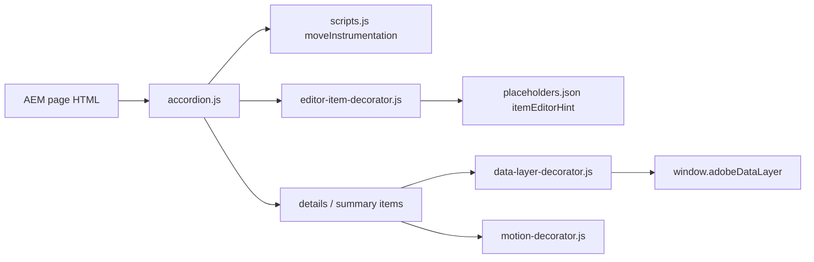

# Accordion

The Accordion shows a list of collapsible items, each with an always-visible summary and a rich text body that opens below it. It is the Block Collection accordion on native `details` / `summary` elements, styled for the TCS site with dividers and a chevron; every item renders closed and items open independently.

| Attribute | Value |
| --------- | ----- |
| Technical name | `accordion` (item: `accordion-item`) |
| Display name | Accordion (item: Accordion Item) |
| Block type | Block with item children (not key-value); one row per Accordion Item |
| Status | Active |
| Parent / children | Parents: Section, Columns Container column, Tabs Container tab (filters `section`, `columns-container`, `tabs`); children: Accordion Item only (filter `accordion`) |
| Owner / version / date | Not recorded / Not recorded / Not recorded |

## Overview

- **Business purpose:** present secondary or reference information (answers, process details, terms) compactly, so visitors scan the summaries and open only what they need while the full text stays in the page HTML.
- **User experience:** a stack of rows between thin dividers; each summary has a chevron on the right that turns when the item opens. Several items can be open at the same time; nothing is open when the page loads.
- **Templates / page types:** any page; the block is offered in every Section, in Columns Container columns and in Tabs Container tabs.
- **Data source:** authored content only (Summary and Text of each item). No sheet, query index, taxonomy or placeholder is read for rendering.
- **Related blocks:** Tabs Container (content compared or switched in place), Text (content that must always be visible), Fragment (to reuse one Accordion on several pages).
- **When to use:** FAQs, eligibility criteria, programme or process details, policy clarifications, long lists of capabilities with explanations.
- **When not to use:** key messages, prices, calls to action or legal notices every visitor must see (collapsed content is easily overlooked); a single item (use a Title and Text); items that need images, videos or nested blocks (the body is a rich text field).
- **Realistic use cases:** a careers FAQ ("How do I apply for a role at TCS?", "Can I apply for more than one position at the same time?"); graduate programme details on a careers page; mobility support explained on an employee page.

## Visual Reference

<!-- BEGIN GENERATED: screenshots (npm run build:docs) -->

Screenshots of the handover (6.20 Accordion Block), taken on the preview with sample content; they show the rendering at the time of the handover revision that added them (later changes are in the sections below and the handover's revision history):

| Screenshot | Shows |
| ---------- | ----- |
| [Desktop rendering](../../docs/handover/screenshots/accordion-desktop-view.jpg) | The Accordion at 1440 px: four items 'How do I apply for a role at TCS?', the selection-process question, 'Can I apply for more than one position at the same time?' and 'Do you offer internships and graduate programmes?' between 1px dividers, chevrons on the right; the second item open with its chevron turned up and its answer about the online assessment and interviews below. |
| [Tablet rendering](../../docs/handover/screenshots/accordion-tablet-view.jpg) | The Accordion at 768 px with the same layout as on desktop but smaller type (summary 1.125rem, body 1rem): the four items 'How do I apply for a role at TCS?', the selection-process question, 'Can I apply for more than one position at the same time?' and 'Do you offer internships and graduate programmes?'; the second, two-line question open with its answer below. |
| [Mobile rendering](../../docs/handover/screenshots/accordion-mobile-view.jpg) | The Accordion at 375 px: the first item 'How do I apply for a role at TCS?' open with its 1rem paragraph and three bullets (create a candidate profile, upload your CV, track the status of your application); the three closed summaries below wrap at 1.125rem with chevrons on the right. |
| [Default Accordion variation](../../docs/handover/screenshots/accordion-default.jpg) | The Accordion at 1440 px with five closed items between 1px dividers, each with a downward chevron: the four careers questions and 'How do you support employees who relocate for an assignment?'; the third summary, under the pointer, in brand blue. |
| [Universal Editor canvas](../../docs/handover/screenshots/accordion-authoring-view.jpg) | The Accordion at 1440 px in Universal Editor Edit mode (annotated preview, not a Universal Editor screenshot) with two items: A on the block, B on the second item, C on the first summary 'How do I apply for a role at TCS?' and D on its open text with the bulleted list. (Annotated preview in editor mode with sample content; letters as in the annotations list, not a Universal Editor screenshot; file screenshots/accordion-authoring-view.jpg) |
| [Properties panel](../../docs/handover/screenshots/accordion-properties-panel.jpg) | The Universal Editor properties panel for the Accordion block (Additional tab with Anchor ID, Hide block and the eight spacing selects) and, side by side, for an Accordion Item (Summary and Text). (Dialog reference generated from the component model, not a Universal Editor screenshot; file screenshots/accordion-properties-panel.jpg) |

Universal Editor dialogs (no screenshot exists yet; to be captured on AEM author):

```text
[Screenshot Placeholder]

File name:
accordion-dialog-additional-desktop.png

Purpose:
The Additional tab of the Accordion properties in Universal Editor, with the fields of the table "Additional tab — Accordion" in Authorable Fields below.

Annotations:
A = Anchor ID
B = Hide block
C = Animation Type
D = Motion Speed
E = Animation Trigger
F = Padding left
G = Padding right
H = Padding top
I = Padding bottom
J = Margin left
```

```text
[Screenshot Placeholder]

File name:
accordion-item-dialog-fields-desktop.png

Purpose:
The dialog of the Accordion Item properties in Universal Editor, with the fields of the table "Fields — Accordion Item" in Authorable Fields below.

Annotations:
A = Summary
B = Text
```

<!-- END GENERATED: screenshots -->

States without a screenshot:

```text
[Screenshot Placeholder]

File name:
accordion-editor-empty-item-desktop.png

Purpose:
Universal Editor edit mode with an Accordion Item just added (no Summary yet): it shows as a dashed placeholder with the itemEditorHint text instead of a row, and can be selected.

Annotations:
A = Accordion block
B = Placeholder of the new Accordion Item
C = Content tree with the Accordion Item selected
```

```text
[Screenshot Placeholder]

File name:
accordion-focus-desktop.png

Purpose:
Keyboard focus on a summary: the 2px brand outline with its 0.125rem offset, the summary text and chevron in the brand colour.

Annotations:
A = Focused summary with the focus outline
B = Chevron in the brand colour
```

```text
[Screenshot Placeholder]

File name:
accordion-dark-section-desktop.png

Purpose:
The Accordion inside a Section with Style Dark: summaries in the light text token, the body text and the dividers, to check contrast (see Known Limitations).

Annotations:
A = Summary text
B = Open body text
C = Divider
```

## For Content Authors

1. **Add the block.** In the content tree select a Section, a Columns Container column or a Tabs Container tab, choose Add (+) and pick **Accordion**.
2. **Open its properties.** Select the Accordion in the content tree; its properties panel has only the **Additional** tab (Anchor ID, Hide block, animation and spacing).
3. **Add the items.** With the Accordion selected, choose Add (+) and pick **Accordion Item**, once per question or entry. A new item has no content and shows as a dashed placeholder until it has a Summary.
4. **Enter content.** Select each Accordion Item and fill **Summary** (the always-visible label, e.g. "How do I apply for a role at TCS?") and **Text** (the answer: paragraphs, lists, links).
5. **Reorder items.** Drag the Accordion Items in the content tree; they render in that order.
6. **Options.** In the Accordion's Additional tab set an Anchor ID (e.g. `anchor-careers-faq`) to link to the FAQ, an Animation Type if the items should appear one after another, or spacing.
7. **Preview.** Switch Universal Editor to Preview, open and close every item, and check the page at mobile, tablet and desktop widths.
8. **Publish** the page (and the fragment page, if the Accordion is on a fragment).
9. **Validate the published output:** on the live page every item is closed on load, opens and closes with mouse and keyboard, and every link in the answers works.

- **Minimum required:** one Accordion Item with a Summary. An item without a Summary is not shown on the page.
- **Recommended:** a Text for every item; a Title (default content) above the Accordion to introduce the topic, because summaries are not headings.
- **Optional:** Anchor ID, Hide block, Animation Type / Motion Speed / Animation Trigger, padding and margin.

## Authorable Fields

<!-- BEGIN GENERATED: fields (npm run build:docs) -->

### Accordion (`accordion`)

Model `accordion`; template name "Accordion" (the block class AEM renders); children: `accordion-item`.

#### Additional tab — Accordion

| Field label | Property | Type | Required | Default | Allowed values | Author guidance | Example |
| ----------- | -------- | ---- | -------- | ------- | -------------- | --------------- | ------- |
| Anchor ID | `classes_anchor` | text | No | — | regExp: ^anchor-[a-z0-9][a-z0-9-]*$; customErrorMsg: Start with anchor-, then lower-case letters, digits and hyphens. | A unique ID of the block on the page, starting with anchor-, e.g. anchor-our-services; link to it with #anchor-our-services. Delivered as a block class. | — |
| Hide block | `classes_hideblock` | boolean | No | `false` | on / off | Hides the whole block on the page until it is turned off (shown faded in the editor). Delivered as a block class. | — |
| Animation Type | `classes_animation` | select | No | "" | None (""), Fade in (`motion-fade-in`), Fade up (`motion-fade-up`), Fade down (`motion-fade-down`), Fade left (`motion-fade-left`), Fade right (`motion-fade-right`), Slide up (`motion-slide-up`), Slide down (`motion-slide-down`), Slide left (`motion-slide-left`), Slide right (`motion-slide-right`), Scale in (`motion-scale-in`) | How the block's content appears; repeated items (cards, list items, accordion items, columns) appear one after another. None: shown as is. Not played in the editor or when the visitor prefers reduced motion. Delivered as a block class. | motion-fade-left |
| Motion Speed | `classes_animationspeed` | select | No | "" | Medium (""), Fast (`motion-fast`), Slow (`motion-slow`) | How fast the animation runs: 0.3, 0.6 or 0.9 seconds. Shown when `classes_animation` is set and `classes_animation` is not empty. Delivered as a block class. | — |
| Animation Trigger | `classes_animationtrigger` | select | No | "" | On Scroll / Viewport Entry (""), On Page Load (`motion-on-load`) | When the block's animations run. On Scroll: when the block comes into view (at once if it is in view when the page opens). On Page Load: as soon as the block is ready, wherever it is on the page. Shown when `classes_animation` is set and `classes_animation` is not empty. Delivered as a block class. | — |
| Padding left | `classes_paddingleft` | select | No | "" | Default (""), 0 (none) (`pl-0`), 0.25rem (space-100) (`pl-100`), 0.5rem (space-200) (`pl-200`), 0.75rem (space-300) (`pl-300`), 1rem (space-400) (`pl-400`), 1.25rem (space-500) (`pl-500`), 1.5rem (space-600) (`pl-600`), 2rem (space-800) (`pl-800`), 2.5rem (space-1000) (`pl-1000`), 3rem (space-1200) (`pl-1200`), 4rem (space-1600) (`pl-1600`), 5rem (space-2000) (`pl-2000`), 6rem (space-2400) (`pl-2400`), 7.5rem (space-3000) (`pl-3000`) | Delivered as a block class. | — |
| Padding right | `classes_paddingright` | select | No | "" | Default (""), 0 (none) (`pr-0`), 0.25rem (space-100) (`pr-100`), 0.5rem (space-200) (`pr-200`), 0.75rem (space-300) (`pr-300`), 1rem (space-400) (`pr-400`), 1.25rem (space-500) (`pr-500`), 1.5rem (space-600) (`pr-600`), 2rem (space-800) (`pr-800`), 2.5rem (space-1000) (`pr-1000`), 3rem (space-1200) (`pr-1200`), 4rem (space-1600) (`pr-1600`), 5rem (space-2000) (`pr-2000`), 6rem (space-2400) (`pr-2400`), 7.5rem (space-3000) (`pr-3000`) | Delivered as a block class. | — |
| Padding top | `classes_paddingtop` | select | No | "" | Default (""), 0 (none) (`pt-0`), 0.25rem (space-100) (`pt-100`), 0.5rem (space-200) (`pt-200`), 0.75rem (space-300) (`pt-300`), 1rem (space-400) (`pt-400`), 1.25rem (space-500) (`pt-500`), 1.5rem (space-600) (`pt-600`), 2rem (space-800) (`pt-800`), 2.5rem (space-1000) (`pt-1000`), 3rem (space-1200) (`pt-1200`), 4rem (space-1600) (`pt-1600`), 5rem (space-2000) (`pt-2000`), 6rem (space-2400) (`pt-2400`), 7.5rem (space-3000) (`pt-3000`) | Delivered as a block class. | — |
| Padding bottom | `classes_paddingbottom` | select | No | "" | Default (""), 0 (none) (`pb-0`), 0.25rem (space-100) (`pb-100`), 0.5rem (space-200) (`pb-200`), 0.75rem (space-300) (`pb-300`), 1rem (space-400) (`pb-400`), 1.25rem (space-500) (`pb-500`), 1.5rem (space-600) (`pb-600`), 2rem (space-800) (`pb-800`), 2.5rem (space-1000) (`pb-1000`), 3rem (space-1200) (`pb-1200`), 4rem (space-1600) (`pb-1600`), 5rem (space-2000) (`pb-2000`), 6rem (space-2400) (`pb-2400`), 7.5rem (space-3000) (`pb-3000`) | Delivered as a block class. | — |
| Margin left | `classes_marginleft` | select | No | "" | Default (""), 0 (none) (`ml-0`), 0.25rem (space-100) (`ml-100`), 0.5rem (space-200) (`ml-200`), 0.75rem (space-300) (`ml-300`), 1rem (space-400) (`ml-400`), 1.25rem (space-500) (`ml-500`), 1.5rem (space-600) (`ml-600`), 2rem (space-800) (`ml-800`), 2.5rem (space-1000) (`ml-1000`), 3rem (space-1200) (`ml-1200`), 4rem (space-1600) (`ml-1600`), 5rem (space-2000) (`ml-2000`), 6rem (space-2400) (`ml-2400`), 7.5rem (space-3000) (`ml-3000`) | Delivered as a block class. | — |
| Margin right | `classes_marginright` | select | No | "" | Default (""), 0 (none) (`mr-0`), 0.25rem (space-100) (`mr-100`), 0.5rem (space-200) (`mr-200`), 0.75rem (space-300) (`mr-300`), 1rem (space-400) (`mr-400`), 1.25rem (space-500) (`mr-500`), 1.5rem (space-600) (`mr-600`), 2rem (space-800) (`mr-800`), 2.5rem (space-1000) (`mr-1000`), 3rem (space-1200) (`mr-1200`), 4rem (space-1600) (`mr-1600`), 5rem (space-2000) (`mr-2000`), 6rem (space-2400) (`mr-2400`), 7.5rem (space-3000) (`mr-3000`) | Delivered as a block class. | — |
| Margin top | `classes_margintop` | select | No | "" | Default (""), 0 (none) (`mt-0`), 0.25rem (space-100) (`mt-100`), 0.5rem (space-200) (`mt-200`), 0.75rem (space-300) (`mt-300`), 1rem (space-400) (`mt-400`), 1.25rem (space-500) (`mt-500`), 1.5rem (space-600) (`mt-600`), 2rem (space-800) (`mt-800`), 2.5rem (space-1000) (`mt-1000`), 3rem (space-1200) (`mt-1200`), 4rem (space-1600) (`mt-1600`), 5rem (space-2000) (`mt-2000`), 6rem (space-2400) (`mt-2400`), 7.5rem (space-3000) (`mt-3000`) | Delivered as a block class. | — |
| Margin bottom | `classes_marginbottom` | select | No | "" | Default (""), 0 (none) (`mb-0`), 0.25rem (space-100) (`mb-100`), 0.5rem (space-200) (`mb-200`), 0.75rem (space-300) (`mb-300`), 1rem (space-400) (`mb-400`), 1.25rem (space-500) (`mb-500`), 1.5rem (space-600) (`mb-600`), 2rem (space-800) (`mb-800`), 2.5rem (space-1000) (`mb-1000`), 3rem (space-1200) (`mb-1200`), 4rem (space-1600) (`mb-1600`), 5rem (space-2000) (`mb-2000`), 6rem (space-2400) (`mb-2400`), 7.5rem (space-3000) (`mb-3000`) | Delivered as a block class. | — |

### Accordion Item (`accordion-item`)

Model `accordion-item`; template name "Accordion Item" (the block class AEM renders).

#### Fields — Accordion Item

| Field label | Property | Type | Required | Default | Allowed values | Author guidance | Example |
| ----------- | -------- | ---- | -------- | ------- | -------------- | --------------- | ------- |
| Summary | `summary` | text | No | "" | — | — | How do I apply for a role at TCS? |
| Text | `text` | richtext | No | "" | — | — | — |

<!-- END GENERATED: fields -->

Notes on the fields (see the tables above for labels, properties and values):

- **Summary:** moved into the item's `summary` element (`summary.accordion-item-label`). It is the accessible name of the disclosure control and the `dc:title` of the item's `cmp:show` / `cmp:hide` data-layer events. An item whose Summary cell has no text (and no image or link) is removed on the page and shown as an editor placeholder in Universal Editor.
- **Text:** becomes `div.accordion-item-body`; an item without Text opens to an empty body. The first and last elements of the body lose their outer margins.
- **No content template values:** new Accordion Items are created empty (the former "Lorem Ipsum" template values were removed, re-audit finding R-C-11).
- **Additional tab:** Anchor ID, Hide block, spacing and the content animation fields behave as described in AGENTS.md "Additional tab" and "Animation and skeletons". For the Accordion the animation targets are the items (`:scope > .accordion-item`), which appear one after another (staggered), from `decorators/motion-decorator.js` `CONTENT_TARGETS`.
- **Legacy mapping:** none; the block reads only the two item cells.

## Screenshot-Based Authoring Steps

### Authoring Step 1: Add the Accordion

```text
[Screenshot Placeholder]

File name:
accordion-authoring-step-1.png

Purpose:
A Section selected in the content tree, the Add (+) menu open with Accordion highlighted.

Annotations:
A = Section in the content tree
B = Add (+) button
C = Accordion in the component list
```

### Values to Enter

| Callout | Field | Value | Reason | Expected result |
| ------- | ----- | ----- | ------ | --------------- |
| A | Section (content tree) | The FAQ section of the careers page | The Accordion is offered in Sections, Columns Container columns and Tabs Container tabs | The section is selected |
| C | Component | Accordion | Adds the block | An empty Accordion appears in the section |

- **Author action:** select the section, choose Add (+), pick Accordion.
- **Expected preview:** an empty block area (no items yet).
- **Expected published result:** nothing visible until items are added.
- **Business rules:** only Accordion Items can be added inside the Accordion.
- **Validation:** the Accordion appears in the content tree under the section.
- **Common mistake:** the Accordion is not in the Add list. Resolution: select a Section, a Columns Container column or a Tabs Container tab, not another block.

### Authoring Step 2: Add Accordion Items

```text
[Screenshot Placeholder]

File name:
accordion-authoring-step-2.png

Purpose:
The Accordion selected, Add (+) open with Accordion Item, and two new items shown as dashed placeholders on the canvas.

Annotations:
A = Accordion in the content tree
B = Accordion Item in the Add list
C = Placeholder of an item without a Summary
```

### Values to Enter

| Callout | Field | Value | Reason | Expected result |
| ------- | ----- | ----- | ------ | --------------- |
| A | Accordion (content tree) | Selected | Items are added to the selected block | The Add list offers Accordion Item |
| B | Component | Accordion Item (four times) | One item per question | Four placeholders appear in the block |

- **Author action:** select the Accordion, choose Add (+) and pick Accordion Item for each question.
- **Expected preview:** each new item is a dashed placeholder with the hint text from placeholder `itemEditorHint`.
- **Expected published result:** items without a Summary are left out of the page.
- **Validation:** the content tree lists the items under the Accordion.
- **Common mistake:** the Summary and Text fields cannot be found. Resolution: select the Accordion Item, not the Accordion.

### Authoring Step 3: Enter Summary and Text

```text
[Screenshot Placeholder]

File name:
accordion-authoring-step-3.png

Purpose:
An Accordion Item selected with its properties panel: Summary and Text filled in; the canvas shows the item as a closed row.

Annotations:
A = Summary field
B = Text field (rich text)
C = The rendered summary row
```

### Values to Enter

| Callout | Field | Value | Reason | Expected result |
| ------- | ----- | ----- | ------ | --------------- |
| A | Summary | How do I apply for a role at TCS? | The visible question | The row shows the question and a chevron |
| B | Text | Search the open roles on our careers pages, choose a role and select Apply. You can save your application and complete it later. Then a bulleted list: Create a candidate profile; Upload your CV; Track the status of your application | The answer shown when the item opens | The body opens below the summary |

- **Author action:** select the item and type both fields; use the rich text toolbar for the list.
- **Expected preview:** a closed row; opening it shows the paragraph and the bullets.
- **Expected published result:** the same row, closed on page load.
- **Business rules:** keep each Summary short and unique; put essential messages outside the Accordion.
- **Validation:** open and close the item in Preview mode.
- **Common mistake:** an item opens to nothing. Resolution: fill its Text.

### Authoring Step 4: Reorder, set options and preview

```text
[Screenshot Placeholder]

File name:
accordion-authoring-step-4.png

Purpose:
An Accordion Item dragged to a new position in the content tree, and the Accordion's Additional tab with Anchor ID anchor-careers-faq and Margin bottom set.

Annotations:
A = Item being dragged in the content tree
B = Anchor ID field
C = Margin bottom select
```

### Values to Enter

| Callout | Field | Value | Reason | Expected result |
| ------- | ----- | ----- | ------ | --------------- |
| A | Item order | Drag "Do you offer internships and graduate programmes?" to the end | Items render in content tree order | The canvas shows the new order |
| B | Anchor ID | anchor-careers-faq | `#anchor-careers-faq` links reach the FAQ | The block gets the id `anchor-careers-faq` |
| C | Margin bottom | 2.5rem (space-1000) | Space below the FAQ | Class `mb-1000` on the block |

- **Author action:** drag items in the content tree; set the Additional tab fields on the Accordion.
- **Expected preview:** items in the new order; the spacing below the block.
- **Expected published result:** the same order and spacing; `#anchor-careers-faq` scrolls to the block.
- **Business rules:** the Anchor ID must start with `anchor-` (validated); a duplicate on the page is suffixed `-2`, `-3`.
- **Validation:** open the preview URL with `#anchor-careers-faq`.
- **Common mistake:** the anchor link does not scroll. Resolution: check the block's id in the browser developer tools and make the Anchor ID unique.

## Variations

### Default Accordion

The Accordion has no style, layout or variant field (its model has only the Additional tab), so there is one presentation. Additional tab options (Anchor ID, Hide block, animation, spacing) are block options, not variations.

| Aspect | Detail |
| ------ | ------ |
| Purpose | Question / answer or label / detail pairs, compact, all closed on load |
| When to use | Several independent items of which visitors read one or a few |
| When not to use | Content every visitor must see; alternative views to compare (Tabs Container) |
| Required fields | One Accordion Item with a Summary |
| Optional fields | Text (recommended), Additional tab |
| Dialog configuration | None besides the Additional tab |
| Rendering | `details.accordion-item` per item with `summary.accordion-item-label` and `div.accordion-item-body`; native marker hidden, chevron drawn by `summary::after` and rotated 180 degrees when open |
| Desktop / tablet / mobile | Same layout at every width; summary and body sizes come from the typography tokens, which switch at 900px |
| Accessibility | Native disclosure semantics and keyboard support; visible focus outline; decorative chevron |
| Data layer | `cmp:show` / `cmp:hide` per toggle, `dc:title` = summary |
| Personalization and fallback | None; the authored items render |

```text
[Screenshot Placeholder]

File name:
accordion-default-tablet.png

Purpose:
The Default Accordion at 768px with one item open, the summary at 1.125rem and the body at 1rem.

Annotations:
A = Closed item with downward chevron
B = Open item with rotated chevron
C = Body text
```

## Complete Authoring Example

Scenario: a careers FAQ on a careers page, below a Title "Frequently asked questions".

| Field | Example value | Guidance |
| ----- | ------------- | -------- |
| Accordion › Anchor ID | anchor-careers-faq | Lets other blocks link to the FAQ |
| Accordion › Margin bottom | 2.5rem (space-1000) | Optional spacing |
| Item 1 › Summary | How do I apply for a role at TCS? | Short, specific question |
| Item 1 › Text | Search the open roles on our careers pages, choose a role and select Apply. … plus three bullets | Paragraph and list |
| Item 2 › Summary | What does the selection process look like, and how long does it usually take from application to offer? | Long summaries wrap; keep them readable on mobile |
| Item 2 › Text | Most roles have an online assessment, a technical interview and a final interview with the hiring team. … | Plain answer |
| Item 3 › Summary | Can I apply for more than one position at the same time? | |
| Item 3 › Text | Yes. You can apply for up to three roles at once; each application is reviewed by the team that is hiring for it. | |
| Item 4 › Summary | Do you offer internships and graduate programmes? | |
| Item 4 › Text | We run paid internships and a two-year graduate programme in most of our regions. … see Graduate careers for the dates. | "Graduate careers" links to the graduates page; descriptive link text |

Steps: add a Title above the block, add the Accordion, add four Accordion Items, fill Summary and Text of each, set the Anchor ID, preview, publish.

- **Expected output:** four closed rows between 1px dividers with chevrons; each opens to its answer; several can be open at once.
- **Responsive:** the same stack at every width; summaries at 1.125rem below 900px and 1.5rem from 900px, bodies at 1rem / 1.125rem.
- **Accessibility:** each summary is a keyboard-operable disclosure named by its text; the Title gives the FAQ a heading.
- **Analytics / data layer:** the block is `component.anchor-careers-faq` (`@type` `tcs-corp/components/accordion`); opening item 1 pushes `cmp:show` with `dc:title` "How do I apply for a role at TCS?"; the "Graduate careers" link pushes `cmp:click`.
- **Personalization fallback:** none; the authored items render for every visitor.
- **Pre-publish checklist:** every item has a Summary and a Text; items in the intended order; Hide block off; Anchor ID unique and starting with `anchor-`; every link in the answers works; keyboard check (Tab, Enter, Space); layout checked at 375px, 768px and 1440px.

## Content and Asset Guidelines

- **Summaries:** short, specific and unique; a question for FAQs; don't start every summary with the same words. Long summaries wrap (the handover recommends up to about 100 characters; not enforced).
- **Body text:** short paragraphs, lists and descriptive links ("Graduate careers", not "click here"). Headings inside a body should follow the page's heading hierarchy.
- **Titles / eyebrows / labels / CTAs:** the block has none of its own; put calls to action outside the Accordion so they are always visible.
- **Images and icons:** the block CSS has no image rules; avoid images in items. The chevron is `icons/chevron-down.svg`, drawn by CSS.
- **Tags and metadata:** none read.
- **Min / max items:** No verified technical limit was identified (the handover recommends 3 to 10 items).
- **Lazy / eager loading and missing assets:** not applicable (no assets).

## Accessibility

- **Semantic HTML:** each item is a native `details` element with a `summary`; screen readers announce it as expandable / collapsed without extra ARIA.
- **Headings:** summaries are not headings and don't appear in the heading outline; introduce the Accordion with a heading above it.
- **Keyboard and focus:** Tab reaches each summary; Enter or Space toggles it (native behaviour). Focus shows a 2px brand outline offset by 0.125rem; hover and focus turn the summary brand-coloured.
- **Accessible names:** the summary text. Items without a summary are removed on the page, so no nameless control is rendered (audit D-C-20, corrected).
- **Decorative elements:** the chevron is a CSS mask on a pseudo-element and is not announced.
- **Reduced motion:** the colour and chevron transitions are disabled with `prefers-reduced-motion: reduce`; the content animation doesn't play for reduced motion (AGENTS.md "Animation and skeletons").
- **Contrast:** colours come from tokens (`--color-text-default`, `--color-text-brand`, `--color-text-neutral-secondary`, `--color-border-default`); see Known Limitations for dark sections.
- **Error / loading / empty states:** none; the content is in the page HTML.
- **Reflow:** single column at every width; long summaries wrap.

Author responsibilities:

- Write summaries that make sense out of context; add a heading above the Accordion.
- Use descriptive link text in the answers; don't hide essential information in a closed item.

Developer responsibilities:

- Keep the native `details` / `summary` structure (it provides the semantics and keyboard support).
- Keep the focus style and the reduced-motion rules; use tokens for colours.

| Key | Expected behavior |
| --- | ----------------- |
| Tab / Shift+Tab | Moves to the next / previous summary (and to links inside open bodies) |
| Enter | Opens or closes the focused item |
| Space | Opens or closes the focused item |

## Data Layer and Analytics

- **Component:** registered by `decorators/data-layer-decorator.js` (`trackBlocks`) after the sections load: id = the block's id (Anchor ID), else `accordion-{n}` in page order; `@type` `tcs-corp/components/accordion`; `parentId` the page (or the containing block); `dc:title` only if the block contains a heading (normally none).
- **Variation:** none.
- **Item positions:** not recorded (the items have no `data-cmp-position`; the summary text identifies the item).
- **Impressions:** no impression event; only the component state above.
- **Interactions:** the `toggle` event of each `details` is captured centrally; summary clicks are excluded from `cmp:click`, so a toggle is counted once.

| Trigger | Data-layer event | Required properties | Analytics behavior |
| ------- | ---------------- | ------------------- | ------------------ |
| Block decorated (page load) | component state | `component.{id}`: `@type`, `parentId` | Inventory of the blocks on the page |
| Item opened | `cmp:show` | `eventInfo.path` `component.{id}`, `dc:title` = summary text | Which questions visitors open |
| Item closed | `cmp:hide` | `eventInfo.path` `component.{id}`, `dc:title` = summary text | Closing interactions |
| Link in an answer clicked | `cmp:click` | `interaction` `link`, `dc:title`, `xdm:linkURL`, `xdm:linkType` (`other`, `exit` or `download`), `breakpoint` | Link tracking within the answers |

No event is pushed when the block is inside an element with `data-analytics="off"`. The intended flow is Adobe Client Data Layer → Adobe Data Collection (Tags) → AEP Web SDK → Edge Network → Analytics / CJA, but Tags and the Web SDK aren't configured yet (blocked: measurement plan), so the events are only in `window.adobeDataLayer`. No consent mechanism is implemented.

## Personalization

This block does not currently expose verified personalization behavior. There is no Adobe Target or Adobe Journey Optimizer integration in the repository; the authored items are what renders for every visitor.

## Responsive Behavior

The block CSS has no media queries; the sizes come from tokens in `styles/styles.css` that change at 900px.

| Viewport | Layout | Image behavior | Interaction behavior |
| -------- | ------ | -------------- | -------------------- |
| Below 900px (mobile, tablet portrait) | Full-width rows; summary 1.125rem (`--heading-font-size-m`), body 1rem (`--body-font-size-m`); long summaries wrap | No images | Tap or keyboard toggles an item |
| 900px and wider | Same rows; summary 1.5rem, body 1.125rem | No images | Hover and focus colour the summary brand blue |

## For Developers

<!-- BEGIN GENERATED: files (npm run build:docs) -->

```text
blocks/accordion/
├── README.md
├── _accordion.json
├── accordion.css
└── accordion.js
```

| Decorator/Utility | Purpose | Execution or dependency point |
| ----------------- | ------- | ----------------------------- |
| [`scripts/scripts.js`](../../scripts/scripts.js) | Page decoration (moveInstrumentation and shared page helpers) | `accordion.js`: { moveInstrumentation } |
| [`decorators/editor-item-decorator.js`](../../decorators/editor-item-decorator.js) | `buildEditorItems`, `editorItemHint` (in Universal Editor, an item the block doesn't render yet, e.g. a CTA just added, as a dashed placeholder the author can select; styles in `styles/lazy-styles.css`; the hint loaded o | `accordion.js`: { buildEditorItems, editorItemHint } |

<!-- END GENERATED: files -->

- **JavaScript (`accordion.js`):** `decorate(block)` turns each item row into `details.accordion-item` > `summary.accordion-item-label` + `div.accordion-item-body`, moving the cells' child nodes and the editor instrumentation (`moveInstrumentation` on the row and on the summary cell).
- **CSS (`accordion.css`):** dividers, chevron (`mask: url('../../icons/chevron-down.svg')`), typography tokens, hover / focus states, reduced-motion rules. All selectors are scoped to `.accordion`.
- **Input DOM (what AEM delivers):** the block isn't key-value, so it starts with an **empty row for its Additional dialog tab**, then one row per Accordion Item with two cells (Summary, Text). In Universal Editor item rows carry `data-aue-resource` / `data-aue-model="accordion-item"`.

```html
<div class="accordion anchor-careers-faq">
  <div><div></div></div>
  <div><div>How do I apply for a role at TCS?</div><div><p>Search the open roles …</p></div></div>
</div>
```

- **Rendered DOM:**

```html
<div class="accordion anchor-careers-faq block" id="anchor-careers-faq">
  <details class="accordion-item">
    <summary class="accordion-item-label">How do I apply for a role at TCS?</summary>
    <div class="accordion-item-body"><p>Search the open roles …</p></div>
  </details>
</div>
```

- **Decoration flow:** rows whose first cell is empty (no text and no `img`, `picture` or `a`) are "unnamed": the tab row and items without a Summary. In Universal Editor (rows with `data-aue-resource`) they are replaced by `buildEditorItems` placeholders with the `itemEditorHint` text (loaded only then, `editorItemHint`); otherwise they are removed. The remaining rows become `details`; a row without a second cell gets an empty body.
- **Events and async behavior:** no listeners of its own; toggling is native. `decorate` awaits `editorItemHint`, which only fetches placeholders in the editor.
- **Error handling:** none needed; if the script fails, the rows stay as plain text (aem.js logs the failure).
- **Exported functions:** the default `decorate` only.
- **Parent / child contracts:** filter `accordion` allows only `accordion-item`; `decorators/motion-decorator.js` animates `:scope > .accordion-item` (staggered), so keep that class on the item elements.
- **Data-layer hooks:** none in the block; `decorators/data-layer-decorator.js` captures the `toggle` of any `details` inside a block.

## Extending the Block

1. **Add a field or option:** edit `blocks/accordion/_accordion.json` (keep the Additional tab last, at most three short tabs), then run `npm run build:json` and `npm run lint`.
2. **Map it to rendering:** a block option should be a `classes_*` field (delivered as a block class, never shifts rows). A new item field adds a cell to every item row: read cells by position from the start and keep the Summary as the first cell, because the decoration treats an empty first cell as "no item".
3. **Delivery rules:** a new dialog tab on the block model adds another empty row (already skipped as unnamed); a tab on the item model adds an empty cell to each item row (use `withoutTabCells` from `utils/cells.js`); field names ending in Text, Title, Type, Alt or MimeType collapse into their base field; don't put sample content in the definition template.
4. **Responsive and accessibility:** keep `details` / `summary`; any "open by default" or "one open at a time" option needs the `open` attribute managed in JS and must keep keyboard behaviour.
5. **Data layer:** opening / closing is already tracked; add `data-cmp-*` attributes only if a new control needs its own interaction name.
6. **Tests and library:** add unit tests for any pure logic under `test/`; add the variation to the block library page `block-library/accordion/accordion`; update this README (`npm run build:docs` regenerates the generated sections); run `npm run build:modules` after changing imports.
7. **Backward compatibility:** existing items have two cells (Summary, Text); keep reading them in that order.

## For Site Administrators

- **Availability:** offered in Sections (`section` filter), Columns Container columns (`columns-container`) and Tabs Container tabs (`tabs`); only Accordion Items inside.
- **Model governance:** definitions, models and the filter live in `blocks/accordion/_accordion.json` and are aggregated into `component-definition.json`, `component-models.json` and `component-filters.json` by `npm run build:json`.
- **Publishing dependencies:** the page (and the fragment page, if the Accordion is in a fragment). Universal Editor only: the placeholder `itemEditorHint`.
- **Localization:** translate summaries and answers per locale site; keep the same Anchor ID across locales for comparable links and analytics.

| Dependency | Purpose | Location | Impact if unavailable |
| ---------- | ------- | -------- | --------------------- |
| Block code | Decoration and styles | `blocks/accordion/` | Items render as plain rows |
| Chevron icon | Open / close indicator | `icons/chevron-down.svg` | No chevron |
| Placeholders sheet (`itemEditorHint`) | Hint text of empty items in Universal Editor | `/{locale}/placeholders.json` | English fallback text |
| Data layer decorator | `cmp:show` / `cmp:hide` | `decorators/data-layer-decorator.js` | No accordion events |
| Spacing / Hide block styles | Additional tab | `styles/styles.css`, `decorators/block-options-decorator.js` | Options have no effect |

## For Architects

- **Role:** a presentational disclosure block with authored content; no data source.
- **Content model:** a container block (`core/franklin/components/block/v1/block`) with item children (`.../block/item`, model `accordion-item`: Summary text, Text rich text); block model with the Additional tab only.
- **Rendering:** client-side decoration of server-delivered HTML; content is in the page HTML (indexable even when closed).
- **Dependencies:** `scripts/scripts.js` (`moveInstrumentation`), `decorators/editor-item-decorator.js`; centrally `decorators/data-layer-decorator.js`, `decorators/motion-decorator.js`, `decorators/block-options-decorator.js`.
- **Data layer / Web SDK / Target:** events in the Adobe Client Data Layer; Tags / Web SDK not configured; no Target.
- **Consent and identity:** none implemented; the events carry no personal data (summary text only).
- **Caching / performance:** delivered with the page through the Edge Delivery CDN; no requests of its own (outside the editor).
- **Security:** no external content; authored nodes are moved, not parsed from strings.
- **Scalability:** DOM size grows linearly with items; no limit in code.



## For QA and Support Teams

| Test ID | Scenario | Configuration | Expected result |
| ------- | -------- | ------------- | --------------- |
| ACCORDION-QA-01 | Default rendering | Four items with Summary and Text | Four closed rows with chevrons between dividers; no row for the dialog tab |
| ACCORDION-QA-02 | Open / close | Click a summary twice | Opens (chevron up), then closes; other items unchanged |
| ACCORDION-QA-03 | Several open | Open items 1 and 3 | Both stay open |
| ACCORDION-QA-04 | Missing Summary | One item without Summary | Item absent on the page; dashed placeholder in Universal Editor |
| ACCORDION-QA-05 | Missing Text | One item without Text | Item renders; opens to an empty body |
| ACCORDION-QA-06 | Anchor ID | `anchor-careers-faq` | Block has `id="anchor-careers-faq"`; `#anchor-careers-faq` scrolls to it |
| ACCORDION-QA-07 | Hide block | Hide block on | Hidden on the page; faded and outlined in edit mode |
| ACCORDION-QA-08 | Animation | Animation Type Fade left | Items appear one after another on scroll; nothing plays in edit mode or with reduced motion |
| ACCORDION-QA-09 | Multiple instances | Two Accordions on one page | Independent; data-layer ids `accordion-1`, `accordion-2` (without Anchor IDs) |
| ACCORDION-QA-10 | Viewports | 375px, 768px, 1440px | Same layout; summary 1.125rem below 900px, 1.5rem from 900px |
| ACCORDION-QA-11 | Keyboard | Tab, Enter, Space | Focus outline visible; Enter and Space toggle |
| ACCORDION-QA-12 | Data layer | Open, then close item 1 | `cmp:show` then `cmp:hide` with `dc:title` = summary; no `cmp:click` for the summary |
| ACCORDION-QA-13 | Link in an answer | Click a link in an open body | `cmp:click` with `xdm:linkURL` |
| ACCORDION-QA-14 | Regression | Existing library page `block-library/accordion/accordion` | All items render; no empty item from the tab row |
| ACCORDION-QA-15 | Reduced motion | OS reduced motion on | No colour or chevron transition |

## Troubleshooting

| Symptom | Likely cause | Diagnostic steps | Resolution | Verification |
| ------- | ------------ | ---------------- | ---------- | ------------ |
| Items show as plain text, no chevrons | Block script failed or wrong block | Developer tools: items should be `details.accordion-item`; console for `failed to load` messages; Network for `accordion.js` | Reload; escalate to development if the files fail | Items open and close |
| An item is missing on the page | Its Summary is empty | Check the item in the content tree; in the editor it is a dashed placeholder | Fill the Summary | The item renders |
| An item opens to nothing | Text empty | Select the item, check Text | Enter the answer or delete the item | The body shows |
| Block missing on the live page | Hide block on, or page / fragment not published | Additional tab; publication status | Turn Hide block off; publish page and fragment | Block visible on aem.live |
| `#anchor-…` link does not reach the block | Anchor ID differs or was suffixed `-2` | Inspect the block's `id` | Correct or de-duplicate the Anchor ID | The link scrolls to the block |
| No `cmp:show` events | Inside `data-analytics="off"`, or Tags not reading them | Open an item, run `window.adobeDataLayer.slice(-3)` in the console | If present, configure Tags (not yet set up); else escalate | `cmp:show` appears |

Evidence to collect (no secrets): page URL, browser and viewport, a screenshot, the block's rendered HTML from the developer tools, console errors, and the last data-layer entries.

## Performance Considerations

- Loaded with its section (eager in the first section, else lazy), like any block; no dynamic imports.
- No network requests on the page; in Universal Editor the placeholders are fetched only when an empty item exists.
- No images; no listeners or observers of its own (the toggle is native; the data layer listens once on the document).
- DOM size grows with the number of items; closed bodies stay in the DOM.
- Layout shift: none from the block; opening an item pushes the content below down by design.

## Security and Privacy

- Content is authored HTML moved from the delivered cells (no `innerHTML` from strings).
- Links in answers are authored links; the block doesn't validate or rewrite them.
- No external content, no query strings read, no data stored; data-layer events contain only the summary text.

## Known Limitations

| Limitation | Impact | Workaround | Planned correction |
| ---------- | ------ | ---------- | ------------------ |
| No "open by default", "one open at a time" or expand / collapse all option | All items start closed and open independently | Put essential content outside the Accordion | Not recorded |
| No FAQ structured data (JSON-LD) | No FAQ rich results | None | Not recorded |
| Summaries are not headings; no heading level option | Not in the heading outline | Add a Title above the block | Not recorded |
| Bodies are rich text only; no nested blocks or image styling | No media in items | Use other blocks outside the Accordion | Not recorded |
| The body text token (`--color-text-neutral-secondary`) and the divider token are not redefined by the dark-background theme contract in `styles/styles.css` | Body text contrast on Dark / Dark green sections may be insufficient | Check on `block-library/foundations/section-colours-with-blocks` before using it on dark sections | Not recorded |

## Related Documentation

- [Blocks documentation](../README.md)
- [Columns Container README](../columns-container/README.md) (a parent)
- Model file: [`_accordion.json`](_accordion.json)
- Animation: [docs/animation/README.md](../../docs/animation/README.md); shared modules: [decorators/README.md](../../decorators/README.md), [utils/README.md](../../utils/README.md)
- Tests: [test/motion/motion.test.mjs](../../test/motion/motion.test.mjs) (Additional tab animation fields of every block model)
- Handover: [handover 6.20 Accordion Block](../../docs/handover/TCS-CORP-HANDOVER.md)
- Block audit: [docs/audit/BLOCK-ECOSYSTEM-AUDIT.md](../../docs/audit/BLOCK-ECOSYSTEM-AUDIT.md)

<!-- BEGIN GENERATED: usage (npm run build:docs) -->

Pages of the block library package 1.0.13 (language master, `/content/tcs-corp/language-master/en`) that contain the block, 8 instance(s) in total:
- Block library: `block-library/accordion/accordion`, `block-library/animation/repeated-items`, `block-library/columns-container/columns-of-blocks`, `block-library/foundations/section-colours-with-blocks`

<!-- END GENERATED: usage -->

## Change History

| Version | Change | Source | Date |
| ------- | ------ | ------ | ---- |
| Not recorded | README generated from verified implementation and approved handover documentation | Repository review | Not recorded |
| Handover 2.18 | Additional tab Content animation (19 blocks, repeated items staggered), including the Accordion | docs/handover revision history | 18 October 2026 |
| Handover 2.27 | Block ecosystem audit: the Accordion no longer renders an empty item from the dialog tab row | docs/handover revision history | 19 October 2026 |
| Handover 2.31 | Re-audit fixes checked on the live pages, including the Accordion items | docs/handover revision history | 20 October 2026 |
