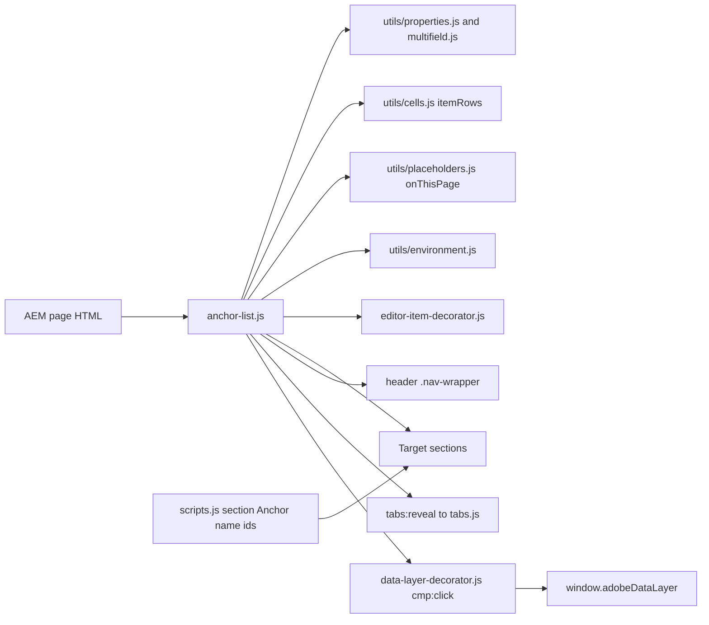

# Anchor List

The Anchor List is an in-page chapter navigation (TCS DS Figma "Chapter Nav"): a horizontal row of links, each scrolling to the section whose Anchor name matches (or to any element with that id). The link of the chapter in view is marked as the current location, and with Sticky the row stays pinned to the top of the screen for the rest of the page.

| Attribute | Value |
| --------- | ----- |
| Technical name | `anchor-list` (item: `anchor-list-item`) |
| Display name | Anchor List (item: Anchor Link) |
| Block type | Key-value block (one row per property) with item children |
| Status | Active |
| Parent / children | Parents: Section, Columns Container column, Tabs Container tab (filters `section`, `columns-container`, `tabs`); children: Anchor Link only (filter `anchor-list`) |
| Owner / version / date | Not recorded / Not recorded / Not recorded |

## Overview

- **Business purpose:** help visitors navigate long pages (reports, solution pages, case studies): show the chapters, jump to one, and always show where they are.
- **User experience:** a centred row of grey links; the current chapter is dark, semibold and underlined in brand blue. A click scrolls smoothly to the chapter (instantly with reduced motion) and moves keyboard focus there. On narrow screens the row scrolls sideways and keeps the current link in view.
- **Templates / page types:** any page; most useful on long article, report and landing pages (used on the curated case study and story pages).
- **Data source:** authored links only; targets are ids on the same page (section Anchor names, block Anchor IDs, heading ids). The navigation's accessible name comes from the placeholder `onThisPage`.
- **Related blocks:** Sections (their Anchor name), every block's Anchor ID (Additional tab), Tabs Container (a target inside a tab opens its tab), Page Header (usually directly above).
- **When to use:** pages with three or more substantial sections; when readers benefit from seeing their position.
- **When not to use:** navigation between pages (every link is `#anchor`); switching content in place (Tabs Container); short pages with one or two sections; many links (they don't wrap and scroll sideways without a visible scrollbar).
- **Realistic use cases:** the "Global technology outlook 2026" report with "CH 1: Overview" to "CH 4: Next steps", pinned while reading; a service page with Overview, Capabilities, Case studies, Contact.

## Visual Reference

<!-- BEGIN GENERATED: screenshots (npm run build:docs) -->

Screenshots of the handover (6.19 Anchor List Block), taken on the preview with sample content; they show the rendering at the time of the handover revision that added them (later changes are in the sections below and the handover's revision history):

| Screenshot | Shows |
| ---------- | ----- |
| [Desktop rendering](../../docs/handover/screenshots/anchor-list-desktop-view.jpg) | The Anchor List at 1440 px below the page title 'Global technology outlook 2026' and its intro: a centred row of four grey links 'CH 1: Overview', 'CH 2: Findings', 'CH 3: Outlook', 'CH 4: Next steps'; 'CH 2: Findings' (page at #findings) dark, semibold, with a 3px brand-blue underline. |
| [Tablet rendering](../../docs/handover/screenshots/anchor-list-tablet-view.jpg) | The viewport at 768 px scrolled into chapter 2 (Key findings): the sticky Anchor List pinned directly below the fixed site header, the four links with 'CH 2: Findings' underlined, the Key findings text below it. |
| [Mobile rendering](../../docs/handover/screenshots/anchor-list-mobile-view.jpg) | The Anchor List at 375 px with the page at #outlook: the four chapter links in one line wider than the screen, scrolled sideways without a visible scrollbar so that 'CH 3: Outlook', underlined in brand blue, is in view. |
| [Default Anchor List](../../docs/handover/screenshots/anchor-list-default.jpg) | The first section at 1440 px: the H1 'Global technology outlook 2026', the intro 'How business and technology leaders plan to grow, modernise and compete in the years ahead.' and below them the in-flow row of four chapter links, 'CH 1: Overview' underlined as current (Sticky off). |
| [Sticky Anchor List](../../docs/handover/screenshots/anchor-list-sticky.jpg) | The viewport at 1440 px scrolled into chapter 3 (Outlook): the sticky Anchor List pinned at the top of the screen across the full width on a white background, 'CH 3: Outlook' underlined, the Outlook text below it. |
| [Universal Editor canvas](../../docs/handover/screenshots/anchor-list-authoring-view.jpg) | The page at 1440 px in Universal Editor Edit mode (annotated preview, not a Universal Editor screenshot): the H1, the intro and the four-link Anchor List, with A on 'CH 4: Next steps', B on the current link, C on 'CH 2: Findings', D on the block and E on the Overview section below. (Annotated preview in editor mode with sample content; letters as in the annotations list, not a Universal Editor screenshot; file screenshots/anchor-list-authoring-view.jpg) |
| [Properties panel](../../docs/handover/screenshots/anchor-list-properties-panel.jpg) | The Anchor List properties panel: the Content tab with the Links multifield (two items with Link Title and Anchor Name) and the Sticky toggle, and the Additional tab. (Dialog reference generated from the component model, not a Universal Editor screenshot; file screenshots/anchor-list-properties-panel.jpg) |

Universal Editor dialogs (no screenshot exists yet; to be captured on AEM author):

```text
[Screenshot Placeholder]

File name:
anchor-list-dialog-content-desktop.png

Purpose:
The Content tab of the Anchor List properties in Universal Editor, with the fields of the table "Content tab — Anchor List" in Authorable Fields below.

Annotations:
A = Links
B = Links › Link Title
C = Links › Anchor Name
D = Sticky
```

```text
[Screenshot Placeholder]

File name:
anchor-list-dialog-additional-desktop.png

Purpose:
The Additional tab of the Anchor List properties in Universal Editor, with the fields of the table "Additional tab — Anchor List" in Authorable Fields below.

Annotations:
A = Anchor ID
B = Hide block
C = Padding left
D = Padding right
E = Padding top
F = Padding bottom
G = Margin left
H = Margin right
I = Margin top
J = Margin bottom
```

```text
[Screenshot Placeholder]

File name:
anchor-list-item-dialog-link-desktop.png

Purpose:
The Link tab of the Anchor Link properties in Universal Editor, with the fields of the table "Link tab — Anchor Link" in Authorable Fields below.

Annotations:
A = Link Title
B = Anchor Name
```

<!-- END GENERATED: screenshots -->

States without a screenshot:

```text
[Screenshot Placeholder]

File name:
anchor-list-editor-item-desktop.png

Purpose:
Universal Editor edit mode: an Anchor Link just added (no Link Title yet) shown as a dashed placeholder at the end of the row; Sticky has no effect in edit mode.

Annotations:
A = Rendered chapter links
B = Placeholder of the new Anchor Link
C = Anchor Link selected in the content tree
```

```text
[Screenshot Placeholder]

File name:
anchor-list-focus-desktop.png

Purpose:
Keyboard focus on a chapter link: the 2px brand outline inset by 3px; after Enter, focus on the target section.

Annotations:
A = Focused link with the focus outline
B = Current link (aria-current)
```

```text
[Screenshot Placeholder]

File name:
anchor-list-sticky-mobile.png

Purpose:
The sticky Anchor List at 375px pinned directly below the fixed site header, the row scrolled sideways to the current chapter.

Annotations:
A = Fixed site header
B = Pinned Anchor List
C = Current link scrolled into view
```

## For Content Authors

1. **Prepare the targets.** For each chapter section, open its Section properties and enter an **Anchor name** (e.g. `overview`, `findings`, `outlook`, `next-steps`: lower case, no spaces). A block's Anchor ID (`anchor-…`) or a heading id also works as a target.
2. **Add the block.** Select the section above the first chapter (a Section, a Columns Container column or a Tabs Container tab), choose Add (+) and pick **Anchor List**.
3. **Open its properties.** The Content tab has **Sticky**, and the **Links** multifield kept for lists authored before; the Additional tab has Anchor ID, Hide block and spacing.
4. **Add the links.** With the Anchor List selected, choose Add (+) and pick **Anchor Link** once per chapter. In each, enter **Link Title** (required, e.g. "CH 1: Overview") and **Anchor Name** (the section's Anchor name, e.g. `overview`).
5. **Reorder links** by dragging the Anchor Links in the content tree; keep them in page order so the highlight follows the reading position.
6. **Choose the variation:** turn **Sticky** on to pin the row while scrolling (long pages); leave it off for an in-place index.
7. **Preview.** Switch to Preview mode (Sticky doesn't pin in edit mode), click every link, scroll the page and check the current-link highlight.
8. **Publish** the page; the links and the section Anchor names are part of the same page.
9. **Validate the published output:** open the live URL with a hash (e.g. `#outlook`): its link is current; each link scrolls to its chapter with the heading visible below the header (and the pinned list).

- **Minimum required:** one Anchor Link with a Link Title, and a matching id on the page (else the link only marks itself current).
- **Recommended:** an Anchor Name for every link; 3 to 7 short links (handover guidance); Sticky on for long pages.
- **Optional:** Anchor ID, Hide block, padding and margin (keep the margins at Default on a sticky list).

## Authorable Fields

<!-- BEGIN GENERATED: fields (npm run build:docs) -->

### Anchor List (`anchor-list`)

Model `anchor-list`; template name "Anchor List" (the block class AEM renders); key-value block (one row per property); children: `anchor-list-item`.

#### Content tab — Anchor List

| Field label | Property | Type | Required | Default | Allowed values | Author guidance | Example |
| ----------- | -------- | ---- | -------- | ------- | -------------- | --------------- | ------- |
| Links | `anchors` | container (multiple) | No | — | — | Links authored before Anchor Link items. Add links to the list with Add (Anchor Link) instead. | — |
| Links › Link Title | `label` | text | No | — | — | e.g. CH 1: Overview | — |
| Links › Anchor Name | `anchorName` | text | No | — | — | The Anchor name of the target section (Section properties), e.g. overview. Heading ids work too. | — |
| Sticky | `sticky` | boolean | No | `false` | on / off | Keep the links at the top of the screen while scrolling. | true |

#### Additional tab — Anchor List

| Field label | Property | Type | Required | Default | Allowed values | Author guidance | Example |
| ----------- | -------- | ---- | -------- | ------- | -------------- | --------------- | ------- |
| Anchor ID | `classes_anchor` | text | No | — | regExp: ^anchor-[a-z0-9][a-z0-9-]*$; customErrorMsg: Start with anchor-, then lower-case letters, digits and hyphens. | A unique ID of the block on the page, starting with anchor-, e.g. anchor-our-services; link to it with #anchor-our-services. Delivered as a block class. | — |
| Hide block | `classes_hideblock` | boolean | No | `false` | on / off | Hides the whole block on the page until it is turned off (shown faded in the editor). Delivered as a block class. | — |
| Padding left | `classes_paddingleft` | select | No | "" | Default (""), 0 (none) (`pl-0`), 0.25rem (space-100) (`pl-100`), 0.5rem (space-200) (`pl-200`), 0.75rem (space-300) (`pl-300`), 1rem (space-400) (`pl-400`), 1.25rem (space-500) (`pl-500`), 1.5rem (space-600) (`pl-600`), 2rem (space-800) (`pl-800`), 2.5rem (space-1000) (`pl-1000`), 3rem (space-1200) (`pl-1200`), 4rem (space-1600) (`pl-1600`), 5rem (space-2000) (`pl-2000`), 6rem (space-2400) (`pl-2400`), 7.5rem (space-3000) (`pl-3000`) | Delivered as a block class. | — |
| Padding right | `classes_paddingright` | select | No | "" | Default (""), 0 (none) (`pr-0`), 0.25rem (space-100) (`pr-100`), 0.5rem (space-200) (`pr-200`), 0.75rem (space-300) (`pr-300`), 1rem (space-400) (`pr-400`), 1.25rem (space-500) (`pr-500`), 1.5rem (space-600) (`pr-600`), 2rem (space-800) (`pr-800`), 2.5rem (space-1000) (`pr-1000`), 3rem (space-1200) (`pr-1200`), 4rem (space-1600) (`pr-1600`), 5rem (space-2000) (`pr-2000`), 6rem (space-2400) (`pr-2400`), 7.5rem (space-3000) (`pr-3000`) | Delivered as a block class. | — |
| Padding top | `classes_paddingtop` | select | No | "" | Default (""), 0 (none) (`pt-0`), 0.25rem (space-100) (`pt-100`), 0.5rem (space-200) (`pt-200`), 0.75rem (space-300) (`pt-300`), 1rem (space-400) (`pt-400`), 1.25rem (space-500) (`pt-500`), 1.5rem (space-600) (`pt-600`), 2rem (space-800) (`pt-800`), 2.5rem (space-1000) (`pt-1000`), 3rem (space-1200) (`pt-1200`), 4rem (space-1600) (`pt-1600`), 5rem (space-2000) (`pt-2000`), 6rem (space-2400) (`pt-2400`), 7.5rem (space-3000) (`pt-3000`) | Delivered as a block class. | — |
| Padding bottom | `classes_paddingbottom` | select | No | "" | Default (""), 0 (none) (`pb-0`), 0.25rem (space-100) (`pb-100`), 0.5rem (space-200) (`pb-200`), 0.75rem (space-300) (`pb-300`), 1rem (space-400) (`pb-400`), 1.25rem (space-500) (`pb-500`), 1.5rem (space-600) (`pb-600`), 2rem (space-800) (`pb-800`), 2.5rem (space-1000) (`pb-1000`), 3rem (space-1200) (`pb-1200`), 4rem (space-1600) (`pb-1600`), 5rem (space-2000) (`pb-2000`), 6rem (space-2400) (`pb-2400`), 7.5rem (space-3000) (`pb-3000`) | Delivered as a block class. | — |
| Margin left | `classes_marginleft` | select | No | "" | Default (""), 0 (none) (`ml-0`), 0.25rem (space-100) (`ml-100`), 0.5rem (space-200) (`ml-200`), 0.75rem (space-300) (`ml-300`), 1rem (space-400) (`ml-400`), 1.25rem (space-500) (`ml-500`), 1.5rem (space-600) (`ml-600`), 2rem (space-800) (`ml-800`), 2.5rem (space-1000) (`ml-1000`), 3rem (space-1200) (`ml-1200`), 4rem (space-1600) (`ml-1600`), 5rem (space-2000) (`ml-2000`), 6rem (space-2400) (`ml-2400`), 7.5rem (space-3000) (`ml-3000`) | Delivered as a block class. | — |
| Margin right | `classes_marginright` | select | No | "" | Default (""), 0 (none) (`mr-0`), 0.25rem (space-100) (`mr-100`), 0.5rem (space-200) (`mr-200`), 0.75rem (space-300) (`mr-300`), 1rem (space-400) (`mr-400`), 1.25rem (space-500) (`mr-500`), 1.5rem (space-600) (`mr-600`), 2rem (space-800) (`mr-800`), 2.5rem (space-1000) (`mr-1000`), 3rem (space-1200) (`mr-1200`), 4rem (space-1600) (`mr-1600`), 5rem (space-2000) (`mr-2000`), 6rem (space-2400) (`mr-2400`), 7.5rem (space-3000) (`mr-3000`) | Delivered as a block class. | — |
| Margin top | `classes_margintop` | select | No | "" | Default (""), 0 (none) (`mt-0`), 0.25rem (space-100) (`mt-100`), 0.5rem (space-200) (`mt-200`), 0.75rem (space-300) (`mt-300`), 1rem (space-400) (`mt-400`), 1.25rem (space-500) (`mt-500`), 1.5rem (space-600) (`mt-600`), 2rem (space-800) (`mt-800`), 2.5rem (space-1000) (`mt-1000`), 3rem (space-1200) (`mt-1200`), 4rem (space-1600) (`mt-1600`), 5rem (space-2000) (`mt-2000`), 6rem (space-2400) (`mt-2400`), 7.5rem (space-3000) (`mt-3000`) | Delivered as a block class. | — |
| Margin bottom | `classes_marginbottom` | select | No | "" | Default (""), 0 (none) (`mb-0`), 0.25rem (space-100) (`mb-100`), 0.5rem (space-200) (`mb-200`), 0.75rem (space-300) (`mb-300`), 1rem (space-400) (`mb-400`), 1.25rem (space-500) (`mb-500`), 1.5rem (space-600) (`mb-600`), 2rem (space-800) (`mb-800`), 2.5rem (space-1000) (`mb-1000`), 3rem (space-1200) (`mb-1200`), 4rem (space-1600) (`mb-1600`), 5rem (space-2000) (`mb-2000`), 6rem (space-2400) (`mb-2400`), 7.5rem (space-3000) (`mb-3000`) | Delivered as a block class. | — |

### Anchor Link (`anchor-list-item`)

Model `anchor-list-item`; template name "Anchor Link" (the block class AEM renders).

#### Link tab — Anchor Link

| Field label | Property | Type | Required | Default | Allowed values | Author guidance | Example |
| ----------- | -------- | ---- | -------- | ------- | -------------- | --------------- | ------- |
| Link Title | `label` | text | Yes | — | — | e.g. CH 1: Overview | — |
| Anchor Name | `anchorName` | text | No | — | — | The Anchor name of the target section (Section properties), e.g. overview. Heading ids work too. | — |

<!-- END GENERATED: fields -->

Notes on the fields (see the tables above):

- **Link Title** becomes the link text. In an Anchor Link it is required: an Anchor Link without a title is not rendered on the page (in Universal Editor it shows as a dashed placeholder with the `itemEditorHint` text).
- **Anchor Name** becomes the link's `href="#…"`, normalized with `toClassName` after removing a leading `#` (e.g. "Our Findings" becomes `our-findings`), the same way `scripts/scripts.js` turns a section's Anchor name into its id. When it is empty, the normalized Link Title is used (e.g. "CH 1: Overview" becomes `ch-1-overview`).
- **Sticky** adds the `sticky` class and enables pinning (see Variations). It is on only for the value `true`.
- **Legacy mapping:** the **Links** multifield (`anchors`: Link Title, Anchor Name) is still read and its links render first, before the Anchor Links. In a multifield item the non-empty values are read in order, so an item with only one value uses it as both the text and (normalized) the anchor. New content should use Anchor Link items (composite multifields don't render from content packages, AGENTS.md "Item children").
- **Additional tab:** Anchor ID, Hide block and spacing as in AGENTS.md "Additional tab". The Anchor List has no animation fields (`test/motion/motion.test.mjs` lists it among the blocks without Content animation).
- **Accessibility / data layer impact:** the Link Title is the link's accessible name and the `dc:title` of its `cmp:click`.

## Screenshot-Based Authoring Steps

### Authoring Step 1: Set the section Anchor names

```text
[Screenshot Placeholder]

File name:
anchor-list-authoring-step-1.png

Purpose:
The Overview section selected, its Section properties open with Anchor name overview.

Annotations:
A = Section in the content tree
B = Anchor name field
```

### Values to Enter

| Callout | Field | Value | Reason | Expected result |
| ------- | ----- | ----- | ------ | --------------- |
| B | Anchor name (Section properties, chapter 1) | overview | The id the first link jumps to | The section gets `id="overview"` |
| B | Anchor name (chapters 2 to 4) | findings, outlook, next-steps | One id per chapter | Each section gets its id |

- **Author action:** select each chapter section and enter its Anchor name.
- **Expected preview / published result:** no visible change; the sections carry the ids.
- **Business rules:** lower case, digits and hyphens (validated); a name already used on the page gets a suffix (`-2`, `-3`), so keep names unique.
- **Validation:** in the browser console, `document.getElementById('findings')` returns the section.
- **Common mistake:** two sections use the same name. Resolution: rename one; the second one would get `findings-2`.

### Authoring Step 2: Add the Anchor List

```text
[Screenshot Placeholder]

File name:
anchor-list-authoring-step-2.png

Purpose:
The first section selected, Add (+) open with Anchor List; the new block below the page title and intro.

Annotations:
A = Section in the content tree
B = Anchor List in the Add list
C = The new Anchor List on the canvas
```

### Values to Enter

| Callout | Field | Value | Reason | Expected result |
| ------- | ----- | ----- | ------ | --------------- |
| B | Component | Anchor List | Adds the chapter navigation | An empty labelled navigation appears |

- **Author action:** select the section above the first chapter, Add (+), pick Anchor List.
- **Expected preview:** an empty row until links are added.
- **Business rules:** place it above the first chapter, below the page title.
- **Validation:** the block appears in the content tree.
- **Common mistake:** the block is placed inside a chapter. Resolution: move it above the first chapter section.

### Authoring Step 3: Add the Anchor Links

```text
[Screenshot Placeholder]

File name:
anchor-list-authoring-step-3.png

Purpose:
An Anchor Link selected with its Link tab: Link Title CH 2: Findings and Anchor Name findings; four links on the canvas.

Annotations:
A = Anchor Link in the content tree
B = Link Title
C = Anchor Name
D = The rendered link
```

### Values to Enter

| Callout | Field | Value | Reason | Expected result |
| ------- | ----- | ----- | ------ | --------------- |
| B | Link Title (link 1) | CH 1: Overview | Visible link text | Link "CH 1: Overview" |
| C | Anchor Name (link 1) | overview | Target section | `href="#overview"` |
| B / C | Links 2 to 4 | CH 2: Findings / findings; CH 3: Outlook / outlook; CH 4: Next steps / next-steps | One link per chapter, in page order | Four links in a row |

- **Author action:** select the Anchor List, Add (+) Anchor Link four times, fill both fields of each.
- **Expected preview:** four links; the first is current at the top of the page.
- **Expected published result:** the same row; a click scrolls to the chapter.
- **Business rules:** keep the links in page order; keep titles short (links never wrap).
- **Validation:** click each link in Preview mode.
- **Common mistake:** a link only underlines itself. Resolution: make its Anchor Name match the section's Anchor name.

### Authoring Step 4: Turn on Sticky and preview

```text
[Screenshot Placeholder]

File name:
anchor-list-authoring-step-4.png

Purpose:
The Anchor List Content tab with Sticky on, and the page in Preview mode scrolled into chapter 3 with the row pinned at the top.

Annotations:
A = Sticky toggle
B = Pinned Anchor List
C = Current link CH 3: Outlook
```

### Values to Enter

| Callout | Field | Value | Reason | Expected result |
| ------- | ----- | ----- | ------ | --------------- |
| A | Sticky | On | Keep the chapters in view on a long page | The row pins once scrolled to the top |
| — | Mode | Preview | Pinning is off in edit mode | The row pins while scrolling |

- **Author action:** turn Sticky on, switch to Preview, scroll through the chapters.
- **Expected preview / published result:** the row pins at the top of the screen (below the fixed header on smaller screens) and the highlight follows the chapter in view.
- **Business rules:** keep the Additional tab margins at Default on a sticky list (margins are outside the height kept while pinned).
- **Validation:** no jump when the row pins; the clicked chapter's heading is visible below the row.
- **Common mistake:** the row doesn't pin in the editor. Resolution: expected; check in Preview mode or on the preview URL.

## Variations

### Default (in place)

| Aspect | Detail |
| ------ | ------ |
| Purpose | A chapter index at its place in the page, typically below the page header |
| When to use | Medium-length pages; a table of contents at the top |
| When not to use | When readers need the chapters while deep in the page (use Sticky) |
| Required fields | Anchor Links with Link Titles; matching ids on the page |
| Optional fields | Anchor Names (else the normalized title), Additional tab |
| Dialog configuration | Sticky off (the default) |
| Rendering | `nav.anchor-list-nav` > `ul.anchor-list-items` > `li` > `a.anchor-list-link`; scrolls away with the page |
| Desktop / tablet / mobile | Centred row; 2.5rem link padding from 900px, 1.5rem below; sideways scrolling when the links don't fit |
| Accessibility | Labelled `nav` landmark, `aria-current="location"`, focus moved to the target after a click |
| Data layer | `cmp:click` per link |
| Personalization and fallback | None; links to missing targets only mark themselves current |

```text
[Screenshot Placeholder]

File name:
anchor-list-default-tablet.png

Purpose:
The in-place Anchor List at 768px below the page title, CH 1: Overview current.

Annotations:
A = Anchor List row
B = Current link
```

### Sticky

| Aspect | Detail |
| ------ | ------ |
| Purpose | Keeps the chapters and the reading position visible throughout a long page |
| When to use | Reports, long solution pages, case studies |
| When not to use | Pages with other fixed elements at the top (they aren't part of the scroll offset) |
| Required fields | As Default, plus Sticky on |
| Dialog configuration | Content tab › Sticky = on |
| Rendering | Class `sticky` (background `--color-bg-default`); once its place scrolls up to the top (or to the bottom of a fixed header), the block gets `anchor-list-pinned` (`position: fixed`, full width, `z-index: 10`, the section's inline padding) and an inline `top`; the wrapper keeps the block's height (`min-height`) so the page doesn't jump. Released when scrolling back above its place. Not pinned in Universal Editor edit mode or while its section is still hidden |
| Desktop / tablet / mobile | From 1200px the site header scrolls away, so the row pins at the very top; below 1200px the header is fixed (`blocks/header/header.css`) and the row pins directly below it |
| Accessibility | As Default; clicked targets get a scroll margin so they aren't hidden under the row |
| Data layer | As Default |
| Personalization and fallback | None |

```text
[Screenshot Placeholder]

File name:
anchor-list-sticky-desktop.png

Purpose:
The pinned Anchor List at 1440px while scrolled into chapter 3, without a jump in the content below.

Annotations:
A = Pinned row at the top of the screen
B = Current link CH 3: Outlook
C = Chapter content below
```

## Complete Authoring Example

Scenario: chapter navigation of the "Global technology outlook 2026" report.

| Field | Example value | Guidance |
| ----- | ------------- | -------- |
| Section 1 | Title "Global technology outlook 2026" (h1), Text intro, Anchor List | The Anchor List sits above the first chapter |
| Anchor Link 1 | CH 1: Overview / overview | Link Title / Anchor Name |
| Anchor Link 2 | CH 2: Findings / findings | |
| Anchor Link 3 | CH 3: Outlook / outlook | |
| Anchor Link 4 | CH 4: Next steps / next-steps | |
| Sticky | On | Long report |
| Chapter sections › Anchor name | overview, findings, outlook, next-steps | One per section, in this order |

Steps: set the four section Anchor names, add the Anchor List to the first section, add four Anchor Links, turn Sticky on, preview, publish.

- **Expected output:** a centred row of four links; "CH 1: Overview" current at the top; scrolling into chapter 2 makes "CH 2: Findings" current; at the end of the page the last link is current.
- **Responsive:** at 375px the links overflow and the row scrolls sideways to the current link; pinned below the fixed header up to 1199px, at the top from 1200px.
- **Accessibility:** a `nav` named "On this page"; Enter on a link moves focus to its chapter.
- **Analytics / data layer:** the block is `anchor-list-1` (no Anchor ID); a click on "CH 2: Findings" pushes `cmp:click` with `dc:title` "CH 2: Findings" and `xdm:linkURL` ending in `#findings`.
- **Personalization fallback:** none.
- **Pre-publish checklist:** every link scrolls to its chapter with the heading visible; the highlight follows the scroll; the preview URL with `#findings` marks CH 2 current; pinning without a jump at 375px and 1440px; Tab and Enter move focus to each chapter; the locale placeholders sheet has `onThisPage`.

## Content and Asset Guidelines

- **Link Titles:** short chapter names, as the section headings read (or a consistent "CH n: Name" pattern); about 25 characters (handover guidance); links never wrap.
- **Anchor Names:** stable, meaningful words (`findings`, not `section-2`); don't rename anchors other pages link to.
- **Titles, descriptions, eyebrows, CTAs, images, icons:** none in this block.
- **Tags and metadata:** none read.
- **Min / max items:** No verified technical limit was identified (the handover recommends 3 to 7 links).
- **Asset loading / fallback:** not applicable (no assets).

## Accessibility

- **Semantic HTML:** a `nav` landmark (`aria-label` from placeholder `onThisPage`, fallback "On this page") with a list of real `#anchor` links.
- **Current location:** `aria-current="location"` on the current link, set from the scroll position, a click or the URL hash.
- **Keyboard and focus:** Tab moves through the links; Enter scrolls to the chapter and moves focus to it (`tabindex="-1"` is added to the target if it has none, focus without a second scroll). Focus shows a 2px brand outline inset by 3px.
- **Announcements:** none besides the native link and `aria-current` semantics.
- **Reduced motion:** smooth scrolling (the target and the row's sideways scroll) becomes instant (`scrollBehavior` in `utils/environment.js`); colour transitions are removed.
- **Contrast:** links use `--color-text-secondary`, the current link `--color-text-default` with a `--color-border-brand` underline (see Known Limitations for a sticky list on dark sections).
- **Empty state:** with no complete link the block renders an empty, labelled navigation.
- **Reflow:** the row scrolls sideways when it doesn't fit; the scrollbar is hidden.

Author responsibilities:

- Give each target section a visible heading matching its link; keep the links few and short.
- Don't use the Anchor List as the only way to reach important content.

Developer responsibilities:

- Keep the `nav` label, `aria-current` and the focus move; keep the scroll offset in step with fixed page chrome.
- Keep the placeholder key `onThisPage` in every locale.

| Key | Expected behavior |
| --- | ----------------- |
| Tab / Shift+Tab | Moves to the next / previous chapter link |
| Enter | Marks the link current, scrolls to the chapter, updates the URL hash and moves focus to the chapter |

## Data Layer and Analytics

- **Component:** `@type` `tcs-corp/components/anchor-list`, id = the block's id (Anchor ID), else `anchor-list-{n}`; no `dc:title` (the block has no heading).
- **Variation / item positions:** not recorded (no `data-cmp-position`).
- **Impressions:** no impression event; scroll-driven changes of the current link are not tracked.
- **Link tracking:** link clicks are captured centrally by `decorators/data-layer-decorator.js`; the block pushes nothing itself.

| Trigger | Data-layer event | Required properties | Analytics behavior |
| ------- | ---------------- | ------------------- | ------------------ |
| Block decorated (page load) | component state | `component.{id}`: `@type`, `parentId` | Inventory of the blocks on the page |
| Chapter link clicked | `cmp:click` | `eventInfo.path` `component.{id}`, `interaction` `link`, `dc:title` = Link Title, `xdm:linkURL` (page URL with `#anchor`), `xdm:linkType` `other`, `breakpoint` | Which chapters readers jump to |

The intended flow is Adobe Client Data Layer → Adobe Data Collection (Tags) → AEP Web SDK → Edge Network → Analytics / CJA, but Tags and the Web SDK aren't configured yet (blocked: measurement plan). No consent mechanism is implemented.

## Personalization

This block does not currently expose verified personalization behavior. There is no Adobe Target or Adobe Journey Optimizer integration in the repository; the authored links are what renders.

## Responsive Behavior

| Viewport | Layout | Image behavior | Interaction behavior |
| -------- | ------ | -------------- | -------------------- |
| Below 900px | Links with 0.75rem × 1.5rem padding (`--space-300` / `--space-600`); the row overflows sideways when needed (hidden scrollbar) | No images | The row scrolls to centre the current link; a sticky row pins below the fixed site header |
| 900px to 1199px | Link padding 0.75rem × 2.5rem (`--space-1000`) | No images | A sticky row pins below the fixed site header |
| 1200px and wider | As from 900px; centred row as wide as its links | No images | The site header isn't fixed (`blocks/header/header.css`), so a sticky row pins at the top of the screen |

## For Developers

<!-- BEGIN GENERATED: files (npm run build:docs) -->

```text
blocks/anchor-list/
├── README.md
├── _anchor-list.json
├── anchor-list.css
└── anchor-list.js
```

| Decorator/Utility | Purpose | Execution or dependency point |
| ----------------- | ------- | ----------------------------- |
| [`scripts/aem.js`](../../scripts/aem.js) | Edge Delivery core library (block loading, CSS, metadata, optimized pictures) | `anchor-list.js`: { toClassName } |
| [`scripts/scripts.js`](../../scripts/scripts.js) | Page decoration (moveInstrumentation and shared page helpers) | `anchor-list.js`: { moveInstrumentation } |
| [`decorators/editor-item-decorator.js`](../../decorators/editor-item-decorator.js) | `buildEditorItems`, `editorItemHint` (in Universal Editor, an item the block doesn't render yet, e.g. a CTA just added, as a dashed placeholder the author can select; styles in `styles/lazy-styles.css`; the hint loaded o | `anchor-list.js`: { buildEditorItems, editorItemHint } |
| [`utils/cells.js`](../../utils/cells.js) | `itemRows`, `KEY_VALUE_ITEM`, `FIELD_ROW_ITEM` (the item rows of a block: by model in the editor, by their cells on the page), `withoutTabCells` (drops the empty cell AEM renders for each dialog tab of an item model), `m | `anchor-list.js`: { KEY_VALUE_ITEM, itemRows, withoutTabCells } |
| [`utils/environment.js`](../../utils/environment.js) | `prefersReducedMotion`, `scrollBehavior`, `isEditing`, `isInEditor`, `isAuthor` (the page is rendered by AEM author, which has no query index) | `anchor-list.js`: { isEditing, scrollBehavior } |
| [`utils/multifield.js`](../../utils/multifield.js) | `readMultifieldItems` (composite multifield items, authored before item children) | `anchor-list.js`: { readMultifieldItems } |
| [`utils/properties.js`](../../utils/properties.js) | `readProperties`, `textOf`, `isOn`, `isOnByDefault` (a toggle that defaults to on), `optionOf`, `normalizeKey`, `textSource` (key-value block properties) | `anchor-list.js`: { isOn, readProperties } |
| [`utils/placeholders.js`](../../utils/placeholders.js) | `getPlaceholders`, `loadPlaceholders`, `fillPlaceholder` (UI text from the locale's placeholders, with English fallbacks) | `anchor-list.js`: { getPlaceholders } |

<!-- END GENERATED: files -->

- **JavaScript (`anchor-list.js`):** reads the properties (`readProperties`), the Links multifield (`readAnchors`) and the Anchor Link items (`itemRows(block, ['anchor-list-item'], KEY_VALUE_ITEM)`, `readAnchorRows` with `ITEM_LAYOUT = [null, 'label', 'anchorName']`), builds the navigation, handles clicks, the current link and Sticky pinning (`pinWhenScrolled`).
- **CSS (`anchor-list.css`):** the row (`overflow-x: auto`, hidden scrollbar), link states, the `sticky` background and `anchor-list-pinned`; one breakpoint (900px).
- **Input DOM (what AEM delivers):** key-value rows (`sticky | true`, `anchors | …`) and, after them, one row per Anchor Link with three cells: the empty cell of its Link dialog tab, Link Title, Anchor Name.

```html
<div class="anchor-list">
  <div><div>sticky</div><div>true</div></div>
  <div><div></div><div>CH 1: Overview</div><div>overview</div></div>
  <div><div></div><div>CH 2: Findings</div><div>findings</div></div>
</div>
```

- **Rendered DOM:**

```html
<div class="anchor-list sticky block">
  <nav class="anchor-list-nav" aria-label="On this page">
    <ul class="anchor-list-items">
      <li><a class="anchor-list-link" href="#overview" aria-current="location">CH 1: Overview</a></li>
      <li><a class="anchor-list-link" href="#findings">CH 2: Findings</a></li>
    </ul>
  </nav>
</div>
```

While pinned the block also has `anchor-list-pinned` and an inline `top`, and its wrapper an inline `min-height`. Instrumentation: the multifield's on the `ul`, each Anchor Link row's on its `li`; incomplete Anchor Links become `li.editor-item` placeholders in the editor.

- **Click flow:** `preventDefault`, mark current, lock the scroll-driven highlight until `scrollend` (or 3 seconds); if the target exists, dispatch `tabs:reveal` (bubbling) on it so a Tabs Container opens the tab holding it, set its `scroll-margin-top` (fixed header height + list height when sticky + 16px), `scrollIntoView`, `history.replaceState` with the hash, focus the target.
- **Current link:** on scroll (requestAnimationFrame-throttled), resize, `load`, body size changes (`ResizeObserver`) and `hashchange`: the last visible target whose top has passed the offset; the last link at the end of the page; the first link before any target; hidden targets (sections still loading) are skipped. A hash matching a link marks it current even without a target on the page.
- **Sticky pinning:** pinned when the wrapper is shown, not in edit mode (`isEditing`), and its top is at or above the header bottom; re-evaluated on scroll, resize, body size changes and the editor's edit / preview switch (a `MutationObserver` on the `html` class).
- **Error handling:** missing targets are tolerated (the link only becomes current); with no links the block returns after rendering the empty `nav` and adds no listeners.
- **Exported functions:** the default `decorate` only.
- **Parent / child contracts:** depends on `header .nav-wrapper` (position and height) and on section ids from `scripts/scripts.js` (Anchor name → `id`, de-duplicated with `availableId`); listens to nothing from other blocks; emits `tabs:reveal` (handled in `blocks/tabs/tabs.js`).
- **Data-layer hooks:** none in the block.

## Extending the Block

1. **Add a field:** edit `blocks/anchor-list/_anchor-list.json` (Content / Additional tabs; at most three short tabs), run `npm run build:json` and `npm run lint`. Block properties are key-value rows read by name, so new block fields don't shift anything.
2. **Item fields:** a new Anchor Link field adds a cell to every item row: update `ITEM_LAYOUT` and the cell reading in `readAnchorRows`, and the `anchor-list-item` entry in `test/items/item-rows.test.mjs`. Item rows must keep 1 or 3+ cells to be told from the block's two-cell property rows (`KEY_VALUE_ITEM`).
3. **Delivery rules:** names ending in Text, Title, Type, Alt or MimeType collapse into their base field; grouped fields (`prefix_name`) aren't delivered in key-value blocks; no sample content in definition templates.
4. **Animation:** the block has no animation fields; adding them means adding the block to `CONTENT_TARGETS` (or animating the block as a whole) and removing it from `NO_ANIMATION` in `test/motion/motion.test.mjs`.
5. **Responsive / accessibility:** keep the scroll offset (`scrollOffset`) in step with new fixed elements; keep `aria-current` and the focus move.
6. **Data layer:** links are tracked centrally; scroll-driven changes would need `pushComponentEvent` (`utils/analytics.js`).
7. **Backward compatibility and docs:** keep reading the `anchors` multifield; update the block library pages `block-library/anchor-list/anchor-list` and `anchor-list-sticky`, this README (`npm run build:docs`), and run `npm run build:modules` after changing imports.

## For Site Administrators

- **Availability:** offered in Sections, Columns Container columns and Tabs Container tabs; only Anchor Links inside.
- **Model governance:** `blocks/anchor-list/_anchor-list.json`, aggregated by `npm run build:json`. The section Anchor name field is in `models/_section.json`.
- **Publishing dependencies:** the page itself (links and section Anchor names); the locale placeholders sheet for `onThisPage` (and `itemEditorHint` in the editor).
- **Localization:** translate Link Titles per locale; Anchor names may stay the same across locales but must match on each page; translate `onThisPage`.

| Dependency | Purpose | Location | Impact if unavailable |
| ---------- | ------- | -------- | --------------------- |
| Section Anchor name | Target ids | Section properties (`models/_section.json`), applied in `scripts/scripts.js` | Links don't scroll |
| Placeholders sheet (`onThisPage`, `itemEditorHint`) | Navigation name; editor hint | `/{locale}/placeholders.json` | English fallbacks |
| Site header | Offset below the fixed header | `blocks/header` (`header .nav-wrapper`) | Targets may be hidden under the header |
| Tabs Container | Opens the tab holding a target | `blocks/tabs/tabs.js` (`tabs:reveal`) | Targets inside hidden tabs aren't reached |

## For Architects

- **Role:** client-side in-page navigation over authored links; no data source.
- **Content model:** key-value block (`sticky`, legacy `anchors` multifield) with item children (`anchor-list-item`: Link Title, Anchor Name).
- **Rendering and data:** decoration of delivered HTML; targets resolved by id at runtime.
- **Dependencies:** `scripts/aem.js` (`toClassName`), `scripts/scripts.js` (`moveInstrumentation`), `decorators/editor-item-decorator.js`, `utils/cells.js`, `utils/environment.js`, `utils/multifield.js`, `utils/properties.js`, `utils/placeholders.js`.
- **Data layer / Web SDK / Target:** link clicks in the Adobe Client Data Layer; Tags / Web SDK not configured; no Target.
- **Consent and identity:** none implemented; no personal data.
- **Caching / performance:** content in the page HTML (CDN cached); the placeholders sheet is loaded once per page.
- **Security:** link targets are normalized to class-name form (`#` + letters, digits, hyphens).
- **Scalability:** one scroll / resize handler set per instance (two with Sticky).



## For QA and Support Teams

| Test ID | Scenario | Configuration | Expected result |
| ------- | -------- | ------------- | --------------- |
| ANCHOR-LIST-QA-01 | Default rendering | Four Anchor Links, Sticky off | Centred row of four links; first current at the top |
| ANCHOR-LIST-QA-02 | Click | Click CH 2: Findings | Scrolls to `#findings` with the heading visible; hash updated without a new history entry; focus on the section |
| ANCHOR-LIST-QA-03 | Scroll highlight | Scroll through the chapters | Current link follows; last link current at the page end |
| ANCHOR-LIST-QA-04 | Hash on load | Open the page at `#outlook` | CH 3: Outlook current |
| ANCHOR-LIST-QA-05 | Sticky | Sticky on, Preview mode | Pins at the top from 1200px, below the header below 1200px; no jump; released above its place |
| ANCHOR-LIST-QA-06 | Sticky in edit mode | Sticky on, edit mode | Not pinned |
| ANCHOR-LIST-QA-07 | Missing target | Anchor Name without a matching id | The link only becomes current |
| ANCHOR-LIST-QA-08 | Empty Anchor Name | Link Title "CH 1: Overview", no Anchor Name | `href="#ch-1-overview"` |
| ANCHOR-LIST-QA-09 | Missing Link Title | Anchor Link without title | Not on the page; dashed placeholder in the editor |
| ANCHOR-LIST-QA-10 | Legacy multifield | Content authored with the Links multifield | Its links render before the Anchor Links |
| ANCHOR-LIST-QA-11 | Target in a tab | Anchor Name of an element inside a hidden tab | The tab opens and the page scrolls to the element |
| ANCHOR-LIST-QA-12 | Overflow | 375px, four links | Row scrolls sideways; current link centred |
| ANCHOR-LIST-QA-13 | Keyboard | Tab, Enter | Focus outline visible; focus moves to the chapter |
| ANCHOR-LIST-QA-14 | Reduced motion | OS reduced motion on | Instant scrolling, no transitions |
| ANCHOR-LIST-QA-15 | Data layer | Click a link | `cmp:click` with `interaction` `link`, `dc:title` = Link Title |
| ANCHOR-LIST-QA-16 | Multiple instances | Two Anchor Lists | Ids `anchor-list-1` / `anchor-list-2`; each highlights independently |
| ANCHOR-LIST-QA-17 | Regression | `block-library/anchor-list/anchor-list`, `anchor-list-sticky`, curated case study and story pages | Links and pinning as before; no layout shift when pinning |

## Troubleshooting

| Symptom | Likely cause | Diagnostic steps | Resolution | Verification |
| ------- | ------------ | ---------------- | ---------- | ------------ |
| A link only underlines itself | No element with the link's anchor (Anchor name missing, different or suffixed `-2`) | `document.getElementById('<anchor>')` in the console; compare the section's id | Match the names; keep them unique | The link scrolls |
| Heading hidden after a click | Another fixed element besides the header and the list | Look for fixed banners; compare 375px and 1440px | Remove it or escalate to development | Heading visible below the row |
| Sticky doesn't pin in the editor | Pinning is off in edit mode by design | Switch to Preview | Test in Preview or on the preview URL | Row pins |
| Wrong link highlighted | Links not in page order; a short last chapter; click lock until the scroll ends | Compare link and section order | Reorder the links | Highlight follows the scroll |
| Links off screen on mobile | Too many or long titles; hidden scrollbar | Check at 375px | Shorten titles or reduce links | All links reachable, current one in view |
| A link is missing | Anchor Link without Link Title | Content tree; editor placeholder | Fill the Link Title | The link renders |
| Page jumps when the row pins | Margins set in the Additional tab | Check the block's classes | Use padding or Default spacing | No visible jump |
| English "On this page" on a localized page | `onThisPage` missing in the locale sheet | `/{locale}/placeholders.json` | Add and publish the key | Localized label in the `nav` |

Evidence to collect (no secrets): page URL with the hash, viewport, a screenshot, the block's rendered HTML, the target element's id, console errors.

## Performance Considerations

- Decorated with its section; awaits the placeholders (one cached request per page) and, in the editor only, the hint.
- No images or dynamic imports.
- Listeners: passive `scroll`, `resize`, `load`, `scrollend`, `hashchange` on `window` and a `ResizeObserver` on `document.body`, all throttled with `requestAnimationFrame`; Sticky adds its own scroll / resize handlers, a `ResizeObserver` and a `MutationObserver` on `html`. No listeners when there are no links.
- Layout shift: the wrapper keeps the block's height while pinned, and pinning waits until the section is shown (handover 2.13: layout shift reduced from 0.35 to 0.006 on article pages with a chapter list).

## Security and Privacy

- Link targets are normalized with `toClassName`, so `href` is always `#` plus letters, digits and hyphens; link text is set with `textContent`.
- The URL hash is read (decoded and normalized) only to choose the current link; nothing is stored.
- No external content; data-layer events carry the link text and URL only.

## Known Limitations

| Limitation | Impact | Workaround | Planned correction |
| ---------- | ------ | ---------- | ------------------ |
| Same-page links only | Can't link to other pages | Use other link blocks | Not planned |
| No visible scrollbar or scroll buttons when links overflow | Off-screen links may be missed | Few, short Link Titles | Not recorded |
| The scroll offset counts only the site header and the list | Other fixed elements can cover the target | Avoid extra fixed elements | Not recorded |
| At the end of the page the highlight jumps to the last link | Short final chapters are highlighted only at the end | Accept, or lengthen the last chapter | Not recorded |
| Scroll-driven highlight changes aren't in the data layer | No reading-progress analytics | None | Not recorded |
| An empty Anchor List renders an empty, labelled `nav` | Empty landmark | Add links or remove the block | Not recorded |
| Listeners aren't removed when Universal Editor re-renders the block (audit D-C-19) | Editor only, no published impact | Reload the editor | Deferred |
| A sticky list keeps `--color-bg-default` while a dark section's theme contract turns the link tokens light (`styles/styles.css`) | Links may lack contrast on a sticky list in a Dark / Dark green section | Check on the page; avoid Sticky in dark sections | Not recorded |
| Several Anchor Lists on a page share the label "On this page" | Landmarks not told apart | One Anchor List per page | Not recorded |

## Related Documentation

- [Blocks documentation](../README.md)
- [Columns Container README](../columns-container/README.md) (a parent); [Header README](../header/README.md) (`header .nav-wrapper`)
- Model file: [`_anchor-list.json`](_anchor-list.json); section Anchor name: [`models/_section.json`](../../models/_section.json)
- Tests: [test/items/item-rows.test.mjs](../../test/items/item-rows.test.mjs) (Anchor Link cells), [test/motion/motion.test.mjs](../../test/motion/motion.test.mjs)
- Shared modules: [decorators/README.md](../../decorators/README.md), [utils/README.md](../../utils/README.md)
- Handover: [handover 6.19 Anchor List Block](../../docs/handover/TCS-CORP-HANDOVER.md)
- Block audit: [docs/audit/BLOCK-ECOSYSTEM-AUDIT.md](../../docs/audit/BLOCK-ECOSYSTEM-AUDIT.md)

<!-- BEGIN GENERATED: usage (npm run build:docs) -->

Pages of the block library package 1.0.13 (language master, `/content/tcs-corp/language-master/en`) that contain the block, 5 instance(s) in total:
- Block library: `block-library/anchor-list/anchor-list`, `block-library/anchor-list/anchor-list-sticky`, `block-library/foundations/section-anchors`
- Curated design pages: `curated-design-pages/case-study`, `curated-design-pages/story`

Project-wide standards: [knowledge base](../../docs/handover/knowledge-base/README.md) ([block governance](../../docs/handover/knowledge-base/blocks.md)).

<!-- END GENERATED: usage -->

## Change History

| Version | Change | Source | Date |
| ------- | ------ | ------ | ---- |
| Not recorded | README generated from verified implementation and approved handover documentation | Repository review | Not recorded |
| Handover 2.10 | Anchor List links are Anchor Link items added with Add, instead of the composite multifield | docs/handover revision history | 17 October 2026 |
| Handover 2.13 | The sticky Anchor List no longer pins while its section is hidden (layout shift 0.35 → 0.006 on article pages with a chapter list) | docs/handover revision history | 17 October 2026 |
| Handover 2.17 | Item children in the Anchor List field specification | docs/handover revision history | 18 October 2026 |
