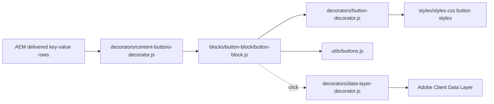

# Button

A call to action with the TCS design system's button views (button, icon-only button, text link),
types (primary, secondary, tertiary), icons and alignment. Shown as **Button** in Universal Editor;
technically the Button Block (`blocks/button-block`), a key-value block that renders one link
through the shared button decorator, so it looks and behaves like every other button of the site.

| Attribute | Value |
| --------- | ----- |
| Technical name | `button-block` (template name "Button Block", block class `button-block`) |
| Display name | Button |
| Block type | Independent block, key-value (one row per property) |
| Status | Active; replaces the built-in Button component ("Button (basic)", no longer offered) |
| Parent / children | Added to a Section, a Columns Container column or a Tabs Container tab (filters `section`, `columns-container`, `tabs`); no child items |
| Owner / version / date | Not recorded |

## Overview

**Business purpose.** A consistent, accessible call to action in page content, with the view, type,
icon and alignment chosen in a dialog instead of bold / italic formatting.

**Why a block.** AEM's built-in Button component (`core/franklin/components/button/v1/button`, now
"Button (basic)") delivers only its link, Text, Title and Primary / Secondary (as bold / italic):
View, Icon, Alignment and Tertiary never reach the page, so changing them in its dialog changed
nothing (finding F-100). A block delivers every field, so all options work and update as they are
changed in the dialog.

**User experience.** A pill button with a trailing arrow (Button view), a round icon-only button
(Icon view) or an underlined text link with a chevron (Link view), placed left, centred or right in
its section or column.

**Templates / page types.** Any page type.

**Data source.** The block's own properties; the icons are files in `/icons`.

**Related blocks.** Text (an inline link in a sentence); Hero, Teaser, Page Header, List and Cards
(their own CTA fields, decorated by the same button decorator); Conversation Canvas (its own Button
items, model `conversation-canvas-button`); [Columns Container](../columns-container/README.md).

**When to use.** A standalone call to action in a section, column or tab.

**When not to use.** A link inside a sentence (use Text); CTAs that belong to a block with its own
CTA fields; navigation menus (the navigation page).

**Realistic use cases.**

- "Contact us" as the primary action of a section.
- "Explore services" (secondary) next to a primary button.
- A search icon button.
- "View all insights" as a text link.

## Visual Reference

<!-- BEGIN GENERATED: screenshots (npm run build:docs) -->

Screenshots of the handover (6.9 Button Component), taken on the preview with sample content; they show the rendering at the time of the handover revision that added them (later changes are in the sections below and the handover's revision history):

| Screenshot | Shows |
| ---------- | ----- |
| [Desktop rendering](../../docs/handover/screenshots/button-desktop-view.jpg) | Six buttons at 1440 px, stacked left aligned in their own paragraphs (not a row): primary 'Contact us', secondary 'Explore services', tertiary 'See all case studies', a blue circular search icon button, the link view 'View all insights' with a chevron and a primary pill with the long download label. |
| [Tablet rendering](../../docs/handover/screenshots/button-tablet-view.jpg) | The same six stacked buttons at 768 px at identical sizes; the long label 'Download the complete annual sustainability and responsibility report 2026' still fits on one line. |
| [Mobile rendering](../../docs/handover/screenshots/button-mobile-view.jpg) | The same six stacked buttons at 375 px at identical sizes; the primary pill with the long download label is clipped at the content edge. |
| [Primary button](../../docs/handover/screenshots/button-primary.jpg) | At 402 px, two black primary pills 'Contact us' with arrows, stacked; the lower one, under the pointer, has its label and arrow in slate-400. |
| [Secondary button](../../docs/handover/screenshots/button-secondary.jpg) | At 402 px, two outlined secondary pills 'Explore services', stacked; the lower one, under the pointer, has a white fill with brand blue border and label. |
| [Tertiary button](../../docs/handover/screenshots/button-tertiary.jpg) | At 402 px, two tertiary calls to action 'See all case studies' with arrows and no container, stacked; the lower one, under the pointer, is brand blue with the arrow closer. |
| [Icon button](../../docs/handover/screenshots/button-icon.jpg) | At 402 px, three 2.75rem circular search icon buttons stacked: primary filled blue with a white icon, secondary with a blue outline and icon, tertiary a blue icon only. |
| [Link view](../../docs/handover/screenshots/button-link.jpg) | At 402 px, two underlined semibold 'View all insights' links with chevrons, stacked; the lower one, under the pointer, is brand blue. |
| [Centre-aligned button](../../docs/handover/screenshots/button-align-center.jpg) | At 1440 px, the black primary pill 'Contact us' with its arrow, centred horizontally in the section content area. |
| [Right-aligned button](../../docs/handover/screenshots/button-align-right.jpg) | At 1440 px, the outlined secondary pill 'Explore services' with its arrow, aligned to the right edge of the content area. |
| [Button on the Universal Editor canvas](../../docs/handover/screenshots/button-authoring-view.jpg) | The centred primary pill 'Contact us' in editor mode at 1440 px (an annotated preview, not a Universal Editor screenshot); A marks the button label and C its paragraph (Alignment). B (Views, Type) is not marked. (Annotated preview in editor mode with sample content; letters as in the annotations list, not a Universal Editor screenshot; file screenshots/button-authoring-view.jpg) |
| [Button properties panel](../../docs/handover/screenshots/button-properties-panel.jpg) | The Properties panel with Link, Text, Title, Views, Type, Icon (visible because Views is Icon) and Alignment. (Dialog reference generated from the component model, not a Universal Editor screenshot; file screenshots/button-properties-panel.jpg) |

Universal Editor dialogs (no screenshot exists yet; to be captured on AEM author):

```text
[Screenshot Placeholder]

File name:
button-block-dialog-content-desktop.png

Purpose:
The Content tab of the Button properties in Universal Editor, with the fields of the table "Content tab — Button" in Authorable Fields below.

Annotations:
A = Link
B = Text
C = Title
```

```text
[Screenshot Placeholder]

File name:
button-block-dialog-style-desktop.png

Purpose:
The Style tab of the Button properties in Universal Editor, with the fields of the table "Style tab — Button" in Authorable Fields below.

Annotations:
A = View
B = Type
C = Icon
D = Alignment
```

```text
[Screenshot Placeholder]

File name:
button-block-dialog-additional-desktop.png

Purpose:
The Additional tab of the Button properties in Universal Editor, with the fields of the table "Additional tab — Button" in Authorable Fields below.

Annotations:
A = Anchor ID
B = Hide block
C = Animation Type
D = Motion Speed
E = Animation Trigger
F = Padding left
G = Padding right
H = Padding top
I = Padding bottom
J = Margin left
```

<!-- END GENERATED: screenshots -->

States without a screenshot:

```text
[Screenshot Placeholder]

File name:
button-block-authoring-universal-editor-desktop.png

Purpose:
The Button selected in Universal Editor with the properties panel on the Style tab (View Icon, Icon visible).

Annotations:
A = The button on the canvas
B = View
C = Type
D = Icon
E = Alignment
```

```text
[Screenshot Placeholder]

File name:
button-block-empty-editor-desktop.png

Purpose:
A Button without a Link in Universal Editor edit mode: the dashed hint "Button: add a Link and a Text."

Annotations:
A = The hint box
```

```text
[Screenshot Placeholder]

File name:
button-block-focus-desktop.png

Purpose:
Keyboard focus on a primary button and on an icon button: the 2px brand focus outline.

Annotations:
A = Focus outline of the primary button
B = Focus outline of the icon button
```

```text
[Screenshot Placeholder]

File name:
button-block-dark-section-desktop.png

Purpose:
Primary, secondary and tertiary Buttons in a Dark section: the inverted button colours of the theme contract.

Annotations:
A = Primary (white)
B = Secondary
C = Tertiary
```

## For Content Authors

1. **Add the block.** Select a Section, a Columns Container column or a Tabs Container tab, choose
   Add (+) and pick **Button**.
2. **Open its properties.** Select the block; the panel has the **Content**, **Style** and
   **Additional** tabs.
3. **Enter the content (Content tab).** Pick the page or asset, or enter a URL, in **Link**; write
   the label in **Text** (the accessible name of an icon button); add a **Title** only for extra
   context (a tooltip).
4. **Choose the look (Style tab).** **View**: Button, Icon or Link. **Type** (Button and Icon
   views): Primary, Secondary or Tertiary. **Icon** (Icon view): Arrow right, Chevron right, Chevron
   down or Search. **Alignment**: Left, Center or Right.
5. **Optional: Additional tab** (Anchor ID, Hide block, animation, spacing).
6. **Preview** at desktop, tablet and mobile widths; check the label isn't clipped.
7. **Publish** the page; publish the target page too.
8. **Validate the published output:** the button has the chosen look and opens the target.

**Minimum required:** Link (without it nothing is shown on the page; in the editor the block says
what to add). **Recommended:** Text. **Optional:** Title, Style tab values, Additional tab.

## Authorable Fields

<!-- BEGIN GENERATED: fields (npm run build:docs) -->

### Button (`button-block`)

Model `button-block`; template name "Button Block" (the block class AEM renders); key-value block (one row per property).

Stored on a new component (definition template): `buttonView` = `"button"`, `buttonVariant` = `"primary"`, `buttonAlignment` = `"left"`.

#### Content tab — Button

| Field label | Property | Type | Required | Default | Allowed values | Author guidance | Example |
| ----------- | -------- | ---- | -------- | ------- | -------------- | --------------- | ------- |
| Link | `link` | aem-content | No | — | — | An AEM page, an asset or a URL. | /language-master/en/curated-design-pages |
| Text | `linkText` | text | No | — | — | The label of the button (the accessible name of an icon button). Delivered with `link` (field collapse). | Curated design pages |
| Title | `linkTitle` | text | No | — | — | Optional tooltip (most buttons need none). Delivered with `link` (field collapse). | Contact the TCS team |

#### Style tab — Button

| Field label | Property | Type | Required | Default | Allowed values | Author guidance | Example |
| ----------- | -------- | ---- | -------- | ------- | -------------- | --------------- | ------- |
| View | `buttonView` | select | No | `button` | Button (`button`), Icon (`icon`), Link (`link`) | Button, an icon-only button (choose its Icon) or a text link. | button |
| Type | `buttonVariant` | select | No | `primary` | Primary (`primary`), Secondary (`secondary`), Tertiary (`tertiary`) | The emphasis of the Button and Icon views. Shown when `buttonView` is off or empty or `buttonView` is `button` or `buttonView` is `icon`. | secondary |
| Icon | `buttonIcon` | select | No | `arrow-right` | Arrow right (`arrow-right`), Chevron right (`chevron-right`), Chevron down (`chevron-down`), Search (`search`) | The icon of the Icon view; the Text becomes its accessible name. Shown when `buttonView` is `icon`. | search |
| Alignment | `buttonAlignment` | select | No | `left` | Left (`left`), Center (`center`), Right (`right`) | Where the button sits in its section or column. | left |

#### Additional tab — Button

| Field label | Property | Type | Required | Default | Allowed values | Author guidance | Example |
| ----------- | -------- | ---- | -------- | ------- | -------------- | --------------- | ------- |
| Anchor ID | `classes_anchor` | text | No | — | regExp: ^anchor-[a-z0-9][a-z0-9-]*$; customErrorMsg: Start with anchor-, then lower-case letters, digits and hyphens. | A unique ID of the block on the page, starting with anchor-, e.g. anchor-our-services; link to it with #anchor-our-services. Delivered as a block class. | — |
| Hide block | `classes_hideblock` | boolean | No | `false` | on / off | Hides the whole block on the page until it is turned off (shown faded in the editor). Delivered as a block class. | — |
| Animation Type | `classes_animation` | select | No | "" | None (""), Fade in (`motion-fade-in`), Fade up (`motion-fade-up`), Fade down (`motion-fade-down`), Fade left (`motion-fade-left`), Fade right (`motion-fade-right`), Slide up (`motion-slide-up`), Slide down (`motion-slide-down`), Slide left (`motion-slide-left`), Slide right (`motion-slide-right`), Scale in (`motion-scale-in`) | How the block's content appears; repeated items (cards, list items, accordion items, columns) appear one after another. None: shown as is. Not played in the editor or when the visitor prefers reduced motion. Delivered as a block class. | — |
| Motion Speed | `classes_animationspeed` | select | No | "" | Medium (""), Fast (`motion-fast`), Slow (`motion-slow`) | How fast the animation runs: 0.3, 0.6 or 0.9 seconds. Shown when `classes_animation` is set and `classes_animation` is not empty. Delivered as a block class. | — |
| Animation Trigger | `classes_animationtrigger` | select | No | "" | On Scroll / Viewport Entry (""), On Page Load (`motion-on-load`) | When the block's animations run. On Scroll: when the block comes into view (at once if it is in view when the page opens). On Page Load: as soon as the block is ready, wherever it is on the page. Shown when `classes_animation` is set and `classes_animation` is not empty. Delivered as a block class. | — |
| Padding left | `classes_paddingleft` | select | No | "" | Default (""), 0 (none) (`pl-0`), 0.25rem (space-100) (`pl-100`), 0.5rem (space-200) (`pl-200`), 0.75rem (space-300) (`pl-300`), 1rem (space-400) (`pl-400`), 1.25rem (space-500) (`pl-500`), 1.5rem (space-600) (`pl-600`), 2rem (space-800) (`pl-800`), 2.5rem (space-1000) (`pl-1000`), 3rem (space-1200) (`pl-1200`), 4rem (space-1600) (`pl-1600`), 5rem (space-2000) (`pl-2000`), 6rem (space-2400) (`pl-2400`), 7.5rem (space-3000) (`pl-3000`) | Delivered as a block class. | — |
| Padding right | `classes_paddingright` | select | No | "" | Default (""), 0 (none) (`pr-0`), 0.25rem (space-100) (`pr-100`), 0.5rem (space-200) (`pr-200`), 0.75rem (space-300) (`pr-300`), 1rem (space-400) (`pr-400`), 1.25rem (space-500) (`pr-500`), 1.5rem (space-600) (`pr-600`), 2rem (space-800) (`pr-800`), 2.5rem (space-1000) (`pr-1000`), 3rem (space-1200) (`pr-1200`), 4rem (space-1600) (`pr-1600`), 5rem (space-2000) (`pr-2000`), 6rem (space-2400) (`pr-2400`), 7.5rem (space-3000) (`pr-3000`) | Delivered as a block class. | — |
| Padding top | `classes_paddingtop` | select | No | "" | Default (""), 0 (none) (`pt-0`), 0.25rem (space-100) (`pt-100`), 0.5rem (space-200) (`pt-200`), 0.75rem (space-300) (`pt-300`), 1rem (space-400) (`pt-400`), 1.25rem (space-500) (`pt-500`), 1.5rem (space-600) (`pt-600`), 2rem (space-800) (`pt-800`), 2.5rem (space-1000) (`pt-1000`), 3rem (space-1200) (`pt-1200`), 4rem (space-1600) (`pt-1600`), 5rem (space-2000) (`pt-2000`), 6rem (space-2400) (`pt-2400`), 7.5rem (space-3000) (`pt-3000`) | Delivered as a block class. | — |
| Padding bottom | `classes_paddingbottom` | select | No | "" | Default (""), 0 (none) (`pb-0`), 0.25rem (space-100) (`pb-100`), 0.5rem (space-200) (`pb-200`), 0.75rem (space-300) (`pb-300`), 1rem (space-400) (`pb-400`), 1.25rem (space-500) (`pb-500`), 1.5rem (space-600) (`pb-600`), 2rem (space-800) (`pb-800`), 2.5rem (space-1000) (`pb-1000`), 3rem (space-1200) (`pb-1200`), 4rem (space-1600) (`pb-1600`), 5rem (space-2000) (`pb-2000`), 6rem (space-2400) (`pb-2400`), 7.5rem (space-3000) (`pb-3000`) | Delivered as a block class. | — |
| Margin left | `classes_marginleft` | select | No | "" | Default (""), 0 (none) (`ml-0`), 0.25rem (space-100) (`ml-100`), 0.5rem (space-200) (`ml-200`), 0.75rem (space-300) (`ml-300`), 1rem (space-400) (`ml-400`), 1.25rem (space-500) (`ml-500`), 1.5rem (space-600) (`ml-600`), 2rem (space-800) (`ml-800`), 2.5rem (space-1000) (`ml-1000`), 3rem (space-1200) (`ml-1200`), 4rem (space-1600) (`ml-1600`), 5rem (space-2000) (`ml-2000`), 6rem (space-2400) (`ml-2400`), 7.5rem (space-3000) (`ml-3000`) | Delivered as a block class. | — |
| Margin right | `classes_marginright` | select | No | "" | Default (""), 0 (none) (`mr-0`), 0.25rem (space-100) (`mr-100`), 0.5rem (space-200) (`mr-200`), 0.75rem (space-300) (`mr-300`), 1rem (space-400) (`mr-400`), 1.25rem (space-500) (`mr-500`), 1.5rem (space-600) (`mr-600`), 2rem (space-800) (`mr-800`), 2.5rem (space-1000) (`mr-1000`), 3rem (space-1200) (`mr-1200`), 4rem (space-1600) (`mr-1600`), 5rem (space-2000) (`mr-2000`), 6rem (space-2400) (`mr-2400`), 7.5rem (space-3000) (`mr-3000`) | Delivered as a block class. | — |
| Margin top | `classes_margintop` | select | No | "" | Default (""), 0 (none) (`mt-0`), 0.25rem (space-100) (`mt-100`), 0.5rem (space-200) (`mt-200`), 0.75rem (space-300) (`mt-300`), 1rem (space-400) (`mt-400`), 1.25rem (space-500) (`mt-500`), 1.5rem (space-600) (`mt-600`), 2rem (space-800) (`mt-800`), 2.5rem (space-1000) (`mt-1000`), 3rem (space-1200) (`mt-1200`), 4rem (space-1600) (`mt-1600`), 5rem (space-2000) (`mt-2000`), 6rem (space-2400) (`mt-2400`), 7.5rem (space-3000) (`mt-3000`) | Delivered as a block class. | — |
| Margin bottom | `classes_marginbottom` | select | No | "" | Default (""), 0 (none) (`mb-0`), 0.25rem (space-100) (`mb-100`), 0.5rem (space-200) (`mb-200`), 0.75rem (space-300) (`mb-300`), 1rem (space-400) (`mb-400`), 1.25rem (space-500) (`mb-500`), 1.5rem (space-600) (`mb-600`), 2rem (space-800) (`mb-800`), 2.5rem (space-1000) (`mb-1000`), 3rem (space-1200) (`mb-1200`), 4rem (space-1600) (`mb-1600`), 5rem (space-2000) (`mb-2000`), 6rem (space-2400) (`mb-2400`), 7.5rem (space-3000) (`mb-3000`) | Delivered as a block class. | — |

<!-- END GENERATED: fields -->

What the tables don't show:

- **Link / Text / Title** arrive as one link (Text and Title collapse into it): Text is the link's
  label, Title its `title` attribute. The Button and Link views have a tooltip only when Title is
  authored; the Icon view sets the tooltip to its accessible name when Title is empty.
- **View** renders `a.button.{type}` (Button), `a.button.{type}.icon-button` with the icon as a CSS
  mask and the Text hidden in a `span` and used as `aria-label` (Icon), or `a.link-button` (Link;
  Type is ignored and hidden in the dialog).
- **Type** is stored as `buttonVariant`: a field ending in `Type` would collapse into the link.
- **Icon** is read only for the Icon view (default Arrow right); the icon is
  `/icons/{name}.svg`.
- **Alignment** adds `button-align-{value}` to the paragraph around the link (`text-align` start,
  center or end).
- **Accessibility impact:** Text is the accessible name in every view; never leave it empty for the
  Icon view.
- **Data-layer impact:** none of the fields adds tracking attributes; the click is tracked centrally
  on the block.
- **Legacy mapping:** unknown or empty values fall back to the defaults (Button, Primary, Left).
  Buttons authored before with the built-in Button keep working with Primary or Secondary (bold /
  italic); replace one with a Button block to use the other options.
- **Additional tab:** as on every block (AGENTS.md "Additional tab"; Animation Type moves the
  block).

## Screenshot-Based Authoring Steps

### Authoring Step 1: Add the Button and set the link

```text
[Screenshot Placeholder]

File name:
button-block-authoring-step-1.png

Purpose:
The Button added from the section's Add (+), the Content tab with Link and Text filled.

Annotations:
A = Add (+)
B = Link
C = Text
D = Title
```

### Values to Enter

| Callout | Field | Value | Reason | Expected result |
| ------- | ----- | ----- | ------ | --------------- |
| B | Link | /language-master/en/curated-design-pages | The target page | The button links to the page |
| C | Text | Curated design pages | Visible label | The pill shows the label with an arrow |
| D | Title | (empty) | Most buttons need no tooltip | No `title` attribute |

**Author action:** add the Button, pick the page and write the label. **Expected preview:** a black
primary pill, left aligned. **Expected published result:** the same, linking to the published path.
**Business rules:** without a Link nothing is shown. **Validation:** click and keyboard (Tab, Enter)
open the page. **Common mistakes:** the label equals the URL; an unpublished target page.

### Authoring Step 2: Choose the view and type

```text
[Screenshot Placeholder]

File name:
button-block-authoring-step-2.png

Purpose:
The Style tab with View Button and Type Secondary, and the outlined pill on the canvas.

Annotations:
A = View
B = Type
C = The secondary button
```

### Values to Enter

| Callout | Field | Value | Reason | Expected result |
| ------- | ----- | ----- | ------ | --------------- |
| A | View | Button | A pill button | `a.button` |
| B | Type | Secondary | Next to a primary action | Outlined pill |

**Author action:** set View and Type. **Expected result:** the outlined secondary pill.
**Business rules:** one primary per section; Type is hidden for the Link view. **Validation:**
hover shows the brand-blue state. **Common mistakes:** Type missing in the dialog because View is
Link.

### Authoring Step 3: An icon button

```text
[Screenshot Placeholder]

File name:
button-block-authoring-step-3.png

Purpose:
View Icon with Icon Search, and the round search icon button on the canvas.

Annotations:
A = View
B = Icon
C = Text (the accessible name)
D = The icon button
```

### Values to Enter

| Callout | Field | Value | Reason | Expected result |
| ------- | ----- | ----- | ------ | --------------- |
| A | View | Icon | Icon-only button | Round 2.75rem button |
| B | Icon | Search | The action's icon | The search icon |
| C | Text | Search | Accessible name and tooltip | Announced "Search" |

**Author action:** set View Icon, choose the Icon and keep a Text. **Expected result:** a round icon
button with the label hidden on screen. **Business rules:** the Icon field shows only for the Icon
view. **Validation:** a screen reader announces the Text. **Common mistakes:** empty Text (the name
falls back to the Title or the icon name).

### Authoring Step 4: Align the button

```text
[Screenshot Placeholder]

File name:
button-block-authoring-step-4.png

Purpose:
Alignment Center and the button centred in the section.

Annotations:
A = Alignment
B = The centred button
```

### Values to Enter

| Callout | Field | Value | Reason | Expected result |
| ------- | ----- | ----- | ------ | --------------- |
| A | Alignment | Center | Centred layout | The button centred in its section or column |

**Author action:** choose the alignment. **Expected result:** `button-align-center` on the paragraph.
**Validation:** check at 390 px too. **Common mistakes:** right-aligning an important action.

## Variations

### Primary, Secondary, Tertiary (Button view)

- **Purpose:** the emphasis of a call to action; one primary per section.
- **Fields:** Link, Text; View Button; Type.
- **Rendering:** `a.button.primary|secondary|tertiary` with a trailing arrow (`icons/arrow-right.svg`
  as a CSS mask); min height `--button-height` (3.125rem); labels don't wrap (`white-space: nowrap`)
  and are clipped at the container width.
- **Accessibility / data layer:** a link named by its Text; `cmp:click` on click.
- **Fallback:** an unknown Type renders Primary.

### Icon view

- **Purpose:** compact actions (search, arrow, chevron). **Fields:** Link, Text, View Icon, Icon,
  Type.
- **Rendering:** a round `--icon-button-size` (2.75rem) button; the Text kept in a hidden `span`, as
  `aria-label` and as tooltip.

```text
[Screenshot Placeholder]

File name:
button-block-icon-types-mobile.png

Purpose:
The three icon button types with each of the four icons at 390 px.

Annotations:
A = Primary icon buttons
B = Secondary icon buttons
C = Tertiary icon buttons
```

### Link view

- **Purpose:** a text call to action ("View all insights"). **Rendering:** `a.link-button`,
  underlined, semibold, with a trailing chevron (`icons/chevron-right.svg`); Type ignored.

### Alignment Left, Center, Right

- **Rendering:** `p.button-wrapper.button-align-left|center|right` (`text-align` start / center /
  end, so it follows the reading direction).

## Complete Authoring Example

Scenario: the primary call to action of a services section.

| Field | Example value | Guidance |
| ----- | ------------- | -------- |
| Link | /language-master/en/curated-design-pages | Pick with the picker |
| Text | Contact us | Verb first, short |
| Title | Contact the TCS team | Only extra context |
| View | Button | Default |
| Type | Primary | One per section |
| Alignment | Left | Default |

**Steps:** add the Button after the section's text, fill the Content and Style tabs, preview,
publish.

**Expected output:** a black primary pill "Contact us" with an arrow, left aligned, tooltip
"Contact the TCS team".

**Responsive:** same size at every viewport; check the label fits at 390 px.

**Accessibility:** a link named "Contact us"; visible focus outline.

**Analytics / data layer:** `tcs-corp/components/button-block` (`button-block-1`); a click pushes
`cmp:click` with `interaction` `link`.

**Personalization fallback:** none.

**Pre-publish checklist:**

1. Link set and the target published.
2. Text describes the outcome (not "Click here").
3. One primary per section.
4. Label fits at 390 px.
5. Icon buttons have a Text.

## Content and Asset Guidelines

- **Labels:** start with a verb, describe the outcome; keep them short (labels don't wrap and are
  clipped).
- **Title:** optional context only; mention the format of downloads.
- **Links:** internal pages with the picker; external URLs open in the same tab (no new-tab option).
- **Icons:** Arrow right, Chevron right, Chevron down, Search (files in `/icons`).
- **Tags and metadata:** none.
- **Min / max items:** one link per block. No verified technical limit was identified.
- **Missing content:** no Link: nothing on the page; the editor hint (placeholder
  `buttonBlockEmpty`, "Button: add a Link and a Text.").

## Accessibility

- **Semantics:** a real `a href` in a paragraph.
- **Keyboard and focus:** Tab reaches it, Enter follows it; the global `a:focus-visible` outline
  (2px `--color-border-brand`).
- **Accessible names:** the Text; for the Icon view `aria-label` = the Text (else the Title, else
  the icon name with spaces).
- **Link purpose:** the label should describe the destination.
- **Contrast:** the button types and the dark-section theme contract (`styles/styles.css`: on Dark
  and Dark green sections buttons are inverted, Primary white).
- **Reduced motion:** the Additional tab animation doesn't play.
- **Reflow:** labels don't wrap; long labels are clipped at narrow widths (see Known Limitations).
- **Empty state:** editor-only hint; nothing on the page.

**Author responsibilities:** descriptive Text, always a Text for icon buttons, one primary per
section.

**Developer responsibilities:** keep every button going through `decorateButton`, names from the
Text, focus styles global.

| Key | Expected behavior |
| --- | ----------------- |
| Tab | Moves focus to the button |
| Enter | Follows the link |

## Data Layer and Analytics

`decorators/data-layer-decorator.js` adds the block as `tcs-corp/components/button-block`, id =
Anchor ID else `button-block-{n}`. The block adds no `data-cmp-*` attributes.

| Trigger | Data-layer event | Required properties | Analytics behavior |
| ------- | ---------------- | ------------------- | ------------------ |
| Block decorated | component state | `@type`, `parentId` | One entry per Button |
| Click | `cmp:click` | `interaction` `link`, `dc:title` (label or `aria-label`), `xdm:linkURL`, `xdm:linkType` (`other`, `exit`, `download`), `breakpoint` | CTA tracking, attributed to the block |

The intended path is Adobe Client Data Layer, then Adobe Data Collection (Tags), the AEP Web SDK,
the Edge Network and Analytics / CJA, but Tags and the Web SDK aren't configured yet (blocked:
measurement plan); no consent mechanism is implemented.

## Personalization

This block does not currently expose verified personalization behavior. There is no Adobe Target
or Journey Optimizer integration in the repository; every visitor sees the authored button.

## Responsive Behavior

Neither `button-block.css` nor the global button styles use media queries.

| Viewport | Layout | Image behavior | Interaction behavior |
| -------- | ------ | -------------- | -------------------- |
| All viewports | One paragraph aligned left, center or right; buttons 3.125rem high, icon buttons 2.75rem | Icons as CSS masks | Same hover and focus states; long labels clipped at the container width |

## For Developers

<!-- BEGIN GENERATED: files (npm run build:docs) -->

```text
blocks/button-block/
├── README.md
├── _button-block.json
├── button-block.css
└── button-block.js
```

| Decorator/Utility | Purpose | Execution or dependency point |
| ----------------- | ------- | ----------------------------- |
| [`decorators/button-decorator.js`](../../decorators/button-decorator.js) | `decorateButton` (option `newTabHint`: a link opening a new tab says so), `createButton`, `setButtonDisabled`, `setButtonAlignment`, `removeButtonDecoration` | `button-block.js`: { decorateButton, setButtonAlignment } |
| [`utils/buttons.js`](../../utils/buttons.js) | `BUTTON_VIEWS`, `BUTTON_TYPES`, `BUTTON_ALIGNMENTS`, `pick`, `readButtonOptions` | `button-block.js`: { BUTTON_ALIGNMENTS, BUTTON_TYPES, BUTTON_VIEWS, pick, } |
| [`utils/environment.js`](../../utils/environment.js) | `prefersReducedMotion`, `scrollBehavior`, `isEditing`, `isInEditor`, `isAuthor` (the page is rendered by AEM author, which has no query index) | `button-block.js`: { isEditing } |
| [`utils/links.js`](../../utils/links.js) | `NEW_WINDOW`, `linkOf`, `linkPathsOf` (the paths of a page property, one or many), `readLinkItems` (CTA lists with Link Type and the items' other select values), `readLinkRows` (the same from link item rows, e.g. Hero CT | `button-block.js`: { linkOf } |
| [`utils/placeholders.js`](../../utils/placeholders.js) | `getPlaceholders`, `loadPlaceholders`, `fillPlaceholder` (UI text from the locale's placeholders, with English fallbacks) | `button-block.js`: { getPlaceholders } |
| [`utils/properties.js`](../../utils/properties.js) | `readProperties`, `textOf`, `isOn`, `isOnByDefault` (a toggle that defaults to on), `optionOf`, `normalizeKey`, `textSource` (key-value block properties) | `button-block.js`: { readProperties, textOf } |

<!-- END GENERATED: files -->

**JavaScript (`button-block.js`).** `readButtonBlock(block)` (exported) reads the key-value rows
(`readProperties`): `link` (`linkOf`; Text and Title collapsed into it), `buttonview`,
`buttonvariant`, `buttonicon`, `buttonalignment`, normalised with `pick` and the lists of
`utils/buttons.js` (defaults button, primary, `arrow-right` for the Icon view, left). `decorate`
renders one `p.button-wrapper` with `setButtonAlignment`, removes the link's classes (the content
buttons decorator already decorated it in `decorateMain`) and calls
`decorateButton(link, { view, type, icon })`. Without a link the block is emptied; in Universal
Editor edit mode (`isEditing`) it shows `p.button-block-empty` with the placeholder
`buttonBlockEmpty`.

**CSS (`button-block.css`).** Only the paragraph margin of a lone button and the editor hint; the
button styles are global (`styles/styles.css`: `a.button`, `.primary`, `.secondary`, `.tertiary`,
`.icon-button`, `a.link-button`, `p.button-wrapper`, `.button-align-*`).

**Input DOM.** Key-value rows `link | <a href title>Text</a>`, `buttonView | …`, `buttonVariant | …`,
`buttonIcon | …`, `buttonAlignment | …`; the Additional tab as block classes.

**Rendered DOM contract.** `.button-block > p.button-wrapper.button-align-{alignment} > a.button.{type}`
(`.icon-button` with `aria-label`, `title`, `--icon-url` and a hidden `span`) or `a.link-button`.

**Template name.** "Button Block" (class `button-block`): a `button` block class would match the
`.button` link selectors. AEM renders a block with the class of its template name, so the template
name must name the block folder ([block-names.test.mjs](../../test/models/block-names.test.mjs)
checks this for every block).

**Events and async behavior.** `getPlaceholders` only for the editor hint; no listeners of its own.
Universal Editor re-renders the block on every change (`scripts/editor-support.js`).

**Error handling.** No link: empty block (hint in the editor); unknown values: defaults.

## Extending the Block

1. **A new icon:** add the SVG to `/icons` and an option to `buttonIcon` in `_button-block.json`.
2. **A new view or type:** extend `BUTTON_VIEWS` / `BUTTON_TYPES` in `utils/buttons.js`, style it in
   `styles/styles.css` and add the option; it applies to every button of the site.
3. **A new field:** add it to `_button-block.json` with a name that doesn't end in Text, Title,
   Type, Alt or MimeType (or it collapses into the link), read it in `readButtonBlock` with a
   default; `npm run build:json`, `npm run lint`.
4. **Accessibility / data layer:** keep the Text as the accessible name; describe new controls with
   `data-cmp-interaction`.
5. **Tests:** `readButtonBlock` and `pick` are pure enough for a Node test in `test/`.
6. **Library and docs:** update the block library, this README, `npm run build:docs`;
   `npm run build:modules` after changing imports.

## For Site Administrators

- **Availability:** in the `section`, `columns-container` and `tabs` filters. The built-in Button
  ("Button (basic)", model `button-basic`) is in no filter; its definition stays so Buttons authored
  before remain editable; the former shared `button` model stays for components authored before.
- **Governance:** `_button-block.json`; aggregates generated.
- **Allowed children:** none.
- **Migration:** the block library's buttons were migrated to Button blocks (package 1.0.8);
  production content with built-in Buttons needs the same migration to use View, Icon, Alignment
  or Tertiary.

| Dependency | Purpose | Location | Impact if unavailable |
| ---------- | ------- | -------- | --------------------- |
| Icons | Arrow, chevron, search masks | `/icons/*.svg` | Button without icon |
| Placeholder `buttonBlockEmpty` | Editor hint | `/{locale}/placeholders.json` | English fallback |
| Target page | Link destination | AEM, published | Broken link |

## For Architects

- **Role:** the authorable CTA of default-content areas, built on the shared button decorator.
- **Content model:** key-value block (Content / Style / Additional).
- **Dependencies:** `decorators/button-decorator.js`, `utils/buttons.js`, `utils/links.js`,
  `utils/properties.js`, `utils/environment.js`, `utils/placeholders.js`.
- **Data layer / Web SDK / Target:** generic click tracking; no Web SDK or Target code.
- **Consent / identity / security:** no personal data; the link is the authored one.
- **Caching / performance:** part of the page HTML; icons cached by the CDN.



## For QA and Support Teams

| Test ID | Scenario | Configuration | Expected result |
| ------- | -------- | ------------- | --------------- |
| BUTTON-BLOCK-QA-01 | Default | Link, Text | Primary pill, left aligned |
| BUTTON-BLOCK-QA-02 | Types | Primary / Secondary / Tertiary | Matching styles; hover states |
| BUTTON-BLOCK-QA-03 | Icon view | View Icon, each Icon, each Type | Round icon button; `aria-label` = Text |
| BUTTON-BLOCK-QA-04 | Link view | View Link | Underlined link with chevron; Type hidden |
| BUTTON-BLOCK-QA-05 | Alignment | Left / Center / Right | `button-align-*` on the paragraph |
| BUTTON-BLOCK-QA-06 | Title | Title set / empty | `title` only when set (Icon view: the name) |
| BUTTON-BLOCK-QA-07 | No link | Link empty | Nothing on the page; hint in the editor |
| BUTTON-BLOCK-QA-08 | Dark section | Section Style Dark | Inverted buttons |
| BUTTON-BLOCK-QA-09 | Long label | About 70 characters at 390 px | Clipped, no wrap (known) |
| BUTTON-BLOCK-QA-10 | Multiple instances | Three Buttons | `button-block-1` … `-3`; clicks attributed to each |
| BUTTON-BLOCK-QA-11 | Keyboard | Tab, Enter | Focus outline; link followed |
| BUTTON-BLOCK-QA-12 | Data layer | Click internal, external, PDF links | `xdm:linkType` `other`, `exit`, `download` |
| BUTTON-BLOCK-QA-13 | Editor | Change View in the dialog | The canvas updates at once |
| BUTTON-BLOCK-QA-14 | Existing content | Built-in Buttons authored before | Still render Primary / Secondary |

## Troubleshooting

| Symptom | Likely cause | Diagnostic steps | Resolution | Verification |
| ------- | ------------ | ---------------- | ---------- | ------------ |
| Nothing on the page | No Link | Editor shows the hint | Set the Link | Button renders |
| Options have no effect | It's a built-in Button ("Button (basic)") authored before | Content tree component name | Replace it with a Button block | Options apply |
| Icon view shows no icon | Icon value unknown | Inspect `--icon-url` | Choose an Icon | Icon visible |
| Label clipped on mobile | Labels never wrap | 390 px preview | Shorten the label | Fits |
| External link opens in the same tab | No new-tab option | Inspect `target` | Accept, or use a block with a new-tab option | — |
| No click in the data layer | Tested in edit mode, or `data-analytics="off"` ancestor | `adobeDataLayer` on preview | Test on preview / live | `cmp:click` appears |

Evidence to collect (no secrets): page URL, `.plain.html` of the block, the rendered link's classes
and attributes, the data-layer entry.

## Performance Considerations

- Decorated with its section; no network requests except the placeholders in the editor.
- No images; icons are small SVG masks (one request per icon, cached).
- No listeners or observers of its own.

## Security and Privacy

- The link is the authored one (AEM maps internal paths); no HTML strings are built; no query
  strings or personal data are added.

## Known Limitations

| Limitation | Impact | Workaround | Planned correction |
| ---------- | ------ | ---------- | ------------------ |
| No open-in-new-tab option | External links open in the same tab | Accept, or another block's CTA | Not recorded (external link policy: owner product owner) |
| No disabled state for authors | — | — | Not recorded |
| Four icons | Limited icon set | Request an icon | Not recorded |
| Labels never wrap | Long labels clipped on mobile | Short labels | Not recorded |
| Alignment not per breakpoint | Same alignment everywhere | — | Not recorded |
| Built-in Buttons authored before keep only Primary / Secondary | Other options need a Button block | Content migration | Content action |

## Related Documentation

- [Blocks documentation](../README.md)
- [Columns Container](../columns-container/README.md), [Conversation Canvas](../conversation-canvas/README.md)
- [Model and definition](_button-block.json)
- [Button decorator](../../decorators/button-decorator.js), [buttons utils](../../utils/buttons.js), [content buttons decorator](../../decorators/content-buttons-decorator.js)
- [Built-in Button models](../../models/_button.json)
- [Block name test](../../test/models/block-names.test.mjs)
- [Handover 6.9 Button Component](../../docs/handover/TCS-CORP-HANDOVER.md)

<!-- BEGIN GENERATED: usage (npm run build:docs) -->

Pages of the block library package 1.0.13 (language master, `/content/tcs-corp/language-master/en`) that contain the block, 79 instance(s) in total:
- Block library: `block-library/columns-container/alignment-gap-and-breakpoints`, `block-library/columns-container/columns-of-blocks`, `block-library/columns/columns-variations`, `block-library/footer/campaign-page`, `block-library/foundations/button`, `block-library/foundations/button-icons-and-alignment`, `block-library/foundations/section-colours-with-blocks`, `block-library/foundations/section-variations`, `block-library/foundations/section-views`, `block-library/foundations/section-widths`, `block-library/fragment/fragment-block`, `block-library/fragment/fragments/cta-banner`, `block-library/modal/fragments/recognition`, `block-library/tabs/fragments/tab-industries`, `block-library/tabs/tabs-section`, `block-library/templates/error-page-404`, `block-library/templates/error-page-404-careers`, `block-library/templates/home-template`
- Other pages: `block-library`

<!-- END GENERATED: usage -->

## Change History

| Version | Change | Source | Date |
| ------- | ------ | ------ | ---- |
| Not recorded | README generated from verified implementation and approved handover documentation | Repository review | Not recorded |
| Handover 2.26 | Button block introduced: the built-in Button delivered only its link and Primary / Secondary (F-100); the Button authors add is now a block whose every option is delivered | docs/handover revision history | 19 October 2026 |
| Handover 2.28 | The built-in Button no longer offered; library buttons migrated to Button blocks (package 1.0.8, F-101) | docs/handover revision history | 20 October 2026 |
| Handover 2.29 | Re-audit: outdated dialog guidance corrected (R-D-16) | docs/handover revision history; docs/audit/REAUDIT-2026-10-20.md | 20 October 2026 |
