# Cards

Cards shows **manually authored cards**: authors type each card's image, eyebrow, title, rich text description, label, tags, date, link and call to action directly in the block. It is the authoring alternative to the [List](../list/README.md), which builds its cards from the metadata of pages. Both blocks share one presentation (the TCS DS Figma "List" variations 1–14: image, panel, report and statistic cards, a large feature card or rows of links, in a grid or a horizontal scroller chosen separately for desktop, tablet and mobile) and one set of block settings, so a Cards block looks exactly like a List with the same settings. Cards is a key-value block; the cards are **Card** items added to it with Add.

| Attribute | Value |
| --------- | ----- |
| Technical name | `cards` (model `cards`, template name "Cards"); item `card` (model `card`, template name "Card") |
| Display name | Cards; item Card |
| Block type | Key-value block (`key-value: true`) with item children |
| Status | Active |
| Parent / children | Parents: Section, Columns Container, Tabs Container (filters `section`, `columns-container`, `tabs`). Children: Card (`card`), filter `cards` |
| Owner / version / date | Not recorded / Not recorded / Not recorded |

## Overview

- **Business purpose:** presents curated, hand-written content as consistent, brand-compliant cards without creating a page for every card: statistics ("4bn revenue"), capabilities, services described in campaign wording, partner logos with a text, report downloads, or promotions pointing to pages or external sites. Because Cards uses the List's design and settings, a page can mix curated cards and page lists without visual differences.
- **User experience:** an optional header (title, description and a call to action on the right), then the cards in the authored order: image cards, coloured panels, report cards with a Download action, statistic cards with a large number, an optional full-width feature card above the others, or full-width rows of links with an arrow. Each breakpoint is a grid or a horizontal scroller with optional previous / next buttons and a scroll indicator.
- **Templates / page types:** any page; no page template adds or removes it. Typical placements: home and landing pages (statistics, capabilities), article and blog pages (related content curated by hand), press-release pages (downloads).
- **Data source:** authored fields only. Tag labels come from the locale's taxonomy (`/{locale}/taxonomy.json`) and UI text from its placeholders. Cards reads no page metadata, query index, redirects sheet or Authors sheet.
- **Related blocks:** [List](../list/README.md) (the same presentation for pages: child pages, fixed list, tagged pages); [Filter List](../filter-list/README.md) (page discovery with filter pills and sorting); [Teaser](../teaser/README.md) and [Hero](../hero/README.md) (single promotions); [Table List](../table-list/README.md) (text-led lists without images); [Columns Container](../columns-container/README.md) (free side-by-side layouts).

| | Cards | List |
|---|---|---|
| Content | Typed in each card | The pages' metadata (card title, description, image, ...), with overrides per item (Fixed list) |
| Destinations | Any page or URL, or none (a card without a link) | Pages of the site or URLs |
| Updates | Edited in the block | Follow the pages (a new child page or tagged page shows up) |
| Rich text | Description is rich text (paragraphs, bold, lists, inline links) | Plain text |
| Statistics, themes | Typed numbers and labels | The same, per item |

- **When to use:** curated content that isn't a page of its own or whose wording is written for this placement (statistics, capabilities, services with their own wording, logos with text, external promotions).
- **When not to use:** cards that represent pages that already have card metadata (use the List, so the cards stay in sync with the pages); filterable or sortable listings (use Filter List); tabular data (Table or Table List); a single promotion (Teaser).
- **Realistic use cases:** an "At a glance" statistic row on an about page; a services rail with images, descriptions and "Learn more" calls to action; dark themed panels linking to topic hubs; a featured spotlight card followed by three smaller cards; report download teasers; a news-style list of links that isn't driven by the query index; Block Collection cards authored before the redesign, which keep rendering in the new design.

## Visual Reference

<!-- BEGIN GENERATED: screenshots (npm run build:docs) -->

Screenshots of the handover (6.15 Cards Block), taken on the preview with sample content; they show the rendering at the time of the handover revision that added them (later changes are in the sections below and the handover's revision history):

**Desktop rendering** — The Cards block at 1440 px with default settings: the header with the H2 "Latest insights" and its description on the left and the "View all insights" text link on the right, above four image cards in one row (photo-1.svg to photo-4.svg in 16:9 frames, kickers such as "Insight", the tag label and "6m", titles from "The agentic bank" to "Personalisation in retail", descriptions and meta rows "Article" with dates from "04 Sep 26").

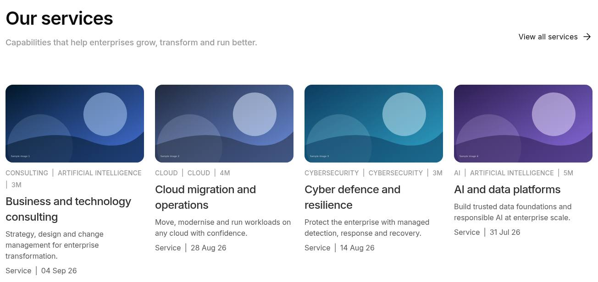

**Tablet rendering** — The same Latest insights block at 1024 px: the 2rem title with "View all insights" still on the right, and the four image cards in one row (Tablet columns 4 by default) with 1.25rem card titles and 0.875rem kickers and meta rows.

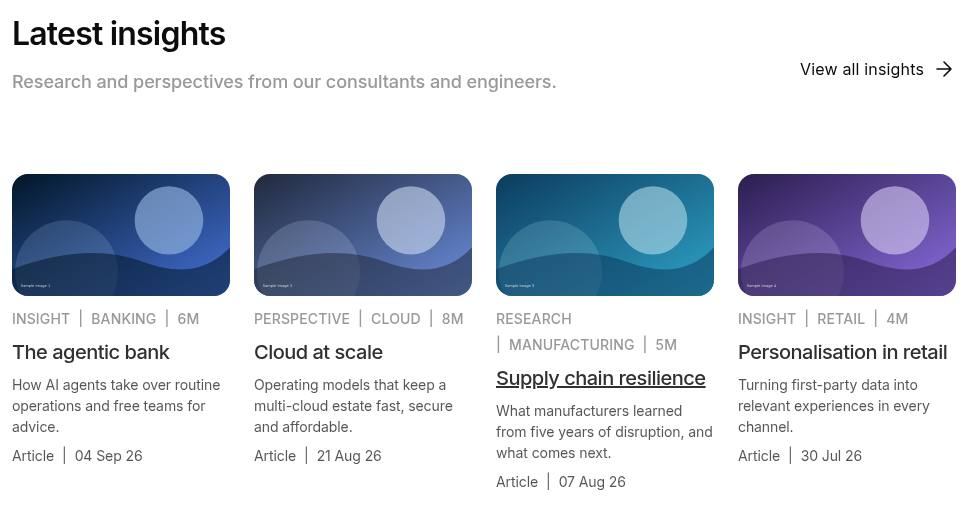

**Mobile rendering** — The Latest insights block at 402 px: the header stacked (title, description, then "View all insights" below), and the four image cards one per row in a single column with a 16 px gap, 1.125rem titles and 0.75rem kickers and meta rows.

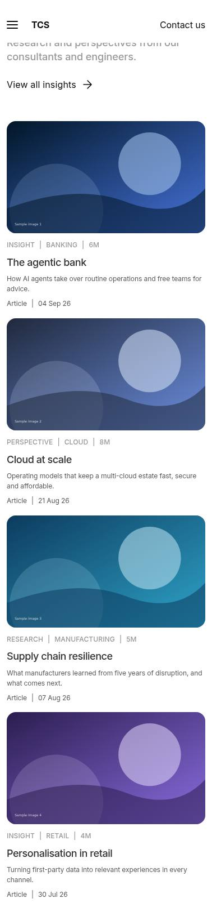

**Image card style** — Four image cards in a row at 1440 px (default Card style Image card, 4 columns): 16:9 rounded images, uppercase grey kickers (e.g. "Insight", the tag label, "6m"), the titles "The agentic bank", "Cloud at scale", "Supply chain resilience" and "Personalisation in retail", two-line descriptions and the meta row "Article" with the date (e.g. "04 Sep 26").

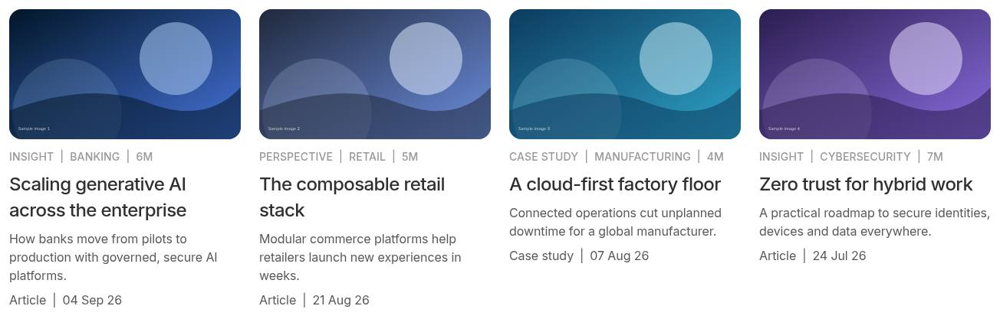

**Panel card style** — Three tall 2:3 dark navy-grey (#20293c) panels in a 3-column row at 1440 px, each with the light kicker "Theme", a large light title ("Responsible AI", "Sustainable operations", "Resilient enterprises"), a muted description and the "Explore" text link at the bottom.

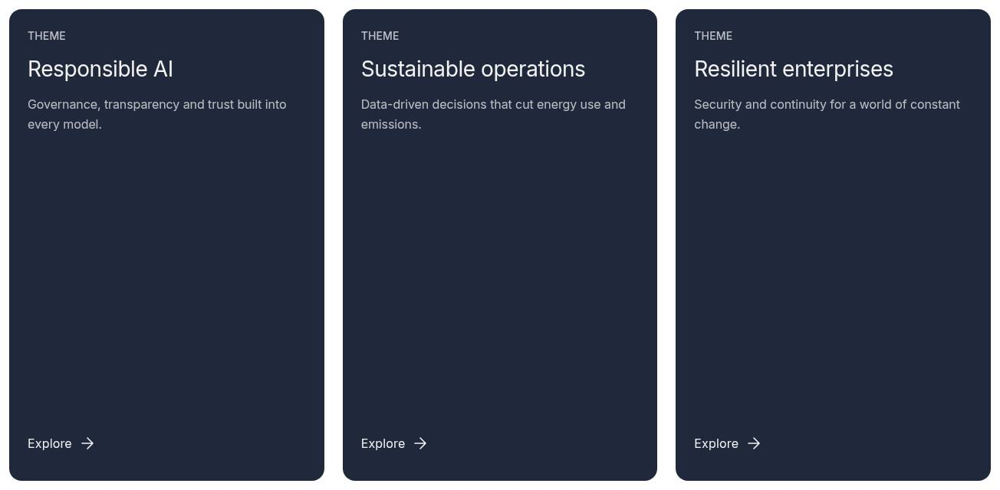

**Report card style** — Three tall 2:3 report cards in a 3-column row at 1440 px on the light blue-grey to warm grey gradient: kickers "Report" with the dates "04 Sep 26", "15 Jul 26" and "28 May 26", the dark titles "State of AI 2026", "Cloud value index" and "Supply chain outlook", descriptions and an outlined "Download" button at the bottom.

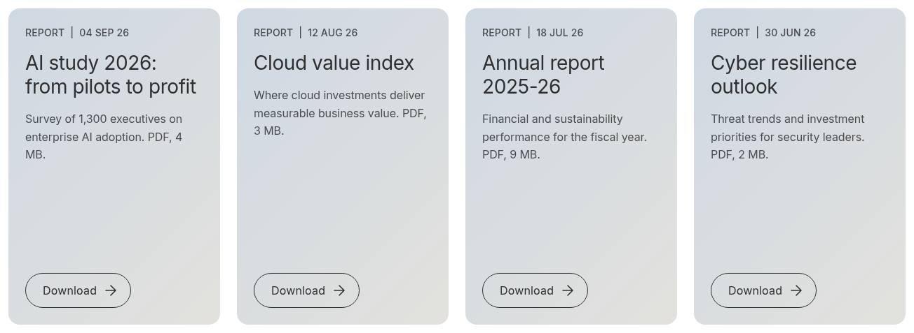

**Statistic card style** — Four light grey (#d9d9d9) 2:3 statistic cards in a row at 1440 px, each with "At a glance" at the top, a very large number ("4bn", "600,000+", "150", "98%") and at the bottom a bold label ("Revenue", "Colleagues", "Delivery centres", "Client retention") with a short description; no links or buttons.

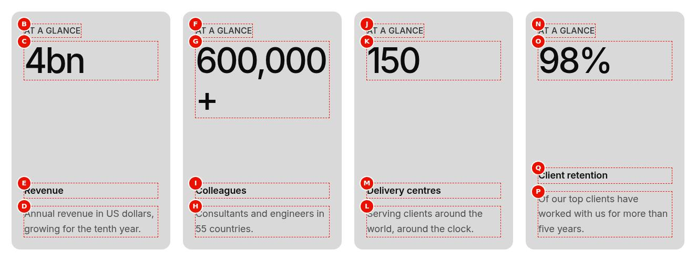

**Mixed card style** — A 3-column row at 1440 px with Card style Mixed: the image card "The agentic bank" (photo-1.svg), the dark #20293c panel "Responsible AI" (no image) with "Explore", and the gradient report card "State of AI 2026" (Content type Report) with the kicker "Report", "04 Sep 26" and a Download button.

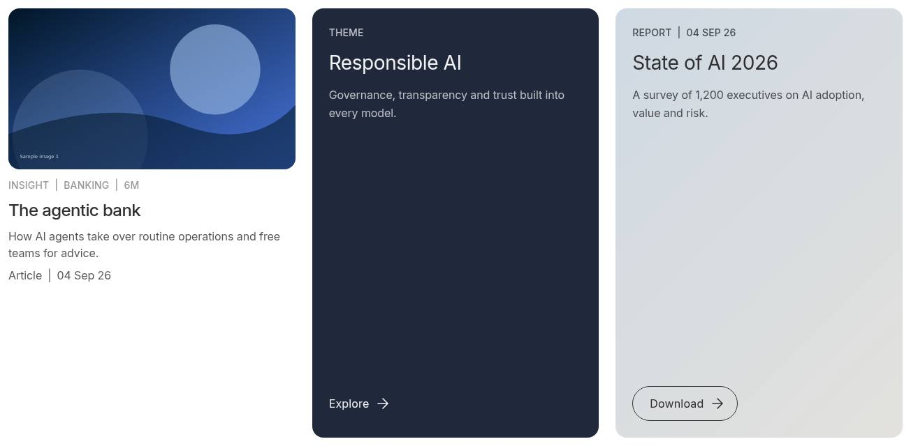

**Feature card** — At 1440 px a full-width feature card (about 35.6rem high) with wide.svg filling it under a white gradient from the left, the two tag labels and "12m" and the large title "Building the agentic enterprise" (no description); below it three image cards ("Cloud at scale", "Supply chain resilience", "Personalisation in retail") in a 3-column row.

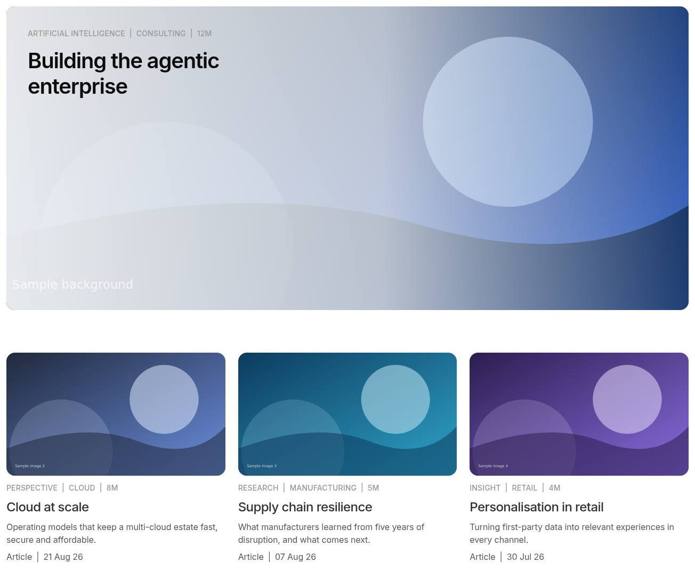

**Rows of links** — Four full-width rows of links at 1440 px, each with the uppercase eyebrow and first tag, a large title ("The agentic bank", "Cloud at scale", ...), a description, the date and a grey arrow on the right, separated by thin grey lines (Dividers between rows); the pointer is on the second row, whose arrow is blue and moved.

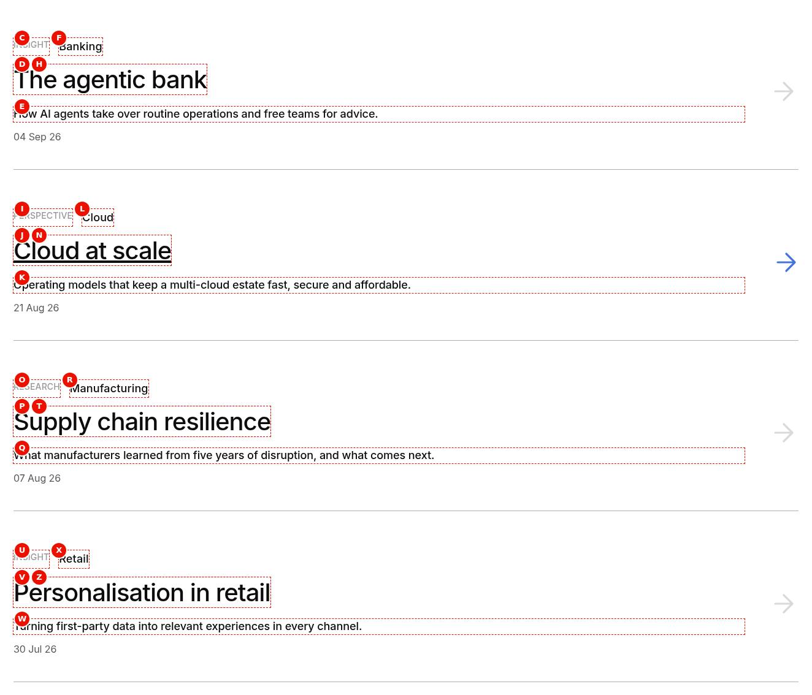

**Dark card colour** — At 1024 px two cards side by side (Tablet columns 2) on dark #20293c with light text: the statistic "4bn" with "At a glance", "Revenue" and its description, and the report card "State of AI 2026" with the kicker "Report", "04 Sep 26", the description and a light outlined Download button.

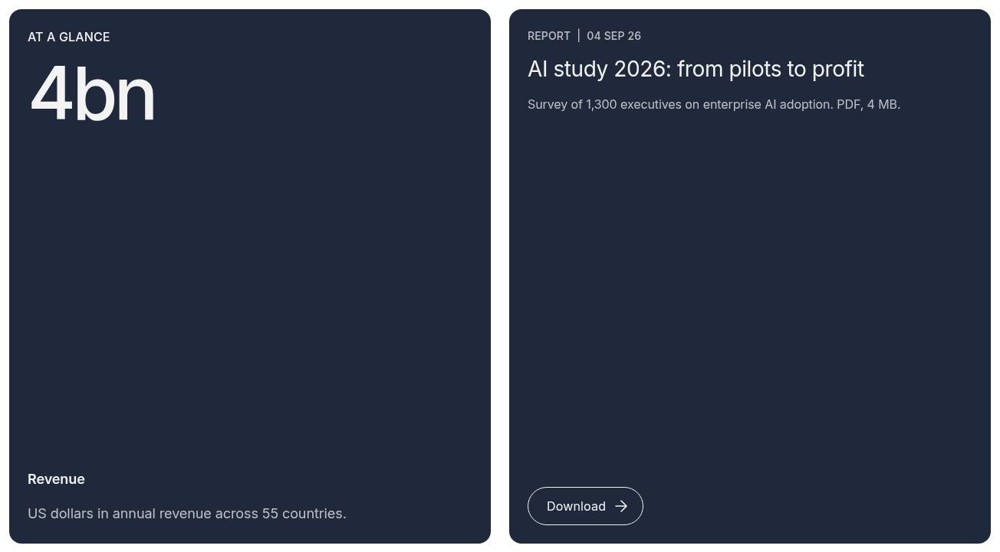

**Navy card colour** — Three 2:3 report cards in a 3-column row at 1440 px on near-black navy (#011627) with light text: the kicker "Report" with the date, the titles "State of AI 2026", "Cloud value index" and "Supply chain outlook", muted descriptions and a light outlined Download button at the bottom.

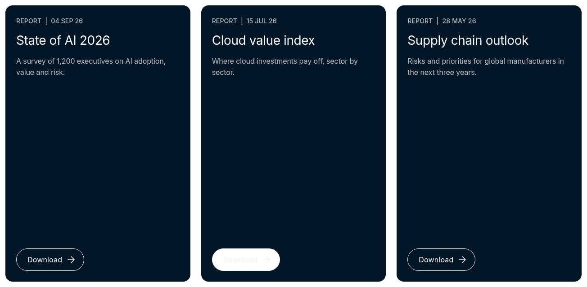

**Brand blue card colour** — At 402 px a single brand blue (#4673db) statistic card filling the column: "At a glance" at the top, the white number "600,000+", and at the bottom the label "Colleagues" with the description in 60 % white.

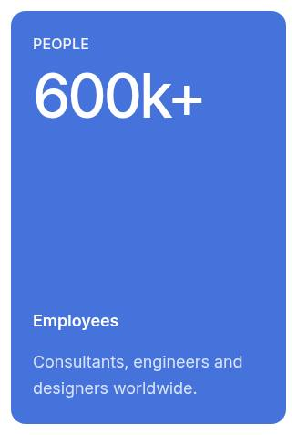

**Light blue card colour** — At 402 px a single light blue statistic card filling the column: "At a glance" at the top, the black number "150", and at the bottom the label "Delivery centres" with a dark description.

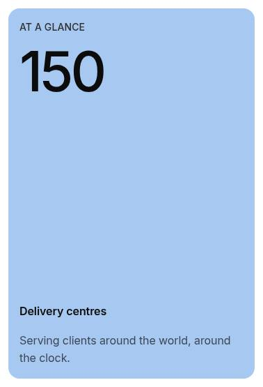

**Light grey card colour** — Three 2:3 panels in a 3-column row at 1440 px on light grey (#d9d9d9) with black text instead of the dark panel default: the kicker "Theme", the titles "Responsible AI", "Sustainable operations" and "Resilient enterprises", the descriptions and a black "Explore" link.

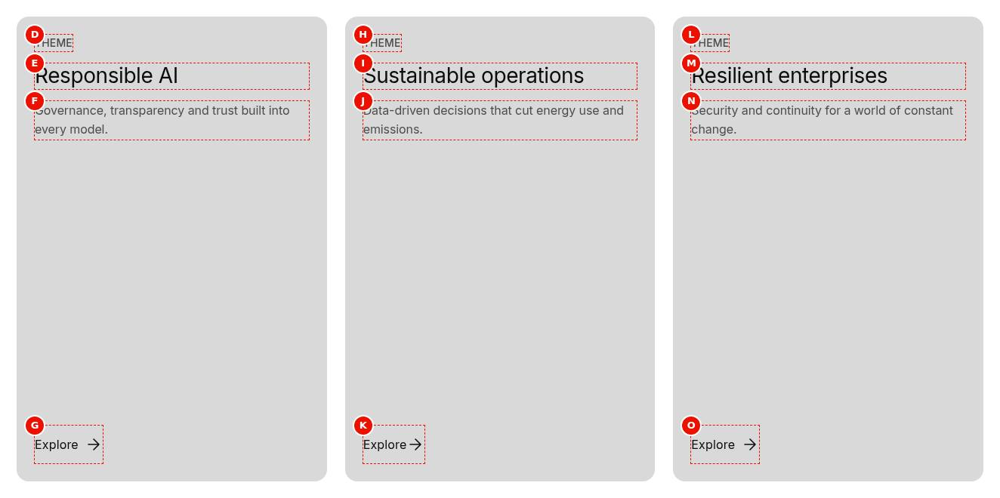

**Mid grey card colour** — At 402 px a single mid grey (#999) statistic card filling the column: "At a glance" at the top, the black number "98%", and at the bottom the label "Client retention" with a dark grey description.

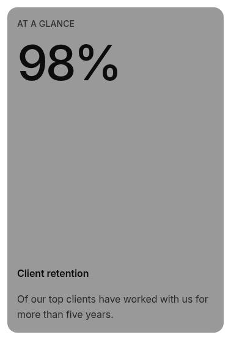

**Grey gradient card colour** — At 402 px a single statistic card on the diagonal light blue-grey to warm grey gradient: "At a glance" at the top, the dark number "4bn", and at the bottom the label "Revenue" with its description.

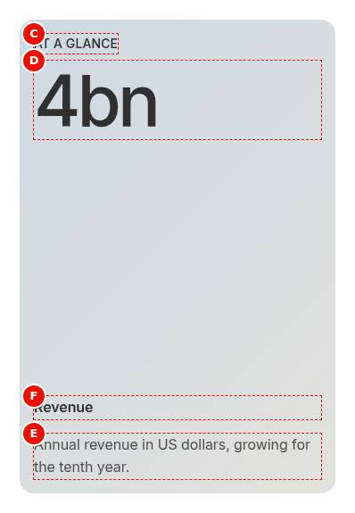

**Image background card colour** — At 402 px a single tall 2:3 panel whose image light.svg covers the whole card, with the kicker "Theme", the title "Future-ready cities", the description and the "Explore" link in dark text on top of the image (no overlay).

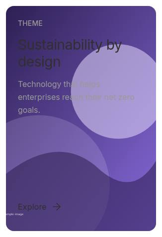

**Square image ratio** — Three image cards in a 3-column row at 1440 px with square images (square-1.svg to square-3.svg), the kickers "Consulting", "Cloud" and "Security", the titles "Business and technology consulting", "Cloud migration and operations" and "Cyber defence and resilience" and their descriptions; no meta row (no content type or date).

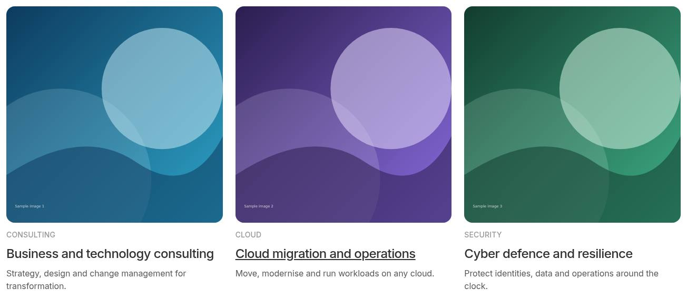

**4:3 image ratio** — Three image cards in a 3-column row at 1440 px with 4:3 images (photo-4.svg to photo-6.svg), kickers with eyebrow, tag label and reading time, the titles "Personalisation in retail", "The energy transition" and "Quantum readiness", descriptions and the meta rows "Article" with "30 Jul 26", "16 Jul 26" and "02 Jul 26".

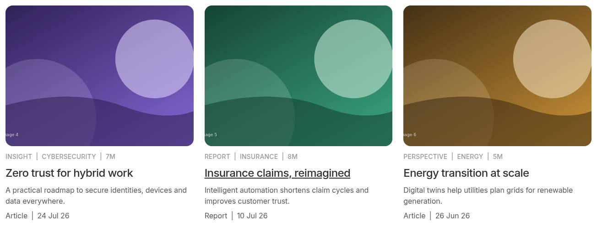

**3:2 image ratio** — Three image cards in a 3-column row at 1440 px with 3:2 images (photo-6.svg to photo-8.svg), the titles "Quantum readiness", "The future of work" and "Touchless insurance claims", descriptions and the meta rows "Article" with "02 Jul 26", "Article" with "18 Jun 26" and "Case study" with "04 Jun 26".

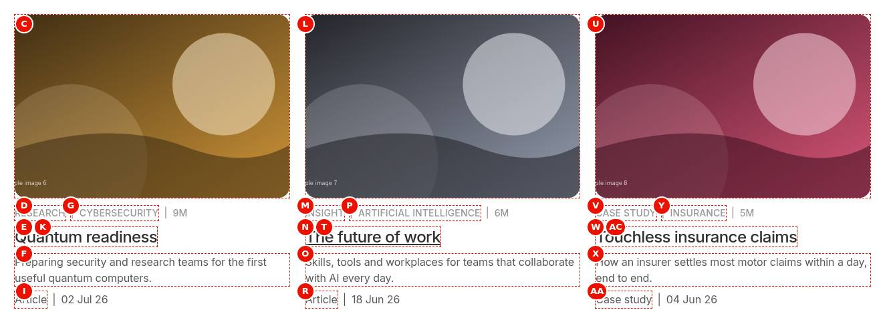

**Compact panel height** — Four nearly square (9:10) light grey statistic cards in a row at 1440 px instead of tall 2:3 ones, each with "At a glance", the number ("4bn", "600,000+", "150", "98%"), the label and the description.

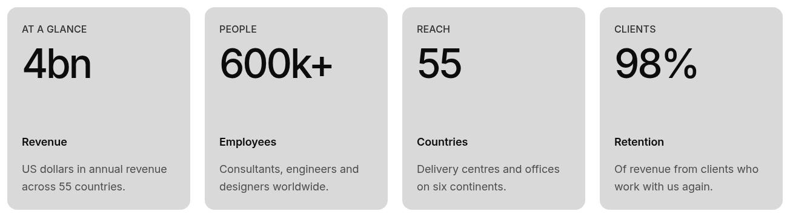

**Content panel height** — Three dark #20293c panels in a 3-column row at 1440 px whose height fits their text instead of the 2:3 shape; with Stretch cards to row height on they share the tallest height, each with the kicker "Theme", the title, the description and "Explore" at the bottom.

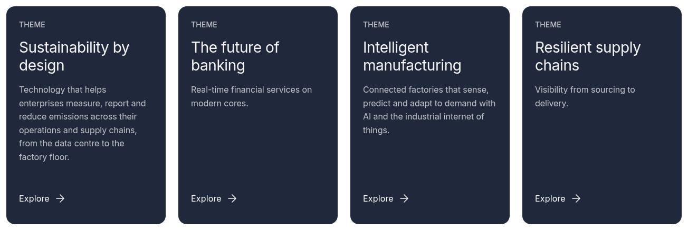

**Compact statistic title** — Three light grey statistic cards in a 3-column row at 1440 px with medium-size titles ("Net zero by 2030", "1 million learners", "50% women leaders") instead of huge numbers, the kicker "Our commitment", the labels "Climate", "Skills" and "Inclusion", descriptions and an outlined "Read more" button each.

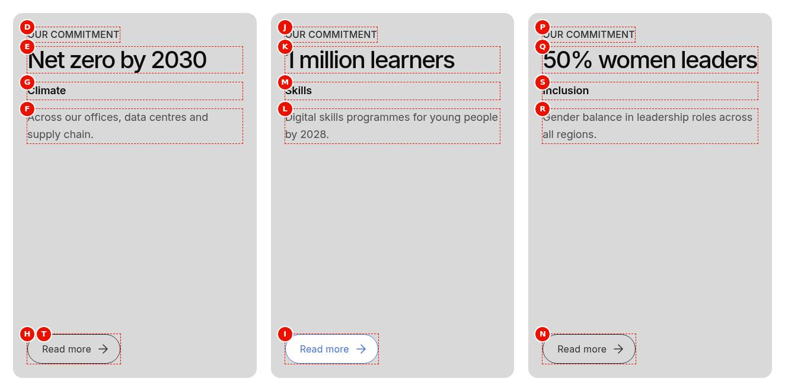

**Dividers between rows** — Three rows of links at 1440 px separated by thin grey (#b2b2b2) lines, each with the eyebrow ("Perspective", "Research", "Insight"), the large title ("The energy transition", "Quantum readiness", "The future of work"), the description, the date and a grey arrow on the right.

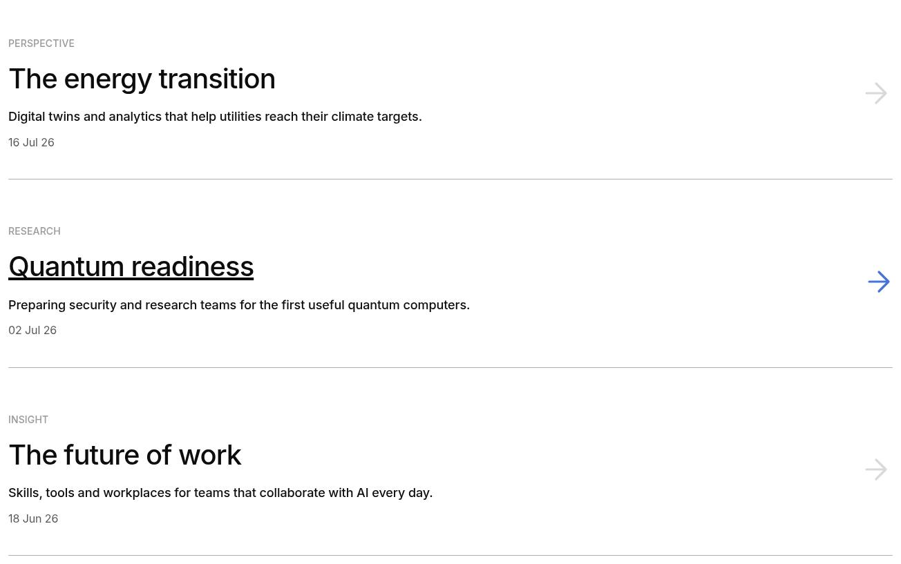

**Centred header** — At 1440 px the title "Our company at a glance", its description and the "About us" text link centred above a row of four compact (9:10) light grey statistic cards ("4bn", "600,000+", "150", "98%").

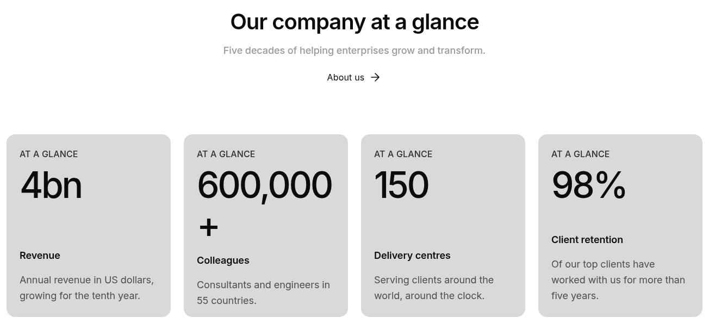

**Header call to action** — One section at 1440 px with two Cards blocks in a single capture: "Latest insights" with a "View all" text link on the right above four insight image cards, then "Our services" with a filled primary "Explore services" button above four service image cards.

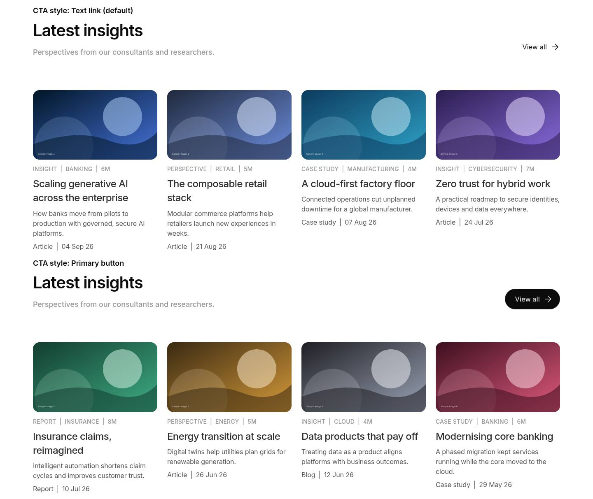

**Grid on every breakpoint** — At 1440 px eight image cards in two rows of four (default Grid, 4 columns), from "The agentic bank" to "Touchless insurance claims"; only the desktop layout is captured (below 600 px the cards would stack in one column).

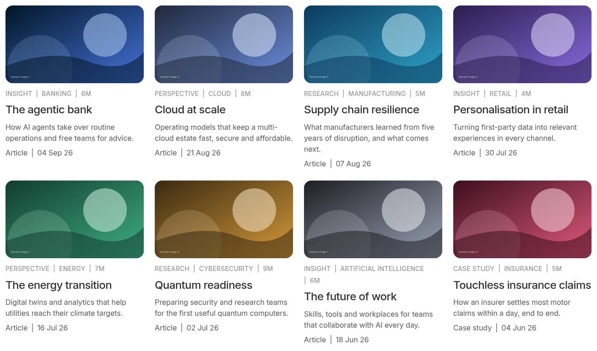

**Horizontal scroll on every breakpoint** — At 1440 px a scrolling row with 4.2 image cards visible, the fifth cut off at the right screen edge (bleed), with the scroll indicator and the round previous / next buttons below (Previous disabled at the start); only the desktop layout is captured.

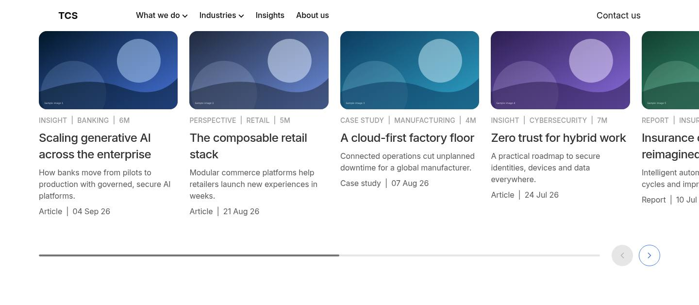

**Desktop-only scroll** — At 1440 px a scrolling row of the six image cards with 4.2 visible, the fifth cut off at the screen edge, and the previous / next buttons at the bottom right; only the desktop layout is captured (tablet would be a 2-column grid, mobile one column).

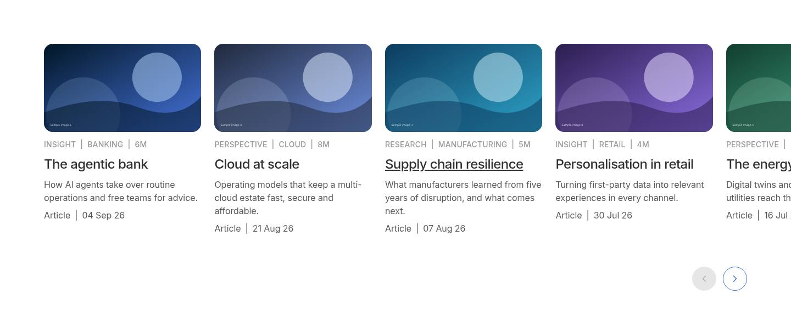

**Tablet-only scroll** — At 1024 px a scrolling row with 2.5 image cards visible ("The agentic bank", "Cloud at scale" and half of "Supply chain resilience"), cut off at the right edge, without buttons or indicator (tablet defaults off).

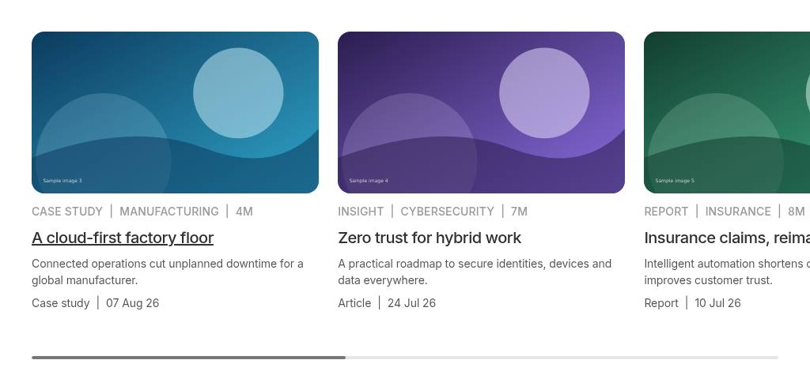

**Mobile-only scroll** — At 402 px a rail of light grey statistic cards with 1.2 visible: "4bn" and part of "600,000+" peeking at the right edge, with the grey scroll indicator below.

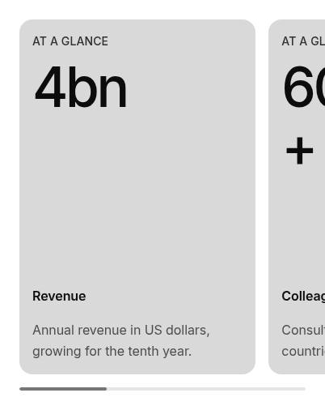

**Desktop and tablet scroll** — At 1024 px a scrolling row with 3.3 image cards visible, the fourth cut off at the right edge, and the previous / next buttons at the bottom right (Previous disabled at the start).

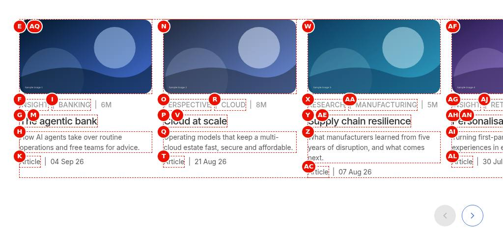

**Desktop and mobile scroll** — At 402 px a rail of image cards with 1.2 visible, "The agentic bank" and part of "Cloud at scale" at the right edge, with the grey scroll indicator below (mobile buttons off by default).

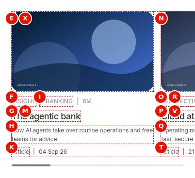

**Tablet and mobile scroll** — At 1024 px a scrolling row with 3.3 image cards visible, the fourth cut off at the right edge, and a thin grey scroll indicator below; no previous / next buttons.

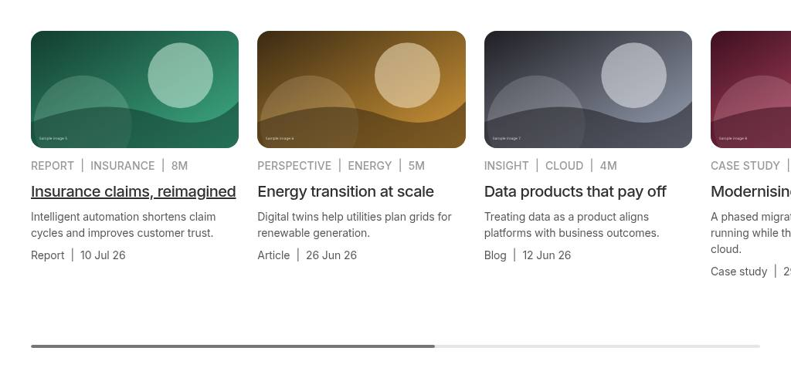

**Previous and next buttons** — At 1440 px a scrolling row of six image cards with 4.2 visible and two round chevron icon buttons at the bottom right under the row; the Previous button is disabled at the start and Next is enabled.

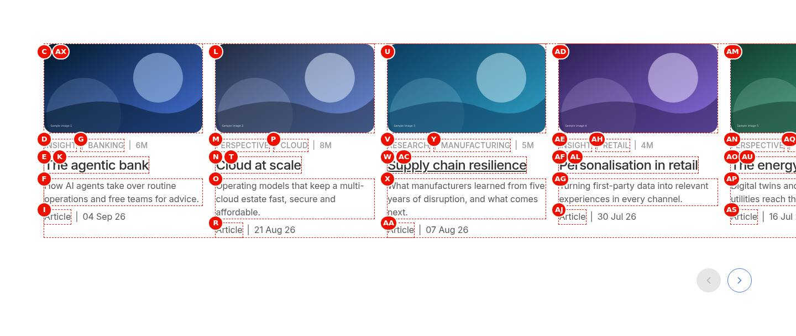

**Scroll indicator** — At 1440 px a scrolling row of six image cards with 4.2 visible and below it a 4-pixel light grey track with a darker grey thumb at the start whose width shows the visible share; no buttons.

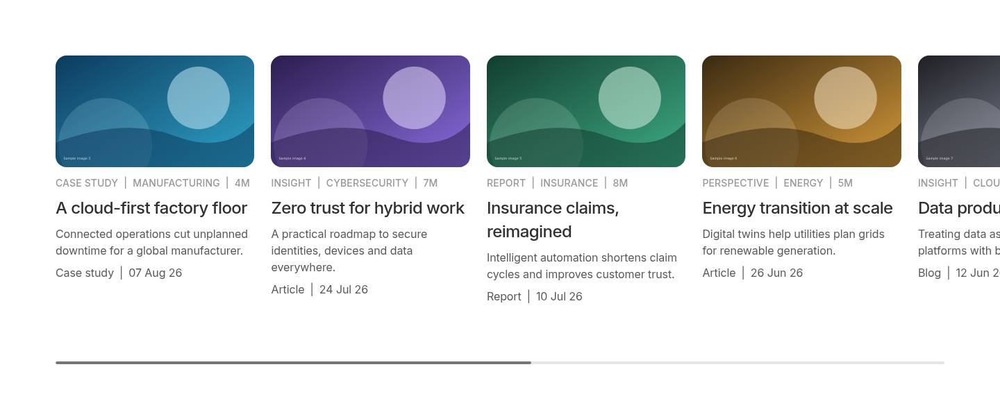

**Fixed card width** — At 1440 px a scrolling row of fixed 320 px (20rem) image cards, about four visible with the last cut off at the screen edge, and the previous / next buttons below.

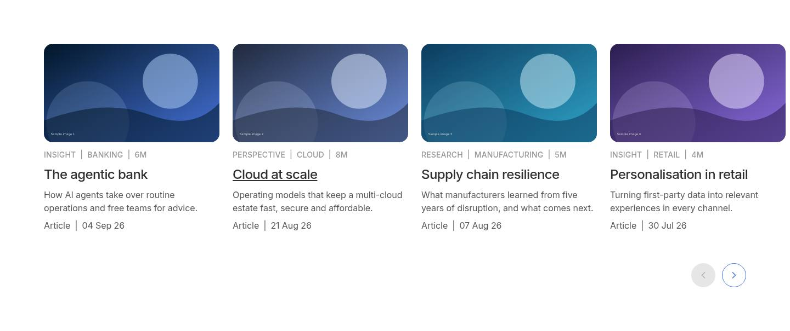

**Scroller inside the content width** — One section at 1440 px with two desktop rails of five image cards in a single capture: in the first (bleed) the last visible card is cut by the screen edge; in the second (Inside the content width) it is cut at the section's right padding. Both have previous / next buttons.

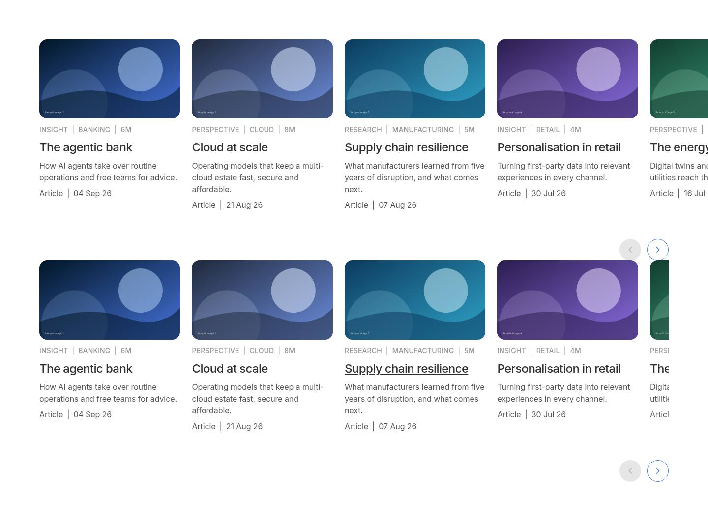

**Centre snap alignment** — At 402 px a rail of service image cards opened at the second card (Initial item index 1): "Cloud migration and operations" centred, with parts of the first and third cards visible on both sides, and the scroll indicator below.

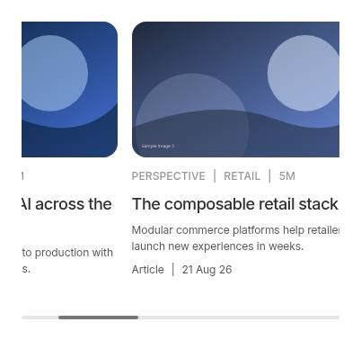

**Viewport scroll step** — At 1440 px the rail of eight image cards after one click on Next (a single capture, not before and after): the next set of cards fills the view and the Previous button is enabled.

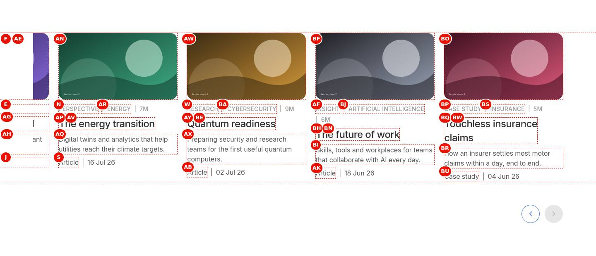

**Loop** — At 1440 px the rail of six image cards scrolled to its end ("Quantum readiness" visible at the right) with the Next button still enabled because Loop is on; the capture shows the end state, not the return to the first card.

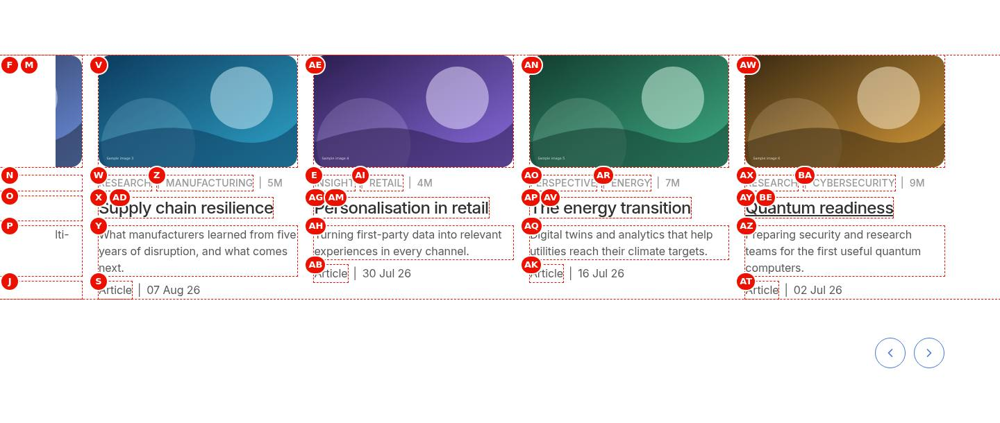

**Initial item** — At 1440 px a rail of six image cards that opens scrolled to its third card, "Supply chain resilience", at the left edge (Initial item index 2), with the Previous button enabled.

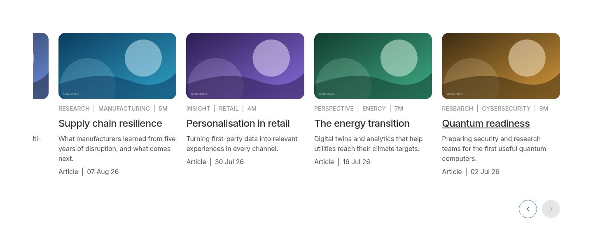

**Equal card height** — At 1440 px six dark #20293c panels (Panel height Content) in two rows of three with the same height, although the second row ("Banking", "Retail", "Manufacturing", with one-line descriptions) has much shorter texts than the first.

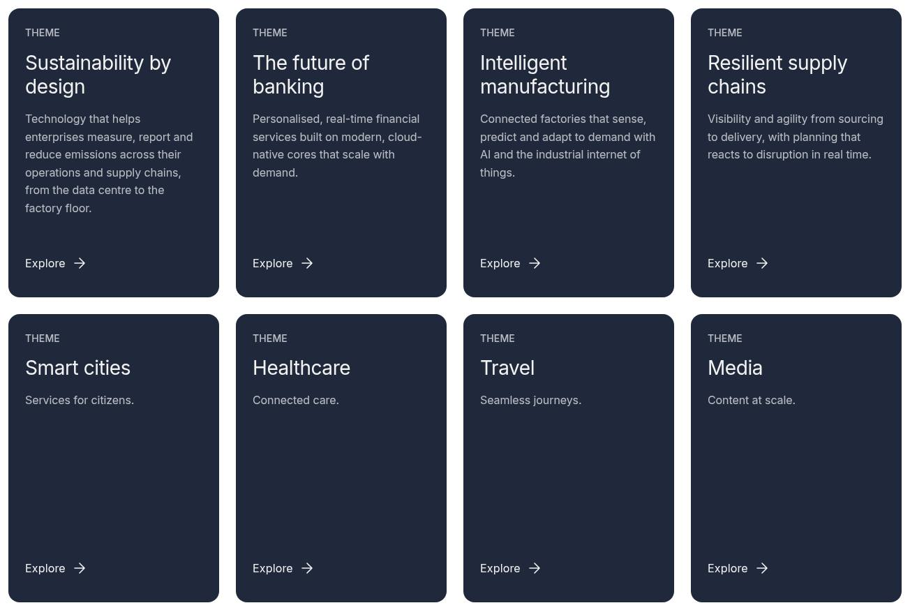

**Cards not stretched** — At 1440 px three image cards in a 3-column row ("Business and technology consulting", "Cloud migration and operations", "Cyber defence and resilience") of different heights, aligned to the top of the row.


**Unlinked cards** — At 1440 px four compact (9:10) light grey statistic cards ("4bn", "600,000+", "150", "98%") without any link or button; the pointer rests on the second card and shows no hand cursor or link styling.

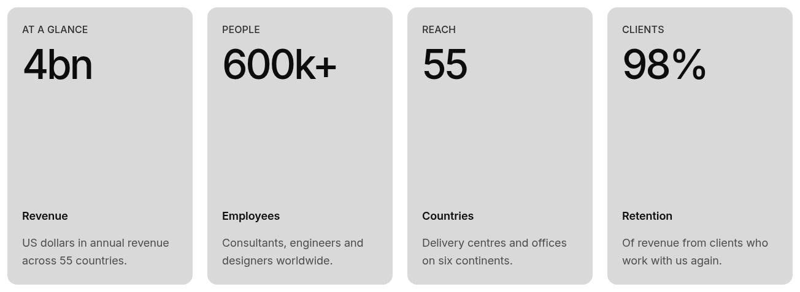

**New-tab links** — At 1440 px three image cards in a 3-column row; the pointer is on the third card's title "Partner summit 2026" (Event, "20 Oct 26"), which links to https://www.example.com/partner-summit in a new tab; the browser status bar isn't part of the page capture.

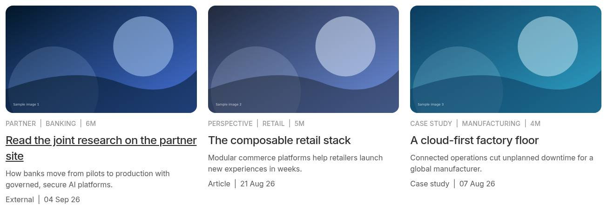

**Legacy cards in the new design** — At 1440 px an older Cards block (image and rich text cells, no block settings) rendered in the new design as four image cards in a row: each heading ("Business and technology consulting", ...) as the title, the sentence as description and "Learn more" as the call to action text link.

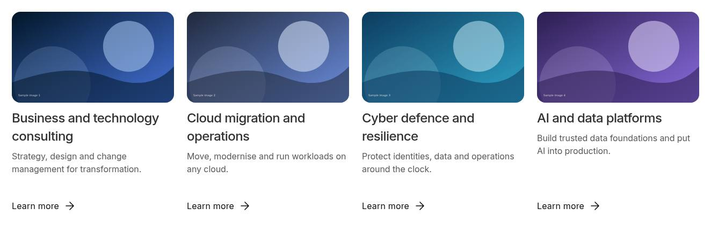

**Empty state** — In Universal Editor edit mode at 1440 px: the header "Our services" with its description, and below it a grey box with "Add a Card to the block and give it a title, a description or an image."

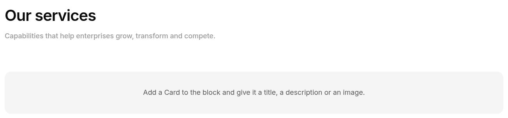

**Universal Editor canvas** — An annotated preview in editor mode at 1440 px (not a Universal Editor screenshot): the header "Our services" with description and "View all services" (A to C) and a rail of four service image cards with 3.2 visible (D to J), with buttons and indicator (K). The content tree with its four Card items (L) isn't part of the capture. (Annotated preview in editor mode with sample content; letters as in the annotations list, not a Universal Editor screenshot; file screenshots/cards-authoring-view.jpg)

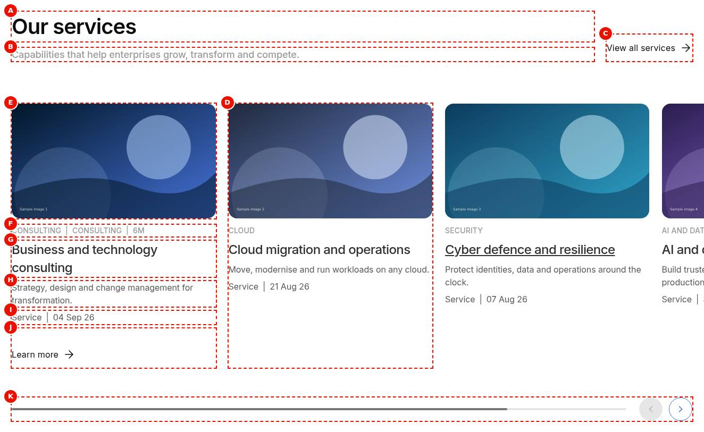

**Properties panel** — The Universal Editor properties panel of a selected Cards block showing the tabs Content, Cards, Layout, Scroll, Advanced and Additional, with the Cards tab open (Display as teaser, Card style, Card colour, Image ratio, Panel height, First card as feature, the Show switches, Date format, Image loading). (Dialog reference generated from the component model, not a Universal Editor screenshot; file screenshots/cards-properties-panel.jpg)

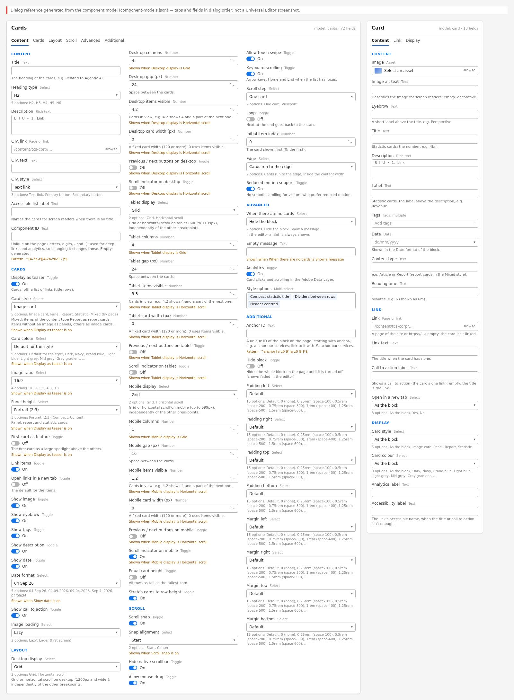

Universal Editor dialogs (no screenshot exists yet; to be captured on AEM author):

```text
[Screenshot Placeholder]

File name:
cards-dialog-content-desktop.png

Purpose:
The Content tab of the Cards properties in Universal Editor, with the fields of the table "Content tab — Cards" in Authorable Fields below.

Annotations:
A = Title
B = Heading type
C = Description
D = CTA link
E = CTA text
F = CTA style
G = Accessible list label
```

```text
[Screenshot Placeholder]

File name:
cards-dialog-display-desktop.png

Purpose:
The Display tab of the Cards properties in Universal Editor, with the fields of the table "Display tab — Cards" in Authorable Fields below.

Annotations:
A = Display as teaser
B = Card style
C = Card colour
D = Image ratio
E = Panel height
F = First card as feature
G = Link items
H = Open links in a new tab
I = Show image
J = Show eyebrow
```

```text
[Screenshot Placeholder]

File name:
cards-dialog-additional-desktop.png

Purpose:
The Additional tab of the Cards properties in Universal Editor, with the fields of the table "Additional tab — Cards" in Authorable Fields below.

Annotations:
A = Anchor ID
B = Hide block
C = Animation Type
D = Motion Speed
E = Animation Trigger
F = Padding left
G = Padding right
H = Padding top
I = Padding bottom
J = Margin left
```

```text
[Screenshot Placeholder]

File name:
card-dialog-content-desktop.png

Purpose:
The Content tab of the Card properties in Universal Editor, with the fields of the table "Content tab — Card" in Authorable Fields below.

Annotations:
A = Image
B = Image alt text
C = Eyebrow
D = Title
E = Description
F = Label
G = Tags
H = Date
I = Content type
J = Reading time
```

```text
[Screenshot Placeholder]

File name:
card-dialog-link-desktop.png

Purpose:
The Link tab of the Card properties in Universal Editor, with the fields of the table "Link tab — Card" in Authorable Fields below.

Annotations:
A = Link
B = Link text
C = Call to action label
D = Open in a new tab
```

```text
[Screenshot Placeholder]

File name:
card-dialog-display-desktop.png

Purpose:
The Display tab of the Card properties in Universal Editor, with the fields of the table "Display tab — Card" in Authorable Fields below.

Annotations:
A = Card style
B = Card colour
C = Analytics label
D = Accessibility label
```

<!-- END GENERATED: screenshots -->

The handover screenshots and the properties panel reference show the dialog tabs used before handover 2.8 (Content, Cards, Layout, Scroll, Advanced, Additional). The dialog now has **Content**, **Display** and **Additional**; the fields and stored values are unchanged. The states below have no screenshot yet.

```text
[Screenshot Placeholder]

File name:
cards-universal-editor-desktop.png

Purpose:
A Cards block selected in Universal Editor (AEM author), with the content tree showing the block and its Card items and the properties panel with the Content / Display / Additional tabs.

Annotations:
A = Cards block in the content tree
B = Card items (add, duplicate, delete, drag to reorder)
C = Properties panel tabs
D = Rendered cards on the canvas
```

```text
[Screenshot Placeholder]

File name:
cards-editor-placeholder-item-desktop.png

Purpose:
In Universal Editor edit mode, a Card just added with Add (no title, description or image yet) shown as a dashed placeholder after the rendered cards, with the hint text.

Annotations:
A = Rendered cards
B = Dashed placeholder item
C = Hint "This card isn't shown yet: give it a title, a description or an image."
```

```text
[Screenshot Placeholder]

File name:
cards-focus-states-desktop.png

Purpose:
Keyboard focus: the focus ring on a card link (inside the card edge on panel, report and statistic cards), on the focused scroller and on the previous / next buttons.

Annotations:
A = Focus ring on a card's link
B = Focus ring on the scroller region
C = Focused Next button
```

```text
[Screenshot Placeholder]

File name:
cards-empty-message-published-desktop.png

Purpose:
On the published page, a Cards block without cards with When there are no cards = Show a message: the header and the Empty message.

Annotations:
A = Header
B = Empty message
```

```text
[Screenshot Placeholder]

File name:
cards-dark-section-desktop.png

Purpose:
Image cards inside a Section with Style Dark (theme contract): light title, description and meta text; panel, report and statistic cards keep their Card colour.

Annotations:
A = Image card with light text
B = Panel card with its own colour
```

```text
[Screenshot Placeholder]

File name:
cards-rows-of-links-mobile.png

Purpose:
Rows of links (Display as teaser off) at mobile width: eyebrow and tag, title, description, date and arrow stacked.

Annotations:
A = Kicker
B = Title link
C = Arrow
```

## For Content Authors

1. **Add the block.** In Universal Editor select a Section, a Columns Container column or a Tabs Container, use **Add (+)** and choose **Cards**.
2. **Open its properties.** Select the Cards block (not a Card) in the content tree; the properties panel has the tabs **Content**, **Display** and **Additional**. Universal Editor collapses tabs that don't fit on one line into a dropdown.
3. **Enter the header (Content tab).** Title and Heading type (H2 under the page H1), an optional Description, and a CTA link with CTA text and CTA style for a "View all" link. Without a Title, fill **Accessible list label** so screen readers can name the cards.
4. **Choose the presentation (Display tab).** Display as teaser (cards; off: rows of links), Card style, Card colour, Image ratio, Panel height, First card as feature, the Show switches, Date format and Image loading.
5. **Choose the layout per breakpoint (Display tab).** For Desktop, Tablet and Mobile choose Grid (columns) or Horizontal scroll (items visible or a card width, previous / next buttons, scroll indicator), and the gap. The scroll options (snap, step, loop, initial item, edge) appear once a breakpoint scrolls.
6. **Add the cards.** Select the Cards block and use **Add (+)** → **Card**. In each Card fill at least a Title, a Description or an Image (otherwise the card isn't shown). Add a Link (a page from the picker, or `https://…`) and, for a button, a Call to action label. Duplicate, delete and drag Cards in the content tree to reorder them; cards render in the content tree order.
7. **Exceptions per card (Card › Display tab).** Card style and Card colour override the block's for one card; Analytics label and Accessibility label are optional.
8. **Preview.** Switch Universal Editor to Preview, or open the page on aem.page; check every breakpoint (desktop from 1200px, tablet 600–1199px, mobile below 600px).
9. **Publish** the page, and the images it uses, from AEM.
10. **Validate the published output** on aem.live: every card is shown, links and calls to action open the right page, tag labels are taxonomy labels, panel texts aren't clipped.

- **Minimum required:** one Card with a Title, a Description or an Image. No field is required in the model.
- **Recommended:** a block Title (or Accessible list label); a Title, Image alt text (for informative images) and Link on every Card; one Card style for the whole block; each breakpoint set explicitly.
- **Optional:** header Description and CTA; Eyebrow, Label, Tags, Date, Content type, Reading time; per-card style and colour; Style options; the scroll options; the Additional tab.

## Authorable Fields

<!-- BEGIN GENERATED: fields (npm run build:docs) -->

### Cards (`cards`)

Model `cards`; template name "Cards" (the block class AEM renders); key-value block (one row per property); children: `card`.

Stored on a new component (definition template): `titleType` = `"h2"`, `displayAsTeaser` = `true`, `cardStyle` = `"image"`, `imageRatio` = `"16-9"`, `panelHeight` = `"portrait"`, `linkItems` = `true`, `showImage` = `true`, `showEyebrow` = `true`, `showTags` = `true`, `showDescription` = `true`, `showDate` = `true`, `dateFormat` = `"dd-mmm-yy"`, `showCta` = `true`, `imageLoading` = `"lazy"`, `desktopMode` = `"grid"`, `desktopColumns` = `4`, `tabletMode` = `"grid"`, `tabletColumns` = `4`, `mobileMode` = `"grid"`, `mobileColumns` = `1`, `scrollSnap` = `true`, `emptyBehavior` = `"hide"`, `analyticsEnabled` = `true`.

#### Content tab — Cards

| Field label | Property | Type | Required | Default | Allowed values | Author guidance | Example |
| ----------- | -------- | ---- | -------- | ------- | -------------- | --------------- | ------- |
| Title | `title` | text | No | — | — | The heading of the cards, e.g. Related to Agentic AI. | Our services |
| Heading type | `titleType` | select | No | `h2` | H2 (`h2`), H3 (`h3`), H4 (`h4`), H5 (`h5`), H6 (`h6`) | Delivered with `title` (field collapse). | h2 |
| Description | `description` | richtext | No | — | — | — | — |
| CTA link | `link` | aem-content | No | — | — | — | /language-master/en/curated-design-pages/insights |
| CTA text | `linkText` | text | No | — | — | Delivered with `link` (field collapse). | View all insights |
| CTA style | `linkType` | select | No | "" | Text link (""), Primary button (`primary`), Secondary button (`secondary`) | Delivered with `link` (field collapse). | primary |
| Accessible list label | `listLabel` | text | No | — | — | Names the cards for screen readers when there is no title. | — |

#### Display tab — Cards

| Field label | Property | Type | Required | Default | Allowed values | Author guidance | Example |
| ----------- | -------- | ---- | -------- | ------- | -------------- | --------------- | ------- |
| Display as teaser | `displayAsTeaser` | boolean | No | `true` | on / off | Cards; off: a list of links (title rows). | false |
| Card style | `cardStyle` | select | No | `image` | Image card (`image`), Panel (`panel`), Report (`report`), Statistic (`stat`), Mixed (`mixed`) | A style here applies to every card (an item's own Card style still wins). Mixed: each card's own style, else (List) the page's card-style metadata, else Report content as report cards, cards without an image as panels, the others as image cards. Shown when `displayAsTeaser` is `true`. | image |
| Card colour | `cardTheme` | select | No | "" | Default for the style (""), Dark (`dark`), Navy (`navy`), Brand blue (`brand`), Light blue (`brand-light`), Light grey (`grey`), Mid grey (`mid-grey`), Grey gradient (`gradient`), Image background (`image`) | Panel, report and statistic cards (image cards keep their image). A colour here applies to every card (an item's own Card colour still wins). Default for the style: the card's own colour, else (List) the page's card-theme metadata, else the style's colour. Shown when `displayAsTeaser` is `true`. | dark |
| Image ratio | `imageRatio` | select | No | `16-9` | 16:9 (`16-9`), 1:1 (`1-1`), 4:3 (`4-3`), 3:2 (`3-2`) | Shown when `displayAsTeaser` is `true`. | 1-1 |
| Panel height | `panelHeight` | select | No | `portrait` | Portrait (2:3) (`portrait`), Compact (`compact`), Content (`auto`) | Panel, report and statistic cards. Shown when `displayAsTeaser` is `true`. | compact |
| First card as feature | `featureFirst` | boolean | No | `false` | on / off | The first card as a large spotlight above the others. Shown when `displayAsTeaser` is `true`. | true |
| Link items | `linkItems` | boolean | No | `true` | on / off | — | — |
| Open links in a new tab | `openInNewTab` | boolean | No | `false` | on / off | The default for the items. | — |
| Show image | `showImage` | boolean | No | `true` | on / off | — | — |
| Show eyebrow | `showEyebrow` | boolean | No | `true` | on / off | — | — |
| Show tags | `showTags` | boolean | No | `true` | on / off | — | false |
| Show description | `showDescription` | boolean | No | `true` | on / off | On image cards and link rows; panel, report and statistic cards always show theirs. | — |
| Show date | `showDate` | boolean | No | `true` | on / off | — | false |
| Date format | `dateFormat` | select | No | `dd-mmm-yy` | 04 Sep 26 (`dd-mmm-yy`), 04-09-2026 (`dd-mm-yyyy`), 09-04-2026 (`mm-dd-yyyy`), Sep 4, 2026 (`mmm-d-yyyy`), 04/09/26 (`dd/mm/yy`), 4th September 2026 (`do-mmmm-yyyy`) | Shown when `showDate` is `true`. | — |
| Show call to action | `showCta` | boolean | No | `true` | on / off | — | false |
| Image loading | `imageLoading` | select | No | `lazy` | Lazy (`lazy`), Eager (first screen) (`eager`) | — | — |
| Desktop display | `desktopMode` | select | No | `grid` | Grid (`grid`), Horizontal scroll (`horizontal-scroll`) | Grid or horizontal scroll on desktop (1200px and wider), independently of the other breakpoints. | horizontal-scroll |
| Desktop columns | `desktopColumns` | number | No | `4` | — | Shown when `desktopMode` is `grid`. | 3 |
| Desktop gap (px) | `desktopGap` | number | No | `24` | — | Space between the cards. | — |
| Desktop items visible | `desktopVisible` | number | No | `4.2` | — | Cards in view, e.g. 4.2 shows 4 and a part of the next one. Shown when `desktopMode` is `horizontal-scroll`. | — |
| Desktop card width (px) | `desktopCardWidth` | number | No | `0` | — | A fixed card width (120 or more); 0 uses Items visible. Shown when `desktopMode` is `horizontal-scroll`. | 320 |
| Previous / next buttons on desktop | `desktopControls` | boolean | No | `false` | on / off | Shown when `desktopMode` is `horizontal-scroll`. | true |
| Scroll indicator on desktop | `desktopIndicator` | boolean | No | `false` | on / off | Shown when `desktopMode` is `horizontal-scroll`. | true |
| Tablet display | `tabletMode` | select | No | `grid` | Grid (`grid`), Horizontal scroll (`horizontal-scroll`) | Grid or horizontal scroll on tablet (600 to 1199px), independently of the other breakpoints. | horizontal-scroll |
| Tablet columns | `tabletColumns` | number | No | `4` | — | Shown when `tabletMode` is `grid`. | 2 |
| Tablet gap (px) | `tabletGap` | number | No | `24` | — | Space between the cards. | — |
| Tablet items visible | `tabletVisible` | number | No | `3.3` | — | Cards in view, e.g. 4.2 shows 4 and a part of the next one. Shown when `tabletMode` is `horizontal-scroll`. | 2.5 |
| Tablet card width (px) | `tabletCardWidth` | number | No | `0` | — | A fixed card width (120 or more); 0 uses Items visible. Shown when `tabletMode` is `horizontal-scroll`. | — |
| Previous / next buttons on tablet | `tabletControls` | boolean | No | `false` | on / off | Shown when `tabletMode` is `horizontal-scroll`. | true |
| Scroll indicator on tablet | `tabletIndicator` | boolean | No | `false` | on / off | Shown when `tabletMode` is `horizontal-scroll`. | true |
| Mobile display | `mobileMode` | select | No | `grid` | Grid (`grid`), Horizontal scroll (`horizontal-scroll`) | Grid or horizontal scroll on mobile (up to 599px), independently of the other breakpoints. | horizontal-scroll |
| Mobile columns | `mobileColumns` | number | No | `1` | — | Shown when `mobileMode` is `grid`. | 1 |
| Mobile gap (px) | `mobileGap` | number | No | `16` | — | Space between the cards. | — |
| Mobile items visible | `mobileVisible` | number | No | `1.2` | — | Cards in view, e.g. 4.2 shows 4 and a part of the next one. Shown when `mobileMode` is `horizontal-scroll`. | 1.2 |
| Mobile card width (px) | `mobileCardWidth` | number | No | `0` | — | A fixed card width (120 or more); 0 uses Items visible. Shown when `mobileMode` is `horizontal-scroll`. | — |
| Previous / next buttons on mobile | `mobileControls` | boolean | No | `false` | on / off | Shown when `mobileMode` is `horizontal-scroll`. | — |
| Scroll indicator on mobile | `mobileIndicator` | boolean | No | `true` | on / off | Shown when `mobileMode` is `horizontal-scroll`. | — |
| Equal card height | `equalHeight` | boolean | No | `false` | on / off | All rows as tall as the tallest card. | true |
| Stretch cards to row height | `stretchCards` | boolean | No | `true` | on / off | — | false |
| Scroll snap | `scrollSnap` | boolean | No | `true` | on / off | Shown when `desktopMode` is `horizontal-scroll` or `tabletMode` is `horizontal-scroll` or `mobileMode` is `horizontal-scroll`. | — |
| Snap alignment | `snapAlign` | select | No | `start` | Start (`start`), Center (`center`) | Shown when `scrollSnap` is `true` and `desktopMode` is `horizontal-scroll` or `tabletMode` is `horizontal-scroll` or `mobileMode` is `horizontal-scroll`. | center |
| Hide native scrollbar | `hideScrollbar` | boolean | No | `true` | on / off | Shown when `desktopMode` is `horizontal-scroll` or `tabletMode` is `horizontal-scroll` or `mobileMode` is `horizontal-scroll`. | — |
| Allow mouse drag | `mouseDrag` | boolean | No | `true` | on / off | Shown when `desktopMode` is `horizontal-scroll` or `tabletMode` is `horizontal-scroll` or `mobileMode` is `horizontal-scroll`. | — |
| Keyboard scrolling | `keyboardScrolling` | boolean | No | `true` | on / off | Arrow keys, Home and End when the list has focus. Shown when `desktopMode` is `horizontal-scroll` or `tabletMode` is `horizontal-scroll` or `mobileMode` is `horizontal-scroll`. | — |
| Scroll step | `scrollStep` | select | No | `one-card` | One card (`one-card`), Viewport (`viewport`) | Shown when `desktopMode` is `horizontal-scroll` or `tabletMode` is `horizontal-scroll` or `mobileMode` is `horizontal-scroll`. | viewport |
| Loop | `loop` | boolean | No | `false` | on / off | Next at the end goes back to the start. Shown when `desktopMode` is `horizontal-scroll` or `tabletMode` is `horizontal-scroll` or `mobileMode` is `horizontal-scroll`. | true |
| Initial item index | `initialIndex` | number | No | `0` | — | The card shown first (0: the first). Shown when `desktopMode` is `horizontal-scroll` or `tabletMode` is `horizontal-scroll` or `mobileMode` is `horizontal-scroll`. | 1 |
| Edge | `edgePadding` | select | No | `bleed` | Cards run to the edge (`bleed`), Inside the content width (`none`) | Fixed-width sections only: the cards run into the section gutter. In full-width sections both look the same. Shown when `desktopMode` is `horizontal-scroll` or `tabletMode` is `horizontal-scroll` or `mobileMode` is `horizontal-scroll`. | none |
| When there are no cards | `emptyBehavior` | select | No | `hide` | Hide the block (`hide`), Show a message (`message`) | In the editor a hint is always shown. | message |
| Empty message | `emptyMessage` | text | No | — | — | Shown when `emptyBehavior` is `message`. | There are no cards to show yet. |
| Analytics | `analyticsEnabled` | boolean | No | `true` | on / off | Card clicks and scrolling in the Adobe Data Layer. | — |
| Style options | `classes` | multiselect | No | — | Compact statistic title (`stat-compact`), Dividers between rows (`dividers`), Header centred (`header-center`) | — | — |

#### Additional tab — Cards

| Field label | Property | Type | Required | Default | Allowed values | Author guidance | Example |
| ----------- | -------- | ---- | -------- | ------- | -------------- | --------------- | ------- |
| Anchor ID | `classes_anchor` | text | No | — | regExp: ^anchor-[a-z0-9][a-z0-9-]*$; customErrorMsg: Start with anchor-, then lower-case letters, digits and hyphens. | A unique ID of the block on the page, starting with anchor-, e.g. anchor-our-services; link to it with #anchor-our-services. Delivered as a block class. | — |
| Hide block | `classes_hideblock` | boolean | No | `false` | on / off | Hides the whole block on the page until it is turned off (shown faded in the editor). Delivered as a block class. | — |
| Animation Type | `classes_animation` | select | No | "" | None (""), Fade in (`motion-fade-in`), Fade up (`motion-fade-up`), Fade down (`motion-fade-down`), Fade left (`motion-fade-left`), Fade right (`motion-fade-right`), Slide up (`motion-slide-up`), Slide down (`motion-slide-down`), Slide left (`motion-slide-left`), Slide right (`motion-slide-right`), Scale in (`motion-scale-in`) | How the block's content appears; repeated items (cards, list items, accordion items, columns) appear one after another. None: shown as is. Not played in the editor or when the visitor prefers reduced motion. Delivered as a block class. | motion-fade-up |
| Motion Speed | `classes_animationspeed` | select | No | "" | Medium (""), Fast (`motion-fast`), Slow (`motion-slow`) | How fast the animation runs: 0.3, 0.6 or 0.9 seconds. Shown when `classes_animation` is set and `classes_animation` is not empty. Delivered as a block class. | motion-fast |
| Animation Trigger | `classes_animationtrigger` | select | No | "" | On Scroll / Viewport Entry (""), On Page Load (`motion-on-load`) | When the block's animations run. On Scroll: when the block comes into view (at once if it is in view when the page opens). On Page Load: as soon as the block is ready, wherever it is on the page. Shown when `classes_animation` is set and `classes_animation` is not empty. Delivered as a block class. | — |
| Padding left | `classes_paddingleft` | select | No | "" | Default (""), 0 (none) (`pl-0`), 0.25rem (space-100) (`pl-100`), 0.5rem (space-200) (`pl-200`), 0.75rem (space-300) (`pl-300`), 1rem (space-400) (`pl-400`), 1.25rem (space-500) (`pl-500`), 1.5rem (space-600) (`pl-600`), 2rem (space-800) (`pl-800`), 2.5rem (space-1000) (`pl-1000`), 3rem (space-1200) (`pl-1200`), 4rem (space-1600) (`pl-1600`), 5rem (space-2000) (`pl-2000`), 6rem (space-2400) (`pl-2400`), 7.5rem (space-3000) (`pl-3000`) | Delivered as a block class. | — |
| Padding right | `classes_paddingright` | select | No | "" | Default (""), 0 (none) (`pr-0`), 0.25rem (space-100) (`pr-100`), 0.5rem (space-200) (`pr-200`), 0.75rem (space-300) (`pr-300`), 1rem (space-400) (`pr-400`), 1.25rem (space-500) (`pr-500`), 1.5rem (space-600) (`pr-600`), 2rem (space-800) (`pr-800`), 2.5rem (space-1000) (`pr-1000`), 3rem (space-1200) (`pr-1200`), 4rem (space-1600) (`pr-1600`), 5rem (space-2000) (`pr-2000`), 6rem (space-2400) (`pr-2400`), 7.5rem (space-3000) (`pr-3000`) | Delivered as a block class. | — |
| Padding top | `classes_paddingtop` | select | No | "" | Default (""), 0 (none) (`pt-0`), 0.25rem (space-100) (`pt-100`), 0.5rem (space-200) (`pt-200`), 0.75rem (space-300) (`pt-300`), 1rem (space-400) (`pt-400`), 1.25rem (space-500) (`pt-500`), 1.5rem (space-600) (`pt-600`), 2rem (space-800) (`pt-800`), 2.5rem (space-1000) (`pt-1000`), 3rem (space-1200) (`pt-1200`), 4rem (space-1600) (`pt-1600`), 5rem (space-2000) (`pt-2000`), 6rem (space-2400) (`pt-2400`), 7.5rem (space-3000) (`pt-3000`) | Delivered as a block class. | — |
| Padding bottom | `classes_paddingbottom` | select | No | "" | Default (""), 0 (none) (`pb-0`), 0.25rem (space-100) (`pb-100`), 0.5rem (space-200) (`pb-200`), 0.75rem (space-300) (`pb-300`), 1rem (space-400) (`pb-400`), 1.25rem (space-500) (`pb-500`), 1.5rem (space-600) (`pb-600`), 2rem (space-800) (`pb-800`), 2.5rem (space-1000) (`pb-1000`), 3rem (space-1200) (`pb-1200`), 4rem (space-1600) (`pb-1600`), 5rem (space-2000) (`pb-2000`), 6rem (space-2400) (`pb-2400`), 7.5rem (space-3000) (`pb-3000`) | Delivered as a block class. | — |
| Margin left | `classes_marginleft` | select | No | "" | Default (""), 0 (none) (`ml-0`), 0.25rem (space-100) (`ml-100`), 0.5rem (space-200) (`ml-200`), 0.75rem (space-300) (`ml-300`), 1rem (space-400) (`ml-400`), 1.25rem (space-500) (`ml-500`), 1.5rem (space-600) (`ml-600`), 2rem (space-800) (`ml-800`), 2.5rem (space-1000) (`ml-1000`), 3rem (space-1200) (`ml-1200`), 4rem (space-1600) (`ml-1600`), 5rem (space-2000) (`ml-2000`), 6rem (space-2400) (`ml-2400`), 7.5rem (space-3000) (`ml-3000`) | Delivered as a block class. | — |
| Margin right | `classes_marginright` | select | No | "" | Default (""), 0 (none) (`mr-0`), 0.25rem (space-100) (`mr-100`), 0.5rem (space-200) (`mr-200`), 0.75rem (space-300) (`mr-300`), 1rem (space-400) (`mr-400`), 1.25rem (space-500) (`mr-500`), 1.5rem (space-600) (`mr-600`), 2rem (space-800) (`mr-800`), 2.5rem (space-1000) (`mr-1000`), 3rem (space-1200) (`mr-1200`), 4rem (space-1600) (`mr-1600`), 5rem (space-2000) (`mr-2000`), 6rem (space-2400) (`mr-2400`), 7.5rem (space-3000) (`mr-3000`) | Delivered as a block class. | — |
| Margin top | `classes_margintop` | select | No | "" | Default (""), 0 (none) (`mt-0`), 0.25rem (space-100) (`mt-100`), 0.5rem (space-200) (`mt-200`), 0.75rem (space-300) (`mt-300`), 1rem (space-400) (`mt-400`), 1.25rem (space-500) (`mt-500`), 1.5rem (space-600) (`mt-600`), 2rem (space-800) (`mt-800`), 2.5rem (space-1000) (`mt-1000`), 3rem (space-1200) (`mt-1200`), 4rem (space-1600) (`mt-1600`), 5rem (space-2000) (`mt-2000`), 6rem (space-2400) (`mt-2400`), 7.5rem (space-3000) (`mt-3000`) | Delivered as a block class. | — |
| Margin bottom | `classes_marginbottom` | select | No | "" | Default (""), 0 (none) (`mb-0`), 0.25rem (space-100) (`mb-100`), 0.5rem (space-200) (`mb-200`), 0.75rem (space-300) (`mb-300`), 1rem (space-400) (`mb-400`), 1.25rem (space-500) (`mb-500`), 1.5rem (space-600) (`mb-600`), 2rem (space-800) (`mb-800`), 2.5rem (space-1000) (`mb-1000`), 3rem (space-1200) (`mb-1200`), 4rem (space-1600) (`mb-1600`), 5rem (space-2000) (`mb-2000`), 6rem (space-2400) (`mb-2400`), 7.5rem (space-3000) (`mb-3000`) | Delivered as a block class. | — |

### Card (`card`)

Model `card`; template name "Card" (the block class AEM renders).

#### Content tab — Card

| Field label | Property | Type | Required | Default | Allowed values | Author guidance | Example |
| ----------- | -------- | ---- | -------- | ------- | -------------- | --------------- | ------- |
| Image | `image` | reference | No | — | — | — | — |
| Image alt text | `imageAlt` | text | No | — | — | Describes the image for screen readers; empty: decorative. Delivered with `image` (field collapse). | — |
| Eyebrow | `eyebrow` | text | No | — | — | A short label above the title, e.g. Perspective. | — |
| Title | `title` | text | No | — | — | Statistic cards: the number, e.g. 4bn. | — |
| Description | `text` | richtext | No | "" | — | — | — |
| Label | `subtitle` | text | No | — | — | Statistic cards: the label above the description, e.g. Revenue. | — |
| Tags | `tags` | aem-tag (multiple) | No | — | — | — | — |
| Date | `date` | date-time | No | — | — | Shown in the Date format of the block. | — |
| Content type | `contentLabel` | text | No | — | — | e.g. Article or Report (report cards in the Mixed style). | — |
| Reading time | `readingTime` | text | No | — | — | Minutes, e.g. 6 (shown as 6m). | — |

#### Link tab — Card

| Field label | Property | Type | Required | Default | Allowed values | Author guidance | Example |
| ----------- | -------- | ---- | -------- | ------- | -------------- | --------------- | ------- |
| Link | `link` | aem-content | No | — | — | A page of the site or https://…; empty: the card isn't linked. | — |
| Link text | `linkText` | text | No | — | — | The title when the card has none. Delivered with `link` (field collapse). | — |
| Call to action label | `ctaLabel` | text | No | — | — | Shows a call to action (the card's one link); empty: the title is the link. | — |
| Open in a new tab | `newTab` | select | No | "" | As the block (""), Yes (`true`), No (`false`) | — | — |

#### Display tab — Card

| Field label | Property | Type | Required | Default | Allowed values | Author guidance | Example |
| ----------- | -------- | ---- | -------- | ------- | -------------- | --------------- | ------- |
| Card style | `kind` | select | No | "" | As the block (""), Image card (`image`), Panel (`panel`), Report (`report`), Statistic (`stat`) | — | — |
| Card colour | `theme` | select | No | "" | As the block (""), Dark (`dark`), Navy (`navy`), Brand blue (`brand`), Light blue (`brand-light`), Light grey (`grey`), Mid grey (`mid-grey`), Grey gradient (`gradient`), Image background (`image`) | Panel, report and statistic cards (image cards keep their image); overrides the block's Card colour. | — |
| Analytics label | `analyticsLabel` | text | No | — | maxLength: 120 | — | — |
| Accessibility label | `ariaLabel` | text | No | — | — | The link's accessible name, when the title or call to action isn't enough. | — |

<!-- END GENERATED: fields -->

The block fields are the shared groups of `models/_card-list.json` (the List's), without the List's source, order and maximum items: cards show in the authored order, with no maximum. Notes the tables can't show:

- **Title / Heading type:** the header heading (`h2` by default); the card titles are one level below it (`h3` under an `h2`, `h3` without a block title, at most `h6`). The heading also names the cards region.
- **CTA style:** collapses into the CTA link as bold / italic (field collapse); Primary and Secondary render buttons, empty renders a text link (`tertiary`). The header CTA reports `interaction: cta` in the data layer.
- **Accessible list label:** when set, it is always the region's `aria-label` (even with a title).
- **Card style:** the card kind is the Card's own Card style, else the block's (unless Mixed), else automatic: a Content type containing "report" gives a report card, a card with an image an image card, otherwise a panel (`kindOf`). The block's style is `xdm:variant` in the data layer (`links` with Display as teaser off).
- **Card colour:** the Card's own colour, else the block's, else the style's default (panel dark, report gradient, statistic grey) (`themeOf`). Image cards keep their image and ignore the colour.
- **Link items:** off, no card is linked.
- **Show call to action:** with a label (the Card's, else "Explore" on panels and "Download" on reports) the call to action is the card's one link; off, the title is the link.
- **Show description:** applies to image cards and rows; panel, report and statistic cards always show their description.
- **Show tags:** also hides the reading time (it is part of the kicker).
- **Image loading:** Eager sets `loading="eager"` and gives only the first image `fetchpriority="high"`; use it only for a block on the first screen.
- **Card Title:** the heading of the card; on statistic cards the number. Without a Title, the Link text becomes the title (unless it equals the URL); a card without a title has no heading and is linked only through a call to action.
- **Card Description:** rich text; it stays editable in place in Universal Editor and its inline links stay clickable above the card link.
- **Card Tags:** up to 3 labels on image cards and the feature card, the first one on panels (without an eyebrow) and rows.
- **Card Date:** shown in the block's Date format inside `<time datetime>`, on image cards (meta row) and rows.
- **Card Reading time:** digits show as `{n}m` (placeholder `minutesShort`).
- **Card Open in a new tab:** As the block, Yes or No; new-tab links get `target="_blank"`, `rel="noopener noreferrer"` and the hidden text "(opens in a new tab)".
- **Card Analytics label:** the card's `dc:title` in the data layer (else the title, else the first 100 characters of the description).
- **Card Accessibility label:** the `aria-label` of the card link; without it a call to action is named "{label}: {title}".
- **Legacy values still read:** Component ID (`componentId`), Allow touch swipe (`touchSwipe`) and Reduced motion support (`reducedMotion`) were removed from the dialog in the block audit (0 uses); stored Component ID and Touch swipe values are still read (Component ID becomes the component id; Touch swipe off adds `no-swipe`), Reduced motion is ignored (reduced motion is always honoured). Cards made before the redesign (an image and a rich text cell) are read as described under [Legacy cards](#legacy-cards-compatibility).
- **Additional tab:** Anchor ID, Hide block, Animation Type / Motion Speed / Animation Trigger, padding and margin, as described in AGENTS.md "Additional tab" and "Animation and skeletons". The Anchor ID becomes the block id and the component id (unless a stored Component ID exists). The animation moves the header, the feature card, the empty message and each card in, one after another (at most 5 steps).

## Screenshot-Based Authoring Steps

### Authoring Step 1: Add Cards and write the header

```text
[Screenshot Placeholder]

File name:
cards-authoring-step-1.png

Purpose:
The Cards block added to a section, with the Content tab of its properties filled in.

Annotations:
A = Title
B = Heading type
C = Description
D = CTA link
E = CTA text
F = CTA style
```

### Values to Enter

| Callout | Field | Value | Reason | Expected result |
| ------- | ----- | ----- | ------ | --------------- |
| A | Title | Our services | Names the block and the cards region | H2 "Our services" on the left of the header |
| B | Heading type | H2 | Fits under the page H1 | Card titles become H3 |
| C | Description | Capabilities that help enterprises grow, transform and compete. | Short introduction | Text below the title |
| D | CTA link | /en/services (page picker) | Overview page | Link on the right of the header |
| E | CTA text | View all services | Specific label | The link text |
| F | CTA style | Text link | Default header link | A text link (`tertiary`) |

- **Author action:** select the section, Add (+) → Cards; select the block and fill the Content tab.
- **Expected preview:** the header with the title, description and the link; an empty block shows "Add a Card to the block and give it a title, a description or an image." in edit mode.
- **Expected published result:** without cards the block is hidden (default When there are no cards = Hide the block).
- **Business rules:** the header link is rendered only when a CTA link is set.
- **Validation:** the heading level in the page outline has no skipped level.
- **Common mistakes:** adding Cards inside another block instead of a section (only Section, Columns Container and Tabs Container offer it).

### Authoring Step 2: Choose the card presentation

```text
[Screenshot Placeholder]

File name:
cards-authoring-step-2.png

Purpose:
The Display tab with the card presentation fields.

Annotations:
A = Display as teaser
B = Card style
C = Card colour
D = Image ratio
E = First card as feature
```

### Values to Enter

| Callout | Field | Value | Reason | Expected result |
| ------- | ----- | ----- | ------ | --------------- |
| A | Display as teaser | On | Cards, not rows of links | Card layout |
| B | Card style | Image card | Service cards with photos | Every card is an image card |
| C | Card colour | Default for the style | Image cards ignore the colour | No colour class |
| D | Image ratio | 16:9 | Default Figma ratio | Images cropped to 16:9 |
| E | First card as feature | Off | Equal cards | No feature card |

- **Author action:** open the Display tab and set the fields; leave the Show switches on.
- **Expected preview:** cards with image, kicker, title, description and meta row.
- **Business rules:** Card style other than Mixed forces every card's style unless a Card sets its own.
- **Validation:** the cards look like the block library page `block-library/cards/card-styles`.
- **Common mistakes:** expecting Card colour on image cards (it applies to panel, report and statistic cards only).

### Authoring Step 3: Set the layout per breakpoint

```text
[Screenshot Placeholder]

File name:
cards-authoring-step-3.png

Purpose:
The Display tab layout fields for desktop, tablet and mobile.

Annotations:
A = Desktop display
B = Desktop items visible
C = Previous / next buttons on desktop
D = Scroll indicator on desktop
E = Tablet display / Tablet columns
F = Mobile display / Mobile columns
```

### Values to Enter

| Callout | Field | Value | Reason | Expected result |
| ------- | ----- | ----- | ------ | --------------- |
| A | Desktop display | Horizontal scroll | A rail on wide screens | Cards in one scrolling row from 1200px |
| B | Desktop items visible | 3.2 | Shows that more cards follow | 3 cards and part of the fourth |
| C | Previous / next buttons on desktop | On | Mouse and keyboard users | Round buttons below the row |
| D | Scroll indicator on desktop | On | Shows the position | Track and thumb below the row |
| E | Tablet display / Tablet columns | Grid / 2 | Two per row at 600–1199px | 2-column grid |
| F | Mobile display / Mobile columns | Grid / 1 | One per row below 600px | Single column |

- **Author action:** set each breakpoint explicitly; the scroll options appear when a breakpoint scrolls.
- **Expected preview:** at 1440px a rail with buttons and indicator; at 1024px a 2-column grid; at 402px one column.
- **Business rules:** buttons and indicator only show on a breakpoint that scrolls and only while the cards overflow; columns are clamped to 1–6, items visible to 1–8, a card width below 120 is ignored.
- **Validation:** resize the preview through 600px and 1200px.
- **Common mistakes:** turning buttons on for another breakpoint than the scrolling one; a rail whose cards all fit (no buttons, no indicator).

### Authoring Step 4: Add and fill the Card items

```text
[Screenshot Placeholder]

File name:
cards-authoring-step-4.png

Purpose:
A Card selected in the content tree with its Content and Link tabs.

Annotations:
A = Image / Image alt text
B = Eyebrow
C = Title
D = Description
E = Link
F = Call to action label
```

### Values to Enter

| Callout | Field | Value | Reason | Expected result |
| ------- | ----- | ----- | ------ | --------------- |
| A | Image / Image alt text | photo-1.svg / Consultants in a client workshop | Informative image | Image in 16:9 with alt text |
| B | Eyebrow | Consulting | Fixed label | Upper case kicker (replaces the tags) |
| C | Title | Business and technology consulting | Card heading | H3 title |
| D | Description | Strategy, design and change management for transformation. | One sentence | Description text |
| E | Link | /en/services/consulting | Destination | The card is linked |
| F | Call to action label | Learn more | A visible action | "Learn more" text link named "Learn more: Business and technology consulting" |

- **Author action:** select the Cards block, Add (+) → Card; fill the Content and Link tabs; repeat for each card and drag to reorder.
- **Expected preview:** the cards in the content tree order; a Card without a title, description or image is a dashed placeholder in edit mode only.
- **Business rules:** a card with an unsafe link (`javascript:`, `data:` or another non-web scheme) isn't shown; a card without a link is shown, not linked.
- **Validation:** count the cards on the page against the Cards in the content tree.
- **Common mistakes:** selecting a Card before Add (+) (items can't hold items); typing a date as text instead of using the date picker.

### Authoring Step 5: Preview, publish and validate

```text
[Screenshot Placeholder]

File name:
cards-authoring-step-5.png

Purpose:
The published page on aem.live with the Cards block at desktop width.

Annotations:
A = Header
B = Cards
C = Previous / next and indicator
```

### Values to Enter

| Callout | Field | Value | Reason | Expected result |
| ------- | ----- | ----- | ------ | --------------- |
| A | Hide block (Additional) | Off | Show the block | Block visible |
| B | Animation Type (Additional) | None | Optional | Cards shown as is |
| C | Analytics (Display) | On | Measurement | Block and cards in `window.adobeDataLayer` |

- **Author action:** Preview in Universal Editor, then publish the page and its images.
- **Expected published result:** the same rendering as the preview; tags show taxonomy labels.
- **Validation:** click every card and call to action (no 404 or redirect); check new-tab cards; on non-English locales check the translated UI texts (Explore, Download, Previous items, Next items).
- **Common mistakes:** unpublished images; links to moved pages (Cards doesn't resolve the redirects sheet).

## Variations

All variations are configurations of the same block (block classes set by `applyCardListLayout`); the List shares them (see the [List README](../list/README.md)). Personalization and fallback are the same for all: no personalization; the authored configuration renders.

### Image cards (Card style Image card, default)

- **Purpose / when to use:** cards with a photo: services, insights, case studies. Not for statistics or text-only cards.
- **Fields:** Image (with alt text) and Title recommended; Eyebrow or Tags, Description, Content type, Date, Reading time, Link and Call to action label optional.
- **Dialog:** Display as teaser on, Card style Image card; Image ratio 16:9, 1:1, 4:3 or 3:2.
- **Rendering:** `article.list-card.list-card-image`: image, kicker (eyebrow, else up to 3 tags, then the reading time), title, description, meta row (content type and date), optional call to action (text link).
- **Responsive:** the grid columns or scroller per breakpoint; the image keeps its ratio (`aspect-ratio`).
- **Accessibility:** decorative image with an empty alt text; the title link or call to action is the only link; inside dark Sections / Columns Containers the text turns light.
- **Data layer:** `xdm:variant: image`; card clicks `interaction: card`.

```text
[Screenshot Placeholder]

File name:
cards-image-tablet.png

Purpose:
Image cards at 1024px (Tablet columns 4 by default) with kicker, title, description and meta row.

Annotations:
A = Image
B = Kicker
C = Title
D = Meta row
```

### Panel cards (Card style Panel)

- **Purpose / when to use:** themed panels linking to topic hubs; no image needed.
- **Fields:** Title, Description; Eyebrow (or the first tag); Link. Image only with Card colour Image background (the image covers the card).
- **Dialog:** Card style Panel; Card colour (default dark `#20293c`); Panel height Portrait (2:3), Compact (9:10) or Content.
- **Rendering:** `list-card-panel` with kicker, title, description and the call to action "Explore" (placeholder `explore`) unless a label is set or Show call to action is off.
- **Responsive:** fixed shapes with `overflow: hidden` clip long texts; Panel height Content fits the text.
- **Accessibility:** the focus ring is drawn inside the card edge; check contrast on Brand blue and Image background.
- **Data layer:** `xdm:variant: panel`.

```text
[Screenshot Placeholder]

File name:
cards-panel-mobile.png

Purpose:
A panel card at 402px with the Explore action at the bottom.

Annotations:
A = Kicker
B = Title
C = Explore
```

### Report cards (Card style Report)

- **Purpose / when to use:** report or download teasers.
- **Fields:** Title, Description, Content type (the kicker, e.g. Report), Link.
- **Dialog:** Card style Report (or Mixed with Content type "Report"); default colour the grey gradient.
- **Rendering:** `list-card-report`: kicker (content type, else eyebrow), title, description and the call to action "Download" (placeholder `download`) unless a label is set or Show call to action is off; it is a text link (`tertiary`), only statistic cards get a secondary button.
- **Responsive / accessibility / data layer:** as panels; `xdm:variant: report`.

```text
[Screenshot Placeholder]

File name:
cards-report-mobile.png

Purpose:
A report card at 402px with the Download call to action.

Annotations:
A = Report kicker
B = Title
C = Download call to action
```

### Statistic cards (Card style Statistic)

- **Purpose / when to use:** "At a glance" figures; the Title holds the number.
- **Fields:** Title (the number, up to about 8 characters), Label, Description; Eyebrow optional.
- **Dialog:** Card style Statistic; default colour light grey; Style option **Compact statistic title** (`stat-compact`) for phrases instead of numbers.
- **Rendering:** `list-card-stat`: top (kicker, number), bottom (label, description); a call to action only with a label (secondary button).
- **Responsive:** the number is 5rem below 600px, 4rem from 600px and 6rem from 1200px; it scales down to fit narrow cards.
- **Accessibility:** the number is the card heading; add a Label and Description so it makes sense.
- **Data layer:** `xdm:variant: stat`.

```text
[Screenshot Placeholder]

File name:
cards-statistic-tablet.png

Purpose:
Statistic cards at 1024px with number, label and description.

Annotations:
A = Number (title)
B = Label
C = Description
```

### Mixed (Card style Mixed)

- **Purpose / when to use:** a row combining image, panel and report cards.
- **Dialog:** Card style Mixed; each card takes its own Card style, else report for a Content type containing "report", image when it has an image, otherwise panel.
- **Data layer:** `xdm:variant: mixed`.

```text
[Screenshot Placeholder]

File name:
cards-mixed-mobile.png

Purpose:
Mixed cards at 402px: an image card, a panel and a report card stacked.

Annotations:
A = Image card
B = Panel
C = Report card
```

### First card as feature

- **Purpose / when to use:** one spotlight card followed by smaller cards (Figma variation 2).
- **Fields:** the first Card's Image, Tags, Reading time and Title (the feature shows no description).
- **Dialog:** Display as teaser on, First card as feature on.
- **Rendering:** `article.list-feature` above the list, with the image behind the tags, reading time and title; the image is shown even with Show image off (unless that card hides it); no author lockup (Cards has no Author field).
- **Responsive:** minimum height 32.5rem below 600px, 27.1875rem from 600px, 35.625rem from 1200px.
- **Data layer:** the feature carries `data-cmp-id` of the first card and position 1.

```text
[Screenshot Placeholder]

File name:
cards-feature-mobile.png

Purpose:
The feature card at 402px above the remaining cards.

Annotations:
A = Feature image
B = Tags and reading time
C = Feature title
```

### Rows of links (Display as teaser off)

- **Purpose / when to use:** news-style link lists (Figma variation 5) not driven by the query index.
- **Dialog:** Display as teaser off; Style option **Dividers between rows** (`dividers`) for lines between rows from 600px.
- **Rendering:** `article.list-row`: kicker (eyebrow, else content type, and the first tag), title link, description, date, a decorative arrow; no images, calls to action, styles, colours or feature.
- **Data layer:** `xdm:variant: links`.

```text
[Screenshot Placeholder]

File name:
cards-rows-of-links-tablet.png

Purpose:
Rows of links at 1024px with dividers.

Annotations:
A = Kicker
B = Title link
C = Arrow
D = Divider
```

### Card colours

Dark, Navy, Brand blue, Light blue, Light grey, Mid grey, Grey gradient and Image background (`theme-{value}` on the card), for panel, report and statistic cards, set on the block or per Card. Buttons on Dark, Navy and Brand blue cards are inverted on hover and focus.

```text
[Screenshot Placeholder]

File name:
cards-colours-tablet.png

Purpose:
Panel cards in several Card colours at 1024px, one with the focus on its Explore link.

Annotations:
A = Dark
B = Brand blue
C = Image background
D = Focus ring
```

### Grid and horizontal scroll per breakpoint

- **Purpose:** a grid (columns) or a rail (items visible or a fixed card width) on each of desktop (from 1200px), tablet (600–1199px) and mobile (below 600px); 8 combinations.
- **Options:** previous / next buttons and scroll indicator per breakpoint; scroll snap (start / center), hide scrollbar, mouse drag, keyboard scrolling, scroll step (one card / viewport), loop, initial item index, edge (bleed / inside the content width).
- **Rendering:** classes `{desktop,tablet,mobile}-{grid,scroll}`, `-controls`, `-indicator`, `snap`, `snap-{start,center}`, `hide-scrollbar`, `edge-bleed`, `equal-height`, `stretch`; custom properties `--list-{columns,gap,visible,card-width}-{bp}`.
- **Accessibility:** the scroller is a named region, focusable only while it overflows; Arrow Left / Right, Home, End scroll it; buttons are `aria-disabled` at the ends (Loop off) and keep the focus.
- **Data layer:** previous / next clicks `interaction: previous` / `next`.

```text
[Screenshot Placeholder]

File name:
cards-scroll-mobile-buttons-mobile.png

Purpose:
A mobile rail with previous / next buttons turned on (off by default on mobile) and the indicator.

Annotations:
A = Peeking next card
B = Indicator
C = Previous / Next
```

### Style options

Compact statistic title (`stat-compact`), Dividers between rows (`dividers`) and Header centred (`header-center`), added as block classes.

### Legacy cards (compatibility)

Cards authored before the redesign (Block Collection: an image and a rich text cell per card, or the rich text only) still render in the new design: the text's first heading (or a bold-only first paragraph) is the title, a link alone in the last paragraph is the call to action and the link, the rest is the description. Cards blocks created before the redesign have no block model and aren't key-value: Universal Editor shows no usable settings, so they use the defaults (image cards, 4 / 4 / 1 columns). Replace such a block with a new Cards block (planned migration: `docs/proposals/cards-card-refactoring.md`). Not for new authoring.

## Complete Authoring Example

Scenario: a services rail on a corporate landing page (handover 6.15.17).

| Field | Example value | Guidance |
| ----- | ------------- | -------- |
| Title (Content) | Our services | The region name and H2 |
| Description (Content) | Capabilities that help enterprises grow, transform and compete. | Up to about 200 characters |
| CTA link / CTA text (Content) | /en/services / View all services | Overview page, specific label |
| Desktop display (Display) | Horizontal scroll | Rail from 1200px |
| Desktop items visible (Display) | 3.2 | A part of the next card shows |
| Previous / next buttons on desktop, Scroll indicator on desktop (Display) | On, On | Controls for the desktop rail |
| Card 1: Image, Image alt text | photo-1.svg, Consultants in a client workshop | Informative image |
| Card 1: Eyebrow, Title | Consulting, Business and technology consulting | Title up to about 60 characters |
| Card 1: Description | Strategy, design and change management for transformation. | One sentence |
| Card 1: Tags, Date, Content type, Reading time | tcs-corp:service/consulting, 2026-09-04, Service, 6 | Kicker and meta row |
| Card 1: Link, Call to action label | /en/services/consulting, Learn more | Verb, 1–3 words |
| Cards 2–4 | Cloud migration and operations, Cyber defence and resilience, AI and data platforms, each with image, eyebrow, description, date, content type Service and a link | Same structure |

Steps: add Cards to the section; fill the Content tab; set the desktop layout on the Display tab; add four Cards and fill them; preview at 1440, 1024 and 402px; publish the page and the images.

- **Expected output:** header with H2 and a text link; a desktop rail of four image cards with 3.2 visible, buttons and indicator; card titles H3; Card 1's call to action "Learn more" (named "Learn more: Business and technology consulting"); the other cards linked through their titles.
- **Responsive:** tablet and mobile keep the default grids (4 columns from 600px, 1 column below).
- **Accessibility:** region named by "Our services"; one link per card; decorative images only where the alt text is empty.
- **Analytics / data layer:** with Analytics on, `cards-1` and `cards-1-item-1` to `-4` are pushed; clicks are `cmp:click` with `interaction` `card`, `cta`, `previous` or `next`.
- **Personalization fallback:** none; the authored cards render for every visitor.
- **Pre-publish checklist:** every Card shown; texts not clipped; tags show taxonomy labels; buttons and indicator appear on the scrolling breakpoint; Hide block off; Anchor ID unique; images published.

## Content and Asset Guidelines

- **Titles:** block title up to about 60 characters; card titles up to about 60 characters (2 lines on a 4-column desktop grid); statistic numbers up to about 8 characters (use Compact statistic title for phrases). Recommended lengths come from the handover; they aren't enforced.
- **Descriptions:** up to about 160 characters; on Portrait / Compact panels up to about 120, or use Panel height Content.
- **Eyebrows and labels:** 1–3 words. The eyebrow replaces the tags on image cards.
- **CTAs and links:** start with a verb ("Explore services", "Download the report"); link to canonical published pages (Cards uses the link as authored and doesn't resolve redirects); don't put the same destination in the card link and in a description link.
- **Images and alt text:** images from AEM Assets; write alt text for informative images, leave it empty for decorative images next to a title. Images are cropped with `object-fit: cover` to the Image ratio (16:9, 1:1, 4:3, 3:2), panels with Image background to 2:3, 9:10 or the content height; keep the subject in the centre (feature card: on the right, the text sits on a gradient on the left).
- **Icons:** previous / next chevrons and the row arrow come from code; no authored icons.
- **Tags and metadata:** tags from the locale taxonomy (only 3 shown, 1 on panels and rows); Cards reads no page metadata.
- **Min / max items:** no verified technical limit was identified (no maximum; cards without content are dropped). Handover recommendation: a multiple of the columns in a grid, 5–12 in a scroller.
- **Asset source:** AEM Assets; images travel with the page when it is published.
- **Lazy / eager loading:** lazy by default; Eager (first screen) only for a block in the first viewport (the first eager image gets `fetchpriority="high"`).
- **Missing assets:** a card without an image renders without one (an image card without image keeps its text); with Card style Mixed it becomes a panel.

## Accessibility

- **Semantic HTML:** the cards are a `<ul>` / `<li>` list inside a `div.list-scroller` with `role="region"`, named by the title (`aria-labelledby`), else the Accessible list label, else "Cards" (placeholder `cards`); each card is an `<article>`; dates are `<time datetime>`.
- **Headings:** the block heading at the chosen level; card titles one level below (at most `h6`); a card without a title has no heading.
- **Keyboard and focus:** one link per card (the call to action when shown, else the title) whose overlay covers the card; inline links of the description stay operable above it; visible focus rings (inside the edge of panel, report and statistic cards). The scroller is focusable only while it overflows; the previous / next buttons use `aria-disabled` (not `disabled`) at the ends so the focus stays.
- **Accessible names:** call to action "{label}: {title}" unless an Accessibility label is set; previous / next buttons "Previous items" / "Next items" with `aria-controls`; new-tab links get the hidden text "(opens in a new tab)".
- **Alt text:** the Image alt text; empty means decorative.
- **Announcements:** none (no live regions).
- **Reduced motion:** scrolling is instant for `prefers-reduced-motion` (always honoured); the row arrow transition is off; the content animation doesn't play.
- **Contrast:** the theme contract turns image card text light on dark Section / Columns Container backgrounds; panel, report and statistic cards keep their Card colour. The handover notes check points for Brand blue and Image background cards.
- **Empty / loading states:** no skeleton (authored content renders at once); an empty block is hidden or shows a message as text.
- **Reflow:** single column below 600px by default; long numbers scale down in narrow statistic cards.

**Author responsibilities:** a title for every card and the block (or an Accessible list label); meaningful alt text; heading type that fits the outline; an Accessibility label mentioning the new tab for new-tab calls to action; not relying on colour alone.

**Developer responsibilities:** keep the one-link-per-card pattern and the region naming in `decorators/card-list-decorator.js`; keep focus rings visible in `styles/card-list.css`; keep the scroller's `aria-disabled` behaviour (`decorators/scroller-decorator.js`); UI text only from placeholders.

| Key | Expected behavior |
| --- | ----------------- |
| Tab / Shift+Tab | Moves through the header link, the card links, inline description links, the scroller (while it overflows) and the previous / next buttons |
| Enter | Follows the focused link; activates a focused previous / next button |
| Space | Activates a focused previous / next button |
| Arrow Right / Arrow Left | On the focused scroller (Keyboard scrolling on): next / previous step |
| Home / End | On the focused scroller: first card / end of the row |

## Data Layer and Analytics

- **Component:** with Analytics on (default), `trackCardList` marks the block `data-analytics="custom"` and pushes the block (`@type: tcs-corp/components/cards`, `parentId` the page, `dc:title` the heading or Accessible list label, `xdm:variant` the Card style or `links`) and each shown card (`@type: tcs-corp/components/cards/item`, `parentId` the block, `dc:title`, `xdm:linkURL`, `xdm:position`, `repo:modifyDate` the card date).
- **Ids:** the stored Component ID, else the Anchor ID (block id), else `cards-1`, `cards-2`, …; cards `{id}-item-{n}` in the shown order (they change when cards are reordered).
- **Interactions:** clicks are captured centrally by `decorators/data-layer-decorator.js` from `data-cmp-id`, `data-cmp-position` (on each `li` and the feature card) and `data-cmp-interaction` (`card`, `cta`, `previous`, `next`). A click ending a mouse drag and clicks on `aria-disabled` buttons aren't pushed. Cards makes no `pushComponentEvent` call of its own.
- **Analytics off:** `data-analytics="off"`: no state and no events for the block.
- **Path:** Adobe Client Data Layer → Adobe Data Collection (Tags) → AEP Web SDK → Edge Network → Analytics / CJA is the intended path, but Tags and the Web SDK aren't configured yet (blocked: measurement plan). No consent mechanism is implemented.

| Trigger | Data-layer event | Required properties | Analytics behavior |
| ------- | ---------------- | ------------------- | ------------------ |
| Block decorated (Analytics on) | `component` state | block `@type`, `parentId`, `dc:title`, `xdm:variant`; per card `@type`, `parentId`, `dc:title`, `xdm:linkURL`, `xdm:position` | Impression state for the block and its cards |
| Card link or call to action | `cmp:click` | `path: component.{card id}`, `interaction: card`, `dc:title`, `xdm:linkURL`, `xdm:linkType` (`other`, `exit`, `download`), `position`, `breakpoint` | Card click with its position |
| Link inside a card description | `cmp:click` | `path: component.{card id}`, `interaction: link`, `position` | Inline link click |
| Header CTA | `cmp:click` | `path: component.{block id}`, `interaction: cta`, `dc:title`, `xdm:linkURL` | CTA click |
| Previous / Next | `cmp:click` | `path: component.{block id}`, `interaction: previous` / `next`, `dc:title` (button name), `breakpoint` | Scroller navigation |

## Personalization

This block does not currently expose verified personalization behavior. There is no Adobe Target or Adobe Journey Optimizer integration in the repository; the authored cards are what renders for every visitor. The data layer state and click events could serve future activities once Adobe Tags and the Web SDK are configured.

## Responsive Behavior

| Viewport | Layout | Image behavior | Interaction behavior |
| -------- | ------ | -------------- | -------------------- |
| Mobile (below 600px) | Mobile display: grid with Mobile columns (default 1, gap 16) or a rail with Mobile items visible (default 1.2) / card width; header stacked; smallest type scale | Image ratio kept; authored picture cloned | Mobile scroll indicator on by default, buttons off; touch scroll native |
| Tablet (600–1199px) | Tablet display: grid (default 4 columns, gap 24) or rail (default 3.3 visible); larger type; row dividers with Dividers between rows | Feature min-height 27.1875rem | Tablet buttons / indicator off by default |
| 900px and wider | Card padding increases (`--space-600`) | — | — |
| Desktop (1200px and wider) | Desktop display: grid (default 4 columns, gap 24) or rail (default 4.2 visible); largest type scale | Feature min-height 35.625rem | Desktop buttons / indicator off by default; mouse drag on rails |

Buttons and indicator are hidden whenever the cards fit (no overflow). Edge "Cards run to the edge" only differs from "Inside the content width" in sections with a side gutter.

## For Developers

<!-- BEGIN GENERATED: files (npm run build:docs) -->

```text
blocks/cards/
├── README.md
├── _cards.json
├── cards-data.js
├── cards.css
└── cards.js
```

| Decorator/Utility | Purpose | Execution or dependency point |
| ----------------- | ------- | ----------------------------- |
| [`utils/card-list-config.js`](../../utils/card-list-config.js) | `normalizePresentation` (the card list settings of List and Cards, with defaults and validation), `PRESENTATION_PROPERTIES`, `kindOf` and `themeOf` (the card's Card style and Card colour: item, list, page metadata, autom | `cards-data.js`: { CARD_KINDS, CARD_THEMES, isExternal, isSafeUrl, isYes, text, toISODate, } |
| [`utils/dates.js`](../../utils/dates.js) | `formatDate` (DD-MM-YYYY, MM-DD-YYYY, MMM d, yyyy, DD/MM/YY, DD MMM YY, 4th September 2026; no time zone shift) | `cards-data.js`: { formatDate } |
| [`decorators/card-list-decorator.js`](../../decorators/card-list-decorator.js) | `buildCardListHeader`, `renderCardList`, `renderCard`, `renderRow`, `renderFeature`, `applyCardListLayout`, `buildCardListSkeleton` (the List's skeleton in its own layout), `renderCardListEmpty`, `cardListId`, `cardHeadi | `cards.js`: { applyCardListLayout, buildCardListHeader, cardListId, renderCardList, renderCardListEmpty, renderEditorItems, trackCardList, } |
| [`utils/card-list-config.js`](../../utils/card-list-config.js) | `normalizePresentation` (the card list settings of List and Cards, with defaults and validation), `PRESENTATION_PROPERTIES`, `kindOf` and `themeOf` (the card's Card style and Card colour: item, list, page metadata, autom | `cards.js`: { HEADINGS, PRESENTATION_PROPERTIES, normalizePresentation, pickValue, } |
| [`utils/cells.js`](../../utils/cells.js) | `itemRows`, `KEY_VALUE_ITEM`, `FIELD_ROW_ITEM` (the item rows of a block: by model in the editor, by their cells on the page), `withoutTabCells` (drops the empty cell AEM renders for each dialog tab of an item model), `m | `cards.js`: { matchCells, withoutTabCells } |
| [`utils/environment.js`](../../utils/environment.js) | `prefersReducedMotion`, `scrollBehavior`, `isEditing`, `isInEditor`, `isAuthor` (the page is rendered by AEM author, which has no query index) | `cards.js`: { isEditing } |
| [`utils/placeholders.js`](../../utils/placeholders.js) | `getPlaceholders`, `loadPlaceholders`, `fillPlaceholder` (UI text from the locale's placeholders, with English fallbacks) | `cards.js`: { getPlaceholders } |
| [`utils/properties.js`](../../utils/properties.js) | `readProperties`, `textOf`, `isOn`, `isOnByDefault` (a toggle that defaults to on), `optionOf`, `normalizeKey`, `textSource` (key-value block properties) | `cards.js`: { normalizeKey, textOf } |
| [`utils/tags.js`](../../utils/tags.js) | `readTagValues`, `parseTag`, `readTags` (tag IDs; ID-derived labels as the taxonomy fallback) | `cards.js`: { readTagValues } |
| [`utils/taxonomy.js`](../../utils/taxonomy.js) | `loadTaxonomy`, `resolveTags` (tag labels from the locale's taxonomy) | `cards.js`: { resolveTags } |

<!-- END GENERATED: files -->

- **JavaScript (`cards.js`):** reads the block (`readBlock`), normalizes the settings (`normalizePresentation` with `idPrefix: 'cards'`, plus `emptyBehavior`), builds the header (`buildCardListHeader`), the cards (`buildManualCards`), resolves tag labels (`resolveTags`), applies the layout classes (`applyCardListLayout`, plus `source-manual`), renders (`renderCardList` or `renderCardListEmpty`), adds editor placeholders (`renderEditorItems`) and the data layer state (`trackCardList`).
- **Data (`cards-data.js`, no DOM):** `CARD_LAYOUT` (the Card cells in model order with `null` for the three dialog tab cells), `itemToCard` (one card; `null` for no content or an unsafe link), `buildManualCards` (authored order, ids renumbered after dropped cards).
- **CSS (`cards.css`):** only imports `styles/card-list.css` (the List's presentation).
- **Input DOM:** key-value rows (`key | value`, keys compared by `normalizeKey` against `PRESENTATION_PROPERTIES`); Card rows (in the editor `data-aue-model="card"`; on the page any row that isn't a setting row). A Card row with more than two cells is matched to the 16 fields with `withoutTabCells` and `matchCells` (by order and content: an image, a `YYYY-MM-DD` date, a link, `true` / `false`, a known style or colour, single-line text), so fields AEM leaves out don't shift the others; a row with two cells or fewer is a legacy card (image + rich text, `readLegacyText`).
- **Rendered DOM:** block classes `card-list`, `{bp}-{grid,scroll}`, `{bp}-controls`, `{bp}-indicator`, `snap`, `snap-{start,center}`, `hide-scrollbar`, `no-swipe`, `edge-bleed`, `equal-height`, `stretch`, `feature-first`, `display-teaser` or `links`, `style-{cardStyle}`, `ratio-{ratio}`, `panel-{height}`, style options, `source-manual`; custom properties `--list-{columns,gap,visible,card-width}-{bp}`; children `div.list-header`, optional `article.list-feature`, `div.list-scroller[role=region]` > `ul.list-items` > `li.list-item[data-card-id][data-cmp-id][data-cmp-position]` > `article.list-card.list-card-{kind}` (or `article.list-row`), `div.list-nav` (indicator, previous / next). Data attributes: `data-cards-decorated`, `data-analytics` (`custom` / `off`), `data-overflow` on the scroller.
- **Decoration flow:** guarded by `data-cards-decorated` (a second call does nothing); awaits the placeholders and, when cards have tags, the taxonomy.
- **Events and async:** the scroller (`createScroller`) listens to scroll, resize, keydown and pointer events; no custom events are dispatched.
- **Error handling:** invalid settings fall back to defaults; cards without content or with unsafe links are dropped; no cards: hidden (empty and `hidden` on the block and its wrapper) or the empty message; in the editor always the hint.
- **Exports:** `cards.js` default `decorate`; `cards-data.js` `CARD_LAYOUT`, `itemToCard`, `buildManualCards`.
- **Parent / child contracts:** Card rows keep their instrumentation on the rendered `li` (`moveInstrumentation`) and the rich text on its body; rows not rendered as cards become editor placeholders.
- **Data-layer hooks:** `data-cmp-id`, `data-cmp-position`, `data-cmp-interaction`, `data-analytics-label` on card links and articles.

## Extending the Block

1. **A dialog field or value:** shared presentation fields go in `models/_card-list.json` (they apply to List and Cards); Card fields in `blocks/cards/_cards.json`. Run `npm run build:json` and `npm run lint`.
2. **Map it to rendering:** settings in `utils/card-list-config.js` `normalizePresentation` (add the normalized key to `PRESENTATION_PROPERTIES`, or the row is read as a Card); Card values in `cards.js` `readCard` and `cards-data.js` `itemToCard`; markup in `decorators/card-list-decorator.js`; styles in `styles/card-list.css` (scoped to `.card-list`, mobile first, `min-width` 600 / 900 / 1200px, rem).
3. **Card cells:** a new Card field changes the row's cells: update `CARD_LAYOUT` (fields in model order, `null` per dialog tab), `CARD_MATCHERS` and `test/cards/cards-data.test.mjs`.
4. **Delivery rules:** don't end a field name with Text, Title, Type, Alt or MimeType unless it should collapse; tab cells arrive empty; Additional tab values arrive as `classes_*` block classes.
5. **Responsive, accessibility, data layer:** keep one link per card, region naming and focus rings; describe new clicks with `data-cmp-interaction` instead of pushing events.
6. **Tests:** `npm test` (`test/cards/cards-data.test.mjs`, and the List tests for shared code).
7. **Backward compatibility:** keep reading removed fields (Component ID, Touch swipe) and legacy two-cell cards; changes to the shared files affect the List.
8. **Docs:** update the block library pages (`block-library/cards/…`), this README (`npm run build:docs` regenerates its generated sections) and the List README; run `npm run build:modules` after changing imports.

## For Site Administrators

- **Availability:** offered in Sections, Columns Container columns and Tabs Containers (`component-filters.json`: `section`, `columns-container`, `tabs`); the Cards filter allows only Card.
- **Model governance:** `blocks/cards/_cards.json` and the shared `models/_card-list.json`; changes need `npm run build:json` and a lint run, and affect List as well (shared groups).
- **Publishing dependencies:** card images (AEM Assets, published with the page); the locale's placeholders and taxonomy sheets. No query index, fragments, redirects or data sheets.
- **Localization:** each locale page has its own cards; the placeholder keys must exist in all 13 locale placeholders sheets; month abbreviations in dates are English in every locale.

| Dependency | Purpose | Location | Impact if unavailable |
| ---------- | ------- | -------- | --------------------- |
| Placeholders sheet | `cards`, `cardsEditorHint`, `cardEditorHint`, `listPrevious`, `listNext`, `opensInNewTab`, `explore`, `download`, `listEmpty`, `minutesShort` | `/{locale}/placeholders.json` | English fallbacks are shown |
| Taxonomy | Tag labels | `/{locale}/taxonomy.json` | Labels derived from the tag IDs |
| AEM Assets images | Card images | DAM, published with the page | Card without image |
| Shared card list code | Presentation and settings | `decorators/card-list-decorator.js`, `utils/card-list-config.js`, `styles/card-list.css` | Block can't render |

- **Deprecation / migration:** Cards blocks created before the redesign have no block model (not key-value); replace them with new Cards blocks. The planned migration and the Classic presentation are in `docs/proposals/cards-card-refactoring.md`.

## For Architects

- **Role:** the manual counterpart of the List: same presentation, authored content.
- **Content model:** key-value container (`cards`) with item children (`card`); the settings are shared with the List.
- **Rendering and data source:** client-side decoration of server-delivered authored HTML; only the placeholders and (with tags) the taxonomy are fetched.
- **Dependencies:** `decorators/card-list-decorator.js` (with the scroller, button, icon button, link, heading, responsive image, skeleton and data layer decorators), `utils/card-list-config.js`, `utils/cells.js`, `utils/taxonomy.js`, `utils/placeholders.js`, `utils/analytics.js`.
- **Data layer / Web SDK / Target:** Adobe Client Data Layer state and clicks; Tags, Web SDK and Target aren't configured.
- **Consent and identity:** none implemented; no personal data in the data layer.
- **Caching:** the page HTML (with the cards) is cached by the Edge Delivery CDN and refreshed on publish; placeholders and taxonomy are fetched once per page and cached in memory.
- **Performance:** no data requests beyond placeholders and taxonomy; CSS-driven layout; lazy images by default.
- **Security:** unsafe card links are dropped; text set with `textContent`.
- **Scalability:** no maximum number of cards; DOM size grows with the cards.


## For QA and Support Teams

| Test ID | Scenario | Configuration | Expected result |
| ------- | -------- | ------------- | --------------- |
| CARDS-QA-01 | Default | New block, 4 Cards with image, title, description, link | Four image cards in a 4-column grid on desktop and tablet, one column on mobile; titles H3 under the H2 |
| CARDS-QA-02 | Panel | Card style Panel | Dark 2:3 panels with "Explore" |
| CARDS-QA-03 | Report | Card style Report | Gradient report cards with a "Download" text link |
| CARDS-QA-04 | Statistic | Card style Statistic, Title 4bn, Label, Description | Grey statistic cards; no link without a Link |
| CARDS-QA-05 | Mixed | Card style Mixed; one card with Content type Report, one without image | Report card, panel, image card |
| CARDS-QA-06 | Feature | First card as feature on | First card full width above the others |
| CARDS-QA-07 | Rows of links | Display as teaser off, Dividers between rows | Rows with arrows, lines from 600px |
| CARDS-QA-08 | Card colours | Each Card colour on panels | `theme-{value}`; image cards unchanged |
| CARDS-QA-09 | Scroll per breakpoint | Desktop horizontal scroll with buttons and indicator | Rail from 1200px; buttons disabled at the ends (Loop off); hidden when the cards fit |
| CARDS-QA-10 | Keyboard | Focus the overflowing scroller | Arrow keys, Home, End scroll; focus visible |
| CARDS-QA-11 | Empty card | A Card with no title, description, image | Not shown on the page; dashed placeholder in edit mode |
| CARDS-QA-12 | Unsafe link | Card Link `javascript:alert(1)` | Card not shown |
| CARDS-QA-13 | No cards | No Card content; then Show a message with an Empty message | Block hidden; then header and message |
| CARDS-QA-14 | New tab | Card Open in a new tab Yes | `target="_blank"`, `rel="noopener noreferrer"`, hidden "(opens in a new tab)" |
| CARDS-QA-15 | Multiple instances | Two Cards blocks on one page | Ids `cards-1`, `cards-2`; separate regions |
| CARDS-QA-16 | Data layer | Analytics on; click a card, the CTA, Next | `cards-1` and items in `window.adobeDataLayer`; `cmp:click` with `card` (with position), `cta`, `next` |
| CARDS-QA-17 | Analytics off | Analytics off | `data-analytics="off"`, no state or events |
| CARDS-QA-18 | Dark section | Cards in a Section with Style Dark | Image card text light |
| CARDS-QA-19 | Legacy regression | A Cards block authored before the redesign (image + rich text) | Renders in the new design with heading as title and last-paragraph link as call to action |
| CARDS-QA-20 | Viewports | 1440, 1024, 768, 600, 390px | Layout per breakpoint as configured; no clipped text |

## Troubleshooting

| Symptom | Likely cause | Diagnostic steps | Resolution | Verification |
| ------- | ------------ | ---------------- | ---------- | ------------ |
| A Card is missing | No title, description or image, or an unsafe link | Check the Card's fields and Link scheme | Add content; use the page picker or an `https://` URL | The card shows after reload |
| The whole block is missing | No card content with Hide the block; Hide block on; script load error | Edit mode hint; Additional tab; console `failed to load block cards` | Add content or Show a message; turn Hide block off; escalate load errors | Block visible on preview and live |
| Tags show ID-like labels | Tag missing in the locale taxonomy or taxonomy not published | Search the tag ID in `/{locale}/taxonomy.json` | Add / translate the tag, publish the taxonomy | Correct label in a new session |
| Text clipped in coloured cards | Portrait / Compact panel height | Check Panel height and text length at narrow widths | Shorter text or Panel height Content | All text visible at all widths |
| No previous / next or indicator | Breakpoint in grid mode, setting off, or no overflow | Check the breakpoint's fields; inspect `.list-scroller[data-overflow]` | Turn the controls on for the scrolling breakpoint; fewer items visible | Controls show and work |
| Settings have no effect | Block authored before the redesign (no block model) | Check `.plain.html` for key-value rows | Replace with a new Cards block | Block follows the settings |
| Date or reading time missing | Show date / Show tags off; card kind without date (panel, statistic) | Check the switches and card kind | Turn on; use image cards for dates | Date shows in the Date format |
| Call to action missing | No Link, Link items off or Show call to action off | Check the Card Link and switches | Add the Link; turn the switches on | Button shows |
| No clicks in the data layer | Analytics off; the click ended a drag | Check `data-analytics`; inspect `window.adobeDataLayer` | Turn Analytics on | `cmp:click` entries appear |
| Card goes through a redirect | Authored link not updated after a page move | Check `/{locale}/redirects.json` | Update the Link and republish | Card opens the target directly |

Evidence to collect: page URL (preview / live), viewport width, the block's `.plain.html` rows, the block's classes and `data-analytics`, console messages, the relevant `window.adobeDataLayer` entries. No credentials or tokens.

## Performance Considerations

- **Initialization:** decorated with its section (eager only in the first section); waits for the placeholders and, when cards have tags, the taxonomy (both cached per page).
- **Images:** the authored `<picture>` is cloned; `loading` from Image loading (lazy by default); with Eager only the first image gets `fetchpriority="high"`; aspect ratios reserve space (no layout shift).
- **Dynamic imports / requests:** none beyond the block's own modules; no query index.
- **DOM size:** one `li` and `article` per card; no virtualization.
- **Listeners / observers:** the scroller adds scroll, resize (ResizeObserver), keydown and pointer listeners on the block; the motion decorator observes the block when an animation is set.
- **Layout shift risks:** the block rebuilds its children on decoration; hiding an empty block removes its wrapper from the layout.
- **High-cost configurations:** many cards with Eager loading; large rails with fixed card widths.

## Security and Privacy

- Card links are validated with `isSafeUrl` (http, https, mailto, tel, paths, anchors and queries; any other scheme such as `javascript:` or `data:` drops the card).
- The header CTA is the link AEM delivers; it isn't validated by the block.
- Text values are set with `textContent`; the rich text description is the AEM-delivered markup moved as is.
- New-tab links get `rel="noopener noreferrer"`; links to other origins are marked `data-external="true"`.
- No external content, query string handling or personal data; the data layer holds titles, URLs and positions only.

## Known Limitations

| Limitation | Impact | Workaround | Planned correction |
| ---------- | ------ | ---------- | ------------------ |
| Cards blocks created before the redesign have no block model | Their settings can't be edited | Replace with a new Cards block | Migration (Phase 0, `docs/proposals/cards-card-refactoring.md`) |
| Those blocks render in the new design, not the original bordered grid | Visual change on existing pages | Replace or accept | Classic presentation (Phase 0) |
| In legacy cards the title stays inside Description in the Card dialog | Authors edit the title in the rich text | Format the title as a heading | Move titles into Title when editing (proposal) |
| No author lockup on the feature card | Feature without author | Use the List for page-based features | Not recorded |
| Internal links aren't resolved through the redirects sheets | Moved pages go through a redirect | Update links after page moves | Not recorded |
| Card text fields are edited in the properties panel; only the description in place | Slower editing | — | Not recorded |
| The new-tab hint isn't announced on calls to action without an Accessibility label (the generated `aria-label` replaces it) | Screen reader users aren't told | Mention the new tab in the Accessibility label | Not recorded |
| Month abbreviations are English in every locale | Non-English dates in English | Use a numeric Date format | Not recorded |
| Card ids follow the shown order | Reordering changes the data-layer ids (D-A-23) | — | Deferred (audit) |
| Edge "Cards run to the edge" looks like "Inside the content width" in full-width sections (D-A-9) | No visible difference | — | Deferred (audit) |
| A stored Touch swipe off with no controls blocks touch scrolling (D-A-10) | Cards unreachable on touch | Turn on previous / next buttons | Deferred (audit) |
| No carousel autoplay or dots, masonry, filtering, sorting or search | — | Filter List for filterable listings | Planned (proposal phases 1–6) |
| Card date may show the previous day for some stored date-times (D-A-26, suspected) | Wrong date | Check the published date | Blocked (to be verified) |

## Related Documentation

- [Blocks documentation](../README.md)
- [List](../list/README.md) (shared presentation, card model, field descriptions and Figma variation table)
- [Filter List](../filter-list/README.md), [Teaser](../teaser/README.md), [Table List](../table-list/README.md)
- Models: [`_cards.json`](_cards.json), [`models/_card-list.json`](../../models/_card-list.json)
- Shared code: [`decorators/card-list-decorator.js`](../../decorators/card-list-decorator.js), [`utils/card-list-config.js`](../../utils/card-list-config.js), [`styles/card-list.css`](../../styles/card-list.css)
- Tests: [`test/cards/cards-data.test.mjs`](../../test/cards/cards-data.test.mjs)
- [Cards and Card refactoring proposal](../../docs/proposals/cards-card-refactoring.md)
- [Animation and skeletons](../../docs/animation/README.md)
- [Handover 6.15 Cards Block](../../docs/handover/TCS-CORP-HANDOVER.md)

<!-- BEGIN GENERATED: usage (npm run build:docs) -->

Pages of the block library package 1.0.14 (language master, `/content/tcs-corp/language-master/en`) that contain the block, 70 instance(s) in total:
- Block library: `block-library/animation/repeated-items`, `block-library/animation/speed-and-trigger`, `block-library/cards/card-colours`, `block-library/cards/card-styles`, `block-library/cards/grid-and-horizontal-scroll`, `block-library/cards/heights-links-legacy`, `block-library/cards/images-panels-style-options`, `block-library/cards/per-card-styles-and-colours`, `block-library/columns-container/columns-of-blocks`, `block-library/foundations/section-colours-with-blocks`, `block-library/tabs/fragments/cloud-overview`, `block-library/tabs/fragments/consulting-overview`, `block-library/tabs/fragments/security-overview`, `block-library/templates/home-template`
- Curated design pages: `curated-design-pages/industry-landing-page`, `curated-design-pages/product`, `curated-design-pages/services`, `curated-design-pages/who-we-are`

Project-wide standards: [knowledge base](../../docs/handover/knowledge-base/README.md) ([block governance](../../docs/handover/knowledge-base/blocks.md)).

<!-- END GENERATED: usage -->

## Change History

| Version | Change | Source | Date |
| ------- | ------ | ------ | ---- |
| Not recorded | README generated from verified implementation and approved handover documentation | Repository review | Not recorded |
| Handover 1.1 | Cards and Card analysis: blocks made before the redesign have no block model and changed appearance (refactoring proposal) | docs/handover revision history | 14 October 2026 |
| Handover 2.7 | The Display as teaser block class is `display-teaser` (was `teaser`, also selected by the Teaser styles), F-83 | docs/handover revision history | 17 October 2026 |
| Handover 2.8 | Dialog tabs Content / Display / Additional; an item without a card is a placeholder in the editor (`cardEditorHint`), F-84, F-85 | docs/handover revision history | 17 October 2026 |
| Handover 2.18 | Additional tab Content animation (repeated items staggered) | docs/handover revision history | 18 October 2026 |
| Handover 2.27 | Block ecosystem audit: header CTA style applied, focus ring inside panel / report / statistic cards, Card colour only on those cards, previous / next keep the focus, Component ID and Reduced motion support removed from the dialog | docs/handover revision history | 19 October 2026 |
| Handover 2.34 | Theme contract: List / Cards image cards light on dark backgrounds | docs/handover revision history | 20 October 2026 |
