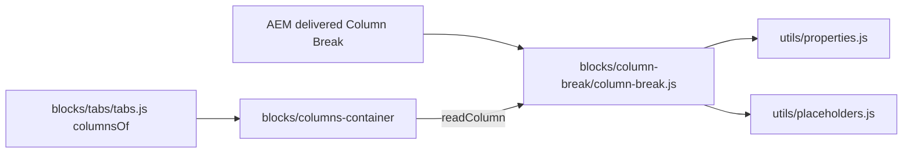

# Column Break

The Column Break is the item that starts a column in a [Columns Container](../columns-container/README.md) or inside a tab of a [Tabs Container](../tabs/README.md): the components after it, up to the next Column Break, are the column's content. It stays in its column as the column's label, shown in Universal Editor edit mode only (to select the column and edit its properties) and hidden on the page; its Additional tab sets the column's Anchor ID, Hide block and spacing.

| Attribute | Value |
|---|---|
| Technical name | `column-break` (component id, model and block class; template name "Column Break") |
| Display name | Column Break |
| Block type | Child item (marker block, key-value) |
| Status | Active |
| Parent / children | Parents: [Columns Container](../columns-container/README.md) (`columns-container` filter) and [Tabs Container](../tabs/README.md) (`tabs` filter, after a [Tab](../tab/README.md)). Children: none; its column's content is the components after it |
| Owner / version / date | Not recorded |

## Overview

**Business purpose.** Lets authors say "a new column starts here" with the standard components, because Edge Delivery doesn't nest blocks in blocks: a column is a run of sibling components in a section.

**User experience.** Visitors don't see the Column Break; they see its column. Authors see a small label ("Contact details", or "Column 2") at the top of an outlined column in edit mode.

**Templates / page types.** Any page with a Columns Container or a Tabs Container. **Data source:** its own fields.

**Related blocks.** [Columns Container](../columns-container/README.md) (builds the columns), [Tabs](../tabs/README.md) and [Tab](../tab/README.md) (Column Breaks in a tab; the Tab's Columns per row), [Columns](../columns/README.md) (the built-in block the Columns Container replaces).

**When to use.** At the start of every column of a Columns Container, and of every column in a tab.

**When not to use.** In a normal Section (it isn't offered there and would build no columns); to add space (use the Additional tab's spacing on the components).

**Realistic use cases.** "Contact details" and "Office map" columns of an offices band; "Image" and "Text" columns in a Cloud tab; hiding one column of a three-column row temporarily.

## Visual Reference

<!-- BEGIN GENERATED: screenshots (npm run build:docs) -->

No handover screenshot of this block was identified.

Universal Editor dialogs (no screenshot exists yet; to be captured on AEM author):

```text
[Screenshot Placeholder]

File name:
column-break-dialog-content-desktop.png

Purpose:
The Content tab of the Column Break properties in Universal Editor, with the fields of the table "Content tab — Column Break" in Authorable Fields below.

Annotations:
A = Column name
```

```text
[Screenshot Placeholder]

File name:
column-break-dialog-additional-desktop.png

Purpose:
The Additional tab of the Column Break properties in Universal Editor, with the fields of the table "Additional tab — Column Break" in Authorable Fields below.

Annotations:
A = Anchor ID
B = Hide block
C = Padding left
D = Padding right
E = Padding top
F = Padding bottom
G = Margin left
H = Margin right
I = Margin top
J = Margin bottom
```

<!-- END GENERATED: screenshots -->

```text
[Screenshot Placeholder]

File name:
column-break-label-editor-desktop.png

Purpose:
Universal Editor edit mode: the Column Break labels at the top of their outlined columns (a named one and an unnamed "Column 2").

Annotations:
A = Label with the Column name
B = Label "Column 2" (no name)
C = Column outline
```

```text
[Screenshot Placeholder]

File name:
column-break-published-desktop.png

Purpose:
The same columns on the published page: no labels, the columns only.

Annotations:
A = Column without label
```

```text
[Screenshot Placeholder]

File name:
column-break-hidden-editor-desktop.png

Purpose:
Hide block on a Column Break: its column dimmed in edit mode, absent on the page.

Annotations:
A = Dimmed column in edit mode
```

## For Content Authors

1. Select a **Columns Container** (or a **Tabs Container**, after a Tab) in the content tree, choose Add (+) and pick **Column Break**.
2. Add the components of the column after it.
3. Add the next Column Break, then that column's components, and so on.
4. Optionally open the Column Break's properties: in **Content** enter a **Column name** (shown in the editor only); in **Additional** set the column's **Anchor ID**, **Hide block** and **Padding / Margin**.
5. To move a column, move its Column Break together with its components.
6. Preview the page at desktop and mobile widths; publish; on the published page check that no label is visible and the columns are as expected.

**Minimum required:** none of its fields; the Column Break itself, followed by the column's components. **Recommended:** a Column name per column on pages with several columns. **Optional:** the Additional tab.

## Authorable Fields

<!-- BEGIN GENERATED: fields (npm run build:docs) -->

### Column Break (`column-break`)

Model `column-break`; template name "Column Break" (the block class AEM renders); key-value block (one row per property).

#### Content tab — Column Break

| Field label | Property | Type | Required | Default | Allowed values | Author guidance | Example |
| ----------- | -------- | ---- | -------- | ------- | -------------- | --------------- | ------- |
| Column name | `title` | text | No | — | — | Shown in the editor only, to tell the columns apart (e.g. Contact details). Not shown on the page. | Grey Teaser |

#### Additional tab — Column Break

| Field label | Property | Type | Required | Default | Allowed values | Author guidance | Example |
| ----------- | -------- | ---- | -------- | ------- | -------------- | --------------- | ------- |
| Anchor ID | `classes_anchor` | text | No | — | regExp: ^anchor-[a-z0-9][a-z0-9-]*$; customErrorMsg: Start with anchor-, then lower-case letters, digits and hyphens. | A unique ID of the block on the page, starting with anchor-, e.g. anchor-our-services; link to it with #anchor-our-services. Delivered as a block class. | — |
| Hide block | `classes_hideblock` | boolean | No | `false` | on / off | Hides the whole block on the page until it is turned off (shown faded in the editor). Delivered as a block class. | — |
| Padding left | `classes_paddingleft` | select | No | "" | Default (""), 0 (none) (`pl-0`), 0.25rem (space-100) (`pl-100`), 0.5rem (space-200) (`pl-200`), 0.75rem (space-300) (`pl-300`), 1rem (space-400) (`pl-400`), 1.25rem (space-500) (`pl-500`), 1.5rem (space-600) (`pl-600`), 2rem (space-800) (`pl-800`), 2.5rem (space-1000) (`pl-1000`), 3rem (space-1200) (`pl-1200`), 4rem (space-1600) (`pl-1600`), 5rem (space-2000) (`pl-2000`), 6rem (space-2400) (`pl-2400`), 7.5rem (space-3000) (`pl-3000`) | Delivered as a block class. | — |
| Padding right | `classes_paddingright` | select | No | "" | Default (""), 0 (none) (`pr-0`), 0.25rem (space-100) (`pr-100`), 0.5rem (space-200) (`pr-200`), 0.75rem (space-300) (`pr-300`), 1rem (space-400) (`pr-400`), 1.25rem (space-500) (`pr-500`), 1.5rem (space-600) (`pr-600`), 2rem (space-800) (`pr-800`), 2.5rem (space-1000) (`pr-1000`), 3rem (space-1200) (`pr-1200`), 4rem (space-1600) (`pr-1600`), 5rem (space-2000) (`pr-2000`), 6rem (space-2400) (`pr-2400`), 7.5rem (space-3000) (`pr-3000`) | Delivered as a block class. | — |
| Padding top | `classes_paddingtop` | select | No | "" | Default (""), 0 (none) (`pt-0`), 0.25rem (space-100) (`pt-100`), 0.5rem (space-200) (`pt-200`), 0.75rem (space-300) (`pt-300`), 1rem (space-400) (`pt-400`), 1.25rem (space-500) (`pt-500`), 1.5rem (space-600) (`pt-600`), 2rem (space-800) (`pt-800`), 2.5rem (space-1000) (`pt-1000`), 3rem (space-1200) (`pt-1200`), 4rem (space-1600) (`pt-1600`), 5rem (space-2000) (`pt-2000`), 6rem (space-2400) (`pt-2400`), 7.5rem (space-3000) (`pt-3000`) | Delivered as a block class. | — |
| Padding bottom | `classes_paddingbottom` | select | No | "" | Default (""), 0 (none) (`pb-0`), 0.25rem (space-100) (`pb-100`), 0.5rem (space-200) (`pb-200`), 0.75rem (space-300) (`pb-300`), 1rem (space-400) (`pb-400`), 1.25rem (space-500) (`pb-500`), 1.5rem (space-600) (`pb-600`), 2rem (space-800) (`pb-800`), 2.5rem (space-1000) (`pb-1000`), 3rem (space-1200) (`pb-1200`), 4rem (space-1600) (`pb-1600`), 5rem (space-2000) (`pb-2000`), 6rem (space-2400) (`pb-2400`), 7.5rem (space-3000) (`pb-3000`) | Delivered as a block class. | — |
| Margin left | `classes_marginleft` | select | No | "" | Default (""), 0 (none) (`ml-0`), 0.25rem (space-100) (`ml-100`), 0.5rem (space-200) (`ml-200`), 0.75rem (space-300) (`ml-300`), 1rem (space-400) (`ml-400`), 1.25rem (space-500) (`ml-500`), 1.5rem (space-600) (`ml-600`), 2rem (space-800) (`ml-800`), 2.5rem (space-1000) (`ml-1000`), 3rem (space-1200) (`ml-1200`), 4rem (space-1600) (`ml-1600`), 5rem (space-2000) (`ml-2000`), 6rem (space-2400) (`ml-2400`), 7.5rem (space-3000) (`ml-3000`) | Delivered as a block class. | — |
| Margin right | `classes_marginright` | select | No | "" | Default (""), 0 (none) (`mr-0`), 0.25rem (space-100) (`mr-100`), 0.5rem (space-200) (`mr-200`), 0.75rem (space-300) (`mr-300`), 1rem (space-400) (`mr-400`), 1.25rem (space-500) (`mr-500`), 1.5rem (space-600) (`mr-600`), 2rem (space-800) (`mr-800`), 2.5rem (space-1000) (`mr-1000`), 3rem (space-1200) (`mr-1200`), 4rem (space-1600) (`mr-1600`), 5rem (space-2000) (`mr-2000`), 6rem (space-2400) (`mr-2400`), 7.5rem (space-3000) (`mr-3000`) | Delivered as a block class. | — |
| Margin top | `classes_margintop` | select | No | "" | Default (""), 0 (none) (`mt-0`), 0.25rem (space-100) (`mt-100`), 0.5rem (space-200) (`mt-200`), 0.75rem (space-300) (`mt-300`), 1rem (space-400) (`mt-400`), 1.25rem (space-500) (`mt-500`), 1.5rem (space-600) (`mt-600`), 2rem (space-800) (`mt-800`), 2.5rem (space-1000) (`mt-1000`), 3rem (space-1200) (`mt-1200`), 4rem (space-1600) (`mt-1600`), 5rem (space-2000) (`mt-2000`), 6rem (space-2400) (`mt-2400`), 7.5rem (space-3000) (`mt-3000`) | Delivered as a block class. | — |
| Margin bottom | `classes_marginbottom` | select | No | "" | Default (""), 0 (none) (`mb-0`), 0.25rem (space-100) (`mb-100`), 0.5rem (space-200) (`mb-200`), 0.75rem (space-300) (`mb-300`), 1rem (space-400) (`mb-400`), 1.25rem (space-500) (`mb-500`), 1.5rem (space-600) (`mb-600`), 2rem (space-800) (`mb-800`), 2.5rem (space-1000) (`mb-1000`), 3rem (space-1200) (`mb-1200`), 4rem (space-1600) (`mb-1600`), 5rem (space-2000) (`mb-2000`), 6rem (space-2400) (`mb-2400`), 7.5rem (space-3000) (`mb-3000`) | Delivered as a block class. | — |

<!-- END GENERATED: fields -->

Notes on the fields:

- **Column name** (`title`): the label in edit mode; empty: "Column {n}" (placeholder `columnLabel`, n = the column's position). Not on the page, not in the data layer.
- **Anchor ID** (`classes_anchor`): the id moves from the Column Break to its column, so `#anchor-…` links jump to the column.
- **Hide block** (`classes_hideblock`): copied to the column: the column is hidden on the page and dimmed in edit mode.
- **Padding / Margin** (`classes_padding*`, `classes_margin*`): copied to the column (`pl-400`, `mt-800`, …; `styles/styles.css` applies them to `.columns-container-column`).
- **Additional tab:** see AGENTS.md "Additional tab"; the Column Break has no animation fields (the container's Animation Type moves the columns).
- **Legacy mapping:** items authored when this item was named "Column" are rendered with the class `column`; in a Columns Container section they are read as Column Breaks. `readColumn` reads a key-value `title` row, else the last cell of the first row.

## Screenshot-Based Authoring Steps

### Authoring Step 1: Add the first Column Break

```text
[Screenshot Placeholder]

File name:
column-break-authoring-step-1.png

Purpose:
A Columns Container selected in the content tree, Add (+) open with Column Break highlighted.

Annotations:
A = Columns Container in the tree
B = Column Break in the list
```

### Values to Enter

| Callout | Field | Value | Reason | Expected result |
|---|---|---|---|---|
| B | Add (+) | Column Break | Starts the first column | An outlined column with the hint "Add the components of this column after it." |

Author action: add the Column Break. Expected preview: an empty outlined column (edit mode). Published: nothing until it has content. Business rule: it is the first item of its column. Common mistake: adding the column's components before it; resolution: move them after it.

### Authoring Step 2: Name the column and add its content

```text
[Screenshot Placeholder]

File name:
column-break-authoring-step-2.png

Purpose:
The Column Break's Content tab with Column name entered, and a Teaser added after it.

Annotations:
A = Column name
B = Label in the canvas
C = Component after the Column Break
```

### Values to Enter

| Callout | Field | Value | Reason | Expected result |
|---|---|---|---|---|
| A | Column name | Grey Teaser | Tells the columns apart in the editor | Label "Grey Teaser" (edit mode only) |
| C | Component after it | Teaser | The column's content | Teaser in the column |

Author action: enter the name; add the components after the Column Break. Expected preview: the label and the content in the column. Published: the content only. Common mistake: expecting the name on the page; it is an editor label only.

### Authoring Step 3: Add the next column

```text
[Screenshot Placeholder]

File name:
column-break-authoring-step-3.png

Purpose:
The content tree with two Column Breaks, each followed by its components, and the two columns side by side.

Annotations:
A = Second Column Break
B = Its components
```

### Values to Enter

| Callout | Field | Value | Reason | Expected result |
|---|---|---|---|---|
| A | Column name | Contact details | Second column | Label "Contact details" |
| B | Components | Title, Text | Its content | Shown in column 2 |

Author action: add a Column Break after the first column's content, then its components. Expected preview and published result: two columns (side by side from the container's breakpoint, 900px by default). Common mistake: a component dragged above the second Column Break ends in the first column; resolution: check the tree order.

### Authoring Step 4: Column options

```text
[Screenshot Placeholder]

File name:
column-break-authoring-step-4.png

Purpose:
The Column Break's Additional tab with Anchor ID anchor-contact and Padding top 1rem (space-400).

Annotations:
A = Anchor ID
B = Hide block
C = Padding top
```

### Values to Enter

| Callout | Field | Value | Reason | Expected result |
|---|---|---|---|---|
| A | Anchor ID | anchor-contact | Links to the column | The column has `id="anchor-contact"` |
| C | Padding top | 1rem (space-400) | Space above the column's content | Class `pt-400` on the column |

Author action: set the options. Expected preview: applied after the section is rendered again (reload the editor; re-audit R-C-7). Published: applied. Common mistake: an Anchor ID without the `anchor-` prefix (rejected by the validation).

## Variations

### Named or unnamed Column Break

With a Column name the editor label is the name; without, "Column {n}". No difference on the page.

### In a Columns Container

The Columns Container's Layout (Columns per row, Gap, Vertical alignment, Side by side from) applies to the columns. See [Columns Container](../columns-container/README.md#variations).

### In a tab of a Tabs Container

After a [Tab](../tab/README.md), Column Breaks lay the tab's content out in columns with the Tab's Columns per row; content between the Tab and the first Column Break stays above the columns. Gap medium, top alignment, side by side from 900px.

```text
[Screenshot Placeholder]

File name:
column-break-in-tab-desktop.png

Purpose:
A tab with a heading and two Column Breaks: the heading above, two columns below.

Annotations:
A = Heading before the first Column Break
B = Two columns
```

### Column options (Additional tab)

Anchor ID, Hide block and spacing apply to the column, not to the hidden Column Break.

## Complete Authoring Example

Scenario: the second column of an "Our offices" Columns Container holds the contact details and is linked from the page's Anchor List.

| Field | Example value | Guidance |
|---|---|---|
| Column name | Contact details | Editor label only |
| Anchor ID | anchor-contact | Starts with `anchor-`; unique on the page |
| Hide block | Off | — |
| Padding top | 1rem (space-400) | Optional |
| Components after it | Title "Contact us", Text with the address | Start with a heading |

Steps: Authoring Steps 1 to 4. Expected output: a column with the heading and address, `id="anchor-contact"`; an Anchor List link to `#anchor-contact` jumps to it (and opens its tab if the columns are in a tab). Responsive: stacked below the container's breakpoint. Accessibility: the column's heading follows the page's heading order. Analytics: the Column Break isn't tracked; the components are. Personalization fallback: none.

Pre-publish checklist: every column starts with a Column Break; the Anchor ID is unique; nothing sits between a Column Break and the wrong components.

## Content and Asset Guidelines

- **Column name:** a short label for authors (e.g. "Contact details"); not translated for visitors (not shown).
- **Anchor ID:** `anchor-` followed by lower-case letters, digits and hyphens (validated).
- **Content:** whatever the parent allows; start a column with a heading when it is its own topic.
- **Images, CTAs, tags:** none on the Column Break.
- **Min / max:** no verified technical limit was identified; the container shows at most 4 columns per row.

## Accessibility

- On the page the Column Break and its wrapper are `display: none` (not announced); the label is shown only under `html.adobe-ue-edit`.
- The column keeps the content order at every width.
- A hidden column (Hide block) is removed from the page (`display: none`), not only visually hidden.
- The label text comes from the Column name or the placeholder `columnLabel`.

**Author responsibilities:** a logical order of the columns (also the order on mobile and for screen readers).

**Developer responsibilities:** keep the marker hidden outside edit mode and `data-analytics="off"`; keep the options on the column, not on the marker.

The Column Break handles no keys.

## Data Layer and Analytics

- The Column Break is `data-analytics="off"`: not a component, no events.
- Its column isn't a component either; the blocks in it are components of the Columns Container (`parentId`).
- The path Adobe Client Data Layer → Adobe Data Collection (Tags) → AEP Web SDK → Edge Network → Analytics / CJA is the intended one, but Tags and the Web SDK aren't configured yet (blocked: measurement plan). No consent mechanism is implemented.

| Trigger | Data-layer event | Required properties | Analytics behavior |
|---|---|---|---|
| Page load | None (excluded with `data-analytics="off"`) | — | Not measured |

## Personalization

This block does not currently expose verified personalization behavior. There is no Adobe Target or AJO integration in the repository; the authored columns render for every visitor.

## Responsive Behavior

The Column Break's CSS has no media query: it is hidden on the page and shown as a label in edit mode at every width. Its column follows the [Columns Container's responsive behavior](../columns-container/README.md#responsive-behavior).

| Viewport | Layout | Image behavior | Interaction behavior |
|---|---|---|---|
| All widths | Hidden on the page; label at the top of its column in edit mode | None | Selectable in the editor |

## For Developers

<!-- BEGIN GENERATED: files (npm run build:docs) -->

```text
blocks/column-break/
├── README.md
├── _column-break.json
├── column-break.css
└── column-break.js
```

| Decorator/Utility | Purpose | Execution or dependency point |
| ----------------- | ------- | ----------------------------- |
| [`utils/placeholders.js`](../../utils/placeholders.js) | `getPlaceholders`, `loadPlaceholders`, `fillPlaceholder` (UI text from the locale's placeholders, with English fallbacks) | `column-break.js`: { getPlaceholders } |
| [`utils/properties.js`](../../utils/properties.js) | `readProperties`, `textOf`, `isOn`, `isOnByDefault` (a toggle that defaults to on), `optionOf`, `normalizeKey`, `textSource` (key-value block properties) | `column-break.js`: { readProperties, textOf } |

<!-- END GENERATED: files -->

**Responsibilities.** `column-break.js` reads the name (`readColumn`, exported for `blocks/columns-container/columns-container.js`) and decorates the marker (label, `data-analytics="off"`). `column-break.css` hides `.column-break` and `.column-break-wrapper` and shows them with the label style under `html.adobe-ue-edit`.

**Input DOM.** A key-value block `div.column-break` with a `title` row; classes from the Additional tab (`anchor-…`, `hideblock`, `p*-N`, `m*-N`); the id from the Anchor ID (`decorators/block-options-decorator.js`).

**Rendered DOM.**

```html
<div class="columns-container-column pt-400" id="anchor-contact">
  <div class="column-break-wrapper">
    <div class="column-break block anchor-contact pt-400" data-column-title="Contact details" data-analytics="off">
      <p class="column-break-label">Contact details</p>
    </div>
  </div>
  <!-- the column's components -->
</div>
```

**Decoration flow.** The Columns Container is loaded before the Column Breaks of its section: it calls `readColumn` (the name is cached on `data-column-title`, so it can be read after the rows are gone), copies `hideblock` and spacing classes to the column and moves the id. Then the Column Break's own `decorate` replaces its rows with `p.column-break-label`: the name, else `columnLabel` with the column's index among the columns.

**Exports.** `readColumn(block)` → `{ title }`; `default decorate(block)`.

**Parent contracts.** Columns Container: a wrapper holding `:scope > .column-break` starts a column. Tabs: `columnsOf` checks for `:scope > .column-break` in a tab's wrappers and builds a `columns-container` block from the first one on.

**Error handling.** No name: the numbered label; no parent column: "Column 1".

## Extending the Block

1. Add a field to `_column-break.json`, run `npm run build:json` and `npm run lint`.
2. A column option: use a `classes_*` field (delivered as a block class) and add its class to `COLUMN_OPTIONS` in `columns-container.js` so it is copied to the column; add its CSS scoped to `.columns-container-column`.
3. A value to read: add it to `readColumn` and cache it on a `data-column-*` attribute. Don't end field names in Text, Title, Type, Alt or MimeType; no sample values in the definition template.
4. Keep the template name "Column Break" (it is the block class; `test/models/block-names.test.mjs` checks template names against block folders).
5. Update this README and run `npm run build:docs`; `npm run build:modules` after changing imports.

## For Site Administrators

- **Availability:** in the `columns-container` and `tabs` filters only.
- **Model governance:** `blocks/column-break/_column-break.json` (definition `column-break`, key-value, no filter).
- **Allowed children:** none.

| Dependency | Purpose | Location | Impact if unavailable |
|---|---|---|---|
| Columns Container / Tabs | Build the columns | `blocks/columns-container`, `blocks/tabs` | No columns |
| Placeholder `columnLabel` | Label of an unnamed column | `/{locale}/placeholders.json` | English fallback "Column {n}" |
| `styles/styles.css` spacing classes | Column Padding / Margin | Repository | No spacing |

**Migration:** items authored as "Column" (class `column`) keep working in Columns Container sections.

## For Architects

- **Role:** a marker block that delimits columns among sibling components (no nested blocks in Edge Delivery).
- **Content model:** key-value block; its `classes_*` fields are delivered (it is a block, not a section).
- **Rendering:** read by the container before its own decoration; values cached in data attributes; the column is a plain element so editor updates of the components in it find their own block.
- **Data layer / Target / consent:** none. **Performance / security:** negligible.



## For QA and Support Teams

| Test ID | Scenario | Configuration | Expected result |
|---|---|---|---|
| COLUMN-BREAK-QA-01 | Named | Column name "Contact details" | Label in edit mode; nothing on the page |
| COLUMN-BREAK-QA-02 | Unnamed | No name, second column | Label "Column 2" |
| COLUMN-BREAK-QA-03 | Empty column | Column Break without components | Hint in edit mode; empty column on the page |
| COLUMN-BREAK-QA-04 | Anchor | Anchor ID `anchor-contact` | The column has the id; the marker doesn't |
| COLUMN-BREAK-QA-05 | Hide | Hide block on | Column absent on the page, dimmed in edit mode |
| COLUMN-BREAK-QA-06 | Spacing | Padding top 1rem | `pt-400` on the column |
| COLUMN-BREAK-QA-07 | In a tab | 2 Column Breaks after a Tab | Two columns in the panel |
| COLUMN-BREAK-QA-08 | Legacy | Item rendered as `column` in a Columns Container | Treated as a Column Break |
| COLUMN-BREAK-QA-09 | Data layer | Inspect `adobeDataLayer` | No Column Break component |

## Troubleshooting

| Symptom | Likely cause | Diagnostic steps | Resolution | Verification |
|---|---|---|---|---|
| No columns | The Column Break is in a normal Section | Check the section class | Use a Columns Container | Columns appear |
| Label visible on the page | Edit mode (`html.adobe-ue-edit`) or CSS not loaded | Check the published page | — | Hidden on the page |
| Option changes not shown in the editor | Applied when the section is rendered again (R-C-7) | Reload | Reload | Applied |
| Content in the wrong column | Its position in the tree | Check the tree order | Move it after its Column Break | Correct column |
| Anchor link doesn't jump | Anchor ID taken (suffix `-2`) or mistyped | Inspect the column id | Use a unique ID | Link jumps |

Evidence to collect: page URL, the column's classes and id, the Column Break's `data-column-title`.

## Performance Considerations

One placeholders lookup (cached), one small DOM replacement; no network, listeners or observers.

## Security and Privacy

The label is set with `textContent`. No external content or personal data.

## Known Limitations

| Limitation | Impact | Workaround | Planned correction |
|---|---|---|---|
| Option changes (Anchor ID, Hide block, spacing) apply after the section is rendered again (re-audit R-C-7, deferred) | No immediate feedback in the editor | Reload the editor | Not recorded |
| Columns have no own width | All columns of a row are equal | Use the container's Columns per row | Not planned |
| The `column` legacy rename is done only in Columns Container sections | Items named "Column" in tabs aren't Column Breaks | Replace them with Column Breaks | Not recorded |

## Related Documentation

- [Blocks documentation](../README.md)
- [Columns Container](../columns-container/README.md) (parent)
- [Tabs](../tabs/README.md) and [Tab](../tab/README.md) (Column Breaks in a tab)
- Model: [`_column-break.json`](_column-break.json)
- Tests: [`test/models/block-names.test.mjs`](../../test/models/block-names.test.mjs)
- [Handover 6.32 Columns Container](../../docs/handover/TCS-CORP-HANDOVER.md)

<!-- BEGIN GENERATED: usage (npm run build:docs) -->

Pages of the block library package 1.0.14 (language master, `/content/tcs-corp/language-master/en`) that contain the block, 161 instance(s) in total:
- Block library: `block-library/animation/repeated-items`, `block-library/columns-container/alignment-gap-and-breakpoints`, `block-library/columns-container/columns-of-blocks`, `block-library/columns-container/columns-per-row`, `block-library/columns/columns-mobile-inset`, `block-library/columns/columns-variations`, `block-library/foundations/section-colours-with-blocks`, `block-library/fragment/fragments/cta-banner`, `block-library/tabs/fragments/tab-industries`, `block-library/tabs/tab`, `block-library/tabs/tab-deep-link`, `block-library/tabs/tabs-fixed-width`, `block-library/tabs/tabs-section`

Project-wide standards: [knowledge base](../../docs/handover/knowledge-base/README.md) ([block governance](../../docs/handover/knowledge-base/blocks.md)).

<!-- END GENERATED: usage -->

## Change History

| Version | Change | Source | Date |
|---|---|---|---|
| Not recorded | README generated from verified implementation and approved handover documentation | Repository review | Not recorded |
| Handover 2.24 | The Column item became Column Break (its template name is its block class); columns are plain wrappers with the Column Break as label; "Column" content still works (F-99) | docs/handover revision history | 19 October 2026 |
| Handover 2.28 | Column Breaks in a Tabs Container tab lay its content out in columns | docs/handover revision history | 20 October 2026 |
