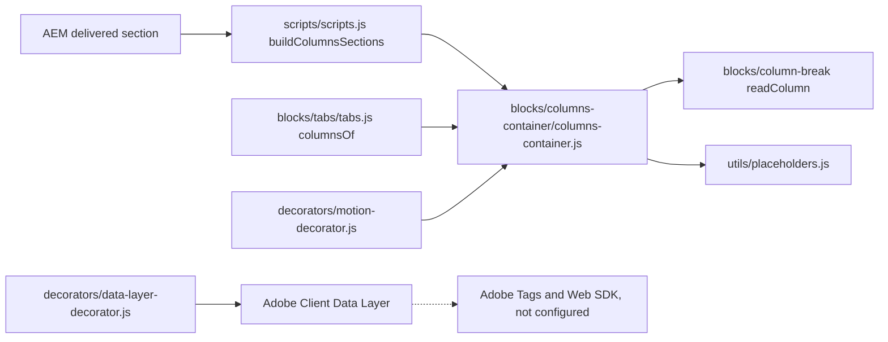

# Columns Container

A section whose content is laid out in columns. Each [Column Break](../column-break/README.md) starts a column, and the components after it, up to the next Column Break, are the column's content: default content (Text, Title, Image, Button) and any block, as in a section. Edge Delivery has no blocks inside blocks (the built-in [Columns](../columns/README.md) block's columns hold default content only), so columns of blocks are a section container, like the Tabs Container and Gen Carousel.

| Attribute | Value |
|---|---|
| Technical name | `columns-container` (component id, model, filter and block class; section style `columns-container-section`) |
| Display name | Columns Container |
| Block type | Container (section); a synthetic block built by `scripts/scripts.js` |
| Status | Active (replaces the built-in Columns block for new content) |
| Parent / children | Parent: the page (`main` filter). Children: [Column Break](../column-break/README.md) and the components of the `columns-container` filter. Also built inside a [Tabs Container](../tabs/README.md) tab from its Column Breaks |
| Owner / version / date | Not recorded |

## Overview

**Business purpose.** Put content, including blocks such as Cards, Teasers, Lists or forms, side by side, with a responsive layout chosen by the author, without a purpose-built block.

**User experience.** Columns of equal width, stacked one under the other below the chosen breakpoint and side by side above it, in rows of Columns per row; optionally on a grey, dark or dark green background.

**Templates / page types.** Any page; no template adds it. **Data source:** authored content; placeholders for editor hints.

**Related blocks.** [Column Break](../column-break/README.md) (starts each column), [Tabs](../tabs/README.md) and [Tab](../tab/README.md) (inside a tab, Column Breaks build this block in the panel), [Columns](../columns/README.md) (the built-in block it replaces), Teaser (shares the BG Color values).

**When to use.** Two to four pieces of content side by side, especially when a column holds a block; contact details next to a form; a teaser next to a list; three cards of different kinds in a row.

**When not to use.** A grid of similar cards (use Cards or List, which have per-breakpoint column settings); an image with text and calls to action in the design-system style (use Teaser or Hero); tabular data (use Table); columns of unequal widths (the columns are always of equal width).

**Realistic use cases.** An "Our offices" section with an address Text in one column and an embedded map in the other; a dark green band with a heading and text in one column and a Teaser in the other; six highlights in two rows of three.

## Visual Reference

<!-- BEGIN GENERATED: screenshots (npm run build:docs) -->

No handover screenshot of this block was identified.

Universal Editor dialogs (no screenshot exists yet; to be captured on AEM author):

```text
[Screenshot Placeholder]

File name:
columns-container-dialog-content-desktop.png

Purpose:
The Content tab of the Columns Container properties in Universal Editor, with the fields of the table "Content tab — Columns Container" in Authorable Fields below.

Annotations:
A = Style
B = BG Color
C = Width Type
D = Background Image
E = Image alt text
F = Anchor name
```

```text
[Screenshot Placeholder]

File name:
columns-container-dialog-layout-desktop.png

Purpose:
The Layout tab of the Columns Container properties in Universal Editor, with the fields of the table "Layout tab — Columns Container" in Authorable Fields below.

Annotations:
A = Columns per row
B = Gap
C = Vertical alignment
D = Side by side from
```

```text
[Screenshot Placeholder]

File name:
columns-container-dialog-additional-desktop.png

Purpose:
The Additional tab of the Columns Container properties in Universal Editor, with the fields of the table "Additional tab — Columns Container" in Authorable Fields below.

Annotations:
A = Anchor ID
B = Hide block
C = Animation Type
D = Motion Speed
E = Animation Trigger
F = Padding left
G = Padding right
H = Padding top
I = Padding bottom
J = Margin left
```

<!-- END GENERATED: screenshots -->

```text
[Screenshot Placeholder]

File name:
columns-container-default-desktop.png

Purpose:
A Columns Container with two Column Breaks at desktop width: two equal columns side by side, medium gap, top aligned.

Annotations:
A = First column
B = Second column
C = Gap
```

```text
[Screenshot Placeholder]

File name:
columns-container-default-mobile.png

Purpose:
The same Columns Container at mobile width: the columns stacked in order.

Annotations:
A = First column
B = Second column below it
```

```text
[Screenshot Placeholder]

File name:
columns-container-per-row-desktop.png

Purpose:
Six Column Breaks with Columns per row 3: two rows of three equal columns.

Annotations:
A = First row
B = Second row
```

```text
[Screenshot Placeholder]

File name:
columns-container-bg-dark-green-desktop.png

Purpose:
BG Color Dark green with Padding from the Additional tab: light text, links and buttons on the dark background.

Annotations:
A = Dark green background of the columns
B = Light text and white Primary button
C = Padding set in the Additional tab
```

```text
[Screenshot Placeholder]

File name:
columns-container-editor-desktop.png

Purpose:
Universal Editor edit mode: each column outlined with its Column Break label, an empty column with the hint "Add the components of this column after it.", a hidden column dimmed.

Annotations:
A = Column outline and label
B = Empty column hint
C = Hidden column (dimmed)
```

```text
[Screenshot Placeholder]

File name:
columns-container-tablet.png

Purpose:
Side by side from Tablet (600px) at tablet width: columns side by side; with the default Desktop (900px) they would be stacked.

Annotations:
A = Columns side by side at tablet width
```

## For Content Authors

1. On the page, choose Add (+) where sections are added and pick **Columns Container**.
2. Inside it, add a **Column Break**, then the components of that column after it; add the next **Column Break**, then its components, and so on. Columns sit side by side in rows of Columns per row (Automatic: up to 4); more Column Breaks start a new row.
3. Select the Columns Container to set its properties: in **Content** the Style, BG Color, Width Type, Background Image and Anchor name; in **Layout** the Columns per row, Gap, Vertical alignment and Side by side from; in **Additional** the block options.
4. Optionally name each Column Break (**Column name**, shown in the editor only) and use its Additional tab for the column's Anchor ID, Hide block and spacing.
5. To reorder columns, move a Column Break together with its components in the content tree.
6. Preview at desktop and mobile widths, publish, and check the published page at the breakpoint you chose.

Allowed in a column: Column Break, Text, Image, Button, Title, Hero, Teaser, Quote, Testimonial, Anchor List, Accordion, Tabs (block), Table, Table List, List, Separator, Embed, Video, Modal, Form Variations, Filter List, Conversation Canvas, Cards and Fragment; not Page Header, Footer and TCS Header.

**Minimum required:** a Column Break and a component after it (content before the first Column Break is a column of its own). **Recommended:** keep Style Columns Container selected; one Column Break per column; Padding when using a BG Color. **Optional:** everything else.

| Tab | Field | Values | Default |
|---|---|---|---|
| Content | Style | Columns Container (keep it selected: it makes the section a Columns Container), Highlight (multiselect) | Columns Container |
| Content | BG Color | Default, Grey, Dark, Dark green (as the Teaser's): only the background colour of the columns (`bg-grey`, `bg-dark`, `bg-dark-green` on the block); text, links and buttons turn light on Dark and Dark green. Space around the columns: Padding in the Additional tab | Default |
| Content | Width Type | Full Width, Fixed Width | Full Width |
| Content | Background Image | An image behind the whole container (as on sections) | — |
| Content | Image alt text | The background image's alternative text; empty: decorative | — |
| Content | Anchor name | Section id, e.g. `our-offices` (link with `#our-offices`, Anchor List) | — |
| Layout | Columns per row | Automatic (as many as there are Column Breaks, at most 4), 1, 2, 3, 4; more Column Breaks start a new row (6 at 3 per row: 2 rows of 3); the columns are of equal width | Automatic |
| Layout | Gap | None, Small, Medium, Large | Medium |
| Layout | Vertical alignment | Top, Middle, Bottom, Stretch (equal heights) | Top |
| Layout | Side by side from | Tablet (600px), Desktop (900px), Large desktop (1200px); stacked below | Desktop |
| Additional | Anchor ID, Hide block, Animation Type, Motion Speed, Animation Trigger, Padding / Margin | As on blocks; Animation Type moves the columns in one after another | — |

In Universal Editor edit mode each column is outlined and labelled with its name, so it can be selected; an empty column says what to add.

## Authorable Fields

<!-- BEGIN GENERATED: fields (npm run build:docs) -->

### Columns Container (`columns-container`)

Model `columns-container`; template name "Columns Container" (the block class AEM renders); children: `column-break`, `text`, `image`, `button-block`, `title`, `hero`, `teaser`, `quote`, `media-contacts`, `testimonial`, `anchor-list`, `accordion`, `tabs-block`, `table`, `table-list`, `list`, `separator`, `embed`, `video`, `modal`, `form-variations`, `filter-list`, `conversation-canvas`, `cards`, `fragment`.

Stored on a new component (definition template): `style` = `"columns-container-section"`, `columnsGap` = `"medium"`, `columnsAlign` = `"top"`, `columnsFrom` = `"desktop"`, `columnsPerRow` = `"auto"`.

#### Content tab — Columns Container

| Field label | Property | Type | Required | Default | Allowed values | Author guidance | Example |
| ----------- | -------- | ---- | -------- | ------- | -------------- | --------------- | ------- |
| Style | `style` | multiselect | No | `columns-container-section` | Columns Container (`columns-container-section`), Highlight (`highlight`) | Keep Columns Container selected: it makes the section a Columns Container. Add Highlight for the highlight background, as on sections. | columns-container-section |
| BG Color | `containerBgColor` | select | No | "" | Default (""), Grey (`bg-grey`), Dark (`bg-dark`), Dark green (`bg-dark-green`), Navy (`bg-navy`) | The background colour of the columns, only the colour (text and buttons turn light on Dark and Dark green); set the space around them with the Padding fields of the Additional tab. | bg-dark-green |
| Width Type | `sectionWidth` | select | No | `full-width` | Full Width (`full-width`), Fixed Width (`fixed-width`) | — | — |
| Background Image | `backgroundImage` | reference | No | — | — | — | /content/dam/tcs-corp/dummy-pages/images/smart-home.jpg |
| Image alt text | `backgroundImageAlt` | text | No | — | — | Describe the image for screen readers. Leave empty if the image is decorative. Delivered with `backgroundImage` (field collapse). | — |
| Anchor name | `anchorName` | text | No | — | regExp: ^#?[a-z0-9][a-z0-9-]*$; customErrorMsg: Lower-case letters, digits and hyphens, e.g. our-offices. | Lets Anchor List links and #links jump to this section, e.g. our-offices (lowercase, no spaces). | our-offices |

#### Layout tab — Columns Container

| Field label | Property | Type | Required | Default | Allowed values | Author guidance | Example |
| ----------- | -------- | ---- | -------- | ------- | -------------- | --------------- | ------- |
| Columns per row | `columnsPerRow` | select | No | `auto` | Automatic (`auto`), 1 (`1`), 2 (`2`), 3 (`3`), 4 (`4`) | How many columns sit side by side in a row, all of equal width; more Column Breaks start a new row (e.g. 6 Column Breaks at 3 per row: 2 rows of 3). Automatic: as many as there are Column Breaks, at most 4. Add a Column Break, then the components of the column after it. | 2 |
| Gap | `columnsGap` | select | No | `medium` | None (`none`), Small (`small`), Medium (`medium`), Large (`large`) | The space between the columns (and between them when stacked). | large |
| Vertical alignment | `columnsAlign` | select | No | `top` | Top (`top`), Middle (`middle`), Bottom (`bottom`), Stretch (equal heights) (`stretch`) | How columns of different heights line up side by side. | middle |
| Side by side from | `columnsFrom` | select | No | `desktop` | Tablet (600px) (`tablet`), Desktop (900px) (`desktop`), Large desktop (1200px) (`large`) | Below this width the columns are stacked, one under the other. | tablet |

#### Additional tab — Columns Container

| Field label | Property | Type | Required | Default | Allowed values | Author guidance | Example |
| ----------- | -------- | ---- | -------- | ------- | -------------- | --------------- | ------- |
| Anchor ID | `containerAnchor` | text | No | — | regExp: ^anchor-[a-z0-9][a-z0-9-]*$; customErrorMsg: Start with anchor-, then lower-case letters, digits and hyphens. | A unique ID of the block on the page, starting with anchor-, e.g. anchor-our-services; link to it with #anchor-our-services. | — |
| Hide block | `containerHide` | boolean | No | `false` | on / off | Hides the whole block on the page until it is turned off (shown faded in the editor). | — |
| Animation Type | `containerAnimation` | select | No | "" | None (""), Fade in (`motion-fade-in`), Fade up (`motion-fade-up`), Fade down (`motion-fade-down`), Fade left (`motion-fade-left`), Fade right (`motion-fade-right`), Slide up (`motion-slide-up`), Slide down (`motion-slide-down`), Slide left (`motion-slide-left`), Slide right (`motion-slide-right`), Scale in (`motion-scale-in`) | How the block's content appears; repeated items (cards, list items, accordion items, columns) appear one after another. None: shown as is. Not played in the editor or when the visitor prefers reduced motion. | motion-fade-up |
| Motion Speed | `containerAnimationSpeed` | select | No | "" | Medium (""), Fast (`motion-fast`), Slow (`motion-slow`) | How fast the animation runs: 0.3, 0.6 or 0.9 seconds. Shown when `containerAnimation` is set and `containerAnimation` is not empty. | motion-slow |
| Animation Trigger | `containerAnimationTrigger` | select | No | "" | On Scroll / Viewport Entry (""), On Page Load (`motion-on-load`) | When the block's animations run. On Scroll: when the block comes into view (at once if it is in view when the page opens). On Page Load: as soon as the block is ready, wherever it is on the page. Shown when `containerAnimation` is set and `containerAnimation` is not empty. | — |
| Padding left | `containerPaddingLeft` | select | No | "" | Default (""), 0 (none) (`pl-0`), 0.25rem (space-100) (`pl-100`), 0.5rem (space-200) (`pl-200`), 0.75rem (space-300) (`pl-300`), 1rem (space-400) (`pl-400`), 1.25rem (space-500) (`pl-500`), 1.5rem (space-600) (`pl-600`), 2rem (space-800) (`pl-800`), 2.5rem (space-1000) (`pl-1000`), 3rem (space-1200) (`pl-1200`), 4rem (space-1600) (`pl-1600`), 5rem (space-2000) (`pl-2000`), 6rem (space-2400) (`pl-2400`), 7.5rem (space-3000) (`pl-3000`) | — | pl-1000 |
| Padding right | `containerPaddingRight` | select | No | "" | Default (""), 0 (none) (`pr-0`), 0.25rem (space-100) (`pr-100`), 0.5rem (space-200) (`pr-200`), 0.75rem (space-300) (`pr-300`), 1rem (space-400) (`pr-400`), 1.25rem (space-500) (`pr-500`), 1.5rem (space-600) (`pr-600`), 2rem (space-800) (`pr-800`), 2.5rem (space-1000) (`pr-1000`), 3rem (space-1200) (`pr-1200`), 4rem (space-1600) (`pr-1600`), 5rem (space-2000) (`pr-2000`), 6rem (space-2400) (`pr-2400`), 7.5rem (space-3000) (`pr-3000`) | — | pr-1000 |
| Padding top | `containerPaddingTop` | select | No | "" | Default (""), 0 (none) (`pt-0`), 0.25rem (space-100) (`pt-100`), 0.5rem (space-200) (`pt-200`), 0.75rem (space-300) (`pt-300`), 1rem (space-400) (`pt-400`), 1.25rem (space-500) (`pt-500`), 1.5rem (space-600) (`pt-600`), 2rem (space-800) (`pt-800`), 2.5rem (space-1000) (`pt-1000`), 3rem (space-1200) (`pt-1200`), 4rem (space-1600) (`pt-1600`), 5rem (space-2000) (`pt-2000`), 6rem (space-2400) (`pt-2400`), 7.5rem (space-3000) (`pt-3000`) | — | pt-1000 |
| Padding bottom | `containerPaddingBottom` | select | No | "" | Default (""), 0 (none) (`pb-0`), 0.25rem (space-100) (`pb-100`), 0.5rem (space-200) (`pb-200`), 0.75rem (space-300) (`pb-300`), 1rem (space-400) (`pb-400`), 1.25rem (space-500) (`pb-500`), 1.5rem (space-600) (`pb-600`), 2rem (space-800) (`pb-800`), 2.5rem (space-1000) (`pb-1000`), 3rem (space-1200) (`pb-1200`), 4rem (space-1600) (`pb-1600`), 5rem (space-2000) (`pb-2000`), 6rem (space-2400) (`pb-2400`), 7.5rem (space-3000) (`pb-3000`) | — | pb-1000 |
| Margin left | `containerMarginLeft` | select | No | "" | Default (""), 0 (none) (`ml-0`), 0.25rem (space-100) (`ml-100`), 0.5rem (space-200) (`ml-200`), 0.75rem (space-300) (`ml-300`), 1rem (space-400) (`ml-400`), 1.25rem (space-500) (`ml-500`), 1.5rem (space-600) (`ml-600`), 2rem (space-800) (`ml-800`), 2.5rem (space-1000) (`ml-1000`), 3rem (space-1200) (`ml-1200`), 4rem (space-1600) (`ml-1600`), 5rem (space-2000) (`ml-2000`), 6rem (space-2400) (`ml-2400`), 7.5rem (space-3000) (`ml-3000`) | — | — |
| Margin right | `containerMarginRight` | select | No | "" | Default (""), 0 (none) (`mr-0`), 0.25rem (space-100) (`mr-100`), 0.5rem (space-200) (`mr-200`), 0.75rem (space-300) (`mr-300`), 1rem (space-400) (`mr-400`), 1.25rem (space-500) (`mr-500`), 1.5rem (space-600) (`mr-600`), 2rem (space-800) (`mr-800`), 2.5rem (space-1000) (`mr-1000`), 3rem (space-1200) (`mr-1200`), 4rem (space-1600) (`mr-1600`), 5rem (space-2000) (`mr-2000`), 6rem (space-2400) (`mr-2400`), 7.5rem (space-3000) (`mr-3000`) | — | — |
| Margin top | `containerMarginTop` | select | No | "" | Default (""), 0 (none) (`mt-0`), 0.25rem (space-100) (`mt-100`), 0.5rem (space-200) (`mt-200`), 0.75rem (space-300) (`mt-300`), 1rem (space-400) (`mt-400`), 1.25rem (space-500) (`mt-500`), 1.5rem (space-600) (`mt-600`), 2rem (space-800) (`mt-800`), 2.5rem (space-1000) (`mt-1000`), 3rem (space-1200) (`mt-1200`), 4rem (space-1600) (`mt-1600`), 5rem (space-2000) (`mt-2000`), 6rem (space-2400) (`mt-2400`), 7.5rem (space-3000) (`mt-3000`) | — | — |
| Margin bottom | `containerMarginBottom` | select | No | "" | Default (""), 0 (none) (`mb-0`), 0.25rem (space-100) (`mb-100`), 0.5rem (space-200) (`mb-200`), 0.75rem (space-300) (`mb-300`), 1rem (space-400) (`mb-400`), 1.25rem (space-500) (`mb-500`), 1.5rem (space-600) (`mb-600`), 2rem (space-800) (`mb-800`), 2.5rem (space-1000) (`mb-1000`), 3rem (space-1200) (`mb-1200`), 4rem (space-1600) (`mb-1600`), 5rem (space-2000) (`mb-2000`), 6rem (space-2400) (`mb-2400`), 7.5rem (space-3000) (`mb-3000`) | — | — |

<!-- END GENERATED: fields -->

Notes on the fields:

- **Style** (`style`, multiselect): `columns-container-section` makes the section a Columns Container. A section that has the container's Layout values (`data-columnsperrow`, `data-columnsgap`, `data-columnsalign`, `data-columnsfrom`) stays one even if an author removes that Style. Highlight adds the section's grey highlight band (`main .section.highlight` in `styles/styles.css`); Sections no longer offer Highlight (handover 2.33), the Columns Container still does.
- **BG Color** (`containerBgColor`): a class on the block, only the background colour (no padding). On Dark and Dark green the theme contract of `styles/styles.css` turns text, links (underlined in running text), focus and buttons light (Primary white); a Teaser or Columns Container with BG Color Grey inside sets them back. Contrast is the tokens'.
- **Width Type, Background Image, Image alt text, Anchor name**: the Section's fields with the same names, applied by `decorateSectionsWithOptions` as on any section (the Image alt text is delivered with the image, field collapse). A Background Image is behind the whole section; its alt text is read by screen readers unless empty (decorative).
- **Columns per row** (`columnsPerRow`): class `per-row-1` to `per-row-4`; Automatic (`per-row-auto`) means as many columns as Column Breaks, at most 4. The block gets `columns-container-{1-4}`.
- **Gap** (`columnsGap`): `gap-none` (0), `gap-small` (`--space-400`), Medium (the default, `--space-800`), `gap-large` (`--space-1600`); the same gap separates stacked columns.
- **Vertical alignment** (`columnsAlign`): `align-middle`, `align-bottom`, `align-stretch`; Top is the default.
- **Side by side from** (`columnsFrom`): `from-tablet` (600px), Desktop (900px, the default), `from-large` (1200px).
- **Legacy mapping:** the former **Column widths** option (`columnsLayout`) was removed; values authored before are ignored and the columns are of equal width. Column Breaks authored when the item was named "Column" (rendered as class `column`) are read as Column Breaks.
- **Additional tab:** see AGENTS.md "Additional tab". The container is a section, whose `classes_*` fields AEM doesn't deliver, so its fields are `container*` (`containerAnchor`, `containerHide`, `containerAnimation`, `containerAnimationSpeed`, `containerAnimationTrigger`, `containerPadding*`, `containerMargin*`), turned into classes of the synthetic block by `applySectionBlockOptions`. Hide block hides the whole section on the page. Animation Type animates the columns one after another (`decorators/motion-decorator.js`, target `.columns-container-column`, staggered).
- **Data layer:** the block is a component `tcs-corp/components/columns-container`; the blocks in its columns are its children (see below).

## Screenshot-Based Authoring Steps

### Authoring Step 1: Add the Columns Container

```text
[Screenshot Placeholder]

File name:
columns-container-authoring-step-1.png

Purpose:
The page's Add (+) menu with Columns Container, and the empty container's hint in edit mode.

Annotations:
A = Add (+) on the page
B = Columns Container in the list
C = Empty hint "Add a Column Break, then the components of the column after it."
```

### Values to Enter

| Callout | Field | Value | Reason | Expected result |
|---|---|---|---|---|
| B | Add (+) | Columns Container | Added where sections are added | An empty container with the hint |
| — | Style | Columns Container | Keep it: it makes the section a container | Section class `columns-container-section` |

Author action: add the container. Expected preview: the hint (edit mode only). Published: nothing until it has content. Business rule: it is a section; it can't be placed inside another section. Common mistake: adding a Section and expecting columns; resolution: use the Columns Container.

### Authoring Step 2: Add the columns

```text
[Screenshot Placeholder]

File name:
columns-container-authoring-step-2.png

Purpose:
The content tree with two Column Breaks, each followed by its components, and the two outlined columns in the canvas.

Annotations:
A = First Column Break and its components
B = Second Column Break and its components
C = Column labels in the canvas
```

### Values to Enter

| Callout | Field | Value | Reason | Expected result |
|---|---|---|---|---|
| A | Column name | Grey Teaser | Tells the columns apart in the editor | Label "Grey Teaser" (edit mode only) |
| A | Components after it | A Teaser | The first column's content | Teaser in column 1 |
| B | Column name | Contact details | — | Label "Contact details" |
| B | Components after it | Title, Text | The second column's content | Shown in column 2 |

Author action: add Column Break, its components, the next Column Break, its components. Expected preview: two outlined columns. Published: two columns from 900px. Business rule: a component belongs to the Column Break above it; content before the first Column Break forms its own first column. Common mistake: components added before the first Column Break; resolution: move them after it.

### Authoring Step 3: Set the layout

```text
[Screenshot Placeholder]

File name:
columns-container-authoring-step-3.png

Purpose:
The Layout tab with Columns per row 2, Gap Large, Vertical alignment Middle, Side by side from Tablet (600px).

Annotations:
A = Columns per row
B = Gap
C = Vertical alignment
D = Side by side from
```

### Values to Enter

| Callout | Field | Value | Reason | Expected result |
|---|---|---|---|---|
| A | Columns per row | 2 | Two columns per row | `per-row-2`, `columns-container-2` |
| B | Gap | Large | More space between the columns | `gap-large` (`--space-1600`) |
| C | Vertical alignment | Middle | Centre columns of different heights | `align-middle` |
| D | Side by side from | Tablet (600px) | Side by side on tablets too | `from-tablet` |

Author action: choose the layout. Expected preview: the layout at the editor's canvas width. Published: stacked below 600px, side by side from 600px. Common mistake: judging the breakpoint in a narrow editor canvas; resolution: preview at the target widths.

### Authoring Step 4: Background colour and spacing

```text
[Screenshot Placeholder]

File name:
columns-container-authoring-step-4.png

Purpose:
BG Color Dark green in the Content tab and Padding top / bottom / left / right 2.5rem (space-1000) in the Additional tab.

Annotations:
A = BG Color
B = Padding fields
C = Result with light text
```

### Values to Enter

| Callout | Field | Value | Reason | Expected result |
|---|---|---|---|---|
| A | BG Color | Dark green | Brand band | `bg-dark-green`; light text and buttons |
| B | Padding top / bottom / left / right | 2.5rem (space-1000) | BG Color adds no space | `pt-1000`, `pb-1000`, `pl-1000`, `pr-1000` |
| — | Animation Type / Motion Speed | Fade up / Slow | Columns appear one after another | Played on scroll on the page, not in the editor |

Author action: choose the colour, then the padding. Expected preview: coloured columns with space inside. Published: the same; the animation plays when the block comes into view (not for reduced motion). Common mistake: expecting padding from BG Color; resolution: set the Padding fields.

## Variations

### Columns per row

Automatic (as many as Column Breaks, at most 4), or 1 to 4. More Column Breaks than per row start new rows of the same column width. **Rendering:** class `columns-container-{n}` sets `--columns-container-count`; the grid is `repeat(n, minmax(0, 1fr))` from the breakpoint. Below it, one column.

### Gap

None, Small, Medium (default), Large: the `--columns-container-gap` variable, used between columns and between stacked columns.

### Vertical alignment

Top (default), Middle, Bottom, Stretch (equal heights): `align-items` of the grid; visible only side by side.

### Side by side from

Tablet (600px), Desktop (900px, default), Large desktop (1200px). Below the chosen width the columns are stacked in their order.

```text
[Screenshot Placeholder]

File name:
columns-container-from-large-desktop.png

Purpose:
Side by side from Large desktop (1200px) at 1024px: still stacked.

Annotations:
A = Stacked columns at 1024px
```

### BG Color

Default, Grey, Dark, Dark green: only the colour; on Dark and Dark green the theme contract applies (light text, links, focus, buttons). Use the Additional tab's Padding for space inside the colour.

### Width Type and Background Image

The Section options: Fixed Width caps the section at the content width; a Background Image sits behind the whole section.

### Columns in a Tabs Container tab

A section can't hold a section, so inside a [Tabs Container](../tabs/README.md) a tab's own Column Breaks make the columns: add a Column Break after the [Tab](../tab/README.md), then that column's components, then the next Column Break. The Tab's **Columns per row** (Automatic, 1-4) sets the columns per row; content before the first Column Break (e.g. a heading) stays above the columns. `blocks/tabs/tabs.js` (`columnsOf`) builds a Columns Container block in the tab's panel, so the layout, CSS and editor labels are the same; Gap, Vertical alignment and Side by side from keep their defaults (Medium, Top, Desktop) there.

**Accessibility (all variations):** the reading order is the content order (columns are not reordered). **Data layer:** unchanged by the variation. **Personalization / fallback:** none.

## Complete Authoring Example

Scenario: an "Our offices" band on a contact page: a dark green background, a heading and address text on the left, a Teaser with a call to action on the right, side by side from tablet.

| Field | Example value | Guidance |
|---|---|---|
| Style | Columns Container | Keep selected |
| BG Color | Dark green | Use the theme's light text |
| Anchor name | our-offices | Links `#our-offices` jump to the section |
| Columns per row | 2 | Two columns |
| Gap | Large | — |
| Vertical alignment | Middle | — |
| Side by side from | Tablet (600px) | — |
| Padding (all sides) | 2.5rem (space-1000) | Space inside the colour |
| Animation Type / Motion Speed | Fade up / Slow | Optional |
| Column Break 1 / content | Contact details / Title "Our offices", Text with the address | — |
| Column Break 2 / content | Grey Teaser / a Teaser with BG Color Grey and a Button | The Grey Teaser gets dark text back |

Steps: Authoring Steps 1 to 4. Expected output: two columns on dark green, stacked below 600px. Accessibility: headings in order; buttons and links readable on the dark background. Analytics: the container is a `columns-container` component, the Teaser its child; clicks are the Teaser's. Personalization fallback: none.

Pre-publish checklist: Style Columns Container kept; every column starts with a Column Break; padding set with a BG Color; images have alt text; checked at 390px, 768px and 1440px.

## Content and Asset Guidelines

- **Columns:** up to four per row (at most 4 in Automatic; 1–4 when chosen); more Column Breaks make more rows. No verified limit on the number of rows was identified.
- **Column content:** start a column with a heading when it is a topic of its own; keep the columns' content of similar length if Vertical alignment Stretch isn't used.
- **Column names:** short editor labels (not shown on the page).
- **Background image:** an image from the DAM; alt text only if it carries meaning, else leave it empty (decorative). The section background is built as a responsive picture (2000px wide from 600px, 750px below).
- **Images in columns:** follow their component; blocks fill their column's width.
- **CTAs and links:** on Dark and Dark green, use the Button blocks; the theme inverts them.
- **Tags and metadata:** not used.
- **Missing content:** an empty column shows nothing on the page (a hint in edit mode); a container without content renders nothing.

## Accessibility

- **Semantics:** the columns are plain `div`s; the reading and focus order is the authored order at every width. Headings come from the components.
- **Keyboard and focus:** the block handles no keys; focus moves through the components in order.
- **Contrast:** BG Color Dark and Dark green apply the theme contract (light text, link and focus tokens; underlined links in running text; inverted buttons).
- **Background image:** alt text from Image alt text, empty for decorative images.
- **Reduced motion:** the Animation Type doesn't play for visitors who prefer reduced motion, or in the editor.
- **Hidden columns:** Hide block on a Column Break removes the column from the page (`display: none`).
- **Reflow:** columns stack below the breakpoint; `minmax(0, 1fr)` and `min-width: 0` keep wide content inside its column.
- **Editor hints:** shown only in edit mode (placeholders `columnEmpty`, `columnsContainerEmpty`, `columnLabel`).

**Author responsibilities:** a logical order of the columns (it is also the mobile order); headings in sequence; alt text for meaningful images; enough padding on coloured backgrounds.

**Developer responsibilities:** keep the content order; keep the theme tokens for text in new blocks; keep the hints in placeholders and hidden outside edit mode.

## Data Layer and Analytics

- **Component:** the synthetic block is added by `decorators/data-layer-decorator.js` as `tcs-corp/components/columns-container` (id: its Anchor ID, else `columns-container-{n}`; `dc:title`: its first heading). Inside a tab the id is `{panel id}-columns`.
- **Children:** the blocks in the columns are components whose `parentId` is the container. The columns are not components; Column Breaks are `data-analytics="off"`.
- **Events:** the block pushes no events itself; clicks, media, submits in its columns are measured centrally and attributed to the block they're in (default content: to the container).
- **Path:** Adobe Client Data Layer → Adobe Data Collection (Tags) → AEP Web SDK → Edge Network → Analytics / CJA is the intended path, but Tags and the Web SDK aren't configured yet (blocked: measurement plan). No consent mechanism is implemented.

| Trigger | Data-layer event | Required properties | Analytics behavior |
|---|---|---|---|
| Page load | component state | `@type` `tcs-corp/components/columns-container`, `parentId` (page), `dc:title` | Inventory |
| Click on a link or button in a column | `cmp:click` | component (the block in the column, else the container), `xdm:linkURL`, `xdm:linkType`, `breakpoint` | Link / button clicks |

## Personalization

This block does not currently expose verified personalization behavior. There is no Adobe Target or AJO integration in the repository; the authored columns render for every visitor.

## Responsive Behavior

| Viewport | Layout | Image behavior | Interaction behavior |
|---|---|---|---|
| Below 600px | One column: the columns stacked in order, separated by the gap | Images and blocks at the column (full) width | As the components |
| 600px to 899px | Side by side with Side by side from Tablet; stacked otherwise | Fill their column | As the components |
| 900px to 1199px | Side by side with Tablet or Desktop (default); stacked with Large desktop | Fill their column | As the components |
| 1200px and wider | Side by side with every setting, `Columns per row` per row | Fill their column | As the components |

## For Developers

<!-- BEGIN GENERATED: files (npm run build:docs) -->

```text
blocks/columns-container/
├── README.md
├── _columns-container.json
├── columns-container.css
└── columns-container.js
```

| Decorator/Utility | Purpose | Execution or dependency point |
| ----------------- | ------- | ----------------------------- |
| [`utils/placeholders.js`](../../utils/placeholders.js) | `getPlaceholders`, `loadPlaceholders`, `fillPlaceholder` (UI text from the locale's placeholders, with English fallbacks) | `columns-container.js`: { getPlaceholders } |
| [`blocks/column-break/column-break.js`](../../blocks/column-break/column-break.js) | — | `columns-container.js`: { readColumn } |

<!-- END GENERATED: files -->

**Responsibilities.**

- `scripts/scripts.js` `buildColumnsSections`: a section with the class `columns-container-section` (added to any section with the container's Layout data attributes) gets a synthetic `div.columns-container`; `.column` blocks are renamed `column-break`; the Layout values become classes (`per-row-{v}`, `gap-{v}`, `align-{v}`, `from-{v}`); `applySectionBlockOptions` adds the `container*` classes (BG Color, anchor, `hideblock`, motion, spacing); `wrapSectionContent` decorates the block while empty and moves the section's wrappers into it (blocks among them are decorated).
- `columns-container.js`: each wrapper holding a `:scope > .column-break` starts a column (`div.columns-container-column`; plain, not a block, so Universal Editor updates of the components in it find their own block); the Column Break's wrapper stays first in its column (the label). `readColumn` caches the Column Break's name; its `hideblock` and spacing classes are copied to the column; its Anchor ID (the id the block options gave it, else the `anchor-` class) moves to the column. An empty column gets `p.columns-container-hint` (`columnEmpty`); no column at all: the hint `columnsContainerEmpty`. The block gets `columns-container-{n}` (`perRow`: `per-row-1`…`4`, else the number of columns, at most `MAX_COLUMNS` 4).
- `columns-container.css`: scoped to `.block.columns-container` (AEM also marks the section of every Columns block `columns-container`, which turned those sections into grids before the block audit of 19 October 2026); a one-column grid, the column template from the breakpoint class; BG Color, gap and alignment classes; blocks fill their column; editor outlines and hints under `html.adobe-ue-edit`; hidden columns.

**Rendered DOM.**

```html
<div class="columns-container block per-row-2 gap-large align-middle from-tablet bg-dark-green pt-1000 columns-container-2">
  <div class="columns-container-column">
    <div class="column-break-wrapper"><div class="column-break block" data-analytics="off">…</div></div>
    <div class="teaser-wrapper">…</div>
  </div>
  <div class="columns-container-column hideblock">…</div>
</div>
```

**Decoration flow.** The section's blocks load in order: the container first (it groups the wrappers), then the Column Breaks (their label uses the column index) and the blocks in the columns. In a tab, `blocks/tabs/tabs.js` creates the block with only `per-row-N` and loads it with `loadBlock`.

**Exports.** `default decorate(block)` only; it imports `readColumn` from `blocks/column-break/column-break.js`.

**Error handling.** No network; missing names or options fall back to defaults.

## Extending the Block

1. **A Layout option:** add the field and options to `_columns-container.json`, run `npm run build:json` and `npm run lint`; read the data attribute in `buildColumnsSections` (add it to the selector that marks container sections) and add the class rule to `columns-container.css` with the `.block.columns-container` scope and the project breakpoints (600 / 900 / 1200px).
2. **Additional tab fields:** sections don't get `classes_*` delivered: use `container*` names; `applySectionBlockOptions` turns their values into classes (`containerhide` → `hideblock`).
3. **Delivery rules:** no field names ending in Text, Title, Type, Alt or MimeType for values to read; no sample values in definition templates; template values are stored on new containers (`columnsGap` medium, `columnsAlign` top, `columnsFrom` desktop, `columnsPerRow` auto).
4. **Motion:** the columns are the motion targets (`CONTENT_TARGETS['columns-container']` in `decorators/motion-decorator.js`); keep `.columns-container-column` or update the decorator.
5. **Theme:** new blocks inside should use the text tokens so they follow the dark backgrounds.
6. **Tests:** `test/motion/motion.test.mjs` checks the container fields (no `classes_*` on the section model); `test/models/block-names.test.mjs` checks that template names render as existing block folders (the "Column" → `column` defect). Check the block library pages listed below.
7. **Backward compatibility:** keep reading `.column` items and ignoring `columnsLayout`.
8. Update this README and run `npm run build:docs`; `npm run build:modules` after changing imports.

## For Site Administrators

- **Availability:** offered in the `main` filter (where sections are added). Its own filter `columns-container` lists the allowed children (see For Content Authors).
- **Governance:** `blocks/columns-container/_columns-container.json`; the Column Break model `blocks/column-break/_column-break.json`.
- **Replaces:** the built-in Columns block, no longer offered (see [Columns](../columns/README.md)); the library content was migrated (handover 2.28).

| Dependency | Purpose | Location | Impact if unavailable |
|---|---|---|---|
| `scripts/scripts.js` `buildColumnsSections`, `applySectionBlockOptions` | Builds the synthetic block, applies options | Repository | Content shown as a plain section |
| Column Break | Starts the columns | `blocks/column-break` | One column with all the content |
| Placeholders `columnLabel`, `columnEmpty`, `columnsContainerEmpty` | Editor labels and hints | `/{locale}/placeholders.json` | English fallbacks |
| DAM image (Background Image) | Section background | `/content/dam/…` | No background image |
| `styles/styles.css` theme contract and spacing classes | Dark backgrounds, Padding / Margin, Hide | Repository | Wrong colours or spacing |

**Localization:** the layout is language-independent; translate the components' content per locale.

## For Architects

- **Role:** the supported way to put blocks side by side: Edge Delivery allows one level of nesting (blocks and default content in sections), so columns of blocks are a section container whose content is wrapped in a synthetic block, like the Tabs Container and Gen Carousel.
- **Content model:** section model `columns-container` (Layout and `container*` fields delivered as data attributes; Content fields as the Section's); item marker `column-break` (key-value block).
- **Rendering:** client-side regrouping of the delivered section; no data source.
- **Dependencies:** `blocks/column-break` (`readColumn`), `utils/placeholders.js`, `scripts/scripts.js`, `decorators/motion-decorator.js`, `decorators/data-layer-decorator.js`, `styles/styles.css`.
- **Data layer / Web SDK / Target:** ACDL component only; Tags / Web SDK not configured; no Target. **Consent / identity:** none.
- **Caching / security:** no requests of its own. **Scalability:** grid layout; no limit beyond the content.



## For QA and Support Teams

| Test ID | Scenario | Configuration | Expected result |
|---|---|---|---|
| COLUMNS-CONTAINER-QA-01 | Default | 2 Column Breaks with content | Two equal columns from 900px, stacked below, medium gap, top |
| COLUMNS-CONTAINER-QA-02 | Automatic | 5 Column Breaks, Automatic | 4 per row, the fifth in a new row |
| COLUMNS-CONTAINER-QA-03 | Per row | 6 Column Breaks, 3 per row | 2 rows of 3 |
| COLUMNS-CONTAINER-QA-04 | Gap | None, Small, Large | 0, `--space-400`, `--space-1600` |
| COLUMNS-CONTAINER-QA-05 | Alignment | Middle, Bottom, Stretch with columns of different heights | Aligned as chosen side by side |
| COLUMNS-CONTAINER-QA-06 | Breakpoints | Tablet / Desktop / Large at 700px, 1000px, 1300px | Side by side from 600 / 900 / 1200px |
| COLUMNS-CONTAINER-QA-07 | BG Color | Grey, Dark, Dark green | Colour only; light text and buttons on the dark ones |
| COLUMNS-CONTAINER-QA-08 | Grey inside dark | Grey Teaser in a Dark green container | Dark text in the Teaser |
| COLUMNS-CONTAINER-QA-09 | Content before the first Column Break | A Text first | A first column of its own |
| COLUMNS-CONTAINER-QA-10 | Hidden column | Hide block on a Column Break | Column absent on the page, dimmed in edit mode |
| COLUMNS-CONTAINER-QA-11 | Column anchor | Anchor ID `anchor-contact` on a Column Break | The column has id `anchor-contact` |
| COLUMNS-CONTAINER-QA-12 | Container Additional tab | Anchor ID, Padding, Hide block, Animation | Classes on the block; Hide hides the section; columns animate in sequence |
| COLUMNS-CONTAINER-QA-13 | Style removed | Remove Columns Container from Style, keep Layout values | Still a Columns Container |
| COLUMNS-CONTAINER-QA-14 | Empty | No content | Nothing on the page; hint in edit mode |
| COLUMNS-CONTAINER-QA-15 | Editor | Edit a component in a column | Updated in place |
| COLUMNS-CONTAINER-QA-16 | In a tab | Column Breaks in a Tabs Container tab | Columns in the panel; id `{panel}-columns` |
| COLUMNS-CONTAINER-QA-17 | Legacy | Items rendered as `column` | Read as Column Breaks |
| COLUMNS-CONTAINER-QA-18 | Multiple instances | Two containers on a page | Independent layouts; data-layer ids `columns-container-1`, `columns-container-2` (without Anchor IDs) |
| COLUMNS-CONTAINER-QA-19 | Keyboard | Tab through the columns | Order follows the content |

## Troubleshooting

| Symptom | Likely cause | Diagnostic steps | Resolution | Verification |
|---|---|---|---|---|
| Content shown as a plain section | Not a Columns Container (Style removed and no Layout values) | Inspect the section for `columns-container-section` | Re-select Style Columns Container | Columns appear |
| Everything in one column | No Column Breaks | Check the content tree | Add a Column Break per column | Columns appear |
| An unexpected first column | Content before the first Column Break | Check the tree order | Move it after a Column Break | Expected columns |
| Columns stacked on tablet | Side by side from Desktop (default) | Check the Layout tab; inspect for `from-*` | Choose Tablet (600px) | Side by side at 600px |
| No space inside the colour | BG Color adds no padding | Check the Additional tab | Set Padding | Space inside |
| Padding / Hide / Animation without effect | Fields not delivered (content authored before the `container*` fields) | Inspect the section's `data-container*` attributes | Re-enter the values in the Additional tab | Classes on the block |
| Column Break option change not visible in the editor | Applied when the section is rendered again (R-C-7) | Reload | Reload | Applied |

Evidence to collect (no secrets): page URL, viewport width, the section's classes and `data-*` attributes, the block's classes, console errors.

## Performance Considerations

- Synchronous regrouping of existing DOM; one placeholders lookup (cached per locale); no network requests of its own, no listeners or observers.
- Loaded with its section (eager if it is the first section, else lazy); the block's CSS and JS are loaded once per page.
- The section stays hidden until its blocks are loaded, so the regrouping causes no visible layout shift; the column layout is pure CSS.
- The blocks in the columns load as in a section (sequentially in content order); many heavy blocks in one container load one after another.

## Security and Privacy

No external content, query strings or user data; the editor hints are set with `textContent`. The components in the columns have their own handling.

## Known Limitations

| Limitation | Impact | Workaround | Planned correction |
|---|---|---|---|
| Columns are always of equal width (Column widths removed in handover 2.26) | No 1/3 + 2/3 layouts | Use blocks with their own layouts (Teaser image position) | Not planned |
| Column Break option changes apply after the section is rendered again (re-audit R-C-7, deferred) | No immediate feedback in the editor | Reload the editor | Not recorded |
| At most 4 columns per row | Wider rows not possible | More rows | Not planned |
| Inside a tab only Columns per row is authorable | Gap, alignment and breakpoint fixed (Medium, Top, Desktop) | Use a Columns Container section | Not planned |
| A section can't be placed in a column | No Tabs Container, Gen Carousel or Columns Container in a column | Use the Tabs block in a column | Not planned |

## Related Documentation

- [Blocks documentation](../README.md)
- [Column Break](../column-break/README.md) (the column item)
- [Tabs](../tabs/README.md) and [Tab](../tab/README.md) (columns in a tab)
- [Columns](../columns/README.md) (the built-in block it replaces)
- Model: [`_columns-container.json`](_columns-container.json)
- Tests: [`test/motion/motion.test.mjs`](../../test/motion/motion.test.mjs), [`test/models/block-names.test.mjs`](../../test/models/block-names.test.mjs)
- Animation: [`docs/animation/README.md`](../../docs/animation/README.md)
- [Handover 6.32 Columns Container](../../docs/handover/TCS-CORP-HANDOVER.md)

<!-- BEGIN GENERATED: usage (npm run build:docs) -->

Pages of the block library package 1.0.14 (language master, `/content/tcs-corp/language-master/en`) that contain the block, 38 instance(s) in total:
- Block library: `block-library/animation/repeated-items`, `block-library/columns-container/alignment-gap-and-breakpoints`, `block-library/columns-container/columns-of-blocks`, `block-library/columns-container/columns-per-row`, `block-library/columns/columns-mobile-inset`, `block-library/columns/columns-variations`, `block-library/foundations/section-colours-with-blocks`, `block-library/fragment/fragments/cta-banner`, `block-library/tabs/fragments/tab-industries`

Project-wide standards: [knowledge base](../../docs/handover/knowledge-base/README.md) ([block governance](../../docs/handover/knowledge-base/blocks.md)).

<!-- END GENERATED: usage -->

## Change History

| Version | Change | Source | Date |
|---|---|---|---|
| Not recorded | README generated from verified implementation and approved handover documentation | Repository review | Not recorded |
| Handover 2.22 | Columns Container introduced: columns of default content and blocks, each started by a Column item; Layout and Additional tab | docs/handover revision history | 19 October 2026 |
| Handover 2.23 | Columns per row (Automatic, 1–4); rows follow from the number of Column items | docs/handover revision history | 19 October 2026 |
| Handover 2.24 | The Column item is Column Break; columns are plain wrappers; content authored with "Column" still works (F-99) | docs/handover revision history | 19 October 2026 |
| Handover 2.25 | The Section's Style, Background Image, Image alt text and Anchor name in the Content tab; a section with the Layout values stays a container | docs/handover revision history | 19 October 2026 |
| Handover 2.26 | Column widths removed; columns are of equal width | docs/handover revision history | 19 October 2026 |
| Handover 2.27 | Block audit: the CSS no longer turns sections with a Columns block into grids | docs/handover revision history | 19 October 2026 |
| Handover 2.28 | Built-in Columns no longer offered; Column Breaks in tabs build a Columns Container | docs/handover revision history | 20 October 2026 |
| Handover 2.30 | Additional tab fields are `container*` (AEM doesn't deliver a section's `classes_*`) | docs/handover revision history | 20 October 2026 |
| Handover 2.32 | BG Color (`containerBgColor`) and Gap None | docs/handover revision history | 20 October 2026 |
