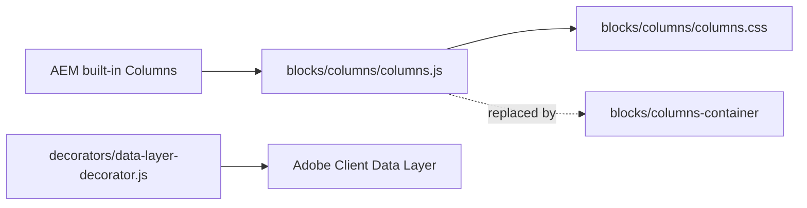

# Columns

The built-in Columns block of the AEM Edge Delivery Services xwalk boilerplate: a grid of rows and equal-width columns whose cells hold default content (Text, Title, Image). It is kept only so that Columns authored before still render and stay editable; new columns are built with the [Columns Container](../columns-container/README.md).

> **Status: Deprecated**
>
> Retained for existing authored content. Use `columns-container` (the [Columns Container](../columns-container/README.md) with [Column Breaks](../column-break/README.md)) for new authoring.

| Attribute | Value |
|---|---|
| Technical name | `columns` (component id, model and block class; AEM resource type `core/franklin/components/columns/v1/columns`) |
| Display name | Columns |
| Block type | Independent (built-in component) |
| Status | Compatibility-only / deprecated: no longer offered in any filter |
| Parent / children | Parent: none offers it any more (formerly sections and Tabs Containers). Children: its columns (`column` filter: Text, Image, Title) |
| Owner / version / date | Not recorded |

## Overview

**Business purpose (historical).** Simple side-by-side default content (image and text, two or three text columns, rows of image and text pairs) without a purpose-built block.

**Why it is deprecated.** Its columns take default content only (Edge Delivery has no blocks inside blocks) and AEM doesn't deliver an Additional tab (`classes_*`) for the built-in Columns component, so anchors, spacing, hiding and animation can't be set on it. The Columns Container holds any block in its columns and has the full layout and Additional tab options.

**Current behavior.** Existing Columns render as before: columns stacked on mobile and tablet, side by side with equal widths from 900px; an image-only column is shown first when stacked. Existing Columns remain editable (their cells still accept Text, Image and Title).

**Templates / page types.** Any page with Columns authored before. **Data source:** authored content.

**Related blocks.** [Columns Container](../columns-container/README.md) (replacement), [Column Break](../column-break/README.md), [Tabs](../tabs/README.md) (Tabs Containers authored before may hold Columns; new tab columns use Column Breaks).

**When to use.** Only to maintain existing content until it is migrated.

**When not to use.** For any new layout: use the Columns Container (or Cards, List, Teaser where they fit).

## Visual Reference

<!-- BEGIN GENERATED: screenshots (npm run build:docs) -->

Screenshots of the handover (6.14 Columns Block), taken on the preview with sample content; they show the rendering at the time of the handover revision that added them (later changes are in the sections below and the handover's revision history):

| Screenshot | Shows |
| ---------- | ----- |
| [Desktop rendering](../../docs/handover/screenshots/columns-desktop-view.jpg) | The Columns block at 1440 px with two equal columns 1.5rem apart: photo-1.svg on the left; on the right, vertically centred, the H2 Cloud transformation, end to end, the paragraph From assessment to migration and managed operations… and the button Explore cloud services. |
| [Tablet rendering](../../docs/handover/screenshots/columns-tablet-view.jpg) | The Columns block at 768 px, stacked: photo-1.svg at full width on top, then the H2 Cloud transformation, end to end, the paragraph and the button Explore cloud services below it. |
| [Mobile rendering](../../docs/handover/screenshots/columns-mobile-view.jpg) | The Columns block at 375 px, stacked within 1.5rem side padding: photo-1.svg first, then the H2 Cloud transformation, end to end, the paragraph and the button Explore cloud services. |
| [Two-column variation](../../docs/handover/screenshots/columns-two-columns.jpg) | The Columns block at 1440 px with two equal columns: the H3 The challenge and the paragraph about ageing store systems on the left, the H3 The solution and the cloud-native inventory platform paragraph on the right. |
| [Three-column variation](../../docs/handover/screenshots/columns-three-columns.jpg) | The Columns block at 1440 px with three equal columns: the H3s Our mission, Our vision and Our values, each with its one-sentence text. |
| [Image column variation](../../docs/handover/screenshots/columns-image-column.jpg) | The Columns block at 1440 px: the H2 Intelligent operations and the AI-led automation paragraph on the left, photo-2.svg on the right; an inset shows the same block at 375 px with the image moved above the text. |
| [Multiple rows variation](../../docs/handover/screenshots/columns-multiple-rows.jpg) | The Columns block at 1440 px with three rows of two equal columns: photo-3.svg beside the H3 Discover, the H3 Design beside photo-4.svg, and photo-5.svg beside the H3 Deliver, each heading with its short paragraph, so the image alternates left, right, left. |
| [Universal Editor canvas](../../docs/handover/screenshots/columns-authoring-view.jpg) | The Columns block in Universal Editor edit mode at 1440 px with three columns: the H2 Banking reimagined and its text, square-1.svg, and a text with the button Banking and financial services; letters A on the block, B on a column, C on the title, D on the text and E on the image. An annotated preview, not a Universal Editor screenshot. (Annotated preview in editor mode with sample content; letters as in the annotations list, not a Universal Editor screenshot; file screenshots/columns-authoring-view.jpg) |
| [Properties panel](../../docs/handover/screenshots/columns-properties-panel.jpg) | The Columns properties panel with the Content tab (Columns, Rows) and the Additional tab header. (Dialog reference generated from the component model, not a Universal Editor screenshot; file screenshots/columns-properties-panel.jpg) |

Universal Editor dialogs (no screenshot exists yet; to be captured on AEM author):

```text
[Screenshot Placeholder]

File name:
columns-dialog-content-desktop.png

Purpose:
The Content tab of the Columns properties in Universal Editor, with the fields of the table "Content tab — Columns" in Authorable Fields below.

Annotations:
A = Columns
B = Rows
```

<!-- END GENERATED: screenshots -->

The handover screenshots above predate the deprecation; the button shown in some of them is a bold / italic link in a Text (the built-in Button is no longer offered either). One state has no screenshot yet:

```text
[Screenshot Placeholder]

File name:
columns-migration-desktop.png

Purpose:
The same content before and after migration: a two-column Columns block and the equivalent Columns Container with two Column Breaks, rendered identically at desktop width.

Annotations:
A = Existing Columns block
B = Columns Container with Column Breaks
```

## For Content Authors

Columns can no longer be added. To maintain an existing one:

1. Select the Columns block on the page; its properties show **Columns** and **Rows** (the grid size set when it was created).
2. Select a column to edit its content or to add a **Text**, **Image** or **Title** to it.
3. A button in a column is a link in a Text made bold (primary) or italic (secondary).
4. Preview, publish, and check the published page at mobile and desktop widths.

To replace it (recommended):

1. Add a **Columns Container** where sections are added (or, inside a Tabs Container tab, use Column Breaks after the Tab).
2. For each column of the Columns block, add a **Column Break**, then the column's content (Text, Title, Image; Button blocks for buttons).
3. Set **Columns per row** to the number of columns per row of the old block; Gap Medium, Vertical alignment Middle and Side by side from Desktop come closest to the old layout (the old block centred columns vertically with a 1.5rem gap from 900px).
4. Delete the Columns block, preview, publish.

## Authorable Fields

<!-- BEGIN GENERATED: fields (npm run build:docs) -->

### Columns (`columns`)

Model `columns`.

Stored on a new component (definition template): `columns` = `"2"`, `rows` = `"1"`.

#### Content tab — Columns

| Field label | Property | Type | Required | Default | Allowed values | Author guidance | Example |
| ----------- | -------- | ---- | -------- | ------- | -------------- | --------------- | ------- |
| Columns | `columns` | text | No | "" | — | — | — |
| Rows | `rows` | text | No | "" | — | — | — |

<!-- END GENERATED: fields -->

Notes on the fields:

- **Columns** and **Rows** (`columns`, `rows`): the size of the grid AEM creates for a new Columns (template values 2 and 1); the code reads the number of cells of the first row, not these values.
- **No Additional tab:** AEM delivers no `classes_*` for the built-in Columns component, so the dialog has none (removed in the block audit, handover 2.27). The motion decorator still lists `columns` (columns as staggered targets), but without delivered classes no animation can be authored.
- **Column content:** the `column` filter allows Text, Image and Title.
- **Data layer:** the block is a component `tcs-corp/components/columns`.

## Screenshot-Based Authoring Steps

### Authoring Step 1: Find the Columns to migrate

```text
[Screenshot Placeholder]

File name:
columns-authoring-step-1.png

Purpose:
An existing Columns block selected in the content tree, with its Columns and Rows properties.

Annotations:
A = Columns block in the tree
B = Columns
C = Rows
```

### Values to Enter

| Callout | Field | Value | Reason | Expected result |
|---|---|---|---|---|
| B | Columns | (read only) 2 | Number of columns to recreate | — |
| C | Rows | (read only) 1 | Number of rows | — |

Author action: note the columns and their content. Common mistake: looking for Columns in the Add (+) list; it is no longer offered.

### Authoring Step 2: Add the Columns Container

```text
[Screenshot Placeholder]

File name:
columns-authoring-step-2.png

Purpose:
A Columns Container added next to the old Columns block, with Columns per row 2.

Annotations:
A = Columns Container
B = Columns per row
```

### Values to Enter

| Callout | Field | Value | Reason | Expected result |
|---|---|---|---|---|
| A | Add (+) on the page | Columns Container | Replacement | Empty container |
| B | Columns per row | 2 | As the old block | Two columns per row |
| — | Vertical alignment | Middle | The old block centred its columns | `align-middle` |

### Authoring Step 3: Recreate the columns

```text
[Screenshot Placeholder]

File name:
columns-authoring-step-3.png

Purpose:
Two Column Breaks with the moved content (Image, then Title and Text), and the old Columns block deleted.

Annotations:
A = Column Break 1 and the Image
B = Column Break 2 and the Title and Text
```

### Values to Enter

| Callout | Field | Value | Reason | Expected result |
|---|---|---|---|---|
| A | Column Break 1 content | Image (with alt text) | First column | Image column |
| B | Column Break 2 content | Title, Text, Button block | Second column | Text column |

Author action: add the Column Breaks and content, delete the old block, preview at 390px and 1440px, publish. Business rule: the Columns Container stacks columns in their order (the old block moved image-only columns first on mobile): put the image column first if it should come first on mobile. Validation: the page looks as before at desktop width.

## Variations

The variations below exist only in content authored before; the code renders them as follows.

### Two columns

Two cells per row: equal columns side by side from 900px, stacked below.

### Three or more columns

Any number of cells per row; each takes an equal share (`flex: 1`). The class `columns-{n}-cols` is added (n = cells of the first row) but no CSS uses it.

### Image column

A cell whose only content is a picture gets `columns-img-col`: shown first when stacked (`order: 0`), image full width.

### Multiple rows

Each row is its own flex row; rows don't share column widths beyond their equal shares.

```text
[Screenshot Placeholder]

File name:
columns-image-column-mobile.png

Purpose:
An existing Columns block with an image-only column on the right at mobile width: the image shown above the text.

Annotations:
A = Image column moved first
B = Text column
```

## Complete Authoring Example

Scenario: migrating a two-column "Cloud transformation" Columns (image left, heading, text and a button right) to a Columns Container.

| Field | Example value | Guidance |
|---|---|---|
| Columns Container Columns per row | 2 | As the old block |
| Vertical alignment | Middle | As the old layout |
| Gap | Medium | Closest to the old 1.5rem gap |
| Column Break 1 | Image (alt text "Cloud operations dashboard") | Keep the alt text |
| Column Break 2 | Title "Cloud transformation, end to end", Text, Button block "Explore cloud services" | Button blocks replace bold links |

Expected output: the same layout from 900px; stacked below in content order. Accessibility: alt text and heading order unchanged. Analytics: the component becomes `tcs-corp/components/columns-container`, its blocks its children. Personalization fallback: none.

Pre-publish checklist: all content moved; old block deleted; checked at mobile and desktop widths.

## Content and Asset Guidelines

- Only Text, Image and Title in columns; buttons as bold (primary) or italic (secondary) links in a Text.
- Images: full column width (`width: 100%`); alt text on every meaningful image.
- Min / max: no verified technical limit was identified; many columns become narrow (equal shares, no wrapping).
- New content: use the Columns Container.

## Accessibility

- Plain `div` rows and cells; the order is the content order, except that image-only cells are shown first when stacked (visual order only: screen readers and keyboard follow the content order).
- No keyboard handling of its own; headings and alt text come from the content.

**Author responsibilities:** alt text, heading order, a sensible order of the cells.

**Developer responsibilities:** don't change the rendering of existing content; send new needs to the Columns Container.

## Data Layer and Analytics

- Component `tcs-corp/components/columns` (added by `decorators/data-layer-decorator.js`; id `columns-{n}`, `dc:title` its first heading); clicks on links in it are measured centrally as `cmp:click` of the block.
- The path Adobe Client Data Layer → Adobe Data Collection (Tags) → AEP Web SDK → Edge Network → Analytics / CJA is the intended one, but Tags and the Web SDK aren't configured yet (blocked: measurement plan). No consent mechanism is implemented.

| Trigger | Data-layer event | Required properties | Analytics behavior |
|---|---|---|---|
| Page load | component state | `@type` `tcs-corp/components/columns`, `parentId`, `dc:title` | Inventory |
| Click on a link | `cmp:click` | component (the Columns), `xdm:linkURL`, `xdm:linkType` | Link clicks |

## Personalization

This block does not currently expose verified personalization behavior. There is no Adobe Target or AJO integration in the repository; the authored content renders for every visitor.

## Responsive Behavior

| Viewport | Layout | Image behavior | Interaction behavior |
|---|---|---|---|
| Below 900px | Each row stacked (one column under the other); image-only columns first | Images full width | None |
| 900px and wider | Columns side by side, equal widths (`flex: 1`), vertically centred, `gap: 1.5rem` | Images fill their column | None |

## For Developers

<!-- BEGIN GENERATED: files (npm run build:docs) -->

```text
blocks/columns/
├── README.md
├── _columns.json
├── columns.css
└── columns.js
```

The block imports no shared decorator or utility.

<!-- END GENERATED: files -->

**Responsibilities.** `columns.js` adds `columns-{n}-cols` (cells of the first row) and marks cells whose only child wrapper holds a picture with `columns-img-col`; `columns.css` stacks rows below 900px (image columns first) and lays them out side by side from 900px.

**Input DOM.** The built-in component's block: `div.columns` > a `div` per row > a `div` per cell with default content. No key-value rows, no tab rows, no `classes_*`.

**Rendered DOM.** The same structure with `columns-{n}-cols` on the block and `columns-img-col` on image cells. AEM also marks the block's section `columns-container` (the boilerplate's `{block}-container` section class), which is why `blocks/columns-container/columns-container.css` is scoped to `.block.columns-container`.

**Exports.** `default decorate(block)`; no imports.

## Extending the Block

Don't extend it: the block is deprecated. Add new layout options to the [Columns Container](../columns-container/README.md#extending-the-block). Keep `columns.js` and `columns.css` as they are so existing content renders unchanged; the definition, model and `columns` / `column` filters must stay so existing Columns remain editable. Don't add the component back to the `section`, `tabs` or `columns-container` filters. If the files change, run `npm run lint`, `npm run build:docs` and, after changing imports, `npm run build:modules`.

## For Site Administrators

- **Availability:** in no parent filter (not in `section`, `tabs`, `columns-container` or `main`); its own `columns` and `column` filters remain for editing existing content.
- **Migration:** the block library content was migrated (handover 2.28: 10 Columns to Columns Containers, 27 Columns in tabs to Column Breaks); production content authored before still needs the same migration (re-audit "Migrate production content").
- **Deprecation plan:** remove the definition only after no content uses it (not recorded when).

| Dependency | Purpose | Location | Impact if unavailable |
|---|---|---|---|
| Definition and model `columns`, filters `columns` / `column` | Editing existing Columns | `blocks/columns/_columns.json` | Existing Columns can't be edited in Universal Editor |
| `columns.js`, `columns.css` | Rendering existing Columns | Repository | Existing Columns render unstyled |

## For Architects

- **Role:** legacy component kept for backward compatibility; replaced by the Columns Container section container.
- **Content model:** AEM's built-in columns resource type (rows and cells); no Additional tab delivered.
- **Rendering:** CSS flex layout; no data source, no network, no listeners.
- **Data layer / Target / consent:** ACDL component only; no Target, no consent.



## For QA and Support Teams

| Test ID | Scenario | Configuration | Expected result |
|---|---|---|---|
| COLUMNS-QA-01 | Not offered | Add (+) in a Section, Tabs Container, Columns Container | Columns isn't listed |
| COLUMNS-QA-02 | Existing two columns | Columns authored before | Side by side from 900px, stacked below |
| COLUMNS-QA-03 | Image column | Image-only cell on the right | Image first below 900px |
| COLUMNS-QA-04 | Multiple rows | 3 rows of 2 | Three rows, equal columns |
| COLUMNS-QA-05 | In a Tabs Container | Columns authored before in a tab | Renders in the panel |
| COLUMNS-QA-06 | Section not a grid | A section with a Columns block | The section isn't laid out as a Columns Container grid |
| COLUMNS-QA-07 | Editable | Edit a Text in a column | Saved and rendered |
| COLUMNS-QA-08 | Data layer | Inspect `adobeDataLayer` | `tcs-corp/components/columns` component |

## Troubleshooting

| Symptom | Likely cause | Diagnostic steps | Resolution | Verification |
|---|---|---|---|---|
| Columns not in the Add (+) list | Deprecated, removed from the filters | — | Use a Columns Container | — |
| A block can't be added to a column | The `column` filter allows Text, Image, Title only | — | Migrate to a Columns Container | Block in a column |
| No spacing / anchor / hide options | No Additional tab for the built-in component | — | Migrate to a Columns Container | Options available |
| Image not first on mobile | The cell holds more than the picture | Inspect for `columns-img-col` | Keep the image alone in its cell, or migrate | Image first |
| Columns too narrow | Many cells per row (no wrapping) | Count the cells | Migrate with Columns per row | Columns wrap into rows |

## Performance Considerations

Runs once on decoration, a few class changes; no network, observers or listeners. Images follow the default image handling.

## Security and Privacy

No external content, input or personal data.

## Known Limitations

| Limitation | Impact | Workaround | Planned correction |
|---|---|---|---|
| Columns hold default content only | No blocks in columns | Columns Container | Not planned (deprecated) |
| No Additional tab (AEM doesn't deliver `classes_*` for the built-in Columns) | No anchor, spacing, hide or animation | Columns Container | Not planned (deprecated) |
| Equal widths only, no wrapping into rows | Narrow columns with many cells | Columns Container with Columns per row | Not planned (deprecated) |
| Production content authored before isn't migrated | Two column implementations coexist | Migrate page by page | Not recorded |

## Related Documentation

- [Blocks documentation](../README.md)
- [Columns Container](../columns-container/README.md) (replacement)
- [Column Break](../column-break/README.md)
- Model: [`_columns.json`](_columns.json)
- Tests: [`test/motion/motion.test.mjs`](../../test/motion/motion.test.mjs) (Columns excluded from the animation fields)
- Re-audit: [`docs/audit/REAUDIT-2026-10-20.md`](../../docs/audit/REAUDIT-2026-10-20.md)
- [Handover 6.14 Columns Block](../../docs/handover/TCS-CORP-HANDOVER.md)

<!-- BEGIN GENERATED: usage (npm run build:docs) -->

No block library or curated design page using this block was recorded in the library snapshot.

<!-- END GENERATED: usage -->

## Change History

| Version | Change | Source | Date |
|---|---|---|---|
| Not recorded | README generated from verified implementation and approved handover documentation | Repository review | Not recorded |
| Handover 2.22 | Columns of blocks moved to the new Columns Container; the Columns block keeps default content only | docs/handover revision history | 19 October 2026 |
| Handover 2.27 | Block audit: the Columns Additional tab removed (AEM doesn't deliver it) | docs/handover revision history | 19 October 2026 |
| Handover 2.28 | The built-in Columns is no longer offered; its definition stays for content authored before; library content migrated | docs/handover revision history | 20 October 2026 |
