# Conversation Canvas

The Canvas is the TCS "ask us a question" entry point: an optional icon, eyebrow, title and text, a search row (a round menu button with the site menu, a search field with voice input and a submit icon button) and optional quick actions (button items), or, in the Primary (sticky) style, a floating search and site navigation dock. It can be authored in the page body, in the header (a section of the nav page) and in the footer (the Footer's Conversation Canvas Page), and all Canvases of a page take part in one **floating journey**: one search row floats at the bottom of the window, lands on each Canvas in place and stops at the footer Canvas.

> Naming: the requirement and Figma say "Canvas" (sometimes "Canva" / "floating Canva"). The block keeps its technical name `conversation-canvas` (classes `conversation-canvas-*`, component "Conversation Canvas") so authored content and styles don't break.

| Attribute | Value |
| --------- | ----- |
| Technical name | `conversation-canvas` |
| Display name | Conversation Canvas |
| Block type | Key-value block (one row per property) with item children |
| Status | Active |
| Parent / children | Added to a Section or a Columns Container column (also a section of the nav page or of the footer canvas page); children: Conversation Canvas Button (`conversation-canvas-button`) |
| Owner / version / date | Not recorded / Not recorded / Not recorded |

## Overview

**Business purpose.** One consistent, authorable place on every page that invites visitors to ask a question in their own words and offers quick routes into the site structure, ready for a search or conversational service through the `conversation-canvas:search` event and the Search page, without re-authoring.

**User experience.** Default and Secondary show a centred panel (white with blue and yellow brand glows, or a background image) with the intro, the search row and quick actions. Once the visitor scrolls past it, the search row floats at the bottom of the window until the next Canvas or the footer Canvas. Primary (sticky) shows only a dock floating at the bottom: the search pill and, from 900px, the site navigation of the current section.

**Templates and page types.** Any page (Section and Columns Container filters; not offered in the Tabs Container). Typical places: the Home hero, a full-width section of a landing page, the header Canvas (a nav page section) and the footer Canvas (`references/footer-conversation-canvas`). The curated design pages Home, Industry landing page and What we do use it.

**Data source.** Authored properties; the site menu and the Primary navigation come from the locale's query index (`path`, `title`); Primary suggestions from the page's tags labelled from the taxonomy; UI texts from placeholders.

**Related blocks.** TCS Header ([README](../header/README.md), hosts the header Canvas and announces its menu), Footer (hosts the footer Canvas), Form Variations ([README](../form-variations/README.md), for data capture), Columns Container ([README](../columns-container/README.md)).

**When to use.** To invite free-text questions or searches; to give quick navigation through a section of the site; at most one Primary (sticky) Canvas per page.

**When not to use.** To collect personal data (use Form Variations); as the only route to content while no Search page or search integration is connected; as a replacement for the header navigation (on mobile the Primary dock shows only the search pill); several Canvases with the same question on one page.

**Realistic use cases.** "How can we help you today?" on Home; "What would you like to explore?" (Secondary, filter tags from a personalisation script); a floating "Ask us a question" dock with section pills on a services page; "Have a question? Ask us." at the top of the footer.

## Visual Reference

<!-- BEGIN GENERATED: screenshots (npm run build:docs) -->

Screenshots of the handover (6.30 Conversation Canvas Block), taken on the preview with sample content; they show the rendering at the time of the handover revision that added them (later changes are in the sections below and the handover's revision history):

**Desktop rendering** — The Default canvas at 1440 px: a white rounded panel with blue and yellow glows at the bottom, the chat icon, the eyebrow Ask TCS, the h2 How can we help you today?, the intro text, the search row (round menu button, pill field Ask us a question with microphone and blue arrow) and the buttons Contact us (primary) and Explore services (secondary), all centred.

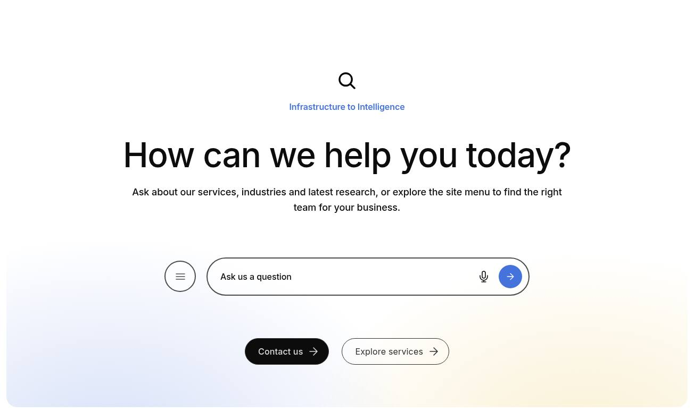

**Tablet rendering** — The same Default canvas at 768 px: chat icon, Ask TCS, the title How can we help you today? on two lines at 3.125rem, the intro text on two lines, the search row filling the width with menu button, microphone and arrow, and Contact us and Explore services side by side.

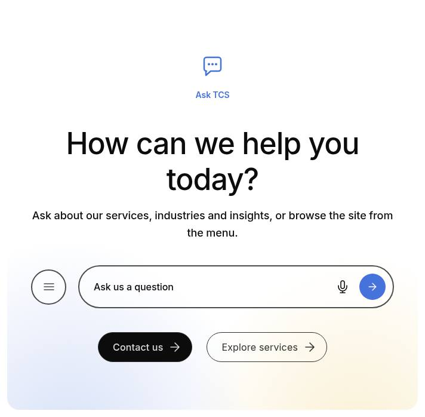

**Mobile rendering** — The same Default canvas at 375 px: chat icon, Ask TCS, the 2.5rem title How can we help you today? on three lines, the intro text, the round menu button beside a narrow search pill with microphone and arrow, and the buttons Contact us and Explore services stacked below each other.

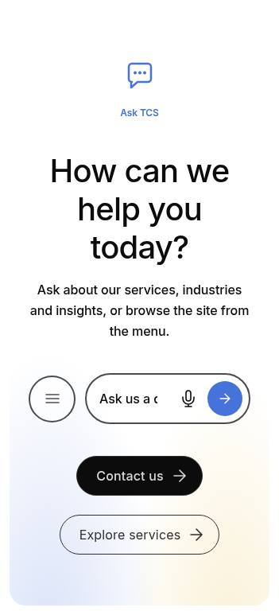

**Default style** — The Default canvas at 1440 px without icon or eyebrow: the h2 How can we help you today?, the text Ask a question in your own words or explore our services and industries., the search row and the buttons Contact us (primary) and Explore services (secondary) on a white panel with blue (left) and yellow (right) glows.

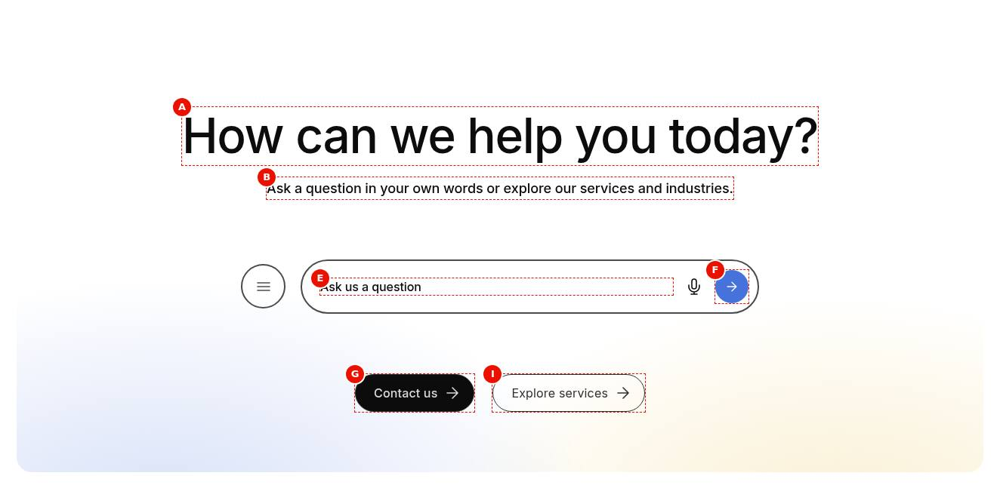

**Secondary style** — The Secondary canvas at 1440 px: the eyebrow Explore topics, the h2 What would you like to explore?, the text, the search row and five script-supplied filter pills: Cloud (active, filled brand blue), AI and data, Cybersecurity, Consulting and Banking, on a panel with a yellow glow left and a blue glow right.

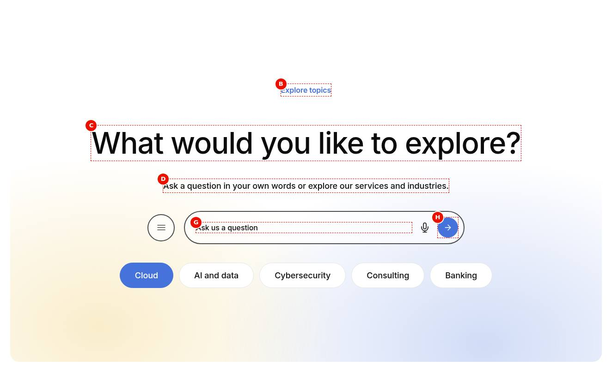

**Primary (sticky) dock on desktop** — The bottom of /en/services/consulting at 1440 px, scrolled down: the Primary dock floats over a white fade with the round menu button and the search pill Ask us a question (microphone, blue arrow) and, below it, the pills Back (arrow), AI and data, Cloud (with chevron), Consulting (current, blue outline) and Cybersecurity.

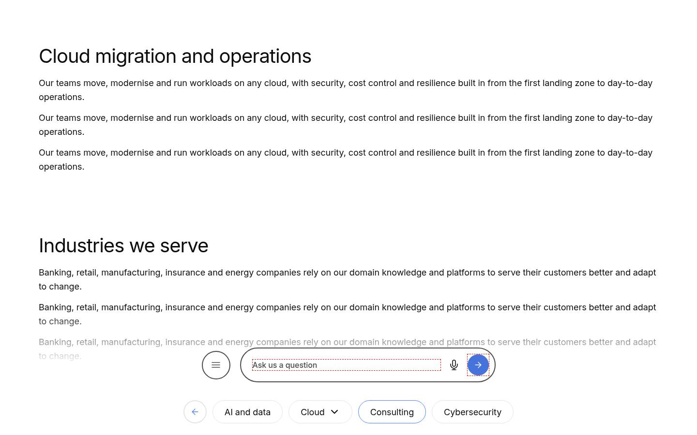

**Default title size** — A Default canvas at 1440 px with the eyebrow Ask TCS, the h2 How can we help you today? at 4rem and the search row (menu button, Ask us a question field with microphone and blue arrow); no text or buttons.

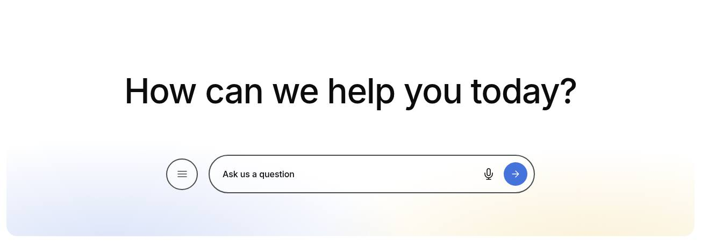

**Bigger title** — A Default canvas at 1440 px with the eyebrow Ask TCS and the h2 Building on belief at 5rem (Title Type Bigger Title) above the search row; no text or buttons.

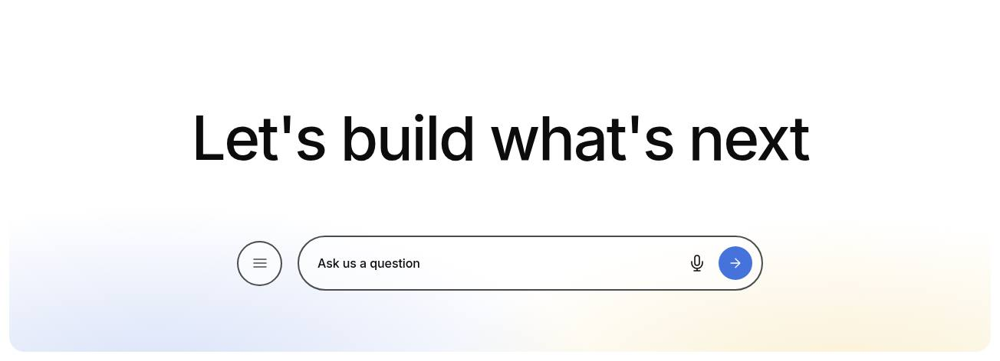

**Medium title** — A Default canvas at 1440 px with the eyebrow Ask TCS and the h2 Questions about our services? Ask us directly. at 2.5rem with line height 1.4 (Title Type Medium Title) above the search row; no text or buttons.

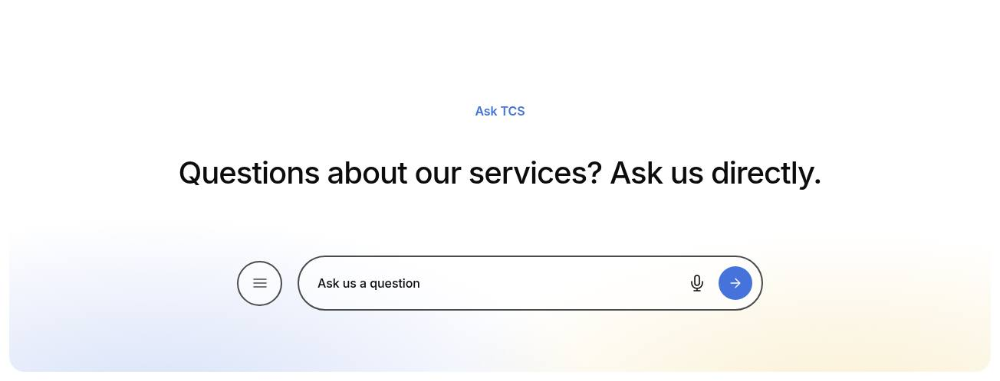

**Default background glow** — A Default canvas at 1440 px with the h2 Ask us a question, the text Ask a question in your own words or explore our services and industries. and the search row on a white panel with a blue glow rising from the bottom left and a yellow glow from the bottom right.


**Background image** — A Default canvas at 1440 px with the light abstract image light.svg (pale blue panel with large white and blue circles) filling the rounded panel behind the h2 Ask us a question, the text and the search row; no glow.

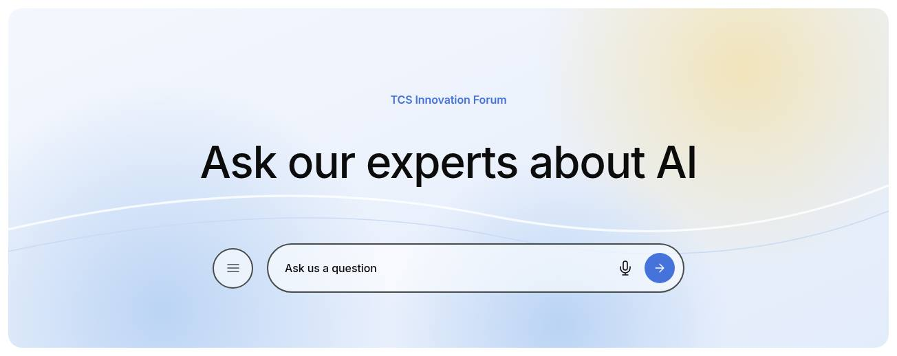

**Primary search button** — The search row of a canvas at 1440 px, cropped: the round menu button and the pill field Ask us a question with the microphone and a filled brand-blue round arrow button (Search bar button icon type Primary).

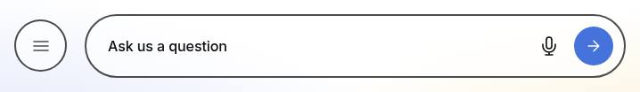

**Secondary search button** — The search row of a canvas at 1440 px, cropped: the round menu button and the pill field Ask us a question with the microphone and a round arrow button with a brand-blue outline and no fill (Search bar button icon type Secondary).

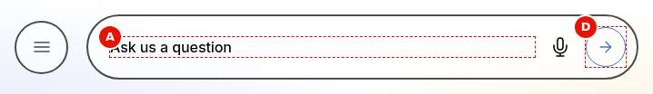

**Tertiary search button** — The search row of a canvas at 1440 px, cropped: the round menu button and the pill field Ask us a question with the microphone and a plain brand-blue arrow without fill or border (Search bar button icon type Tertiary).

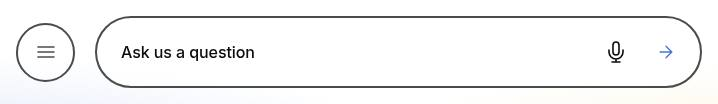

**Voice input** — The search row of a canvas at 1440 px, cropped: the menu button and the pill Ask us a question with the default microphone button in its listening state (brand blue with a round outline, aria-pressed="true") next to the filled blue arrow.

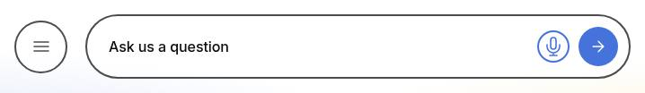

**Custom audio icon** — The search row of a canvas at 1440 px, cropped: the menu button and the pill Ask us a question with the custom audio icon audio-icon.svg (five blue sound bars, 1.5rem) in place of the microphone, next to the filled blue arrow.

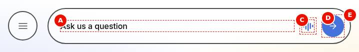

**Button items** — A Default canvas at 1440 px with the h2 Ask us a question, the search row and two centred pill buttons below it: a black primary Contact us and an outlined secondary Explore services, each with a trailing arrow.

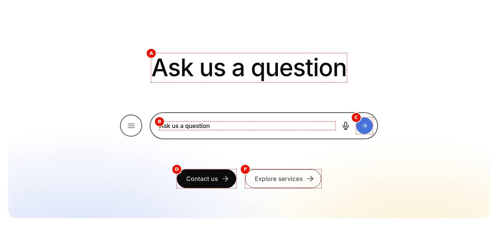

**Icon button item** — A Default canvas at 1440 px with the h2 Ask us a question, the search row and below it one round brand-blue icon button with a white chevron-right (Views Icon, Icon Chevron right); its text Explore our services is not visible.

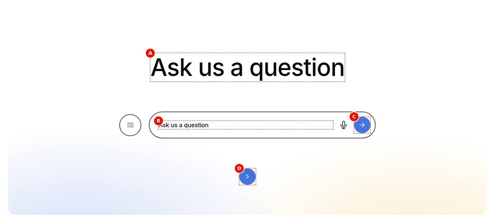

**Link item** — A Default canvas at 1440 px with the h2 Ask us a question, the search row and below it the centred text link View all FAQs with a trailing chevron (Views Link).

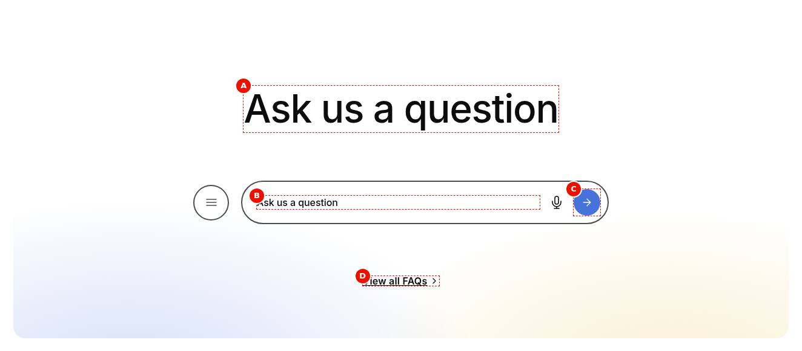

**Floating search row** — The floating-row page at 1440 px scrolled past its canvas: the sections Industries we serve, Research and insights and Consulting that delivers outcomes, with the canvas's menu button and Ask us a question pill (microphone, blue arrow) floating centred 1.5rem above the viewport bottom, translucent white with shadow and blur.

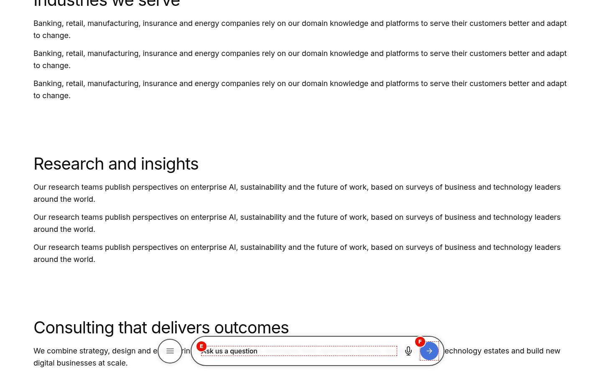

**Footer canvas** — The site footer at 1440 px: the h2 Have a question? Ask us. at 6rem on two lines, the search row (menu button, Ask us a question, microphone, arrow; 38.0625rem wide), Contact us (primary) and About TCS (secondary) side by side, then © TATA Consultancy Services 2027 with Privacy policy, Cookie policy and Terms of use, and the LinkedIn, X, YouTube and Instagram icons.

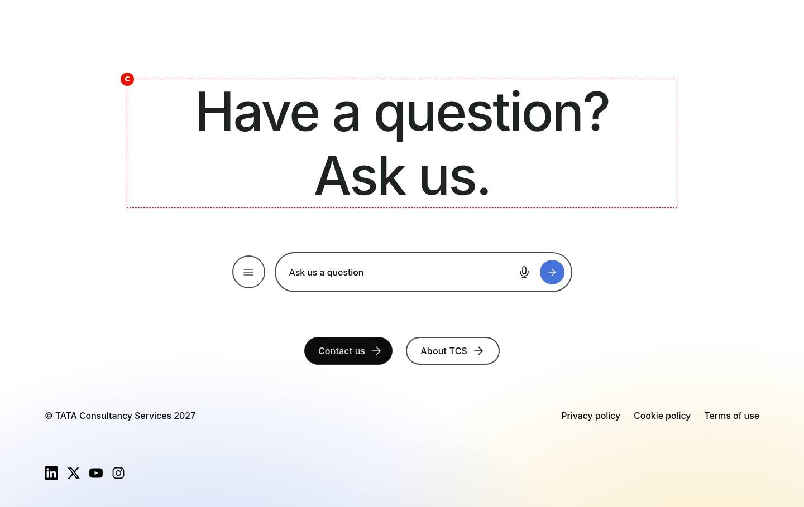

**Universal Editor canvas** — An annotated editor-mode preview at 1440 px (not a Universal Editor screenshot) of the Default canvas with chat icon, Ask TCS, How can we help you today?, text, search row, Contact us and Explore services, with markers A (block) to I (buttons) on icon, eyebrow, title, text, menu button, search field and submit button. (Annotated preview in editor mode with sample content; letters as in the annotations list, not a Universal Editor screenshot; file screenshots/conversation-canvas-authoring-view.jpg)

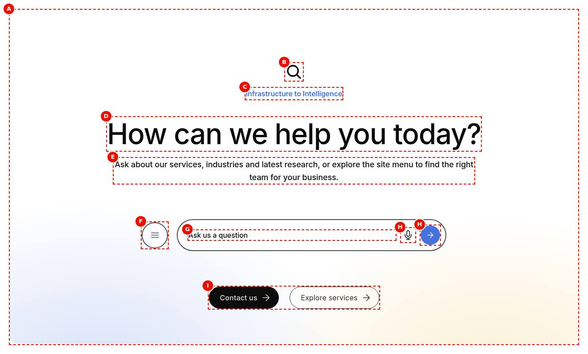

**Properties panel** — Properties panel with the Content tab (Canvas Style, BG Style, images, (Dialog reference generated from the component model, not a Universal Editor screenshot; file screenshots/conversation-canvas-properties-panel.jpg)


Universal Editor dialogs (no screenshot exists yet; to be captured on AEM author):

```text
[Screenshot Placeholder]

File name:
conversation-canvas-dialog-content-desktop.png

Purpose:
The Content tab of the Conversation Canvas properties in Universal Editor, with the fields of the table "Content tab — Conversation Canvas" in Authorable Fields below.

Annotations:
A = Canvas Style
B = Floating journey
C = Quick actions
D = BG Style
E = BG Background Image
F = Icon
G = Icon Alt Text
H = Eyebrow
I = Title
J = Title Type
```

```text
[Screenshot Placeholder]

File name:
conversation-canvas-dialog-additional-desktop.png

Purpose:
The Additional tab of the Conversation Canvas properties in Universal Editor, with the fields of the table "Additional tab — Conversation Canvas" in Authorable Fields below.

Annotations:
A = Anchor ID
B = Hide block
C = Animation Type
D = Motion Speed
E = Animation Trigger
F = Background animation
G = Padding left
H = Padding right
I = Padding top
J = Padding bottom
```

```text
[Screenshot Placeholder]

File name:
conversation-canvas-button-dialog-fields-desktop.png

Purpose:
The dialog of the Conversation Canvas Button properties in Universal Editor, with the fields of the table "Fields — Conversation Canvas Button" in Authorable Fields below.

Annotations:
A = Link
B = Text
C = Title
D = Views
E = Type
F = Icon
```

<!-- END GENERATED: screenshots -->

States that exist in the code without a screenshot in the handover:

```text
[Screenshot Placeholder]

File name:
conversation-canvas-floating-mobile.png

Purpose:
A Default Canvas scrolled past at 375 px: the search row floats 1.25rem above the bottom of the window (plus the safe area), full width minus 1.5rem gutters, translucent with shadow and blur.

Annotations:
A = Floating search row
B = Reserved place of the row (no layout shift)
```

```text
[Screenshot Placeholder]

File name:
conversation-canvas-primary-mobile.png

Purpose:
The Primary (sticky) dock below 900 px: only the 17.5rem "Ask TCS" search pill floats, no navigation.

Annotations:
A = Search pill
B = Voice and submit buttons
```

```text
[Screenshot Placeholder]

File name:
conversation-canvas-primary-text-links-desktop.png

Purpose:
Primary (sticky) with Navigation style Text links at 1440 px: the navigation as text items, the current item as a filled pill.

Annotations:
A = Search pill
B = Text navigation items
C = Current item (filled pill)
```

```text
[Screenshot Placeholder]

File name:
conversation-canvas-primary-dark-desktop.png

Purpose:
Primary (sticky) with BG Style Dark at 1440 px: the black fade, the dark search pill with a grey outline and light navigation.

Annotations:
A = Black fade
B = Dark search pill
C = Light navigation items
```

```text
[Screenshot Placeholder]

File name:
conversation-canvas-menu-open-desktop.png

Purpose:
The site menu of a Default Canvas at 1440 px (Figma Full menu 1124:26210 / 1124:26244): the first level as pills below the search row over the faded page, a pill's child pages in the panel above on hover; a second level with its open item and the third level in the panel; and the four skeleton pills shown while the query index loads.

Annotations:
A = Menu button (aria-expanded="true", the blue close button)
B = First-level pills
C = Panel of a page's child pages (List Container rows)
D = Second level: menu button, open item (blue pill), chevrons
```

```text
[Screenshot Placeholder]

File name:
conversation-canvas-menu-empty-desktop.png

Purpose:
The menu with "No pages found" (no indexed pages below the Menu root path, e.g. in Universal Editor).

Annotations:
A = Empty state text
```

```text
[Screenshot Placeholder]

File name:
conversation-canvas-primary-panel-desktop.png

Purpose:
The Primary dock with a sub-page panel open (six or more items in two balanced columns) in place of the search row.

Annotations:
A = Panel with sub-pages
B = Open toggle (aria-expanded="true")
C = Back / menu button
```

```text
[Screenshot Placeholder]

File name:
conversation-canvas-section-tablet.png

Purpose:
A section Canvas at 768 px: at least 50rem high, content centred, 1.5rem gutters, quick actions as pills.

Annotations:
A = Intro
B = Search row
C = Quick action pills
```

```text
[Screenshot Placeholder]

File name:
conversation-canvas-header-canvas-desktop.png

Purpose:
The header Canvas (a nav page section) on the bottom of the Home hero at the top of the page, and the same row fixed at the bottom of the window after a small scroll.

Annotations:
A = Header Canvas row in place
B = The same row floating
```

## For Content Authors

1. **Add the block.** In Universal Editor select a Section (or a Columns Container column) and choose Add > Conversation Canvas. For the header Canvas add it to a section of the Navigation page; for the footer Canvas add it to the page referenced by the Footer's Conversation Canvas Page (e.g. `references/footer-conversation-canvas`).
2. **Open its properties.** Select the block; the dialog has the tabs Content and Additional.
3. **Choose the style.** Canvas Style Default, Secondary or Primary (sticky). Primary renders only the floating dock: intro, background and buttons aren't shown.
4. **Enter the content.** Icon (and Icon Alt Text only if the icon carries meaning), Eyebrow, Title, Title Type, Text, BG Background Image; Menu root path and Menu depth (1 to 3) for the site menu; the Search bar fields: water mark (the placeholder and the field's label), audio icon and its alt text, button icon type, hover text (the submit button's name) and Search page.
5. **Set the journey.** Default and Secondary: Floating journey Floats and docks (default) or Stays in place, and Quick actions Auto, Pills or Buttons; Primary (always floating) instead shows Navigation style and BG Style (the dialog shows only the fields of the chosen Canvas Style).
6. **Add quick actions.** Select the block in the content tree and Add > Conversation Canvas Button; set Link, Text, Views (Button, Icon, Link), Type and Icon. Reorder them by dragging in the content tree.
7. **Preview** on aem.page (the query index isn't available in the editor, so the menu shows "No pages found" there), scroll the page to check floating and docking.
8. **Publish** the page (and the nav or footer canvas page when you changed those), then **validate**: the menu lists the pages, a search opens the Search page with `?q=` and the row floats and docks as expected.

**Minimum required:** none technically; recommended: Title, Search bar water mark, Search bar button icon type hover text ("Submit"), Search page and a Menu root path in the same locale. **Optional:** icon, eyebrow, text, background image, quick actions, the Additional tab.

## Authorable Fields

<!-- BEGIN GENERATED: fields (npm run build:docs) -->

### Conversation Canvas (`conversation-canvas`)

Model `conversation-canvas`; template name "Conversation Canvas" (the block class AEM renders); key-value block (one row per property); children: `conversation-canvas-button`.

#### Content tab — Conversation Canvas

| Field label | Property | Type | Required | Default | Allowed values | Author guidance | Example |
| ----------- | -------- | ---- | -------- | ------- | -------------- | --------------- | ------- |
| Canvas Style | `classes` | select | No | "" | Default (""), Primary (sticky) (`primary`), Secondary (`secondary`) | Default: the ask-us panel (title, text, search row, quick actions). Primary (sticky): only a search and site navigation dock, floating at the bottom of the window from the top of the page to the footer. Secondary: the topic exploration panel (Default with the glows reversed and suggestion filters a script can fill). | secondary |
| Floating journey | `classes_journey` | select | No | "" | Floats and docks (""), Stays in place (`nofloat`) | Default and Secondary. Floats and docks: the search row stays in place, floats once scrolled past and lands on the next Canvas, until the footer Canvas. Stays in place: the row never floats; a floating row lands on it while it is on screen. The footer Canvas never floats; Primary always floats. Shown when `classes` is not `primary`. Delivered as a block class. | nofloat |
| Quick actions | `classes_actions` | select | No | "" | Auto (""), Pills (`action-pills`), Buttons (`action-buttons`) | How the button items look. Auto: pills in page sections, buttons in the footer (Figma). Pills: filter-tag pills without arrows. Buttons: as each item is authored (view and type). Shown when `classes` is not `primary`. Delivered as a block class. | action-pills |
| BG Style | `bgStyle` | select | No | `default` | Default (`default`), Dark (Primary) (`dark`) | Shown when `classes` is `primary`. | default |
| BG Background Image | `backgroundImage` | reference | No | — | — | — | /content/dam/tcs-corp/home/home-hero-background.jpg |
| Icon | `icon` | reference | No | — | — | — | /content/dam/tcs-corp/block-library/icons/chat-icon.svg |
| Icon Alt Text | `iconAlt` | text | No | — | — | Delivered with `icon` (field collapse). | — |
| Eyebrow | `eyebrow` | text | No | — | — | — | Ask TCS |
| Title | `title` | text | No | — | — | — | Let’s shape what’s next, together |
| Title Type | `titleSize` | select | No | "" | Default (""), Bigger Title (`bigger`), Medium Title (`medium`) | — | bigger |
| Text | `text` | richtext | No | "" | — | — | — |
| Menu | `menu` | container | No | — | — | — | — |
| Menu › Menu root path | `menuRootPath` | aem-content | No | — | — | — | /language-master/en/dummy-pages |
| Menu › Menu depth | `menuDepth` | number | No | `1` | — | — | 2 |
| Navigation style | `classes_navstyle` | select | No | "" | Pills (""), Text links (`text-links`) | Primary (sticky): the site navigation as pills or as text links (Figma “No Pill”). Shown when `classes` is `primary`. Delivered as a block class. | text-links |
| Search bar | `searchBar` | container | No | — | — | — | — |
| Search bar › Search bar water mark | `searchPlaceholder` | text | No | — | — | — | Ask us a question |
| Search bar › Search bar audio icon | `searchAudioIcon` | reference | No | — | — | — | /content/dam/tcs-corp/block-library/icons/audio-icon.svg |
| Search bar › Search bar audio icon alt text | `searchAudioIconAlt` | text | No | — | — | — | Search by voice |
| Search bar › Search bar button icon type | `searchButtonStyle` | select | No | `primary` | Primary (`primary`), Secondary (`secondary`), Tertiary (`tertiary`) | — | primary |
| Search bar › Search bar button icon type hover text | `searchButtonLabel` | text | No | — | — | — | Search |
| Search bar › Search page | `searchPage` | aem-content | No | — | — | The page that shows search results (opened with ?q=the query). Without it, and without a search integration, visitors are told search isn’t available. | — |

#### Additional tab — Conversation Canvas

| Field label | Property | Type | Required | Default | Allowed values | Author guidance | Example |
| ----------- | -------- | ---- | -------- | ------- | -------------- | --------------- | ------- |
| Anchor ID | `classes_anchor` | text | No | — | regExp: ^anchor-[a-z0-9][a-z0-9-]*$; customErrorMsg: Start with anchor-, then lower-case letters, digits and hyphens. | A unique ID of the block on the page, starting with anchor-, e.g. anchor-our-services; link to it with #anchor-our-services. Delivered as a block class. | — |
| Hide block | `classes_hideblock` | boolean | No | `false` | on / off | Hides the whole block on the page until it is turned off (shown faded in the editor). Delivered as a block class. | — |
| Animation Type | `classes_animation` | select | No | "" | None (""), Fade in (`motion-fade-in`), Fade up (`motion-fade-up`), Fade down (`motion-fade-down`), Fade left (`motion-fade-left`), Fade right (`motion-fade-right`), Slide up (`motion-slide-up`), Slide down (`motion-slide-down`), Slide left (`motion-slide-left`), Slide right (`motion-slide-right`), Scale in (`motion-scale-in`) | How the block's content appears; repeated items (cards, list items, accordion items, columns) appear one after another. None: shown as is. Not played in the editor or when the visitor prefers reduced motion. Delivered as a block class. | motion-fade-in |
| Motion Speed | `classes_animationspeed` | select | No | "" | Medium (""), Fast (`motion-fast`), Slow (`motion-slow`) | How fast the block's animations run (Animation Type 0.3 / 0.6 / 0.9 s; the Background animation takes 1.5 times as long). Shown when (`classes_animation` is set and `classes_animation` is not empty) or (`classes_bganimation` is set and `classes_bganimation` is not empty). Delivered as a block class. | motion-slow |
| Animation Trigger | `classes_animationtrigger` | select | No | "" | On Scroll / Viewport Entry (""), On Page Load (`motion-on-load`) | When the block's animations run. On Scroll: when the block comes into view (at once if it is in view when the page opens). On Page Load: as soon as the block is ready, wherever it is on the page. Shown when (`classes_animation` is set and `classes_animation` is not empty) or (`classes_bganimation` is set and `classes_bganimation` is not empty). Delivered as a block class. | — |
| Background animation | `classes_bganimation` | select | No | "" | None (""), Fade in (`bg-motion-fade-in`), Reveal from the centre (`bg-motion-reveal`), Wipe left to right (`bg-motion-wipe-right`), Wipe right to left (`bg-motion-wipe-left`), Wipe bottom to top (`bg-motion-wipe-up`), Scale reveal (`bg-motion-scale`) | How the block's background (its colour, image or overlay as set in the block) appears. It doesn't animate the content: see Animation Type. Motion Speed and Animation Trigger apply to it too. Not played in the editor or when the visitor prefers reduced motion. Delivered as a block class. | bg-motion-reveal |
| Padding left | `classes_paddingleft` | select | No | "" | Default (""), 0 (none) (`pl-0`), 0.25rem (space-100) (`pl-100`), 0.5rem (space-200) (`pl-200`), 0.75rem (space-300) (`pl-300`), 1rem (space-400) (`pl-400`), 1.25rem (space-500) (`pl-500`), 1.5rem (space-600) (`pl-600`), 2rem (space-800) (`pl-800`), 2.5rem (space-1000) (`pl-1000`), 3rem (space-1200) (`pl-1200`), 4rem (space-1600) (`pl-1600`), 5rem (space-2000) (`pl-2000`), 6rem (space-2400) (`pl-2400`), 7.5rem (space-3000) (`pl-3000`) | Delivered as a block class. | — |
| Padding right | `classes_paddingright` | select | No | "" | Default (""), 0 (none) (`pr-0`), 0.25rem (space-100) (`pr-100`), 0.5rem (space-200) (`pr-200`), 0.75rem (space-300) (`pr-300`), 1rem (space-400) (`pr-400`), 1.25rem (space-500) (`pr-500`), 1.5rem (space-600) (`pr-600`), 2rem (space-800) (`pr-800`), 2.5rem (space-1000) (`pr-1000`), 3rem (space-1200) (`pr-1200`), 4rem (space-1600) (`pr-1600`), 5rem (space-2000) (`pr-2000`), 6rem (space-2400) (`pr-2400`), 7.5rem (space-3000) (`pr-3000`) | Delivered as a block class. | — |
| Padding top | `classes_paddingtop` | select | No | "" | Default (""), 0 (none) (`pt-0`), 0.25rem (space-100) (`pt-100`), 0.5rem (space-200) (`pt-200`), 0.75rem (space-300) (`pt-300`), 1rem (space-400) (`pt-400`), 1.25rem (space-500) (`pt-500`), 1.5rem (space-600) (`pt-600`), 2rem (space-800) (`pt-800`), 2.5rem (space-1000) (`pt-1000`), 3rem (space-1200) (`pt-1200`), 4rem (space-1600) (`pt-1600`), 5rem (space-2000) (`pt-2000`), 6rem (space-2400) (`pt-2400`), 7.5rem (space-3000) (`pt-3000`) | Delivered as a block class. | — |
| Padding bottom | `classes_paddingbottom` | select | No | "" | Default (""), 0 (none) (`pb-0`), 0.25rem (space-100) (`pb-100`), 0.5rem (space-200) (`pb-200`), 0.75rem (space-300) (`pb-300`), 1rem (space-400) (`pb-400`), 1.25rem (space-500) (`pb-500`), 1.5rem (space-600) (`pb-600`), 2rem (space-800) (`pb-800`), 2.5rem (space-1000) (`pb-1000`), 3rem (space-1200) (`pb-1200`), 4rem (space-1600) (`pb-1600`), 5rem (space-2000) (`pb-2000`), 6rem (space-2400) (`pb-2400`), 7.5rem (space-3000) (`pb-3000`) | Delivered as a block class. | — |
| Margin left | `classes_marginleft` | select | No | "" | Default (""), 0 (none) (`ml-0`), 0.25rem (space-100) (`ml-100`), 0.5rem (space-200) (`ml-200`), 0.75rem (space-300) (`ml-300`), 1rem (space-400) (`ml-400`), 1.25rem (space-500) (`ml-500`), 1.5rem (space-600) (`ml-600`), 2rem (space-800) (`ml-800`), 2.5rem (space-1000) (`ml-1000`), 3rem (space-1200) (`ml-1200`), 4rem (space-1600) (`ml-1600`), 5rem (space-2000) (`ml-2000`), 6rem (space-2400) (`ml-2400`), 7.5rem (space-3000) (`ml-3000`) | Delivered as a block class. | — |
| Margin right | `classes_marginright` | select | No | "" | Default (""), 0 (none) (`mr-0`), 0.25rem (space-100) (`mr-100`), 0.5rem (space-200) (`mr-200`), 0.75rem (space-300) (`mr-300`), 1rem (space-400) (`mr-400`), 1.25rem (space-500) (`mr-500`), 1.5rem (space-600) (`mr-600`), 2rem (space-800) (`mr-800`), 2.5rem (space-1000) (`mr-1000`), 3rem (space-1200) (`mr-1200`), 4rem (space-1600) (`mr-1600`), 5rem (space-2000) (`mr-2000`), 6rem (space-2400) (`mr-2400`), 7.5rem (space-3000) (`mr-3000`) | Delivered as a block class. | — |
| Margin top | `classes_margintop` | select | No | "" | Default (""), 0 (none) (`mt-0`), 0.25rem (space-100) (`mt-100`), 0.5rem (space-200) (`mt-200`), 0.75rem (space-300) (`mt-300`), 1rem (space-400) (`mt-400`), 1.25rem (space-500) (`mt-500`), 1.5rem (space-600) (`mt-600`), 2rem (space-800) (`mt-800`), 2.5rem (space-1000) (`mt-1000`), 3rem (space-1200) (`mt-1200`), 4rem (space-1600) (`mt-1600`), 5rem (space-2000) (`mt-2000`), 6rem (space-2400) (`mt-2400`), 7.5rem (space-3000) (`mt-3000`) | Delivered as a block class. | — |
| Margin bottom | `classes_marginbottom` | select | No | "" | Default (""), 0 (none) (`mb-0`), 0.25rem (space-100) (`mb-100`), 0.5rem (space-200) (`mb-200`), 0.75rem (space-300) (`mb-300`), 1rem (space-400) (`mb-400`), 1.25rem (space-500) (`mb-500`), 1.5rem (space-600) (`mb-600`), 2rem (space-800) (`mb-800`), 2.5rem (space-1000) (`mb-1000`), 3rem (space-1200) (`mb-1200`), 4rem (space-1600) (`mb-1600`), 5rem (space-2000) (`mb-2000`), 6rem (space-2400) (`mb-2400`), 7.5rem (space-3000) (`mb-3000`) | Delivered as a block class. | — |

### Conversation Canvas Button (`conversation-canvas-button`)

Model `conversation-canvas-button`; template name "Conversation Canvas Button" (the block class AEM renders).

#### Fields — Conversation Canvas Button

| Field label | Property | Type | Required | Default | Allowed values | Author guidance | Example |
| ----------- | -------- | ---- | -------- | ------- | -------------- | --------------- | ------- |
| Link | `link` | aem-content | No | — | — | — | — |
| Text | `linkText` | text | No | — | — | Delivered with `link` (field collapse). | — |
| Title | `linkTitle` | text | No | — | — | Delivered with `link` (field collapse). | — |
| Views | `buttonView` | select | No | `button` | Button (`button`), Icon (`icon`), Link (`link`) | — | — |
| Type | `buttonVariant` | select | No | `primary` | Primary (`primary`), Secondary (`secondary`), Tertiary (`tertiary`) | Shown when `buttonView` is off or empty or `buttonView` is `button` or `buttonView` is `icon`. | — |
| Icon | `buttonIcon` | select | No | — | Arrow right (`arrow-right`), Chevron right (`chevron-right`), Chevron down (`chevron-down`), Search (`search`) | Shown when `buttonView` is `icon`. | — |

<!-- END GENERATED: fields -->

Notes the tables can't show:

| Field | Values | Effect |
| ----- | ------ | ------ |
| Canvas Style | Default / Primary (sticky) / Secondary | The variation (block class `primary` / `secondary`) |
| Floating journey (`classes_journey`, Default and Secondary only) | Floats and docks (default) / Stays in place (`nofloat`) | Stays in place: a stop of the journey whose own row never floats; a floating row lands on it while it's on screen (the previous row floats on after it). `decorative` (no longer offered) is read as Stays in place. Primary always floats |
| Quick actions (`classes_actions`) | Auto (default) / Pills (`action-pills`) / Buttons (`action-buttons`) | How the button items look. Auto: pills in page sections (`main`), buttons elsewhere (footer, header). Pills: filter-tag pills without arrows. Buttons: as each item is authored (view and type) |
| BG Style | Default / Dark (Primary) | Adds `conversation-canvas-bg-{value}`; only the Primary dock has Dark styles |
| Navigation style (`classes_navstyle`) | Pills / Text links | Primary dock navigation only |

- **Title** always renders as an H2 (`h2.conversation-canvas-title`); Title Type only changes its size (Bigger: 2.75rem / 4rem / 6rem below 600px / from 600px / from 1200px; Medium: 1.75rem / 2rem / 2.5rem; Default: 2.5rem / 3.125rem / 4rem).
- **Icon Alt Text** and **Search bar audio icon alt text** collapse into their images (field collapse); the block reads the image's alt (and a separate row when present). The audio alt text names the voice button (fallback placeholder `searchByVoice`); the audio icon itself is decorative.
- **Search bar water mark** is the input's placeholder and its visually hidden label; several, separated by "|", rotate every 3 seconds while the field is empty (fallback placeholder `searchPlaceholders`: five "Ask us …" texts).
- **Search bar button icon type hover text** is the submit button's accessible name and tooltip (fallback `submit`, "Submit").
- **Search page**: a search opens it with `?q=` and the query, unless a page integration handles the `conversation-canvas:search` event; without either, a status for screen readers says "Search isn’t available yet."
- **Menu root path** is converted to the published path; empty gives the locale root (e.g. `/de-de`). **Menu depth** 1 to 3 levels below the root.
- **Quick actions** (Conversation Canvas Button items): Views and Type come from the item (`buttonView`, `buttonVariant`), else from the link formatting, defaults Button / Primary; Title is dropped when equal to the text.
- **Data layer impact:** filter tags supplied by script carry `data-cmp-interaction="filter"` and `data-cmp-value`; see Data Layer and Analytics.
- **Legacy mapping:** button items authored with the former shared `button` model are read from their link and option cells (any cell value that is a known view or type; an unknown value is the icon). If no row has a known key, single-cell rows are read as properties in model order (Canvas Style and the collapsed alt texts excluded).
- **Additional tab:** Anchor ID, Hide block, the animations and spacing behave as described in AGENTS.md ("Additional tab", "Animation and skeletons"); Hide block and spacing apply only in `main`, not to header or footer Canvases. The content animation moves `.conversation-canvas-content` (intro, search row, buttons); the Background animation reveals the base colour, the brand glows (`::before`: Default blue left / yellow right, Secondary the reverse) or the BG Background Image, read from the block, never redefined (`decorators/motion-decorator.js`, `docs/animation/README.md`).

## Screenshot-Based Authoring Steps

### Authoring Step 1: Add a Default Canvas

```text
[Screenshot Placeholder]

File name:
conversation-canvas-authoring-step-1.png

Purpose:
The Content tab with Canvas Style Default and the intro fields filled in.

Annotations:
A = Canvas Style
B = Icon
C = Eyebrow
D = Title
E = Title Type
F = Text
```

#### Values to Enter

| Callout | Field | Value | Reason | Expected result |
| ------- | ----- | ----- | ------ | --------------- |
| A | Canvas Style | Default | In-page panel | White panel with blue / yellow glows |
| B | Icon | /content/dam/tcs-corp/block-library/icons/chat-icon.svg | Visual cue | 2.5rem icon above the eyebrow |
| C | Eyebrow | Ask TCS | Context | Small brand-coloured text |
| D | Title | How can we help you today? | The question | H2 |
| E | Title Type | Default | Standard size | 4rem from 1200px |
| F | Text | Ask about our services, industries and insights, or browse the site from the menu. | Guidance | Centred text below the title |

**Author action:** Section > Add > Conversation Canvas, fill the Content tab. **Expected preview:** the centred intro and a search row. **Expected published result:** the same. **Business rule:** the page H1 stays elsewhere (Page Header). **Validation:** the heading order of the page stays logical. **Common mistake:** Canvas Style Primary when an in-page panel is wanted: Primary renders only the dock.

### Authoring Step 2: Configure the menu and search bar

```text
[Screenshot Placeholder]

File name:
conversation-canvas-authoring-step-2.png

Purpose:
The Menu and Search bar groups of the Content tab.

Annotations:
A = Menu root path
B = Menu depth
C = Search bar water mark
D = Search bar button icon type
E = Search bar button icon type hover text
F = Search page
```

#### Values to Enter

| Callout | Field | Value | Reason | Expected result |
| ------- | ----- | ----- | ------ | --------------- |
| A | Menu root path | /language-master/en/dummy-pages | Section of the site | Menu lists its child pages |
| B | Menu depth | 2 | Two levels | Nested list in the menu |
| C | Search bar water mark | Ask us a question | Invitation and label | Placeholder and hidden label |
| D | Search bar button icon type | Primary | Filled arrow | Brand-blue round arrow button |
| E | Search bar button icon type hover text | Submit | Accessible name | Tooltip and name "Submit" |
| F | Search page | The site's search results page | Somewhere to go | Search opens it with `?q=` |

**Author action:** fill the groups and save. **Expected preview:** on aem.page the menu button opens the list of pages; in Universal Editor it shows "No pages found". **Expected published result:** a query opens the Search page. **Business rule:** Menu root path in the same locale as the page. **Validation:** open the menu, submit a query. **Common mistake:** a test word in the hover text (it becomes the button's name): enter "Submit".

### Authoring Step 3: Add quick actions

```text
[Screenshot Placeholder]

File name:
conversation-canvas-authoring-step-3.png

Purpose:
The content tree with two Conversation Canvas Button items and the item dialog.

Annotations:
A = Link
B = Text
C = Views
D = Type
```

#### Values to Enter

| Callout | Field | Value | Reason | Expected result |
| ------- | ----- | ----- | ------ | --------------- |
| A | Link | /content/tcs-corp/language-master/en/dummy-pages/contact | Destination | Link to the contact page |
| B | Text | Contact us | Visible text | Button text |
| C | Views | Button | Button look | A button (pill in page sections with Quick actions Auto) |
| D | Type | Primary | Main action | Primary style when shown as a button |

**Author action:** select the block in the content tree > Add > Conversation Canvas Button (twice; the second: Explore services, Secondary). **Expected preview:** the quick actions below the search row. **Expected published result:** in a page section with Quick actions Auto they render as pills; set Quick actions to Buttons to keep the authored button styles. **Business rule:** one to three actions. **Validation:** each link opens its page. **Common mistake:** expecting button styles in a page section: Auto shows pills there.

### Authoring Step 4: Set the floating journey

```text
[Screenshot Placeholder]

File name:
conversation-canvas-authoring-step-4.png

Purpose:
The Floating journey and Quick actions selects.

Annotations:
A = Floating journey
B = Quick actions
```

#### Values to Enter

| Callout | Field | Value | Reason | Expected result |
| ------- | ----- | ----- | ------ | --------------- |
| A | Floating journey | Floats and docks | Default journey | Row floats once passed, lands on the next Canvas |
| A | Floating journey (second Canvas of the page) | Stays in place | A stop that shouldn't float itself | The previous row floats on after it |
| B | Quick actions | Pills | Figma filter-tag look | Pills without arrows |

**Author action:** set the values on each Canvas of the page. **Expected preview:** on aem.page scroll down: one floating row, landing on each Canvas, stopping at the footer Canvas. **Business rule:** authors never set offsets, z-index or thresholds; roles come from placement. **Validation:** `document.documentElement.dataset.canvasJourneyState` shows the state. **Common mistake:** every Canvas set to Docks only: nothing floats (state `hidden`).

### Authoring Step 5: Footer and header Canvases

```text
[Screenshot Placeholder]

File name:
conversation-canvas-authoring-step-5.png

Purpose:
The Footer block's Conversation Canvas Page field, and a Navigation page section holding a Canvas.

Annotations:
A = Conversation Canvas Page
B = Nav page section with the Canvas
```

#### Values to Enter

| Callout | Field | Value | Reason | Expected result |
| ------- | ----- | ----- | ------ | --------------- |
| A | Conversation Canvas Page (Footer) | references/footer-conversation-canvas | Final stop of the journey | The footer Canvas; nothing floats below it |
| B | A section of the Navigation page | A Conversation Canvas | Header Canvas | Row on the bottom of the first screen, fixed at the bottom of the window as soon as the page scrolls |

**Author action:** set the footer reference; add a section with a Canvas to the Navigation page (a TCS Header block in the same section stays the logo bar); publish both pages. **Expected published result:** the journey starts at the header Canvas and ends at the footer Canvas. **Validation:** scroll to the bottom: state `footer-docked`. **Common mistake:** the footer canvas page not published: the floating row stops above the footer instead.

## Variations

Verified from the repository, the published content and Figma *New Screens from New DS*. Only these are implemented.

| Variation | Figma | Context | Configuration | Floating / docked |
| --------- | ----- | ------- | ------------- | ----------------- |
| Default | Hero (4082:120388), Intelligent Personalisation Block (251:41883), Footer (2496:91965) | Page body, header, footer | Canvas Style Default | Search row docks in place, floats once passed |
| Secondary | — (repository) | Page body | Canvas Style Secondary | As Default; filter tags by script |
| Section Canvas | Intelligent Personalisation Block (251:41883), tablet 2313:52736 | Page body (Default / Secondary) | — | From 600px at least 50rem (800px) high, content centred, 1.5rem gutters; from 1200px 10rem / 5rem (160px / 80px) padding; edge to edge in a Full Width section (no rounded corners); search row 37.9375rem (607px) |
| Quick actions | Filter tag (state-5-pills, 251:41883); Footer CTA buttons (2496:91965) | Page body / footer | Quick actions (`classes_actions`) | Auto: pills in page sections (0.75rem 2rem padding, 1px `--color-border-default`, 1.125rem medium, no arrow, 0.75rem apart, at most 56.25rem wide), buttons in the footer |
| Floating search row | Floating menu (4308:42483): 59px menu button, 2px `#494c4d` outline, 60% white pill; 607×72 desktop, 463×72 tablet | Any Default / Secondary | — | The floating presentation of the owner row: 28.9375rem (463px) wide below 1200px, 37.9375rem (607px) from 1200px, never wider than the window minus 1.5rem gutters; it changes width as it floats and lands on tablet |
| Primary — Pills | Full menu (1124:26210, 1124:26244) | Page body | Canvas Style Primary (sticky), Navigation style Pills | Whole dock floats; docks give way to Canvases in place. From 900px: the 33.125rem (530px) search pill alone (40% white, light outline, light placeholder); first level as pills (0.75rem 2rem, medium), the levels below as text items with the open one filled, their row starting with the menu button (back to the first level; a back arrow deeper down) |
| Primary — Text links | Full menu – No Pill (1734:31279) | As Primary | Navigation style Text links | Text items; current / open item as filled pill |
| Primary — Dark | L1 Media & Investors (1734:38272) | As Primary | BG Style Dark (Primary) + Text links | Black fade, `--black-400` pill with `--grey-300` outline, light items |
| Title Bigger / Medium, background image, icon, eyebrow, buttons | Hero, Intelligent Personalisation Block | Default / Secondary | Title Type, BG Background Image, Icon, Eyebrow, Button items | Title Bigger 6rem (96px) from 1200px |

### Default

Purpose: the standard ask-us panel. Use for heroes and sections; don't use for data capture. Required: nothing; recommended: Title, Search bar fields. Dialog: Canvas Style Default. Rendering: white panel (`--color-bg-default`), 1.25rem corners, blue glow left / yellow right, centred content, search row, quick actions. Site menu (Default and Secondary, desktop; Figma Full menu 1124:26210 / 1124:26244): the menu button (a blue close button while open) opens the pages below the Menu root path as a row below the search row, the page behind in a grey fade the size of the window (40% black at the top, `--color-bg-secondary` from 55% down; Figma 1124:26244); the menu button is the Figma Circle Menu (4308:42483): a 59px `--color-bg-brand` circle with a white menu icon, in place and floating. Items (Figma 1124:27046 Nav-Items): the first level as Filter tag pills (1px `--color-border-neutral-secondary` #767676, 12px 32px, medium `--color-text-neutral`), the levels below as white pills (1px `--color-border-default`, 8px 24px); in the pills only a page with child pages has an arrow (a chevron); in the panel every row has one (Figma List Container 1124:26250), on a page with child pages it is the button opening them; the open item is a filled blue pill. A page with child pages shows them, while the pointer is on it, in a panel above the row in place of the search row (Figma List Container 1124:26250: 14 / 20px rows 49px apart, an arrow at the right of every row, a Black/300 divider below every row but the last; 25.5938rem, or two columns filled top to bottom, 2.5rem apart and 51.1875rem wide, for more than six pages; 1.25rem padding); its chevron button opens it too (keyboard, touch). A link's text opens its page. In the panel, the arrow of a page with child pages opens its level: the row shows that level's pages as text items, starting with a menu button back to the first level (a back arrow below the second level), the page as a filled blue pill with a chevron and its child pages in the panel; hovering another item shows its child pages. Escape closes the panel, then the menu; a click outside (anywhere but the search row and the menu: page, header, beside the pills) or focus leaving the search row closes it; closing (any way, also scrolling) resets it to the first level with no panel open, so the search row shows again and it reopens at the first level. While open, the search row moves up when the row below wouldn't fit in the window (e.g. the header Canvas or a floating row at its bottom), placed when it opens and on resize; scrolling closes it (it doesn't follow a moving row, no flicker). The menu button and its menu show at every width (TCS Designs - Prototypes "Floating menu" 1:3117 desktop / 1:3169 mobile: the 59px Circle Menu, 17px, the search field): with a non-Primary Canvas on the Navigation page the site header shows only the logos and its own menu button is hidden (`blocks/tcs-header`); a Navigation page without one keeps the header's menu. The menu opens at the current page's level (else the first level, which starts with a Home link); Back goes up to the first or second level; a page of the second level or below without child pages shows suggestions (placeholder `menuSuggestions`, "|" between them; a click searches for one); a click outside closes the menu. The menu's display, size, margin and padding are its own, also inside `<header>` (the header Canvas), where the header's `header nav` rules would otherwise size it. While the header's tablet / mobile menu is open, the header Canvas is hidden (the menu covers the page, whose Canvases are inert; nothing floats) and shows again in its place, with its search text, when the menu closes. Desktop / tablet / mobile: see Responsive Behavior. Accessibility: H2 title, search landmark, labelled controls. Data layer: `cmp:click`, `cmp:search`. Personalization: none; the authored panel renders.

```text
[Screenshot Placeholder]

File name:
conversation-canvas-default-mobile.png

Purpose:
The Default Canvas at 375 px: the 2.5rem title, the menu button beside a narrow search pill, buttons below.

Annotations:
A = Title
B = Search row
C = Quick actions
```

### Secondary

Purpose: a topic exploration panel. Dialog: Canvas Style Secondary. Rendering: as Default with the glows reversed (yellow left, blue right), a 2.5rem gap in the intro, and an empty, hidden filter list (`ul.conversation-canvas-filters`, `aria-label` "Suggestions") that a script fills with `setConversationCanvasFilters(block, tags)`. Without a script no filters show. Personalization fallback: no filter tags.

```text
[Screenshot Placeholder]

File name:
conversation-canvas-secondary-tablet.png

Purpose:
The Secondary Canvas at 768 px with script-supplied filter tags (one active).

Annotations:
A = Filter tags
B = Active tag
```

### Primary (sticky)

Purpose: a persistent search and section navigation dock. Use at most one per page, on long pages. Dialog: Canvas Style Primary (sticky); options Navigation style (Pills / Text links), BG Style (Default / Dark), Menu root path and depth. Rendering: only `.conversation-canvas-dock`, fixed at the bottom; hidden (`inert`, transparent) while another Canvas is docked or the header menu is open; below 900px only the 17.5rem search pill; from 900px the menu button, navigation and sub-page panel over a white (or black, Dark) fade. Navigation views: the root's sections on the menu root (or when the page isn't in the tree); a page's sub-pages when it has some (pills with their own sub-pages open a panel; six or more items in two balanced columns); on a page without sub-pages its suggestions (the page's tag labels, or `setConversationCanvasSuggestions(block, suggestions)`), else its parent's sub-pages. Clicking a suggestion fills the field (surrounding quotes removed) and submits. Titles drop the text after "|". Personalization fallback: tag labels or the parent's sub-pages.

```text
[Screenshot Placeholder]

File name:
conversation-canvas-primary-suggestions-desktop.png

Purpose:
The Primary dock on a page without sub-pages: the back button and suggestion pills from the page's tags.

Annotations:
A = Back / menu button
B = Suggestion pills
```

### Floating journey: the three behaviours

The Canvas options give three behaviours, each with its own use: **Primary (sticky)** (Canvas Style): the dock floats at the bottom of the window from the top of the page to the footer (site search and navigation on long pages). **Floats and docks** (Floating journey, the default for Default and Secondary): the row stays in place, floats once scrolled past and lands on the next Canvas, until the footer Canvas. **Stays in place** (`nofloat`): the row never floats; a floating row lands on it while it's on screen, so there's never a second row over it. The former Docks only is Stays in place; the former Decorative (a Canvas outside the journey, which the floating row passed over, showing two rows) is read as Stays in place too; Floating journey isn't offered for Primary, which always floats (Docks only on a Primary used to hide the dock for good). **Hidden Canvases aren't active.** A Canvas with Hide block, or one that isn't shown (a hidden tab or section), never floats and nothing docks on it, wherever it is: in the page, in the header (nav page) or the footer (the footer's Canvas page), and a Primary dock; one that was active lets go (no floating row, `data-canvas-role` or reserved space left) and the journey runs on the active Canvases only. Hide block hides the Canvas in the header and footer too (`styles/styles.css` hides blocks in `main` only); in Universal Editor edit mode it stays visible, faded, and isn't active either. Examples: a hidden section Canvas: the header row floats on past it; a hidden header Canvas: nothing floats until the next Canvas, which floats from there; a hidden footer Canvas: the floating row floats to the end of the page, lifted above the footer.

**One row in use.** While a row floats it is the only Canvas row in use: its menu button, search field, voice and submit work, and every other Canvas row is a placeholder (`inert`: it can't be clicked, focused or read out), e.g. the next Canvas's row, hidden while the floating row comes up to it (`.conversation-canvas-approaching`), which a click used to show again next to the floating row. With no row floating (the header Canvas docked on the first screen, a section or the footer Canvas docked) every Canvas row is in use on its own. A row in use (focus in it, e.g. while typing in a docked row) stays docked while it's on screen (`focused` in `canvas-journey.js`), so it doesn't turn into a placeholder under the user's hands. An open site menu closes when its row starts or stops floating. In Universal Editor edit mode no row is made inert (authors select them). The Canvas content around a row (title, text, Quick actions) is page content and always stays in use.

### Placement: header, section and footer Canvas

Roles come from placement (`data-canvas-role` on the block): a Canvas in `<header>` (a nav page section, hosted in `header .nav-canvas`), or the first Canvas when it is in the page's first section (the hero), is **header**; the last Canvas in `<footer>` is **footer** (the final stop; other Canvases in the footer are sections); the rest are **section**; Primary has no role (`dock`). The header Canvas sits on the bottom of the first screen and floats as soon as scrolling would carry it up; a hero shorter than the window makes it float from the start.

## Complete Authoring Example

Scenario: the Overview Canvas of the block library (`block-library/conversation-canvas/conversation-canvas`).

| Field | Example value | Guidance |
| ----- | ------------- | -------- |
| Canvas Style | Default | In-page panel |
| BG Style | Default | Glows |
| Icon | /content/dam/tcs-corp/block-library/icons/chat-icon.svg | Decorative: no alt text |
| Eyebrow | Ask TCS | Short |
| Title | How can we help you today? | One question |
| Text | Ask about our services, industries and insights, or browse the site from the menu. | One sentence |
| Menu root path | /content/tcs-corp/language-master/en/dummy-pages | Same locale |
| Menu depth | 2 | 1 to 3 |
| Search bar water mark | Ask us a question | Also the field's label |
| Search bar button icon type | Primary | Filled arrow |
| Search bar button icon type hover text | Submit | Button name |
| Search page | The search results page | Without it search isn't available |
| Button 1 | Contact us, Button, Primary | Main action |
| Button 2 | Explore services, Button, Secondary | Second action |

Steps: add the block, fill the fields, add two Conversation Canvas Buttons, publish. Expected output: the centred panel with icon, eyebrow, H2, text, the search row and two quick actions (pills in a page section with Quick actions Auto). Responsive: the title shrinks to 3.125rem below 1200px and 2.5rem below 600px; the row floats once scrolled past. Accessibility: search landmark, labelled menu button, Escape closes the menu. Analytics: component entry, `cmp:click` on the actions and the menu, `cmp:search` with the redacted term. Personalization fallback: the authored panel. Pre-publish checklist: menu root in the same locale; hover text not a test value; Search page set; one Primary at most; the footer canvas page published; tested on aem.page by scrolling the whole page.

## Content and Asset Guidelines

- **Titles, eyebrows, text:** one question as the H2; eyebrow a short context label; one or two sentences of text.
- **Search bar texts:** an inviting water mark (it is also the label); a meaningful hover text (it is the submit button's name).
- **Quick actions:** clear verbs ("Contact us", "Explore services"); one primary action.
- **Links:** quick action links and the Search page are authored; menu and dock links come from the query index (concise page titles; text after "|" is dropped in the dock only).
- **Images and alt text:** the background image is decorative (`alt=""`, `object-fit: cover`, no fixed aspect ratio; keep the subject centred); the icon renders at 2.5rem (`--icon-size-l`), the audio icon at 1.5rem (`--icon-size-s`); SVG preferred. Leave Icon Alt Text empty for decorative icons.
- **Tags and metadata:** Primary suggestions come from the page's tags, labelled from the locale's taxonomy (labels derived from tag IDs when untranslated).
- **Min / max items:** Menu depth 1 to 3 (dialog). No other verified technical limit was identified.
- **Asset source and loading:** DAM references; a picture delivered by AEM is used as delivered, an image built from a URL is an optimized picture (site media) or a lazy ``. Missing image: the glows show instead of a background; no icon renders without an icon.

## Accessibility

- **Semantic HTML:** `h2` title; the search form has `role="search"`, an `input type="search"` with a visually hidden `label`; native `button`s for the menu, voice, submit, navigation toggles and back; `nav` elements labelled "Menu" (site menu) and "Site" (Primary navigation); lists for menus, actions and filters.
- **Disclosures:** the menu button has `aria-controls` and `aria-expanded`; navigation toggles `aria-expanded` / `aria-controls` to the panel; on pages where the full menu is the default the Primary menu button uses `aria-expanded`, elsewhere `aria-pressed`; the voice button `aria-pressed` while listening.
- **Current page:** `aria-current="page"` (or `true` for an ancestor) in the dock and panel.
- **Keyboard and focus:** Escape closes the menu or the panel and returns focus to its button; the menu closes when focus leaves the search row or on a click outside; the sub-page panel follows its toggles in the DOM (keyboard order) while CSS shows it above them; focused elements scroll clear of the floating row (`scroll-padding-bottom`, WCAG 2.4.11); while a row floats the other Canvas rows are `inert` (one search row in the tab order and the accessibility tree), so Tab goes from the floating row on to the page content.
- **Floating is visual only:** DOM and reading order never change, nothing is announced while scrolling; the hidden Primary dock is `inert`; the floating row is hidden while the header menu is open.
- **Announcements:** a visually hidden `role="status"` says "Search isn’t available yet." when a search can't run.
- **Touch targets:** the menu button is 3.6875rem (59px), navigation items and the back button 3rem (48px), the voice button 2rem (32px). The Primary input keeps 1rem text so iOS Safari doesn't zoom on focus. The floating offset includes `env(safe-area-inset-bottom)`.
- **Reduced motion:** the float-in animation and dock transitions are off with `prefers-reduced-motion: reduce`; a lift-off from a row in place has no entry animation; the Additional tab animations don't play.
- **Empty and loading states:** "No pages found" in the menu; skeleton rows / pills while the query index loads for longer than 150ms.

**Author responsibilities:** a meaningful hover text and water mark, alt text only for meaningful icons, readable text over background images, one Canvas question per page.

**Developer responsibilities:** keep the floating presentation visual only (no DOM moves), keep `inert` on the hidden dock, UI texts in placeholders, the `header:menu` contract.

| Key | Expected behavior |
| --- | ----------------- |
| Enter (in the search field) | Submits a non-empty query |
| Escape | Closes the open sub-page panel (Default / Secondary site menu, Primary), then the menu (Default / Secondary), focus back on its button |
| Tab / Shift+Tab | Moves through the row; leaving the search row closes its menu; focused elements scroll clear of the floating row |

## Data Layer and Analytics

- **Component:** `tcs-corp/components/conversation-canvas`, id = the block's id (Anchor ID) else `conversation-canvas-{n}`; `dc:title` from its heading (none for Primary).
- **Variation and journey state:** not pushed; the state is readable in `<html data-canvas-journey-state>`.
- **Clicks** (central `decorators/data-layer-decorator.js`; the block calls no `pushComponentEvent`): `cmp:click` for the menu button, menu, navigation and panel links (`interaction: link`), navigation toggles, back, voice and suggestion buttons (`interaction: button`), quick actions, and script-supplied filter tags (`interaction: filter`, `value` from `data-cmp-value`). The submit button of the search form isn't a click: the search is measured as one `cmp:search`.
- **Search:** `cmp:search` for a non-empty query, with `xdm:searchTerm` redacted by `utils/privacy.js` (`redactSearchTerm`: e-mail addresses become `[email]`, phone numbers `[number]`, trimmed, at most 100 characters).

| Trigger | Data-layer event | Required properties | Analytics behavior |
| ------- | ---------------- | ------------------- | ------------------ |
| Block decorated | component state | `@type`, `parentId`, `dc:title` | Inventory of Canvases (header, page, footer) |
| Click on a link, button or quick action | `cmp:click` | `interaction`, `dc:title`, `xdm:linkURL`, `xdm:linkType`, `breakpoint` | Navigation and action clicks |
| Click on a filter tag | `cmp:click` | `interaction: filter`, `value` | Filter use |
| Search submitted (Enter, arrow or suggestion) | `cmp:search` | `xdm:searchTerm` (redacted) | Search terms without personal data |

The intended path is Adobe Client Data Layer → Adobe Data Collection (Tags) → AEP Web SDK → Edge Network → Analytics / CJA, but Tags and the Web SDK aren't configured yet (blocked: measurement plan). No consent mechanism is implemented.

## Personalization

This block does not currently expose verified personalization behavior. There is no Adobe Target or AJO integration in the repository; the authored Canvas is what renders. The block offers two script hooks for a future service, `setConversationCanvasSuggestions` (Primary suggestion pills) and `setConversationCanvasFilters` (Secondary filter tags); no script in the repository calls them, so the defaults apply (the page's tag labels; no filter tags).

## Responsive Behavior

| Viewport | Layout | Image behavior | Interaction behavior |
| -------- | ------ | -------------- | -------------------- |
| Below 600px (base styles, mobile first) | Padding 4rem / 1.5rem; title 2.25rem (Bigger 2.75rem, Medium 1.75rem); the search row (Figma Floating menu 1:3169): the 59px Circle Menu in brand blue in every state, 17px, the 278 × 72px field with a 4px brand ring; at most 354px; Quick actions 44px pills | Background `object-fit: cover`; icon 2.5rem | Floating row 1.25rem above the window bottom (plus safe area), the full 354px row, always shown |
| 600px and above | Content up to 80rem; the row 64px high, a 52px Circle Menu (the active blue while open), the field `min(34rem, 100vw - 8rem)`; the header and footer give the row its width; Quick actions 48px | As below 600px | Floating row `calc(100vw - 3rem)` at most; hidden while it lands (approaching) |
| 900px and above | Primary dock: navigation wraps, 37px above the search row, sub-page panel over a fade (black for Dark) | As above | Primary navigation, panels and Escape |
| 1200px and above | Padding 7.5rem / 5rem / 5rem; section Canvas 10rem / 5rem; title 4rem (Bigger 6rem, Medium 2.5rem); the intro at least 14.375rem high, never wider than the content; the row as wide as its content (59px + 12px + the 599 × 72px field; 17px in the footer); Quick actions 53px in a 56.25rem block, the first five Secondary pills at their Figma widths | As above | Floating row 3.25rem above the bottom |

The Primary dock keeps a 1.5rem offset at every width. On tablet the row in place is 37.9375rem (607px) and the floating row 28.9375rem (463px), both from Figma, so it changes width as it floats and lands.

## For Developers

<!-- BEGIN GENERATED: files (npm run build:docs) -->

```text
blocks/conversation-canvas/
├── README.md
├── _conversation-canvas.json
├── canvas-controller.js
├── canvas-journey.js
├── conversation-canvas.css
└── conversation-canvas.js
```

| Decorator/Utility | Purpose | Execution or dependency point |
| ----------------- | ------- | ----------------------------- |
| [`scripts/aem.js`](../../scripts/aem.js) | Edge Delivery core library (block loading, CSS, metadata, optimized pictures) | `conversation-canvas.js`: { toClassName } |
| [`scripts/scripts.js`](../../scripts/scripts.js) | Page decoration (moveInstrumentation and shared page helpers) | `conversation-canvas.js`: { moveInstrumentation } |
| [`decorators/responsive-image-decorator.js`](../../decorators/responsive-image-decorator.js) | `buildImage` (image from a URL; site media optimized) | `conversation-canvas.js`: { buildImage } |
| [`utils/metadata.js`](../../utils/metadata.js) | `getPageMetadata`, `getPageTags` (article:tag and the AEM page Tags published as `cq-tags`), `getPageLanguage` (page properties and bulk metadata columns: page-type, author-id, publish-date, reading-time, ...) | `conversation-canvas.js`: { getPageTags } |
| [`utils/query-index.js`](../../utils/query-index.js) | `getPages` (the current locale's pages from `/query-index.json`, or the language master's own pages while it is under review (`indexRoot`) with their metadata columns: tags, page and content type, dates, images, author,  | `conversation-canvas.js`: { getPages } |
| [`utils/site.js`](../../utils/site.js) | `LOCALES`, `DEFAULT_LOCALE`, `getLocale`, `indexRoot`, `REVIEW_ROOTS` and `REVIEW_SHEETS` (temporary: the language master under review, /language-master/en, lists its own pages and reads its own placeholders, redirects,  | `conversation-canvas.js`: { getLocale } |
| [`utils/taxonomy.js`](../../utils/taxonomy.js) | `loadTaxonomy`, `resolveTags` (tag labels from the locale's taxonomy) | `conversation-canvas.js`: { resolveTags } |
| [`decorators/a11y-decorator.js`](../../decorators/a11y-decorator.js) | `hideVisually`, `createHiddenText` (with `.visually-hidden` in `styles/styles.css`) | `conversation-canvas.js`: { hideVisually } |
| [`decorators/button-decorator.js`](../../decorators/button-decorator.js) | `decorateButton` (option `newTabHint`: a link opening a new tab says so), `createButton`, `setButtonDisabled`, `setButtonAlignment`, `removeButtonDecoration` | `conversation-canvas.js`: { createButton } |
| [`decorators/icon-button-decorator.js`](../../decorators/icon-button-decorator.js) | `createIconButton` | `conversation-canvas.js`: { createIconButton } |
| [`utils/buttons.js`](../../utils/buttons.js) | `BUTTON_VIEWS`, `BUTTON_TYPES`, `BUTTON_ALIGNMENTS`, `pick`, `readButtonOptions` | `conversation-canvas.js`: { BUTTON_ALIGNMENTS, BUTTON_TYPES, BUTTON_VIEWS, readButtonOptions, } |
| [`utils/properties.js`](../../utils/properties.js) | `readProperties`, `textOf`, `isOn`, `isOnByDefault` (a toggle that defaults to on), `optionOf`, `normalizeKey`, `textSource` (key-value block properties) | `conversation-canvas.js`: { normalizeKey as normalize, textOf } |
| [`utils/urls.js`](../../utils/urls.js) | `toSitePath` (AEM content paths to published paths, e.g. `/content/tcs-corp/de/de-de/x.html` → `/de-de/x`) | `conversation-canvas.js`: { toSitePath } |
| [`utils/ids.js`](../../utils/ids.js) | `nextInstance`, `uniqueId`, `createIdFactory` (unique ids per block instance), `availableId` (an authored id kept, suffixed -2, -3, ... only when taken) | `conversation-canvas.js`: { uniqueId } |
| [`utils/placeholders.js`](../../utils/placeholders.js) | `getPlaceholders`, `loadPlaceholders`, `fillPlaceholder` (UI text from the locale's placeholders, with English fallbacks) | `conversation-canvas.js`: { fillPlaceholder, getPlaceholders } |
| [`decorators/skeleton-decorator.js`](../../decorators/skeleton-decorator.js) | `renderWhenLoaded` (a block from data that may take time: directly within 150ms, else after a skeleton so its section is shown; removed on success and failure), `skeletonWhile` (a skeleton in a part that fills in by itse | `conversation-canvas.js`: { bone, skeletonElement, skeletonWhile } |
| [`decorators/editor-item-decorator.js`](../../decorators/editor-item-decorator.js) | `buildEditorItems`, `editorItemHint` (in Universal Editor, an item the block doesn't render yet, e.g. a CTA just added, as a dashed placeholder the author can select; styles in `styles/lazy-styles.css`; the hint loaded o | `conversation-canvas.js`: { buildEditorItems, editorItemHint } |

<!-- END GENERATED: files -->

| File | Responsibility |
| ---- | -------------- |
| `conversation-canvas.js` | Decoration: reads the key-value rows, builds the intro, search row, menu, filters, buttons or the Primary dock; registers the block with the controller |
| `canvas-journey.js` | The journey as a pure function (`STATES`, `ROLES`, `TRANSITIONS`, `isAllowedTransition`, `assignRoles`, `resolveJourney`): no DOM, unit tested in `test/conversation-canvas/` |
| `canvas-controller.js` | One controller per page (`registerCanvas`): measures the page, applies the journey (`data-canvas-journey-state`, classes, reserved space, footer lift, focus clearance), HIDDEN on `header:menu` |
| `conversation-canvas.css` | Styles, variations, floating / docked presentation |
| `_conversation-canvas.json` | Universal Editor definition, models and filter |

The header (`blocks/header`) and footer (`blocks/footer`) only *host* Canvases: a nav page section with a Canvas becomes `header .nav-canvas`; the footer loads its Conversation Canvas Page as a fragment. Neither contains Canvas logic. `conversation-canvas` is one of the `CHROME_BLOCKS` of `scripts.js`, so its modules are preloaded on every page.

### Input DOM

A key-value block: one `key | value` row per set property (`readBlock` normalises the key and keeps the 17 known `FIELDS`); rows of the `conversation-canvas-button` model (Universal Editor, `data-aue-model`) and rows with a link and no known key are button items (each a row of cells: the link with its text and title, then the view, type and icon values); grouped fields (Menu, Search bar) arrive as plain keys. Canvas Style, Floating journey, Quick actions, Navigation style and the Additional tab arrive as block classes. Fallback without keys: single-cell rows in model order.

### Rendered DOM contract

- Block classes: `primary` / `secondary`, `conversation-canvas-bg-{style}`, `conversation-canvas-title-{bigger|medium}`, `conversation-canvas-has-background`; journey: `conversation-canvas-owner`, `data-canvas-role` (`header`, `section`, `footer`, `dock`).
- Default / Secondary: `.conversation-canvas-background` (optional), `.conversation-canvas-content` > `.conversation-canvas-intro` (`.conversation-canvas-icon`, `p.conversation-canvas-eyebrow`, `h2.conversation-canvas-title`, `.conversation-canvas-text`), `.conversation-canvas-search-slot` > `.conversation-canvas-search` (menu toggle, `nav.conversation-canvas-menu`, `form.conversation-canvas-search-form`), `ul.conversation-canvas-filters` (Secondary), `ul.conversation-canvas-buttons`.
- Primary: `.conversation-canvas-dock` > `.conversation-canvas-search`, `nav.conversation-canvas-nav` (`data-view`: `root`, `section`, `suggestions`), `.conversation-canvas-nav-panel`.
- Ids per instance: `conversation-canvas-{n}-q`, `-menu`, `-nav`, `-panel`.
- Floating: `.conversation-canvas-floating` on the row (or dock), `.conversation-canvas-handoff` (no entry animation), `.conversation-canvas-approaching` on the next slot; `--conversation-canvas-lift` on the row; `--conversation-canvas-obscured` and `data-canvas-journey-state` on `<html>`; `--conversation-canvas-first-section-bottom` on the header (used by `blocks/header/header.css`).

### Floating journey

```text
INITIAL → FLOATING → SECTION_DOCKED → FLOATING_AFTER_SECTION → … → FOOTER_DOCKED   (HIDDEN: suppressed)
```

- **Targets**: every Default / Secondary Canvas in the journey (it has a search row in place). Roles come from the semantic container, not DOM order (see Placement above).
- **Dock line**: the top of the floating row (viewport height − floating offset − row height).
- **Docked**: a target's search row is on screen at or above the dock line; nothing floats. With two rows in place, the one nearest to the dock line is the docked one; the state stays INITIAL while the header Canvas is still in place. The header Canvas is docked only while its row is at the dock line (2px tolerance); as soon as scrolling would carry it up it floats, at the same place.
- **Owner** (the one floating row): the Primary (sticky) Canvas if there is one that floats, else the last target (DOM order) that has crossed the dock line and may float. After each section Canvas the floating row is that Canvas's, so it shows the section's variation; scrolling up hands it back.
- **Approaching**: the next target coming up from below. Its own row is hidden (opacity, still focusable and read) until it reaches the dock line, where it replaces the floating row at the same position (no duplicate row, no jump).
- **Final stop**: once the footer Canvas reaches the dock line (or the page bottom on a short page) nothing floats any more.
- **No footer Canvas**: the floating row is lifted to stay above the footer's top edge; it never covers footer navigation or legal links.

| State (`<html data-canvas-journey-state>`) | Meaning |
| ------------------------------------------ | ------- |
| `initial` | The header Canvas (or the hero) is in place, or no Canvas floats yet |
| `floating` | The owner floats; no section Canvas crossed yet |
| `section-docked` | A section Canvas is in place |
| `floating-after-section` | Floating after at least one section Canvas |
| `footer-docked` | The footer Canvas is in place: the final stop |
| `hidden` | Suppressed: the header menu is open, or only Canvases that don't float were passed |

The state is computed from the scroll position, never from the previous state, so fast scrolling or a jump (anchor link, End key) can't leave a stale state. Continuous scrolling produces only the transitions of `TRANSITIONS` (tested): the journey in both directions; INITIAL / SECTION_DOCKED / FOOTER_DOCKED handing over directly when two Canvases are on screen; FOOTER_DOCKED → FLOATING when no section Canvas was crossed; any state ↔ HIDDEN.

### Ownership

| Part | Owns |
| ---- | ---- |
| `blocks/header` (TCS Header) | Logos, navigation, the header Canvas host (`.nav-canvas`: nav page sections with a Canvas, below the nav); announces its menu with the `document` event `header:menu` (`detail.open`) |
| `blocks/conversation-canvas` | Canvas content, variations, interaction and authoring; registers itself with the controller when decorated (in the header, page or footer) |
| `canvas-journey.js` | The state model (pure) |
| `canvas-controller.js` | One controller per page: geometry, observers, the state attribute, the classes; listens to `header:menu` (HIDDEN) |

The header and the Canvas don't import each other: the event is the only contract. Each Canvas block registers itself during its own decoration (EDS block lifecycle), so header decoration never waits for page Canvases.

### Mechanics

- The row floats with `position: fixed` **inside its own block**: no DOM moves, no clones, no re-initialisation; reading order, focus, listeners and editor instrumentation stay put. Its slot keeps `min-height` while it floats, so the page doesn't move (no CLS).
- Measurement (slot positions, footer top, page height, the floating offset from the slot's `scroll-margin-bottom`, the bottom of the first section) happens on registration, on `resize` and through a `ResizeObserver` on `<body>` (sections, images, fonts, header and footer loading) once a resize has settled for 100ms (`RESIZE_SETTLE`), never while scrolling.
- Scroll: one passive listener for all Canvases; one update per animation frame that reads only `scrollY`, resolves the journey and writes classes only when the result changes; `<html>` custom properties and the state are written only when their value changes.
- Stacking: the owner block gets `z-index: var(--conversation-canvas-z-floating)` (100, above page content; blocks use 10 at most); the block's `isolation: isolate` would otherwise keep the floating row below later positioned content. The site menu uses `z-index: 101`; while it is open the search row's `::before` fades the page (white 70%) below it.
- Lift (fallback) uses the `translate` property, so it never conflicts with the centring `transform` or the entry animation.
- Universal Editor: re-decorated blocks register as new entries; removed ones are released on the next measurement. Fragment Canvases (header, footer) are decorated before they are attached and join the journey once on the page. The shared listeners and the ResizeObserver are attached once per page (no MutationObserver).
- Failures are isolated: an error in the controller releases every row (nothing floats, state `hidden`); header, navigation, page and footer keep working.

### Events and async behavior

- `decorate` awaits the placeholders, then builds synchronously and registers with the controller.
- Default / Secondary menu: built from `getPages()` on the first open (`skeletonWhile` shows four rows after 150ms); `scripts.js` `prefetchData` already starts the query index and taxonomy at the lazy phase on pages with a Canvas in `main`.
- Primary: loads the menu tree and the tag labels at decoration (`skeletonWhile` shows four pills); a failure is logged (`console.error('conversation canvas navigation', …)`) and leaves the navigation empty.
- Search submit: empty queries do nothing; otherwise a bubbling, cancelable `conversation-canvas:search` event (`detail: { query }`) is dispatched on the block. An integration that handles it calls `preventDefault()`; else the Search page opens with `?q=`; else the hidden status announces "Search isn’t available yet."

```js
document.addEventListener('conversation-canvas:search', (e) => {
  e.preventDefault(); // the integration shows the results / assistant
  openAssistant(e.detail.query);
});
```

- Voice input: only where `SpeechRecognition` / `webkitSpeechRecognition` exists (else the button is hidden); language `<html lang>` or `en`; the first result fills the field and focuses it (no auto-submit); a second click stops.

### Exported functions

| Module | Export | Purpose |
| ------ | ------ | ------- |
| `conversation-canvas.js` | `default decorate(block)` | Block decoration |
| `conversation-canvas.js` | `setConversationCanvasSuggestions(block, suggestions)` | Primary: replaces the suggestion pills (strings) and re-renders |
| `conversation-canvas.js` | `setConversationCanvasFilters(block, tags)` | Secondary: renders `{ label, href?, active? }` as links or `aria-pressed` buttons (no behaviour of their own) |
| `canvas-controller.js` | `default registerCanvas({ block, row, slot, primary, floats })` | Adds a Canvas to the journey (once per block) |
| `canvas-journey.js` | `STATES`, `ROLES`, `TRANSITIONS`, `isAllowedTransition`, `assignRoles`, `resolveJourney` | The pure state model |

## Extending the Block

1. **A dialog field or value:** edit `_conversation-canvas.json`, run `npm run build:json` and `npm run lint`. Add a new property's normalised name to `FIELDS` (and to `COLLAPSED` if it collapses into another field); avoid names ending in Text, Title, Type, Alt or MimeType for values that must be read (field collapse); a block option is a `classes_*` select (arrives as a block class). No sample content in definition templates.
2. **A variation:** a Canvas Style value adds a class (`STYLES` in the JS), styled in `conversation-canvas.css` (selectors scoped to the block, rem sizes, 600 / 900 / 1200px breakpoints); decide whether it has a search slot (journey target) or not.
3. **Journey changes:** change `canvas-journey.js` only, keep it pure, extend `TRANSITIONS` deliberately and add cases to `test/conversation-canvas/canvas-journey.test.mjs` (`npm test`); the controller only measures and applies. Don't add Canvas logic to `header.js` or `footer.js`.
4. **Accessibility and data layer:** keep floating visual only; describe new clicks with `data-cmp-interaction` / `data-cmp-value` rather than pushing events.
5. **Animation:** the block is in `CONTENT_TARGETS` / `BACKGROUNDS` of `decorators/motion-decorator.js`; update them if the content or background elements change.
6. **Local checks:** `drafts/` pages (`aem up --html-folder drafts`): `canvas-journey` (all variations and the full journey), `canvas-journey-primary`, `-primary-text`, `-primary-dark`, `canvas-journey-fallback` (footer without a Canvas), `canvas-journey-header` (Canvas in the nav page).
7. **Block library and docs:** update `block-library/conversation-canvas` pages and this README; `npm run build:docs`; `npm run build:modules` after changing imports.

## For Site Administrators

- **Availability:** Section and Columns Container filters; not in the Tabs Container filter. Child: `conversation-canvas-button` (filter `conversation-canvas`).
- **Governance:** models in `_conversation-canvas.json`; the button items have their own model (`conversation-canvas-button`, Type as `buttonVariant`).
- **Publishing dependencies:** the page; the Navigation page (header Canvas) and the footer canvas page; the query index; the taxonomy; the placeholders; DAM images (images travel with the page).
- **Localization:** one footer canvas page and nav page per locale; Menu root path within the locale; translate the placeholder keys.

| Dependency | Purpose | Location | Impact if unavailable |
| ---------- | ------- | -------- | --------------------- |
| Query index | Menu and Primary navigation (`path`, `title`) | `/query-index.json` (`helix-query.yaml`; per locale, or the language master under review) | "No pages found"; empty Primary navigation |
| Taxonomy | Labels of the Primary suggestions | `/{locale}/taxonomy.json` | Labels derived from tag IDs |
| Placeholders | `menu`, `back`, `noPagesFound`, `siteNavigation`, `suggestions`, `searchPlaceholder`, `searchByVoice`, `submit`, `searchUnavailable` | `/{locale}/placeholders.json` | English fallbacks |
| Search page | Results for `?q=` | Authored per Canvas | Search isn't available (announced to screen readers only) |
| Footer canvas page | Final stop of the journey | Footer's Conversation Canvas Page, e.g. `references/footer-conversation-canvas` | The floating row stops above the footer |
| Navigation page section | Header Canvas | The page's Navigation (inherited) | No header Canvas |
| Web Speech API | Voice input | Browser | Voice button hidden |

No deprecation applies.

## For Architects

- **Role:** the site's question / search entry point and floating navigation aid; integration surface for a future search or conversational service.
- **Content model:** key-value properties plus button items; options as block classes.
- **Rendering and data source:** authored content, the locale's query index (menus), page tags and taxonomy (suggestions).
- **Container model:** the header and footer host Canvases from their pages; one page-level controller coordinates all Canvases through a pure journey function.
- **Dependencies:** `toClassName` (aem.js), `moveInstrumentation`, `buildImage`, `getPageTags`, `getPages`, `getLocale`, `resolveTags`, `hideVisually`, `createButton`, `createIconButton`, `readButtonOptions` and button constants, `linkOf`, `normalizeKey` / `textOf`, `toSitePath`, `uniqueId`, placeholders, skeleton decorator.
- **Data layer / Web SDK / Target:** central `cmp:click` / `cmp:search` (redacted); Tags and Web SDK not configured; no Target.
- **Consent and identity:** none implemented; search terms are redacted before they reach the data layer.
- **Caching:** page HTML on the CDN; the query index, taxonomy and placeholders loaded once per page view and cached in memory.
- **Performance:** no layout reads while scrolling; writes only on change (handover 2.36).
- **Security:** see Security and Privacy.
- **Figma gaps and decisions:** Figma doesn't prototype scrolling, docking or the footer stop, so the journey supplements it (Figma is used for the visuals and positions); the two `figma.com/site/…` files (www.tcs.com) are Figma Sites, which the Figma API can't read, so the prototype's threshold, offsets and motion aren't verifiable; hover states of the Text links and Dark navigation aren't in Figma and reuse the pill's blue outline; the header is the TCS Header (PR #81): the Figma logo bar on desktop, the menu below 1200px.

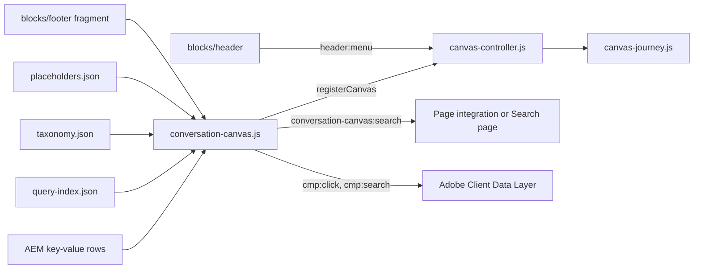

## For QA and Support Teams

| Test ID | Scenario | Configuration | Expected result |
| ------- | -------- | ------------- | --------------- |
| CONVERSATION-CANVAS-QA-01 | Default rendering | Library Overview | Icon, eyebrow, H2, text, search row, two actions, glows |
| CONVERSATION-CANVAS-QA-02 | Secondary | Canvas Style Secondary | Reversed glows; no filter list until a script fills it |
| CONVERSATION-CANVAS-QA-03 | Primary Pills | Library `docked` page, 1440px | Dock floats with search pill and section pills; hidden while a Canvas is docked |
| CONVERSATION-CANVAS-QA-04 | Primary Text links / Dark | Navigation style Text links; BG Style Dark | Text items with filled current pill; black fade and dark pill |
| CONVERSATION-CANVAS-QA-05 | Primary mobile | < 900px | Only the 17.5rem search pill |
| CONVERSATION-CANVAS-QA-06 | Title Type | Default / Bigger / Medium at 375, 768, 1440px | Sizes as in Responsive Behavior |
| CONVERSATION-CANVAS-QA-07 | Background image | BG Background Image set | Image covers the panel, no glows |
| CONVERSATION-CANVAS-QA-08 | Menu | Menu root path, depth 2, on aem.page | Menu lists the pages; Escape closes it, focus back on the button |
| CONVERSATION-CANVAS-QA-09 | Empty menu | Universal Editor or a root without indexed pages | "No pages found" |
| CONVERSATION-CANVAS-QA-10 | Search page | Search page set | A query opens it with `?q=` |
| CONVERSATION-CANVAS-QA-11 | No search target | No Search page, no integration | Nothing navigates; screen readers hear "Search isn’t available yet." |
| CONVERSATION-CANVAS-QA-12 | Integration | Listener with `preventDefault()` | No navigation; the listener gets `detail.query` |
| CONVERSATION-CANVAS-QA-13 | Voice | Chrome / a browser without the Web Speech API | Button toggles `aria-pressed` and fills the field / button hidden |
| CONVERSATION-CANVAS-QA-14 | Journey down and up | Header Canvas, section Canvas, footer Canvas | States `initial` → `floating` → `section-docked` → `floating-after-section` → `footer-docked` and back; one floating row |
| CONVERSATION-CANVAS-QA-15 | Stays in place | Floating journey Stays in place on a section Canvas | Its row never floats; the floating row lands on it while it's on screen |
| CONVERSATION-CANVAS-QA-15b | One row in use | Scroll until a row floats; click or Tab where the next Canvas's row is; then scroll until a Canvas docks | While floating only the floating row works (the others are inert, Tab skips them); docked: every row works; typing in a docked row keeps it docked while on screen |
| CONVERSATION-CANVAS-QA-15c | Hidden Canvas | Hide block on a section, header, footer or Primary Canvas; scroll down and up | Not shown and never floats; the journey runs on the other Canvases (never two rows, never an invisible floating row) |
| CONVERSATION-CANVAS-QA-15e | Full cycle | Header, section and footer Canvas; scroll to the end and back to the top (desktop and mobile) | initial > floating > section-docked > floating-after-section > footer-docked and back in reverse order |
| CONVERSATION-CANVAS-QA-15d | Add a button | Universal Editor: select the Canvas > Add > Conversation Canvas Button | A placeholder ("Not shown yet…") appears in the buttons, selectable; with a link it becomes the button |
| CONVERSATION-CANVAS-QA-16 | No footer Canvas | Footer without canvas page | The floating row stays above the footer |
| CONVERSATION-CANVAS-QA-17 | Header menu | Open the menu below 1200px | State `hidden`; nothing floats; back after closing |
| CONVERSATION-CANVAS-QA-18 | Focus clearance | Tab to a link under the floating row | The link scrolls clear of the row |
| CONVERSATION-CANVAS-QA-19 | Data layer | Click an action, search "call +44 20 7946 0000" | `cmp:click`; `cmp:search` with `[number]` in the term |
| CONVERSATION-CANVAS-QA-20 | Layout shift | Scroll past a Canvas | No page movement when the row floats or lands |
| CONVERSATION-CANVAS-QA-21 | Existing content | Button items of the former shared `button` model | Rendered with their view and type |

Unit tests: `npm test` runs `test/conversation-canvas/canvas-journey.test.mjs` (roles from placement, the journey down and up, every transition of continuous scrolls against `TRANSITIONS`, single owner, HIDDEN, Stays in place (nofloat), Primary, a focused row in place, missing intermediate / footer Canvas, two Canvases on screen, header Canvas with a hero, short page).

## Troubleshooting

| Symptom | Likely cause | Diagnostic steps | Resolution | Verification |
| ------- | ------------ | ---------------- | ---------- | ------------ |
| A search does nothing visible | No Search page and no integration | Check the Search page field; listen for `conversation-canvas:search` in the console | Set the Search page or connect an integration | A query opens results |
| The menu shows "No pages found" | Viewed in Universal Editor, root in another locale, pages not indexed, a parent page missing from the index | Open `/query-index.json` on aem.page and look for the root's child paths | Test on aem.page; fix the root; publish the missing pages | The menu lists the pages |
| The Primary dock never appears | Hide block on (a hidden Primary isn't active), or a Canvas in place on screen | Inspect the dock for `conversation-canvas-floating` and the journey state | Set Floats and docks; check other Canvases | The dock floats after scrolling |
| Nothing floats after the last section Canvas (state `hidden`) | That Canvas is Stays in place and no earlier Canvas may float | Check Floating journey of each Canvas | Set Floats and docks on one Canvas | State `floating-after-section` |
| The floating row stops above the footer | No footer Canvas (Conversation Canvas Page empty or unpublished) | Check the Footer block and the referenced page | Reference and publish the footer canvas page | State `footer-docked` at the bottom |
| The submit tooltip shows a test word | Hover text holds a test value | Open the Canvas (or the footer canvas page) | Enter "Submit" or clear it; publish | Tooltip and name read "Submit" |
| Dock pills on the wrong level | The page is deeper than Menu depth or outside the root | Compare the URL with root and depth | Increase the depth (max 3) or change the root | Expected view |
| No microphone button | Browser without the Web Speech API | Check `window.SpeechRecognition` and `window.webkitSpeechRecognition` in the console | None needed | Button appears in a supporting browser |

Evidence to collect (without secrets): the page URL on aem.page, `document.documentElement.dataset.canvasJourneyState` while reproducing, `data-canvas-role` of each Canvas, the Network entries for `/query-index.json` and the sheets (status only), console errors, the viewport size.

## Performance Considerations

- Decoration awaits the placeholders; everything else is built synchronously.
- The block's modules are preloaded on every page (`CHROME_BLOCKS` in `scripts.js`) because the header and footer may hold Canvases.
- Query index: fetched once per page view and cached; started at the lazy phase on pages with a Canvas in `main` (`prefetchData`), used on the first menu open (Default / Secondary) or at decoration (Primary, with the taxonomy).
- Skeletons only when the data takes longer than 150ms.
- One page-level controller: passive scroll listener with one animation frame per update and no layout reads while scrolling; geometry measured on registration, resize and a body `ResizeObserver` settled for 100ms; `<html>` writes only on change (handover 2.36: the controller had rewritten `<html>` custom properties on every resize while the page loaded).
- Layout shift: the floating row's slot keeps its height; the header keeps its reserved space (see the header README).
- Images: a background image built from a URL is lazy; per the handover a background image in the first section isn't loaded eagerly (possible LCP impact).
- High-cost configuration: a Primary dock with a deep tree (depth 3) renders more navigation items; no verified limit was identified.

## Security and Privacy

- The search query goes to the Search page through `URL.searchParams` (encoded), or to an integration as `detail.query`; the repository sends it to no service.
- Menu, navigation, suggestion and filter labels are set with `textContent`; link targets come from the query index or authored links.
- The search term in the data layer is redacted (`utils/privacy.js`): e-mail addresses and phone numbers replaced, at most 100 characters. Visitors may still type other personal data; a privacy review of search term tracking is recorded as open in the handover.
- Voice input uses the browser's Web Speech API; the repository sends no audio itself.

## Known Limitations

| Limitation | Impact | Workaround | Planned correction |
| ---------- | ------ | ---------- | ------------------ |
| No search or conversational service in the repository | A query only opens the Search page or reaches an integration | Set the Search page | Not recorded |
| Without Search page and integration the "Search isn’t available yet." status is visually hidden | Sighted visitors get no feedback | Set the Search page | Not recorded |
| Filters and suggestions need a script; filter buttons have no behaviour | Secondary shows no filters | Implement the supplying script | Not recorded |
| The menu ignores `hide-in-nav` and `robots` (F-33) and lists pages in path order, not the Figma order (F-78) | Unexpected or misordered entries | Exclude pages from the index | Not recorded |
| The query index isn't available in Universal Editor | "No pages found" while authoring | Check on aem.page | Not planned |
| BG Style Dark and Navigation style apply only to Primary (CSS) | No visible change on Default / Secondary | Use a background image or a Section style | Not recorded |
| Hide block and spacing apply only in `main` | No effect on header / footer Canvases | Edit the nav or footer canvas page | Not recorded |
| The site menu keeps the title suffix after a vertical bar (only the dock removes it) | Long menu labels | Shorter page titles | Not recorded |
| The dock panel has an `aria-label` without a landmark role | The label may not be announced | — | Not recorded |
| Unkeyed (single-cell) rows: a row with a link is read as a button item | Only hand-made markup affected | Use keyed rows | Not planned |
| Footer canvas sample with a test hover text (F-33) | Odd button name and tooltip | Correct the field | Not recorded |
| The prototype's threshold, offsets and motion (Figma Sites) can't be verified | Values come from the design file | — | Not planned |

## Related Documentation

- [Blocks documentation](../README.md)
- [TCS Header](../header/README.md) (host of the header Canvas, `header:menu`), [Form Variations](../form-variations/README.md), [Columns Container](../columns-container/README.md); footer host: [`footer.js`](../footer/footer.js)
- Model file: [`_conversation-canvas.json`](_conversation-canvas.json)
- Tests: [canvas journey tests](../../test/conversation-canvas/canvas-journey.test.mjs), [motion tests](../../test/motion/motion.test.mjs)
- Shared code: [decorators README](../../decorators/README.md), [utils README](../../utils/README.md), [data-layer decorator](../../decorators/data-layer-decorator.js), [privacy utils](../../utils/privacy.js)
- Animation: [docs/animation/README.md](../../docs/animation/README.md)
- [Handover 6.30 Conversation Canvas Block](../../docs/handover/TCS-CORP-HANDOVER.md) (6.30.18 Floating Journey)

<!-- BEGIN GENERATED: usage (npm run build:docs) -->

Pages of the block library package 1.0.14 (language master, `/content/tcs-corp/language-master/en`) that contain the block, 33 instance(s) in total:
- Block library: `block-library/animation/background-by-block`, `block-library/animation/skeleton-loading`, `block-library/animation/speed-and-trigger`, `block-library/conversation-canvas/conversation-canvas`, `block-library/conversation-canvas/docked`, `block-library/conversation-canvas/floating`, `block-library/conversation-canvas/journey-and-actions`, `block-library/footer/footer-conversation-canvas`
- Curated design pages: `curated-design-pages/home`, `curated-design-pages/industry-landing-page`, `curated-design-pages/what-we-do`

Project-wide standards: [knowledge base](../../docs/handover/knowledge-base/README.md) ([block governance](../../docs/handover/knowledge-base/blocks.md)).

<!-- END GENERATED: usage -->

## Change History

| Version | Change | Source | Date |
| ------- | ------ | ------ | ---- |
| Not recorded | README generated from verified implementation and approved handover documentation | Repository review | Not recorded |
| Handover 2.3 | Floating Canvas journey (PR #71): states initial, floating, section-docked, floating-after-section, footer-docked, hidden; hidden while the header menu is open (`header:menu`); Floating journey field | docs/handover revision history | 16 October 2026 |
| Handover 2.5 | Primary dock aligned with Figma Full menu | docs/handover revision history | 16 October 2026 |
| Handover 2.6 | Section Canvas aligned with Figma 251:41883 / 2313:52736; Quick actions field | docs/handover revision history | 16 October 2026 |
| Handover 2.11 | Temporary: pages below `/language-master/en` list the language master's own pages in Canvas menus | docs/handover revision history | 17 October 2026 |
| Handover 2.13 | Query index and taxonomy start loading at the lazy phase on pages with Canvases | docs/handover revision history | 17 October 2026 |
| Handover 2.15 | Header keeps the space of the TCS Header with its Canvas until it has loaded (no layout shift) | docs/handover revision history | 18 October 2026 |
| Handover 2.18 | Content and Background animation (brand glows), skeletons for the Canvas navigation and menu | docs/handover revision history | 18 October 2026 |
| Handover 2.21 | Header and Canvas as two zones (PR #92): the header Canvas row on the bottom of the Home hero, fixed at the bottom of the window as soon as the page scrolls | docs/handover revision history | 19 October 2026 |
| Handover 2.27 | Block audit: Canvas search redacted in the data layer and given a Search page | docs/handover revision history | 19 October 2026 |
| Handover 2.29 | Re-audit: Canvas in tabs corrected | docs/handover revision history | 20 October 2026 |
| Handover 2.36 | Canvas controller writes `<html>` custom properties only on change; resizes measured once settled | docs/handover revision history | 20 October 2026 |
| Not recorded | Floating journey options Floats and docks / Stays in place (Decorative merged, not for Primary); one row in use while a row floats (the others inert); hidden Canvases (also header, footer, Primary) aren't active; editor placeholders for Buttons without a link | KB-D-053 (Proposed) | 22 October 2026 |
| Not recorded | Site menu pills as Figma 1124:27046, arrows only for pages with child pages, grey fade, blue menu icon; the menu closes on scroll (from 1f40578); typing in the search field restored (1f40578's Escape handler moved the focus on every key) | fix/block-issues | 22 October 2026 |
| Not recorded | Site menu: an arrow on every panel row again (Figma 1124:26250); closing resets it to the first level (a pinned third-level panel stayed open after a click outside and hid the search row) | fix/block-issues | 22 October 2026 |
| Not recorded | Navigation beside the search field at every width (TCS Designs - Prototypes Floating menu); CSS restructured mobile first without `!important` (rem, tokens; same computed styles on Home and the block library at 402 / 768 / 1024 / 1440px except the fixes listed in the commit); the footer canvas row rules moved here from `blocks/footer`; search submit hands the query to `conversation-canvas:search` / the Search page again (not `#`); Search button style read again; Escape closes the Primary panel; Home is a link; suggestions and water marks from placeholders; Quick action icon buttons keep their icon | fix/tcs-header-header-form, KB-D-059 (Proposed) | 28 October 2026 |
