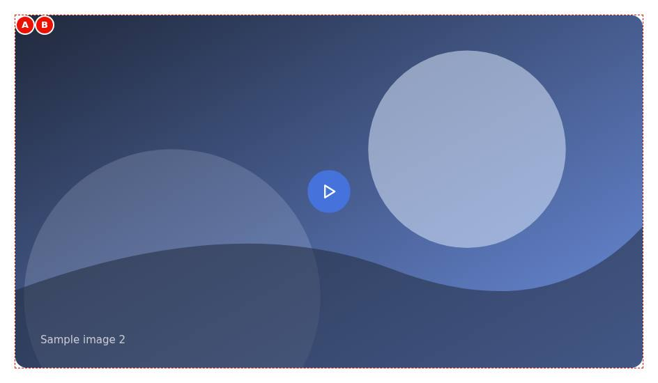
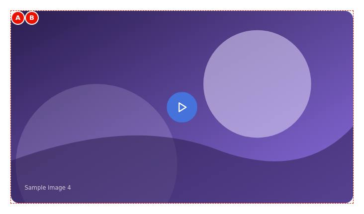
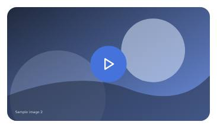
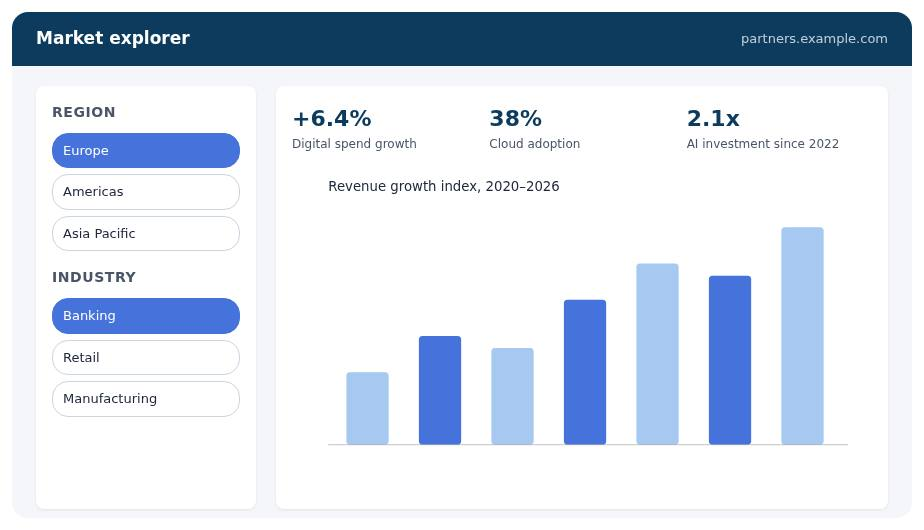
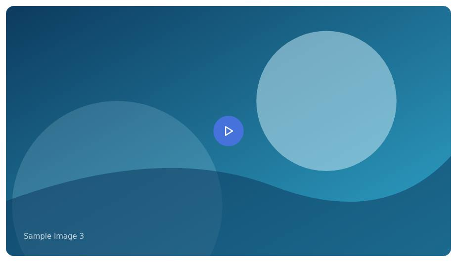
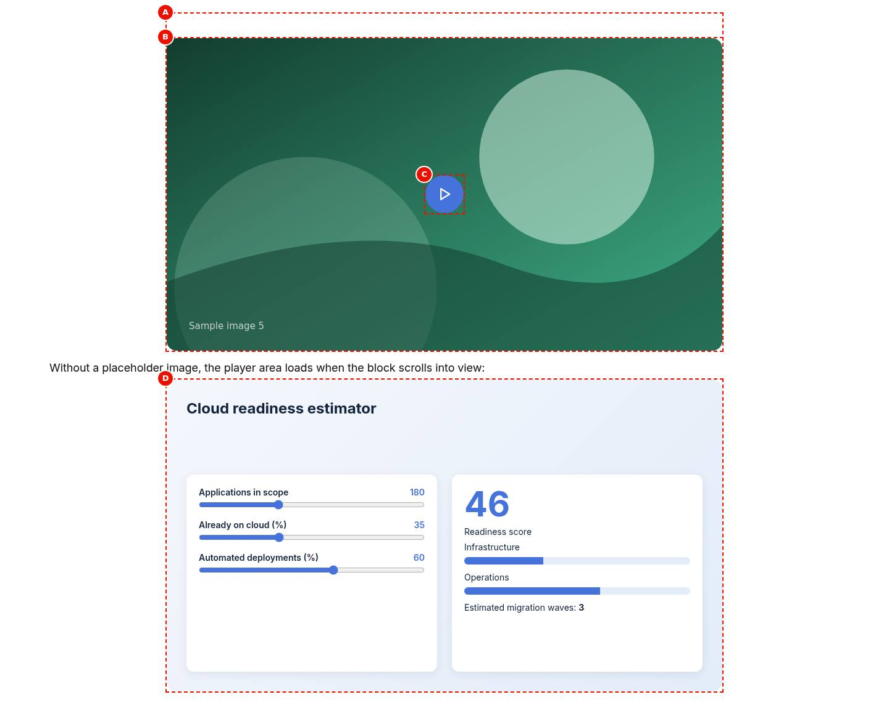
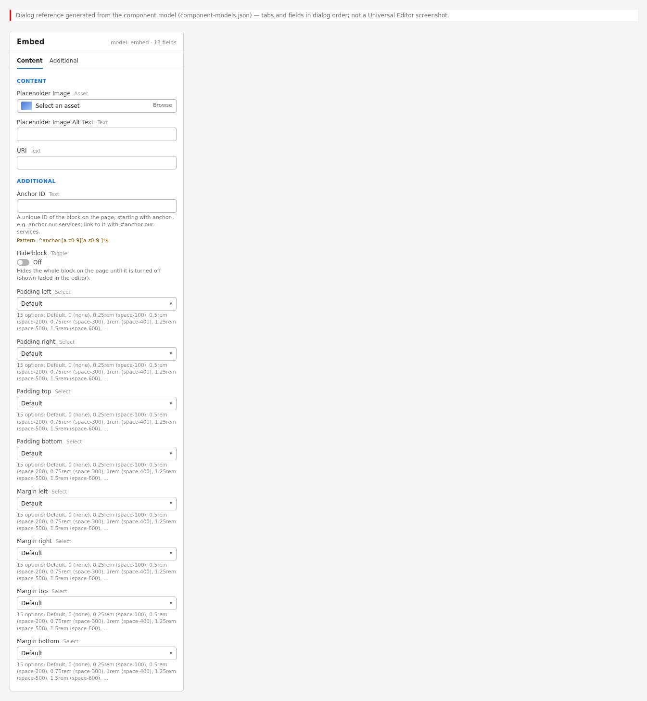
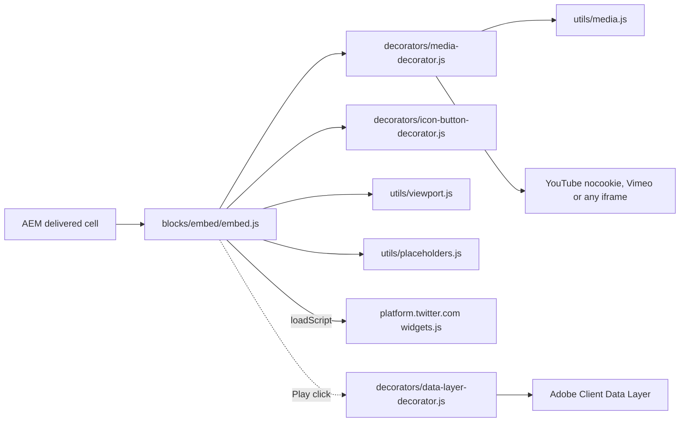

# Embed

The Embed block places third-party content from a URL on the page: a YouTube or Vimeo video, an
X (Twitter) post, or any other URL as an iframe. It is based on the Block Collection embed and
adapted so that players are built with DOM APIs by the media decorator, YouTube and Vimeo use
their privacy-enhanced players, frames are named from the placeholders and keyboard focus moves
into the player after Play. Without a placeholder image the embed loads when it scrolls into
view; with one it loads only when the visitor presses Play (click-to-load).

| Attribute | Value |
| --------- | ----- |
| Technical name | `embed` (template name "Embed", block class `embed`) |
| Display name | Embed |
| Block type | Independent block (one cell of grouped fields; not key-value) |
| Status | Active |
| Parent / children | Added to a Section, a Columns Container column or a Tabs Container tab (filters `section`, `columns-container`, `tabs`); no child items |
| Owner / version / date | Not recorded |

## Overview

**Business purpose.** Include video and social content hosted on external platforms at a low
performance cost (lazy or click-to-load) and with accessible names.

**User experience.** With a placeholder image visitors see the image with a round Play button;
the provider's player loads and starts after Play. Without one, the player or post appears when
the block scrolls into view.

**Templates / page types.** Any page type.

**Data source.** The block's URI and optional placeholder image; the content itself comes from
YouTube, Vimeo, X or the embedded site.

**Related blocks.** [Video](../video/README.md) (AEM Assets files, captions, transcript, autoplay,
background, pop-up and display options); Hero and Teaser (Lottie animations, not embeds).

**When to use.** A YouTube, Vimeo or X item, or an approved page that allows framing, needing no
playback options.

**When not to use.** AEM Assets videos, captions files, autoplay or background videos, a pop-up
player or sizes and aspect ratios (use Video); Instagram, LinkedIn, Facebook or TikTok posts (no
dedicated handler; providers usually refuse framing); content whose interactions must be tracked
(iframe interactions aren't visible to the page).

**Realistic use cases.**

- A keynote on YouTube behind a branded placeholder image on a campaign page.
- An official TCS post on X in a press release.
- An approved partner's interactive page in an iframe.

## Visual Reference

<!-- BEGIN GENERATED: screenshots (npm run build:docs) -->

Screenshots of the handover (6.27 Embed Block), taken on the preview with sample content; they show the rendering at the time of the handover revision that added them (later changes are in the sections below and the handover's revision history):

**Desktop rendering** — The Embed at 1440 px: the placeholder image photo-2.svg in a 16:9 frame 900 px wide (56.25rem), centred, with 1rem rounded corners, and the round primary Play button in its centre. The YouTube player is not loaded yet.



**Tablet rendering** — The Embed at 768 px: the placeholder image photo-4.svg at the full content width (about 688 px) in a 16:9 frame with rounded corners and the Play button centred; the Vimeo player loads only after Play.



**Mobile rendering** — The Embed at 390 px: the placeholder image photo-2.svg at the full content width (about 342 px) in a 16:9 frame with rounded corners and the Play button centred. No X post is part of this example.



**Variation example** — The Embed at 1440 px: a 16:9 iframe 900 px wide with rounded corners showing a partner's Market explorer page with Region and Industry filters and the figures +6.4% digital spend growth, 38% cloud adoption and 2.1x AI investment since 2022. The capture uses a local stand-in page for the partner URL.



**Variation example** — The Embed at 1440 px: the placeholder image photo-3.svg in a centred 900 px 16:9 frame with rounded corners and the round primary Play button in the centre. Only the state before Play is shown; the YouTube player is not in the screenshot.



**Universal Editor canvas** — An annotated edit-mode view at 1440 px (not a Universal Editor screenshot): the H2 Watch: AI at enterprise scale above the Embed block (A) with the placeholder image photo-2.svg (B) and the generated Play button (C) centred on it. No properties panel is shown. (Annotated preview in editor mode with sample content; letters as in the annotations list, not a Universal Editor screenshot; file screenshots/embed-authoring-view.jpg)



**Properties panel** — The Embed properties panel: Content tab with Placeholder Image, Placeholder Image Alt Text and URI; the Additional tab. (Dialog reference generated from the component model, not a Universal Editor screenshot; file screenshots/embed-properties-panel.jpg)



Universal Editor dialogs (no screenshot exists yet; to be captured on AEM author):

```text
[Screenshot Placeholder]

File name:
embed-dialog-content-desktop.png

Purpose:
The Content tab of the Embed properties in Universal Editor, with the fields of the table "Content tab — Embed" in Authorable Fields below.

Annotations:
A = Placeholder Image
B = Placeholder Image Alt Text
C = URI
```

```text
[Screenshot Placeholder]

File name:
embed-dialog-additional-desktop.png

Purpose:
The Additional tab of the Embed properties in Universal Editor, with the fields of the table "Additional tab — Embed" in Authorable Fields below.

Annotations:
A = Anchor ID
B = Hide block
C = Animation Type
D = Motion Speed
E = Animation Trigger
F = Padding left
G = Padding right
H = Padding top
I = Padding bottom
J = Margin left
```

<!-- END GENERATED: screenshots -->

States without a screenshot:

```text
[Screenshot Placeholder]

File name:
embed-authoring-universal-editor-desktop.png

Purpose:
The Embed selected in Universal Editor edit mode with the properties panel on the Content tab.

Annotations:
A = The Embed on the canvas
B = Placeholder Image and Placeholder Image Alt Text
C = URI
```

```text
[Screenshot Placeholder]

File name:
embed-youtube-playing-desktop.png

Purpose:
The YouTube player after Play at 1440 px, loaded from youtube-nocookie.com, with keyboard focus in the frame.

Annotations:
A = The player frame in the 16:9 area
B = Rounded corners of the frame
```

```text
[Screenshot Placeholder]

File name:
embed-x-post-desktop.png

Purpose:
An X post rendered by the X widget, centred in the block.

Annotations:
A = The rendered post
```

```text
[Screenshot Placeholder]

File name:
embed-x-post-fallback-mobile.png

Purpose:
An X post whose widget hasn't loaded (blocked or failed) at 390 px: the post's address shown as a link.

Annotations:
A = The fallback link
```

```text
[Screenshot Placeholder]

File name:
embed-play-focus-desktop.png

Purpose:
The Play button on the placeholder image with the keyboard focus outline.

Annotations:
A = Play button with focus outline
```

```text
[Screenshot Placeholder]

File name:
embed-loading-tablet.png

Purpose:
An Embed without placeholder before it has loaded: the empty 16:9 area reserved at 768 px.

Annotations:
A = The reserved 16:9 area
```

## For Content Authors

1. **Add the block.** Select a Section, a Columns Container column or a Tabs Container tab in the
   content tree, choose Add (+) and pick **Embed**.
2. **Open its properties.** Select the block; the panel has the **Content** and **Additional**
   tabs.
3. **Enter the URI.** Paste the full https URL: a YouTube watch / `youtu.be` / `/shorts/` / `/live/`
   URL, a Vimeo URL, an X post URL, or a page that may be framed.
4. **Optional placeholder.** Select a 16:9 **Placeholder Image** and write its **Placeholder
   Image Alt Text** (it also names the Play button: "Play video: {alt text}").
5. **Put context before the block.** A Title and a short Text naming the content help every
   visitor (the iframe's own name is only "Content from {site}").
6. **Optional: Additional tab** (Anchor ID, Hide block, animation, spacing).
7. **Preview** at desktop, tablet and mobile widths; press Play with mouse and keyboard.
8. **Publish** the page (with the placeholder image).
9. **Validate the published output:** the image and Play button load; no provider request happens
   before Play (Network panel); the video plays or the post renders as a card.

**Minimum required:** URI (not required in the model, but without it nothing renders).
**Recommended:** Placeholder Image with alt text for videos; a heading and text before the block.
**Optional:** the Additional tab.

## Authorable Fields

<!-- BEGIN GENERATED: fields (npm run build:docs) -->

### Embed (`embed`)

Model `embed`; template name "Embed" (the block class AEM renders).

#### Content tab — Embed

| Field label | Property | Type | Required | Default | Allowed values | Author guidance | Example |
| ----------- | -------- | ---- | -------- | ------- | -------------- | --------------- | ------- |
| Placeholder Image | `embed_placeholder` | reference | No | — | — | — | /content/dam/tcs-corp/dummy-pages/images/generative-ai.jpg |
| Placeholder Image Alt Text | `embed_placeholderAlt` | text | No | "" | — | Delivered with `embed_placeholder` (field collapse). | Video: how enterprises scale AI with confidence |
| URI | `embed_uri` | text | No | — | — | — | https://www.youtube.com/watch?v=Xk3pQ7vT9mA |

#### Additional tab — Embed

| Field label | Property | Type | Required | Default | Allowed values | Author guidance | Example |
| ----------- | -------- | ---- | -------- | ------- | -------------- | --------------- | ------- |
| Anchor ID | `classes_anchor` | text | No | — | regExp: ^anchor-[a-z0-9][a-z0-9-]*$; customErrorMsg: Start with anchor-, then lower-case letters, digits and hyphens. | A unique ID of the block on the page, starting with anchor-, e.g. anchor-our-services; link to it with #anchor-our-services. Delivered as a block class. | — |
| Hide block | `classes_hideblock` | boolean | No | `false` | on / off | Hides the whole block on the page until it is turned off (shown faded in the editor). Delivered as a block class. | — |
| Animation Type | `classes_animation` | select | No | "" | None (""), Fade in (`motion-fade-in`), Fade up (`motion-fade-up`), Fade down (`motion-fade-down`), Fade left (`motion-fade-left`), Fade right (`motion-fade-right`), Slide up (`motion-slide-up`), Slide down (`motion-slide-down`), Slide left (`motion-slide-left`), Slide right (`motion-slide-right`), Scale in (`motion-scale-in`) | How the block's content appears; repeated items (cards, list items, accordion items, columns) appear one after another. None: shown as is. Not played in the editor or when the visitor prefers reduced motion. Delivered as a block class. | — |
| Motion Speed | `classes_animationspeed` | select | No | "" | Medium (""), Fast (`motion-fast`), Slow (`motion-slow`) | How fast the animation runs: 0.3, 0.6 or 0.9 seconds. Shown when `classes_animation` is set and `classes_animation` is not empty. Delivered as a block class. | — |
| Animation Trigger | `classes_animationtrigger` | select | No | "" | On Scroll / Viewport Entry (""), On Page Load (`motion-on-load`) | When the block's animations run. On Scroll: when the block comes into view (at once if it is in view when the page opens). On Page Load: as soon as the block is ready, wherever it is on the page. Shown when `classes_animation` is set and `classes_animation` is not empty. Delivered as a block class. | — |
| Padding left | `classes_paddingleft` | select | No | "" | Default (""), 0 (none) (`pl-0`), 0.25rem (space-100) (`pl-100`), 0.5rem (space-200) (`pl-200`), 0.75rem (space-300) (`pl-300`), 1rem (space-400) (`pl-400`), 1.25rem (space-500) (`pl-500`), 1.5rem (space-600) (`pl-600`), 2rem (space-800) (`pl-800`), 2.5rem (space-1000) (`pl-1000`), 3rem (space-1200) (`pl-1200`), 4rem (space-1600) (`pl-1600`), 5rem (space-2000) (`pl-2000`), 6rem (space-2400) (`pl-2400`), 7.5rem (space-3000) (`pl-3000`) | Delivered as a block class. | — |
| Padding right | `classes_paddingright` | select | No | "" | Default (""), 0 (none) (`pr-0`), 0.25rem (space-100) (`pr-100`), 0.5rem (space-200) (`pr-200`), 0.75rem (space-300) (`pr-300`), 1rem (space-400) (`pr-400`), 1.25rem (space-500) (`pr-500`), 1.5rem (space-600) (`pr-600`), 2rem (space-800) (`pr-800`), 2.5rem (space-1000) (`pr-1000`), 3rem (space-1200) (`pr-1200`), 4rem (space-1600) (`pr-1600`), 5rem (space-2000) (`pr-2000`), 6rem (space-2400) (`pr-2400`), 7.5rem (space-3000) (`pr-3000`) | Delivered as a block class. | — |
| Padding top | `classes_paddingtop` | select | No | "" | Default (""), 0 (none) (`pt-0`), 0.25rem (space-100) (`pt-100`), 0.5rem (space-200) (`pt-200`), 0.75rem (space-300) (`pt-300`), 1rem (space-400) (`pt-400`), 1.25rem (space-500) (`pt-500`), 1.5rem (space-600) (`pt-600`), 2rem (space-800) (`pt-800`), 2.5rem (space-1000) (`pt-1000`), 3rem (space-1200) (`pt-1200`), 4rem (space-1600) (`pt-1600`), 5rem (space-2000) (`pt-2000`), 6rem (space-2400) (`pt-2400`), 7.5rem (space-3000) (`pt-3000`) | Delivered as a block class. | — |
| Padding bottom | `classes_paddingbottom` | select | No | "" | Default (""), 0 (none) (`pb-0`), 0.25rem (space-100) (`pb-100`), 0.5rem (space-200) (`pb-200`), 0.75rem (space-300) (`pb-300`), 1rem (space-400) (`pb-400`), 1.25rem (space-500) (`pb-500`), 1.5rem (space-600) (`pb-600`), 2rem (space-800) (`pb-800`), 2.5rem (space-1000) (`pb-1000`), 3rem (space-1200) (`pb-1200`), 4rem (space-1600) (`pb-1600`), 5rem (space-2000) (`pb-2000`), 6rem (space-2400) (`pb-2400`), 7.5rem (space-3000) (`pb-3000`) | Delivered as a block class. | — |
| Margin left | `classes_marginleft` | select | No | "" | Default (""), 0 (none) (`ml-0`), 0.25rem (space-100) (`ml-100`), 0.5rem (space-200) (`ml-200`), 0.75rem (space-300) (`ml-300`), 1rem (space-400) (`ml-400`), 1.25rem (space-500) (`ml-500`), 1.5rem (space-600) (`ml-600`), 2rem (space-800) (`ml-800`), 2.5rem (space-1000) (`ml-1000`), 3rem (space-1200) (`ml-1200`), 4rem (space-1600) (`ml-1600`), 5rem (space-2000) (`ml-2000`), 6rem (space-2400) (`ml-2400`), 7.5rem (space-3000) (`ml-3000`) | Delivered as a block class. | — |
| Margin right | `classes_marginright` | select | No | "" | Default (""), 0 (none) (`mr-0`), 0.25rem (space-100) (`mr-100`), 0.5rem (space-200) (`mr-200`), 0.75rem (space-300) (`mr-300`), 1rem (space-400) (`mr-400`), 1.25rem (space-500) (`mr-500`), 1.5rem (space-600) (`mr-600`), 2rem (space-800) (`mr-800`), 2.5rem (space-1000) (`mr-1000`), 3rem (space-1200) (`mr-1200`), 4rem (space-1600) (`mr-1600`), 5rem (space-2000) (`mr-2000`), 6rem (space-2400) (`mr-2400`), 7.5rem (space-3000) (`mr-3000`) | Delivered as a block class. | — |
| Margin top | `classes_margintop` | select | No | "" | Default (""), 0 (none) (`mt-0`), 0.25rem (space-100) (`mt-100`), 0.5rem (space-200) (`mt-200`), 0.75rem (space-300) (`mt-300`), 1rem (space-400) (`mt-400`), 1.25rem (space-500) (`mt-500`), 1.5rem (space-600) (`mt-600`), 2rem (space-800) (`mt-800`), 2.5rem (space-1000) (`mt-1000`), 3rem (space-1200) (`mt-1200`), 4rem (space-1600) (`mt-1600`), 5rem (space-2000) (`mt-2000`), 6rem (space-2400) (`mt-2400`), 7.5rem (space-3000) (`mt-3000`) | Delivered as a block class. | — |
| Margin bottom | `classes_marginbottom` | select | No | "" | Default (""), 0 (none) (`mb-0`), 0.25rem (space-100) (`mb-100`), 0.5rem (space-200) (`mb-200`), 0.75rem (space-300) (`mb-300`), 1rem (space-400) (`mb-400`), 1.25rem (space-500) (`mb-500`), 1.5rem (space-600) (`mb-600`), 2rem (space-800) (`mb-800`), 2.5rem (space-1000) (`mb-1000`), 3rem (space-1200) (`mb-1200`), 4rem (space-1600) (`mb-1600`), 5rem (space-2000) (`mb-2000`), 6rem (space-2400) (`mb-2400`), 7.5rem (space-3000) (`mb-3000`) | Delivered as a block class. | — |

<!-- END GENERATED: fields -->

What the tables don't show:

- **URI (`embed_uri`)** picks the handler: a URL containing `youtube.com` / `youtu.be` builds a
  YouTube frame, `vimeo.com` a Vimeo frame, a `twitter.com` / `x.com` host (with or without `www.`)
  an X post; anything else an iframe of the URL. The code reads the first link of the block, else
  the first `http(s)://` URL in its text.
- **Placeholder Image / Alt Text** (`embed_placeholder`, `embed_placeholderAlt`; the alt collapses
  into the image) switches the block to click-to-load: the image with a Play button; Play loads the
  embed with `autoplay=1` and `muted=1` for YouTube and Vimeo and moves focus into it. The alt text
  names the Play button ("Play video: {alt}"); without alt text the button is "Play".
- **Rendering result:** YouTube from `https://www.youtube-nocookie.com/embed/{id}` (`rel=0`,
  `enablejsapi=1`); Vimeo from `https://player.vimeo.com/video/{id}` with `dnt=1` (channel URLs and
  unlisted hashes supported); X posts as a `blockquote.twitter-tweet` with `x.com` rewritten to
  `twitter.com` and `https://platform.twitter.com/widgets.js` loaded; other URLs as an iframe with
  `allow="encrypted-media"` and fullscreen.
- **Accessibility impact:** every iframe is titled "Content from {host}" (placeholder
  `contentFrom`, host without `www.`); the placeholder alt text is the only per-item name.
- **Data-layer impact:** the Play button carries `data-cmp-interaction="play"`.
- **Legacy mapping:** none; the block reads the delivered link and picture wherever they are in
  the block, so the empty rows AEM delivers for the Content and Additional tabs don't matter.
- **Additional tab:** as on every block (AGENTS.md "Additional tab"); the block is centred with
  `margin: 0 auto`, which Margin left / right replace.

## Screenshot-Based Authoring Steps

### Authoring Step 1: Add the Embed and paste the URI

```text
[Screenshot Placeholder]

File name:
embed-authoring-step-1.png

Purpose:
The section's Add (+) list with Embed, then the Content tab with the URI filled.

Annotations:
A = Add (+)
B = Embed in the list
C = URI
```

### Values to Enter

| Callout | Field | Value | Reason | Expected result |
| ------- | ----- | ----- | ------ | --------------- |
| B | Component | Embed | Adds the block | An Embed in the content tree |
| C | URI | https://www.youtube.com/watch?v=Xk3pQ7vT9mA | The video to embed | The YouTube player appears when the block is in view |

**Author action:** add the Embed, open its properties and paste the URL. **Expected preview:** a
16:9 rounded YouTube player, up to 56.25rem wide, centred. **Expected published result:** the same.
**Business rules:** without a URL nothing renders. **Validation:** the player loads at 390, 768
and 1440 px. **Common mistakes:** a URL without `https://`, or a Vimeo URL without the numeric id.

### Authoring Step 2: Add the placeholder image

```text
[Screenshot Placeholder]

File name:
embed-authoring-step-2.png

Purpose:
The Placeholder Image and its alt text filled, and the image with the Play button on the canvas.

Annotations:
A = Placeholder Image
B = Placeholder Image Alt Text
C = Play button
```

### Values to Enter

| Callout | Field | Value | Reason | Expected result |
| ------- | ----- | ----- | ------ | --------------- |
| A | Placeholder Image | /content/dam/tcs-corp/dummy-pages/images/generative-ai.jpg | Branded first view; nothing loads from YouTube before Play | The image fills a 16:9 area |
| B | Placeholder Image Alt Text | Video: how enterprises scale AI with confidence | Describes the image and names the Play button | Play is announced "Play video: Video: how enterprises scale AI with confidence" |

**Author action:** select the image and write the alt text. **Expected preview:** the image with a
round Play button. **Expected published result:** the same; Play loads and starts the video.
**Business rules:** the image is cropped to 16:9 (`object-fit: cover`). **Validation:** Network
panel shows no YouTube request before Play. **Common mistakes:** an image that isn't 16:9 is
cropped badly; keep the subject centred. Starting the alt text with "Video:" repeats the button's
"Play video:" prefix; describe the image instead.

### Authoring Step 3: Name the content in the page

```text
[Screenshot Placeholder]

File name:
embed-authoring-step-3.png

Purpose:
A Title and a Text directly before the Embed in the same section.

Annotations:
A = Title before the block
B = Text before the block
C = The Embed
```

### Values to Enter

| Callout | Field | Value | Reason | Expected result |
| ------- | ----- | ----- | ------ | --------------- |
| A | Title (component) | Watch: AI at enterprise scale | The iframe is only named "Content from youtube-nocookie.com" | A heading names the video for everyone |

**Author action:** add a Title (and a Text) before the Embed. **Expected preview / published
result:** the heading above the embed. **Validation:** a screen reader reads the heading before the
frame. **Common mistakes:** relying on the frame name alone.

## Variations

### YouTube

- **Purpose:** public, embeddable YouTube videos. **Fields:** URI; optional placeholder.
- **Rendering:** `div.embed-frame > iframe` (16:9, rounded `--radius-l`), block classes
  `embed-youtube embed-is-loaded`; privacy-enhanced host always (no option).
- **Accessibility:** iframe title "Content from youtube-nocookie.com"; captions are the video's own.
- **Data layer:** player interactions aren't tracked; Play is a `cmp:click` (`play`).

```text
[Screenshot Placeholder]

File name:
embed-youtube-mobile.png

Purpose:
A YouTube embed without placeholder at 390 px, filling the content width.

Annotations:
A = Player frame
```

### Vimeo

- **Rendering:** `player.vimeo.com/video/{id}` with `dnt=1` (and `h` for unlisted videos);
  `embed-vimeo`. Otherwise as YouTube.

```text
[Screenshot Placeholder]

File name:
embed-vimeo-desktop.png

Purpose:
A Vimeo embed at 1440 px.

Annotations:
A = Vimeo player frame
```

### X (Twitter) post

- **Rendering:** `blockquote.twitter-tweet` with a link to the post (its address as text) until
  the X widget script replaces it; `embed-twitter`; the rendered post is centred. The post takes the
  widget's height (no 16:9 frame).
- **Accessibility / data layer:** a click on the fallback link is a `cmp:click` (`link`, `exit`);
  clicks inside the rendered widget aren't tracked.
- **Fallback:** if the widget never loads, the link stays.

### Generic iframe

- **Purpose:** an approved page that allows framing. **Rendering:** a 16:9 `div.embed-frame`
  iframe of the URL (`allow="encrypted-media"`, fullscreen, lazy). No height or ratio option; no
  host allow-list. A site that forbids framing shows the browser's refusal in the frame.

### Placeholder image with Play (click-to-load)

- **Purpose:** branded first view and no provider request until Play; recommended for videos.
- **Rendering:** `div.embed-placeholder` (picture + `button.embed-placeholder-play`); Play replaces it
  with the embed (with autoplay for YouTube / Vimeo) and focuses the iframe (or the X link).
- **Accessibility:** native `button`, named from the alt text; focus moves into the player.
- **Data layer:** `cmp:click` with `interaction` `play`.

## Complete Authoring Example

Scenario: a keynote video with a branded placeholder on an insights page.

| Field | Example value | Guidance |
| ----- | ------------- | -------- |
| Title before the block | Watch: AI at enterprise scale | Names the video |
| Placeholder Image | /content/dam/tcs-corp/dummy-pages/images/generative-ai.jpg | 16:9, subject centred |
| Placeholder Image Alt Text | Keynote speaker on stage presenting enterprise AI | Describes the image |
| URI | https://www.youtube.com/watch?v=Xk3pQ7vT9mA | Full https URL |

**Steps:** add the Title, then the Embed; fill the placeholder, alt text and URI; preview; publish.

**Expected output:** the centred, rounded 16:9 image (up to 56.25rem wide) with the Play button;
Play loads the privacy-enhanced YouTube player and moves focus into it.

**Responsive:** fluid width at every viewport; the 16:9 area scales.

**Accessibility:** Play named "Play video: Keynote speaker on stage presenting enterprise AI";
the heading names the content; captions come from YouTube.

**Analytics / data layer:** `tcs-corp/components/embed` (`embed-1`); Play pushes `cmp:click` with
`interaction` `play`.

**Personalization fallback:** none.

**Pre-publish checklist:**

1. The URI is a full https URL of a public, embeddable item.
2. The placeholder image is 16:9 and published.
3. Alt text describes the image.
4. A heading before the block names the content.
5. Play works with mouse and keyboard.
6. No horizontal scrolling at 390 px.

## Content and Asset Guidelines

- **Titles and descriptions:** put them in the page (Title / Text before the block); the block has
  no text fields.
- **Labels:** "Play", "Play video: {title}" and "Content from {source}" come from placeholders
  (`play`, `playVideoTitle`, `contentFrom`); keep `{title}` / `{source}` when translating.
- **Links:** full https URLs; the canonical provider URL.
- **Images and alt text:** a 16:9 image (cropped with `object-fit: cover` to the 56.25rem maximum
  width); alt text describing it.
- **Icons:** the Play icon is generated (`icons/play.svg`).
- **Tags and metadata:** none.
- **Min / max items:** one URL per block. No verified technical limit was identified.
- **Asset source:** the placeholder from AEM Assets; content from the providers.
- **Loading:** the embed loads when in view (no placeholder) or after Play; a placeholder image in
  the first section can be the LCP image (loaded eagerly by `waitForFirstImage`).
- **Missing-asset fallback:** no URL: nothing renders (the empty block still reserves a 16:9 area,
  see Known Limitations); an X widget that doesn't load leaves the post link.

## Accessibility

- **Semantics:** iframes with a `title`; a native `button` for Play; X posts as a `blockquote` with
  a link.
- **Headings:** none in the block; add one before it.
- **Keyboard and focus:** Play is reachable with Tab and activated with Enter / Space; after Play
  focus moves into the iframe (or the X link).
- **Accessible names:** Play from the placeholder alt text; frames "Content from {host}".
- **Moving content:** videos start only after Play (click-to-load) or not at all; a video in a
  hidden tab of a Tabs Container is paused (YouTube / Vimeo pause commands).
- **Reduced motion:** the Additional tab animation doesn't play; embeds never autoplay without Play.
- **Contrast and reflow:** the block is fluid; the Play button uses the primary icon button styles.
- **Empty / loading / error states:** empty without a URL; the reserved area while loading; provider
  error pages inside the frame.

**Author responsibilities:** placeholder alt text, a heading before the block, videos with captions
on their platform, a transcript in the page for informative videos.

**Developer responsibilities:** keep the frame names and the Play label from placeholders, the focus
move and the DOM-built players.

| Key | Expected behavior |
| --- | ----------------- |
| Tab | Moves to the Play button, then into the player once loaded |
| Enter / Space | Activates Play: the embed loads and receives focus |

## Data Layer and Analytics

`decorators/data-layer-decorator.js` adds the block as `tcs-corp/components/embed`, id = Anchor ID
else `embed-{n}`. The block sets `data-cmp-interaction="play"` on the Play button.

| Trigger | Data-layer event | Required properties | Analytics behavior |
| ------- | ---------------- | ------------------- | ------------------ |
| Block decorated | component state | `@type`, `parentId` | One entry per block |
| Play button click | `cmp:click` | `interaction` `play`, `dc:title` (the button's name), `breakpoint` | A play request |
| X fallback link click | `cmp:click` | `interaction` `link`, `xdm:linkURL`, `xdm:linkType` `exit` | Exit link |

Interactions inside the provider frames and the X widget aren't visible to the page. The intended
path is Adobe Client Data Layer, then Adobe Data Collection (Tags), the AEP Web SDK, the Edge
Network and Analytics / CJA, but Tags and the Web SDK aren't configured yet (blocked: measurement
plan); no consent mechanism is implemented.

## Personalization

This block does not currently expose verified personalization behavior. There is no Adobe Target
or Journey Optimizer integration in the repository; every visitor sees the authored embed.

## Responsive Behavior

`embed.css` has no media queries.

| Viewport | Layout | Image behavior | Interaction behavior |
| -------- | ------ | -------------- | -------------------- |
| All viewports | Up to 56.25rem wide, centred; 16:9 frames and placeholder with `--radius-l` corners; X posts at the widget's size, centred | Placeholder image covers the 16:9 area (`object-fit: cover`) | Play (scaled 1.4×) centred on the image; same behaviour everywhere |

## For Developers

<!-- BEGIN GENERATED: files (npm run build:docs) -->

```text
blocks/embed/
├── README.md
├── _embed.json
├── embed.css
└── embed.js
```

| Decorator/Utility | Purpose | Execution or dependency point |
| ----------------- | ------- | ----------------------------- |
| [`scripts/aem.js`](../../scripts/aem.js) | Edge Delivery core library (block loading, CSS, metadata, optimized pictures) | `embed.js`: { loadScript } |
| [`decorators/icon-button-decorator.js`](../../decorators/icon-button-decorator.js) | `createIconButton` | `embed.js`: { createIconButton } |
| [`decorators/media-decorator.js`](../../decorators/media-decorator.js) | `createFrame`, `createYoutubeFrame`, `createVimeoFrame`, `createVideoElement` | `embed.js`: { createFrame, createVimeoFrame, createYoutubeFrame, } |
| [`utils/media.js`](../../utils/media.js) | `isYoutube`, `isVimeo`, `isAnimation`, `youtubeEmbedUrl`, `vimeoEmbedUrl`, `videoType` | `embed.js`: { isVimeo, isYoutube } |
| [`utils/viewport.js`](../../utils/viewport.js) | `onVisible` (once), `watchVisibility` (on / off screen), `currentBreakpoint` (mobile / tablet / desktop) | `embed.js`: { onVisible } |
| [`utils/placeholders.js`](../../utils/placeholders.js) | `getPlaceholders`, `loadPlaceholders`, `fillPlaceholder` (UI text from the locale's placeholders, with English fallbacks) | `embed.js`: { getPlaceholders } |

<!-- END GENERATED: files -->

**JavaScript (`embed.js`).** `decorate` takes the first `picture` (placeholder) and the first link's
`href` (else the first `http(s)://` URL in the block's text), empties the block and returns if
there is no URL. With a placeholder it builds `div.embed-placeholder` with the picture and a primary
icon button (`createIconButton`, `data-cmp-interaction="play"`) calling
`loadEmbed(block, link, { autoplay: true, focus: true, t })`; without, `onVisible(block, …)` calls
`loadEmbed` without autoplay. `loadEmbed` runs once (`embed-is-loaded` guard), picks the first
matching entry of `EMBEDS` (`youtube`, `vimeo`, `twitter`) or `createFrame`, replaces the block's
children and adds `embed-{name}` and `embed-is-loaded`. The module exports only `decorate`.

**CSS (`embed.css`).** `max-width: 56.25rem`, centred; the block reserves 16:9 while it has neither
a placeholder nor a loaded embed; `.embed-frame` and `.embed-placeholder` are 16:9 with
`--radius-l`.

**Input DOM.** Not key-value: AEM delivers an empty row per dialog tab (Content, Additional) and one
cell with the grouped fields (picture with the collapsed alt text, then the URI as a link or text).

**Rendered DOM contract.** Before loading: `.embed > .embed-placeholder > picture +
button.embed-placeholder-play`, or an empty `.embed`. After: `.embed.embed-is-loaded[.embed-youtube|
.embed-vimeo|.embed-twitter] > .embed-frame > iframe` or `> blockquote.twitter-tweet > a`.

**Events and async behavior.** `getPlaceholders` is awaited after the URL check; IntersectionObserver
(`onVisible`); `loadScript('https://platform.twitter.com/widgets.js')` for X posts.

**Error handling.** No URL: empty block. Provider failures are shown by the provider; the block logs
nothing.

**Parent / child contracts.** Tabs (`blocks/tabs/tabs.js`) posts pause commands to YouTube
(`enablejsapi=1`) and Vimeo frames of hidden tabs.

## Extending the Block

1. **A new provider:** add an entry `{ name, match, embed }` to `EMBEDS` in `embed.js`, building the
   DOM with the media decorator (`createFrame`) or DOM APIs, never HTML strings; add styles scoped
   as `.embed.embed-{name}`.
2. **A dialog field:** add it to `_embed.json` (it's a grouped `embed_*` cell: read it by element, not
   by position), then `npm run build:json` and `npm run lint`. Field names ending in Text, Title,
   Type, Alt or MimeType collapse into their base field.
3. **Responsive / accessibility:** keep frames titled from placeholders, focus after Play and the
   reserved aspect ratio.
4. **Data layer:** describe new controls with `data-cmp-interaction`.
5. **Tests:** URL parsing belongs in `utils/media.js` with tests in `test/media/`.
6. **Backward compatibility:** the block reads links and pictures anywhere in the block, so tab rows
   and the order of the grouped fields don't matter; keep it that way.
7. **Library and docs:** update the block library, this README, `npm run build:docs`;
   `npm run build:modules` after changing imports.

## For Site Administrators

- **Availability:** in the `section`, `columns-container` and `tabs` filters.
- **Governance:** `_embed.json`; aggregates generated by `npm run build:json`.
- **Allowed children:** none.
- **Localization:** placeholder alt text per locale; `play`, `playVideoTitle`, `contentFrom` per
  locale's placeholders sheet.

| Dependency | Purpose | Location | Impact if unavailable |
| ---------- | ------- | -------- | --------------------- |
| YouTube / Vimeo | Video players | `www.youtube-nocookie.com`, `player.vimeo.com` | Provider error inside the frame |
| X widget script | Renders posts | `https://platform.twitter.com/widgets.js` | The post's link stays |
| Placeholder image | Click-to-load image | AEM Assets | No placeholder: loads when in view |
| Placeholders `play`, `playVideoTitle`, `contentFrom` | Labels | `/{locale}/placeholders.json` | English fallbacks |
| Content Security Policy / consent tooling (if introduced) | Allow the provider hosts | Site / CDN configuration | Frames or the widget blocked |

## For Architects

- **Role:** a thin client-side wrapper for provider embeds.
- **Content model:** one grouped cell (placeholder, alt, URI) plus the Additional tab.
- **Rendering:** DOM-built iframes via `decorators/media-decorator.js`; X via the provider widget.
- **Dependencies:** media decorator / utils, icon button decorator, viewport and placeholders utils,
  `loadScript` from `scripts/aem.js`.
- **Data layer / Web SDK / Target:** generic component state and the Play click; no Web SDK or Target.
- **Consent and identity:** none implemented; YouTube privacy-enhanced host and Vimeo `dnt=1` are
  always used; the X widget and generic iframes set whatever the provider sets once loaded.
- **Caching / performance:** page HTML and image via the CDN; provider content cached by providers;
  nothing loads before visibility or Play.
- **Security:** see below.



## For QA and Support Teams

| Test ID | Scenario | Configuration | Expected result |
| ------- | -------- | ------------- | --------------- |
| EMBED-QA-01 | YouTube, no placeholder | Watch URL | Player loads when in view from `www.youtube-nocookie.com`, no autoplay |
| EMBED-QA-02 | YouTube URL forms | `youtu.be`, `/shorts/`, `/live/`, `/embed/` | Valid embed of the id |
| EMBED-QA-03 | Vimeo | `vimeo.com/{id}`, channel, unlisted | `player.vimeo.com/video/{id}` with `dnt=1` (and `h`) |
| EMBED-QA-04 | X post | `x.com/...` | Post rendered by the widget; `twitter.com` link before |
| EMBED-QA-05 | Generic iframe | An embeddable https page | 16:9 iframe titled "Content from {host}" |
| EMBED-QA-06 | Click-to-load | Placeholder + alt + YouTube URL | No provider request before Play; Play loads, autoplays and focuses the frame |
| EMBED-QA-07 | Play name | Placeholder without alt | Button named "Play" |
| EMBED-QA-08 | Bare URL | URI delivered as text | Embed renders |
| EMBED-QA-09 | No URI | URI empty | Nothing rendered (16:9 area reserved) |
| EMBED-QA-10 | Multiple instances | Two Embeds | `embed-1`, `embed-2`; independent loading |
| EMBED-QA-11 | Viewports | 1440 / 768 / 390 px | Fluid, max 56.25rem, no horizontal scroll |
| EMBED-QA-12 | Keyboard | Tab, Enter | As in the key table |
| EMBED-QA-13 | Data layer | Press Play | `cmp:click` with `interaction` `play` |
| EMBED-QA-14 | Hidden tab | YouTube in a tab, switch tab | Video paused |
| EMBED-QA-15 | Margins | Margin left set | Centring replaced by the margin |

## Troubleshooting

| Symptom | Likely cause | Diagnostic steps | Resolution | Verification |
| ------- | ------------ | ---------------- | ---------- | ------------ |
| Nothing renders | No URI | `{page}.plain.html`: look for the link or URL | Paste the full https URL | Embed appears |
| YouTube "Video unavailable" | Wrong id, private video, embedding disabled | Inspect the iframe `src` | Public, embeddable video URL | Player loads |
| Vimeo "does not exist" | URL without a numeric id | Inspect the iframe `src` | Use `vimeo.com/{id}` | Player loads |
| X post shows only a link | Widget script blocked, post protected or deleted | Network: `widgets.js`; open the post | Public post; allow the script | Card renders |
| Iframe "refused to connect" | Site forbids framing, or http | Console (X-Frame-Options / CSP) | Embeddable https URL, or a link instead | Page shows |
| Video starts with sound after Play | `muted=1` is passed to YouTube as well; browsers' autoplay rules apply | Inspect the `src` parameters | Expected; use Video for playback control | — |
| Placeholder cropped badly | Image not 16:9 | Compare dimensions | 16:9 rendition, subject centred | Image framed well |

Evidence to collect (no secrets): page URL, `.plain.html` of the block, the iframe `src`, console
errors (CSP, framing), Network entries of the provider requests, the block's data-layer entries.

## Performance Considerations

- Decorated with its section; only placeholders are fetched before the URL is used.
- No provider request until the block is in view (no placeholder) or until Play; iframes
  `loading="lazy"`; `widgets.js` only when an X post loads.
- 16:9 space reserved before loading (no layout shift for videos and iframes); X posts change height
  when the widget renders.
- One IntersectionObserver per block, disconnected after loading.
- A placeholder image in the first section may be the LCP element.

## Security and Privacy

- Players are built with DOM APIs (`decorators/media-decorator.js`); no authored URL is written as
  HTML.
- Any URL becomes a generic iframe: there is no host allow-list and no `sandbox` attribute; only
  approved, framable URLs should be authored.
- YouTube always uses `www.youtube-nocookie.com`, Vimeo `dnt=1`; the X widget and generic iframes
  load third-party content and cookies as their providers do. No consent mechanism is implemented.
- `x.com` is rewritten to `twitter.com` for the widget; other query strings of YouTube URLs aren't
  passed on (only the id is used).

## Known Limitations

| Limitation | Impact | Workaround | Planned correction |
| ---------- | ------ | ---------- | ------------------ |
| No start time, playlist or other YouTube parameters | Plays from the start | Use the Video block (Start At) | Not recorded |
| Generic iframes always 16:9 | Tall pages are cut off | Link to the page instead | Not recorded |
| No host allow-list for generic iframes | Any framable URL can be embedded | Governance of who authors Embeds | Not recorded |
| No handlers for Instagram, LinkedIn, Facebook, TikTok | Usually refused as iframes | Link to the post | Not recorded |
| Iframe interactions not tracked | No provider play data | None | Not recorded |
| Frame name is generic ("Content from {host}") | Screen readers don't hear the video's name from the frame | Heading before the block; placeholder alt text | Not recorded |
| `muted=1` passed to YouTube after Play | The video may start with sound | Use the Video block | Not recorded |
| An Embed without a URL still reserves an empty 16:9 area | Blank space on the page | Delete the block or add a URI | Not recorded |
| No consent management | Provider cookies once loaded | Click-to-load placeholder | Not recorded (owner: privacy / legal) |

## Related Documentation

- [Blocks documentation](../README.md)
- [Video block](../video/README.md), [Tabs block](../tabs/tabs.js)
- [Model and definition](_embed.json)
- [Media decorator](../../decorators/media-decorator.js), [media utils](../../utils/media.js)
- [Vimeo URL tests](../../test/media/vimeo-url.test.mjs)
- [Handover 6.27 Embed Block](../../docs/handover/TCS-CORP-HANDOVER.md)

<!-- BEGIN GENERATED: usage (npm run build:docs) -->

Pages of the block library package 1.0.14 (language master, `/content/tcs-corp/language-master/en`) that contain the block, 6 instance(s) in total:
- Block library: `block-library/embed/embed`

Project-wide standards: [knowledge base](../../docs/handover/knowledge-base/README.md) ([block governance](../../docs/handover/knowledge-base/blocks.md)).

<!-- END GENERATED: usage -->

## Change History

| Version | Change | Source | Date |
| ------- | ---- | ------ | ---- |
| Not recorded | README generated from verified implementation and approved handover documentation | Repository review | Not recorded |
| Handover 2.18 | Additional tab content animation (Animation Type, Motion Speed, Animation Trigger) | docs/handover revision history | 18 October 2026 |
| Handover 2.27 | Block audit: Play named after the placeholder alt text (D-D-8), bare URLs rendered (D-D-9), privacy-enhanced players (D-D-10) | docs/handover revision history; docs/audit/BLOCK-ECOSYSTEM-AUDIT.md | 19 October 2026 |
| Handover 2.29 | Re-audit: Vimeo player / channel / unlisted URLs (R-D-5); embeds paused in hidden tabs (R-C-8) | docs/handover revision history; docs/audit/REAUDIT-2026-10-20.md | 20 October 2026 |
