# Filter List

The Filter List is the site's content discovery block (TCS DS Figma "Explore the Agentic bank" / "Explore insights & opinions"). It lists the current locale's pages from the query index, or a manual list of pages, as cards built from the pages' metadata, and lets visitors narrow the list with filter pills and an advanced filter panel; a hero spotlight, featured spotlights and Load more complete it.

| Attribute | Value |
| --------- | ----- |
| Technical name | `filter-list` (items: `filter-list-tag`, `filter-list-category`, `filter-list-page`) |
| Display name | Filter List (items: Filter Tag, Filter Category, Filter Page) |
| Block type | Key-value block (one row per property) with item children; rendered from the query index |
| Status | Active |
| Parent / children | Parents: Section, Columns Container column, Tabs Container tab (filters `section`, `columns-container`, `tabs`); children: Filter Tag, Filter Category, Filter Page (filter `filter-list`) |
| Owner / version / date | Not recorded / Not recorded / Not recorded |

## Overview

- **Business purpose:** one place to explore a collection of content (insights, articles, reports, case studies) and narrow it by taxonomy, without maintaining the list by hand: pages appear once they are published with the right metadata.
- **User experience:** a title and description, a row of filter pills (All plus tags) with a round filter button that opens an Advanced filters panel of checkboxes, an optional result count, an optional hero spotlight, cards in a masonry, grid or list layout, a featured spotlight after each page of cards, and a Load more button.
- **Templates / page types:** any page; typically listing and hub pages (curated Insights and Collection pages, `dummy-pages/explore-insights`).
- **Data source:** `/query-index.json` (rows of the current locale, or of the language master while it is under review), the locale's taxonomy, the Authors data sheet and the placeholders; authored settings and items.
- **Related blocks:** [List](../list/README.md) (child pages, fixed list or tagged pages from the same index, without visitor filters; applies redirects and leaves out `hide-in-nav` pages, which the Filter List doesn't), [Cards](../cards/README.md) (manual cards), Page Header (reads the same page metadata).
- **When to use:** the list should follow page metadata and stay current; visitors need to filter many pages by tags; hero and featured cards should follow rules (featured flag, priority, latest).
- **When not to use:** a short fixed set of authored cards (Cards); a list without visitor filters in the List presentations (List); content that isn't published to Edge Delivery (the block reads only the query index); results needed in Universal Editor itself (the editor shows a hint, there is no index on AEM author).
- **Realistic use cases:** "Explore insights & opinions" below `/en/insights`, newest first, with a hero; an industry page with pills for banking topics; a hand-picked Manual List of pages; a resource library with Industry and Topic categories combined with OR.

## Visual Reference

<!-- BEGIN GENERATED: screenshots (npm run build:docs) -->

Screenshots of the handover (6.17 Filter List Block), taken on the preview with sample content; they show the rendering at the time of the handover revision that added them (later changes are in the sections below and the handover's revision history):

**Desktop rendering** — The Filter List at 1440 px: the title Explore insights & opinions, the description, the Filters label with All, Banking, Retail, Artificial intelligence and Cloud and the round filter button; The agentic bank as hero with Anita Rao's lockup; four masonry columns of six Mixed cards including the Quantum readiness report card and the dark Cloud migration card; a State of AI 2026 spotlight and Load more.

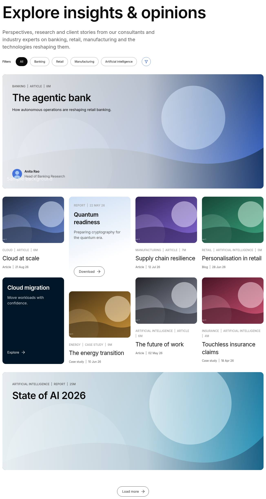

**Tablet rendering** — The same Filter List at 768 px only: the Filters label with the filter button at the right, the five pills on a full row below, the open Advanced filters panel with Industry (Banking, Energy, Insurance, Manufacturing, Retail) and Topic (Artificial intelligence, Cloud, Cybersecurity) side by side, The agentic bank hero and a two-column card grid.

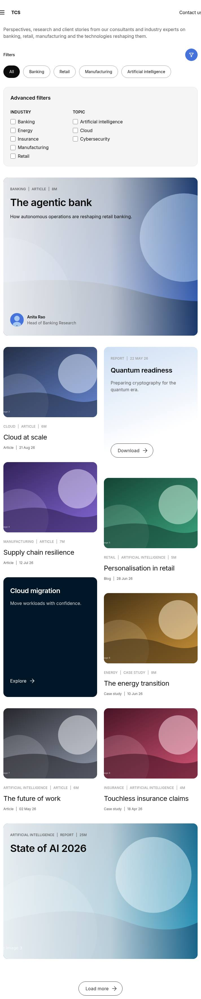

**Mobile rendering** — The Filter List at 375 px: title, description, the Filters label with the filter button at the right and the five pills wrapping below, one column of three cards (The agentic bank and State of AI 2026 are spotlights, so the cards start with Cloud at scale), The agentic bank featured spotlight and the centred Load more button.


**Masonry layout** — Latest insights at 1440 px in the Masonry layout: four columns of eight Mixed cards of different heights packed without row gaps, newest first from Cloud at scale, with State of AI 2026 and Quantum readiness as report panels, and a full-width spotlight for The agentic bank below all columns; no Load more.

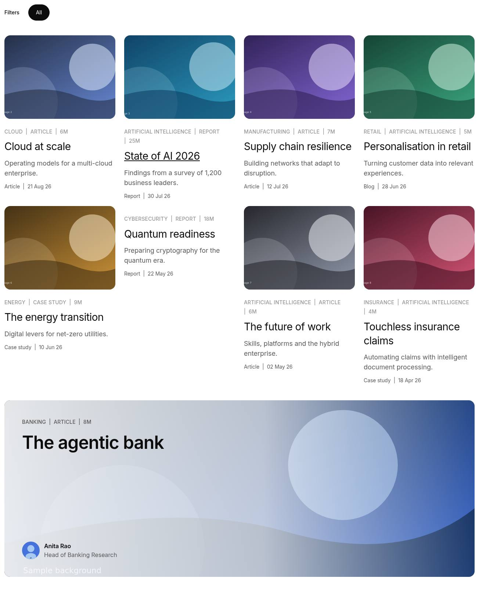

**Grid layout** — Latest insights at 1440 px in the Grid layout: two aligned rows of four Default cards (image, tag line, title, three-line description, meta line), from The agentic bank to The future of work, with space below shorter cards, and a Load more button for the ninth page.

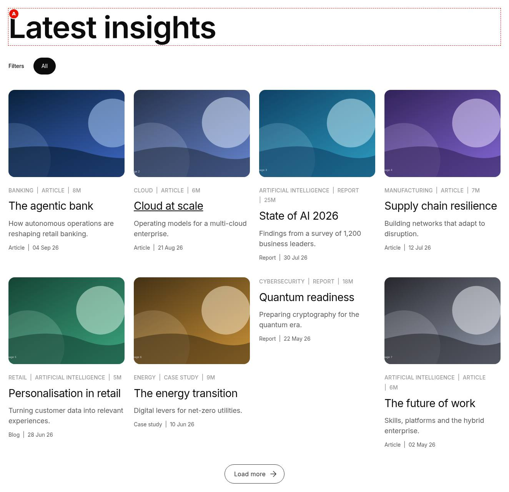

**List layout** — Perspectives and case studies at 1440 px in the List layout: four cards one per row (The agentic bank, Cloud at scale, Supply chain resilience, Personalisation in retail), each with the 4:3 image in the left third and the tags, title and meta line in the right two thirds, a divider below each, then Load more.

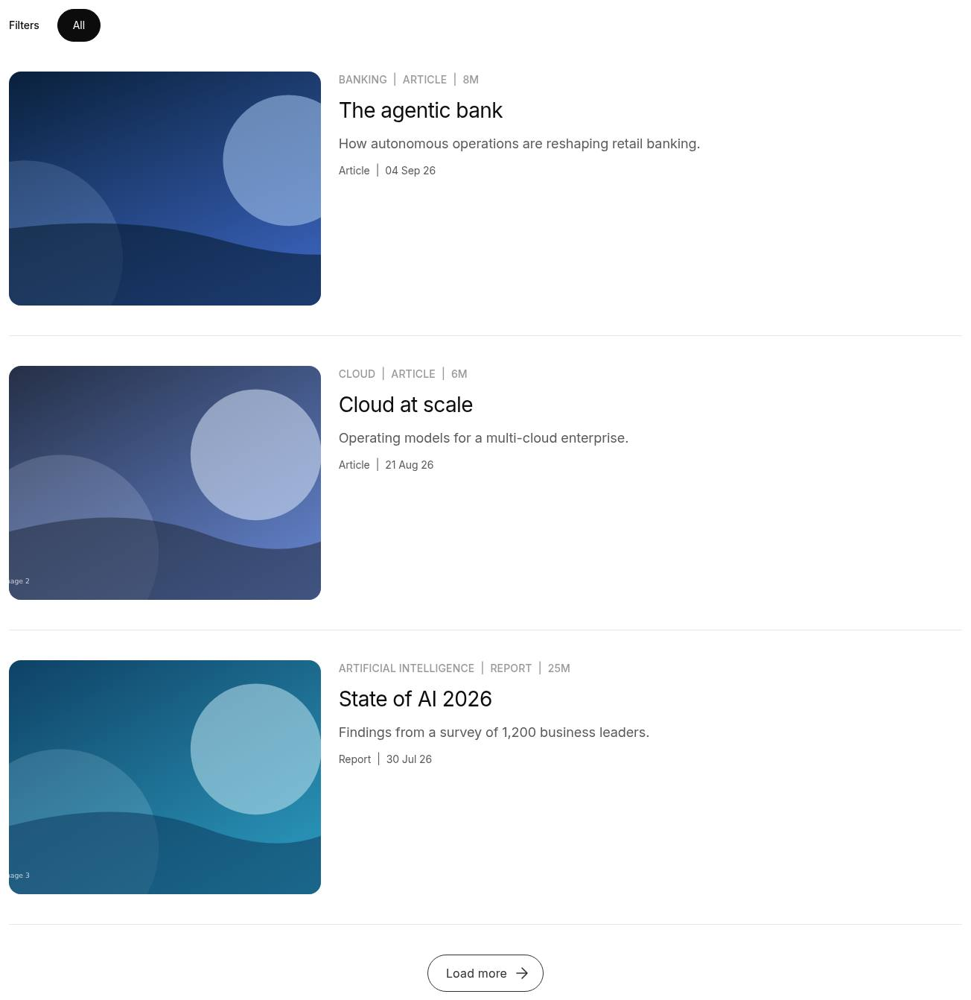

**Default card style** — Close-up of the first Default card at 1440 px: the 4:3 rounded image, the uppercase tag line Banking, Article and 8m separated by bars, the title The agentic bank, the description How autonomous operations are reshaping retail banking. and the meta line Article and 04 Sep 26.


**Compact card style** — All insights at 1440 px with Card style Compact: two rows of four outlined text cards (tag line with reading time, medium title link, eyebrow and date), no images and no descriptions, from The agentic bank to The future of work, and a Load more button.

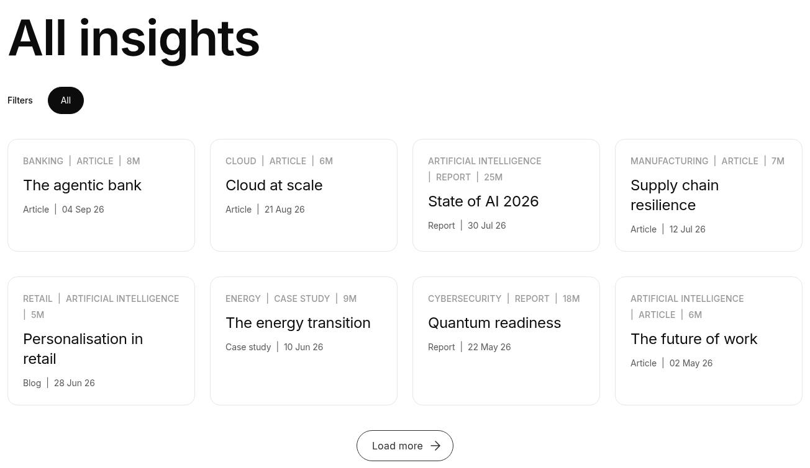

**Featured card style** — Flagship content at 1440 px with Card style Featured: two rows of three large cards from The agentic bank to The energy transition, each with image, tag line, semibold title, description, meta line and a Read more text button, then Load more.

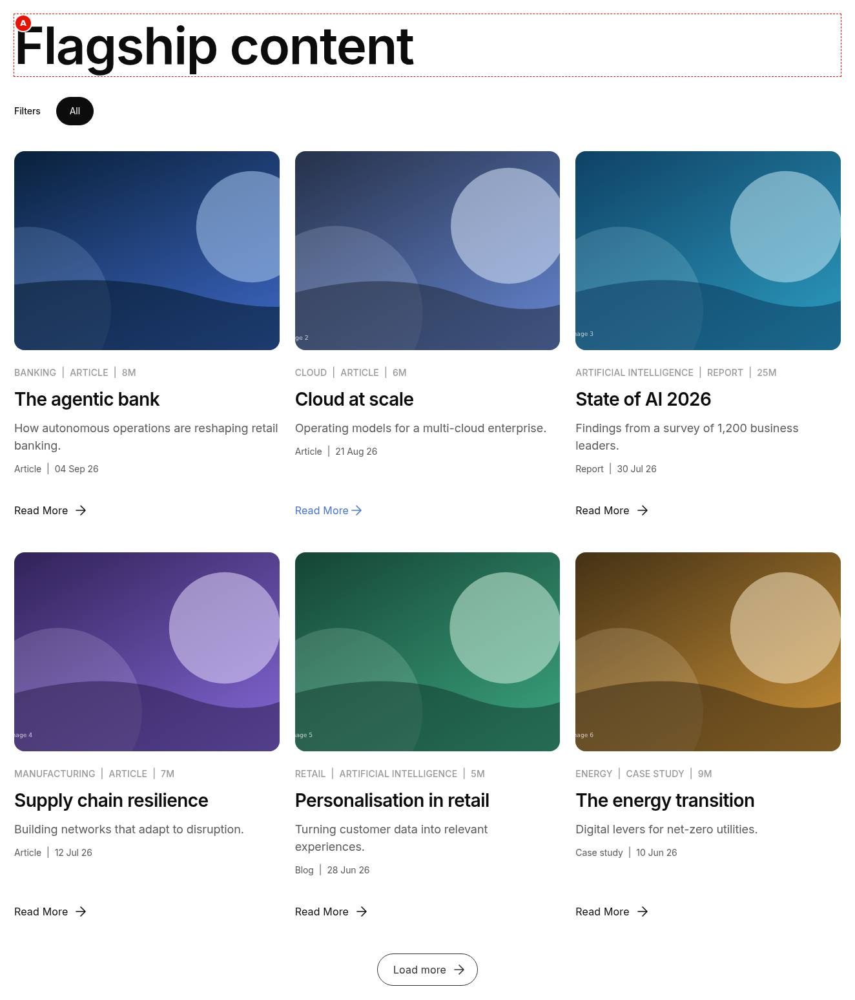

**Mixed card style** — Explore insights & opinions at 1440 px: a four-column masonry wall of eight cards in the authored order, image cards without description, Quantum readiness as a light gradient report panel with Download and Cloud migration as a dark blue panel with Explore; no spotlight and no Load more.

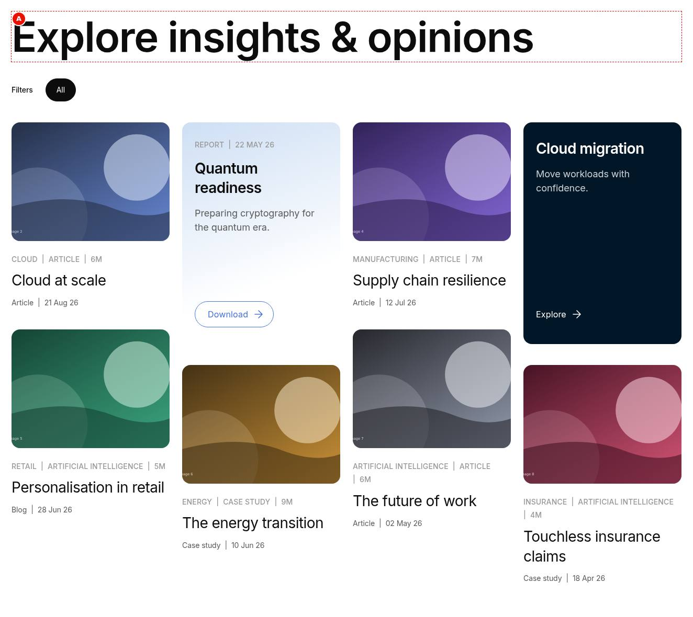

**Report card in the Mixed style** — Close-up of the Quantum readiness report card at 1440 px: a light brand-to-white diagonal gradient, the line REPORT and 22 May 26 separated by a bar, the semibold title, the description Preparing cryptography for the quantum era. and a secondary Download button.

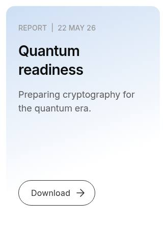

**Dark card in the Mixed style** — Close-up of the Cloud migration dark card at 1440 px: a dark brand-blue panel without a tag line (the page has no tags), the white semibold title Cloud migration, the light description Move workloads with confidence. and a white Explore text button.

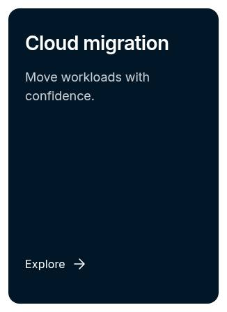

**Hero spotlight (Featured rule)** — Close-up of the hero spotlight at 1440 px: The agentic bank image under a white gradient, at the left the tag line Banking, Article and 8m, the 3rem title The agentic bank, its description and the lockup with Anita Rao's photo, name and Head of Banking Research.

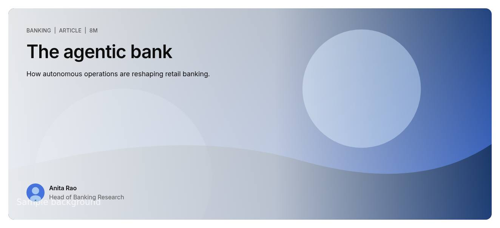

**Hero spotlight (Latest rule)** — Latest from our blog and case studies at 1440 px: the hero spotlight for Personalisation in retail (Retail, Artificial intelligence, 5m, Anita Rao) above two standard Mixed cards, The energy transition and Touchless insurance claims; no featured spotlight.

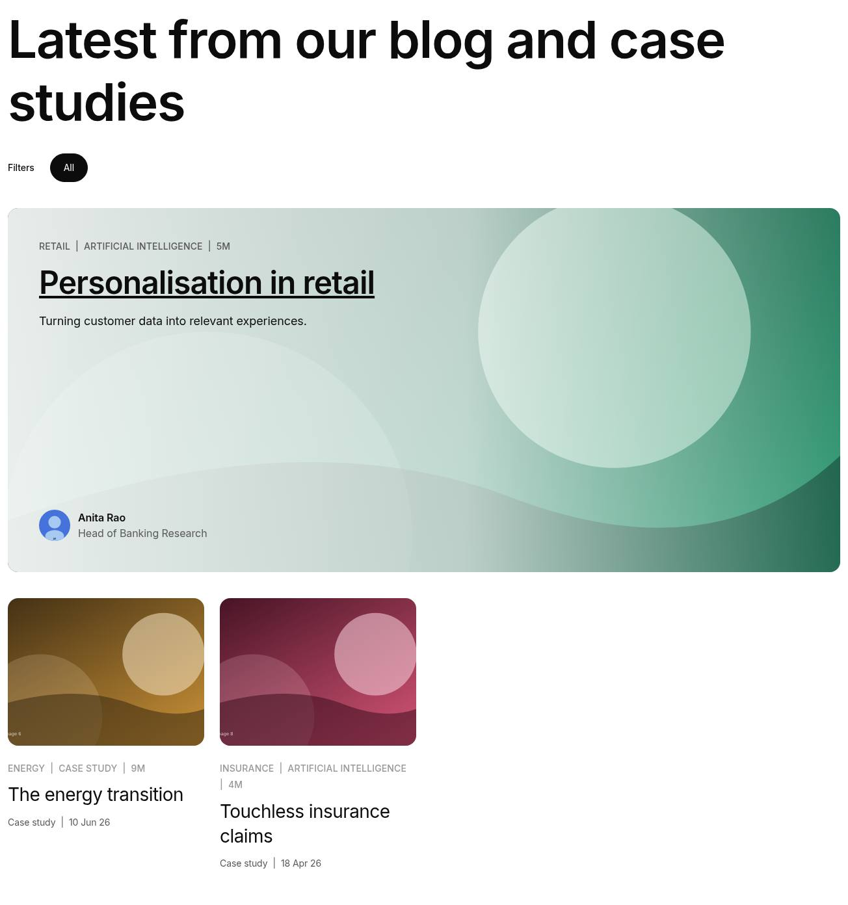

**Hero spotlight (Manual rule)** — Close-up of the hero spotlight at 1440 px (the card only, not the dialog): Supply chain resilience with the tag line Manufacturing, Article and 7m, its description Building networks that adapt to disruption. and the lockup of Sara Lee, Supply Chain Lead, over the page image.

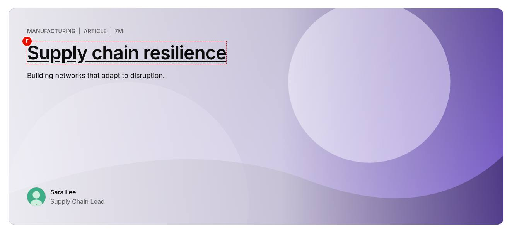

**Featured spotlight (featured=true)** — The results at 1440 px after one Load more: four cards (Cloud at scale, Supply chain resilience, Personalisation in retail, The energy transition), The agentic bank spotlight, three more cards (Quantum readiness as a report panel, The future of work, Touchless insurance claims) and the State of AI 2026 spotlight; Load more is gone.

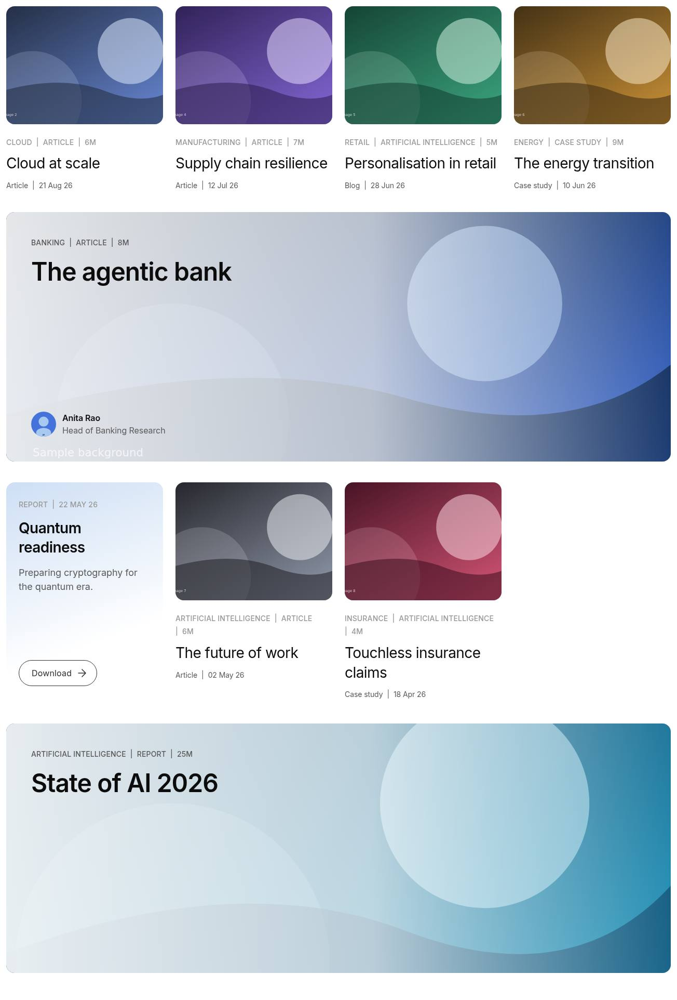

**Featured spotlight (priority<=3)** — Insights at 1440 px: four Mixed cards (Cloud at scale, State of AI 2026 as a report panel, Supply chain resilience, Personalisation in retail), then a full-width spotlight for The agentic bank (priority 1) and the Load more button.

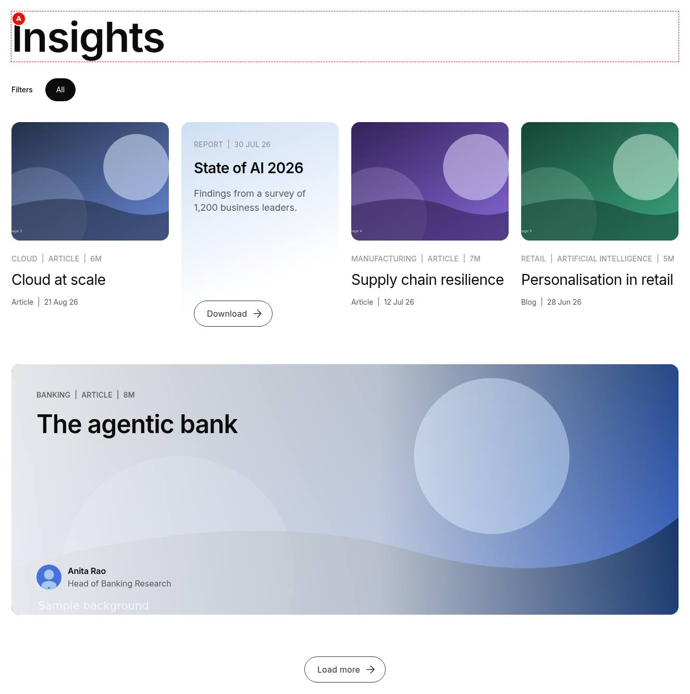

**Featured spotlight (Manual)** — The results at 1440 px (not the dialog): six cards (The agentic bank, State of AI 2026 report panel, Supply chain resilience, Personalisation in retail, Quantum readiness report panel, Touchless insurance claims) followed by spotlights for The future of work, The energy transition and Cloud at scale in the authored order.

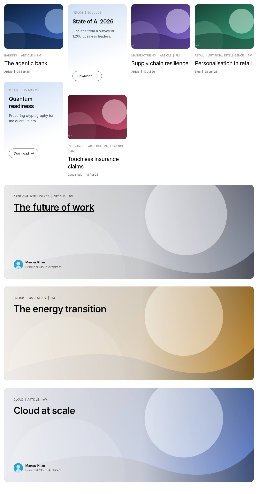

**Query Index source settings** — The rendered block at 1440 px (not the Source tab): Articles and reports with one masonry row of four Mixed cards (Cloud at scale, Supply chain resilience, Quantum readiness report panel, The future of work) followed by spotlights for The agentic bank and State of AI 2026.

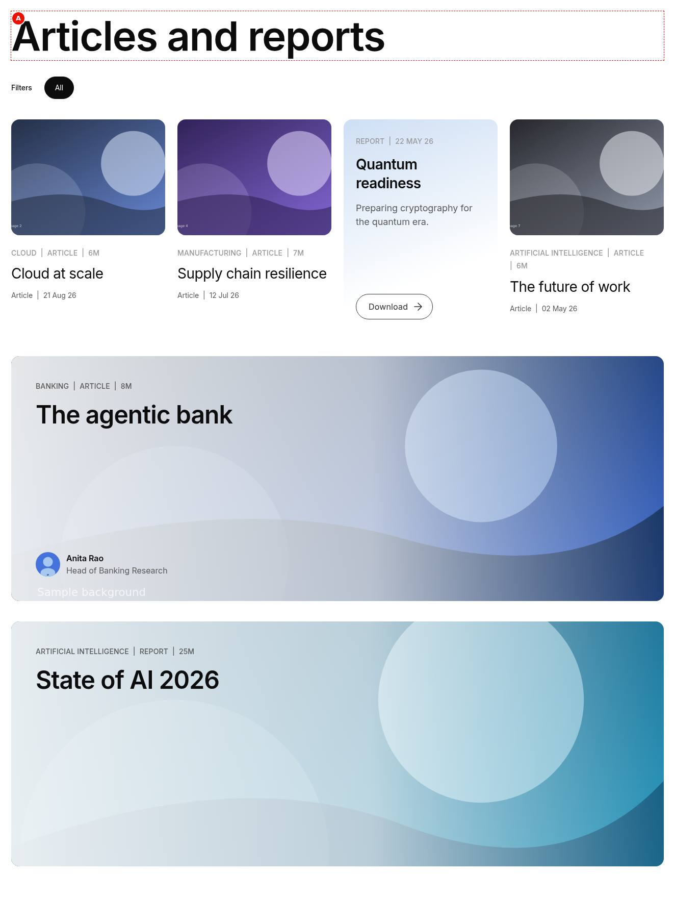

**Manual List source settings** — The rendered block at 1440 px (not the Source tab): Recommended reading with five Mixed image cards in the authored order, The future of work, The energy transition, Cloud at scale, Personalisation in retail and Touchless insurance claims; no spotlight and no Load more.

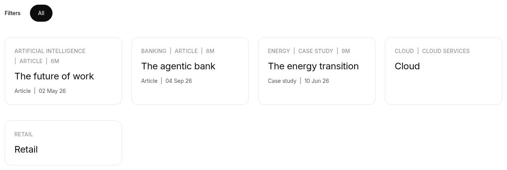

**Single select pills** — Insights at 1440 px after selecting Banking: the pills All (outlined), Banking (filled dark, pressed), Retail, Insurance and Artificial intelligence, the visible count 1 result and a single card for The agentic bank.

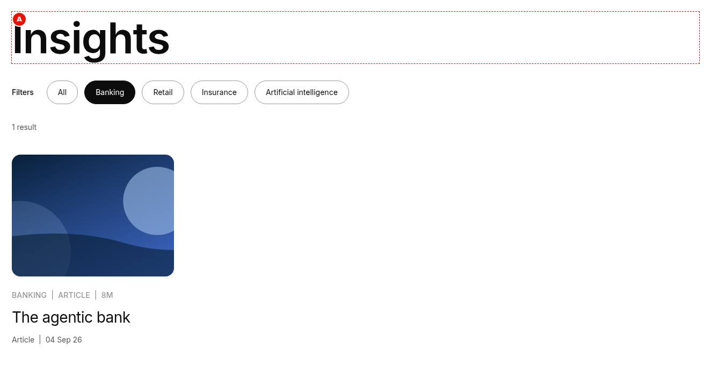

**Multi select pills** — Insights at 1440 px after selecting Insurance and Artificial intelligence: both pills pressed, All, Banking and Retail outlined, the count 1 result and one card for Touchless insurance claims, the only page tagged with both.

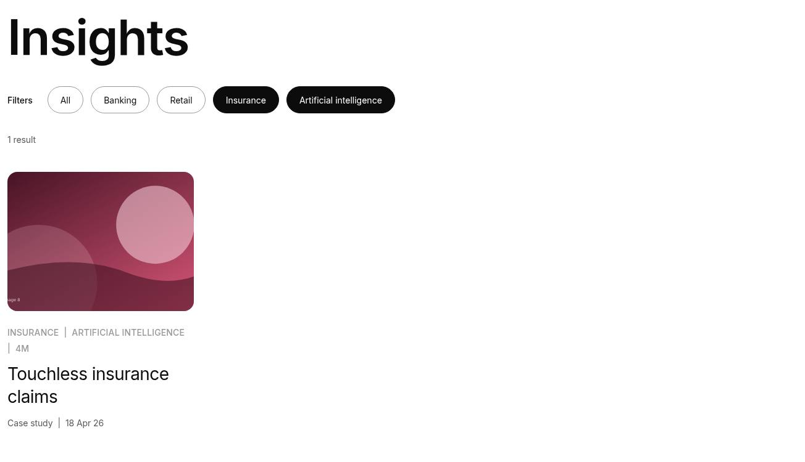

**Advanced filter panel (AND)** — Insights at 1440 px: the All pill, the filter button with a 2 badge and the open Advanced filters panel with Clear all and the fieldsets Industry (Banking, Energy, Insurance, Manufacturing, Retail) and Topic (Artificial intelligence, Cloud, Cybersecurity), Retail and Artificial intelligence checked; 1 result, Personalisation in retail.

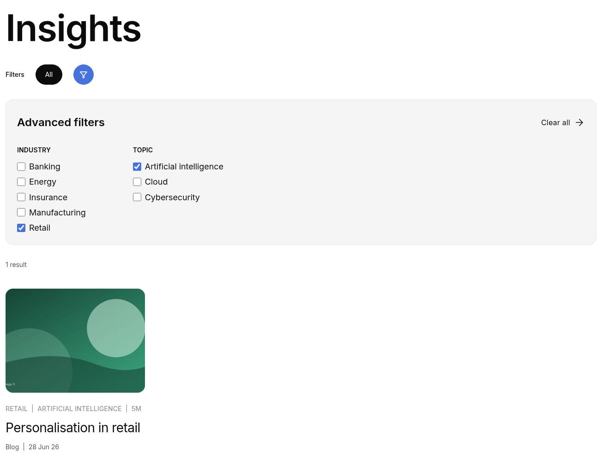

**Advanced filter panel (OR)** — Insights at 1440 px: the open Advanced filters panel with Banking and Energy (Industry) and Cloud (Topic) checked, a 3 badge, the count 3 results and cards for The agentic bank, Cloud at scale and The energy transition.

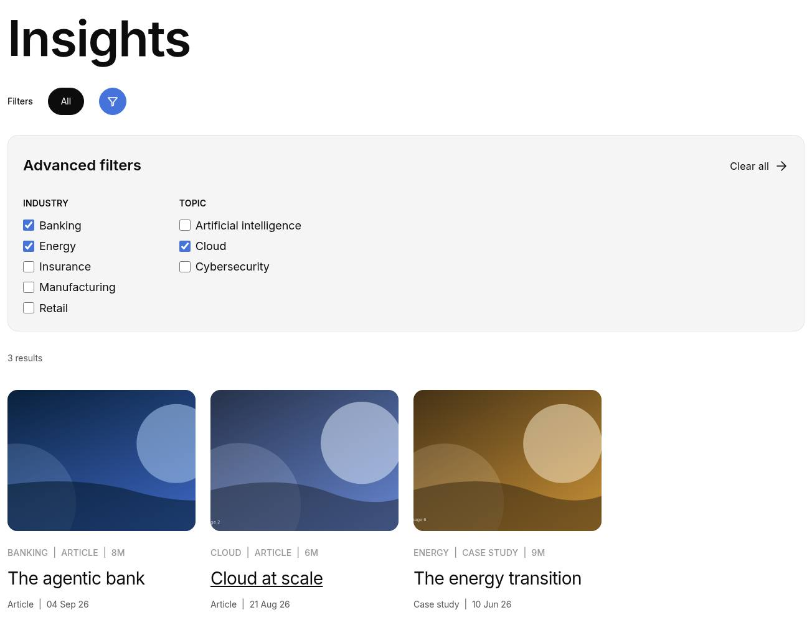

**Latest First order** — All insights at 1440 px: nine compact cards in four columns, dates descending from The agentic bank (04 Sep 26), Cloud at scale (21 Aug 26) and State of AI 2026 (30 Jul 26) to Touchless insurance claims (18 Apr 26).

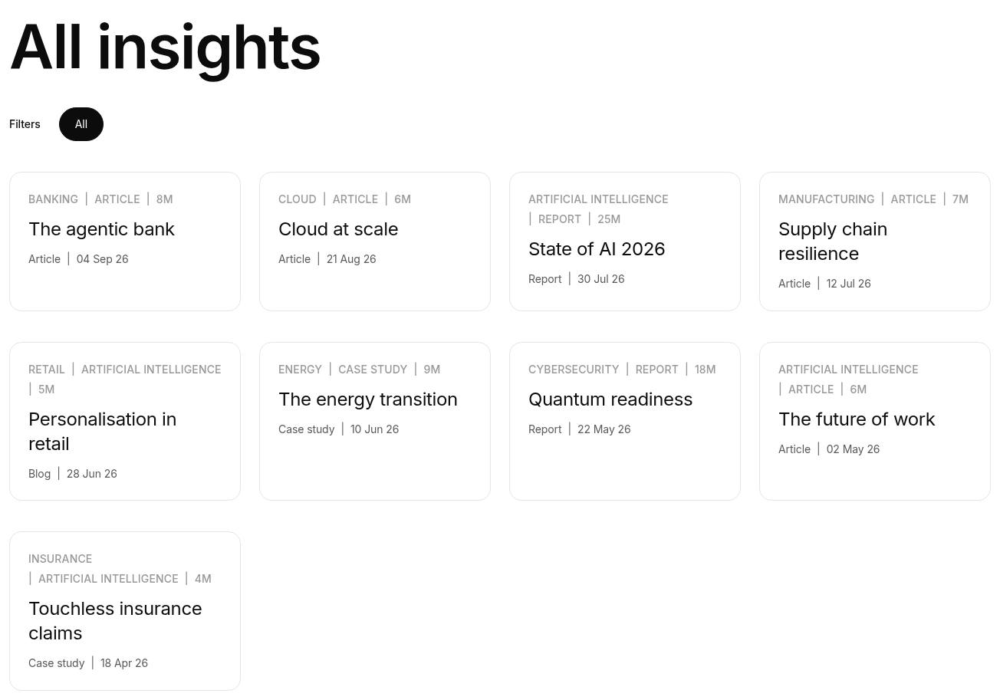

**Featured First order** — All insights at 1440 px: nine compact cards starting with the featured pages The agentic bank and State of AI 2026, then Cloud at scale to Touchless insurance claims newest first; with this sample data the order equals the Priority example.

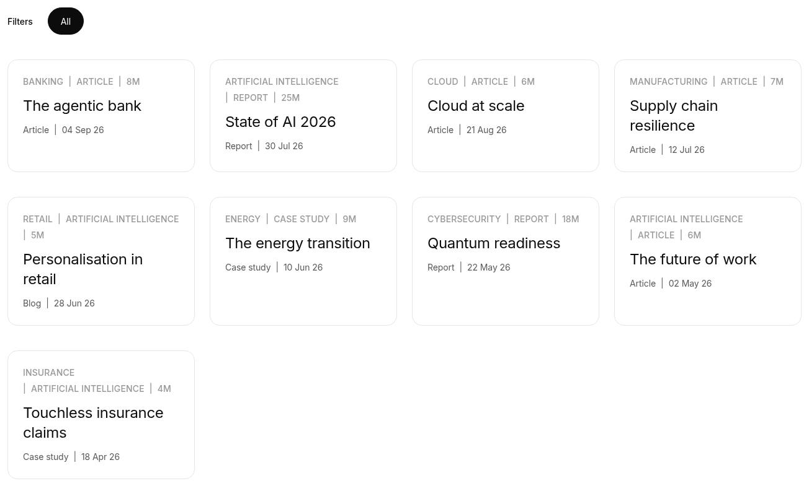

**Priority order** — All insights at 1440 px: nine compact cards starting with The agentic bank (priority 1) and State of AI 2026 (priority 2), then the pages without priority newest first, Cloud at scale to Touchless insurance claims; the sample data has no priority 3.

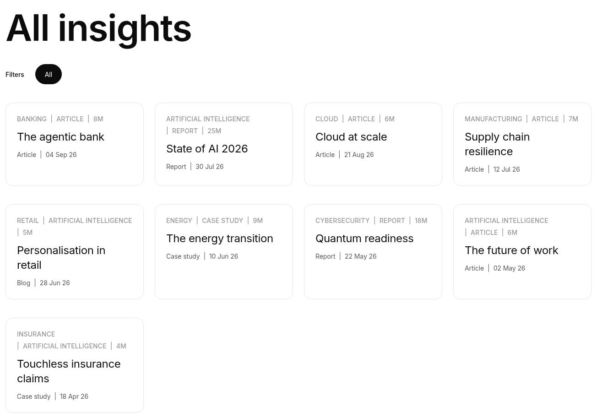

**Alphabetical order** — All insights at 1440 px: nine compact cards A to Z by title, Cloud at scale, Personalisation in retail, Quantum readiness, State of AI 2026, Supply chain resilience, The agentic bank, The energy transition, The future of work, Touchless insurance claims.

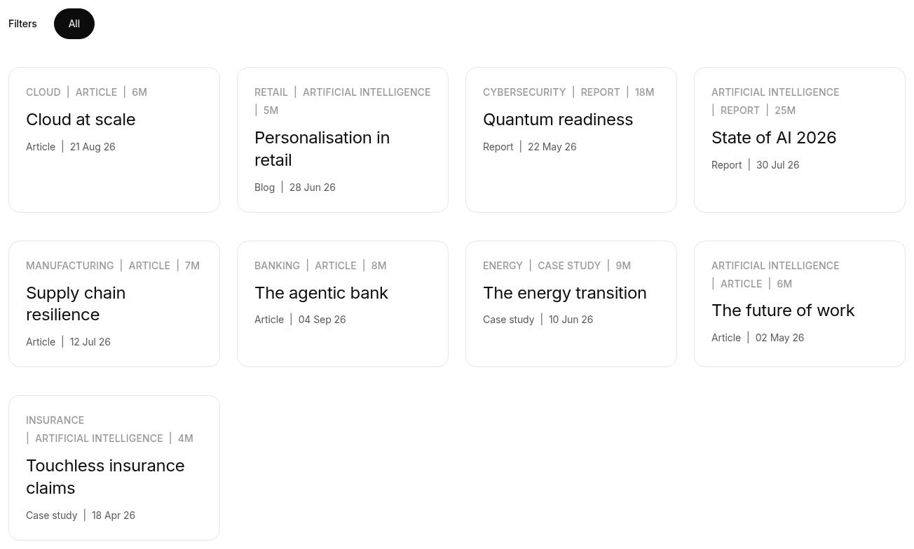

**Universal Editor canvas** — The Filter List selected in Universal Editor at 1440 px, annotated: A the title Explore insights & opinions, B the description, C the Filters label, D the pills All, Banking, Artificial intelligence and Cloud, E the result count 0 results and F the grey hint The results show on the published page, from the pages' metadata. (Annotated preview in editor mode with sample content; letters as in the annotations list, not a Universal Editor screenshot; file screenshots/filter-list-authoring-view.jpg)

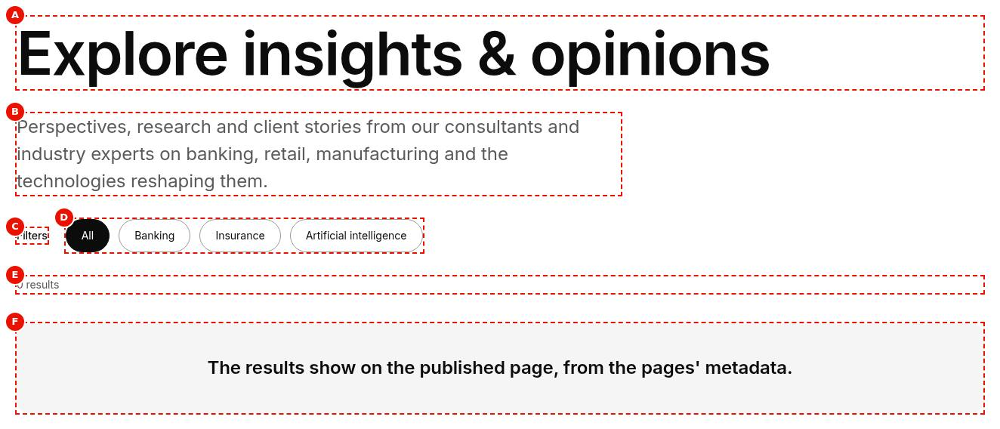

**Properties panel** — The Universal Editor properties panel of the Filter List with the seven tabs Content, Source, Filters, Advanced, Cards, Mapping and Additional, the Content tab open. (Dialog reference generated from the component model, not a Universal Editor screenshot; file screenshots/filter-list-properties-panel.jpg)

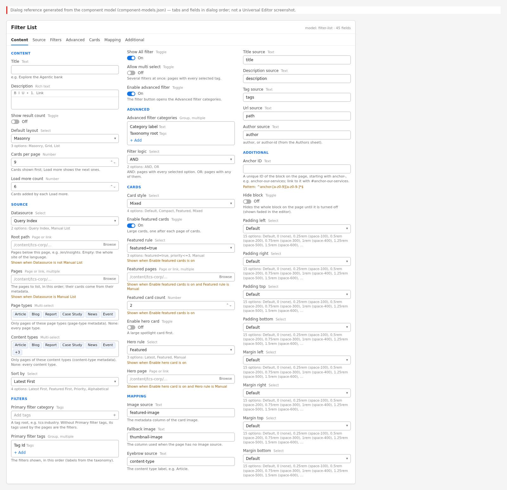

Universal Editor dialogs (no screenshot exists yet; to be captured on AEM author):

```text
[Screenshot Placeholder]

File name:
filter-list-dialog-content-desktop.png

Purpose:
The Content tab of the Filter List properties in Universal Editor, with the fields of the table "Content tab — Filter List" in Authorable Fields below.

Annotations:
A = Title
B = Description
C = Show result count
D = Default layout
E = Cards per page
F = Load more count
G = Datasource
H = Root path
I = Pages (authored before Page items)
J = Pages (authored before Page items) › Page
```

```text
[Screenshot Placeholder]

File name:
filter-list-dialog-cards-desktop.png

Purpose:
The Cards tab of the Filter List properties in Universal Editor, with the fields of the table "Cards tab — Filter List" in Authorable Fields below.

Annotations:
A = Card style
B = Enable featured cards
C = Featured rule
D = Featured pages (authored before Page items)
E = Featured pages (authored before Page items) › Featured page
F = Featured card count
G = Enable hero card
H = Hero rule
I = Hero page
J = Image source
```

```text
[Screenshot Placeholder]

File name:
filter-list-dialog-additional-desktop.png

Purpose:
The Additional tab of the Filter List properties in Universal Editor, with the fields of the table "Additional tab — Filter List" in Authorable Fields below.

Annotations:
A = Anchor ID
B = Hide block
C = Animation Type
D = Motion Speed
E = Animation Trigger
F = Padding left
G = Padding right
H = Padding top
I = Padding bottom
J = Margin left
```

```text
[Screenshot Placeholder]

File name:
filter-list-tag-dialog-fields-desktop.png

Purpose:
The dialog of the Filter Tag properties in Universal Editor, with the fields of the table "Fields — Filter Tag" in Authorable Fields below.

Annotations:
A = Tag
```

```text
[Screenshot Placeholder]

File name:
filter-list-category-dialog-category-desktop.png

Purpose:
The Category tab of the Filter Category properties in Universal Editor, with the fields of the table "Category tab — Filter Category" in Authorable Fields below.

Annotations:
A = Category label
B = Taxonomy root
```

```text
[Screenshot Placeholder]

File name:
filter-list-page-dialog-page-desktop.png

Purpose:
The Page tab of the Filter Page properties in Universal Editor, with the fields of the table "Page tab — Filter Page" in Authorable Fields below.

Annotations:
A = Page
B = Use
```

<!-- END GENERATED: screenshots -->

States without a screenshot:

```text
[Screenshot Placeholder]

File name:
filter-list-loading-desktop.png

Purpose:
The skeleton shown when the query index takes longer than 150ms: a title bone, up to five pill bones and six card bones at desktop (four at tablet, two at mobile).

Annotations:
A = Title bone
B = Pill bones
C = Card bones (media, line, title, line)
```

```text
[Screenshot Placeholder]

File name:
filter-list-empty-desktop.png

Purpose:
The empty state after a filter matches nothing: "No resources found.", "Try selecting another filter." and the Reset filters button.

Annotations:
A = Empty state title
B = Hint
C = Reset filters button
```

```text
[Screenshot Placeholder]

File name:
filter-list-editor-items-desktop.png

Purpose:
Universal Editor edit mode: the editor hint instead of cards (no query index on AEM author) and, below the block, the Filter Tag, Filter Category and Filter Page items as selectable chips labelled with their tag, "label: root" or page path.

Annotations:
A = Editor hint text
B = Filter Tag chip
C = Filter Category chip
D = Filter Page chip
```

```text
[Screenshot Placeholder]

File name:
filter-list-advanced-mobile.png

Purpose:
The Advanced filters panel open at 375px with focus on the first checkbox, the toggle in its pressed state with the selected-count badge.

Annotations:
A = Filter toggle with badge
B = Category fieldset and legend
C = Focused checkbox
D = Clear all
```

```text
[Screenshot Placeholder]

File name:
filter-list-load-more-focus-desktop.png

Purpose:
After Load more: focus on the first new card's link (outline around the card) and the count "Showing {n} of {total}".

Annotations:
A = Focused new card
B = Result count text
C = Load more button
```

## For Content Authors

1. **Prepare the pages.** Each listed page needs its metadata: Title, Description, Tags, Page Type, `content-type`, `publish-date` (YYYY-MM-DD), `reading-time`, `featured-image` or `thumbnail-image`, and `author-id` (Authors sheet) or `author`; `featured` / `priority` for spotlights. Publish the pages so they are in the query index.
2. **Add the block.** Select a Section, a Columns Container column or a Tabs Container tab, choose Add (+) and pick **Filter List**.
3. **Open its properties.** Tabs: **Content** (title, description, layout, paging, source, filters), **Cards** (card style, featured cards, hero card, card mapping), **Additional**.
4. **Enter content.** Title (e.g. "Insights"), an optional Description, Default layout, Cards per page and Load more count.
5. **Choose the source.** Datasource **Query Index** (with an optional Root path, Page types, Content types and Sort by) or **Manual List** (then add Filter Page items with Use = Listed).
6. **Add filters.** Either set a **Primary filter category** (its tags used by the pages become pills) or add **Filter Tag** items (one pill per tag, in item order). For the advanced filter, keep Enable advanced filter on and add **Filter Category** items (Category label, Taxonomy root). Choose Allow multi select, Show All filter and Filter logic.
7. **Select the presentation.** In the Cards tab choose Card style, and turn on featured cards (Featured rule, count; Manual: Filter Page items with Use = Featured) or the hero card (Hero rule; Manual: Hero page).
8. **Add / reorder items** with Add (+) on the block; drag them in the content tree. Filter Tags render in item order; Filter Pages in their order for a Manual List and Manual featured rule.
9. **Preview** on the preview URL (aem.page): Universal Editor and AEM author show a hint instead of cards, because AEM author has no query index.
10. **Publish** the page (and the listed pages, the taxonomy and the Authors sheet when they changed).
11. **Validate the published output:** cards appear with images and labels; pills and the panel filter the cards; Load more adds cards; the count is right.

- **Minimum required:** none in the model; with the defaults the block lists every indexed page of the locale. A Manual List needs Filter Pages (Use = Listed); a Filter Category needs a Taxonomy root.
- **Recommended:** a Title (the block's `h2`), a Root path, filter tags or a Primary filter category, Show result count for large lists.
- **Optional:** Description, hero and featured spotlights, sorting, the card mapping fields, the Additional tab.

## Authorable Fields

<!-- BEGIN GENERATED: fields (npm run build:docs) -->

### Filter List (`filter-list`)

Model `filter-list`; template name "Filter List" (the block class AEM renders); key-value block (one row per property); children: `filter-list-tag`, `filter-list-category`, `filter-list-page`.

Stored on a new component (definition template): `showResultCount` = `false`, `layout` = `"masonry"`, `cardsPerPage` = `9`, `loadMoreCount` = `6`, `source` = `"query-index"`, `sortBy` = `"latest"`, `showAll` = `true`, `multiSelect` = `false`, `advancedFilter` = `true`, `filterLogic` = `"and"`, `cardStyle` = `"mixed"`, `enableFeatured` = `true`, `featuredRule` = `"featured"`, `featuredCount` = `2`, `enableHero` = `false`, `heroRule` = `"featured"`, `imageSource` = `"featured-image"`, `fallbackImage` = `"thumbnail-image"`, `eyebrowSource` = `"content-type"`, `titleSource` = `"title"`, `descriptionSource` = `"description"`, `tagSource` = `"tags"`, `urlSource` = `"path"`, `authorSource` = `"author"`.

#### Content tab — Filter List

| Field label | Property | Type | Required | Default | Allowed values | Author guidance | Example |
| ----------- | -------- | ---- | -------- | ------- | -------------- | --------------- | ------- |
| Title | `title` | text | No | — | — | e.g. Explore the Agentic bank | Insights |
| Description | `description` | richtext | No | — | — | — | — |
| Show result count | `showResultCount` | boolean | No | `false` | on / off | — | true |
| Default layout | `layout` | select | No | `masonry` | Masonry (`masonry`), Grid (`grid`), List (`list`) | — | grid |
| Cards per page | `cardsPerPage` | number | No | `9` | — | Cards shown first; Load more shows the next ones. | 6 |
| Load more count | `loadMoreCount` | number | No | `6` | — | Cards added by each Load more. | 3 |
| Datasource | `source` | select | No | `query-index` | Query Index (`query-index`), Manual List (`manual`) | — | manual |
| Root path | `rootPath` | aem-content | No | — | — | Pages below this page, e.g. /en/insights. Empty: the whole site of the language. Shown when `source` is not `manual`. | /language-master/en/dummy-pages/insights |
| Pages (authored before Page items) | `pageItems` | container (multiple) | No | — | — | Kept for lists authored before; add items with Add instead. Shown when `source` is `manual`. | — |
| Pages (authored before Page items) › Page | `page` | aem-content | No | — | — | — | — |
| Page types | `pageTypes` | multiselect | No | — | Article (`article`), Blog (`blog`), Press release (`press-release`) | Only pages of these page types (page-type metadata). None: every page type. | — |
| Content types | `contentTypes` | multiselect | No | — | Article (`article`), Blog (`blog`), Insights (`insights`), Case study (`case-study`), Whitepaper (`whitepaper`), Report (`report`), News (`news`), Event (`event`), Press release (`press-release`) | Only pages of these content types (content-type metadata). None: every content type. | — |
| Sort by | `sortBy` | select | No | `latest` | Latest First (`latest`), Featured First (`featured`), Priority (`priority`), Alphabetical (`alphabetical`) | — | latest |
| Primary filter category | `primaryCategory` | aem-tag | No | — | — | A tag root, e.g. tcs:industry. Without Primary filter tags, its tags used by the pages are the filters. | tcs-corp:industry |
| Primary filter tags (authored before Tag items) | `primaryTags` | container (multiple) | No | — | — | Kept for lists authored before; add items with Add instead. | — |
| Primary filter tags (authored before Tag items) › Tag Id | `tagId` | aem-tag | No | — | — | — | — |
| Show All filter | `showAll` | boolean | No | `true` | on / off | — | true |
| Allow multi select | `multiSelect` | boolean | No | `false` | on / off | Several filters at once: pages with every selected tag. | true |
| Enable advanced filter | `advancedFilter` | boolean | No | `true` | on / off | The filter button opens the Advanced filter categories. | false |
| Advanced filter categories (authored before Category items) | `advancedCategories` | container (multiple) | No | — | — | Kept for lists authored before; add items with Add instead. | — |
| Advanced filter categories (authored before Category items) › Category label | `categoryLabel` | text | No | — | — | e.g. Industry | — |
| Advanced filter categories (authored before Category items) › Taxonomy root | `taxonomyRoot` | aem-tag | No | — | — | e.g. tcs:industry; its tags used by the pages are the options. | — |
| Filter logic | `filterLogic` | select | No | `and` | AND (`and`), OR (`or`) | AND: pages with every selected option. OR: pages with any of them. | or |

#### Cards tab — Filter List

| Field label | Property | Type | Required | Default | Allowed values | Author guidance | Example |
| ----------- | -------- | ---- | -------- | ------- | -------------- | --------------- | ------- |
| Card style | `cardStyle` | select | No | `mixed` | Default (`default`), Compact (`compact`), Featured (`featured`), Mixed (`mixed`) | — | default |
| Enable featured cards | `enableFeatured` | boolean | No | `true` | on / off | Large cards, one after each page of cards. | false |
| Featured rule | `featuredRule` | select | No | `featured` | Marked as featured (featured metadata) (`featured`), Priority 1 to 3 (priority metadata) (`priority`), Manual (`manual`) | Shown when `enableFeatured` is `true`. | priority |
| Featured pages (authored before Page items) | `featuredItems` | container (multiple) | No | — | — | Kept for lists authored before; add items with Add instead. Shown when `enableFeatured` is `true` and `featuredRule` is `manual`. | — |
| Featured pages (authored before Page items) › Featured page | `featuredPage` | aem-content | No | — | — | — | — |
| Featured card count | `featuredCount` | number | No | `2` | — | Shown when `enableFeatured` is `true`. | 1 |
| Enable hero card | `enableHero` | boolean | No | `false` | on / off | A large spotlight card first. | true |
| Hero rule | `heroRule` | select | No | `featured` | Latest (`latest`), Featured (`featured`), Manual (`manual`) | Shown when `enableHero` is `true`. | latest |
| Hero page | `heroPage` | aem-content | No | — | — | Shown when `enableHero` is `true` and `heroRule` is `manual`. | — |
| Image source | `imageSource` | text | No | `featured-image` | — | The metadata column of the card image. | featured-image |
| Fallback image | `fallbackImage` | text | No | `thumbnail-image` | — | The column used when the page has no image source. | thumbnail-image |
| Eyebrow source | `eyebrowSource` | text | No | `content-type` | — | The content type label, e.g. Article. | — |
| Title source | `titleSource` | text | No | `title` | — | — | — |
| Description source | `descriptionSource` | text | No | `description` | — | — | — |
| Tag source | `tagSource` | text | No | `tags` | — | — | — |
| Url source | `urlSource` | text | No | `path` | — | — | — |
| Author source | `authorSource` | text | No | `author` | — | author, or author-id (from the Authors sheet). | author |

#### Additional tab — Filter List

| Field label | Property | Type | Required | Default | Allowed values | Author guidance | Example |
| ----------- | -------- | ---- | -------- | ------- | -------------- | --------------- | ------- |
| Anchor ID | `classes_anchor` | text | No | — | regExp: ^anchor-[a-z0-9][a-z0-9-]*$; customErrorMsg: Start with anchor-, then lower-case letters, digits and hyphens. | A unique ID of the block on the page, starting with anchor-, e.g. anchor-our-services; link to it with #anchor-our-services. Delivered as a block class. | — |
| Hide block | `classes_hideblock` | boolean | No | `false` | on / off | Hides the whole block on the page until it is turned off (shown faded in the editor). Delivered as a block class. | — |
| Animation Type | `classes_animation` | select | No | "" | None (""), Fade in (`motion-fade-in`), Fade up (`motion-fade-up`), Fade down (`motion-fade-down`), Fade left (`motion-fade-left`), Fade right (`motion-fade-right`), Slide up (`motion-slide-up`), Slide down (`motion-slide-down`), Slide left (`motion-slide-left`), Slide right (`motion-slide-right`), Scale in (`motion-scale-in`) | How the block's content appears; repeated items (cards, list items, accordion items, columns) appear one after another. None: shown as is. Not played in the editor or when the visitor prefers reduced motion. Delivered as a block class. | motion-fade-in |
| Motion Speed | `classes_animationspeed` | select | No | "" | Medium (""), Fast (`motion-fast`), Slow (`motion-slow`) | How fast the animation runs: 0.3, 0.6 or 0.9 seconds. Shown when `classes_animation` is set and `classes_animation` is not empty. Delivered as a block class. | — |
| Animation Trigger | `classes_animationtrigger` | select | No | "" | On Scroll / Viewport Entry (""), On Page Load (`motion-on-load`) | When the block's animations run. On Scroll: when the block comes into view (at once if it is in view when the page opens). On Page Load: as soon as the block is ready, wherever it is on the page. Shown when `classes_animation` is set and `classes_animation` is not empty. Delivered as a block class. | — |
| Padding left | `classes_paddingleft` | select | No | "" | Default (""), 0 (none) (`pl-0`), 0.25rem (space-100) (`pl-100`), 0.5rem (space-200) (`pl-200`), 0.75rem (space-300) (`pl-300`), 1rem (space-400) (`pl-400`), 1.25rem (space-500) (`pl-500`), 1.5rem (space-600) (`pl-600`), 2rem (space-800) (`pl-800`), 2.5rem (space-1000) (`pl-1000`), 3rem (space-1200) (`pl-1200`), 4rem (space-1600) (`pl-1600`), 5rem (space-2000) (`pl-2000`), 6rem (space-2400) (`pl-2400`), 7.5rem (space-3000) (`pl-3000`) | Delivered as a block class. | — |
| Padding right | `classes_paddingright` | select | No | "" | Default (""), 0 (none) (`pr-0`), 0.25rem (space-100) (`pr-100`), 0.5rem (space-200) (`pr-200`), 0.75rem (space-300) (`pr-300`), 1rem (space-400) (`pr-400`), 1.25rem (space-500) (`pr-500`), 1.5rem (space-600) (`pr-600`), 2rem (space-800) (`pr-800`), 2.5rem (space-1000) (`pr-1000`), 3rem (space-1200) (`pr-1200`), 4rem (space-1600) (`pr-1600`), 5rem (space-2000) (`pr-2000`), 6rem (space-2400) (`pr-2400`), 7.5rem (space-3000) (`pr-3000`) | Delivered as a block class. | — |
| Padding top | `classes_paddingtop` | select | No | "" | Default (""), 0 (none) (`pt-0`), 0.25rem (space-100) (`pt-100`), 0.5rem (space-200) (`pt-200`), 0.75rem (space-300) (`pt-300`), 1rem (space-400) (`pt-400`), 1.25rem (space-500) (`pt-500`), 1.5rem (space-600) (`pt-600`), 2rem (space-800) (`pt-800`), 2.5rem (space-1000) (`pt-1000`), 3rem (space-1200) (`pt-1200`), 4rem (space-1600) (`pt-1600`), 5rem (space-2000) (`pt-2000`), 6rem (space-2400) (`pt-2400`), 7.5rem (space-3000) (`pt-3000`) | Delivered as a block class. | — |
| Padding bottom | `classes_paddingbottom` | select | No | "" | Default (""), 0 (none) (`pb-0`), 0.25rem (space-100) (`pb-100`), 0.5rem (space-200) (`pb-200`), 0.75rem (space-300) (`pb-300`), 1rem (space-400) (`pb-400`), 1.25rem (space-500) (`pb-500`), 1.5rem (space-600) (`pb-600`), 2rem (space-800) (`pb-800`), 2.5rem (space-1000) (`pb-1000`), 3rem (space-1200) (`pb-1200`), 4rem (space-1600) (`pb-1600`), 5rem (space-2000) (`pb-2000`), 6rem (space-2400) (`pb-2400`), 7.5rem (space-3000) (`pb-3000`) | Delivered as a block class. | — |
| Margin left | `classes_marginleft` | select | No | "" | Default (""), 0 (none) (`ml-0`), 0.25rem (space-100) (`ml-100`), 0.5rem (space-200) (`ml-200`), 0.75rem (space-300) (`ml-300`), 1rem (space-400) (`ml-400`), 1.25rem (space-500) (`ml-500`), 1.5rem (space-600) (`ml-600`), 2rem (space-800) (`ml-800`), 2.5rem (space-1000) (`ml-1000`), 3rem (space-1200) (`ml-1200`), 4rem (space-1600) (`ml-1600`), 5rem (space-2000) (`ml-2000`), 6rem (space-2400) (`ml-2400`), 7.5rem (space-3000) (`ml-3000`) | Delivered as a block class. | — |
| Margin right | `classes_marginright` | select | No | "" | Default (""), 0 (none) (`mr-0`), 0.25rem (space-100) (`mr-100`), 0.5rem (space-200) (`mr-200`), 0.75rem (space-300) (`mr-300`), 1rem (space-400) (`mr-400`), 1.25rem (space-500) (`mr-500`), 1.5rem (space-600) (`mr-600`), 2rem (space-800) (`mr-800`), 2.5rem (space-1000) (`mr-1000`), 3rem (space-1200) (`mr-1200`), 4rem (space-1600) (`mr-1600`), 5rem (space-2000) (`mr-2000`), 6rem (space-2400) (`mr-2400`), 7.5rem (space-3000) (`mr-3000`) | Delivered as a block class. | — |
| Margin top | `classes_margintop` | select | No | "" | Default (""), 0 (none) (`mt-0`), 0.25rem (space-100) (`mt-100`), 0.5rem (space-200) (`mt-200`), 0.75rem (space-300) (`mt-300`), 1rem (space-400) (`mt-400`), 1.25rem (space-500) (`mt-500`), 1.5rem (space-600) (`mt-600`), 2rem (space-800) (`mt-800`), 2.5rem (space-1000) (`mt-1000`), 3rem (space-1200) (`mt-1200`), 4rem (space-1600) (`mt-1600`), 5rem (space-2000) (`mt-2000`), 6rem (space-2400) (`mt-2400`), 7.5rem (space-3000) (`mt-3000`) | Delivered as a block class. | — |
| Margin bottom | `classes_marginbottom` | select | No | "" | Default (""), 0 (none) (`mb-0`), 0.25rem (space-100) (`mb-100`), 0.5rem (space-200) (`mb-200`), 0.75rem (space-300) (`mb-300`), 1rem (space-400) (`mb-400`), 1.25rem (space-500) (`mb-500`), 1.5rem (space-600) (`mb-600`), 2rem (space-800) (`mb-800`), 2.5rem (space-1000) (`mb-1000`), 3rem (space-1200) (`mb-1200`), 4rem (space-1600) (`mb-1600`), 5rem (space-2000) (`mb-2000`), 6rem (space-2400) (`mb-2400`), 7.5rem (space-3000) (`mb-3000`) | Delivered as a block class. | — |

### Filter Tag (`filter-list-tag`)

Model `filter-list-tag`; template name "Filter Tag" (the block class AEM renders).

#### Fields — Filter Tag

| Field label | Property | Type | Required | Default | Allowed values | Author guidance | Example |
| ----------- | -------- | ---- | -------- | ------- | -------------- | --------------- | ------- |
| Tag | `tagId` | aem-tag | Yes | — | — | A primary filter, in the order of the items (label from the taxonomy). | — |

### Filter Category (`filter-list-category`)

Model `filter-list-category`; template name "Filter Category" (the block class AEM renders).

#### Category tab — Filter Category

| Field label | Property | Type | Required | Default | Allowed values | Author guidance | Example |
| ----------- | -------- | ---- | -------- | ------- | -------------- | --------------- | ------- |
| Category label | `categoryLabel` | text | No | — | — | e.g. Industry | — |
| Taxonomy root | `taxonomyRoot` | aem-tag | Yes | — | — | e.g. tcs:industry; its tags used by the pages are the options of the advanced filter. | — |

### Filter Page (`filter-list-page`)

Model `filter-list-page`; template name "Filter Page" (the block class AEM renders).

#### Page tab — Filter Page

| Field label | Property | Type | Required | Default | Allowed values | Author guidance | Example |
| ----------- | -------- | ---- | -------- | ------- | -------------- | --------------- | ------- |
| Page | `page` | aem-content | Yes | — | — | — | — |
| Use | `pageRole` | select | No | `listed` | Listed (Manual List) (`listed`), Featured (`featured`) | Listed: a page of the Manual List (Datasource). Featured: a featured page (Featured rule Manual). | — |

<!-- END GENERATED: fields -->

Notes on the fields (see the tables above for labels, properties, defaults and values):

- **Title** renders as `h2.filter-list-title`; it is the component's `dc:title` in the data layer (without a Title, the first card heading is).
- **Description** (rich text) is moved into `div.filter-list-description`.
- **Show result count** shows `p.filter-list-count`; when off it stays visually hidden but is still a `role="status"` live region (set after the first count, so the initial count isn't announced).
- **Cards per page / Load more count / Featured card count:** read as `Math.max(1, parseInt(value) || default)`; the model limits them (1 to 48, 1 to 48, 1 to 12), the code enforces only the minimum of 1.
- **Datasource Query Index:** pages strictly below Root path (not the root page itself), the current page excluded, filtered by Page types (`page-type`) and Content types (`content-type`) when selected, sorted by Sort by. **Manual List:** the Filter Pages (Use = Listed) in authored order, only those in the locale's index; Root path, types and Sort by are not applied; the current page is not excluded.
- **Sort by:** Latest First = `publish-date` descending, then last modified; Priority = `priority` ascending (pages without it last), then latest; Featured First = featured pages first, then priority; Alphabetical = title with the page language's collator (case and accents ignored).
- **Primary filter category / Filter Tag:** Filter Tags (and the multifield authored before) are the pills; without them, the category's tags used by the listed pages are the pills, sorted by label. Labels come from the locale's taxonomy, else from the tag ID; a pill matches a page that has the tag or a tag below it.
- **Show All filter** adds the All pill (pressed when nothing is selected). **Allow multi select:** pills toggle and a page must have every selected tag; off: one pill at a time, clicking the pressed pill clears it.
- **Enable advanced filter / Filter Category:** each category's options are the tags below its Taxonomy root used by the listed pages; categories without options are left out; with none, there is no filter button. **Filter logic** combines the checked options (AND: every option; OR: any); the result is combined with the pills by AND.
- **Card style:** see Variations. **Enable featured cards / Featured rule / Featured card count**, **Enable hero card / Hero rule / Hero page:** see Variations "Hero spotlight" and "Featured spotlights"; a page is used once (hero, then featured, then standard cards).
- **Card mapping (Image source … Author source):** metadata column names (e.g. `featured-image`, read as the index column `featuredImage`). Image: Image source, else Fallback image, else the page's own image (index `image`, og:image). Title: Title source, else the page title, else the path. Url: Url source, else the path (on AEM author, the AEM page). Eyebrow: Eyebrow source; a `content-type` value is shown with its taxonomy label (e.g. "Case study"). Tags: the first two tags of Tag source plus the reading time (a whole number becomes "{n}m", placeholder `minutesShort`). Author: the Author source value looked up as an Authors sheet id, else the page's `author-id`, else the value as a name. A misspelt column empties that part of every card.
- **Legacy mapping (still read):** the composite multifields `pageItems` (Pages), `featuredItems` (Featured pages), `primaryTags`, `advancedCategories`; the multi-value fields `pages` and `featuredPages` of lists made before them; the older `filters` multifield (tag title and tags, read when `primaryTags` is empty) and `filtersLabel` (replaces the "Filters" label). Their values come before those of the items.
- **Additional tab:** as in AGENTS.md "Additional tab"; the Filter List isn't in `CONTENT_TARGETS`, so its Animation Type animates the block as a whole, released after the skeleton.

## Screenshot-Based Authoring Steps

### Authoring Step 1: Add the block and set the content

```text
[Screenshot Placeholder]

File name:
filter-list-authoring-step-1.png

Purpose:
The Filter List added to a section, its Content tab with Title, Description, Default layout and paging filled in.

Annotations:
A = Title
B = Description
C = Default layout
D = Cards per page
E = Load more count
```

### Values to Enter

| Callout | Field | Value | Reason | Expected result |
| ------- | ----- | ----- | ------ | --------------- |
| A | Title | Insights | The list's heading | `h2` "Insights" |
| B | Description | Research, perspectives and case studies from across our industries and technologies. | Introduces the list | Text below the title |
| C | Default layout | Grid | Aligned rows | Class `layout-grid` |
| D | Cards per page | 6 | First page of cards | Six standard cards |
| E | Load more count | 3 | Cards per Load more | Three more per click |

- **Author action:** Add (+) › Filter List, then fill the Content tab.
- **Expected preview:** in Universal Editor the hint "The results show on the published page, from the pages' metadata."; cards on aem.page.
- **Business rules:** the numbers must be at least 1.
- **Validation:** on the preview URL the title and six cards show.
- **Common mistake:** expecting cards in the editor. Resolution: check the preview URL.

### Authoring Step 2: Choose the source

```text
[Screenshot Placeholder]

File name:
filter-list-authoring-step-2.png

Purpose:
The Content tab with Datasource Query Index, Root path, Page types, Content types and Sort by.

Annotations:
A = Datasource
B = Root path
C = Content types
D = Sort by
```

### Values to Enter

| Callout | Field | Value | Reason | Expected result |
| ------- | ----- | ----- | ------ | --------------- |
| A | Datasource | Query Index | Automatic list | Pages from the index |
| B | Root path | /language-master/en/dummy-pages/insights | Only pages below it | The root page itself isn't listed |
| C | Content types | Article, Report | Narrow the list | Only pages with those `content-type` values |
| D | Sort by | Latest First | Newest first | Ordered by `publish-date` |

- **Author action:** select the source and its settings (or Manual List and Filter Page items, Use = Listed).
- **Expected published result:** the matching pages, sorted.
- **Business rules:** Root path, types and Sort by apply only to Query Index.
- **Validation:** compare with `/query-index.json` rows below the Root path.
- **Common mistake:** "No resources found." with no filter selected. Resolution: check the Root path locale and the type selections against the pages' metadata.

### Authoring Step 3: Add the filters

```text
[Screenshot Placeholder]

File name:
filter-list-authoring-step-3.png

Purpose:
Filter Tag and Filter Category items in the content tree, a Filter Category's properties with Category label and Taxonomy root, and the rendered pills.

Annotations:
A = Filter Tag items
B = Filter Category item
C = Category label
D = Taxonomy root
E = Rendered pills and filter button
```

### Values to Enter

| Callout | Field | Value | Reason | Expected result |
| ------- | ----- | ----- | ------ | --------------- |
| A | Filter Tag › Tag | tcs-corp:industry/banking, tcs-corp:industry/retail, tcs-corp:service/ai, tcs-corp:service/cloud | One pill each, in order | Pills with taxonomy labels after All |
| C | Filter Category › Category label | Industry | Legend of the option group | "Industry" fieldset |
| D | Filter Category › Taxonomy root | tcs-corp:industry | Options: its tags used by the pages | Checkboxes for the used industry tags |
| — | Allow multi select | On | Combine pills | A page must match every selected pill |
| — | Filter logic | OR | Any checked option | More results per added option |

- **Author action:** Add (+) › Filter Tag per pill and Filter Category per group; set the toggles in the Content tab.
- **Expected preview:** the items show as chips below the block in the editor.
- **Business rules:** tag values must be tag IDs (`namespace:path`); categories without used tags are hidden.
- **Validation:** on the preview URL, click a pill and open the panel.
- **Common mistake:** no filter button. Resolution: turn Enable advanced filter on and choose roots the pages are tagged with.

### Authoring Step 4: Cards, spotlights and preview

```text
[Screenshot Placeholder]

File name:
filter-list-authoring-step-4.png

Purpose:
The Cards tab with Card style, Enable featured cards, Featured rule, Featured card count, Enable hero card and Hero rule; the preview with the hero and a featured spotlight.

Annotations:
A = Card style
B = Featured rule
C = Featured card count
D = Enable hero card / Hero rule
E = Hero spotlight in the preview
```

### Values to Enter

| Callout | Field | Value | Reason | Expected result |
| ------- | ----- | ----- | ------ | --------------- |
| A | Card style | Default | Image, description and meta on every card | Class `card-default` |
| B | Featured rule | Priority 1 to 3 (priority metadata) | Pages with `priority` 1 to 3 | Spotlights by priority |
| C | Featured card count | 1 | One spotlight | One featured spotlight after the first page of cards |
| D | Enable hero card / Hero rule | On / Latest | The newest page first, large | Hero spotlight above the cards |

- **Author action:** set the Cards tab, publish, check the preview URL.
- **Expected published result:** hero first, then the cards with a spotlight after the first page, Load more.
- **Business rules:** a page appears once; Manual rules use only pages that match the source and filters.
- **Validation:** the hero is the newest matching page; the spotlight has priority 1 to 3.
- **Common mistake:** no spotlights. Resolution: check the pages' `featured` / `priority` values in the index (`featured` accepts yes, true, 1, on, y).

## Variations

### Layout: Masonry

| Aspect | Detail |
| ------ | ------ |
| Purpose | Cards of different heights packed in columns without row gaps, in reading order |
| When to use / not | Mixed content with varying card heights; not when rows must align (Grid) |
| Fields / dialog | Default layout = Masonry (the default) |
| Rendering | `div.filter-list-grid.layout-masonry` with `masonry-native` (CSS `grid-template-rows: masonry` where supported) or `masonry-spans` (`decorators/masonry-decorator.js` sets each card's row span; spotlights start below every column) |
| Desktop / tablet / mobile | 4 columns from 1200px (3 for Featured style), 3 from 900px (2 for Featured), 2 from 600px, 1 below |
| Accessibility / data layer | DOM order is the reading order across columns; as the block |
| Personalization / fallback | None; without masonry support and `ResizeObserver` the grid stays a plain grid |

```text
[Screenshot Placeholder]

File name:
filter-list-layout-masonry-tablet.png

Purpose:
The masonry layout at 768px: two columns of cards packed by height.

Annotations:
A = Column 1
B = Column 2
```

### Layout: Grid

| Aspect | Detail |
| ------ | ------ |
| Purpose | Aligned rows of cards |
| When to use / not | Uniform cards (Default, Compact); not for very uneven heights |
| Fields / dialog | Default layout = Grid |
| Rendering | `div.filter-list-grid.layout-grid`; block class `layout-grid` |
| Desktop / tablet / mobile | Same column counts as Masonry |
| Accessibility / data layer | As the block |
| Personalization / fallback | None |

```text
[Screenshot Placeholder]

File name:
filter-list-layout-grid-mobile.png

Purpose:
The grid layout at 375px: one column of cards.

Annotations:
A = Card
```

### Layout: List

| Aspect | Detail |
| ------ | ------ |
| Purpose | One card per row with a divider, for scanning titles |
| When to use / not | Text-led lists; not for image-led walls |
| Fields / dialog | Default layout = List |
| Rendering | Block class `layout-list`; cards (not spotlights) get a bottom border; from 600px a card with an image shows it in the left third and the text in the right two thirds |
| Desktop / tablet / mobile | One column at every width; image beside the text from 600px, above it below |
| Accessibility / data layer | As the block |
| Personalization / fallback | Cards without an image take the full row |

```text
[Screenshot Placeholder]

File name:
filter-list-layout-list-mobile.png

Purpose:
The list layout at 375px: image above the text, divider below each card.

Annotations:
A = Card image
B = Card text
C = Divider
```

### Card style: Default

| Aspect | Detail |
| ------ | ------ |
| Purpose | Image, tag line, title link, description (3 lines) and meta line on every card |
| Fields / dialog | Card style = Default |
| Rendering | `article.filter-list-card-standard`; 4:3 image (`object-fit: cover`); the title link covers the card |
| Desktop / tablet / mobile | 4 / 3 / 2 / 1 columns (1200 / 900 / 600 / below) |
| Accessibility | One link per card (the title); images decorative (empty alt) |
| Data layer | Card link `cmp:click` |
| Personalization / fallback | No image: no media area |

```text
[Screenshot Placeholder]

File name:
filter-list-card-default-mobile.png

Purpose:
A Default card at 375px: image, tag line, title, description and meta line.

Annotations:
A = Image
B = Tag line
C = Title link
D = Description
E = Meta line
```

### Card style: Compact

| Aspect | Detail |
| ------ | ------ |
| Purpose | Text-only outlined cards: tag line, title link, meta line |
| Fields / dialog | Card style = Compact |
| Rendering | `article.filter-list-card-compact`; no image or description |
| Desktop / tablet / mobile | 4 / 3 / 2 / 1 columns |
| Accessibility / data layer | As Default |
| Personalization / fallback | None |

```text
[Screenshot Placeholder]

File name:
filter-list-card-compact-tablet.png

Purpose:
Compact cards at 768px in two columns.

Annotations:
A = Compact card outline
B = Title link
```

### Card style: Featured

| Aspect | Detail |
| ------ | ------ |
| Purpose | Large cards with image, tag line, title, description, meta line and a Read more button |
| Fields / dialog | Card style = Featured |
| Rendering | `article.filter-list-card-large`; the Read more link (placeholder `readMore`, `aria-label` "Read more: {title}") covers the card |
| Desktop / tablet / mobile | 3 columns from 1200px, 2 from 900px, 2 from 600px, 1 below |
| Accessibility | The button's accessible name includes the page title |
| Data layer | `cmp:click` with `dc:title` = the `aria-label` |
| Personalization / fallback | No image: no media area |

```text
[Screenshot Placeholder]

File name:
filter-list-card-featured-mobile.png

Purpose:
A Featured style card at 375px with its Read more button.

Annotations:
A = Image
B = Read more button
```

### Card style: Mixed

| Aspect | Detail |
| ------ | ------ |
| Purpose | A varied wall (the default style): image cards without description, report panels and dark panels |
| Fields / dialog | Card style = Mixed |
| Rendering | Report card (`filter-list-card-report`, light brand gradient, Download secondary button, placeholder `download`) when the eyebrow value contains "report"; dark card (`filter-list-card-dark`, brand dark panel, first tag only, Explore tertiary button, placeholder `explore`) when the page has no image; else a standard image card without description |
| Desktop / tablet / mobile | 4 / 3 / 2 / 1 columns |
| Accessibility | Button names "Download: {title}" / "Explore: {title}"; check contrast of the panels with real content |
| Data layer | `cmp:click` on the button |
| Personalization / fallback | Pages without images become dark cards |

```text
[Screenshot Placeholder]

File name:
filter-list-card-mixed-mobile.png

Purpose:
The Mixed style at 375px: an image card, a report panel and a dark panel in one column.

Annotations:
A = Image card
B = Report panel with Download
C = Dark panel with Explore
```

### Hero spotlight

| Aspect | Detail |
| ------ | ------ |
| Purpose | One large spotlight card above the cards |
| Fields / dialog | Enable hero card on; Hero rule Latest / Featured / Manual (Hero page) |
| Rules | Latest: the newest matching page. Featured: the featured matching page with the lowest priority, else the newest. Manual: the Hero page if it matches the source and current filters, else no hero |
| Rendering | `article.filter-list-card-spotlight.filter-list-card-hero` before the grid: image behind (1600px from 900px, 750px below, loaded eagerly), tag line, title link, description, author lockup (Authors sheet) |
| Desktop / tablet / mobile | Full width, at least 35rem high; title 3rem and larger padding from 900px |
| Accessibility | Title link; decorative image |
| Data layer | Card link `cmp:click` |
| Personalization / fallback | The hero follows the filters (it is chosen from the matching pages) |

```text
[Screenshot Placeholder]

File name:
filter-list-hero-mobile.png

Purpose:
The hero spotlight at 375px with its tag line, title, description and author lockup.

Annotations:
A = Hero image
B = Title link
C = Author lockup
```

### Featured spotlights

| Aspect | Detail |
| ------ | ------ |
| Purpose | Large spotlight cards placed between pages of cards |
| Fields / dialog | Enable featured cards on (default); Featured rule: Marked as featured / Priority 1 to 3 / Manual (Filter Page, Use = Featured); Featured card count (default 2) |
| Rules | Marked as featured: featured pages by priority, else (none) pages with priority 1 to 3. Priority 1 to 3: those pages by priority. Manual: the featured pages that match, in authored order. At most the count |
| Placement | One spotlight after the first page of cards and after each Load more; once every standard card is shown, the rest follow |
| Rendering | `article.filter-list-card-spotlight.filter-list-card-featured` (full width, at least 30rem); like the hero without description, image lazy |
| Accessibility / data layer | As the hero |
| Personalization / fallback | No matching page: no spotlight |

```text
[Screenshot Placeholder]

File name:
filter-list-featured-tablet.png

Purpose:
A featured spotlight at 768px after the first page of cards.

Annotations:
A = Cards of the first page
B = Featured spotlight
C = Load more
```

### Datasource: Query Index

| Aspect | Detail |
| ------ | ------ |
| Purpose | Automatic list from published pages |
| Fields / dialog | Datasource = Query Index; Root path, Page types, Content types, Sort by |
| Rendering | Candidates below the Root path, current page excluded, filtered by type, sorted |
| Desktop / tablet / mobile | Per layout |
| Accessibility / data layer | As the block |
| Personalization / fallback | No index (AEM author, editor): the editor hint; no matching page: "No resources found." |

```text
[Screenshot Placeholder]

File name:
filter-list-source-query-index-mobile.png

Purpose:
A Query Index Filter List at 375px sorted Latest First.

Annotations:
A = Newest card
```

### Datasource: Manual List

| Aspect | Detail |
| ------ | ------ |
| Purpose | A hand-picked, ordered list with the same cards and filters |
| Fields / dialog | Datasource = Manual List; Filter Page items with Use = Listed |
| Rendering | The pages in item order, only those in the locale's index; Sort by, Root path and types not applied |
| Desktop / tablet / mobile | Per layout |
| Accessibility / data layer | As the block |
| Personalization / fallback | A page not in the index is left out |

```text
[Screenshot Placeholder]

File name:
filter-list-source-manual-mobile.png

Purpose:
A Manual List at 375px in the authored order.

Annotations:
A = First authored page
```

### Filter pills (single or multi select)

| Aspect | Detail |
| ------ | ------ |
| Purpose | Quick filtering by a few tags |
| Fields / dialog | Filter Tag items or Primary filter category; Show All filter; Allow multi select |
| Rendering | `div.filter-list-filters[role="group"]` (name from `filters`) with `button.filter-list-filter[aria-pressed]`, `aria-controls` on the results; a "Filters" label before them |
| Desktop / tablet / mobile | From 900px the pills sit on the toolbar row; below, on their own row below the label and the filter button |
| Accessibility | Toggle buttons with `aria-pressed`; result count in a live region |
| Data layer | `cmp:click`, `interaction` `filter`, `value` tag ID or `all` |
| Personalization / fallback | No pills when there are no tags and Show All is off |

```text
[Screenshot Placeholder]

File name:
filter-list-pills-mobile.png

Purpose:
The pills at 375px wrapping below the Filters label and the filter button, one pill pressed.

Annotations:
A = Filters label
B = Pressed pill
C = Filter button
```

### Advanced filter (AND or OR)

| Aspect | Detail |
| ------ | ------ |
| Purpose | Filtering by several taxonomy groups |
| Fields / dialog | Enable advanced filter (default on); Filter Category items; Filter logic AND (default) / OR |
| Rendering | Round filter button (`icons/filter.svg`, name from `advancedFilters`, `aria-expanded`, `aria-controls`, a count badge) and `div.filter-list-panel[role="region"]` with a `fieldset` and `legend` per category, checkboxes and Clear all |
| Desktop / tablet / mobile | From 600px the fieldsets sit side by side (auto-fit, at least 12rem); below, stacked |
| Accessibility | Opening focuses the first checkbox; Escape closes and returns focus to the button; Clear all returns focus to the first checkbox |
| Data layer | `cmp:change`, `interaction` `filter-option`, `value` tag ID, `checked` |
| Personalization / fallback | No used tags below a root: the category is left out |

```text
[Screenshot Placeholder]

File name:
filter-list-advanced-tablet.png

Purpose:
The open panel at 768px with two categories side by side and Clear all.

Annotations:
A = Industry fieldset
B = Topic fieldset
C = Clear all
```

### Sort order

| Aspect | Detail |
| ------ | ------ |
| Purpose | Order of the Query Index list |
| Fields / dialog | Sort by: Latest First (default), Featured First, Priority, Alphabetical |
| Rendering | See the field notes above; no effect on a Manual List |
| Desktop / tablet / mobile | Per layout (masonry keeps the order across columns) |
| Accessibility / data layer | As the block |
| Personalization / fallback | Pages without date or priority sort last within their rule |

```text
[Screenshot Placeholder]

File name:
filter-list-sort-alphabetical-mobile.png

Purpose:
The Alphabetical order at 375px.

Annotations:
A = First card A to Z
```

## Complete Authoring Example

Scenario: the "Explore insights & opinions" hub (block library `block-library/filter-list/filter-list`).

| Field | Example value | Guidance |
| ----- | ------------- | -------- |
| Title | Explore insights & opinions | The block's `h2` |
| Description | Research, perspectives and case studies from across our industries and technologies. | One sentence |
| Default layout | Masonry | Mixed heights |
| Cards per page / Load more count | 6 / 6 | |
| Datasource | Manual List | With eight Filter Pages, Use = Listed |
| Sort by | Latest First | Not applied to a Manual List |
| Filter Tag items | tcs-corp:industry/banking, tcs-corp:industry/retail, tcs-corp:service/ai, tcs-corp:service/cloud | Pills in this order |
| Filter Category items | Industry / tcs-corp:industry; Topic / tcs-corp:topic | Advanced filter groups |
| Show All filter / Allow multi select / Filter logic | On / Off / AND | Defaults |
| Card style | Mixed | Default style |
| Enable featured cards / Featured rule / count | On / Marked as featured / 2 | |
| Enable hero card / Hero rule | On / Featured | |
| Card mapping | Defaults (featured-image, thumbnail-image, content-type, title, description, tags, path, author) | Change only for other indexed columns |

Steps: add the block, fill the Content tab, add the Filter Pages, Filter Tags and Filter Categories, set the Cards tab, publish the page, check aem.page.

- **Expected output:** title and description; Filters label with All and four pills; the filter button with Industry and Topic; the hero spotlight; a masonry wall of Mixed cards with a featured spotlight after the first six; Load more.
- **Responsive:** 4 columns from 1200px, 3 from 900px, 2 from 600px, 1 below; the pills wrap on their own row below 900px.
- **Accessibility:** pills are toggle buttons; the panel is a labelled region; Escape closes it; the result count is announced on changes.
- **Analytics / data layer:** the block is `anchor-filter-list-desktop` (its Anchor ID); a Banking pill click pushes `cmp:click` with `interaction` `filter` and `value` `tcs-corp:industry/banking`; checking an option pushes `cmp:change`.
- **Personalization fallback:** none; every visitor sees the same list.
- **Pre-publish checklist:** listed pages published with images, tags, content type and dates; taxonomy published with the tags; Authors sheet published; placeholders translated; Root path in the same locale; cards checked on aem.page at 375px, 768px and 1440px; keyboard check of pills, panel and Load more.

## Content and Asset Guidelines

- **Title / description:** the handover recommends up to 60 characters for the title and 1 to 2 sentences for the description (not enforced).
- **Card titles and descriptions:** come from the pages (title / description or the mapped columns); descriptions are clamped to 3 lines by CSS; write page titles that make sense out of context (they are the link text of most cards).
- **Eyebrows and labels:** the eyebrow is the `content-type` label by default; use consistent Content type values (a value containing "report" makes a report card in the Mixed style). CTA labels (Read more, Download, Explore, Load more, Reset filters) come from placeholders, not from the block.
- **Images and alt text:** card images use the mapped image columns, else the page's own image; all card and author images are decorative (empty alt). Site media (`/media_` URLs on the same origin) are optimized responsive pictures; other URLs are plain lazy `img` elements. Card media is 4:3 (`object-fit: cover`); spotlights cover a full-width card (at least 35rem hero, 30rem featured) — keep the subject clear of the text side.
- **Icons:** `icons/filter.svg` for the filter button.
- **Tags and metadata:** tag IDs below a namespace (e.g. `tcs-corp:industry/banking`); publish the locale taxonomy with translated titles; card tags show the first two tags of each page.
- **Min / max items:** No verified technical limit was identified for pills, categories or listed pages; the numeric fields have model limits (Cards per page and Load more count 1 to 48, Featured card count 1 to 12) of which the code enforces the minimum.
- **Loading:** the hero image loads eagerly, all others lazily; a page without any image shows no media (or a dark card in Mixed).

## Accessibility

- **Semantic HTML:** the title is an `h2`, card titles `h3`; cards are `article` elements with one link each (the title, or the call to action), stretched over the card.
- **Filters:** pills are `button`s with `aria-pressed` in a `role="group"` named "Filters" (placeholder `filters`), with `aria-controls` pointing to the results; the filter button has `aria-expanded` / `aria-controls` and an accessible name that adds "{n} selected" (placeholder `selectedCount`); the badge is `aria-hidden`; the panel is a `role="region"` named "Advanced filters" with a `fieldset` / `legend` per category and labelled checkboxes.
- **Keyboard and focus:** native buttons and checkboxes; opening the panel focuses its first checkbox; Escape inside the panel closes it and returns focus to the filter button; Clear all focuses the first checkbox; Reset filters returns focus to the first pill; after Load more focus moves to the first new card's link. Focus outlines: pills 2px brand outline; cards an outline around the whole card.
- **Announcements:** the result count is a `role="status"` live region (set after the first count, so it isn't announced on page load); after Load more it reads "Showing {n} of {total}".
- **Loading / empty states:** the skeleton is `aria-hidden` and the block `aria-busy` while it shows; the empty state is text with a Reset filters button when filters are selected; in the editor or on AEM author without an index, a hint.
- **Reduced motion:** the image zoom transition is removed; the content animation doesn't play.
- **Contrast:** tokens throughout; report and dark panels use their own colours (check with real content).
- **Reflow:** a single column below 600px; pills wrap.

Author responsibilities:

- Always set a Title; use meaningful taxonomy titles (they are the pill and option names); keep pill counts small.
- Don't rely on card images to carry information.

Developer responsibilities:

- Keep every label in placeholders; keep `aria-pressed`, `aria-expanded`, the live region and the focus moves.
- Keep the single stretched link per card.

| Key | Expected behavior |
| --- | ----------------- |
| Tab / Shift+Tab | Moves through the pills, the filter button, the panel's checkboxes and buttons, the card links and Load more |
| Enter / Space on a pill | Toggles the pill and re-renders the cards |
| Enter / Space on the filter button | Opens or closes the Advanced filters panel |
| Space on a checkbox | Checks or unchecks the option and re-renders the cards |
| Escape (inside the panel) | Closes the panel and returns focus to the filter button |
| Enter on Load more | Adds the next cards and focuses the first of them |

## Data Layer and Analytics

- **Component:** `@type` `tcs-corp/components/filter-list`, id = the block's id (Anchor ID), else `filter-list-{n}`; `dc:title` = the block's first heading (the Title, else the first card title). While the skeleton shows the block is marked `data-analytics="pending"` and is added once rendered.
- **Variation:** not pushed (the block classes `card-{style}` and `layout-{layout}` are on the element only).
- **Item positions:** not recorded (cards have no `data-cmp-position` or `data-cmp-id`).
- **Impressions:** no impression events for cards.
- **Interactions** are captured centrally from the block's `data-cmp-*` attributes; the block pushes no events itself.

| Trigger | Data-layer event | Required properties | Analytics behavior |
| ------- | ---------------- | ------------------- | ------------------ |
| Block rendered | component state | `component.{id}`: `@type`, `parentId`, `dc:title` | Inventory of the blocks |
| Pill clicked | `cmp:click` | `interaction` `filter`, `dc:title` = pill label, `value` = tag ID or `all`, `xdm:linkType` `other`, `breakpoint` | Which filters visitors use |
| Advanced option checked / unchecked | `cmp:change` | `interaction` `filter-option`, `value` = tag ID, `checked` | Advanced filter use |
| Filter button, Clear all, Reset filters | `cmp:click` | `interaction` `button`, `dc:title` = accessible name | Panel use |
| Load more | `cmp:click` | `interaction` `load-more`, `dc:title` "Load more" | Depth of browsing |
| Card link or card button | `cmp:click` | `interaction` `link`, `dc:title` = link text or `aria-label`, `xdm:linkURL`, `xdm:linkType`, `breakpoint` | Which pages are opened from the list |

The intended flow is Adobe Client Data Layer → Adobe Data Collection (Tags) → AEP Web SDK → Edge Network → Analytics / CJA, but Tags and the Web SDK aren't configured yet (blocked: measurement plan). No consent mechanism is implemented; visitor filter choices are not stored.

## Personalization

This block does not currently expose verified personalization behavior. There is no Adobe Target or Adobe Journey Optimizer integration in the repository; the list built from the settings and the query index is what renders for every visitor.

## Responsive Behavior

| Viewport | Layout | Image behavior | Interaction behavior |
| -------- | ------ | -------------- | -------------------- |
| Below 600px | 1 column; spotlights full width; list layout image above text | Card images 750px wide; spotlights 750px | Pills on their own row below the label and filter button; skeleton with 2 cards |
| 600px to 899px | 2 columns (not List); list layout image in the left third; panel fieldsets side by side (at least 12rem) | Card images 750px | Skeleton with 4 cards |
| 900px to 1199px | 3 columns (Featured style 2); larger title (`--display-font-size-1`); spotlight title 3rem, content padding `--space-1200`; pills on the toolbar row | Card images 600px; spotlights 1600px | As above |
| 1200px and wider | 4 columns for Default, Compact and Mixed; 3 for Featured; List always 1 | As from 900px | Skeleton with 6 cards |

## For Developers

<!-- BEGIN GENERATED: files (npm run build:docs) -->

```text
blocks/filter-list/
├── README.md
├── _filter-list.json
├── filter-list.css
└── filter-list.js
```

| Decorator/Utility | Purpose | Execution or dependency point |
| ----------------- | ------- | ----------------------------- |
| [`decorators/article-meta-decorator.js`](../../decorators/article-meta-decorator.js) | `buildPublished`, `buildReadingTime`, `buildPageActions` (listen / download / share), `buildAuthorLockup` | `filter-list.js`: { buildAuthorLockup } |
| [`decorators/button-decorator.js`](../../decorators/button-decorator.js) | `decorateButton` (option `newTabHint`: a link opening a new tab says so), `createButton`, `setButtonDisabled`, `setButtonAlignment`, `removeButtonDecoration` | `filter-list.js`: { decorateButton } |
| [`decorators/date-decorator.js`](../../decorators/date-decorator.js) | `buildTime` (`<time>` for a date) | `filter-list.js`: { buildTime } |
| [`decorators/editor-item-decorator.js`](../../decorators/editor-item-decorator.js) | `buildEditorItems`, `editorItemHint` (in Universal Editor, an item the block doesn't render yet, e.g. a CTA just added, as a dashed placeholder the author can select; styles in `styles/lazy-styles.css`; the hint loaded o | `filter-list.js`: { buildEditorItems, editorItemHint } |
| [`decorators/icon-button-decorator.js`](../../decorators/icon-button-decorator.js) | `createIconButton` | `filter-list.js`: { createIconButton } |
| [`decorators/masonry-decorator.js`](../../decorators/masonry-decorator.js) | `layoutMasonry` (a grid's items of different heights packed in columns, in reading order; native masonry where supported) | `filter-list.js`: { layoutMasonry } |
| [`decorators/skeleton-decorator.js`](../../decorators/skeleton-decorator.js) | `renderWhenLoaded` (a block from data that may take time: directly within 150ms, else after a skeleton so its section is shown; removed on success and failure), `skeletonWhile` (a skeleton in a part that fills in by itse | `filter-list.js`: { bone, renderWhenLoaded, skeletonElement } |
| [`decorators/responsive-image-decorator.js`](../../decorators/responsive-image-decorator.js) | `buildImage` (image from a URL; site media optimized) | `filter-list.js`: { buildImage } |
| [`scripts/aem.js`](../../scripts/aem.js) | Edge Delivery core library (block loading, CSS, metadata, optimized pictures) | `filter-list.js`: { toClassName } |
| [`utils/cells.js`](../../utils/cells.js) | `itemRows`, `KEY_VALUE_ITEM`, `FIELD_ROW_ITEM` (the item rows of a block: by model in the editor, by their cells on the page), `withoutTabCells` (drops the empty cell AEM renders for each dialog tab of an item model), `m | `filter-list.js`: { KEY_VALUE_ITEM, itemRows, withoutTabCells } |
| [`utils/data.js`](../../utils/data.js) | `loadDataSheet`, `getAuthor`, `getAuthors`, `getLocations`, `getPartners`, `getSocialLinks`, `getMediaContacts`, `inRegion` (the locale's data sheets) | `filter-list.js`: { getAuthors } |
| [`utils/environment.js`](../../utils/environment.js) | `prefersReducedMotion`, `scrollBehavior`, `isEditing`, `isInEditor`, `isAuthor` (the page is rendered by AEM author, which has no query index) | `filter-list.js`: { isAuthor, isEditing } |
| [`utils/ids.js`](../../utils/ids.js) | `nextInstance`, `uniqueId`, `createIdFactory` (unique ids per block instance), `availableId` (an authored id kept, suffixed -2, -3, ... only when taken) | `filter-list.js`: { uniqueId } |
| [`utils/multifield.js`](../../utils/multifield.js) | `readMultifieldItems` (composite multifield items, authored before item children) | `filter-list.js`: { readMultifieldItems } |
| [`utils/placeholders.js`](../../utils/placeholders.js) | `getPlaceholders`, `loadPlaceholders`, `fillPlaceholder` (UI text from the locale's placeholders, with English fallbacks) | `filter-list.js`: { getPlaceholders } |
| [`utils/properties.js`](../../utils/properties.js) | `readProperties`, `textOf`, `isOn`, `isOnByDefault` (a toggle that defaults to on), `optionOf`, `normalizeKey`, `textSource` (key-value block properties) | `filter-list.js`: { isOn, readProperties, textOf } |
| [`utils/query-index.js`](../../utils/query-index.js) | `getPages` (the current locale's pages from `/query-index.json`, or the language master's own pages while it is under review (`indexRoot`) with their metadata columns: tags, page and content type, dates, images, author,  | `filter-list.js`: { columnOf, getPages, listOf } |
| [`utils/site.js`](../../utils/site.js) | `LOCALES`, `DEFAULT_LOCALE`, `getLocale`, `indexRoot`, `REVIEW_ROOTS` and `REVIEW_SHEETS` (temporary: the language master under review, /language-master/en, lists its own pages and reads its own placeholders, redirects,  | `filter-list.js`: { pageLink, toPublishedPath } |
| [`utils/card-list-config.js`](../../utils/card-list-config.js) | `normalizePresentation` (the card list settings of List and Cards, with defaults and validation), `PRESENTATION_PROPERTIES`, `kindOf` and `themeOf` (the card's Card style and Card colour: item, list, page metadata, autom | `filter-list.js`: { contentTypeLabel } |
| [`utils/tags.js`](../../utils/tags.js) | `readTagValues`, `parseTag`, `readTags` (tag IDs; ID-derived labels as the taxonomy fallback) | `filter-list.js`: { readTagValues } |
| [`utils/taxonomy.js`](../../utils/taxonomy.js) | `loadTaxonomy`, `resolveTags` (tag labels from the locale's taxonomy) | `filter-list.js`: { loadTaxonomy, resolveTags } |
| [`utils/viewport.js`](../../utils/viewport.js) | `onVisible` (once), `watchVisibility` (on / off screen), `currentBreakpoint` (mobile / tablet / desktop) | `filter-list.js`: { currentBreakpoint } |

<!-- END GENERATED: files -->

- **JavaScript (`filter-list.js`):** `readConfig` reads the key-value properties (with defaults and validation: `pick`, `flag`, `count`) and the items (`readItems`); `decorate` requests placeholders, the query index (`getPages`), the taxonomy (`loadTaxonomy`) and the Authors sheet (`getAuthors`, failures as empty) in parallel and renders with `renderWhenLoaded` (skeleton from `buildSkeleton` when the data takes longer than 150ms). `candidatesOf` (source, root, types, sort), `arrange` (hero, featured, standard cards), `standardCard` / `spotlightCard` and `render` (re-run on every filter change, from the data already loaded).
- **CSS (`filter-list.css`):** header and toolbar, pills, filter button and panel, the grid (`--filter-list-columns`), masonry rows, card kinds, spotlights, list layout, empty state, editor item chips; breakpoints 600 / 900 / 1200px.
- **Input DOM (what AEM delivers):** key-value rows (`title | …`, `layout | masonry`, …), then the item rows: a Filter Tag has **one cell** (its tag; the model has no tab), a Filter Category **three** (the empty Category tab cell, label, root) and a Filter Page **three** (the empty Page tab cell, a link, `listed` / `featured`). In Universal Editor the rows carry `data-aue-model`; on the page Filter Pages are told from Filter Categories by their link (`test/items/item-rows.test.mjs`).

```html
<div class="filter-list">
  <div><div>title</div><div>Explore insights &amp; opinions</div></div>
  <div><div>source</div><div>manual</div></div>
  <div><div>tcs-corp:industry/banking</div></div>
  <div><div></div><div>Industry</div><div>tcs-corp:industry</div></div>
  <div><div></div><div><a href="/en/dummy-pages/insights/cloud-modernization-strategy">…</a></div><div>listed</div></div>
</div>
```

- **Rendered DOM:** `div.filter-list.block.card-{style}.layout-{layout}` > `div.filter-list-header` (`h2.filter-list-title`, `div.filter-list-description`, `div.filter-list-toolbar` with `p.filter-list-label`, `div.filter-list-filters[role=group]` > `button.filter-list-filter[data-filter][aria-pressed][data-cmp-interaction=filter][data-cmp-value]`, `button.filter-list-toggle` with `span.filter-list-toggle-count`; `div.filter-list-panel[role=region]` with `fieldset.filter-list-category` > `ul.filter-list-options` > checkboxes `[data-cmp-interaction=filter-option]`; `p.filter-list-count`), `div.filter-list-results#{id}-results` (hero `article.filter-list-card-spotlight.filter-list-card-hero`, `div.filter-list-grid.layout-{layout}` with `article.filter-list-card-{standard|compact|large|report|dark}` and `article.filter-list-card-spotlight.filter-list-card-featured`, or `div.filter-list-empty`), `p.filter-list-more` (Load more, `data-cmp-interaction="load-more"`), and in the editor `div.filter-list-editor-items`. Ids come from `uniqueId('filter-list')`.
- **Events and async behavior:** pill clicks, checkbox changes, Clear all, Reset filters, the panel's Escape and Load more re-render or extend the grid; no requests after the first load. `scripts/scripts.js` `prefetchData` starts the query index and taxonomy requests when the lazy phase begins on pages with a Filter List.
- **Error handling:** fetch failures resolve to empty data (`getPages`, `loadTaxonomy`, `getAuthors().catch`), so the block shows the empty state or ID-derived labels; a failing deferred render is logged (`failed to render filter-list`) and the skeleton removed.
- **Exported functions:** the default `decorate` only.
- **Parent / child contracts:** filter `filter-list` (Filter Tag, Filter Category, Filter Page); item layouts `CATEGORY_LAYOUT = [null, 'categoryLabel', 'taxonomyRoot']`, `PAGE_LAYOUT = [null, 'page', 'pageRole']`; the index columns of `helix-query.yaml`.
- **Data-layer hooks:** `data-cmp-interaction` / `data-cmp-value` on pills, options and Load more; the skeleton's `data-analytics="pending"`.

## Extending the Block

1. **Add a dialog field or value:** edit `blocks/filter-list/_filter-list.json` (keep the three tabs Content / Cards / Additional), add the value to the allowed list in `filter-list.js` (`LAYOUTS`, `STYLES`, `SORTS`, `FEATURED_RULES`, `HERO_RULES`) and its default in `readConfig`; run `npm run build:json` and `npm run lint`.
2. **Map it to rendering:** a new layout or card style is a block class (`layout-*`, `card-*`) plus CSS column rules in the media queries; a new card kind goes in `standardCard`.
3. **New metadata for cards:** add the column to `helix-query.yaml` (and re-index), then read it with `columnOf`.
4. **Items:** a new item field adds a cell: update `CATEGORY_LAYOUT` / `PAGE_LAYOUT`, `readItems` and `test/items/item-rows.test.mjs`; keep Filter Tags at one cell and the other items at three or more so rows stay distinguishable from properties.
5. **Delivery rules:** names ending in Text, Title, Type, Alt or MimeType collapse into their base field; grouped fields aren't delivered in key-value blocks; definition template values are stored on every new block (no sample content); composite multifields don't render from packages (use items).
6. **Responsive and accessibility:** keep `aria-pressed`, `aria-expanded`, the live region and the focus moves; new labels go to placeholders with an English fallback.
7. **Data layer:** describe new controls with `data-cmp-interaction` / `data-cmp-value`; don't push clicks from the block.
8. **Backward compatibility:** keep the readers of `pageItems`, `featuredItems`, `primaryTags`, `advancedCategories`, `pages`, `featuredPages`, `filters` and `filtersLabel`.
9. **Library and docs:** update the block library pages under `block-library/filter-list/`, this README (`npm run build:docs`), and run `npm run build:modules` after changing imports.

## For Site Administrators

- **Availability:** offered in Sections, Columns Container columns and Tabs Container tabs; items: Filter Tag, Filter Category, Filter Page.
- **Model governance:** `blocks/filter-list/_filter-list.json`, aggregated by `npm run build:json`; Page types options follow the Page Type values, Content types the content-type taxonomy (audit D-A-6).
- **Publishing dependencies:** listed pages (in the query index), the locale taxonomy, the Authors sheet, the placeholders sheet; images published as site media.
- **Localization:** each locale lists only its own pages; set Root path and pages within the locale; translate the placeholder keys, the taxonomy titles and the Authors sheet designations.

| Dependency | Purpose | Location | Impact if unavailable |
| ---------- | ------- | -------- | --------------------- |
| Query index | The pages and their metadata | `/query-index.json` (`helix-query.yaml`) | "No resources found." (editor / AEM author: the hint) |
| Taxonomy | Pill, option and card tag labels; content type labels | `/{locale}/taxonomy.json` | Labels derived from tag IDs |
| Authors sheet | Author lockups on spotlights | `/{locale}/data/authors.json` | Lockup with the `author` text only, or none |
| Placeholders | Every UI label (`filters`, `all`, `advancedFilters`, `selectedCount`, `clearAll`, `resultCountOne`, `resultCount`, `showingCount`, `loadMore`, `noResources`, `noResourcesHint`, `resetFilters`, `filterListEditor`, `minutesShort`, `readMore`, `download`, `explore`, `itemEditorHint`) | `/{locale}/placeholders.json` | English fallbacks |
| Page metadata | Card content, filtering, sorting, rules | Page properties and the locale metadata sheet | Missing card parts; pages not matched |
| Filter icon | Advanced filter button | `icons/filter.svg` | Button without icon |

Deprecation / migration: the composite multifields and multi-value fields listed under "Legacy mapping" are kept for lists authored before the items (audit D-A-17: removal needs a production content check).

## For Architects

- **Role:** client-rendered content discovery over the Edge Delivery query index.
- **Content model:** key-value block (settings in three tabs) with three item models; legacy multifields still read.
- **Rendering and data source:** the cards are built in the browser from `/query-index.json` (fetched in pages of 500 rows until `total`, cached per page view, filtered to the locale root by `indexRoot`), the taxonomy and the Authors sheet; they are not in the delivered HTML.
- **Dependencies:** decorators `article-meta`, `button`, `date`, `editor-item`, `icon-button`, `masonry`, `skeleton`, `responsive-image`; utils `cells`, `data`, `environment`, `ids`, `multifield`, `placeholders`, `properties`, `query-index`, `site`, `card-list-config`, `tags`, `taxonomy`, `viewport`.
- **Data layer / Web SDK / Target:** interactions in the Adobe Client Data Layer; Tags / Web SDK not configured; no Target.
- **Consent and identity:** none implemented; no personal data in events (tag IDs, labels, URLs).
- **Caching:** index, taxonomy, Authors and placeholders are CDN-served JSON, requested once per page view; the index updates on preview / publish.
- **Performance and scalability:** the whole index is downloaded and filtered in the browser, so its size drives the load; filter changes re-render from memory.
- **Security:** text set with `textContent`; URLs and images come from the site's own index.

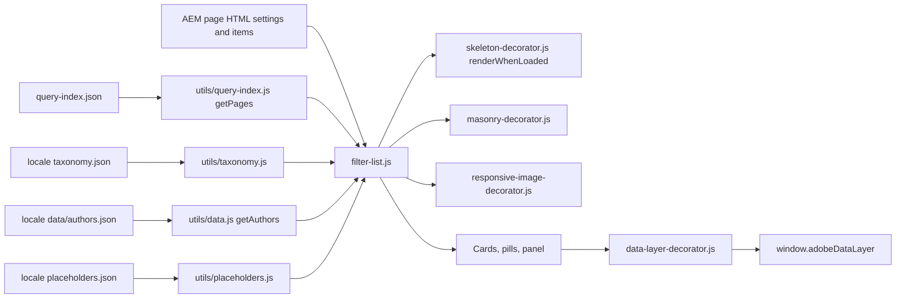

## For QA and Support Teams

| Test ID | Scenario | Configuration | Expected result |
| ------- | -------- | ------------- | --------------- |
| FILTER-LIST-QA-01 | Default rendering | Defaults, Query Index | Masonry of Mixed cards, newest first; featured spotlights if pages are featured; Load more if more than 9 cards |
| FILTER-LIST-QA-02 | Layouts | Masonry, Grid, List | Columns as in Responsive Behavior; List one per row with dividers |
| FILTER-LIST-QA-03 | Card styles | Default, Compact, Featured, Mixed | Card parts as in Variations; Mixed report / dark kinds |
| FILTER-LIST-QA-04 | Hero rules | Latest, Featured, Manual | The expected page first; Manual hero absent if it doesn't match |
| FILTER-LIST-QA-05 | Featured rules | Marked as featured, Priority 1 to 3, Manual | Spotlights after each page of cards, at most the count; no page twice |
| FILTER-LIST-QA-06 | Manual List | Five Filter Pages (Listed) | Authored order; Sort by ignored |
| FILTER-LIST-QA-07 | Pills single select | Click Banking, then Banking again | Only banking pages; second click shows all |
| FILTER-LIST-QA-08 | Pills multi select | Insurance + Artificial intelligence | Only pages with both tags |
| FILTER-LIST-QA-09 | Advanced AND / OR | Two options checked | AND: pages with both; OR: pages with either; badge shows 2 |
| FILTER-LIST-QA-10 | Empty state | Filters matching nothing | "No resources found.", hint, Reset filters; Reset restores and focuses the first pill |
| FILTER-LIST-QA-11 | Editor / AEM author | Open in Universal Editor | Hint text instead of cards; items as chips below the block |
| FILTER-LIST-QA-12 | Slow index | Throttled network | Skeleton shown, then cards; the section isn't held back |
| FILTER-LIST-QA-13 | Load more | More cards than Cards per page | Next cards added; focus on the first new card; count "Showing {n} of {total}"; button hidden at the end |
| FILTER-LIST-QA-14 | Missing images | Pages without image metadata | Page's own image used; none: no media (Mixed: dark card) |
| FILTER-LIST-QA-15 | Viewports | 375px, 768px, 1024px, 1440px | 1 / 2 / 3 / 4 columns (Featured 1 / 2 / 2 / 3) |
| FILTER-LIST-QA-16 | Keyboard | Tab through pills, button, panel, cards | Escape closes the panel and focuses the button; visible focus everywhere |
| FILTER-LIST-QA-17 | Data layer | Click a pill, check an option, Load more, a card | `cmp:click` filter, `cmp:change` filter-option, `cmp:click` load-more, `cmp:click` link |
| FILTER-LIST-QA-18 | Multiple instances | Two Filter Lists on a page | Independent filters; unique ids for results and panel |
| FILTER-LIST-QA-19 | Localization | A non-English locale page | Only that locale's pages; translated labels and tag titles |
| FILTER-LIST-QA-20 | Regression | `block-library/filter-list/*`, curated Insights and Collection pages | Same cards as before; legacy multifield content still renders |

## Troubleshooting

| Symptom | Likely cause | Diagnostic steps | Resolution | Verification |
| ------- | ------------ | ---------------- | ---------- | ------------ |
| Hint instead of cards in the editor | No query index on AEM author (expected) | Open the preview URL | Review on aem.page / aem.live | Cards on the preview |
| "No resources found." without filters | Root path in another locale, types too narrow, pages not published or excluded by `helix-query.yaml`, index request failed | `/query-index.json` rows below the Root path; their `pageType` / `contentType`; Network panel | Fix Root path or types; publish the pages | Cards and count appear |
| A new page is missing | Not yet in the live index; it is the Root path page or the current page; another locale | Its row in `/query-index.json` on aem.live | Publish again; ask an administrator to re-index | The card appears |
| Pills show derived labels or are missing | Tag missing from the locale taxonomy; value isn't a tag ID; no page uses the category's tags | `/{locale}/taxonomy.json`; the items' values | Publish the taxonomy; pick tags with the tag picker | Taxonomy titles on the pills |
| No filter button | Enable advanced filter off; no Taxonomy root; no page uses tags below the roots | Content tab; pages' tags in the index | Turn it on; choose used roots | Button and panel appear |
| Dark cards everywhere (Mixed) or no images | Image columns empty or misspelt in the card mapping | Index columns `featuredImage`, `thumbnailImage`, `image` | Fill the metadata; restore the default mapping | Image cards |
| Wrong hero or no spotlights | Rule fallbacks; Manual pages outside the source or filters; `featured` values other than yes / true / 1 / on / y | Pages' `featured` / `priority` in the index | Correct metadata or rules | Expected spotlights |
| Author lockup shows only a name | `author-id` / Author source doesn't exactly match an Authors sheet id (case-sensitive) or the sheet isn't published | Compare with `/{locale}/data/authors.json` | Correct the id; publish the sheet | Photo, name and designation |
| English labels on a localized page | Placeholder keys missing in the locale sheet | `/{locale}/placeholders.json` | Add and publish the keys | Localized labels |

Evidence to collect (no secrets): page URL, viewport, a screenshot, the block's settings, the relevant `/query-index.json` rows, the Network status of the index / taxonomy / Authors / placeholders requests, console errors.

## Performance Considerations

- **Initialization:** decorated with its section; the four data requests run in parallel and are started early by `prefetchData` in the lazy phase. Data within 150ms renders directly; later data shows the skeleton (at least 250ms) so the section and the ones below are shown.
- **Network:** `/query-index.json` in pages of 500 rows until `total` (all locales, filtered in the browser), the taxonomy, the Authors sheet and the placeholders, each once per page view.
- **Images:** card images lazy (600px from 900px, 750px below), spotlights 1600px / 750px, the hero eager; non-site-media URLs are not optimized.
- **DOM:** only Cards per page cards and one spotlight are rendered first; Load more adds more; filter changes rebuild the grid.
- **Observers:** masonry (non-native) observes the grid and every card with a `ResizeObserver` and the grid with a `MutationObserver`.
- **High-cost configurations:** large indexes; very high Cards per page; Masonry with many cards; placing the block in the first section (its data competes with the LCP image).

## Security and Privacy

- Card text, labels and tag names are set with `textContent`; only the authored Description's nodes are moved into the block.
- Card URLs come from the Url source column (default `path`) and images from the mapped columns of the site's own query index; they are not otherwise validated, so the mapping should name trusted columns only.
- Tag values from items are accepted only as tag IDs (`namespace:path`).
- No query strings are read; filter choices are kept in memory only and not stored; data-layer events carry tag IDs, labels and URLs, no personal data.

## Known Limitations

| Limitation | Impact | Workaround | Planned correction |
| ---------- | ------ | ---------- | ------------------ |
| No results in Universal Editor or on AEM author (no query index) | Authors can't see the cards while editing | Check the preview URL | Not planned |
| Filters aren't in the URL | No deep links or back-button state for filters | None | Not recorded |
| The whole index (all locales) is downloaded and filtered in the browser | Load time grows with the site | Keep the index lean | Not recorded |
| `hide-in-nav` pages and redirects aren't applied (unlike List) | Hidden or redirected pages can be listed | Restrict by Root path or types; Manual List | Deferred (audit D-A-29, product decision) |
| Authors lookup is case-sensitive | Lockup with name only | Use consistent lower-case ids | Not recorded |
| Card CTA labels are global placeholders; the report "Download" opens the page, not a file | Generic button labels | Make the report page offer the download | Not recorded |
| Numeric maximums are only in the model; the code enforces the minimum of 1 | Values authored outside the dialog aren't capped | None | Not recorded |
| The card mapping fields are free text | A typo empties that part of every card | Keep the defaults | Not recorded (audit D-A-18: mapping fields kept) |
| Cards aren't server-rendered | Not in the delivered HTML for crawlers without JavaScript | Listed pages are in the sitemap | Not recorded |

## Related Documentation

- [Blocks documentation](../README.md)
- Related blocks: [List](../list/README.md), [Cards](../cards/README.md), [Columns Container](../columns-container/README.md) (a parent)
- Model file: [`_filter-list.json`](_filter-list.json); index definition: [`helix-query.yaml`](../../helix-query.yaml)
- Tests: [test/items/item-rows.test.mjs](../../test/items/item-rows.test.mjs) (item cells), [test/list/query-index-tags.test.mjs](../../test/list/query-index-tags.test.mjs) (query index tags), [test/site/index-root.test.mjs](../../test/site/index-root.test.mjs) (`indexRoot`, `pageLink`)
- Shared modules: [decorators/README.md](../../decorators/README.md), [utils/README.md](../../utils/README.md); animation and skeletons: [docs/animation/README.md](../../docs/animation/README.md)
- Handover: [handover 6.17 Filter List Block](../../docs/handover/TCS-CORP-HANDOVER.md)
- Block audit: [docs/audit/BLOCK-ECOSYSTEM-AUDIT.md](../../docs/audit/BLOCK-ECOSYSTEM-AUDIT.md)

<!-- BEGIN GENERATED: usage (npm run build:docs) -->

Pages of the block library package 1.0.13 (language master, `/content/tcs-corp/language-master/en`) that contain the block, 32 instance(s) in total:
- Block library: `block-library/animation/repeated-items`, `block-library/animation/skeleton-loading`, `block-library/filter-list/content-types`, `block-library/filter-list/filter-list`, `block-library/filter-list/filters`, `block-library/filter-list/insights-listing`, `block-library/filter-list/layouts-and-card-styles`, `block-library/filter-list/rules`
- Curated design pages: `curated-design-pages/collection`, `curated-design-pages/insights`
- Other pages: `dummy-pages/explore-insights`

Project-wide standards: [knowledge base](../../docs/handover/knowledge-base/README.md) ([block governance](../../docs/handover/knowledge-base/blocks.md)).

<!-- END GENERATED: usage -->

## Change History

| Version | Change | Source | Date |
| ------- | ------ | ------ | ---- |
| Not recorded | README generated from verified implementation and approved handover documentation | Repository review | Not recorded |
| Handover 2.8 | Dialog reduced to the tabs Content / Cards / Additional (fields and stored values unchanged) | docs/handover revision history | 17 October 2026 |
| Handover 2.9 | Pages and Featured pages as composite multifields (`pageItems`, `featuredItems`); the multi-value fields still read | docs/handover revision history | 17 October 2026 |
| Handover 2.10 | Primary filter tags, advanced filter categories and listed / featured pages as items (Filter Tag, Filter Category, Filter Page) | docs/handover revision history | 17 October 2026 |
| Handover 2.11 | Temporary: pages below `/language-master/en` list the language master's own pages; cards link to the AEM pages on author | docs/handover revision history | 17 October 2026 |
| Handover 2.12 | On AEM author the Filter List shows the hint `filterListEditor` in page view as in the editor | docs/handover revision history | 17 October 2026 |
| Handover 2.13 | Query index and taxonomy start loading when the lazy phase begins on pages with a Filter List | docs/handover revision history | 17 October 2026 |
| Handover 2.17 | Item children in the Filter List field specification | docs/handover revision history | 18 October 2026 |
| Handover 2.18 | Skeleton when the query index takes longer than 150ms; Content animation on the Additional tab | docs/handover revision history | 18 October 2026 |
| Handover 2.30 | Cards fall back to the page's own image (R-L-2), package 1.0.10 | docs/handover revision history | 20 October 2026 |
| Handover 2.31 | Cards show the pages' images on the published library and Insights pages | docs/handover revision history | 20 October 2026 |
