# Footer

The site footer, with two roles under one block name (`blocks/footer/footer.js`): the **page footer** that `scripts/aem.js` `loadFooter` builds in every page's `<footer>` (it loads the page's footer page as a fragment and adds the locale's Social Links), and the authored **Footer** block on that footer page (an optional Conversation Canvas above the footer bar with the copyright text and the footer links).

| Attribute | Value |
| --------- | ----- |
| Technical name | `footer` (`blocks/footer`); item `footer-link` |
| Display name | Footer; item Footer Link |
| Block type | Structural: page footer (auto-loaded) and an authored block (model `footer`, template name "Footer", filter `footer`; not key-value) |
| Status | Active |
| Parent / children | Page footer: parent `<footer>`. Authored block: any section (`models/_section.json` filter `section`), used on footer pages in `references/`; children: Footer Link items (`footer-link`) |
| Owner / version / date | Owner: Not recorded; version: Not recorded; date: Not recorded |

## Overview

**Business purpose.** Close every page of every locale with the legal copyright, the policy links, the social channels and, in the TCS design, the Conversation Canvas ("Let's shape what's next, together"), maintained per locale (or per area) by authors.

**User experience.** On a white background with soft blue and yellow glows at the bottom: the footer Canvas (title, search row, buttons) when the footer page has one, then the bar with the copyright at the left and the links at the right (stacked on narrow screens), then the social icons (Figma "Footer - Desktop / Tablet / Mobile").

**Templates / page types.** All pages and templates, including the 404 page.

**Data source.**

- The footer page: the page's own **Footer** page property (or the metadata sheet's `footer` column), else the nearest parent page's up to the locale Home (`utils/inherited-metadata.js`), else the locale's `references/footer` (`utils/site.js` `resolvePagePath`).
- The locale's Social Links data sheet (`/{locale}/data/social-links.json`: platform, url, icon, sort-order; `utils/data.js` `getSocialLinks`).
- The Footer block's fields and Footer Link items; the Conversation Canvas page it names.

**Related blocks.** [Header](../header/README.md) (same loading and inheritance), [Fragment](../fragment/README.md) (`loadFragment`), [Conversation Canvas](../conversation-canvas/README.md) (the footer Canvas, the final stop of the floating journey).

**When to use.** The page footer is always loaded. Add the Footer block only to footer pages in `references/` (`references/footer`, `references/footer-campaign`, …).

**When not to use.** On content pages: the block is offered in every section, but its styles are scoped to `<footer>`, so it renders unstyled there. Don't put social channels in the footer links (maintain the Social Links sheet); don't use the footer for page-specific calls to action.

**Realistic use cases.** The locale footer with the Canvas (block library `block-library/footer/footer-default`); a campaign footer without Canvas with "Campaign terms" (`footer-campaign`); an investors footer with "Investor relations" opening in a new tab (`footer-investors`).

## Visual Reference

<!-- BEGIN GENERATED: screenshots (npm run build:docs) -->

Screenshots of the handover (6.2 Footer Block), taken on the preview with sample content; they show the rendering at the time of the handover revision that added them (later changes are in the sections below and the handover's revision history):

**Desktop rendering** — The footer at 1440 px on white with blue and yellow glows at the bottom: the title Let’s shape what’s next, together on two lines, the menu button and the Ask us a question field, the buttons Explore our services, Read our insights and Talk to an expert in a row, then © Tata Consultancy Services 2026 at the left and Privacy & Terms, Cookie policy and Accessibility at the right, then the LinkedIn, X, YouTube and Instagram icons.

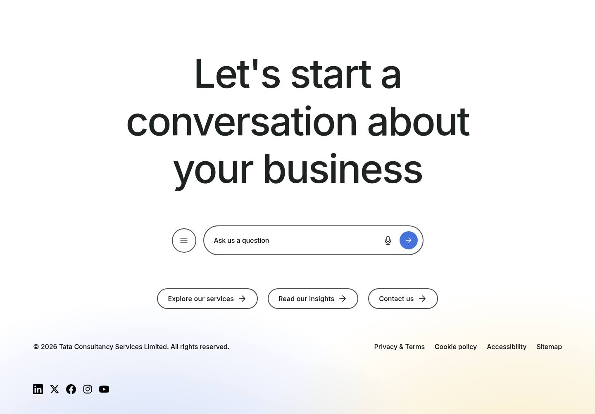

**Tablet rendering** — The footer at 1024 px: the canvas title Let’s shape what’s next, together without a maximum width, the menu button and the Ask us a question field, the three canvas buttons in a row, then the bar with © Tata Consultancy Services 2026 and the three links, and the four social icons.

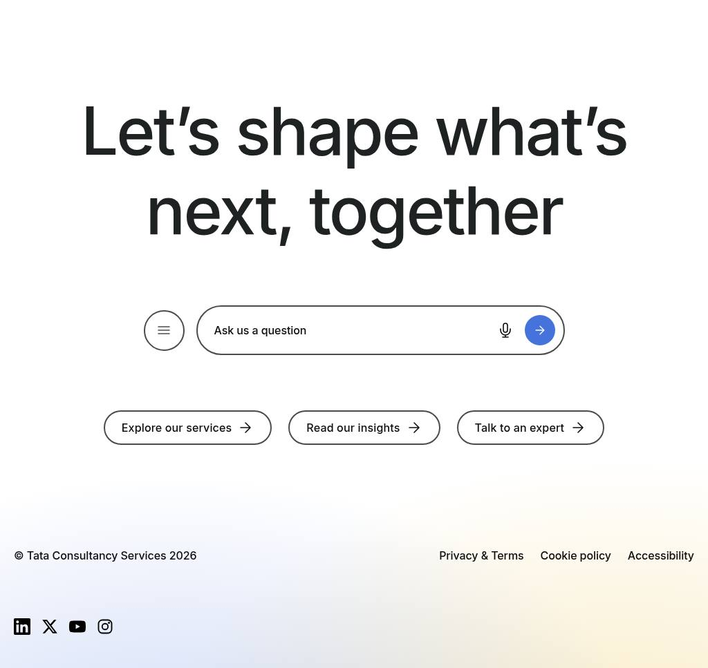

**Mobile rendering** — The footer at 390 px: the title Let’s shape what’s next, together at 3.25rem over several centred lines, the Ask us a question field without a menu button, the three buttons stacked, then © Tata Consultancy Services 2026 above Privacy & Terms, Cookie policy and Accessibility, and the four social icons.

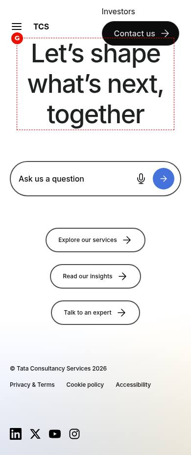

**Default footer of /en** — A full /en content page at 1440 px ending with the footer from /en/references/footer: the canvas with its title, search field and three buttons, the bar with © Tata Consultancy Services 2026, Privacy & Terms, Cookie policy and Accessibility, and the LinkedIn, X, YouTube and Instagram icons.

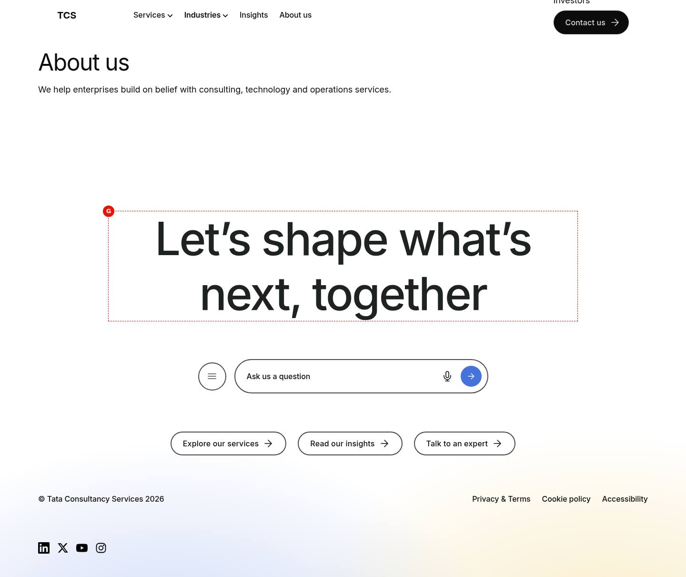

**Area-specific footer** — A full campaign page at 1440 px ending with the footer from references/footer-campaign, without a canvas: © Tata Consultancy Services 2026 at the left, Privacy & Terms, Campaign terms and Contact us at the right, and below them the LinkedIn, X, YouTube and Instagram icons.

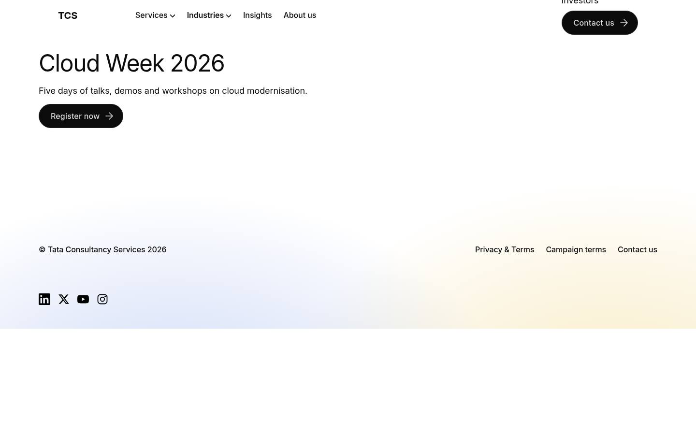

**Bar without canvas** — Two frames scrolled to the footer, one above the other. Top, 1440 px: one row with © Tata Consultancy Services 2026 at the left and Privacy & Terms, Campaign terms and Contact us at the right, then the social icons. Bottom, 390 px: the copyright above the three links in smaller text, then the icons.

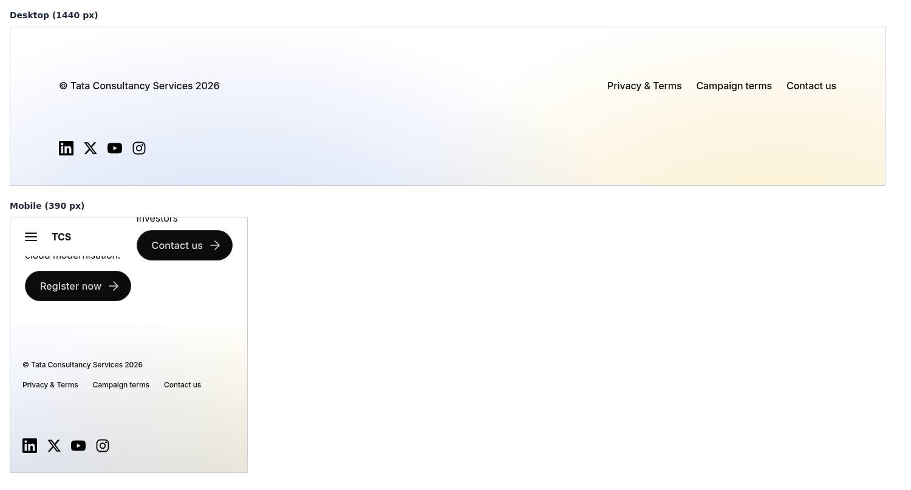

**Canvas in the footer** — The footer at 1440 px with the canvas from references/footer-conversation-canvas: the title Let’s shape what’s next, together, the menu button and the Ask us a question field with its Search button, the three secondary buttons with dark 2px borders on white, then the bar and the four social icons.

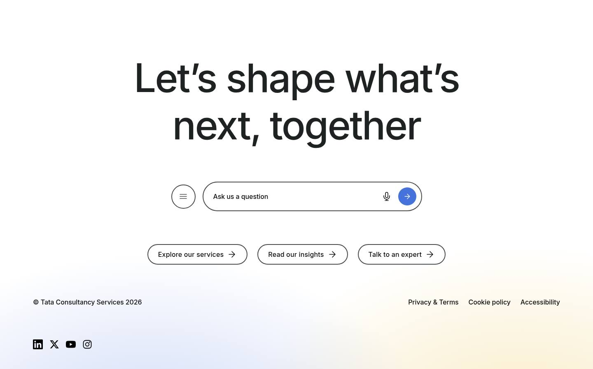

**Social icon row** — The end of a page at 1440 px with the footer-campaign bar (© Tata Consultancy Services 2026, Privacy & Terms, Campaign terms, Contact us) and below it a row of 1.5rem icons in sort-order: LinkedIn, X, YouTube, Instagram and Facebook.

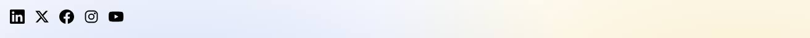

**Image and text fallbacks** — The end of a page at 1440 px with the footer-campaign bar and below it the social row: the LinkedIn icon, the square-2.svg image for Glassdoor at 1.5rem and the visible text link Follow us on Xing.

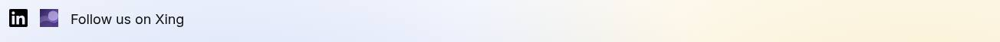

**New-window link** — The investors page footer at 1440 px: © Tata Consultancy Services 2026, Privacy & Terms, Cookie policy and Investor relations, then the four social icons; marker A on Investor relations, whose anchor has target="_blank" and rel="noopener noreferrer".

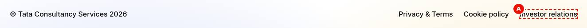

**Universal Editor canvas of the footer page** — references/footer in editor mode at 1440 px: A the Footer block, B the canvas with Let’s shape what’s next, together, C the copyright © Tata Consultancy Services 2026, D the first link Privacy & Terms, and E the LinkedIn, X, YouTube and Instagram row in the page footer below. (Annotated preview in editor mode with sample content; letters as in the annotations list, not a Universal Editor screenshot; file screenshots/footer-authoring-view.jpg)

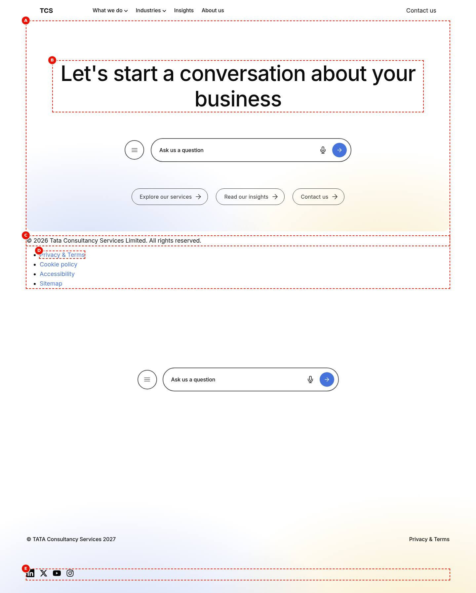

**Footer block properties** — The properties panel of the Footer block with Conversation Canvas Page, Copyright Text and the Link List with two items expanded. (Dialog reference generated from the component model, not a Universal Editor screenshot; file screenshots/footer-properties-panel.jpg)

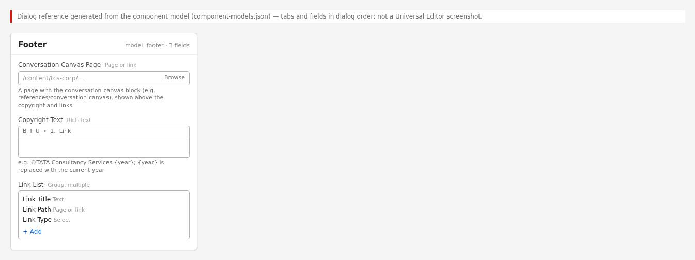

Universal Editor dialogs (no screenshot exists yet; to be captured on AEM author):

```text
[Screenshot Placeholder]

File name:
footer-dialog-fields-desktop.png

Purpose:
The dialog of the Footer properties in Universal Editor, with the fields of the table "Fields — Footer" in Authorable Fields below.

Annotations:
A = Conversation Canvas Page
B = Copyright Text
C = Link List
D = Link List › Link Title
E = Link List › Link Path
F = Link List › Link Type
```

```text
[Screenshot Placeholder]

File name:
footer-link-dialog-fields-desktop.png

Purpose:
The dialog of the Footer Link properties in Universal Editor, with the fields of the table "Fields — Footer Link" in Authorable Fields below.

Annotations:
A = Link Path
B = Link text
C = Open in
```

<!-- END GENERATED: screenshots -->

States without a screenshot:

```text
[Screenshot Placeholder]

File name:
footer-link-item-placeholder-desktop.png

Purpose:
Universal Editor: a Footer Link item just added (no link yet) shown as a dashed placeholder in the link list.

Annotations:
A = Dashed placeholder "Not shown yet: fill in this item's properties."
B = Footer Link item in the content tree
```

```text
[Screenshot Placeholder]

File name:
footer-social-only-desktop.png

Purpose:
The page footer when the footer page can't be loaded: only the Social Links row.

Annotations:
A = Social icons
```

```text
[Screenshot Placeholder]

File name:
footer-canvas-mobile.png

Purpose:
The footer with its Canvas at 390px: 3.25rem title, no menu button, buttons stacked, links below the copyright.

Annotations:
A = Canvas title
B = Search field (no menu button below 600px)
C = Stacked buttons
D = Copyright
E = Footer links
F = Social icons
```

## For Content Authors

1. **Open the footer page** of the locale (`references/footer`) or of the area (for example `references/footer-campaign`) in Universal Editor.
2. **Add the block** if the page has none: section › Add › **Footer**.
3. **Open its properties.** Fill in **Conversation Canvas Page** (optional: a page with a Conversation Canvas block, e.g. `references/footer-conversation-canvas`) and **Copyright Text** (use `{year}` for the current year).
4. **Add links** with Add › **Footer Link** inside the Footer block: Link Path (required), Link text, Open in (Same tab / New tab). Reorder them in the content tree; they render in that order.
5. **Social channels** are not in the block: maintain the locale's `data/social-links` sheet (platform, url, icon, sort-order).
6. **Preview** a content page (desktop, tablet, mobile) and check the bar, the Canvas and the social row.
7. **Publish** the footer page, the Conversation Canvas page and, after changes, the Social Links sheet.
8. **Choose the footer for an area (optional):** Page Properties › **Footer** on the area's top page (inherited by child pages; empty: the parent's, else `references/footer`), or the metadata sheet's `footer` column.
9. **Validate** on the published site: the year is current, links reach their pages, new-tab links open a new tab.

Minimum required: Copyright Text or at least one Footer Link. Recommended: 3–6 links, the Canvas page on the locale footer, a `platform` value on every social row. Optional: the Canvas, area footers.

## Authorable Fields

<!-- BEGIN GENERATED: fields (npm run build:docs) -->

### Footer (`footer`)

Model `footer`; template name "Footer" (the block class AEM renders); children: `footer-link`.

#### Fields — Footer

| Field label | Property | Type | Required | Default | Allowed values | Author guidance | Example |
| ----------- | -------- | ---- | -------- | ------- | -------------- | --------------- | ------- |
| Conversation Canvas Page | `conversationCanvas` | aem-content | No | — | — | A page with the conversation-canvas block (e.g. references/conversation-canvas), shown above the copyright and links | — |
| Copyright Text | `copyright` | richtext | No | — | — | e.g. ©TATA Consultancy Services {year}; {year} is replaced with the current year | — |
| Link List | `links` | container (multiple) | No | — | — | Links authored before Footer Link items. Add links with Add (Footer Link) instead. | — |
| Link List › Link Title | `linkText` | text | No | — | — | — | — |
| Link List › Link Path | `link` | aem-content | No | — | — | — | — |
| Link List › Link Type | `linkTarget` | select | No | "" | Default (""), Open in new window (`new-window`) | — | — |

### Footer Link (`footer-link`)

Model `footer-link`; template name "Footer Link" (the block class AEM renders).

#### Fields — Footer Link

| Field label | Property | Type | Required | Default | Allowed values | Author guidance | Example |
| ----------- | -------- | ---- | -------- | ------- | -------------- | --------------- | ------- |
| Link Path | `link` | aem-content | Yes | — | — | — | — |
| Link text | `linkText` | text | No | — | — | Delivered with `link` (field collapse). | — |
| Open in | `linkTarget` | select | No | "" | Same tab (""), New tab (`new-window`) | — | — |

<!-- END GENERATED: fields -->

Notes on the significant fields:

- **Conversation Canvas Page.** Loaded as a fragment (`loadFragment`) into `div.footer-canvas` above the bar; a value that can't be loaded or has no sections is skipped. Inside the footer the Canvas loses its own surface, glow and padding; its menu button shows from 600px.
- **Copyright Text.** Rich text kept with its editor instrumentation (`fromCell`); every `{year}` becomes the current four-digit year from the visitor's clock; empty text renders no copyright element.
- **Footer Link (item).** Link Path with its Link text collapsed into one link (AEM delivery rule); Open in New tab sets `target="_blank"` and `rel="noopener noreferrer"` and adds the hidden hint "(opens in a new tab)" (placeholder `opensInNewTab`). Links are plain links (button decoration removed). An item without a link isn't rendered; in Universal Editor it shows as a dashed placeholder (placeholder `itemEditorHint`).
- **Link List (legacy multifield).** Still read: its items render before the Footer Link items. Add links as Footer Link items instead (composite multifields didn't render from content packages, AGENTS.md "Item children").
- **Page property Footer** (`footer`, `models/_page.json`) and the metadata `footer` column choose the footer page (see the Header README for the same inheritance; values cached per browser session, F-35).
- **Social Links sheet.** Rows without `url` are skipped; ordered by numeric `sort-order` (rows without one last, in sheet order). `icon`: a value with `.` or `/` is an image URL; otherwise an icon name in `/icons` (`linkedin`, `x`, `facebook`, `instagram`, `youtube`; `twitter` is an alias of `x`); without an icon and an unknown platform, the label is shown as text. Links to another origin open in a new tab.
- **Accessibility impact.** `nav.footer-links` named "Footer links" (`footerLinks`); social links named "Follow us on {platform}" (`followUsOn`), the list "Follow us" (`followUs`).
- **Data layer impact.** Clicks are reported for the footer components (see [Data Layer and Analytics](#data-layer-and-analytics)).
- **Additional tab.** The Footer has none (AGENTS.md "Additional tab": all blocks except header and footer).

## Screenshot-Based Authoring Steps

### Authoring Step 1: Open the footer page and add the Footer block

```text
[Screenshot Placeholder]

File name:
footer-authoring-step-1.png

Purpose:
The locale's references/footer page in Universal Editor with the Footer block in its section.

Annotations:
A = Section of the footer page
B = Footer block
C = Footer Link items in the content tree
```

### Values to Enter

| Callout | Field | Value | Reason | Expected result |
| ------- | ----- | ----- | ------ | --------------- |
| A | Page | `references/footer` (sample `block-library/footer/footer-default`) | The default footer of the locale | Opens as a page |
| B | Component | Footer | Holds the bar | An empty Footer block |

Author action: section › Add › Footer. Expected preview: an empty bar. Business rule: footer pages live in `references/`. Validation: the block appears in the content tree. Common mistake: adding a Footer to a content page (unstyled); resolution: remove it there.

### Authoring Step 2: Canvas page and copyright

```text
[Screenshot Placeholder]

File name:
footer-authoring-step-2.png

Purpose:
The Footer properties with Conversation Canvas Page and Copyright Text filled in.

Annotations:
A = Conversation Canvas Page
B = Copyright Text
```

### Values to Enter

| Callout | Field | Value | Reason | Expected result |
| ------- | ----- | ----- | ------ | --------------- |
| A | Conversation Canvas Page | `/content/tcs-corp/language-master/en/block-library/footer/footer-conversation-canvas` | The footer Canvas of the design | "Let's shape what's next, together" above the bar |
| B | Copyright Text | `© Tata Consultancy Services {year}` | Keeps the year current | "© Tata Consultancy Services 2026" in 2026 |

Expected published result: the Canvas and the copyright on every page using this footer. Business rule: the Canvas page must be published and contain a Conversation Canvas. Validation: the year shows as the current year. Common mistake: typing the year (it won't update); use `{year}`.

### Authoring Step 3: Footer Links

```text
[Screenshot Placeholder]

File name:
footer-authoring-step-3.png

Purpose:
A Footer Link item's properties.

Annotations:
A = Link Path
B = Link text
C = Open in
```

### Values to Enter

| Callout | Field | Value | Reason | Expected result |
| ------- | ----- | ----- | ------ | --------------- |
| A | Link Path | The privacy notice page | Required | Link target |
| B | Link text | `Privacy & Terms` | Visible text | "Privacy & Terms" in the bar |
| C | Open in | Same tab | Site page | Opens in the same tab |

Add `Cookie policy` and `Accessibility` the same way (sample footer-default). Author action: Footer block › Add › Footer Link. Expected preview: links at the right of the copyright (below it on mobile). Business rule: an item without a link isn't rendered on the site. Validation: each link opens its page. Common mistake: leaving Link Path empty (dashed placeholder in the editor, nothing on the site).

### Authoring Step 4: A link opening a new tab

```text
[Screenshot Placeholder]

File name:
footer-authoring-step-4.png

Purpose:
A Footer Link with Open in = New tab (sample footer-investors).

Annotations:
A = Link Path (external)
B = Open in: New tab
```

### Values to Enter

| Callout | Field | Value | Reason | Expected result |
| ------- | ----- | ----- | ------ | --------------- |
| A | Link Path | `https://investors.example.com/` (library sample) | External site | Link to the other site |
| B | Link text | `Investor relations` | Visible text | Link text |
| C | Open in | New tab | Leave the TCS site open | `target="_blank"`, hint "(opens in a new tab)" for screen readers |

Validation: the published link has `rel="noopener noreferrer"`. Common mistake: new tabs for site pages; keep Same tab for them.

### Authoring Step 5: Area footer

```text
[Screenshot Placeholder]

File name:
footer-authoring-step-5.png

Purpose:
Page Properties of an area's top page with the Footer field set.

Annotations:
A = Footer
```

### Values to Enter

| Callout | Field | Value | Reason | Expected result |
| ------- | ----- | ----- | ------ | --------------- |
| A | Footer | `references/footer-campaign` | Campaign footer | The area's pages show the campaign footer |

Validation: a child page in a new private window. Common mistake: a typo in the path: the page footer then shows only the social row (no fallback to `references/footer`).

## Variations

### Default locale footer

- **Purpose:** the footer of every page without a Footer value: `/{locale}/references/footer`.
- **Fields / configuration:** none on the content page.
- **Rendering:** the footer page's sections in `footer > div.footer > div`, then `ul.footer-social`.
- **Desktop / tablet / mobile:** see [Responsive Behavior](#responsive-behavior).
- **Accessibility / data layer:** `<footer>` landmark; clicks on `footer-1` / `footer-2`.
- **Personalization / fallback:** none; a failing footer page leaves the social row.

```text
[Screenshot Placeholder]

File name:
footer-default-desktop.png

Purpose:
A content page ending with the default footer at 1440px.

Annotations:
A = Footer Canvas
B = Footer bar
C = Social icons
```

### Area-specific footer

- **Purpose:** another footer page for an area or campaign (`references/footer-campaign`).
- **Configuration:** Page Properties › Footer on the area's top page, or the metadata `footer` column.
- **Rendering:** as the default; only the footer page differs; the Social Links are added to every footer page.

```text
[Screenshot Placeholder]

File name:
footer-campaign-desktop.png

Purpose:
A campaign page ending with the campaign footer (no Canvas).

Annotations:
A = Copyright
B = Campaign links
```

### Footer bar only (no Canvas)

- **Purpose:** a compact footer.
- **Fields:** Copyright Text and Footer Links; Conversation Canvas Page empty.
- **Rendering:** `div.footer-bar` only; no minimum height.

```text
[Screenshot Placeholder]

File name:
footer-bar-only-mobile.png

Purpose:
The bar at 390px: the copyright above the links.

Annotations:
A = Copyright
B = Links
```

### Footer with Conversation Canvas

- **Purpose:** the design's footer: the Canvas above the bar.
- **Fields:** Conversation Canvas Page.
- **Rendering:** `div.footer-canvas` with the Canvas page's sections; the footer gets a minimum height (50rem, 59.75rem from 600px, 50.125rem from 1200px) and the bar sits at its bottom; title 3.25rem (6rem from 600px), buttons stacked below 600px, the Canvas menu button from 600px.
- **Data layer:** the Canvas is its own component; it is the footer stop of the floating journey.

```text
[Screenshot Placeholder]

File name:
footer-canvas-mobile.png

Purpose:
The footer Canvas at 390px (see Visual Reference).

Annotations:
A = Title
B = Search
```

### Social links (icons, images, text)

- **Purpose:** the locale's channels from the Social Links sheet.
- **Rendering:** `ul.footer-social[aria-label="Follow us"] > li > a` with `span.icon.icon-{name}` (1.5rem), an image for an icon URL (`alt=""`), or the visible label text; the label "Follow us on {platform}" is visually hidden behind an icon.
- **Accessibility:** external links open a new tab and say so in the label.

```text
[Screenshot Placeholder]

File name:
footer-social-fallbacks-desktop.png

Purpose:
A social row with an /icons icon, an image icon and a text label.

Annotations:
A = Icon
B = Image icon
C = Text label
```

### Footer Link opening in a new tab

- **Purpose:** an external destination.
- **Fields:** Open in = New tab.
- **Rendering:** `target="_blank"`, `rel="noopener noreferrer"`, hidden " (opens in a new tab)".

```text
[Screenshot Placeholder]

File name:
footer-new-tab-desktop.png

Purpose:
The investors footer with "Investor relations" opening a new tab.

Annotations:
A = Investor relations link
```

## Complete Authoring Example

Scenario: the `/en` footer with the Canvas, three policy links and the social channels.

| Field | Example value | Guidance |
| ----- | ------------- | -------- |
| Page | `/content/tcs-corp/us/en/references/footer` | The locale default |
| Conversation Canvas Page | `references/footer-conversation-canvas` | A page with one Conversation Canvas |
| Copyright Text | `© Tata Consultancy Services {year}` | Keep `{year}` in translations |
| Footer Link 1 | Privacy & Terms → the privacy page, Same tab | |
| Footer Link 2 | Cookie policy → the cookie policy page, Same tab | |
| Footer Link 3 | Accessibility → the accessibility page, Same tab | |
| Social Links sheet | `LinkedIn` / profile URL / `linkedin` / `1`, … | Full https URLs |

Steps: author the block and its items, publish the footer page and the Canvas page, check the Social Links sheet is published.

Expected output: the Canvas, the bar and the icons on every `/en` page without its own Footer value. Responsive: see the table below. Accessibility: `nav` "Footer links", named social links, new-tab hints. Analytics: bar clicks on `footer-2`, social clicks on `footer-1`, Canvas clicks on its own component. Personalization fallback: none.

Pre-publish checklist:

- [ ] `{year}` in the copyright.
- [ ] Every Footer Link has a Link Path and a text.
- [ ] New tab only for external links.
- [ ] Canvas page published; Social Links rows have `url` and `platform`.
- [ ] Checked at 390px, 1024px, 1440px.

## Content and Asset Guidelines

- **Copyright.** One line; the copyright column is at least 19.375rem wide (links go below it on narrow screens).
- **Links.** Navigational nouns ("Privacy & Terms", "Cookie policy"), short and unique.
- **Canvas.** See the Conversation Canvas README; its title shows at 6rem from 600px.
- **Icons.** `/icons` names need no upload; image icons display at 1.5rem × 1.5rem (square SVG / PNG).
- **Alt text.** Social images are decorative (`alt=""`); the link name comes from the platform.
- **Tags and metadata.** No tags; the `footer` metadata chooses the footer page.
- **Min / max items.** No verified technical limit was identified.
- **Loading.** The footer page, Social Links and placeholders load in parallel in the lazy phase; the Canvas page is a further fragment request.
- **Missing assets.** An icon name without a file in `/icons` gives a broken icon (F-16).

## Accessibility

- **Semantics.** `<footer>` (contentinfo landmark); the bar's links in `nav.footer-links` named "Footer links"; social links in a list named "Follow us".
- **Headings.** None in the bar; the Canvas brings its own title.
- **Keyboard and focus.** Plain links in DOM order (Canvas, copyright links, footer links, social links); hover and focus underline the bar links.
- **Accessible names.** Social: "Follow us on {platform}" (visually hidden behind an icon; the URL when the platform is empty).
- **New tabs.** Announced with the hidden hint "(opens in a new tab)" (`opensInNewTab`) on Footer Links set to New tab and on external social links.
- **Contrast.** Text in `--footer-text-color` (`--color-text-default`) on `--color-bg-default`.
- **Reflow.** The bar and the links wrap; buttons stack below 600px.

Author responsibilities: unique link texts, a `platform` on every social row, new tabs only for external sites, `{year}` instead of a typed year.

Developer responsibilities: keep the `nav` / list names, `announceNewTab`, `rel="noopener noreferrer"`, UI text from placeholders.

| Key | Expected behavior |
| --- | ----------------- |
| Tab / Shift+Tab | Moves through the Canvas controls, the bar links and the social links |
| Enter | Follows the focused link (a new tab for New tab / external social links) |

## Data Layer and Analytics

- **Components.** Both footer blocks are `.block`s added in the delayed phase (`trackBlocks(document)`): the page footer (e.g. `footer-1`, `parentId` the page) and the authored block (e.g. `footer-2`, `parentId` `footer-1`); ids follow page order. The footer Canvas is its own component.
- **Clicks.** Captured centrally (`decorators/data-layer-decorator.js`): bar links report the authored block, social links the page footer. No `data-cmp-*` attributes or own pushes in the footer.

| Trigger | Data-layer event | Required properties | Analytics behavior |
| ------- | ---------------- | ------------------- | ------------------ |
| Delayed phase | `component` entries `footer-1`, `footer-2` | `@type` `tcs-corp/components/footer`, `parentId` | Component inventory |
| Click on a footer link | `cmp:click` | `eventInfo.path` `component.footer-2`, `interaction` "link", `dc:title` (link text, with the new-tab hint when set), `xdm:linkURL`, `xdm:linkType` `other` / `exit`, `breakpoint` | Policy link click |
| Click on a social link | `cmp:click` | `eventInfo.path` `component.footer-1`, `dc:title` "Follow us on {platform} …", `xdm:linkType` `exit` | Social click |

The intended flow is Adobe Client Data Layer → Adobe Data Collection (Tags) → AEP Web SDK → Edge Network → Analytics / CJA; Tags and the Web SDK aren't configured yet (blocked: measurement plan). No consent mechanism is implemented.

## Personalization

This block does not currently expose verified personalization behavior. There is no Adobe Target or Journey Optimizer integration in the repository; the default content (the inherited footer page) is what renders. Area footers are content choices, not audience personalization.

## Responsive Behavior

| Viewport | Layout | Image behavior | Interaction behavior |
| -------- | ------ | -------------- | -------------------- |
| Mobile (< 600px) | Padding 3.5rem / 1.25rem / 1.5rem; text 0.75rem; links below the copyright; with Canvas: min height 50rem, title 3.25rem (max 20rem wide), buttons stacked, no Canvas menu button | Social icons 1.5rem; glows: blue at the left, yellow mostly beyond the right edge | Links |
| Tablet (600–1199px) | Padding 7.5rem / 1.25rem / 2.5rem; text 1rem; with Canvas: min height 59.75rem, title 6rem, buttons in a row, Canvas menu button shown | As mobile, glows repositioned | Links, Canvas menu |
| Desktop (>= 1200px) | Padding 7.5rem / 5rem / 2.5rem; content up to `--page-max-width`; with Canvas: min height 50.125rem, title up to 61.5rem wide | As tablet | As tablet |

## For Developers

<!-- BEGIN GENERATED: files (npm run build:docs) -->

```text
blocks/footer/
├── README.md
├── _footer.json
├── footer.css
└── footer.js
```

| Decorator/Utility | Purpose | Execution or dependency point |
| ----------------- | ------- | ----------------------------- |
| [`blocks/fragment/fragment.js`](../../blocks/fragment/fragment.js) | — | `footer.js`: { loadFragment } |
| [`decorators/motion-decorator.js`](../../decorators/motion-decorator.js) | `prepareMotion` (the Content animation and Background animation of the blocks of a section, before it is shown, or of a fragment, footer page or header Canvas once in the page: first frame paused, run by one Intersection | `footer.js`: { prepareMotion } |
| [`scripts/scripts.js`](../../scripts/scripts.js) | Page decoration (moveInstrumentation and shared page helpers) | `footer.js`: { moveInstrumentation } |
| [`decorators/button-decorator.js`](../../decorators/button-decorator.js) | `decorateButton` (option `newTabHint`: a link opening a new tab says so), `createButton`, `setButtonDisabled`, `setButtonAlignment`, `removeButtonDecoration` | `footer.js`: { removeButtonDecoration } |
| [`decorators/content-decorator.js`](../../decorators/content-decorator.js) | `fromCell` (property content into an element, keeping editor instrumentation) | `footer.js`: { fromCell } |
| [`decorators/editor-item-decorator.js`](../../decorators/editor-item-decorator.js) | `buildEditorItems`, `editorItemHint` (in Universal Editor, an item the block doesn't render yet, e.g. a CTA just added, as a dashed placeholder the author can select; styles in `styles/lazy-styles.css`; the hint loaded o | `footer.js`: { buildEditorItems, editorItemHint } |
| [`decorators/link-decorator.js`](../../decorators/link-decorator.js) | `setLinkTarget` (open in a new window), `announceNewTab` (tells screen reader users a link opens in a new tab: hidden text, or added to its aria-label) | `footer.js`: { announceNewTab, setLinkTarget } |
| [`decorators/social-links-decorator.js`](../../decorators/social-links-decorator.js) | `buildSocialLinks` (Social Links data sheet as an icon list) | `footer.js`: { buildSocialLinks } |
| [`utils/cells.js`](../../utils/cells.js) | `itemRows`, `KEY_VALUE_ITEM`, `FIELD_ROW_ITEM` (the item rows of a block: by model in the editor, by their cells on the page), `withoutTabCells` (drops the empty cell AEM renders for each dialog tab of an item model), `m | `footer.js`: { FIELD_ROW_ITEM, itemRows } |
| [`utils/data.js`](../../utils/data.js) | `loadDataSheet`, `getAuthor`, `getAuthors`, `getLocations`, `getPartners`, `getSocialLinks`, `getMediaContacts`, `inRegion` (the locale's data sheets) | `footer.js`: { getSocialLinks } |
| [`utils/inherited-metadata.js`](../../utils/inherited-metadata.js) | `getInheritedMetadata`, `INHERITED_METADATA` (nav, footer and error-page of the page, else of the nearest parent page up to Home; parent heads loaded in parallel and cached per session) | `footer.js`: { getInheritedMetadata } |
| [`utils/links.js`](../../utils/links.js) | `NEW_WINDOW`, `linkOf`, `linkPathsOf` (the paths of a page property, one or many), `readLinkItems` (CTA lists with Link Type and the items' other select values), `readLinkRows` (the same from link item rows, e.g. Hero CT | `footer.js`: { readLinkItems, readLinkRows } |
| [`utils/placeholders.js`](../../utils/placeholders.js) | `getPlaceholders`, `loadPlaceholders`, `fillPlaceholder` (UI text from the locale's placeholders, with English fallbacks) | `footer.js`: { getPlaceholders } |
| [`utils/site.js`](../../utils/site.js) | `LOCALES`, `DEFAULT_LOCALE`, `getLocale`, `indexRoot`, `REVIEW_ROOTS` and `REVIEW_SHEETS` (temporary: the language master under review, /language-master/en, lists its own pages and reads its own placeholders, redirects,  | `footer.js`: { resolvePagePath } |

<!-- END GENERATED: files -->

**Roles.** `decorate(block)`: a block whose parent is `<footer>` is the page footer (`decoratePageFooter`), any other the authored bar (`decorateFooterBar`).

**Input DOM (authored block).** Not key-value: one row per field in model order — Conversation Canvas Page, Copyright Text, Link List (legacy multifield cell) — then one row per Footer Link item with 2 cells (the link with its collapsed text, Open in). `itemRows(block, ['footer-link'], FIELD_ROW_ITEM)` finds the items (by `data-aue-model` in the editor, by their cells on the page; covered by `test/items/item-rows.test.mjs`); the other rows are read by position.

**Decoration flow.**

- `decoratePageFooter`: `resolvePagePath(await getInheritedMetadata('footer'), 'references/footer')`; `loadFragment`, `getSocialLinks`, `getPlaceholders` in parallel; moves the fragment's sections into a `div`; appends `buildSocialLinks(…, 'footer-social', …)` with `aria-label`; `prepareMotion(block)` for the footer page's block animations.
- `decorateFooterBar`: placeholders, `buildCanvas` (link `href` or text → `loadFragment(resolvePagePath(value, ''))`) and `editorItemHint` in parallel; `fromCell` + `fillYear` for the copyright; `buildLinkList` (legacy `readLinkItems`, then `readLinkRows`; `removeButtonDecoration`, `setLinkTarget`, `announceNewTab`, `moveInstrumentation(row, li)`; editor placeholders for items without a link); `block.replaceChildren(canvas, bar)`.

**Rendered DOM contract.**

```text
footer
└─ div.footer.block                         (page footer)
   └─ div
      ├─ div.section …                      (footer page sections)
      │  └─ div.footer-wrapper > div.footer.block   (authored block)
      │     ├─ div.footer-canvas > div.section … div.conversation-canvas.block
      │     └─ div.footer-bar
      │        ├─ div.footer-copyright
      │        └─ nav.footer-links[aria-label] > ul > li > a
      └─ ul.footer-social[aria-label] > li > a > (span.icon | img) + span (label)
```

**Async and loading.** `scripts.js` `loadLazy` hides `<footer>` (`display: none`) while the main sections load and shows it after them, so it never moves; `footer .footer` stays `visibility: hidden` until `data-block-status="loaded"`.

**Error handling.** A footer page that can't load leaves only the social row (no fallback to `references/footer`); a Canvas page that can't load is skipped; a missing Social Links sheet gives no list.

**Exported functions.** Only the default `decorate(block)`.

**Parent / child contracts.** The footer Canvas is detected by the Canvas controller (`inFooter`) as the footer stop of the journey; don't add Canvas logic to `footer.js` (AGENTS.md "Floating Canvas").

## Extending the Block

- **A field or value.** Edit `blocks/footer/_footer.json` (the `footer` or `footer-link` model), run `npm run build:json` and `npm run lint`. The authored block reads rows by position: append new block fields at the end and update `decorateFooterBar`; a new item field changes the item's cells: update `test/items/item-rows.test.mjs` (layout `['link', 'linkTarget']`). Fields ending in Text, Title, Type or Alt collapse into their base field.
- **Rendering / responsive.** Styles are scoped to `footer`; use the component tokens at the top of `footer.css` and the 600 / 1200px media queries.
- **Accessibility.** New links go through `setLinkTarget` / `announceNewTab`; names from placeholders.
- **Data layer.** Captured centrally; add `data-cmp-interaction` for non-link controls.
- **Backward compatibility.** Keep reading the Link List multifield.
- **Docs and modules.** Update this README (`npm run build:docs`) and the block library footer pages; `npm run build:modules` after changing imports (the footer is in `CHROME_BLOCKS`).

## For Site Administrators

- **Availability.** The Footer is offered in the `section` filter (any section; audit suggestion: a filter for reference pages only); Footer Link only inside the Footer (filter `footer`). Not in the Columns Container or Tabs filters.
- **Governance.** Models in `blocks/footer/_footer.json`; the Footer page property in `models/_page.json`.
- **Publishing dependencies.** Footer pages, the Canvas page, the Social Links sheet, placeholders; the metadata sheet only if the `footer` column is used (applied once listed in `metadata.source`). `paths.json` maps `data/social-links`.
- **Localization.** Each locale has its own `references/footer`, Canvas page and `data/social-links`; translate the placeholders; keep `{year}`.

| Dependency | Purpose | Location | Impact if unavailable |
| ---------- | ------- | -------- | --------------------- |
| Default footer page | Footer content | `/{locale}/references/footer` | Only the social row |
| Area footer page | Area footer | e.g. `references/footer-campaign` | Only the social row (no fallback) |
| Footer page property / `footer` metadata column | Choose the footer page | Page properties; `/{locale}/metadata.json` | Default footer page |
| Conversation Canvas page | Footer Canvas | e.g. `references/footer-conversation-canvas` | Bar without Canvas |
| Social Links sheet | Social row | `/{locale}/data/social-links.json` | No social row |
| `/icons` SVGs | Social icons | `icons/linkedin.svg`, `x.svg`, `facebook.svg`, `instagram.svg`, `youtube.svg` | Broken icon for a named icon |
| Placeholders `footerLinks`, `followUs`, `followUsOn`, `opensInNewTab`, `itemEditorHint` | UI text | `/{locale}/placeholders.json` | English fallbacks |

## For Architects

- **Role.** Page chrome (contentinfo), built in the lazy phase from a content page, plus an authored block for its bar.
- **Content model.** Footer page per locale / area, inherited like an AEM page property; Footer Link item children; social channels as data (sheet), not content.
- **Rendering and data source.** Client-side from `{footer}.plain.html`, the Canvas page fragment and `social-links.json`.
- **Dependencies.** `blocks/fragment`, `decorators/motion-decorator.js`, `button-decorator.js`, `content-decorator.js`, `editor-item-decorator.js`, `link-decorator.js`, `social-links-decorator.js`, `utils/cells.js`, `utils/data.js`, `utils/inherited-metadata.js`, `utils/links.js`, `utils/placeholders.js`, `utils/site.js`.
- **Data layer / Web SDK / Target.** Central capture; no Target.
- **Consent and identity.** None.
- **Caching.** Pages and sheets through the CDN / browser cache; inherited values per session.
- **Performance / scalability.** Three parallel requests plus the Canvas fragment; one footer page per locale / area.

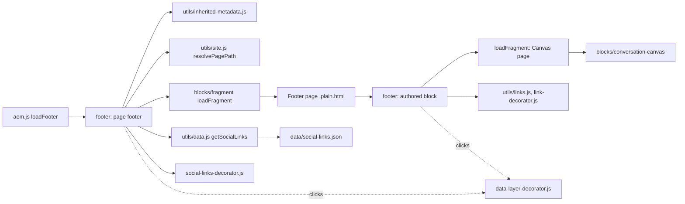

## For QA and Support Teams

| Test ID | Scenario | Configuration | Expected result |
| ------- | -------- | ------------- | --------------- |
| FOOTER-QA-01 | Default footer | Page without Footer value | `references/footer` content and the social row |
| FOOTER-QA-02 | Area footer | Area top page with Footer `references/footer-campaign` | Child pages show the campaign footer (new session) |
| FOOTER-QA-03 | Missing footer page | Footer pointing to an unpublished page | Only the social row; no error |
| FOOTER-QA-04 | Year | Copyright `© Tata Consultancy Services {year}` | Current year |
| FOOTER-QA-05 | Canvas | Conversation Canvas Page set | Canvas above the bar; min height; bar at the bottom |
| FOOTER-QA-06 | Canvas missing | Canvas page unpublished | Bar only |
| FOOTER-QA-07 | Links | Three Footer Links | In content-tree order, plain links |
| FOOTER-QA-08 | New tab | Open in = New tab | `target="_blank"`, `rel="noopener noreferrer"`, hidden hint |
| FOOTER-QA-09 | Legacy links | Footer with Link List multifield items and Footer Links | Multifield links first, then the items |
| FOOTER-QA-10 | Editor placeholder | Add a Footer Link without a link in Universal Editor | Dashed placeholder; nothing on the published page |
| FOOTER-QA-11 | Social order and fallbacks | Rows with sort-order, an image icon, an unknown platform without icon | Sorted; image 1.5rem; text label |
| FOOTER-QA-12 | Viewports | 390 / 1024 / 1440px | As the Responsive Behavior table |
| FOOTER-QA-13 | Keyboard | Tab through the footer | All links reachable with visible focus |
| FOOTER-QA-14 | Data layer | Click a bar link and a social link | `cmp:click` on `footer-2` and `footer-1` |
| FOOTER-QA-15 | No layout shift | Throttled load | Footer appears only after the main sections |

## Troubleshooting

| Symptom | Likely cause | Diagnostic steps | Resolution | Verification |
| ------- | ------------ | ---------------- | ---------- | ------------ |
| Footer shows only social icons | Footer page not published or wrong Footer value | Network: `{footer}.plain.html` status; `<meta name="footer">` of the page and parents | Publish / correct the path | Bar visible |
| `{year}` shown or wrong year | Year typed, or `{year}` misspelled; visitor's clock | Inspect the copyright text | Use `{year}` | Current year |
| Social links missing or in the wrong order | Sheet not published, rows without `url`, `sort-order` not numeric | Open `/{locale}/data/social-links.json` | Fix and publish the sheet | Row in order |
| Broken social icon | Icon name without a file in `/icons` (F-16) | Inspect `span.icon-{name}` | Use a supported name or an image URL | Icon visible |
| Canvas missing | Canvas page unpublished or without content | Network for the Canvas page | Publish it | Canvas visible |
| Footer unstyled | Footer block placed on a content page | Inspect the block's position | Remove it from the content page | — |
| Wrong footer in an area | Parent value cached (F-35) or set on the wrong page | New private window; check the parents | Set Footer on the area top page | Area footer |

Evidence to collect: page URL, the `footer` meta values, network status of the footer, Canvas and Social Links requests, console errors, screenshots. No cookies or tokens.

## Performance Considerations

- Lazy phase, alongside the main sections (handover 2.13); hidden until they have loaded, so no layout shift.
- Footer page, Social Links and placeholders in parallel; the Canvas page is a sequential second fragment (after the footer page's Footer block is decorated).
- Modules and stylesheets preloaded on every page (`CHROME_BLOCKS`).
- No listeners or observers in the footer itself; the footer Canvas uses the Canvas controller.

## Security and Privacy

- Fragment paths through `loadFragment` (same-site, root-relative); social URLs come from the site's own sheet and are used as authored; external links get `rel="noopener noreferrer"`.
- `{year}` is replaced in text nodes only (no HTML injection); no query strings; no personal data.

## Known Limitations

| Limitation | Impact | Workaround | Planned correction |
| ---------- | ------ | ---------- | ------------------ |
| The bar is rendered even when copyright and links are empty (F-16) | An empty strip on a footer page | Fill in the copyright or links | Not recorded (F-16 open, P3) |
| An icon name without a file in `/icons` gives a broken icon (F-16) | Broken social icon | Use a supported name or an image URL | Not recorded (F-16 open, P3) |
| No fallback to `references/footer` when the configured footer page can't load (the header has one) | Only the social row | Publish the footer page / correct the path | Not recorded |
| Inherited Footer values cached per browser session (F-35) | Changes show in a new session | Private window | Not recorded |
| Offered in every section; styles only inside `<footer>` | Unstyled on content pages | Use it only on footer pages | Not recorded |
| A link title equal to its text is kept (audit, docs/audit/blocks/group-d-forms-media-chrome.md) | Redundant tooltip | — | Not recorded |
| Link List multifield still in the dialog | Two ways to add links | Use Footer Link items | Not recorded (audit: deprecate) |

## Related Documentation

- [Blocks documentation](../README.md)
- [Header](../header/README.md), [Fragment](../fragment/README.md), [Conversation Canvas](../conversation-canvas/README.md)
- Model: [`_footer.json`](./_footer.json); page properties [`models/_page.json`](../../models/_page.json)
- [decorators README](../../decorators/README.md), [utils README](../../utils/README.md)
- Tests: [`test/items/item-rows.test.mjs`](../../test/items/item-rows.test.mjs) (Footer Link cells), [`test/site/index-root.test.mjs`](../../test/site/index-root.test.mjs) (`references/footer` paths), [`test/motion/motion.test.mjs`](../../test/motion/motion.test.mjs)
- Handover: [handover 6.2 Footer Block](../../docs/handover/TCS-CORP-HANDOVER.md)

<!-- BEGIN GENERATED: usage (npm run build:docs) -->

Pages of the block library package 1.0.14 (language master, `/content/tcs-corp/language-master/en`) that contain the block, 3 instance(s) in total:
- Block library: `block-library/footer/footer-campaign`, `block-library/footer/footer-default`, `block-library/footer/footer-investors`

Project-wide standards: [knowledge base](../../docs/handover/knowledge-base/README.md) ([block governance](../../docs/handover/knowledge-base/blocks.md)).

<!-- END GENERATED: usage -->

## Change History

| Version | Change | Source | Date |
| ------- | ------ | ------ | ---- |
| Not recorded | README generated from verified implementation and approved handover documentation | Repository review | Not recorded |
| Handover 2.3 | The footer Canvas is the final stop of the floating journey | docs/handover revision history | 16 October 2026 |
| Handover 2.10 | Footer links as Footer Link items added with Add; the Link List multifield still read (F-87) | docs/handover revision history | 17 October 2026 |
| Handover 2.13 | The footer loads alongside the main sections, hidden until they have loaded (F-90) | docs/handover revision history | 17 October 2026 |
| Handover 2.14 | Language master pages inherit Footer up to its root page (F-91) | docs/handover revision history | 17 October 2026 |
| Handover 2.27 | Block ecosystem audit: new-tab footer and social links announced (D-D-24) | docs/handover revision history; docs/audit/BLOCK-ECOSYSTEM-AUDIT.md | 19 October 2026 |
| Handover 2.29 | Re-audit: Footer Link labels (Link text, Open in) and the social list named (R-D-13) | docs/handover revision history; docs/audit/REAUDIT-2026-10-20.md | 20 October 2026 |
| Handover 2.36 | Footer blocks' modules and stylesheets preloaded (F-106) | docs/handover revision history | 20 October 2026 |
| Not recorded | The footer Canvas's search row, field and Quick action rules moved to `blocks/conversation-canvas` (the Canvas styles its row in every context; the footer keeps its frame, title and glows, and the `--footer-search-*` / `--footer-button-*` values the Canvas reads on tablet). As since the Canvas changes of PR #169, the footer Canvas shows its menu button and its buttons in a row on mobile too (Figma Floating menu 1:3169), no longer stacked | fix/tcs-header-header-form, KB-D-059 (Proposed) | 28 October 2026 |
