# Form Variations

Form Variations builds an accessible, client-side validated web form from child field items authored in Universal Editor: text inputs (Text, Email, Tel), dropdowns, a textarea with a character counter, a consent checkbox, contact cards and submit buttons. Fields, contact cards and buttons can depend on a dropdown value ("Show only if dropdown value equals"), so one form can route visitors, for example by region, to the right contact. A valid submission goes to a page integration (the `form-variations:submit` event) or is POSTed as JSON to the authored Submit action; without either, the visitor is told the form isn't connected and nothing is claimed as sent.

| Attribute | Value |
| --------- | ----- |
| Technical name | `form-variations` |
| Display name | Form Variations |
| Block type | Container block (not key-value: one row per property plus an empty row per dialog tab, then one row per item) |
| Status | Active |
| Parent / children | Added to a Section, a Columns Container column or a Tabs Container; children: Text Input Field, Dropdown / Select Field, Textarea Field, Consent Checkbox Field, Contact Card Output, Submit Button |
| Owner / version / date | Not recorded / Not recorded / Not recorded |

## Overview

**Business purpose.** Authors create contact, enquiry, call-back and feedback forms without developer work, with consistent TCS styling, accessible labels and errors, and conditional content (for example a Region dropdown that reveals the matching regional contact card).

**User experience.** The visitor sees an optional H2 title and description, a "* Required fields" note when any field is mandatory, the fields in authored order (fields whose Field Name / ID contains "name" side by side on desktop), and a primary submit button. Errors are validated on submit and shown under each invalid field; a status message below the form reports the outcome.

**Templates and page types.** Any page: the block is in the Section, Columns Container and Tabs Container filters. No template adds it automatically. It can be reused through a Fragment, or shown in a pop-up through a Modal (the block library has a `block-library/modal/fragments/contact-form` page).

**Data source.** Authored content only. The block reads no query index, metadata, tags or data sheets; UI texts come from the locale's placeholders sheet.

**Related blocks.** Conversation Canvas ([README](../conversation-canvas/README.md)) for search / question entry points (not data capture); Columns Container ([README](../columns-container/README.md)) to place a form next to other content; Modal and Fragment for reuse.

**When to use.**

- A short form of simple fields (text, email, phone, dropdown, long text, one consent checkbox) whose data is handled by a connected endpoint or page integration.
- Contact details that change with a visitor's choice (contact cards).

**When not to use.**

- For live data capture while no Submit action and no integration exists: visitors are told "This form isn’t connected yet: your details weren’t sent."
- For file uploads, date pickers, radio groups, multi-select, number fields, checkbox groups, multi-step forms, CAPTCHA or server-side validation: no verified implementation of these was identified.
- For content without input (use Teaser, Cards or default content).

**Realistic use cases.** "Contact us" with Region, names, email, message and consent; "Request a call back" with names and email; "Share your feedback" with a 1500-character message; "Talk to our experts" on a dark panel with a regional contact card.

## Visual Reference

<!-- BEGIN GENERATED: screenshots (npm run build:docs) -->

Screenshots of the handover (6.29 Form Variations Block), taken on the preview with sample content; they show the rendering at the time of the handover revision that added them (later changes are in the sections below and the handover's revision history):

**Desktop rendering** — The Form Variations block at 1280 px, Default theme, 45rem wide: the H2 Contact us and its grey description, the note * Required fields, the Region dropdown on Select an option, First name and Last name side by side, Email, the How can we help you? textarea with the counter 0/1500, the consent checkbox with the underlined Privacy Notice link and the black Send button with an arrow.

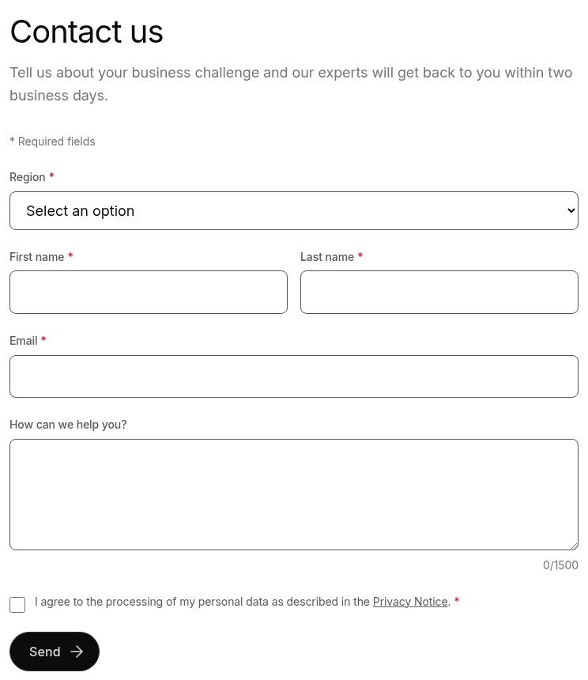

**Tablet rendering** — The same Contact us form at 768 px: title, description, * Required fields, Region, then First name, Last name and Email each on their own full-width row, the textarea with 0/1500 below it, the consent checkbox and the left-aligned Send button.

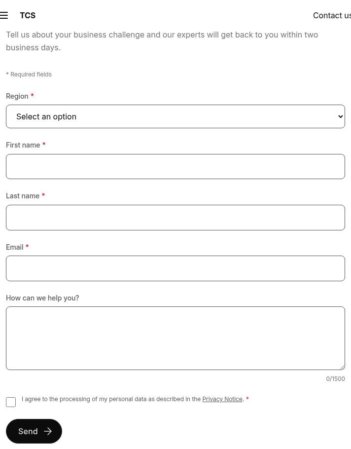

**Mobile rendering** — The Contact us form at 375 px after a successful Send: single column, every field empty again (reset), the consent text wrapped beside the checkbox, the Send button and below it the blue message Thank you, your details were sent.; the sticky header covers the description in the capture.

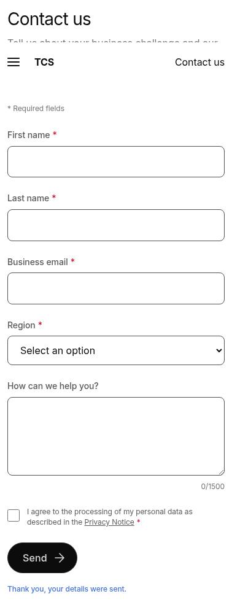

**Default theme** — A Default theme form at 1280 px: the H2 Request a call back, the description Leave your details and a specialist will call you., First name and Last name side by side, Email, the black Send button and, after Send, the blue message Thank you, your details were sent.

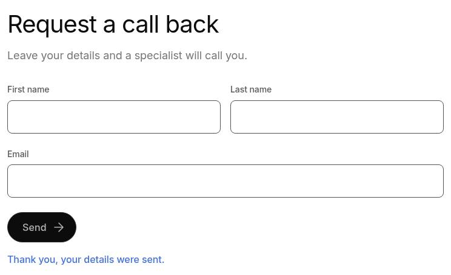

**Dark theme** — A Dark theme form at 1280 px: a black panel with 1rem rounded corners across the section, the content centred at 45rem: the white H2 Talk to our experts, the description, Region set to India, First name and Last name side by side, Email, a divider, the India media relations card in light blue with two email addresses and +91 00 0000 0000, and the white Send button.

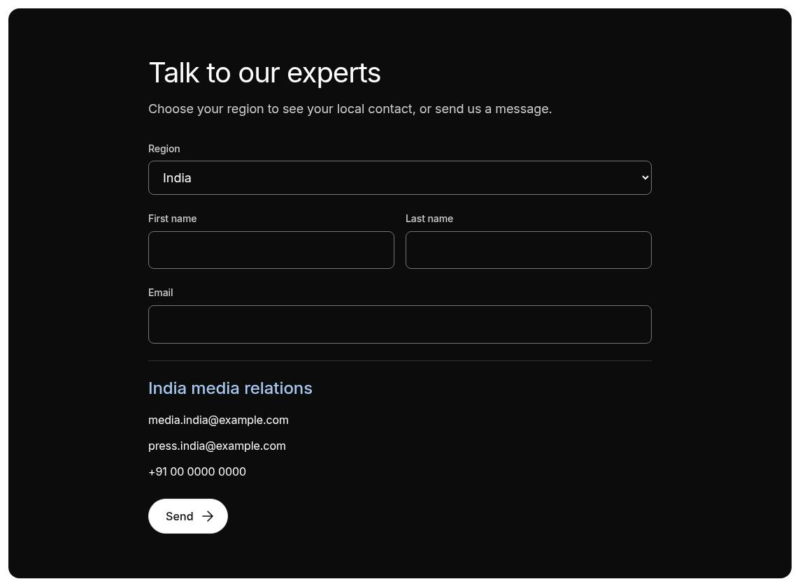

**Half-width name fields** — A Default theme form at 1280 px: the H2 Subscribe to our insights, First name and Last name side by side in two columns, a full-width Email input below them and the black Subscribe button with an arrow.

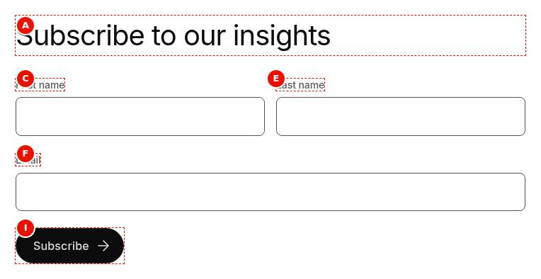

**Single-column form** — A Default theme form at 1280 px: the H2 Share your feedback and four full-width fields one below the other, Full name, Email, Phone and the Message textarea with the counter 0/1500, then the black Send button.

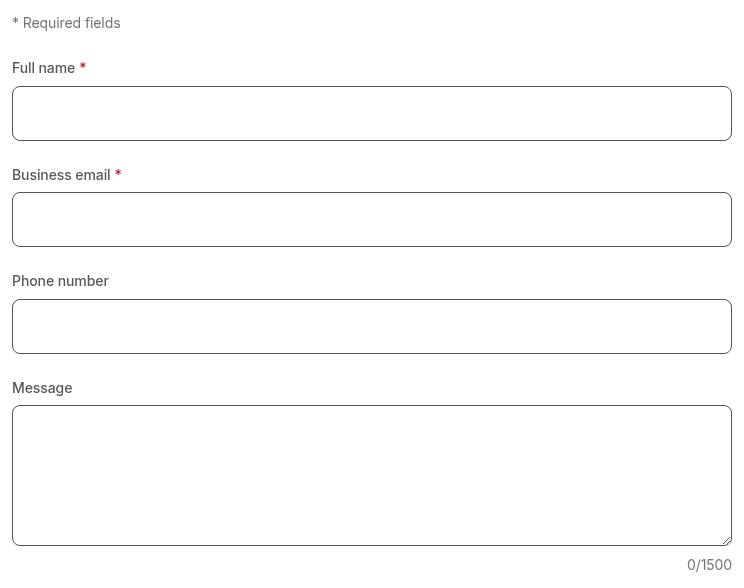

**Text input** — A form at 1280 px with a single mandatory Text input: the note * Required fields, the label Company with a red asterisk and an empty full-width single-line input.

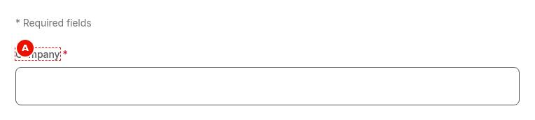

**Email input with error** — A form at 1280 px after Send with an invalid address: * Required fields, the label Business email with an asterisk, the input with anita.rao.example.com and a red border, the red error Enter a valid email address. below it and the black Send button.

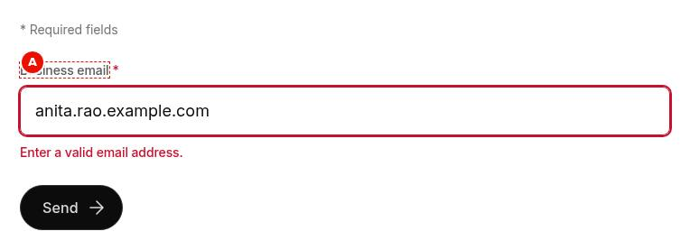

**Phone input** — A form at 375 px with a mandatory Tel input: * Required fields, the label Phone number with a red asterisk and the full-width input focused with the 2 px brand-blue outline; the telephone keypad that opens on the phone is not part of the capture.

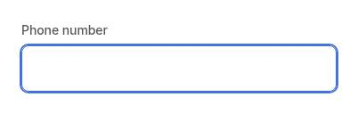

**Dropdown field** — A form at 1280 px with the Region dropdown open: the native list shows the greyed prompt Select an option and the options Asia Pacific, Europe, India and North America; the label has no asterisk because the field is optional.

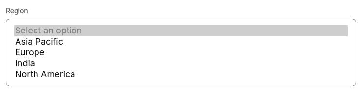

**Textarea with counter** — A form at 1280 px with the textarea How can we help you? focused (brand outline), holding the typed text We are planning to move our customer analytics platform to the cloud and would like to discuss options, timelines and costs. and the counter 124/1500 right-aligned below it.

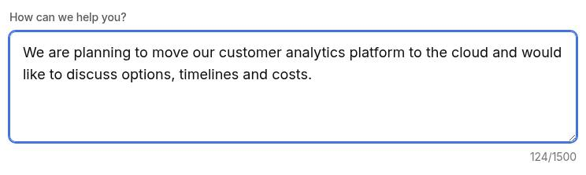

**Consent checkbox** — A form at 1280 px with a mandatory consent checkbox: * Required fields, then a 1.25rem checkbox followed by the small text I agree to the processing of my personal data as described in the Privacy Notice, with Privacy Notice underlined as a link, and a red asterisk.

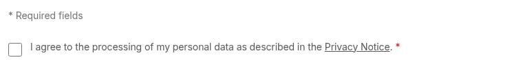

**Conditional field shown** — A form at 1280 px after choosing Other: * Required fields, the mandatory Sector dropdown set to Other and, below it, the newly shown mandatory text input Please specify your sector.

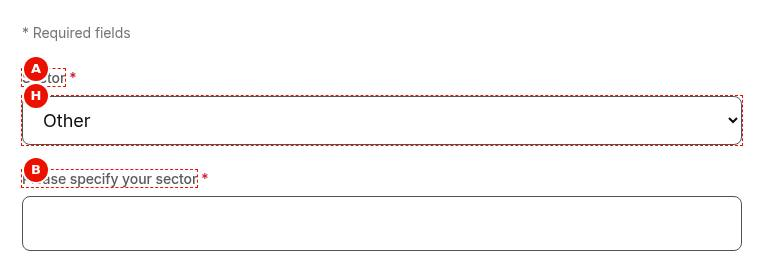

**Contact card shown for a region** — A form at 1280 px with Region set to India: below the dropdown, after a thin divider, the contact name India media relations in brand blue and the links media.india@example.com, press.india@example.com and +91 00 0000 0000 listed vertically; the Europe card stays hidden.

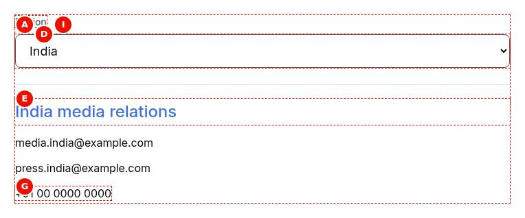

**Submit button and success message** — A form at 1280 px after a valid Send: the label Email above an empty input (reset), the black primary Send button with a trailing arrow, and below the form the brand-blue message Thank you, your details were sent.

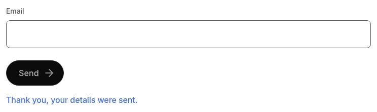

**Universal Editor canvas** — The Contact us form in Universal Editor edit mode at 1280 px with sample content and red dashed markers A to J: title, description, required note (one column wide), First name, Region, the textarea, the consent row, the India contact card with its italic condition note in a dashed box, and the Send button. (Annotated preview in editor mode with sample content; letters as in the annotations list, not a Universal Editor screenshot; file screenshots/form-variations-authoring-view.jpg)

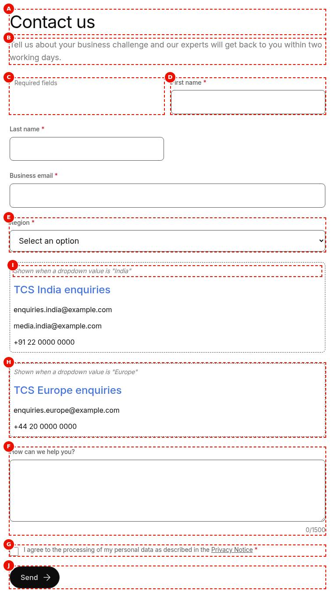

**Properties panel** — The properties panel of the Form Variations block with the Content and (Dialog reference generated from the component model, not a Universal Editor screenshot; file screenshots/form-variations-properties-panel.jpg)

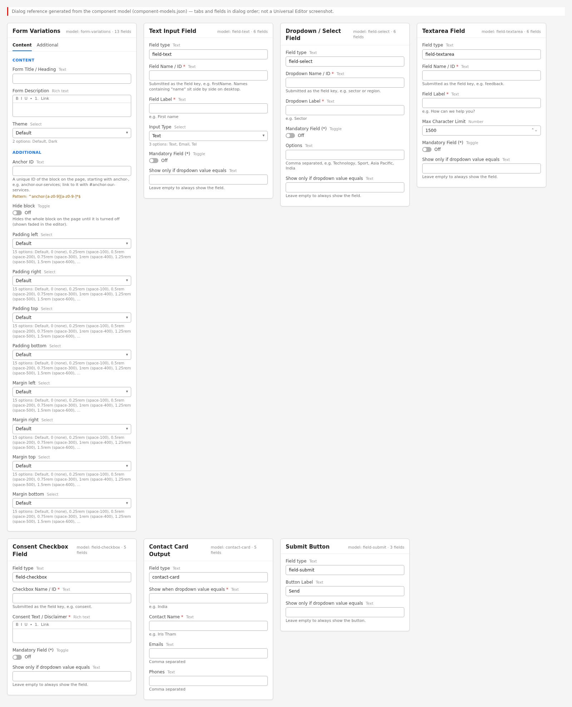

Universal Editor dialogs (no screenshot exists yet; to be captured on AEM author):

```text
[Screenshot Placeholder]

File name:
form-variations-dialog-content-desktop.png

Purpose:
The Content tab of the Form Variations properties in Universal Editor, with the fields of the table "Content tab — Form Variations" in Authorable Fields below.

Annotations:
A = Form Title / Heading
B = Form Description
C = Submit action
D = Theme
```

```text
[Screenshot Placeholder]

File name:
form-variations-dialog-additional-desktop.png

Purpose:
The Additional tab of the Form Variations properties in Universal Editor, with the fields of the table "Additional tab — Form Variations" in Authorable Fields below.

Annotations:
A = Anchor ID
B = Hide block
C = Animation Type
D = Motion Speed
E = Animation Trigger
F = Background animation
G = Padding left
H = Padding right
I = Padding top
J = Padding bottom
```

```text
[Screenshot Placeholder]

File name:
field-text-dialog-fields-desktop.png

Purpose:
The dialog of the Text Input Field properties in Universal Editor, with the fields of the table "Fields — Text Input Field" in Authorable Fields below.

Annotations:
A = Field type
B = Field Name / ID
C = Field Label
D = Input Type
E = Mandatory Field (*)
F = Show only if dropdown value equals
```

```text
[Screenshot Placeholder]

File name:
field-select-dialog-fields-desktop.png

Purpose:
The dialog of the Dropdown / Select Field properties in Universal Editor, with the fields of the table "Fields — Dropdown / Select Field" in Authorable Fields below.

Annotations:
A = Field type
B = Dropdown Name / ID
C = Dropdown Label
D = Mandatory Field (*)
E = Options
F = Show only if dropdown value equals
```

```text
[Screenshot Placeholder]

File name:
field-textarea-dialog-fields-desktop.png

Purpose:
The dialog of the Textarea Field properties in Universal Editor, with the fields of the table "Fields — Textarea Field" in Authorable Fields below.

Annotations:
A = Field type
B = Field Name / ID
C = Field Label
D = Max Character Limit
E = Mandatory Field (*)
F = Show only if dropdown value equals
```

```text
[Screenshot Placeholder]

File name:
field-checkbox-dialog-fields-desktop.png

Purpose:
The dialog of the Consent Checkbox Field properties in Universal Editor, with the fields of the table "Fields — Consent Checkbox Field" in Authorable Fields below.

Annotations:
A = Field type
B = Checkbox Name / ID
C = Consent Text / Disclaimer
D = Mandatory Field (*)
E = Show only if dropdown value equals
```

```text
[Screenshot Placeholder]

File name:
contact-card-dialog-fields-desktop.png

Purpose:
The dialog of the Contact Card Output properties in Universal Editor, with the fields of the table "Fields — Contact Card Output" in Authorable Fields below.

Annotations:
A = Field type
B = Show when dropdown value equals
C = Contact Name
D = Emails
E = Phones
```

```text
[Screenshot Placeholder]

File name:
field-submit-dialog-fields-desktop.png

Purpose:
The dialog of the Submit Button properties in Universal Editor, with the fields of the table "Fields — Submit Button" in Authorable Fields below.

Annotations:
A = Field type
B = Button Label
C = Show only if dropdown value equals
```

<!-- END GENERATED: screenshots -->

States that exist in the code without a screenshot in the handover:

```text
[Screenshot Placeholder]

File name:
form-variations-not-connected-desktop.png

Purpose:
A valid Send on a form without Submit action and without integration: the values stay in the fields and the status below the form reads "This form isn’t connected yet: your details weren’t sent."

Annotations:
A = Fields keeping their values
B = Status message (role="status", focused)
```

```text
[Screenshot Placeholder]

File name:
form-variations-submit-error-desktop.png

Purpose:
The Submit action answered with an error (or the integration's promise was rejected): the status reads "Your details couldn’t be sent. Please try again." and the values are kept.

Annotations:
A = Send button
B = Status message
```

```text
[Screenshot Placeholder]

File name:
form-variations-required-errors-mobile.png

Purpose:
An empty Send at 375 px: every mandatory field shows "This field is required." below it, with a red border, and focus is on the first invalid field.

Annotations:
A = First invalid field (focused)
B = Error text linked with aria-describedby
C = * Required fields note
```

```text
[Screenshot Placeholder]

File name:
form-variations-editor-no-action-desktop.png

Purpose:
Universal Editor edit mode of a form without Submit action: the italic note "No Submit action set: submissions aren’t sent anywhere." at the top of the form, and conditional items visible with their dashed border and condition note.

Annotations:
A = No Submit action note
B = Conditional item with "Shown when a dropdown value is ..." note
```

```text
[Screenshot Placeholder]

File name:
form-variations-dark-mobile.png

Purpose:
The Dark theme at 375 px: the dark panel with its mobile padding, single-column fields and the inverted (white) Send button.

Annotations:
A = Dark panel
B = Inverted primary button
```

## For Content Authors

1. **Add the block.** In Universal Editor select a Section (or a Columns Container column, or a Tabs Container) and choose Add > Form Variations.
2. **Open its properties.** Select the block; the dialog has the tabs Content and Additional.
3. **Enter the content.** Form Title / Heading (rendered as an H2), Form Description (rich text), Submit action (the endpoint the data is sent to; ask the development team for it) and Theme (Default or Dark).
4. **Add the items.** In the content tree, select the block and use Add to insert items in the order visitors should fill them: Text Input Field, Dropdown / Select Field, Textarea Field, Consent Checkbox Field, Contact Card Output, Submit Button. Reorder them by dragging in the content tree.
5. **Fill each item.** Give every field a unique Field Name / ID (the submitted key, e.g. `firstName`), a label, and set Mandatory Field (*) where needed. For a conditional item, copy the exact dropdown option text into "Show only if dropdown value equals" (or "Show when dropdown value equals" for a contact card).
6. **Preview.** In Universal Editor every conditional item stays visible with an italic condition note; switch to the preview (aem.page) to test the real behaviour.
7. **Publish** the page, then **validate** the published page: an empty Send shows the errors, a valid Send shows "Thank you, your details were sent." only when the endpoint or integration accepted the data.

**Minimum required:** at least one field item and one Submit Button. **Recommended:** Form Title / Heading, Form Description, Submit action, labels on every field, Input Type Email / Tel where relevant. **Optional:** Theme, conditions, contact cards, Max Character Limit, the Additional tab.

## Authorable Fields

<!-- BEGIN GENERATED: fields (npm run build:docs) -->

### Form Variations (`form-variations`)

Model `form-variations`; template name "Form Variations" (the block class AEM renders); children: `field-text`, `field-select`, `field-textarea`, `field-checkbox`, `contact-card`, `field-submit`.

#### Content tab — Form Variations

| Field label | Property | Type | Required | Default | Allowed values | Author guidance | Example |
| ----------- | -------- | ---- | -------- | ------- | -------------- | --------------- | ------- |
| Form Title / Heading | `formHeading` | text | No | — | — | — | Contact us |
| Form Description | `formDescription` | richtext | No | "" | — | — | — |
| Submit action | `formAction` | aem-content | No | — | — | Where the form data is sent (POST, JSON): e.g. an AEM Forms or spreadsheet submission endpoint. Without it, nothing is sent and visitors are told so. | — |
| Theme | `classes` | select | No | "" | Default (""), Dark (`dark`) | — | dark |

#### Additional tab — Form Variations

| Field label | Property | Type | Required | Default | Allowed values | Author guidance | Example |
| ----------- | -------- | ---- | -------- | ------- | -------------- | --------------- | ------- |
| Anchor ID | `classes_anchor` | text | No | — | regExp: ^anchor-[a-z0-9][a-z0-9-]*$; customErrorMsg: Start with anchor-, then lower-case letters, digits and hyphens. | A unique ID of the block on the page, starting with anchor-, e.g. anchor-our-services; link to it with #anchor-our-services. Delivered as a block class. | — |
| Hide block | `classes_hideblock` | boolean | No | `false` | on / off | Hides the whole block on the page until it is turned off (shown faded in the editor). Delivered as a block class. | — |
| Animation Type | `classes_animation` | select | No | "" | None (""), Fade in (`motion-fade-in`), Fade up (`motion-fade-up`), Fade down (`motion-fade-down`), Fade left (`motion-fade-left`), Fade right (`motion-fade-right`), Slide up (`motion-slide-up`), Slide down (`motion-slide-down`), Slide left (`motion-slide-left`), Slide right (`motion-slide-right`), Scale in (`motion-scale-in`) | How the block's content appears; repeated items (cards, list items, accordion items, columns) appear one after another. None: shown as is. Not played in the editor or when the visitor prefers reduced motion. Delivered as a block class. | motion-fade-up |
| Motion Speed | `classes_animationspeed` | select | No | "" | Medium (""), Fast (`motion-fast`), Slow (`motion-slow`) | How fast the block's animations run (Animation Type 0.3 / 0.6 / 0.9 s; the Background animation takes 1.5 times as long). Shown when (`classes_animation` is set and `classes_animation` is not empty) or (`classes_bganimation` is set and `classes_bganimation` is not empty). Delivered as a block class. | — |
| Animation Trigger | `classes_animationtrigger` | select | No | "" | On Scroll / Viewport Entry (""), On Page Load (`motion-on-load`) | When the block's animations run. On Scroll: when the block comes into view (at once if it is in view when the page opens). On Page Load: as soon as the block is ready, wherever it is on the page. Shown when (`classes_animation` is set and `classes_animation` is not empty) or (`classes_bganimation` is set and `classes_bganimation` is not empty). Delivered as a block class. | — |
| Background animation | `classes_bganimation` | select | No | "" | None (""), Fade in (`bg-motion-fade-in`), Reveal from the centre (`bg-motion-reveal`), Wipe left to right (`bg-motion-wipe-right`), Wipe right to left (`bg-motion-wipe-left`), Wipe bottom to top (`bg-motion-wipe-up`), Scale reveal (`bg-motion-scale`) | How the block's background (its colour, image or overlay as set in the block) appears. It doesn't animate the content: see Animation Type. Motion Speed and Animation Trigger apply to it too. Not played in the editor or when the visitor prefers reduced motion. Delivered as a block class. | bg-motion-wipe-right |
| Padding left | `classes_paddingleft` | select | No | "" | Default (""), 0 (none) (`pl-0`), 0.25rem (space-100) (`pl-100`), 0.5rem (space-200) (`pl-200`), 0.75rem (space-300) (`pl-300`), 1rem (space-400) (`pl-400`), 1.25rem (space-500) (`pl-500`), 1.5rem (space-600) (`pl-600`), 2rem (space-800) (`pl-800`), 2.5rem (space-1000) (`pl-1000`), 3rem (space-1200) (`pl-1200`), 4rem (space-1600) (`pl-1600`), 5rem (space-2000) (`pl-2000`), 6rem (space-2400) (`pl-2400`), 7.5rem (space-3000) (`pl-3000`) | Delivered as a block class. | — |
| Padding right | `classes_paddingright` | select | No | "" | Default (""), 0 (none) (`pr-0`), 0.25rem (space-100) (`pr-100`), 0.5rem (space-200) (`pr-200`), 0.75rem (space-300) (`pr-300`), 1rem (space-400) (`pr-400`), 1.25rem (space-500) (`pr-500`), 1.5rem (space-600) (`pr-600`), 2rem (space-800) (`pr-800`), 2.5rem (space-1000) (`pr-1000`), 3rem (space-1200) (`pr-1200`), 4rem (space-1600) (`pr-1600`), 5rem (space-2000) (`pr-2000`), 6rem (space-2400) (`pr-2400`), 7.5rem (space-3000) (`pr-3000`) | Delivered as a block class. | — |
| Padding top | `classes_paddingtop` | select | No | "" | Default (""), 0 (none) (`pt-0`), 0.25rem (space-100) (`pt-100`), 0.5rem (space-200) (`pt-200`), 0.75rem (space-300) (`pt-300`), 1rem (space-400) (`pt-400`), 1.25rem (space-500) (`pt-500`), 1.5rem (space-600) (`pt-600`), 2rem (space-800) (`pt-800`), 2.5rem (space-1000) (`pt-1000`), 3rem (space-1200) (`pt-1200`), 4rem (space-1600) (`pt-1600`), 5rem (space-2000) (`pt-2000`), 6rem (space-2400) (`pt-2400`), 7.5rem (space-3000) (`pt-3000`) | Delivered as a block class. | — |
| Padding bottom | `classes_paddingbottom` | select | No | "" | Default (""), 0 (none) (`pb-0`), 0.25rem (space-100) (`pb-100`), 0.5rem (space-200) (`pb-200`), 0.75rem (space-300) (`pb-300`), 1rem (space-400) (`pb-400`), 1.25rem (space-500) (`pb-500`), 1.5rem (space-600) (`pb-600`), 2rem (space-800) (`pb-800`), 2.5rem (space-1000) (`pb-1000`), 3rem (space-1200) (`pb-1200`), 4rem (space-1600) (`pb-1600`), 5rem (space-2000) (`pb-2000`), 6rem (space-2400) (`pb-2400`), 7.5rem (space-3000) (`pb-3000`) | Delivered as a block class. | — |
| Margin left | `classes_marginleft` | select | No | "" | Default (""), 0 (none) (`ml-0`), 0.25rem (space-100) (`ml-100`), 0.5rem (space-200) (`ml-200`), 0.75rem (space-300) (`ml-300`), 1rem (space-400) (`ml-400`), 1.25rem (space-500) (`ml-500`), 1.5rem (space-600) (`ml-600`), 2rem (space-800) (`ml-800`), 2.5rem (space-1000) (`ml-1000`), 3rem (space-1200) (`ml-1200`), 4rem (space-1600) (`ml-1600`), 5rem (space-2000) (`ml-2000`), 6rem (space-2400) (`ml-2400`), 7.5rem (space-3000) (`ml-3000`) | Delivered as a block class. | — |
| Margin right | `classes_marginright` | select | No | "" | Default (""), 0 (none) (`mr-0`), 0.25rem (space-100) (`mr-100`), 0.5rem (space-200) (`mr-200`), 0.75rem (space-300) (`mr-300`), 1rem (space-400) (`mr-400`), 1.25rem (space-500) (`mr-500`), 1.5rem (space-600) (`mr-600`), 2rem (space-800) (`mr-800`), 2.5rem (space-1000) (`mr-1000`), 3rem (space-1200) (`mr-1200`), 4rem (space-1600) (`mr-1600`), 5rem (space-2000) (`mr-2000`), 6rem (space-2400) (`mr-2400`), 7.5rem (space-3000) (`mr-3000`) | Delivered as a block class. | — |
| Margin top | `classes_margintop` | select | No | "" | Default (""), 0 (none) (`mt-0`), 0.25rem (space-100) (`mt-100`), 0.5rem (space-200) (`mt-200`), 0.75rem (space-300) (`mt-300`), 1rem (space-400) (`mt-400`), 1.25rem (space-500) (`mt-500`), 1.5rem (space-600) (`mt-600`), 2rem (space-800) (`mt-800`), 2.5rem (space-1000) (`mt-1000`), 3rem (space-1200) (`mt-1200`), 4rem (space-1600) (`mt-1600`), 5rem (space-2000) (`mt-2000`), 6rem (space-2400) (`mt-2400`), 7.5rem (space-3000) (`mt-3000`) | Delivered as a block class. | — |
| Margin bottom | `classes_marginbottom` | select | No | "" | Default (""), 0 (none) (`mb-0`), 0.25rem (space-100) (`mb-100`), 0.5rem (space-200) (`mb-200`), 0.75rem (space-300) (`mb-300`), 1rem (space-400) (`mb-400`), 1.25rem (space-500) (`mb-500`), 1.5rem (space-600) (`mb-600`), 2rem (space-800) (`mb-800`), 2.5rem (space-1000) (`mb-1000`), 3rem (space-1200) (`mb-1200`), 4rem (space-1600) (`mb-1600`), 5rem (space-2000) (`mb-2000`), 6rem (space-2400) (`mb-2400`), 7.5rem (space-3000) (`mb-3000`) | Delivered as a block class. | — |

### Text Input Field (`field-text`)

Model `field-text`; template name "Text Input Field" (the block class AEM renders).

Stored on a new component (definition template): `classes` = `"field-text"`, `inputKind` = `"text"`.

#### Fields — Text Input Field

| Field label | Property | Type | Required | Default | Allowed values | Author guidance | Example |
| ----------- | -------- | ---- | -------- | ------- | -------------- | --------------- | ------- |
| Field type | `classes` | text | No | `field-text` | — | Read only. | — |
| Field Name / ID | `fieldName` | text | Yes | — | — | Submitted as the field key, e.g. firstName. Names containing "name" sit side by side on desktop. Letters, digits, - or _, e.g. firstName (sent as written). | firstName |
| Field Label | `label` | text | Yes | — | — | e.g. First name | First name |
| Input Type | `inputKind` | select | No | `text` | Text (`text`), Email (`email`), Tel (`tel`) | — | text |
| Mandatory Field (*) | `required` | boolean | No | `false` | on / off | — | true |
| Show only if dropdown value equals | `dependsOn` | text | No | — | — | Leave empty to always show the field. | Other |

### Dropdown / Select Field (`field-select`)

Model `field-select`; template name "Dropdown / Select Field" (the block class AEM renders).

Stored on a new component (definition template): `classes` = `"field-select"`.

#### Fields — Dropdown / Select Field

| Field label | Property | Type | Required | Default | Allowed values | Author guidance | Example |
| ----------- | -------- | ---- | -------- | ------- | -------------- | --------------- | ------- |
| Field type | `classes` | text | No | `field-select` | — | Read only. | — |
| Dropdown Name / ID | `fieldName` | text | Yes | — | — | Submitted as the field key, e.g. sector or region. Letters, digits, - or _, e.g. firstName (sent as written). | region |
| Dropdown Label | `label` | text | Yes | — | — | e.g. Sector | Region |
| Mandatory Field (*) | `required` | boolean | No | `false` | on / off | — | true |
| Options | `options` | text | No | — | — | Comma separated, e.g. Technology, Sport, Asia Pacific, India | Asia Pacific, Europe, India, North America |
| Show only if dropdown value equals | `dependsOn` | text | No | — | — | Leave empty to always show the field. | — |

### Textarea Field (`field-textarea`)

Model `field-textarea`; template name "Textarea Field" (the block class AEM renders).

Stored on a new component (definition template): `classes` = `"field-textarea"`, `maxLength` = `1500`.

#### Fields — Textarea Field

| Field label | Property | Type | Required | Default | Allowed values | Author guidance | Example |
| ----------- | -------- | ---- | -------- | ------- | -------------- | --------------- | ------- |
| Field type | `classes` | text | No | `field-textarea` | — | Read only. | — |
| Field Name / ID | `fieldName` | text | Yes | — | — | Submitted as the field key, e.g. feedback. Letters, digits, - or _, e.g. firstName (sent as written). | message |
| Field Label | `label` | text | Yes | — | — | e.g. How can we help you? | How can we help you? |
| Max Character Limit | `maxLength` | number | No | `1500` | — | — | 1500 |
| Mandatory Field (*) | `required` | boolean | No | `false` | on / off | — | false |
| Show only if dropdown value equals | `dependsOn` | text | No | — | — | Leave empty to always show the field. | — |

### Consent Checkbox Field (`field-checkbox`)

Model `field-checkbox`; template name "Consent Checkbox Field" (the block class AEM renders).

Stored on a new component (definition template): `classes` = `"field-checkbox"`, `required` = `true`.

#### Fields — Consent Checkbox Field

| Field label | Property | Type | Required | Default | Allowed values | Author guidance | Example |
| ----------- | -------- | ---- | -------- | ------- | -------------- | --------------- | ------- |
| Field type | `classes` | text | No | `field-checkbox` | — | Read only. | — |
| Checkbox Name / ID | `fieldName` | text | Yes | — | — | Submitted as the field key, e.g. consent. Letters, digits, - or _, e.g. firstName (sent as written). | consent |
| Consent Text / Disclaimer | `label` | richtext | Yes | — | — | — | — |
| Mandatory Field (*) | `required` | boolean | No | `true` | on / off | — | true |
| Show only if dropdown value equals | `dependsOn` | text | No | — | — | Leave empty to always show the field. | — |

### Contact Card Output (`contact-card`)

Model `contact-card`; template name "Contact Card Output" (the block class AEM renders).

Stored on a new component (definition template): `classes` = `"contact-card"`.

#### Fields — Contact Card Output

| Field label | Property | Type | Required | Default | Allowed values | Author guidance | Example |
| ----------- | -------- | ---- | -------- | ------- | -------------- | --------------- | ------- |
| Field type | `classes` | text | No | `contact-card` | — | Read only. | — |
| Show when dropdown value equals | `region` | text | Yes | — | — | e.g. India | India |
| Contact Name | `contactName` | text | Yes | — | — | e.g. Iris Tham | India media relations |
| Emails | `emails` | text | No | — | — | Comma separated | media.india@example.com, press.india@example.com |
| Phones | `phones` | text | No | — | — | Comma separated | +91 00 0000 0000 |

### Submit Button (`field-submit`)

Model `field-submit`; template name "Submit Button" (the block class AEM renders).

Stored on a new component (definition template): `classes` = `"field-submit"`, `label` = `"Send"`.

#### Fields — Submit Button

| Field label | Property | Type | Required | Default | Allowed values | Author guidance | Example |
| ----------- | -------- | ---- | -------- | ------- | -------------- | --------------- | ------- |
| Field type | `classes` | text | No | `field-submit` | — | Read only. | — |
| Button Label | `label` | text | No | `Send` | — | — | Send |
| Show only if dropdown value equals | `dependsOn` | text | No | — | — | Leave empty to always show the button. | — |

<!-- END GENERATED: fields -->

Notes the tables can't show:

- **Form Title / Heading** renders as `h2.form-variations-title` and labels the form (`aria-labelledby`); it is also the `dc:title` of `cmp:submit` in the data layer. Without it the form has no accessible name and `cmp:submit` uses the block name.
- **Submit action** is read from the cell's link (`href`), else its text. It receives a `POST` with `Content-Type: application/json` and the body `{ "data": { ... } }`. Without it (and without an integration) nothing is sent; in the editor a note says so.
- **Theme** Dark adds the block class `dark`: a full-width dark panel (`--color-bg-neutral`) with rounded corners, light labels and an inverted primary button.
- **Field Name / ID** (`fieldName`) is the submitted key, sent as written. The dialog marks it required but doesn't validate its characters. A Text Input Field whose name contains "name" (any case) is half width from 900px (`half-width`); every other item is full width. The name also sets `autocomplete` (e.g. `firstName` gives `given-name`, `company` gives `organization`); Input Type Email / Tel set `email` / `tel`.
- **Mandatory Field (*)**: only the value `true` makes a field required; the asterisk is hidden from screen readers and explained once by "* Required fields".
- **Options**: comma separated; a disabled, pre-selected "Select an option" prompt comes first.
- **Max Character Limit**: a value above 0, else 1500; enforced with `maxlength`; the counter shows `count/limit` and announces "{count} of {max} characters".
- **Consent Text / Disclaimer** is rich text: its links are kept and underlined. An empty text shows the field name.
- **Show only if dropdown value equals / Show when dropdown value equals**: the item is shown when *any* enabled dropdown of the form has that value (trimmed, case-insensitive). Hidden items are `hidden`, their controls disabled (left out of validation and the data) and not required.
- **Contact Card Output** Emails become `mailto:` links, Phones `tel:` links (only digits and `+` in the link).
- **Button Label**: empty gives the placeholder `send` ("Send").
- **Legacy mapping.** Items authored before the `fieldName` field (re-audit R-D-1) have fewer cells: their key is read from the item's node name, which AEM delivers in class-name form (`firstName` arrives as `firstname`), unless the node name is only the template name (`text-input-field`, `dropdown-select-field`, `textarea-field`, `consent-checkbox-field`, `contact-card-output`, `submit-button`), in which case the name fallback applies (`text`, `select`, `message`, `consent`). Older markup with the type alone in the first cell is read too.
- **Additional tab.** Anchor ID, Hide block, Animation Type / Motion Speed / Animation Trigger, Background animation and spacing behave as described in AGENTS.md ("Additional tab", "Animation and skeletons"). The content animation moves the block's children; the Background animation reveals the block's own background (visible with Theme Dark).

## Screenshot-Based Authoring Steps

### Authoring Step 1: Add the block and its properties

```text
[Screenshot Placeholder]

File name:
form-variations-authoring-step-1.png

Purpose:
The Form Variations dialog, Content tab, with the title, description and Submit action filled in.

Annotations:
A = Form Title / Heading
B = Form Description
C = Submit action
D = Theme
```

#### Values to Enter

| Callout | Field | Value | Reason | Expected result |
| ------- | ----- | ----- | ------ | --------------- |
| A | Form Title / Heading | Contact us | Names the form for everyone | H2 above the form; the form is labelled by it |
| B | Form Description | Tell us about your business challenge and our experts will get back to you within two business days. | Sets expectations | Grey text under the title |
| C | Submit action | The endpoint provided by the development team | Data must reach a system | Valid submissions are POSTed there |
| D | Theme | Default | Light pages | 45rem-wide form on the page background |

**Author action:** Section > Add > Form Variations; select the block; fill the Content tab. **Expected preview:** title and description render; in the editor, without Submit action, the note "No Submit action set: submissions aren’t sent anywhere." appears. **Expected published result:** the same title and description. **Business rule:** don't publish a form for live data capture without a Submit action or an agreed integration. **Validation:** check the note disappears once Submit action is set. **Common mistake:** leaving Submit action empty: visitors are told the form isn't connected; set it.

### Authoring Step 2: Add the fields

```text
[Screenshot Placeholder]

File name:
form-variations-authoring-step-2.png

Purpose:
The content tree under the block with the items added, and the Text Input Field dialog open.

Annotations:
A = Content tree items
B = Field Name / ID
C = Field Label
D = Input Type
E = Mandatory Field (*)
```

#### Values to Enter

| Callout | Field | Value | Reason | Expected result |
| ------- | ----- | ----- | ------ | --------------- |
| B | Field Name / ID | firstName | Submitted key; contains "name" | Half width from 900px; `autocomplete="given-name"` |
| C | Field Label | First name | Visible label | Label linked to the input |
| D | Input Type | Text | Plain text | `type="text"` |
| E | Mandatory Field (*) | on | Needed by the team | Asterisk, required validation |
| B | Field Name / ID (second item) | lastName | Pairs with firstName | Sits beside First name |
| D | Input Type (third item, Field Name / ID email, Label Email) | Email | Address format | Email keyboard and format check |

**Author action:** select the block in the content tree > Add > Text Input Field (three times), fill each. **Expected preview:** First name and Last name side by side on desktop, Email full width. **Expected published result:** the same; an address without "@" shows "Enter a valid email address." on Send. **Business rule:** every Field Name / ID unique within the form. **Validation:** open the item again and check every field is set. **Common mistake:** a full-width field named `companyName` turns half width: rename it (e.g. `company`).

### Authoring Step 3: Add a dropdown with a conditional contact card

```text
[Screenshot Placeholder]

File name:
form-variations-authoring-step-3.png

Purpose:
The Dropdown / Select Field dialog and a Contact Card Output dialog with the matching value.

Annotations:
A = Dropdown Name / ID
B = Options
C = Show when dropdown value equals
D = Contact Name
E = Emails
F = Phones
```

#### Values to Enter

| Callout | Field | Value | Reason | Expected result |
| ------- | ----- | ----- | ------ | --------------- |
| A | Dropdown Name / ID | region | Submitted key | `region` in the data |
| B | Options | Asia Pacific, Europe, India, North America | Choices | Four options after "Select an option" |
| C | Show when dropdown value equals | India | Exact option text | Card shown only for India |
| D | Contact Name | India media relations | Card heading | Brand-coloured name |
| E | Emails | media.india@example.com, press.india@example.com | Contact routes | Two `mailto:` links |
| F | Phones | +91 00 0000 0000 | Contact route | One `tel:` link |

**Author action:** Add > Dropdown / Select Field, then Add > Contact Card Output. **Expected preview:** in the editor the card stays visible with "Shown when a dropdown value is "India"". **Expected published result:** the card appears after a thin divider when India is selected, and the status announces "More fields are shown below.". **Business rule:** one value per conditional item; add another item for another value. **Validation:** select every option on aem.page. **Common mistake:** a condition spelled differently from the option: copy the option text exactly.

### Authoring Step 4: Consent and submit

```text
[Screenshot Placeholder]

File name:
form-variations-authoring-step-4.png

Purpose:
The Consent Checkbox Field and Submit Button dialogs.

Annotations:
A = Checkbox Name / ID
B = Consent Text / Disclaimer
C = Mandatory Field (*)
D = Button Label
```

#### Values to Enter

| Callout | Field | Value | Reason | Expected result |
| ------- | ----- | ----- | ------ | --------------- |
| A | Checkbox Name / ID | consent | Submitted key | `consent: "true"` when checked |
| B | Consent Text / Disclaimer | I agree to the processing of my personal data as described in the Privacy Notice (with Privacy Notice linked) | Legal consent | Small text with an underlined link |
| C | Mandatory Field (*) | on (default) | Consent required | Send blocked until checked |
| D | Button Label | Send | Clear action | Black primary button |

**Author action:** Add > Consent Checkbox Field, Add > Submit Button. **Expected preview:** the checkbox with its text and the Send button. **Expected published result:** Send without the box checked shows "This field is required.". **Business rule:** at least one Submit Button without a condition, so visitors always have a button. **Validation:** check the button is visible before and after choosing each dropdown value. **Common mistake:** every Submit Button conditional: add an unconditional one.

### Authoring Step 5: Preview, publish and validate

```text
[Screenshot Placeholder]

File name:
form-variations-authoring-step-5.png

Purpose:
The published form after a valid Send with the success message, the form reset.

Annotations:
A = Reset fields
B = Status "Thank you, your details were sent."
```

#### Values to Enter

| Callout | Field | Value | Reason | Expected result |
| ------- | ----- | ----- | ------ | --------------- |
| A | First name / Last name / Email | Test values agreed with the receiving team | End-to-end check | Entry arrives in the receiving system |
| B | — | — | Outcome | Success message only if the endpoint answered OK |

**Author action:** publish, open the page on aem.live, submit once. **Expected result:** the form resets and the success message receives focus. **Validation:** confirm the entry in the receiving system. **Common mistake:** testing in Universal Editor, where all conditional items are visible: test on aem.page / aem.live.

## Variations

### Default theme

Purpose: a form on a light page. Use it by default; don't use it on a dark section background unless the theme contract of the section (styles/styles.css) gives enough contrast. Required: field items and a Submit Button; optional: title, description. Dialog: Theme = Default. Rendering: centred, at most 45rem wide; one column below 900px, two columns from 900px. Accessibility and data layer as in the sections below. Personalization: none; the authored form renders.

```text
[Screenshot Placeholder]

File name:
form-variations-default-mobile.png

Purpose:
The Default theme at 375 px: single column, full-width fields, Send button left aligned.

Annotations:
A = Title and description
B = Fields in one column
C = Send button
```

### Dark theme

Purpose: a highlighted panel (e.g. "Talk to our experts"). Dialog: Theme = Dark (block class `dark`). Rendering: a dark (`--color-bg-neutral`) panel with `--radius-l` corners across the container, content centred at 45rem; padding grows at 600px and 900px; light labels, transparent inputs, a light-blue contact name and status, and the primary button inverted to white. Error colour `#ff6b6b` (hard-coded). Background animation, when chosen, reveals this panel.

```text
[Screenshot Placeholder]

File name:
form-variations-dark-tablet.png

Purpose:
The Dark theme at 768 px: the panel with its tablet padding and a contact card shown for a region.

Annotations:
A = Dark panel
B = Contact card
C = White Send button
```

### Half-width name fields

Not a dialog option: a Text Input Field whose Field Name / ID contains "name" gets `half-width` and sits beside the next half-width field from 900px. Use it for First name / Last name; avoid "name" in other field names.

### Conditional items

Not a dialog option per se: any field, contact card or Submit Button with a condition value. Rendering: `data-depends-on` on the item's group; hidden and disabled until a dropdown has the value; chains of conditions are resolved; in the editor all are shown with a note and a dashed border.

```text
[Screenshot Placeholder]

File name:
form-variations-conditional-desktop.png

Purpose:
Sector set to Other reveals the mandatory "Please specify your sector" input.

Annotations:
A = Controlling dropdown
B = Revealed conditional field
```

## Complete Authoring Example

Scenario: the "Contact us" form of the block library (`block-library/form-variations/form-variations`, section Main).

| Field | Example value | Guidance |
| ----- | ------------- | -------- |
| Form Title / Heading | Contact us | Short, specific |
| Form Description | Tell us about your business challenge and our experts will get back to you within two business days. | What happens after sending |
| Submit action | The agreed endpoint | Required for real submissions |
| Dropdown / Select Field | region, Region, mandatory, Asia Pacific, Europe, India, North America | Options as conditions will use them |
| Text Input Field | firstName, First name, Text, mandatory | Half width |
| Text Input Field | lastName, Last name, Text, mandatory | Half width |
| Text Input Field | email, Email, Email, mandatory | Format check |
| Textarea Field | message, How can we help you?, 1500 | Counter 0/1500 |
| Consent Checkbox Field | consent, consent text with Privacy Notice link, mandatory | Legal text approved per locale |
| Submit Button | Send | Unconditional |

Steps: add the block, fill the Content tab, add the seven items in that order, publish. Expected output: H2 "Contact us", "* Required fields", the Region dropdown, First name and Last name side by side (desktop), Email, the textarea with 0/1500, the consent checkbox and the Send button. Responsive: one column below 900px. Accessibility: labels, required state, errors linked to fields, focus to the first error, status focused after the outcome. Data layer: the component entry, `cmp:click` on Send, `cmp:submit` with the field names (no values) for a valid submission. Personalization fallback: the authored form. Pre-publish checklist: Submit action set; unique field names; an unconditional Send; an empty Send shows errors; each Region value tested; placeholders translated for the locale; consent text approved.

## Content and Asset Guidelines

- **Titles and descriptions:** one H2 per form; keep the page H1 elsewhere (e.g. the Page Header). The description says what happens after sending.
- **Labels:** clear, visible, without relying on the description. Don't put essential information only in conditional contact cards.
- **CTAs:** a specific verb on the Submit Button ("Send", "Subscribe"); one visible primary action, extra buttons only when conditional.
- **Links:** only in the consent text (rich text) and contact cards (generated `mailto:` / `tel:`).
- **Images, icons, tags, metadata:** not applicable; the block has no image, icon or tag field and reads no metadata.
- **Min / max items:** no verified technical limit was identified. The textarea limit defaults to 1500 characters.
- **Contact data:** only approved business contacts; sample people and numbers in the library are fictional.
- **Localization:** author labels, options, consent text and cards per locale; keep Field Name / ID identical across locales (data keys); conditions must match the locale's option text; translate the placeholder keys listed under For Site Administrators.

## Accessibility

- **Semantic HTML:** a native `form` (`novalidate`, labelled by the title), `label for` on every control, native `input`, `select`, `textarea`, `button type="submit"`, a `ul` of contact links.
- **Headings:** the title is an H2.
- **Errors:** validated on submit; each error is a `p.form-variations-error` in the field's group, linked with `aria-describedby`, the control gets `aria-invalid="true"`; messages are text, not only colour; focus moves to the first invalid field; an error is removed as soon as the field becomes valid while typing.
- **Required:** native `required`; the asterisk is `aria-hidden` and explained once by "* Required fields".
- **Input purpose:** `autocomplete` from the field name or type (WCAG 1.3.5).
- **Announcements:** `p.form-variations-status` (`role="status"`, `tabindex="-1"`) announces revealed fields ("More fields are shown below.") and the outcome, and receives focus after a submission.
- **Counter:** the visible `count/limit` is `aria-hidden`; a visually hidden text reads "{count} of {max} characters".
- **Busy state:** while the Submit action request runs, the form has `aria-busy="true"` and the button `aria-disabled="true"`.
- **Focus:** a 2px brand outline on controls (`:focus-visible`).
- **Reflow:** single column below 900px.
- **Reduced motion:** the Additional tab animations don't play for reduced motion (AGENTS.md).

**Author responsibilities:** a label on every field, only genuinely required fields marked, Input Type Email / Tel where relevant, descriptive link text in the consent text, conditional items placed right after their dropdown.

**Developer responsibilities:** keep the error / status contract, keep UI texts in placeholders, check contrast of the Dark theme and the hard-coded error colours.

| Key | Expected behavior |
| --- | ----------------- |
| Enter (in a text input) / Enter or Space (on Send) | Submits: validation runs, focus goes to the first invalid field or, after the outcome, to the status message |
| Tab / Shift+Tab | Moves through the visible fields; hidden conditional fields are disabled and skipped |

## Data Layer and Analytics

- **Component:** `tcs-corp/components/form-variations`, id = the block's id (Anchor ID) else `form-variations-{n}`; `dc:title` from the first heading (the form title).
- **Variation:** not pushed; the Theme is a block class only.
- **Item positions:** none.
- **Interactions** (captured centrally by `decorators/data-layer-decorator.js`; the block sets no `data-cmp-*` attributes and calls no `pushComponentEvent`): `cmp:click` on the Send button (`interaction: button`), not while it is `aria-disabled`; `cmp:click` on contact links (`interaction: link`, `xdm:linkType: exit` for `mailto:` / `tel:`); `cmp:submit` in the capture phase, only when the form is valid (`noValidate` forms are checked with `checkValidity()`), with the field **names** only (never values, including the names of hidden conditional fields). The dropdowns don't push `cmp:change` (they have no `data-cmp-interaction`).
- **Outcome:** `cmp:submit` is pushed before the outcome is known; an outcome signal is blocked on the measurement plan (re-audit R-D-3).

| Trigger | Data-layer event | Required properties | Analytics behavior |
| ------- | ---------------- | ------------------- | ------------------ |
| Block decorated | component state | `@type`, `parentId`, `dc:title` | Inventory of forms on the page |
| Click on Send | `cmp:click` | `interaction`, `dc:title`, `xdm:linkType`, `breakpoint` | Button click, also for invalid attempts |
| Click on a contact link | `cmp:click` | `interaction: link`, `xdm:linkURL`, `xdm:linkType: exit` | Contact intent |
| Valid submit | `cmp:submit` | `dc:title` (form title), `fields` (names) | Submission attempt, not confirmed delivery |

The intended path is Adobe Client Data Layer → Adobe Data Collection (Tags) → AEP Web SDK → Edge Network → Analytics / CJA, but Tags and the Web SDK aren't configured yet (blocked: measurement plan). No consent mechanism is implemented.

## Personalization

This block does not currently expose verified personalization behavior. There is no Adobe Target or AJO integration in the repository; the authored form is what renders. Conditional items react only to the visitor's own dropdown choice on the page.

## Responsive Behavior

| Viewport | Layout | Image behavior | Interaction behavior |
| -------- | ------ | -------------- | -------------------- |
| Below 600px | One column, every item full width; Dark panel padding `--space-1000` / `--space-600` | No images | Native mobile keyboards per Input Type |
| 600px and above | One column; Dark panel padding `--space-1200` / `--space-1000` | No images | As below 600px |
| 900px and above | Two columns: `half-width` text fields side by side, the other items span both columns; Dark panel padding `--space-1600` | No images | As below 600px |

The "* Required fields" note has no `full-width` class, so from 900px it takes one grid column (handover finding F-32).

## For Developers

<!-- BEGIN GENERATED: files (npm run build:docs) -->

```text
blocks/form-variations/
├── README.md
├── _form-variations.json
├── form-variations.css
└── form-variations.js
```

| Decorator/Utility | Purpose | Execution or dependency point |
| ----------------- | ------- | ----------------------------- |
| [`scripts/scripts.js`](../../scripts/scripts.js) | Page decoration (moveInstrumentation and shared page helpers) | `form-variations.js`: { moveInstrumentation } |
| [`decorators/button-decorator.js`](../../decorators/button-decorator.js) | `decorateButton` (option `newTabHint`: a link opening a new tab says so), `createButton`, `setButtonDisabled`, `setButtonAlignment`, `removeButtonDecoration` | `form-variations.js`: { decorateButton } |
| [`decorators/content-decorator.js`](../../decorators/content-decorator.js) | `fromCell` (property content into an element, keeping editor instrumentation) | `form-variations.js`: { fromCell } |
| [`decorators/heading-decorator.js`](../../decorators/heading-decorator.js) | `buildHeading` (Title + Title Type), `HEADINGS` | `form-variations.js`: { buildHeading } |
| [`utils/environment.js`](../../utils/environment.js) | `prefersReducedMotion`, `scrollBehavior`, `isEditing`, `isInEditor`, `isAuthor` (the page is rendered by AEM author, which has no query index) | `form-variations.js`: { isInEditor } |
| [`utils/links.js`](../../utils/links.js) | `NEW_WINDOW`, `linkOf`, `linkPathsOf` (the paths of a page property, one or many), `readLinkItems` (CTA lists with Link Type and the items' other select values), `readLinkRows` (the same from link item rows, e.g. Hero CT | `form-variations.js`: { linkOf } |
| [`utils/properties.js`](../../utils/properties.js) | `readProperties`, `textOf`, `isOn`, `isOnByDefault` (a toggle that defaults to on), `optionOf`, `normalizeKey`, `textSource` (key-value block properties) | `form-variations.js`: { textOf } |
| [`utils/ids.js`](../../utils/ids.js) | `nextInstance`, `uniqueId`, `createIdFactory` (unique ids per block instance), `availableId` (an authored id kept, suffixed -2, -3, ... only when taken) | `form-variations.js`: { createIdFactory, uniqueId } |
| [`utils/placeholders.js`](../../utils/placeholders.js) | `getPlaceholders`, `loadPlaceholders`, `fillPlaceholder` (UI text from the locale's placeholders, with English fallbacks) | `form-variations.js`: { fillPlaceholder, getPlaceholders } |

<!-- END GENERATED: files -->

**Responsibilities.** `form-variations.js` reads the rows, builds the form, validates, handles conditional visibility and the submission. `form-variations.css` styles both themes, the grid, errors, counter, contact cards and the editor notes.

**Input DOM (what AEM delivers).** Not a key-value block: the first rows are the block properties, with an empty row for each dialog tab (Content first, Additional last) around Form Title / Heading, Form Description and Submit action; Theme and the Additional tab arrive as block classes. Then one row per item: the first cell is `<node name>, <classes>` (e.g. `email, field-text`), followed by one cell per field in model order. `readProperties` uses `data-aue-prop` in the editor, else skips the leading empty tab row; `readItem` takes the type from the first cell (or `data-aue-model` in the editor), uses the `fieldName` cell when the row has all cells of the current model (`FIELD_COUNT`) and otherwise the legacy key from the node name. Item cells are read by position (handover open question O-18).

**Rendered DOM contract.**

```html
<div class="form-variations block [dark]">
  <div class="form-variations-header"><h2 class="form-variations-title" id="form-variations-1-title">…</h2><div class="form-variations-description">…</div></div>
  <form class="form-variations-form" novalidate aria-labelledby="form-variations-1-title">
    <p class="form-variations-required-note">* Required fields</p>
    <div class="form-variations-group field-text half-width">label, input.form-variations-control</div>
    <div class="form-variations-group form-variations-contact-card full-width" data-depends-on="India" hidden>…</div>
    <div class="form-variations-group field-submit full-width"><button type="submit" class="button primary">Send</button></div>
  </form>
  <p class="form-variations-status" role="status" tabindex="-1"></p>
</div>
```

Ids come from `createIdFactory(uniqueId('form-variations'))`: `form-variations-{n}-{name in class-name form}`, de-duplicated with `-2`, `-3`. Mandatory controls carry `data-required="true"` so `updateVisibility` can restore `required`.

**Decoration flow.** `getPlaceholders()` (awaited first) → rows to properties and items → `BUILDERS[type]` per item, `moveInstrumentation` from the row → editor condition notes → header (`buildHeading`, `fromCell`) → required note → listeners (`change` on selects, `input`, `submit`) → editor "No Submit action" note → `block.replaceChildren(header, form, status)` → `updateVisibility`.

**Submission (events and async behavior).**

1. `submit` is prevented; a second submit while `aria-busy="true"` is ignored.
2. `validate(form)`: errors and focus; stop when invalid.
3. `collectData(form)`: `FormData` of the enabled controls; repeated names become arrays.
4. A bubbling, cancelable `form-variations:submit` `CustomEvent` is dispatched on the block with `detail: { data, respondWith(promise) }`.
5. An integration that handles it calls `preventDefault()` and may call `detail.respondWith(promise)`. The block awaits the promise: resolved (or no promise given) → reset, counters and visibility updated, `formSuccess`; rejected → `formError`, values kept.
6. Not handled and no Submit action → `formNotConnected` ("This form isn’t connected yet: your details weren’t sent."), values kept, no request.
7. Not handled with a Submit action → `fetch(action, { method: 'POST', headers: { 'Content-Type': 'application/json' }, body: JSON.stringify({ data }) })` with `aria-busy` / `aria-disabled` set; `response.ok` → success, otherwise or on a network error → `formError`.
8. The status message receives focus.

```js
document.addEventListener('form-variations:submit', (e) => {
  e.preventDefault(); // the integration handles the data
  e.detail.respondWith(sendToBackEnd(e.detail.data)); // rejected: "couldn’t be sent"
});
```

**Exported functions.** `default decorate(block)`, `readItem(row)` (`{ type, cells }`), `readProperties(cells)` (`{ titleCell, descriptionCell, actionCell }`).

**Parent / child contracts.** The filter `form-variations` allows the six item components; each item definition stores its type in the read-only `classes` field (template value), which is how the published row is recognised.

**Data-layer hooks.** None in the block; see Data Layer and Analytics.

## Extending the Block

1. **A new field or option** in an item model: edit `_form-variations.json` (model, and the definition template only for type values, never sample content), run `npm run build:json` and `npm run lint`. Item cells are positional: append new fields at the end of the model, update `FIELD_COUNT` for keyed types and the destructuring in the builder, and keep reading rows with fewer cells (content authored before).
2. **A new item type:** add a definition with a `classes` template value, a model whose first field is the read-only `classes`, the id to the filter, the type to `ITEM_TYPES` (and `KEYED_TYPES` / `FIELD_COUNT` / `TEMPLATE_NAMES` when it has a key) and a builder in `BUILDERS`.
3. **Delivery rules:** avoid field names ending in Text, Title, Type, Alt or MimeType (field collapse); don't rely on the item `name` for case-sensitive values (use `fieldName`); expect the empty tab rows; keep `classes_*` for the Additional tab.
4. **Rendering, responsive and accessibility:** keep labels, `aria-describedby` errors and the status live region; UI texts through `t(key, fallback)` with a new placeholder key.
5. **Data layer:** don't push events from the block; `cmp:submit` is captured centrally.
6. **Tests:** there is no unit test of this block in `test/` yet; `readItem` and `readProperties` are exported and pure enough to test with fixtures of the delivered rows.
7. **Block library and docs:** add an example to `block-library/form-variations`, update this README; `npm run build:docs` regenerates the generated sections; run `npm run build:modules` after changing imports.

## For Site Administrators

- **Availability:** Section, Columns Container and Tabs Container filters (`component-filters.json`).
- **Governance:** the models and definitions live in `_form-variations.json`; changes are aggregated by `npm run build:json`.
- **Allowed children:** the six item components of the `form-variations` filter.
- **Publishing dependencies:** the page; the locale's placeholders sheet; the Submit action endpoint (outside this repository).
- **Localization:** translate the placeholder keys per locale; author labels and options per locale page.

| Dependency | Purpose | Location | Impact if unavailable |
| ---------- | ------- | -------- | --------------------- |
| Placeholders sheet | UI texts: `fieldRequired`, `fieldEmail`, `fieldFormat`, `fieldTooLong`, `selectAnOption`, `send`, `charactersCount`, `shownWhenValue`, `requiredNote`, `fieldsUpdated`, `formSuccess`, `formError`, `formNotConnected`, `formNoAction` | `/{locale}/placeholders.json` | English fallbacks are shown |
| Submit action endpoint | Receives `{ data }` as JSON | Authored per form | "This form isn’t connected yet" (none set) or "couldn’t be sent" (error) |
| Page integration (optional) | Handles `form-variations:submit` | Site code (none in the repository) | The Submit action is used instead |

No deprecation applies.

## For Architects

- **Role:** client-side form renderer and validator; data delivery is delegated to an authored endpoint or a page integration (event contract).
- **Content model:** container block with six typed item models; positional cells; type in the first cell.
- **Rendering and data source:** authored rows only; no index or sheets besides placeholders.
- **Dependencies:** `moveInstrumentation` (scripts.js), `decorateButton`, `fromCell`, `buildHeading`, `isInEditor`, `linkOf`, `textOf`, `createIdFactory` / `uniqueId`, `getPlaceholders` / `fillPlaceholder`.
- **Data layer / Web SDK / Target:** central `cmp:click` / `cmp:submit`; Tags and Web SDK not configured; no Target.
- **Consent and identity:** no consent mechanism, no identity handling; the consent checkbox only travels as `consent: "true"` in the data.
- **Caching:** page HTML on the CDN; placeholders loaded once per page view; no form data stored.
- **Performance:** no images, no third-party scripts; one request per submission.
- **Security:** see Security and Privacy.
- **Scalability:** no verified technical limit was identified.

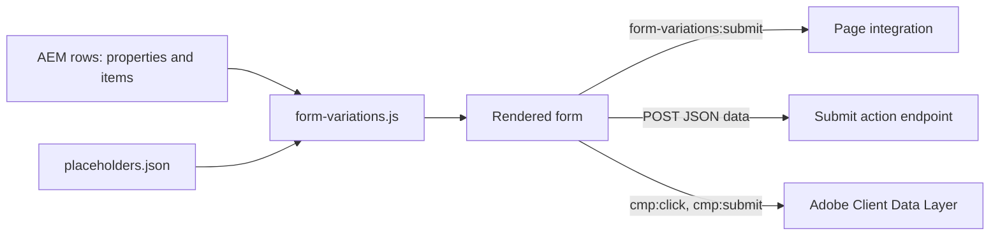

## For QA and Support Teams

| Test ID | Scenario | Configuration | Expected result |
| ------- | -------- | ------------- | --------------- |
| FORM-VARIATIONS-QA-01 | Default rendering | Library section Main | Title, description, required note, fields in order, Send |
| FORM-VARIATIONS-QA-02 | Dark theme | Theme Dark | Dark panel, light text, white Send button |
| FORM-VARIATIONS-QA-03 | Half width | firstName, lastName, email at 1280px | First / Last name side by side, Email full width |
| FORM-VARIATIONS-QA-04 | Required errors | Empty Send | "This field is required." under each mandatory field, focus on the first |
| FORM-VARIATIONS-QA-05 | Email format | Input Type Email, value without @ | "Enter a valid email address." |
| FORM-VARIATIONS-QA-06 | Textarea limit | Max Character Limit 1000 | Counter 0/1000, input stops at 1000 |
| FORM-VARIATIONS-QA-07 | Conditional field | Sector = Other | "Please specify your sector" appears and becomes required; status announces it |
| FORM-VARIATIONS-QA-08 | Contact card | Region = India / Europe | Only the matching card shows; links are `mailto:` / `tel:` |
| FORM-VARIATIONS-QA-09 | Not connected | No Submit action, no integration | Values kept, "This form isn’t connected yet: your details weren’t sent.", no request |
| FORM-VARIATIONS-QA-10 | Endpoint success | Submit action returning 2xx | One POST with `{ data }`, form reset, success message focused |
| FORM-VARIATIONS-QA-11 | Endpoint failure | Submit action returning an error | "Your details couldn’t be sent. Please try again.", values kept |
| FORM-VARIATIONS-QA-12 | Double submit | Two quick Sends with a slow endpoint | One request |
| FORM-VARIATIONS-QA-13 | Integration | Listener with `preventDefault()` and a rejected `respondWith` | No POST, error message |
| FORM-VARIATIONS-QA-14 | Editor | Universal Editor | Conditional items visible with notes; "No Submit action" note when empty |
| FORM-VARIATIONS-QA-15 | Multiple instances | Two forms on a page | Unique ids (`form-variations-1-…`, `form-variations-2-…`) |
| FORM-VARIATIONS-QA-16 | Viewports | 375, 768, 1280px | One column below 900px, two from 900px |
| FORM-VARIATIONS-QA-17 | Keyboard | Tab through, Enter to submit | Logical order, visible focus, hidden fields skipped |
| FORM-VARIATIONS-QA-18 | Data layer | Valid and invalid Send | `cmp:click` for both; `cmp:submit` with names only for the valid one |
| FORM-VARIATIONS-QA-19 | Existing content | Items authored before `fieldName` | Keys read from the node name (lower-cased), form renders |
| FORM-VARIATIONS-QA-20 | Translation | /de-de page | UI texts from the German placeholders, else English |

## Troubleshooting

| Symptom | Likely cause | Diagnostic steps | Resolution | Verification |
| ------- | ------------ | ---------------- | ---------- | ------------ |
| "This form isn’t connected yet" after Send | No Submit action and no integration | Check the Submit action field; in the console listen for `form-variations:submit` | Set the Submit action or add the integration | A valid Send shows the success message |
| "Your details couldn’t be sent" | Endpoint error, network error or rejected `respondWith` promise | Network tab: the POST status; console | Fix the endpoint / integration | 2xx response, success message |
| A conditional item never appears | Condition text differs from the option, or its dropdown is hidden | Inspect `data-depends-on` on the group | Copy the option text exactly; one value per item | Item appears for that value on aem.page |
| All conditional items visible | Viewed in Universal Editor | Look for the italic condition notes | Test on aem.page | Only unconditional items initially |
| No Send button | Every Submit Button conditional, or none added | Check the submit items | Add an unconditional Submit Button | Button visible for every choice |
| Submitted keys lower-cased | Items authored before `fieldName` | `.plain.html`: count the item's cells | Open the item, set Field Name / ID, republish | Key arrives as written |
| Values in the wrong field | A missing positional cell (O-18) | `.plain.html`: count the item's cells | Set every field of the item and save | One cell per field |
| English texts on a locale | Placeholder key missing | Open `/{locale}/placeholders.json` | Add and publish the keys | Translated texts |

Evidence to collect (without secrets): page URL on aem.page, the item rows of `{page}.plain.html`, the Network entry of the POST (status only, no personal data), console errors, `window.adobeDataLayer` entries.

## Performance Considerations

- Decoration waits for the placeholders sheet (loaded once per page view) before rendering.
- The block loads with its section (eager only in the first section); no images, no dynamic imports, no third-party scripts.
- One `fetch` per valid submission (Submit action path); none otherwise.
- Listeners on the form only (`change`, `input`, `submit`) and one `input` listener per textarea; no observers.
- `updateVisibility` repeats until stable, at most once per conditional item plus one pass.
- Layout shift: the form is built before it replaces the rows; the status paragraph has no margin while empty.

## Security and Privacy

- The Submit action URL is used as authored (no allow-list); the request carries no credentials beyond the browser's defaults for that URL and no CSRF token or CAPTCHA.
- Values are sent as typed, without server-side validation in this repository; client validation is only `required`, `type="email"` and `maxlength`. There is no phone format validation.
- The consent text is rich text sanitized by the platform; labels, options and contact data are set with `textContent`.
- Contact phone links keep only digits and `+`; email links use the authored text.
- Data minimisation: the data layer receives field names only, never values; the block stores nothing.

## Known Limitations

| Limitation | Impact | Workaround | Planned correction |
| ---------- | ------ | ---------- | ------------------ |
| No back end in the repository (F-01, O-08) | Data is delivered only with a Submit action or an integration | Set the Submit action; agree the back end | Not recorded |
| `cmp:submit` is pushed before the outcome (R-D-3) | Analytics can't tell delivered submissions | Use a success signal from the integration | Blocked: measurement plan |
| The double-submit guard (`aria-busy`) covers only the Submit action request | While an integration's promise is pending, another Send dispatches the event again | Let the integration ignore repeated calls | Not recorded |
| One value per condition; conditions match any dropdown of the form | Complex routing needs several items | Add one item per value | Not planned |
| Width derived from the field name; the required note takes one grid column from 900px; the checkbox error sits beside the consent text (F-32) | Layout surprises | Start with a full-width item, pair half-width fields | Not recorded |
| Item cells read by position (O-18) | A missing cell shifts later values | Set every item field once | Not recorded |
| Error colours hard-coded (`#c8102e`, `#ff6b6b`) | Not themable by tokens | — | Not recorded |
| No radio groups, multi-select, file upload, date, number or multi-step forms | Unsupported form types | Other solutions | Not recorded |

## Related Documentation

- [Blocks documentation](../README.md)
- [Conversation Canvas](../conversation-canvas/README.md), [Columns Container](../columns-container/README.md)
- Model file: [`_form-variations.json`](_form-variations.json)
- Shared code: [decorators README](../../decorators/README.md), [utils README](../../utils/README.md), [data-layer decorator](../../decorators/data-layer-decorator.js)
- Animation: [docs/animation/README.md](../../docs/animation/README.md), [motion tests](../../test/motion/motion.test.mjs)
- Re-audit: [REAUDIT-2026-10-20](../../docs/audit/REAUDIT-2026-10-20.md)
- [Handover 6.29 Form Variations Block](../../docs/handover/TCS-CORP-HANDOVER.md)

<!-- BEGIN GENERATED: usage (npm run build:docs) -->

Pages of the block library package 1.0.13 (language master, `/content/tcs-corp/language-master/en`) that contain the block, 19 instance(s) in total:
- Block library: `block-library/animation/background-by-block`, `block-library/columns-container/columns-of-blocks`, `block-library/form-variations/field-types`, `block-library/form-variations/form-variations`, `block-library/modal/fragments/contact-form`

Project-wide standards: [knowledge base](../../docs/handover/knowledge-base/README.md) ([block governance](../../docs/handover/knowledge-base/blocks.md)).

<!-- END GENERATED: usage -->

## Change History

| Version | Change | Source | Date |
| ------- | ------ | ------ | ---- |
| Not recorded | README generated from verified implementation and approved handover documentation | Repository review | Not recorded |
| Handover 2.18 | Background animation offered on Form Variations (Additional tab) | docs/handover revision history | 18 October 2026 |
| Handover 2.27 | Block audit: forms were empty on the published site (item node name and classes in the first cell, empty row per dialog tab); corrected | docs/handover revision history | 19 October 2026 |
| Handover 2.29 | Re-audit: field keys in their own `fieldName` field, double-submit guard, integration outcomes (`detail.respondWith`) | docs/handover revision history | 20 October 2026 |
