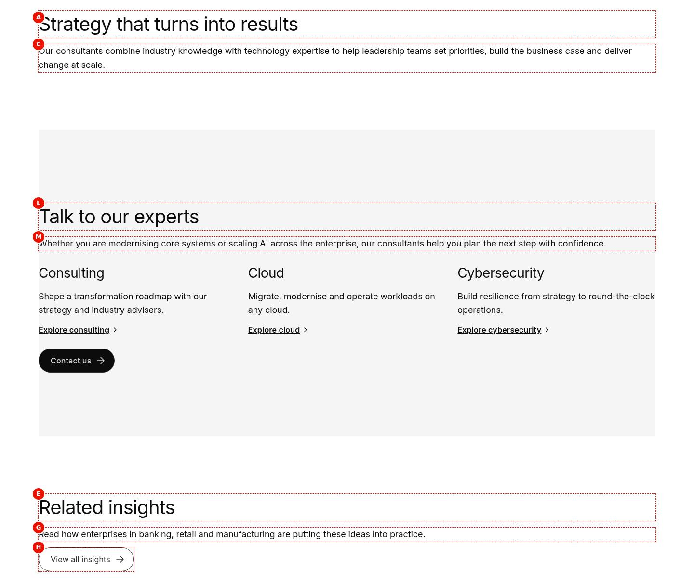
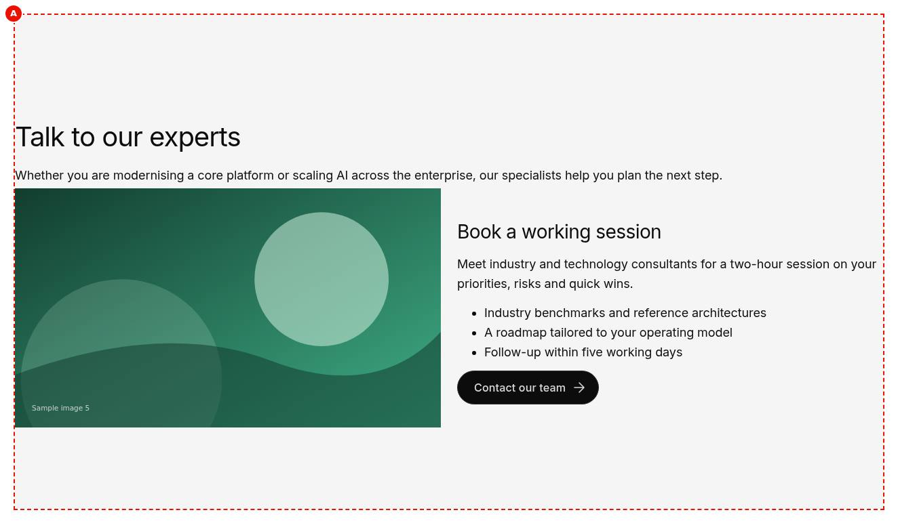
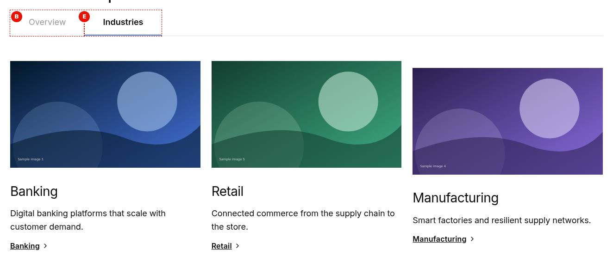
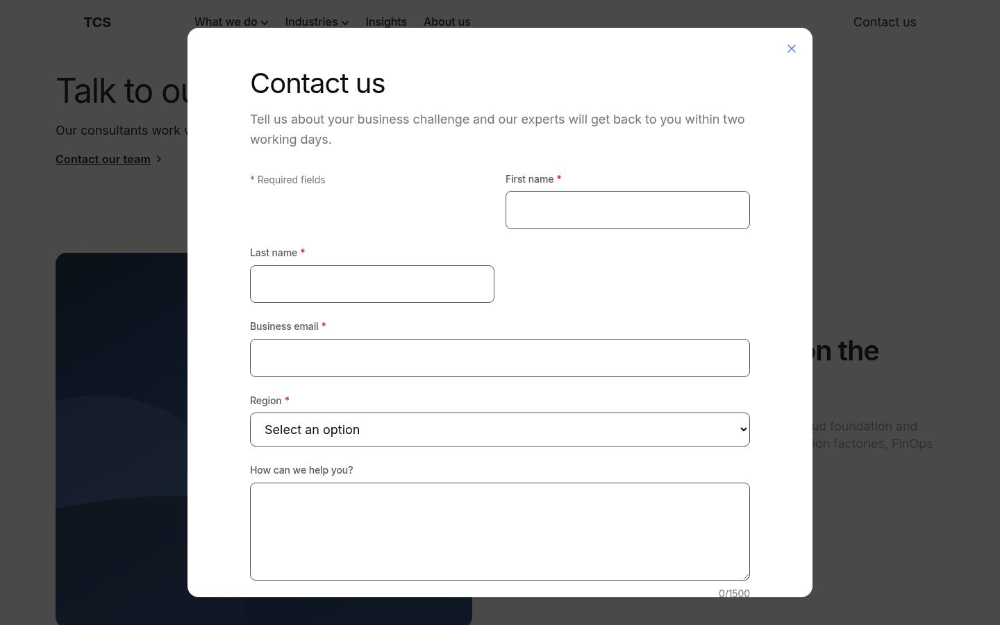
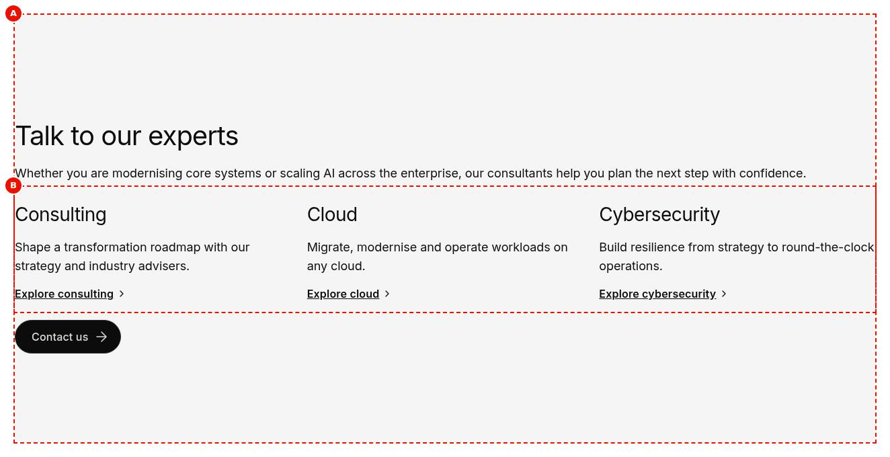
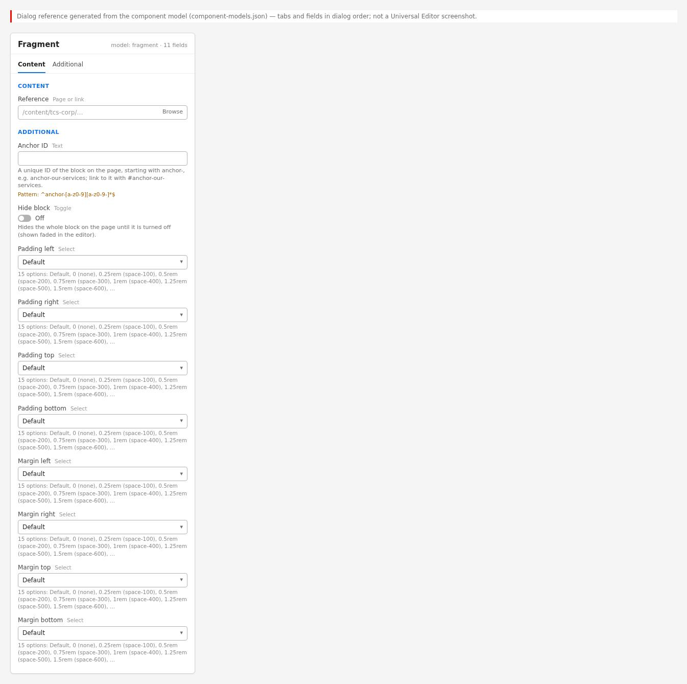
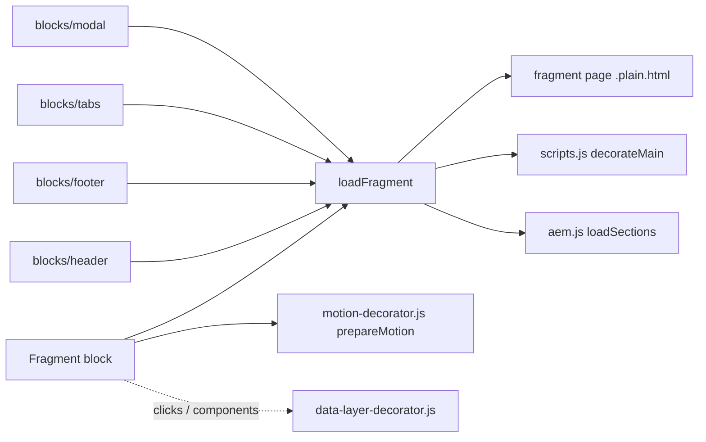

# Fragment

Includes the content of another page (a fragment page, by convention in the locale's `references/`) in the current page. `blocks/fragment/fragment.js` has two parts: the authored **Fragment** block, which replaces its content with the fragment page's sections, and the exported `loadFragment(path, from)` that the header, the footer, the Tabs block and the Modal use to load and fully decorate a page's content. Based on the AEM Block Collection Fragment block.

| Attribute | Value |
| --------- | ----- |
| Technical name | `fragment` (`blocks/fragment`) |
| Display name | Fragment |
| Block type | Structural block (model `fragment`, template name "Fragment"; not key-value) and a shared loader function |
| Status | Active |
| Parent / children | Parent: a section (`section` filter), a Columns Container column (`columns-container` filter) or a Tabs Container tab (`tabs` filter). Children: none authored; renders the fragment page's sections and blocks |
| Owner / version / date | Owner: Not recorded; version: Not recorded; date: Not recorded |

## Overview

**Business purpose.** Author shared content once and reuse it on many pages, so a change is made in one place (a contact banner, a disclaimer, a recurring call to action).

**User experience.** Visitors see the fragment's sections as part of the page, styled by their own sections and blocks; nothing marks them as included.

**Templates / page types.** Any page and template.

**Data source.** The fragment page's `{path}.plain.html` (its sections), fetched in the browser; the fragment page's metadata and tags aren't used.

**Related blocks.** [Header](../header/README.md) (nav page), [Footer](../footer/README.md) (footer page and its Canvas page), [Modal](../modal/README.md) (fragment pages in a dialog), the Tabs block (`blocks/tabs`, a tab's Fragment), [Columns Container](../columns-container/README.md) (can hold a Fragment).

**When to use.** Content that must be identical on several pages of the same locale and maintained centrally.

**When not to use.** Page-specific content; the header and footer (use the Navigation / Footer page properties); content that must be in the page's delivered HTML for SEO (fragments are loaded in the browser); the first, LCP-critical section (a fragment adds a request).

**Realistic use cases.** A "Talk to our experts" banner with three service columns on every service page (block library `block-library/fragment/fragment-block` with `fragments/cta-banner`); a regulatory disclaimer on investor pages; a campaign banner for a period.

## Visual Reference

<!-- BEGIN GENERATED: screenshots (npm run build:docs) -->

Screenshots of the handover (6.3 Fragment Block), taken on the preview with sample content; they show the rendering at the time of the handover revision that added them (later changes are in the sections below and the handover's revision history):

**Desktop rendering** — The Consulting page at 1440 px: the H2 Strategy that turns into results and its text, then the grey Highlight section of references/cta-banner with the H2 Talk to our experts, its intro text, the H3 columns Consulting, Cloud and Cybersecurity with the links Explore consulting, Explore cloud and Explore cybersecurity, and a black Contact us primary button, the three columns side by side, then the H2 Related insights, its text and an outlined View all insights button.



**Tablet rendering** — The Fragment at 768 px: the grey Highlight section with the H2 Talk to our experts and its text, the columns Consulting, Cloud and Cybersecurity stacked one below the other (Columns go side by side only from 900 px), each with its Explore link, and the black Contact us button.


**Mobile rendering** — The Fragment at 390 px: the grey Highlight section with the H2 Talk to our experts, the intro text wrapped over four lines, Consulting, Cloud and Cybersecurity stacked with their texts and Explore links, and the black Contact us button last.


**Fragment block in a page** — The selected Fragment block in Universal Editor at 1440 px, cropped to the block: the grey Highlight section of references/cta-banner with the H2 Talk to our experts, its intro text, the H3 columns Consulting, Cloud and Cybersecurity with the links Explore consulting, Explore cloud and Explore cybersecurity, and a black Contact us primary button, the columns side by side.



**Fragment in a tab** — The Tabs block How we help at 1440 px in the Underline style: the tabs Overview and Industries, Industries selected with a blue underline; its panel shows the tab-industries fragment, three columns Banking, Retail and Manufacturing, each with a sample image, an H3, a short text and a link.



**Fragment in a modal** — The Get in touch page at 1440 px dimmed behind an open dialog loaded from /en/shots/g01b/modals/contact-form: a close icon, the H2 Contact our team, the description, the * Required fields note taking a grid column beside Full name (F-32), Business e-mail, Company, How can we help? with 0/1500, the consent checkbox and the Send button cut at the bottom.



**Universal Editor canvas** — The Fragment at 1440 px in editor mode with two markers: A around the whole Fragment block (the grey Talk to our experts section) and B around the included Columns block only (Consulting, Cloud, Cybersecurity with their Explore links); the H2, the text and the Contact us button lie inside A, outside B. (Annotated preview in editor mode with sample content; letters as in the annotations list, not a Universal Editor screenshot; file screenshots/fragment-authoring-view.jpg)



**Properties panel** — The Fragment block's properties with the Content tab (Reference) and the Additional tab (Anchor ID, Hide block, padding and margin selects). (Dialog reference generated from the component model, not a Universal Editor screenshot; file screenshots/fragment-properties-panel.jpg)



Universal Editor dialogs (no screenshot exists yet; to be captured on AEM author):

```text
[Screenshot Placeholder]

File name:
fragment-dialog-content-desktop.png

Purpose:
The Content tab of the Fragment properties in Universal Editor, with the fields of the table "Content tab — Fragment" in Authorable Fields below.

Annotations:
A = Reference
```

```text
[Screenshot Placeholder]

File name:
fragment-dialog-additional-desktop.png

Purpose:
The Additional tab of the Fragment properties in Universal Editor, with the fields of the table "Additional tab — Fragment" in Authorable Fields below.

Annotations:
A = Anchor ID
B = Hide block
C = Padding left
D = Padding right
E = Padding top
F = Padding bottom
G = Margin left
H = Margin right
I = Margin top
J = Margin bottom
```

<!-- END GENERATED: screenshots -->

States without a screenshot:

```text
[Screenshot Placeholder]

File name:
fragment-empty-editor-desktop.png

Purpose:
Universal Editor edit mode: a Fragment without a page (or one that can't load) shows its hint.

Annotations:
A = Hint "Fragment: choose the page whose content it shows."
B = Fragment block in the content tree
```

```text
[Screenshot Placeholder]

File name:
fragment-unpublished-desktop.png

Purpose:
The published page when the fragment page isn't published: the block keeps its authored content (the reference link).

Annotations:
A = Reference path shown as a link
```

## For Content Authors

1. **Create the fragment page** in the locale's `references/` (for example `references/cta-banner`) and author its sections and blocks like any page; start its headings at H2.
2. **Publish the fragment page** (Preview for `.aem.page`, Publish for `.aem.live`).
3. **Add the block** to the host page: section (or Columns Container column, or Tab) › Add › **Fragment**.
4. **Open its properties** and pick the fragment page in **Reference** (content picker).
5. **Additional tab** (optional): Anchor ID, Hide block, padding and margin apply to the Fragment block on this page.
6. **Preview** the host page: the fragment's sections appear in the block. To change the content, edit the fragment page, not the host page.
7. **Publish** the host page.
8. **Validate** on the published site: the content shows, images load, headings fit the page's hierarchy, there is one H1.

Minimum required: Reference to a published page. Recommended: one self-contained unit per fragment (one to three sections), one fragment page per locale. Optional: the Additional tab.

## Authorable Fields

<!-- BEGIN GENERATED: fields (npm run build:docs) -->

### Fragment (`fragment`)

Model `fragment`; template name "Fragment" (the block class AEM renders).

#### Content tab — Fragment

| Field label | Property | Type | Required | Default | Allowed values | Author guidance | Example |
| ----------- | -------- | ---- | -------- | ------- | -------------- | --------------- | ------- |
| Reference | `reference` | aem-content | No | — | — | — | /language-master/en/block-library/fragment/fragments/cta-banner |

#### Additional tab — Fragment

| Field label | Property | Type | Required | Default | Allowed values | Author guidance | Example |
| ----------- | -------- | ---- | -------- | ------- | -------------- | --------------- | ------- |
| Anchor ID | `classes_anchor` | text | No | — | regExp: ^anchor-[a-z0-9][a-z0-9-]*$; customErrorMsg: Start with anchor-, then lower-case letters, digits and hyphens. | A unique ID of the block on the page, starting with anchor-, e.g. anchor-our-services; link to it with #anchor-our-services. Delivered as a block class. | — |
| Hide block | `classes_hideblock` | boolean | No | `false` | on / off | Hides the whole block on the page until it is turned off (shown faded in the editor). Delivered as a block class. | — |
| Padding left | `classes_paddingleft` | select | No | "" | Default (""), 0 (none) (`pl-0`), 0.25rem (space-100) (`pl-100`), 0.5rem (space-200) (`pl-200`), 0.75rem (space-300) (`pl-300`), 1rem (space-400) (`pl-400`), 1.25rem (space-500) (`pl-500`), 1.5rem (space-600) (`pl-600`), 2rem (space-800) (`pl-800`), 2.5rem (space-1000) (`pl-1000`), 3rem (space-1200) (`pl-1200`), 4rem (space-1600) (`pl-1600`), 5rem (space-2000) (`pl-2000`), 6rem (space-2400) (`pl-2400`), 7.5rem (space-3000) (`pl-3000`) | Delivered as a block class. | — |
| Padding right | `classes_paddingright` | select | No | "" | Default (""), 0 (none) (`pr-0`), 0.25rem (space-100) (`pr-100`), 0.5rem (space-200) (`pr-200`), 0.75rem (space-300) (`pr-300`), 1rem (space-400) (`pr-400`), 1.25rem (space-500) (`pr-500`), 1.5rem (space-600) (`pr-600`), 2rem (space-800) (`pr-800`), 2.5rem (space-1000) (`pr-1000`), 3rem (space-1200) (`pr-1200`), 4rem (space-1600) (`pr-1600`), 5rem (space-2000) (`pr-2000`), 6rem (space-2400) (`pr-2400`), 7.5rem (space-3000) (`pr-3000`) | Delivered as a block class. | — |
| Padding top | `classes_paddingtop` | select | No | "" | Default (""), 0 (none) (`pt-0`), 0.25rem (space-100) (`pt-100`), 0.5rem (space-200) (`pt-200`), 0.75rem (space-300) (`pt-300`), 1rem (space-400) (`pt-400`), 1.25rem (space-500) (`pt-500`), 1.5rem (space-600) (`pt-600`), 2rem (space-800) (`pt-800`), 2.5rem (space-1000) (`pt-1000`), 3rem (space-1200) (`pt-1200`), 4rem (space-1600) (`pt-1600`), 5rem (space-2000) (`pt-2000`), 6rem (space-2400) (`pt-2400`), 7.5rem (space-3000) (`pt-3000`) | Delivered as a block class. | — |
| Padding bottom | `classes_paddingbottom` | select | No | "" | Default (""), 0 (none) (`pb-0`), 0.25rem (space-100) (`pb-100`), 0.5rem (space-200) (`pb-200`), 0.75rem (space-300) (`pb-300`), 1rem (space-400) (`pb-400`), 1.25rem (space-500) (`pb-500`), 1.5rem (space-600) (`pb-600`), 2rem (space-800) (`pb-800`), 2.5rem (space-1000) (`pb-1000`), 3rem (space-1200) (`pb-1200`), 4rem (space-1600) (`pb-1600`), 5rem (space-2000) (`pb-2000`), 6rem (space-2400) (`pb-2400`), 7.5rem (space-3000) (`pb-3000`) | Delivered as a block class. | — |
| Margin left | `classes_marginleft` | select | No | "" | Default (""), 0 (none) (`ml-0`), 0.25rem (space-100) (`ml-100`), 0.5rem (space-200) (`ml-200`), 0.75rem (space-300) (`ml-300`), 1rem (space-400) (`ml-400`), 1.25rem (space-500) (`ml-500`), 1.5rem (space-600) (`ml-600`), 2rem (space-800) (`ml-800`), 2.5rem (space-1000) (`ml-1000`), 3rem (space-1200) (`ml-1200`), 4rem (space-1600) (`ml-1600`), 5rem (space-2000) (`ml-2000`), 6rem (space-2400) (`ml-2400`), 7.5rem (space-3000) (`ml-3000`) | Delivered as a block class. | — |
| Margin right | `classes_marginright` | select | No | "" | Default (""), 0 (none) (`mr-0`), 0.25rem (space-100) (`mr-100`), 0.5rem (space-200) (`mr-200`), 0.75rem (space-300) (`mr-300`), 1rem (space-400) (`mr-400`), 1.25rem (space-500) (`mr-500`), 1.5rem (space-600) (`mr-600`), 2rem (space-800) (`mr-800`), 2.5rem (space-1000) (`mr-1000`), 3rem (space-1200) (`mr-1200`), 4rem (space-1600) (`mr-1600`), 5rem (space-2000) (`mr-2000`), 6rem (space-2400) (`mr-2400`), 7.5rem (space-3000) (`mr-3000`) | Delivered as a block class. | — |
| Margin top | `classes_margintop` | select | No | "" | Default (""), 0 (none) (`mt-0`), 0.25rem (space-100) (`mt-100`), 0.5rem (space-200) (`mt-200`), 0.75rem (space-300) (`mt-300`), 1rem (space-400) (`mt-400`), 1.25rem (space-500) (`mt-500`), 1.5rem (space-600) (`mt-600`), 2rem (space-800) (`mt-800`), 2.5rem (space-1000) (`mt-1000`), 3rem (space-1200) (`mt-1200`), 4rem (space-1600) (`mt-1600`), 5rem (space-2000) (`mt-2000`), 6rem (space-2400) (`mt-2400`), 7.5rem (space-3000) (`mt-3000`) | Delivered as a block class. | — |
| Margin bottom | `classes_marginbottom` | select | No | "" | Default (""), 0 (none) (`mb-0`), 0.25rem (space-100) (`mb-100`), 0.5rem (space-200) (`mb-200`), 0.75rem (space-300) (`mb-300`), 1rem (space-400) (`mb-400`), 1.25rem (space-500) (`mb-500`), 1.5rem (space-600) (`mb-600`), 2rem (space-800) (`mb-800`), 2.5rem (space-1000) (`mb-1000`), 3rem (space-1200) (`mb-1200`), 4rem (space-1600) (`mb-1600`), 5rem (space-2000) (`mb-2000`), 6rem (space-2400) (`mb-2400`), 7.5rem (space-3000) (`mb-3000`) | Delivered as a block class. | — |

<!-- END GENERATED: fields -->

Notes:

- **Reference.** The block reads the first link's `href`, else its text. Only paths starting with `/` (not `//`) are loaded; full URLs and relative paths are ignored. `.html` / `.plain.html` endings are removed and `{path}.plain.html` is fetched (the AEM author path when editing in Universal Editor, the published path on the site). The path isn't localized: pick the page of the same locale.
- **Rendering result.** The block's content is replaced by the fragment's sections (`div.section`), decorated like a page (`decorateMain`: sections with their options, Columns Containers, Tabs, blocks, block options, buttons) and loaded (`loadSections`); images with `./media_` paths are rebased to the fragment page; the fragment's block animations are prepared (`prepareMotion`).
- **No content.** A path that can't load (not published, 404) leaves the authored content (the reference link); in Universal Editor edit mode the block shows the hint "Fragment: choose the page whose content it shows." (placeholder `fragmentEmpty`).
- **Recursion.** A fragment that includes itself, directly or through other fragments, or the page it is on, isn't loaded again; the same fragment twice side by side is fine.
- **Accessibility impact.** The fragment's headings become part of the host page's outline.
- **Data layer impact.** The Fragment block is a component; the fragment's blocks are its children (`parentId`).
- **Legacy mapping.** None.
- **Additional tab.** As every block (AGENTS.md "Additional tab"), without animation fields (the blocks inside keep their own animations); applies to the Fragment block on the host page.

## Screenshot-Based Authoring Steps

### Authoring Step 1: Create and publish the fragment page

```text
[Screenshot Placeholder]

File name:
fragment-authoring-step-1.png

Purpose:
The fragment page (references/cta-banner) in Universal Editor with its sections.

Annotations:
A = Default content: H2 and intro
B = Columns Container with three columns
C = Button Block "Contact us"
```

### Values to Enter

| Callout | Field | Value | Reason | Expected result |
| ------- | ----- | ----- | ------ | --------------- |
| A | Title (H2) | `Talk to our experts` | The fragment starts at H2 | Heading in the host page outline |
| B | Columns Container | Consulting, Cloud, Cybersecurity columns | Shared content | Columns in every host page |
| C | Button Block | `Contact us` | Shared call to action | Same CTA everywhere |

Values from `block-library/fragment/fragments/cta-banner`. Author action: create the page, author, publish. Business rule: the fragment page must be published before the host page shows it. Validation: open `{path}.plain.html` on the site. Common mistake: an H1 in the fragment (two H1 on the page).

### Authoring Step 2: Add the Fragment block

```text
[Screenshot Placeholder]

File name:
fragment-authoring-step-2.png

Purpose:
The host page with the Add menu of a section and Fragment highlighted.

Annotations:
A = Section of the host page
B = Fragment in the component list
```

### Values to Enter

| Callout | Field | Value | Reason | Expected result |
| ------- | ----- | ----- | ------ | --------------- |
| B | Component | Fragment | Includes the shared page | Empty block with the editor hint |

Expected preview: "Fragment: choose the page whose content it shows." until a Reference is set. Common mistake: adding it in the first section of the page (slower LCP).

### Authoring Step 3: Choose the Reference

```text
[Screenshot Placeholder]

File name:
fragment-authoring-step-3.png

Purpose:
The Fragment properties, Content tab, with Reference picked.

Annotations:
A = Reference
```

### Values to Enter

| Callout | Field | Value | Reason | Expected result |
| ------- | ----- | ----- | ------ | --------------- |
| A | Reference | `/language-master/en/block-library/fragment/fragments/cta-banner` | The shared page | The banner renders in the block |

Business rule: only site paths are loaded (no full URLs). Validation: the content shows in the editor preview. Common mistake: a page of another locale (wrong language).

### Authoring Step 4: Additional tab and publish

```text
[Screenshot Placeholder]

File name:
fragment-authoring-step-4.png

Purpose:
The Additional tab of the Fragment with an Anchor ID and a margin.

Annotations:
A = Anchor ID
B = Margin top
```

### Values to Enter

| Callout | Field | Value | Reason | Expected result |
| ------- | ----- | ----- | ------ | --------------- |
| A | Anchor ID | `anchor-g01b-fragment` (library sample) | Jump target | `id` on the block |
| B | Margin top | Default | Spacing comes from the fragment's sections | No extra space |

Expected published result: the banner on the published host page. Validation: `#anchor-g01b-fragment` jumps to it. Common mistake: publishing only the host page.

## Variations

### Fragment block (default)

- **Purpose:** include one page's sections.
- **When to use / not:** shared content; not for page-specific or SEO-critical content.
- **Required fields:** Reference. **Optional:** Additional tab.
- **Rendering:** `div.fragment.block` containing the fragment's `div.section`s; no styles of its own (`fragment.css` is empty).
- **Desktop / tablet / mobile:** as the included sections and blocks.
- **Accessibility:** the included content's semantics.
- **Data layer:** `fragment-{n}` (or its Anchor ID) with the inner blocks as children.
- **Personalization / fallback:** none; an unpublished fragment leaves the reference link.

```text
[Screenshot Placeholder]

File name:
fragment-block-desktop.png

Purpose:
A host page with the included CTA banner at 1440px.

Annotations:
A = Fragment block boundary
B = Included Columns Container
```

### Nested fragments

- **Purpose:** a fragment page that itself contains a Fragment (or a Tabs block with tab fragments).
- **Rendering:** the inner fragment loads while the outer one is decorated; the chain of including fragments (`main[data-fragment-chain]`) stops a fragment from including itself or the host page.
- **Performance:** each level adds a sequential request.

```text
[Screenshot Placeholder]

File name:
fragment-nested-desktop.png

Purpose:
A fragment containing another fragment, both rendered once.

Annotations:
A = Outer fragment
B = Inner fragment
```

### Shared loader (header, footer, tabs, modal)

- **Purpose:** the same `loadFragment` loads the Navigation page (`blocks/header`), the footer page and its Canvas page (`blocks/footer`), a tab's Fragment (`blocks/tabs`, passing the tab row as `from`) and modal content (`blocks/modal`).
- **Rendering:** the caller places the decorated sections; see each block's README.

```text
[Screenshot Placeholder]

File name:
fragment-in-tab-desktop.png

Purpose:
A Tabs block panel showing a tab fragment.

Annotations:
A = Tab
B = Panel with the fragment's content
```

## Complete Authoring Example

Scenario: a "Talk to our experts" banner reused on the Consulting page.

| Field | Example value | Guidance |
| ----- | ------------- | -------- |
| Fragment page | `/content/tcs-corp/us/en/references/cta-banner` | In the locale's `references/` |
| Fragment page content | H2 `Talk to our experts`, intro, Columns Container (Consulting, Cloud, Cybersecurity, each with an "Explore …" Button Block), Button Block `Contact us` | Self-contained, starts at H2 |
| Host page › Fragment › Reference | `/content/tcs-corp/us/en/references/cta-banner` | Same locale |
| Additional › Anchor ID | `anchor-contact` | Optional |

Steps: author and publish the fragment page, add the Fragment to the host page, pick the Reference, publish the host page.

Expected output: the banner between the host page's sections. Responsive: the Columns Container's own behaviour. Accessibility: H2 / H3 inside the page's outline. Analytics: clicks on the banner's buttons report their Button Blocks (children of the fragment component); clicks on default-content links report the fragment. Personalization fallback: none.

Pre-publish checklist:

- [ ] Fragment page published and in the same locale.
- [ ] No H1 or Page Header in the fragment.
- [ ] The fragment doesn't include the host page or itself.
- [ ] Not in the page's first section.

## Content and Asset Guidelines

- **Titles.** Start at H2; keep the fragment's outline valid in every host page.
- **CTAs and links.** Generic enough for every host page.
- **Images.** Select them with the image picker on the fragment page; `./media_` paths are rebased to the fragment page.
- **Tags and metadata.** Not used from the fragment page; give it a clear title for authors.
- **Min / max items.** No verified technical limit was identified.
- **Loading.** Fetched when the block's section loads; images load as their blocks define.
- **Missing assets / page.** An unpublished fragment page leaves the reference link on the page.

## Accessibility

- The block adds no markup or roles: the fragment's content keeps its own semantics, headings, keyboard behaviour and focus handling.
- One H1 per page: fragments start at H2.
- The editor hint is plain text (edit mode only).
- Ids inside a fragment are de-duplicated against the page only for block anchors at decoration time; the same fragment included twice may produce duplicate ids (suspected in the audit).

Author responsibilities: heading levels, alt texts and link texts on the fragment page; content that makes sense without the surrounding page.

Developer responsibilities: keep the content unchanged when moving it into the block; keep the recursion guard and the editor hint.

The block handles no keys itself; the included blocks define their keyboard behaviour.

## Data Layer and Analytics

- **Component.** `fragment-{n}` (its Anchor ID when set), `@type` `tcs-corp/components/fragment`, `parentId` the page, added after the main sections are loaded (`trackBlocks(main)`).
- **Children.** Blocks of the fragment get `parentId` = the fragment's id.
- **Clicks.** Captured centrally; links in the fragment's default content report the fragment, links in its blocks report those blocks. No `data-cmp-*` attributes or own pushes.

| Trigger | Data-layer event | Required properties | Analytics behavior |
| ------- | ---------------- | ------------------- | ------------------ |
| Main sections loaded | `component` entries for the fragment and its blocks | `@type`, `parentId` | Inventory with nesting |
| Click on a link in the fragment's default content | `cmp:click` | `eventInfo.path` `component.fragment-{n}`, `interaction`, `dc:title`, `xdm:linkURL`, `xdm:linkType`, `breakpoint` | Link click attributed to the fragment |
| Click in a block of the fragment | `cmp:click` | The block's own path | As that block |

The intended flow is Adobe Client Data Layer → Adobe Data Collection (Tags) → AEP Web SDK → Edge Network → Analytics / CJA; Tags and the Web SDK aren't configured yet (blocked: measurement plan). No consent mechanism is implemented.

## Personalization

This block does not currently expose verified personalization behavior. There is no Adobe Target or Journey Optimizer integration in the repository; the referenced fragment page is what renders for every visitor.

## Responsive Behavior

| Viewport | Layout | Image behavior | Interaction behavior |
| -------- | ------ | -------------- | -------------------- |
| All | No styles of its own (`fragment.css` is empty, no media queries): the included sections and blocks apply their own breakpoints | As the included blocks | As the included blocks |

## For Developers

<!-- BEGIN GENERATED: files (npm run build:docs) -->

```text
blocks/fragment/
├── README.md
├── _fragment.json
├── fragment.css
└── fragment.js
```

| Decorator/Utility | Purpose | Execution or dependency point |
| ----------------- | ------- | ----------------------------- |
| [`scripts/scripts.js`](../../scripts/scripts.js) | Page decoration (moveInstrumentation and shared page helpers) | `fragment.js`: { decorateMain, } |
| [`scripts/aem.js`](../../scripts/aem.js) | Edge Delivery core library (block loading, CSS, metadata, optimized pictures) | `fragment.js`: { loadSections, } |
| [`decorators/motion-decorator.js`](../../decorators/motion-decorator.js) | `prepareMotion` (the Content animation and Background animation of the blocks of a section, before it is shown, or of a fragment, footer page or header Canvas once in the page: first frame paused, run by one Intersection | `fragment.js`: { prepareMotion } |
| [`utils/environment.js`](../../utils/environment.js) | `prefersReducedMotion`, `scrollBehavior`, `isEditing`, `isInEditor`, `isAuthor` (the page is rendered by AEM author, which has no query index) | `fragment.js`: { isEditing } |
| [`utils/placeholders.js`](../../utils/placeholders.js) | `getPlaceholders`, `loadPlaceholders`, `fillPlaceholder` (UI text from the locale's placeholders, with English fallbacks) | `fragment.js`: { getPlaceholders } |

<!-- END GENERATED: files -->

**Input DOM.** One row with one cell: the Reference link (or its text). The Additional tab arrives as block classes.

**`loadFragment(path, from = null)`** (exported).

1. Returns `null` unless `path` starts with `/` and not `//`.
2. Removes the first `.plain.html` / `.html`; returns `null` for the current page's path or a path already in the chain of `from` (`from.closest('main[data-fragment-chain]')`).
3. `fetchFragment`: `fetch(`${path}.plain.html`)`; a non-OK response returns `null`; a detached `main[data-fragment-chain]` gets the HTML; `./media_` `img[src]` / `source[srcset]` are rebased; `decorateMain(main)`; `await loadSections(main)`; returns the `main`.

Callers pass the including element as `from` (the Fragment block, a tab row) so nested fragments know their chain; the header, the footer and the Modal call it without `from`.

**`decorate(block)`.** Path from the first `a` or the text; `loadFragment(path, block)`; on success `block.replaceChildren(...fragment.childNodes)` and `await prepareMotion(block)`; else in edit mode (`isEditing()`, `html.adobe-ue-edit`) `p.fragment-empty` with the `fragmentEmpty` placeholder; otherwise the block is left as delivered.

**Rendered DOM contract.**

```text
div.fragment.block[data-block-name=fragment][id?]
├─ div.section …[data-section-status=loaded]
│  ├─ div.default-content-wrapper
│  └─ div.{block}-wrapper > div.{block}.block
└─ div.section …
```

**Error handling.** A network error rejects `fetch`; `aem.js` `loadBlock` logs it and marks the block loaded with its authored content. Other callers treat `null` as "no content".

**Async behavior.** The block resolves after the fragment's sections and blocks are loaded and its animations prepared.

## Extending the Block

- **A field.** Add it to `_fragment.json` (keep the Additional tab last), `npm run build:json`, `npm run lint`. The block isn't key-value: a dialog tab adds an empty row, so read rows by `data-aue-prop` in the editor and skip empty rows rather than taking "the first row" (AGENTS.md "AEM delivery rules").
- **Loader changes.** `loadFragment` is shared by header, footer, tabs and modal: keep its signature, the path rules and the recursion guard; pass `from` from new callers.
- **Responsive / accessibility.** The block should stay style-free; included content owns its layout and semantics.
- **Data layer.** Inner blocks are tracked as children automatically.
- **Tests.** No unit test covers the block; `test/motion/motion.test.mjs` checks it has no animation fields. Add tests for new pure logic.
- **Docs and modules.** Update this README (`npm run build:docs`) and the block library page; `npm run build:modules` after changing imports (the fragment is in `CHROME_BLOCKS`).

## For Site Administrators

- **Availability.** Offered in the `section`, `columns-container` and `tabs` filters.
- **Governance.** Model in `blocks/fragment/_fragment.json`.
- **Publishing dependencies.** The fragment pages (published before the host pages) and the assets they use; the placeholder `fragmentEmpty` (editor only). Fragment pages in `references/` are excluded from the query index (`helix-query.yaml`).
- **Localization.** One fragment page per locale, referenced by that locale's pages.

| Dependency | Purpose | Location | Impact if unavailable |
| ---------- | ------- | -------- | --------------------- |
| Fragment page | The included content | e.g. `/{locale}/references/cta-banner` | The reference link stays on the page |
| Blocks used in the fragment | Rendering | `blocks/*` | As those blocks' errors |
| Placeholder `fragmentEmpty` | Editor hint | `/{locale}/placeholders.json` | English fallback |

## For Architects

- **Role.** Content reuse (the Edge Delivery equivalent of an experience fragment) and the shared loader of the page chrome and dialogs.
- **Content model.** A reference to a page; the page is the unit of reuse.
- **Rendering.** Client-side: `.plain.html` fetched and decorated with the page pipeline (`decorateMain`, `loadSections`).
- **Dependencies.** `scripts/scripts.js` (`decorateMain`), `scripts/aem.js` (`loadSections`), `decorators/motion-decorator.js`, `utils/environment.js`, `utils/placeholders.js`.
- **Data layer / Web SDK / Target.** Nested component entries; no Target.
- **Consent and identity.** None.
- **Caching.** `.plain.html` through the CDN and browser cache; no caching in code (each use fetches).
- **Performance.** One request per fragment per use, sequential for nesting.
- **Security.** Same-site root-relative paths only.
- **Scalability.** Any number of host pages per fragment; republish the fragment to update them all.



## For QA and Support Teams

| Test ID | Scenario | Configuration | Expected result |
| ------- | -------- | ------------- | --------------- |
| FRAGMENT-QA-01 | Default | Reference to a published page | Its sections render in the block |
| FRAGMENT-QA-02 | Unpublished page | Reference to an unpublished page | Reference link stays; no error on the page |
| FRAGMENT-QA-03 | Empty in the editor | No Reference, edit mode | Hint "Fragment: choose the page whose content it shows." |
| FRAGMENT-QA-04 | Full URL | Reference `https://…` | Ignored (authored content stays) |
| FRAGMENT-QA-05 | Self-inclusion | Fragment page containing a Fragment of itself | Loaded once, no loop |
| FRAGMENT-QA-06 | Host page reference | Fragment pointing to the host page | Not loaded |
| FRAGMENT-QA-07 | Twice side by side | Two Fragments with the same Reference | Both render |
| FRAGMENT-QA-08 | Images | Fragment with images | Images load on the host page |
| FRAGMENT-QA-09 | Additional tab | Anchor ID, Hide block | `id` set; hidden on the site, dimmed in the editor |
| FRAGMENT-QA-10 | In a Columns Container / Tab | Fragment in a column or tab | Renders inside the column / panel |
| FRAGMENT-QA-11 | Viewports | 390 / 1024 / 1440px | Included blocks follow their own breakpoints |
| FRAGMENT-QA-12 | Data layer | Inspect `adobeDataLayer` | Fragment entry with child blocks' `parentId` |
| FRAGMENT-QA-13 | Animations | Fragment with an animated block | Animation plays when in view, not in edit mode |

## Troubleshooting

| Symptom | Likely cause | Diagnostic steps | Resolution | Verification |
| ------- | ------------ | ---------------- | ---------- | ------------ |
| The block shows a bare link | Fragment page not published (404) or a full URL | Network: `{path}.plain.html` status; the Reference value | Publish the page; pick it with the content picker | Content renders |
| Broken images in the fragment | Unpublished assets or non-`./media_` paths | Inspect `img src` | Re-select images on the fragment page and republish | Images load |
| Wrong language | Reference to another locale | Check the path's locale | Point to the locale's fragment page | Right language |
| Old content | Fragment page not republished, cache | Open its `.plain.html` | Publish the fragment page | New content |
| Two H1 | H1 or Page Header in the fragment | Heading outline | Use H2 | One H1 |
| Fragment missing on one page only | It references that page itself (guard) | Compare Reference and host path | Reference another page | Content renders |

Evidence to collect: host page URL, Reference value, network status of the `.plain.html` request, console errors, screenshot. No cookies or tokens.

## Performance Considerations

- Loaded with its section (eager for the first section, else lazy): one extra request, then the included blocks' modules and styles; avoid the first section.
- Nested fragments add sequential requests; the same fragment used twice is requested twice (normally from the browser cache).
- No listeners or observers of its own; animations through `prepareMotion`.

## Security and Privacy

- Only root-relative same-site paths are fetched (`/`, not `//`); full URLs are ignored, so no external content is loaded.
- The HTML is the site's own `.plain.html`, inserted with `innerHTML` into a detached element and decorated; no query strings, no personal data.

## Known Limitations

| Limitation | Impact | Workaround | Planned correction |
| ---------- | ------ | ---------- | ------------------ |
| Full URLs in Reference are ignored (F-15) | A pasted URL shows nothing | Use the content picker | Not recorded (F-15 open, P3) |
| Content isn't in the delivered page HTML | Not part of the page for SEO | Keep unique content on the page | Not planned |
| No caching in code; each use fetches | Extra requests for repeated fragments | — | Not planned |
| The same fragment twice may produce duplicate ids (suspected, audit docs/audit/blocks/group-c-containers.md) | Duplicate anchors | Avoid two instances with anchors | Not recorded |
| The Reference isn't localized | Copied pages may show another locale | Re-point after copying | Not planned |
| Field label "Reference" is technical (audit suggestion "Fragment page") | Author clarity | — | Not recorded |

## Related Documentation

- [Blocks documentation](../README.md)
- [Header](../header/README.md), [Footer](../footer/README.md), [Modal](../modal/README.md), [Columns Container](../columns-container/README.md)
- Model: [`_fragment.json`](./_fragment.json)
- [decorators README](../../decorators/README.md), [utils README](../../utils/README.md)
- Tests: [`test/motion/motion.test.mjs`](../../test/motion/motion.test.mjs)
- Handover: [handover 6.3 Fragment Block](../../docs/handover/TCS-CORP-HANDOVER.md)

<!-- BEGIN GENERATED: usage (npm run build:docs) -->

Pages of the block library package 1.0.13 (language master, `/content/tcs-corp/language-master/en`) that contain the block, 1 instance(s) in total:
- Block library: `block-library/fragment/fragment-block`

Project-wide standards: [knowledge base](../../docs/handover/knowledge-base/README.md) ([block governance](../../docs/handover/knowledge-base/blocks.md)).

<!-- END GENERATED: usage -->

## Change History

| Version | Change | Source | Date |
| ------- | ------ | ------ | ---- |
| Not recorded | README generated from verified implementation and approved handover documentation | Repository review | Not recorded |
| Handover 2.27 | Block ecosystem audit: recursion guard (D-C-17); editor hint when nothing is shown (D-C-21) | docs/handover revision history; docs/audit/BLOCK-ECOSYSTEM-AUDIT.md | 19 October 2026 |
| Handover 2.29 | Re-audit: fragments loaded twice (regression of the recursion guard) corrected; recursion by the chain of including fragments (R-C-5) | docs/handover revision history; docs/audit/REAUDIT-2026-10-20.md | 20 October 2026 |
| Handover 2.36 | The stylesheets of blocks in the header's fragments preloaded (F-106) | docs/handover revision history | 20 October 2026 |
