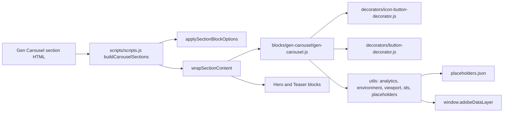

# Gen Carousel

The Gen Carousel shows a sequence of slides one at a time, with previous / next buttons, dots, swipe and keyboard navigation and an optional autoplay with a pause / play button. It is a section container: authors add a **Gen Carousel** section at the page level and place Hero or Teaser blocks in it; `scripts/scripts.js` `buildCarouselSections` wraps the section's content in a synthetic `gen-carousel` block, and `blocks/gen-carousel/gen-carousel.js` turns every child of that block into a slide, whatever it contains. Each slide keeps its own block design and authoring. It follows the WAI-ARIA carousel pattern.

| Attribute | Value |
| --------- | ----- |
| Technical name | `gen-carousel` (template name "Gen Carousel", resource type `core/franklin/components/section/v1/section`, section style `gen-carousel-section`) |
| Display name | Gen Carousel |
| Block type | Container section (synthetic block built from the section; its children are slides) |
| Status | Active |
| Parent / children | Added at the page level (filter `main`); children: Hero and Teaser blocks (filter `gen-carousel`) |
| Owner / version / date | Owner: Not recorded; version: 1.0 (handover 6.24.8); date: Not recorded |

## Overview

**Business purpose.** Feature several campaigns, stories or offers of similar importance in one prominent space, typically the top of the home page, while each message stays a full-size [Hero](../hero/README.md) or Teaser with its own CTA.

**User experience.** One slide is visible at a time. With two or more slides, controls appear below the slides: a pause / play button (Auto modes), previous and next arrows (Manual modes) and one dot per slide (the current one a wide brand pill). Slides can be swiped or scrolled (except in Auto-only mode). Autoplay pauses while the pointer is over the slides, while keyboard focus is inside the carousel, when it is mostly off screen and when the browser tab is hidden.

**Templates / page types.** Any page; typically the Home template and landing pages. `templates/home/home.css` makes the first section (usually a Hero or a Gen Carousel) meet the header.

**Data source.** The authored slides and the section's properties; UI text from the locale's placeholders. No metadata, tags, sheets or query index.

**Related blocks.** [Hero](../hero/README.md) and the Teaser (`blocks/teaser`) are the slides; [List](../list/README.md) and [Cards](../cards/README.md) offer horizontal-scroll card lists; the Tabs Container (`blocks/tabs`) switches content without rotation; [Columns Container](../columns-container/README.md) is the other section container built the same way.

**When to use.** Two or more messages of similar importance sharing one space, each a complete Hero or Teaser.

**When not to use.** One message only (a single slide shows no controls: use the Hero or Teaser directly); critical information every visitor must see (later slides are often not viewed); long lists of items (use List or Cards); content other than Hero and Teaser (the filter allows only these two).

**Realistic use cases.**

- A home page rotation of three Heroes: brand campaign, latest results, a major event.
- Rotating case studies as Teasers on an industry landing page.
- Campaign highlights with autoplay every 7 seconds and manual navigation.

## Visual Reference

<!-- BEGIN GENERATED: screenshots (npm run build:docs) -->

Screenshots of the handover (6.24 Gen Carousel Block), taken on the preview with sample content; they show the rendering at the time of the handover revision that added them (later changes are in the sections below and the handover's revision history):

| Screenshot | Shows |
| ---------- | ----- |
| [Desktop rendering](../../docs/handover/screenshots/gen-carousel-desktop-view.jpg) | At 1200 px: slide 1 of a three-Hero carousel at full content width (navy overlay, eyebrow Enterprise AI, H1 Building on belief, the description and the primary button Explore AI services, centred), and 2rem below it the pause button, previous arrow, three dots (the first a wide brand pill) and next arrow. |
| [Tablet rendering](../../docs/handover/screenshots/gen-carousel-tablet-view.jpg) | At 768 px: slide 1 of a three-Teaser carousel, the photo-4 image above the eyebrow Case study, the H2 A digital core for a European bank, the description and the primary button Read the story, and 1.5rem below it the previous arrow, three dots and next arrow. |
| [Mobile rendering](../../docs/handover/screenshots/gen-carousel-mobile-view.jpg) | At 375 px: slide 1 of a three-Hero carousel in the Hero mobile layout (35rem high, navy overlay, eyebrow Enterprise AI, H1 Building on belief, description and the button Explore AI services, centred), and below it the previous arrow, three dots and next arrow on one line. |
| [Manual navigation](../../docs/handover/screenshots/gen-carousel-manual.jpg) | At 1440 px: slide 1 of the three-Hero carousel (navy overlay, Enterprise AI, H1 Building on belief, description, Explore AI services) and centred 2rem below it the previous arrow, three dots and next arrow, with no pause button. |
| [Auto navigation](../../docs/handover/screenshots/gen-carousel-auto.jpg) | At 1440 px: slide 1 of the three-Hero carousel (Enterprise AI, H1 Building on belief, Explore AI services over the navy overlay) and below it only the pause button and three dots, without previous or next arrows. |
| [Manual and Auto navigation](../../docs/handover/screenshots/gen-carousel-manual-auto.jpg) | At 1440 px: slide 1 of the three-Hero carousel (Enterprise AI, H1 Building on belief, Explore AI services over the navy overlay) and centred below it the pause button, previous arrow, three dots and next arrow. |
| [Single slide](../../docs/handover/screenshots/gen-carousel-single-slide.jpg) | At 1440 px: a Gen Carousel with a single Hero (navy overlay, eyebrow Enterprise AI, H1 Building on belief, description and Explore AI services, centred) and no controls below it. |
| [Hero slides](../../docs/handover/screenshots/gen-carousel-hero-slides.jpg) | At 1440 px: slide 1 of three Hero slides, a full-width photograph under the navy overlay with the eyebrow Enterprise AI, the H1 Building on belief, the description and the primary button Explore AI services, and below it previous, three dots and next. |
| [Teaser slides](../../docs/handover/screenshots/gen-carousel-teaser-slides.jpg) | At 1440 px: slide 1 of three Teaser slides, the rounded photo-4 image on the left and on the right the eyebrow Case study, the H2 A digital core for a European bank, the description and the primary button Read the story, with previous, three dots and next below. |
| [Universal Editor canvas](../../docs/handover/screenshots/gen-carousel-authoring-view.jpg) | Universal Editor edit mode at 1440 px: a Gen Carousel of Hero, Teaser, Hero showing slide 2, the Teaser A digital core for a European bank, because it is selected; letters A (carousel), B (current slide), C (next button), D (dots) and E (pause button). (Annotated preview in editor mode with sample content; letters as in the annotations list, not a Universal Editor screenshot; file screenshots/gen-carousel-authoring-view.jpg) |
| [Properties panel](../../docs/handover/screenshots/gen-carousel-properties-panel.jpg) | The Gen Carousel properties panel with the Content tab (Style, Navigation, Autoplay interval) and the Additional tab. (Dialog reference generated from the component model, not a Universal Editor screenshot; file screenshots/gen-carousel-properties-panel.jpg) |

Universal Editor dialogs (no screenshot exists yet; to be captured on AEM author):

```text
[Screenshot Placeholder]

File name:
gen-carousel-dialog-content-desktop.png

Purpose:
The Content tab of the Gen Carousel properties in Universal Editor, with the fields of the table "Content tab — Gen Carousel" in Authorable Fields below.

Annotations:
A = Style
B = Navigation
C = Accessible name
D = Autoplay interval (seconds)
```

```text
[Screenshot Placeholder]

File name:
gen-carousel-dialog-additional-desktop.png

Purpose:
The Additional tab of the Gen Carousel properties in Universal Editor, with the fields of the table "Additional tab — Gen Carousel" in Authorable Fields below.

Annotations:
A = Anchor ID
B = Hide block
C = Animation Type
D = Motion Speed
E = Animation Trigger
F = Padding left
G = Padding right
H = Padding top
I = Padding bottom
J = Margin left
```

<!-- END GENERATED: screenshots -->

States without a screenshot:

```text
[Screenshot Placeholder]

File name:
gen-carousel-added-editor-desktop.png

Purpose:
A new Gen Carousel section added to the page in Universal Editor, before slides are added (Add offers Hero and Teaser).

Annotations:
A = Gen Carousel in the content tree
B = Add (+) with Hero and Teaser
C = Properties panel with the Content and Additional tabs
```

```text
[Screenshot Placeholder]

File name:
gen-carousel-controls-focus-desktop.png

Purpose:
Keyboard focus on the dots after ArrowRight: the current dot focused and highlighted; autoplay paused while focus is inside.

Annotations:
A = Focused current dot
B = Previous / next buttons
C = Pause / play button
```

```text
[Screenshot Placeholder]

File name:
gen-carousel-paused-desktop.png

Purpose:
A Manual and Auto carousel after the visitor selected pause: the button shows the play icon and the label "Play slides".

Annotations:
A = Play button
B = Dots
```

```text
[Screenshot Placeholder]

File name:
gen-carousel-swipe-mobile.png

Purpose:
A Manual carousel at 375px during a swipe between two Hero slides (scroll snap).

Annotations:
A = Slide 1 leaving
B = Slide 2 entering
C = Dots
```

```text
[Screenshot Placeholder]

File name:
gen-carousel-editor-selection-desktop.png

Purpose:
Universal Editor edit mode: selecting the Teaser of slide 2 in the content tree scrolls the carousel to slide 2; autoplay doesn't run in edit mode.

Annotations:
A = Selected component in the content tree
B = Slide 2 shown
```

## For Content Authors

1. **Add the section.** In Universal Editor select the page (main) in the content tree, choose **Add (+)** and pick **Gen Carousel**. It is offered only at the page level, like a Section. A new carousel stores Style Default, Navigation Manual and Autoplay interval 5.
2. **Open its properties.** Select the Gen Carousel; the panel shows **Content** and **Additional**.
3. **Choose the navigation (Content tab).** **Navigation**: Manual (arrows, dots, swipe), Auto (autoplay with a pause button and dots) or Manual and Auto (both). With Auto or Manual and Auto, set **Autoplay interval (seconds)** (2 to 30). Enter an **Accessible name** that describes the slides, e.g. "Customer stories" (default "Carousel").
4. **Add slides.** Select the Gen Carousel, choose **Add (+)** and pick **Hero** or **Teaser**; author each one as usual (see their documentation). Every block becomes one slide, in content tree order; drag to reorder.
5. **Additional tab.** Anchor ID, Hide block (hides the whole section), Animation Type, Motion Speed, Animation Trigger and spacing of the carousel.
6. **Preview.** In edit mode autoplay doesn't run and selecting a component shows its slide; switch to Preview (or open aem.page) to check autoplay, swipe and the controls at desktop and mobile widths.
7. **Publish** the page with its assets.
8. **Validate the published output.** The controls appear from two slides, every dot shows content, autoplay pauses and plays, and only one H1 is on the page (Hero slides after the first should use Title heading level H2).

**Minimum required content:** two slides (one slide renders without controls). **Recommended:** two to five slides with one primary CTA each, an Accessible name, Manual or Manual and Auto. **Optional:** autoplay, Additional tab options.

## Authorable Fields

<!-- BEGIN GENERATED: fields (npm run build:docs) -->

### Gen Carousel (`gen-carousel`)

Model `gen-carousel`; template name "Gen Carousel" (the block class AEM renders); children: `hero`, `teaser`.

Stored on a new component (definition template): `style` = `"gen-carousel-section"`, `carouselNavigation` = `"manual"`, `carouselInterval` = `5`.

#### Content tab — Gen Carousel

| Field label | Property | Type | Required | Default | Allowed values | Author guidance | Example |
| ----------- | -------- | ---- | -------- | ------- | -------------- | --------------- | ------- |
| Style | `style` | select | No | `gen-carousel-section` | Default (`gen-carousel-section`) | — | gen-carousel-section |
| Navigation | `carouselNavigation` | select | No | `manual` | Manual (`manual`), Auto (`auto`), Manual and Auto (`manual-auto`) | Manual: previous / next buttons, dots and swipe. Auto: slides advance on their own, with a pause button. Manual and Auto: both. | manual-auto |
| Accessible name | `carouselAriaLabel` | text | No | — | — | Names the carousel for screen reader users, e.g. Customer stories (default: Carousel). | — |
| Autoplay interval (seconds) | `carouselInterval` | number | No | `5` | — | Time each slide is shown before the next one appears. Shown when `carouselNavigation` is not `manual`. | 7 |

#### Additional tab — Gen Carousel

| Field label | Property | Type | Required | Default | Allowed values | Author guidance | Example |
| ----------- | -------- | ---- | -------- | ------- | -------------- | --------------- | ------- |
| Anchor ID | `containerAnchor` | text | No | — | regExp: ^anchor-[a-z0-9][a-z0-9-]*$; customErrorMsg: Start with anchor-, then lower-case letters, digits and hyphens. | A unique ID of the block on the page, starting with anchor-, e.g. anchor-our-services; link to it with #anchor-our-services. | — |
| Hide block | `containerHide` | boolean | No | `false` | on / off | Hides the whole block on the page until it is turned off (shown faded in the editor). | — |
| Animation Type | `containerAnimation` | select | No | "" | None (""), Fade in (`motion-fade-in`), Fade up (`motion-fade-up`), Fade down (`motion-fade-down`), Fade left (`motion-fade-left`), Fade right (`motion-fade-right`), Slide up (`motion-slide-up`), Slide down (`motion-slide-down`), Slide left (`motion-slide-left`), Slide right (`motion-slide-right`), Scale in (`motion-scale-in`) | How the block's content appears; repeated items (cards, list items, accordion items, columns) appear one after another. None: shown as is. Not played in the editor or when the visitor prefers reduced motion. | — |
| Motion Speed | `containerAnimationSpeed` | select | No | "" | Medium (""), Fast (`motion-fast`), Slow (`motion-slow`) | How fast the animation runs: 0.3, 0.6 or 0.9 seconds. Shown when `containerAnimation` is set and `containerAnimation` is not empty. | — |
| Animation Trigger | `containerAnimationTrigger` | select | No | "" | On Scroll / Viewport Entry (""), On Page Load (`motion-on-load`) | When the block's animations run. On Scroll: when the block comes into view (at once if it is in view when the page opens). On Page Load: as soon as the block is ready, wherever it is on the page. Shown when `containerAnimation` is set and `containerAnimation` is not empty. | — |
| Padding left | `containerPaddingLeft` | select | No | "" | Default (""), 0 (none) (`pl-0`), 0.25rem (space-100) (`pl-100`), 0.5rem (space-200) (`pl-200`), 0.75rem (space-300) (`pl-300`), 1rem (space-400) (`pl-400`), 1.25rem (space-500) (`pl-500`), 1.5rem (space-600) (`pl-600`), 2rem (space-800) (`pl-800`), 2.5rem (space-1000) (`pl-1000`), 3rem (space-1200) (`pl-1200`), 4rem (space-1600) (`pl-1600`), 5rem (space-2000) (`pl-2000`), 6rem (space-2400) (`pl-2400`), 7.5rem (space-3000) (`pl-3000`) | — | — |
| Padding right | `containerPaddingRight` | select | No | "" | Default (""), 0 (none) (`pr-0`), 0.25rem (space-100) (`pr-100`), 0.5rem (space-200) (`pr-200`), 0.75rem (space-300) (`pr-300`), 1rem (space-400) (`pr-400`), 1.25rem (space-500) (`pr-500`), 1.5rem (space-600) (`pr-600`), 2rem (space-800) (`pr-800`), 2.5rem (space-1000) (`pr-1000`), 3rem (space-1200) (`pr-1200`), 4rem (space-1600) (`pr-1600`), 5rem (space-2000) (`pr-2000`), 6rem (space-2400) (`pr-2400`), 7.5rem (space-3000) (`pr-3000`) | — | — |
| Padding top | `containerPaddingTop` | select | No | "" | Default (""), 0 (none) (`pt-0`), 0.25rem (space-100) (`pt-100`), 0.5rem (space-200) (`pt-200`), 0.75rem (space-300) (`pt-300`), 1rem (space-400) (`pt-400`), 1.25rem (space-500) (`pt-500`), 1.5rem (space-600) (`pt-600`), 2rem (space-800) (`pt-800`), 2.5rem (space-1000) (`pt-1000`), 3rem (space-1200) (`pt-1200`), 4rem (space-1600) (`pt-1600`), 5rem (space-2000) (`pt-2000`), 6rem (space-2400) (`pt-2400`), 7.5rem (space-3000) (`pt-3000`) | — | — |
| Padding bottom | `containerPaddingBottom` | select | No | "" | Default (""), 0 (none) (`pb-0`), 0.25rem (space-100) (`pb-100`), 0.5rem (space-200) (`pb-200`), 0.75rem (space-300) (`pb-300`), 1rem (space-400) (`pb-400`), 1.25rem (space-500) (`pb-500`), 1.5rem (space-600) (`pb-600`), 2rem (space-800) (`pb-800`), 2.5rem (space-1000) (`pb-1000`), 3rem (space-1200) (`pb-1200`), 4rem (space-1600) (`pb-1600`), 5rem (space-2000) (`pb-2000`), 6rem (space-2400) (`pb-2400`), 7.5rem (space-3000) (`pb-3000`) | — | — |
| Margin left | `containerMarginLeft` | select | No | "" | Default (""), 0 (none) (`ml-0`), 0.25rem (space-100) (`ml-100`), 0.5rem (space-200) (`ml-200`), 0.75rem (space-300) (`ml-300`), 1rem (space-400) (`ml-400`), 1.25rem (space-500) (`ml-500`), 1.5rem (space-600) (`ml-600`), 2rem (space-800) (`ml-800`), 2.5rem (space-1000) (`ml-1000`), 3rem (space-1200) (`ml-1200`), 4rem (space-1600) (`ml-1600`), 5rem (space-2000) (`ml-2000`), 6rem (space-2400) (`ml-2400`), 7.5rem (space-3000) (`ml-3000`) | — | — |
| Margin right | `containerMarginRight` | select | No | "" | Default (""), 0 (none) (`mr-0`), 0.25rem (space-100) (`mr-100`), 0.5rem (space-200) (`mr-200`), 0.75rem (space-300) (`mr-300`), 1rem (space-400) (`mr-400`), 1.25rem (space-500) (`mr-500`), 1.5rem (space-600) (`mr-600`), 2rem (space-800) (`mr-800`), 2.5rem (space-1000) (`mr-1000`), 3rem (space-1200) (`mr-1200`), 4rem (space-1600) (`mr-1600`), 5rem (space-2000) (`mr-2000`), 6rem (space-2400) (`mr-2400`), 7.5rem (space-3000) (`mr-3000`) | — | — |
| Margin top | `containerMarginTop` | select | No | "" | Default (""), 0 (none) (`mt-0`), 0.25rem (space-100) (`mt-100`), 0.5rem (space-200) (`mt-200`), 0.75rem (space-300) (`mt-300`), 1rem (space-400) (`mt-400`), 1.25rem (space-500) (`mt-500`), 1.5rem (space-600) (`mt-600`), 2rem (space-800) (`mt-800`), 2.5rem (space-1000) (`mt-1000`), 3rem (space-1200) (`mt-1200`), 4rem (space-1600) (`mt-1600`), 5rem (space-2000) (`mt-2000`), 6rem (space-2400) (`mt-2400`), 7.5rem (space-3000) (`mt-3000`) | — | — |
| Margin bottom | `containerMarginBottom` | select | No | "" | Default (""), 0 (none) (`mb-0`), 0.25rem (space-100) (`mb-100`), 0.5rem (space-200) (`mb-200`), 0.75rem (space-300) (`mb-300`), 1rem (space-400) (`mb-400`), 1.25rem (space-500) (`mb-500`), 1.5rem (space-600) (`mb-600`), 2rem (space-800) (`mb-800`), 2.5rem (space-1000) (`mb-1000`), 3rem (space-1200) (`mb-1200`), 4rem (space-1600) (`mb-1600`), 5rem (space-2000) (`mb-2000`), 6rem (space-2400) (`mb-2400`), 7.5rem (space-3000) (`mb-3000`) | — | — |

<!-- END GENERATED: fields -->

Notes on the significant fields:

- **Style.** Must stay Default (`gen-carousel-section`): `buildCarouselSections` turns only sections with this class into a carousel.
- **Navigation.** Delivered as the section's `data-carouselnavigation` and put on the carousel block as a class (`manual`, `auto`, `manual-auto`); anything else is read as Manual. Accessibility: Manual modes add the arrows and the ArrowLeft / ArrowRight keys; Auto modes add the pause / play button (WCAG 2.2.2). Data layer: the controls carry `data-cmp-interaction`.
- **Accessible name.** Delivered as `data-carouselarialabel`; becomes the region's `aria-label` (else the placeholder `carousel`, "Carousel").
- **Autoplay interval (seconds).** The model limits it to 2–30; the code reads `data-interval`, uses 5 when missing or invalid and at least 2 seconds.
- **Legacy mapping.** None for the carousel fields.
- **Additional tab.** AEM doesn't deliver a section's `classes_*` fields, so the carousel's Additional tab fields are `container*` (`containerAnchor`, `containerHide`, `containerAnimation`, `containerAnimationSpeed`, `containerAnimationTrigger`, `containerPadding*`, `containerMargin*`); `scripts.js` `applySectionBlockOptions` turns them into the synthetic block's classes (AGENTS.md "Additional tab" and "AEM delivery rules"). Hide block hides the whole section on the page (`styles/styles.css`). The content animation moves the carousel block as a whole. Slides keep their own Additional tabs.

## Screenshot-Based Authoring Steps

### Authoring Step 1: Add the Gen Carousel

```text
[Screenshot Placeholder]

File name:
gen-carousel-authoring-step-1.png

Purpose:
The page's Add (+) menu at the main level with Gen Carousel, and the new carousel in the content tree.

Annotations:
A = Page (main) selected
B = Add (+) › Gen Carousel
C = New Gen Carousel
```

### Values to Enter

| Callout | Field | Value | Reason | Expected result |
| ------- | ----- | ----- | ------ | --------------- |
| A | (content tree) | The page (main) | Gen Carousel is a page-level section | Page selected |
| B | Add (+) | Gen Carousel | Adds the section | A Gen Carousel section |
| C | (properties) | — | Template values | Style Default, Navigation Manual, interval 5 |

Author action: select the page, Add (+) › Gen Carousel; move it to the top if it is the opening banner. Expected preview: an empty section. Business rule: only the `main` filter offers it. Validation: it appears at the top level of the content tree. Common mistake: looking for it inside a Section (it isn't offered there).

### Authoring Step 2: Navigation and name

```text
[Screenshot Placeholder]

File name:
gen-carousel-authoring-step-2.png

Purpose:
The Content tab with Navigation Manual and Auto, an Accessible name and an interval of 7 seconds.

Annotations:
A = Navigation
B = Accessible name
C = Autoplay interval (seconds)
```

### Values to Enter

| Callout | Field | Value | Reason | Expected result |
| ------- | ----- | ----- | ------ | --------------- |
| A | Navigation | Manual and Auto | Rotation with manual control | Pause button, arrows and dots |
| B | Accessible name | Customer stories | Names the region for screen readers | `aria-label="Customer stories"` |
| C | Autoplay interval (seconds) | 7 | Time to read each slide | A slide change every 7 seconds |

Author action: open the Content tab, enter the values. Expected preview: the interval field appears only when Navigation isn't Manual. Business rule: 2 to 30 seconds. Validation: `data-interval="7"` on the carousel block. Common mistake: a very short interval; resolution: at least 5 seconds.

### Authoring Step 3: Add the slides

```text
[Screenshot Placeholder]

File name:
gen-carousel-authoring-step-3.png

Purpose:
Three Heroes added to the Gen Carousel, the second one selected and shown as slide 2.

Annotations:
A = Hero slides in the content tree
B = Slide shown for the selected Hero
C = Dots
```

### Values to Enter

| Callout | Field | Value | Reason | Expected result |
| ------- | ----- | ----- | ------ | --------------- |
| A | Add (+) | Hero (three times) | One message per slide | Three slides, three dots |
| B | Hero › Title / Title heading level | Building on belief, H1 (slide 1); H2 on the others | One H1 per page | Headings in order |
| C | Hero › CTA | Explore AI services, Primary | One action per slide | One button per slide |

Author action: select the carousel, Add (+) › Hero; author each Hero. Expected preview: selecting a Hero shows its slide. Business rule: every block is one slide. Validation: the number of dots equals the number of blocks. Common mistake: hiding a slide with Hide block (it still counts as a slide and shows empty); resolution: delete or move it.

### Authoring Step 4: Preview, publish and verify

```text
[Screenshot Placeholder]

File name:
gen-carousel-authoring-step-4.png

Purpose:
The carousel in Preview with autoplay running and the published page at mobile width.

Annotations:
A = Pause / play button
B = Current dot
C = Next button
```

### Values to Enter

| Callout | Field | Value | Reason | Expected result |
| ------- | ----- | ----- | ------ | --------------- |
| A | Preview | On | Autoplay doesn't run in edit mode | Slides advance every 7 seconds |
| B | Publish | Page with assets | Live page | The carousel on aem.live |

Author action: switch to Preview, check autoplay and the controls, publish. Validation: pause stops the rotation; keyboard arrows on the controls change slides. Common mistake: judging autoplay in edit mode; resolution: test in Preview.

## Variations

Navigation values are defined in `blocks/gen-carousel/_gen-carousel.json` and read by `readNavigation` in `gen-carousel.js`.

### Manual (`manual`, default)

Purpose: visitor-controlled slides. Rendering: previous button, dots, next button; swipe / scroll with scroll snap; ArrowLeft / ArrowRight when focus is on the controls (focus then moves to the current dot). Previous / next wrap around. No autoplay. Accessibility: slide changes are announced politely (`aria-live="polite"`). Data layer: `cmp:click` `previous` / `next` / `button` (dots) and `cmp:show` per slide change.

```text
[Screenshot Placeholder]

File name:
gen-carousel-manual-mobile.png

Purpose:
A Manual carousel at 375px: previous, dots and next on one line below the slide.

Annotations:
A = Previous
B = Dots
C = Next
```

### Auto (`auto`)

Purpose: rotation without arrows. Rendering: pause / play button and dots only; the slides can't be swiped (`overflow-x: hidden`). Autoplay every interval; starts paused for reduced motion. Accessibility: the live region is off while playing. Data layer: `cmp:click` `pause` / `play`, `cmp:show` for every automatic change.

```text
[Screenshot Placeholder]

File name:
gen-carousel-auto-tablet.png

Purpose:
An Auto carousel at 768px: only the pause button and the dots below the slide.

Annotations:
A = Pause button
B = Dots
```

### Manual and Auto (`manual-auto`)

Purpose: rotation with full manual control. Rendering: pause / play, previous, dots, next; swipe enabled. A click on a control or dot restarts the interval.

### Single slide

With fewer than two slides there are no controls and no autoplay; the slide is marked active.

### Hero slides / Teaser slides

Each slide renders with its block's own design; slides fill the full width (`flex: 0 0 100%`) and their content stretches to the slide height so slides of different blocks line up. A Hero in the carousel's first section keeps its eager, high-priority image.

## Complete Authoring Example

Scenario: the home page opening rotation with three Heroes.

| Field | Example value | Guidance |
| ----- | ------------- | -------- |
| Navigation | Manual and Auto | Rotation with control |
| Accessible name | Highlights | Describes the slides |
| Autoplay interval (seconds) | 7 | At least 5 for reading |
| Slide 1 | Hero "Building on belief", H1, BG Color Dark blue, CTA "Explore AI services" | The most important message first (LCP) |
| Slide 2 | Hero, H2, CTA | One message |
| Slide 3 | Hero, H2, CTA | One message |
| Additional | — | Defaults |

Steps: add the Gen Carousel at the top of the page (Authoring Step 1), set the navigation (Step 2), add the three Heroes (Step 3), preview and publish (Step 4).

Expected output: slide 1 visible with pause, previous, three dots and next below it; slides advance every 7 seconds until the visitor hovers, focuses or pauses.

Responsive: slides are always one at a time and full width; the controls sit `--space-600` below the slides (`--space-800` from 900px).

Accessibility: region named "Highlights", slides "1 of 3", pause control, keyboard on the controls, hidden slides inert.

Analytics / data layer: `gen-carousel-1` in the data layer with the Heroes as children; `cmp:show` for each slide change; `cmp:click` for the controls.

Personalization fallback: none; the slides render in authored order.

Pre-publish checklist:

- [ ] At least two slides; no slide hidden with Hide block.
- [ ] Only slide 1 has an H1 (the others H2), or the page has another single H1.
- [ ] Accessible name entered.
- [ ] Interval at least 5 seconds for Auto modes.
- [ ] Each slide has alt text and one clear CTA.
- [ ] Checked in Preview at desktop and mobile widths.

## Content and Asset Guidelines

- **Titles, descriptions, eyebrows, CTAs.** Follow the Hero / Teaser rules; one message and one primary CTA per slide; distinct CTAs across slides.
- **Images and alt text.** Per slide block; use the same aspect ratio on all slides so heights stay consistent; the first slide's image is the LCP candidate when the carousel opens the page.
- **Icons.** Controls use `icons/chevron-left.svg`, `chevron-right.svg`, `pause.svg`, `play.svg`.
- **Tags and metadata.** None.
- **Min / max items.** Controls need at least two slides; no verified technical maximum was identified.
- **Asset source.** The slides' own DAM assets.
- **Loading.** All slides are decorated with the section; their images follow the slide blocks' loading rules.
- **Missing-asset fallback.** A slide without content still counts as a slide (an empty slide and dot).

## Accessibility

- **Semantic HTML and roles.** The block is `role="region"` with `aria-roledescription` (placeholder `carouselRole`, "carousel") and an `aria-label` (Accessible name, else `carousel`); slides are `role="group"` with `aria-roledescription` (`slideRole`, "slide") and `aria-label` "{n} of {total}" (`slideOf`).
- **Headings.** From the slides; one H1 per page.
- **Keyboard.** The slide track is focusable (`tabindex="0"`) so arrow keys scroll it; on the controls ArrowLeft / ArrowRight change slides and move focus to the current dot; non-current slides are `inert` outside edit mode, so focus never lands in a hidden slide.
- **Focus.** Keyboard focus inside the carousel (`:focus-visible`, except on the pause / play button) pauses autoplay.
- **Accessible names.** Dots "Show slide {n} of {total}" (`showSlide`) with `aria-controls` and `aria-current`; previous / next (`previousSlide`, `nextSlide`); pause / play (`pauseSlides`, `playSlides`) with `aria-controls` on the track.
- **Announcements.** The track is `aria-live="polite"` when not playing and `off` while playing.
- **Reduced motion.** Autoplay starts paused, slide scrolling is instant, the dot transition is off.
- **Contrast.** Dots use `--color-border-neutral-tertiary` and the brand fill for the current one.
- **Hit area.** Dots are at least 1.5rem (`--space-600`).
- **Empty state.** A single slide has no controls.

Author responsibilities: Accessible name, at least 5 seconds for autoplay, alt texts and one H1 across slides, no hidden slides.

Developer responsibilities: keep the region / group roles, the pause control for Auto modes, `inert` on hidden slides, the controls-only arrow keys (widgets inside slides keep their keys) and the reduced-motion behavior.

| Key | Expected behavior |
| --- | ----------------- |
| Tab / Shift+Tab | Moves to the slide track, the current slide's links and the controls (hidden slides are skipped) |
| ArrowLeft / ArrowRight (focus on the controls, Manual modes) | Previous / next slide; focus moves to the current dot |
| ArrowLeft / ArrowRight (focus on the track) | Scroll the track; the slide mostly in view becomes current |
| Enter / Space | Activates the focused pause / play, previous, next or dot button |

## Data Layer and Analytics

- **Component.** The synthetic block is in the data layer as `tcs-corp/components/gen-carousel`, id = Anchor ID else `gen-carousel-{n}`; the slide blocks get the carousel as `parentId`.
- **Item positions.** Slides carry `data-cmp-id` (`gen-carousel-{n}-slide-{i}`); `cmp:show` carries the 1-based `position`.
- **Impression / slide view.** `gen-carousel.js` pushes `cmp:show` (`pushComponentEvent`) at every change of slide (buttons, dots, keys, swipe, autoplay, editor selection), not for the first slide on load.
- **Interactions.** Captured centrally: `data-cmp-interaction` `previous`, `next`, and `pause` / `play` (the action the click takes); dots have none (`button`).

| Trigger | Data-layer event | Required properties | Analytics behavior |
| ------- | ---------------- | ------------------- | ------------------ |
| Block decorated | component entry | `@type`, `parentId`, `dc:title` | State |
| Slide change | `cmp:show` | `path: component.gen-carousel-{n}-slide-{i}`, `position` | Slide view (also automatic changes) |
| Previous / next click | `cmp:click` | `interaction: previous` / `next`, `dc:title` (button label), `breakpoint` | Navigation use |
| Pause / play click | `cmp:click` | `interaction: pause` / `play`, `dc:title` | Autoplay control |
| Dot click | `cmp:click` | `interaction: button`, `dc:title` "Show slide {n} of {total}" | Navigation use |
| CTA click in a slide | `cmp:click` | as the slide block (Hero / Teaser) | Attributed to the slide block |

The intended path is Adobe Client Data Layer → Adobe Data Collection (Tags) → AEP Web SDK → Edge Network → Analytics / CJA, but Tags and the Web SDK aren't configured yet (blocked: measurement plan). No consent mechanism is implemented.

## Personalization

This block does not currently expose verified personalization behavior. There is no Adobe Target or Adobe Journey Optimizer integration in the repository; the slides render in authored order for every visitor.

## Responsive Behavior

| Viewport | Layout | Image behavior | Interaction behavior |
| -------- | ------ | -------------- | -------------------- |
| < 900px | One full-width slide at a time; controls centred, wrapping, `--space-600` below the slides | As the slide block (e.g. Hero mobile crop) | Swipe with scroll snap (not in Auto); controls and dots |
| >= 900px | As above; controls `--space-800` below the slides | As the slide block | As above |

## For Developers

<!-- BEGIN GENERATED: files (npm run build:docs) -->

```text
blocks/gen-carousel/
├── README.md
├── _gen-carousel.json
├── gen-carousel.css
└── gen-carousel.js
```

| Decorator/Utility | Purpose | Execution or dependency point |
| ----------------- | ------- | ----------------------------- |
| [`decorators/button-decorator.js`](../../decorators/button-decorator.js) | `decorateButton` (option `newTabHint`: a link opening a new tab says so), `createButton`, `setButtonDisabled`, `setButtonAlignment`, `removeButtonDecoration` | `gen-carousel.js`: { decorateButton } |
| [`decorators/icon-button-decorator.js`](../../decorators/icon-button-decorator.js) | `createIconButton` | `gen-carousel.js`: { createIconButton } |
| [`utils/analytics.js`](../../utils/analytics.js) | `pushToDataLayer`, `pushComponents`, `pushComponentEvent` (Adobe Client Data Layer, Core Components schema; never throws) | `gen-carousel.js`: { pushComponentEvent } |
| [`utils/environment.js`](../../utils/environment.js) | `prefersReducedMotion`, `scrollBehavior`, `isEditing`, `isInEditor`, `isAuthor` (the page is rendered by AEM author, which has no query index) | `gen-carousel.js`: { isEditing, prefersReducedMotion, scrollBehavior } |
| [`utils/viewport.js`](../../utils/viewport.js) | `onVisible` (once), `watchVisibility` (on / off screen), `currentBreakpoint` (mobile / tablet / desktop) | `gen-carousel.js`: { watchVisibility } |
| [`utils/ids.js`](../../utils/ids.js) | `nextInstance`, `uniqueId`, `createIdFactory` (unique ids per block instance), `availableId` (an authored id kept, suffixed -2, -3, ... only when taken) | `gen-carousel.js`: { uniqueId } |
| [`utils/placeholders.js`](../../utils/placeholders.js) | `getPlaceholders`, `loadPlaceholders`, `fillPlaceholder` (UI text from the locale's placeholders, with English fallbacks) | `gen-carousel.js`: { getPlaceholders } |

<!-- END GENERATED: files -->

**Responsibilities.** `scripts/scripts.js` `buildCarouselSections` (during `decorateMain`): for each `.section.gen-carousel-section` without a `.gen-carousel-wrapper`, create `div.gen-carousel`, add the Navigation class, `data-interval` and `aria-label` from the section's data attributes, apply the Additional tab (`applySectionBlockOptions`) and `wrapSectionContent` (decorate the empty block, then decorate and append the section's wrappers, except `.section-background`). `gen-carousel.js` builds the slides and controls; `gen-carousel.css` the scroll-snap track, slide sizing, controls and dots.

**Input DOM.** The section, with `data-carouselnavigation`, `data-carouselinterval`, `data-carouselarialabel` and `data-container*`, holding block wrappers (Hero, Teaser) and default-content wrappers; each wrapper becomes one child of the synthetic block, and so one slide.

**Rendered DOM.**

```html
<div class="gen-carousel manual-auto block" data-interval="7" role="region" aria-roledescription="carousel" aria-label="Highlights">
  <div class="gen-carousel-slides" id="gen-carousel-1-slides" tabindex="0" aria-live="off">
    <div class="gen-carousel-slide gen-carousel-slide-active" id="gen-carousel-1-slide-1" data-cmp-id="gen-carousel-1-slide-1" role="group" aria-roledescription="slide" aria-label="1 of 3"><div class="hero-wrapper">…</div></div>
    <div class="gen-carousel-slide" id="gen-carousel-1-slide-2" inert>…</div>
  </div>
  <div class="gen-carousel-controls">
    <button class="gen-carousel-toggle …" data-cmp-interaction="pause" aria-controls="gen-carousel-1-slides"></button>
    <button class="gen-carousel-prev …" data-cmp-interaction="previous"></button>
    <ul class="gen-carousel-dots"><li><button class="gen-carousel-dot" aria-controls="gen-carousel-1-slide-1" aria-current="true"></button></li></ul>
    <button class="gen-carousel-next …" data-cmp-interaction="next"></button>
  </div>
</div>
```

**Decoration flow.** Await placeholders → set the region roles and label → wrap each child in a slide → if fewer than two slides, mark the first active and stop → build the controls for the navigation mode → `IntersectionObserver` on the slides (root the track, threshold 0.6) sets the current slide on swipe / scroll → `watchVisibility` (threshold 0.25) pauses off screen → pointer, focus, `visibilitychange` and `aue:ui-select` listeners → `setCurrent(0)` and `schedule()`.

**Events and async behavior.** Autoplay uses one `setTimeout` per interval; it doesn't run in edit mode (`isEditing()`), off screen, in a hidden browser tab, while hovered or keyboard-focused, or once the block is disconnected. A navigation suppresses the `cmp:show` of slides passed on the way for 1 second. `aue:ui-select` (Universal Editor) scrolls to the slide holding the selected component.

**Error handling.** No console output of its own; missing placeholders fall back to English.

**Exported functions.** Only the default `decorate`.

**Parent / child contracts.** Slides are any wrapper of the section; the carousel never reads slide markup. Section-level CSS hides the whole section when the carousel has `hideblock`. Keep the `gen-carousel-section` style value and the `gen-carousel-wrapper` check (re-rendered sections aren't wrapped twice).

**Data-layer hooks.** `data-cmp-id` on slides, `data-cmp-interaction` on the controls, `pushComponentEvent('cmp:show', …)`.

## Extending the Block

1. **Add a section field** in `_gen-carousel.json` (it arrives as a section data attribute, not as a class: sections don't get `classes_*` delivered), read it in `buildCarouselSections` and pass it to the block (class or data attribute); run `npm run build:json` and `npm run lint`.
2. **Add a navigation mode** to the Navigation options and `NAVIGATION_MODES`, with its controls in `decorate` and its CSS under `.gen-carousel.<mode>`.
3. **Allow another slide block** by adding it to the `gen-carousel` filter in `_gen-carousel.json` (the carousel accepts any wrapper; check the block's layout at full slide width).
4. **Responsive and accessibility.** Keep one slide per view, the pause control for any autoplay, `inert` hidden slides and the controls-only arrow keys.
5. **Data layer.** Describe new controls with `data-cmp-interaction`; keep `cmp:show` limited to real slide changes.
6. **Tests.** `test/motion/motion.test.mjs` checks that the container sections have no `classes_*` fields and that their animation fields are `container*`. Run `npm test`.
7. **Block library and docs.** Update the Gen Carousel library pages and this README, run `npm run build:docs`; `npm run build:modules` after changing imports.

## For Site Administrators

- **Availability.** Offered in the `main` filter (with Section, Tabs Container and Columns Container); allowed children Hero and Teaser (`gen-carousel` filter).
- **Model governance.** `blocks/gen-carousel/_gen-carousel.json` (definition with the section resource type and template values, model, filter), aggregated by `npm run build:json`.
- **Publishing dependencies.** The slides' DAM assets (non-image assets such as Lottie JSON must be published themselves); the locale's placeholders.
- **Localization.** Slides authored per locale; control labels and role descriptions from the placeholders (keep the `{n}` and `{total}` variables).

| Dependency | Purpose | Location | Impact if unavailable |
| ---------- | ------- | -------- | --------------------- |
| `scripts/scripts.js` `buildCarouselSections` | Builds the synthetic block | `scripts/scripts.js` | Slides stacked, no carousel |
| Placeholders `carouselRole`, `carousel`, `slideRole`, `slideOf`, `showSlide`, `pauseSlides`, `playSlides`, `previousSlide`, `nextSlide` | Roles and labels | `/{locale}/placeholders.json` | English fallbacks |
| Hero / Teaser blocks | Slides | `blocks/hero`, `blocks/teaser` | Empty slides |
| Icons | Control icons | `icons/chevron-left.svg`, `chevron-right.svg`, `pause.svg`, `play.svg` | Icons missing |

## For Architects

- **Role.** A section container that turns its blocks into slides; often the opening section of Home.
- **Content model.** Section resource type with a model (Content, Additional) and a filter of Hero / Teaser; options delivered as section data attributes.
- **Rendering and data source.** Synthetic block built client-side in `decorateMain`; authored content only.
- **Container / child model.** Child of `main`; parent of Hero and Teaser blocks, which decorate themselves.
- **Dependencies.** Button and icon-button decorators; analytics, environment, viewport, ids and placeholders utils; `scripts/scripts.js` section helpers.
- **Data layer / Web SDK / Target.** `cmp:show` per slide and `cmp:click` per control; no Web SDK or Target.
- **Consent and identity.** None handled.
- **Caching.** Page HTML on the Edge Delivery CDN; placeholders loaded once per page.
- **Performance.** No requests besides placeholders; timers stop when not needed; observers per carousel.
- **Security.** No external content; no URL handling of its own.
- **Scalability.** Several carousels per page get unique ids (`uniqueId`).



## For QA and Support Teams

| Test ID | Scenario | Configuration | Expected result |
| ------- | -------- | ------------- | --------------- |
| GEN-CAROUSEL-QA-01 | Manual | Three Heroes, Navigation Manual | Previous, three dots, next; no pause button; swipe works |
| GEN-CAROUSEL-QA-02 | Auto | Navigation Auto, interval 5 | Pause button and dots only; slides advance every 5 s; no swipe |
| GEN-CAROUSEL-QA-03 | Manual and Auto | Interval 7 | All controls; advance every 7 s; control click restarts the interval |
| GEN-CAROUSEL-QA-04 | Single slide | One Hero | No controls, no autoplay |
| GEN-CAROUSEL-QA-05 | Teaser slides | Three Teasers | Teasers at full slide width, same height |
| GEN-CAROUSEL-QA-06 | Interval limits | `data-interval` 1 / missing | 2 s / 5 s |
| GEN-CAROUSEL-QA-07 | Autoplay pauses | Hover, keyboard focus, scroll away, hidden browser tab | Rotation stops; resumes after |
| GEN-CAROUSEL-QA-08 | Reduced motion | OS reduced motion on, Auto | Starts paused ("Play slides"); instant scrolling |
| GEN-CAROUSEL-QA-09 | Keyboard | Tab to the controls, ArrowLeft / ArrowRight | Slide changes; focus on the current dot; hidden slides not focusable |
| GEN-CAROUSEL-QA-10 | Screen reader | Accessible name "Highlights" | Region named "Highlights" with role description "carousel"; slides named "1 of 3" with role description "slide" |
| GEN-CAROUSEL-QA-11 | Editor | Universal Editor edit mode, select slide 2's block | Slide 2 shown; no autoplay; all slides editable |
| GEN-CAROUSEL-QA-12 | Data layer | Next, dot, pause; let autoplay run | `cmp:click` `next` / `button` / `pause`; `cmp:show` with position per change, none on load |
| GEN-CAROUSEL-QA-13 | Additional tab | containerHide on; containerAnimation Fade up | Whole section hidden on the page; the carousel fades up once |
| GEN-CAROUSEL-QA-14 | Multiple instances | Two carousels on a page | Ids `gen-carousel-1`, `gen-carousel-2`; independent controls |
| GEN-CAROUSEL-QA-15 | Viewports | 375, 768, 1440px | One slide per view, controls wrap, no horizontal page overflow |
| GEN-CAROUSEL-QA-16 | Existing content | Carousel authored before the Accessible name field | Region named "Carousel" |

## Troubleshooting

| Symptom | Likely cause | Diagnostic steps | Resolution | Verification |
| ------- | ------------ | ---------------- | ---------- | ------------ |
| Slides stacked, no carousel | Section isn't a Gen Carousel (no `gen-carousel-section`) or a script error | Look for `div.gen-carousel-wrapper`; console | Use the Gen Carousel component and move the blocks into it | One slide with controls |
| No controls | Only one slide | Count the blocks | Add slides or use the Hero alone | Controls from two slides |
| Autoplay doesn't run | Navigation Manual; paused; reduced motion; hovered; focus inside; off screen; edit mode | Block class and pause / play label; OS setting; test in Preview | Set Auto or Manual and Auto; select Play | Slides advance |
| Interval differs | Missing / invalid value (5 s) or below 2 (2 s); interaction restarts it | `data-interval` on the block | Enter 2–30 and publish | Interval matches |
| Swipe doesn't work | Navigation Auto (by design) | `auto` class | Use Manual and Auto | Swipe changes slide |
| Empty slide / dot | A slide with Hide block or no content | Check each slide's Additional tab | Delete or move the block | Every dot shows content |
| Many `cmp:show` events | Autoplay changes count as slide views | Inspect `window.adobeDataLayer` | Define the slide view in the measurement plan | Reports match the definition |

Evidence to collect (no secrets): URL, viewport, the section's data attributes, the block's classes and `data-interval`, console errors, the data-layer events.

## Performance Considerations

- **Initialization.** Built with its section; when it opens the page, the first slide's image is the LCP candidate. `decorate` awaits the placeholders.
- **Requests.** None besides placeholders and icons.
- **DOM size.** One wrapper per slide plus the controls (one dot per slide).
- **Listeners / observers.** One IntersectionObserver for the slides, one for the block's visibility, pointer / focus / keydown listeners on the block, a `visibilitychange` listener on the document; one autoplay timeout at a time.
- **Layout shift.** All slides are in the DOM from the start; the controls are added below the track during decoration.
- **High-cost configurations.** Many heavy slides (each slide's block is decorated with the section).

## Security and Privacy

- No external content, URLs or query strings are read by the carousel; slide content is the authored blocks.
- The data layer receives slide ids, positions and control labels only.

## Known Limitations

| Limitation | Impact | Workaround | Planned correction |
| ---------- | ------ | ---------- | ------------------ |
| Autoplay pushes `cmp:show` at every automatic change | Slide views inflated in analytics | Filter in the measurement plan | Not recorded (analytics owner to be confirmed) |
| A hidden or empty slide still counts as a slide | Empty slide and dot | Delete or move the block | Not planned |
| Auto-only carousels can't be swiped | No touch navigation besides the dots | Use Manual and Auto | Not planned (by design) |

## Related Documentation

- [Blocks documentation](../README.md)
- [Hero](../hero/README.md), [Teaser](../teaser/README.md), [Tabs](../tabs/README.md), [Columns Container](../columns-container/README.md), [List](../list/README.md), [Cards](../cards/README.md)
- Model: [`_gen-carousel.json`](./_gen-carousel.json)
- Section builder: [`scripts/scripts.js`](../../scripts/scripts.js)
- Tests: [`test/motion/motion.test.mjs`](../../test/motion/motion.test.mjs)
- [Handover 6.24 Gen Carousel Block](../../docs/handover/TCS-CORP-HANDOVER.md)

<!-- BEGIN GENERATED: usage (npm run build:docs) -->

Pages of the block library package 1.0.13 (language master, `/content/tcs-corp/language-master/en`) that contain the block, 5 instance(s) in total:
- Block library: `block-library/gen-carousel/auto`, `block-library/gen-carousel/hero-slides`, `block-library/gen-carousel/manual-and-auto`, `block-library/gen-carousel/single-slide`, `block-library/gen-carousel/teaser-slides`

Project-wide standards: [knowledge base](../../docs/handover/knowledge-base/README.md) ([block governance](../../docs/handover/knowledge-base/blocks.md)).

<!-- END GENERATED: usage -->

## Change History

| Version | Change | Source | Date |
| ------- | ------ | ------ | ---- |
| Not recorded | README generated from verified implementation and approved handover documentation | Repository review | Not recorded |
| Handover 2.30 | The Additional tab fields are `container*` (AEM doesn't deliver a section's `classes_*`), applied to the carousel block | docs/handover revision history | 20 October 2026 |
| Handover 2.31 | Container sections' Additional tab verified on aem.live (`data-containeranimation`, `data-containeranimationspeed`) | docs/handover revision history | 20 October 2026 |
