# Header

The site header of every page (the TCS Header of Figma *New Screens from New DS*). Authors don't add it: `scripts/aem.js` `loadHeader` builds a `header` block inside the page's `<header>` in the lazy phase, and `blocks/header/header.js` loads the page's **Navigation page** as a fragment and turns it into the logo bar (TCS logo, TATA logo), the tablet / mobile menu and, optionally, the header Conversation Canvas.

| Attribute | Value |
| --------- | ----- |
| Technical name | `header` (`blocks/header`) |
| Display name | Header (TCS Header) |
| Block type | Structural: auto-loaded in `<header>`, no Universal Editor model (`_header.json` doesn't exist) |
| Status | Active |
| Parent / children | Parent: the page's `<header>` element. Content: the Navigation page (the page's Navigation property, inherited, else the locale's `references/nav`); uses the nav page's TCS Header block ([`tcs-header`](../tcs-header/README.md)) for the logos and its Conversation Canvas sections ([`conversation-canvas`](../conversation-canvas/README.md)) as the header Canvas |
| Owner / version / date | Owner: Not recorded; version: Not recorded; date: Not recorded |

## Overview

**Business purpose.** One consistent, accessible header on every page of every locale site, maintained by authors on a Navigation page (no code change for a new menu or logo).

**User experience.**

- Desktop (>= 1200px): the Figma logo bar only, TCS logo left and TATA logo right, 124px high. There is no navigation in the header (strict Figma, product decision of 16 October 2026, handover F-72): the site navigation is in the Conversation Canvas.
- Tablet and mobile (< 1200px): a fixed 64px bar with the two logos and a menu button; the menu opens full screen and shows one level at a time (title "Menu", then the open section's label, a Back button from the second level).
- Desktop over a light hero: when the page's first section has a Hero that isn't `bg-dark`, `bg-dark-subtle` or `bg-black`, the header has no band and lies over the hero (Figma Logos 667:52520, Hero 4082:120388). The TCS Header's **Header over the first block** can change this (Always: over any first block; Never: never), see [TCS Header](../tcs-header/README.md).

Figma: *New Screens from New DS* (`yElx5Tf9wr8G2vCXopi49W`): Navigation (1124:25825; mobile menu frames 1124:27418, 1124:27432, 1124:27453), Home desktop / tablet / mobile (229:15426, 671:52732, 4082:120430).

**Templates / page types.** All pages and templates, including the 404 page (`404.html` uses `--nav-height`).

**Data source.** The Navigation page: the page's own **Navigation** page property (or the metadata sheet's `nav` column), else the nearest parent page's up to the locale's Home page (`utils/inherited-metadata.js`), else the locale's `references/nav` (`utils/site.js` `resolvePagePath`). A configured Navigation page that can't be loaded (not published, moved) falls back to `references/nav`, so the page keeps a header. UI text comes from the locale's placeholders.

**Related blocks.** [TCS Header](../tcs-header/README.md) (the logos on the nav page), [Conversation Canvas](../conversation-canvas/README.md) (the header Canvas and the floating journey), [Fragment](../fragment/README.md) (`loadFragment`), [Footer](../footer/README.md) (same loading and inheritance).

**When to use.** Always: it is loaded automatically. Authors decide which Navigation page a page (or an area) uses and what that page contains.

**When not to use.** Don't try to add a Header to a page (it isn't in any component list); don't put page-specific promotions on the nav page (use a Fragment, Teaser or Hero on the page); don't expect desktop navigation from the header (add a Conversation Canvas).

**Realistic use cases.**

- The global header of a locale (`/en/references/nav`).
- An area header: the Careers area sets Navigation `references/nav-careers` on its top page; all pages below inherit it (block library: `block-library/header/nav-careers`).
- A Home page whose Navigation page has a Conversation Canvas section: the search row lies on the bottom of the hero and floats when the page scrolls.

## Visual Reference

<!-- BEGIN GENERATED: screenshots (npm run build:docs) -->

Screenshots of the handover (6.1 Header Block), taken on the preview with sample content; they show the rendering at the time of the handover revision that added them (later changes are in the sections below and the handover's revision history):

**Desktop rendering** — The header at 1440 px in one 4rem row: TCS at the left, Services, Industries, Insights and About us, then Investors and the Contact us primary button at the right. Services is open: its chevron points up and a light grey 12.5rem panel with a pointer triangle lists Consulting, Cloud, Cybersecurity and AI and data.

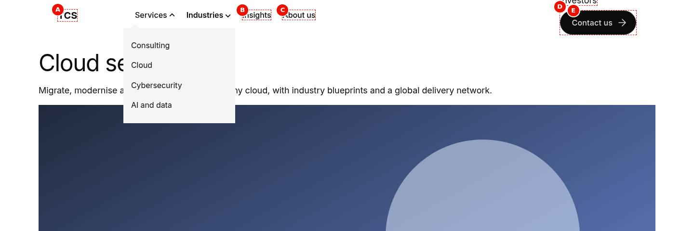

**Tablet rendering** — The header at 768 px with the menu closed, in one 4rem row: the three-bar menu button at the left, TCS next to it and Investors with the Contact us button at the right; the four sections are hidden.

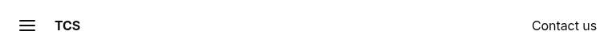

**Mobile rendering** — Two 390 px frames side by side. Menu closed: the menu button, TCS and the tools in one 4rem row. Menu open: the X icon and TCS, then Services with Consulting, Cloud, Cybersecurity and AI and data, Industries with Banking, Retail and Manufacturing, Insights and About us stacked, and Investors and Contact us at the bottom.

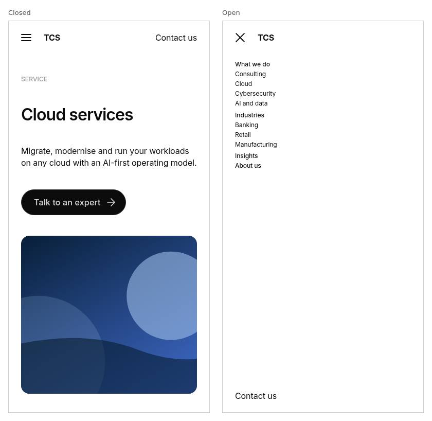

**Default navigation of the /en locale** — An /en content page at 1440 px with the header from /en/references/nav, all dropdowns closed: TCS, Services and Industries with chevrons, Insights, About us, Investors and the Contact us primary button, above the start of the page content.

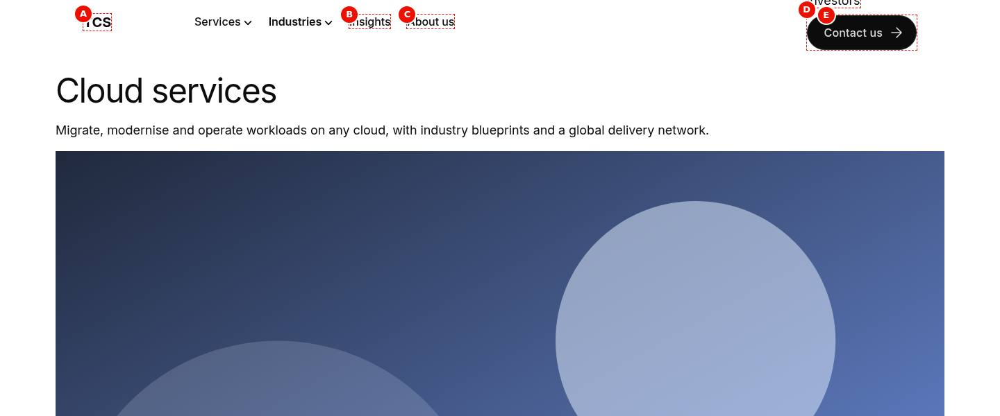

**Area-specific navigation** — Two 1440 px headers one above the other (not side by side). Top, a page of /en: TCS, Services, Industries, Insights, About us, Investors, Contact us. Bottom, /en/careers/jobs inheriting nav-careers: TCS Careers, Find jobs with a chevron, Life at TCS, Locations, tcs.com and the Apply now primary button.

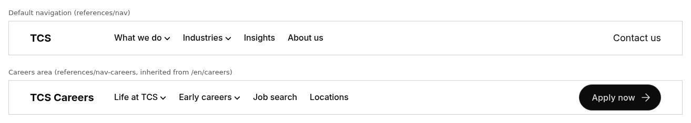

**An open dropdown** — The header at 1440 px with Services open: its chevron points up, and the light grey 12.5rem panel with the pointer triangle lists Consulting, Cloud, Cybersecurity and AI and data in regular weight, with Cloud underlined under the mouse pointer.

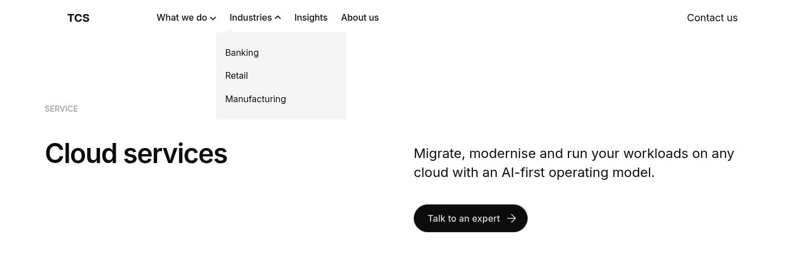

**Open mobile menu** — The header at 390 px with the menu open over the full height: the X icon and TCS on top, then Services with Consulting, Cloud, Cybersecurity and AI and data, Industries with Banking, Retail and Manufacturing, Insights and About us stacked, and Investors and Contact us at the bottom.

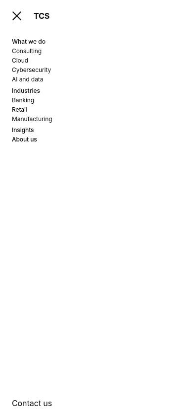

**Section label rendered as a button** — The header at 1440 px after Tab to Services and Enter: the Services button shows the keyboard focus ring and its chevron points up, and its dropdown lists Consulting, Cloud, Cybersecurity and AI and data.

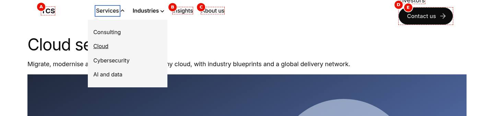

**Linked label with dropdown toggle** — The header at 1440 px after Tab from the bold Industries link to its toggle and Enter: Industries stays a link with its chevron pointing up and the dropdown lists Banking, Retail and Manufacturing; no focus ring is visible because the toggle button is 0 × 0 (F-13).

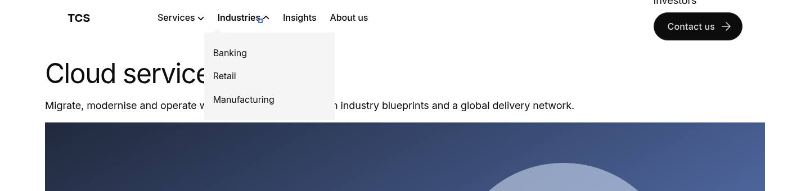

**Plain first-level link** — The header at 1440 px with the pointer on Insights: Insights is underlined and has no chevron, like About us, while Services and Industries carry closed chevrons; no dropdown is open.


**Tools on the right of the header** — Two frames one above the other. Top, 1440 px: the full row with Investors as a link and the Contact us primary button at the right end. Bottom, 390 px with the menu closed: the menu button, TCS and the same two tools at the right of the 4rem row.

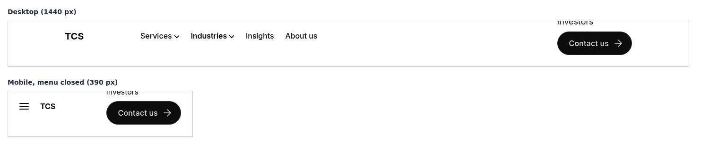

**Universal Editor canvas of the nav page** — references/nav opened directly in editor mode at 1440 px, rendered as an ordinary page under its own header: A the section with the TCS link, B the bulleted list, C Services with its four indented links, D one second-level link, E the section with Investors and the Contact us button. (Annotated preview in editor mode with sample content; letters as in the annotations list, not a Universal Editor screenshot; file screenshots/header-authoring-view.jpg)

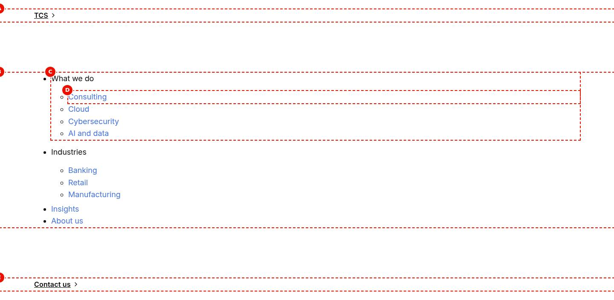

**Properties used to choose the nav page** — Page Properties of a content page with the Navigation field (and Footer, 404 Page) highlighted; plus the properties panel of the Text component holding the list on the nav page. (Dialog reference generated from the component model, not a Universal Editor screenshot; file screenshots/header-properties-panel.jpg)

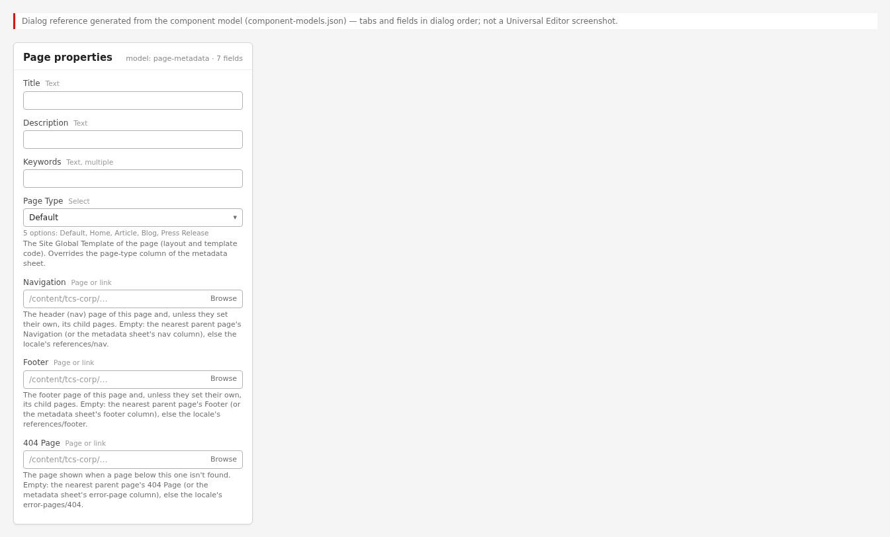

<!-- END GENERATED: screenshots -->

The handover screenshots above were taken before the TCS Header of handover 2.2: they show the earlier desktop dropdown navigation, a text "TCS" brand and a Contact us tools button. The current header has no navigation on desktop and opens the menu one level at a time below 1200px; the states below have no screenshot yet.

```text
[Screenshot Placeholder]

File name:
header-logo-bar-desktop.png

Purpose:
The desktop header (1440px): the logo bar only, 124px high, 80px gutters, on a page without a light hero.

Annotations:
A = TCS logo (brand), linked to the locale Home
B = TATA logo (tools), linked to tata.com
```

```text
[Screenshot Placeholder]

File name:
header-light-hero-desktop.png

Purpose:
The desktop header over a light Hero in the first section: no header band, the hero behind the logos.

Annotations:
A = TCS logo over the hero
B = TATA logo over the hero
C = Hero content starting below the header height
```

```text
[Screenshot Placeholder]

File name:
header-menu-closed-tablet.png

Purpose:
The tablet header (1024px) with the menu closed: fixed 64px bar, 24px gutters.

Annotations:
A = TCS logo
B = TATA logo
C = Menu button (Open navigation)
```

```text
[Screenshot Placeholder]

File name:
header-menu-level-1-mobile.png

Purpose:
The mobile menu (390px) open at its first level, full screen, page scrolling locked.

Annotations:
A = Close navigation button (X)
B = Level title "Menu"
C = A section row with its arrow (opens a level)
D = A plain link row
```

```text
[Screenshot Placeholder]

File name:
header-menu-level-2-mobile.png

Purpose:
The mobile menu after opening a section: its sub-list in place of the first level, focus on Back.

Annotations:
A = Back button (focused)
B = Level title: the section's label
C = Sub-level link rows
```

```text
[Screenshot Placeholder]

File name:
header-linked-section-tablet.png

Purpose:
A section whose label is a link: the link stays, a separate arrow button opens its level.

Annotations:
A = The section link (navigates)
B = The arrow button "Show {label} menu" (opens the level)
```

```text
[Screenshot Placeholder]

File name:
header-canvas-home-desktop.png

Purpose:
The header Canvas on Home: the search row on the bottom of the opening hero, then floating at the bottom of the window once the page scrolls.

Annotations:
A = Logo bar
B = Header Canvas row (menu button and search, 607px on desktop)
C = Bottom of the hero / first screen
```

```text
[Screenshot Placeholder]

File name:
header-nav-page-authoring-desktop.png

Purpose:
The Navigation page (references/nav) open in Universal Editor: the TCS Header block section, the menu list section and an optional Conversation Canvas section.

Annotations:
A = Section with the TCS Header block
B = Section with the menu list (Text component)
C = A nested list (a menu level)
D = Optional section with a Conversation Canvas (the header Canvas)
```

## For Content Authors

The header has no dialog. You change it by editing the Navigation page, and choose which Navigation page a page uses with its page properties.

1. **Find the Navigation page.** Open the locale's `references/nav` page (for example `/content/tcs-corp/us/en/references/nav`) in Universal Editor. For an area with its own header, open (or create) its page, for example `references/nav-careers`.
2. **Logos (first section).** Add a **TCS Header** block to the first section (component list of the section) and fill in TCS Logo, TCS Logo Alt Text, TCS Logo Link, TATA Logo, TATA Logo Alt Text and TATA Logo Link (see the [TCS Header README](../tcs-header/README.md)). Without a TCS Header block, the first section is the brand (an image linked to Home) and the third section the tools (the TATA logo linked to tata.com).
3. **Menu (the next section).** Add a Text component with a bulleted list: each item is a menu row. Indent items under an item (a nested list) to make that item a section with its own level; levels can be nested to any depth. A section label can be plain text (the whole row opens the level) or a link (the link stays and a separate arrow button opens the level).
4. **Optional header Canvas.** Add a section with a **Conversation Canvas** block to the Navigation page: it becomes the header Canvas at the bottom of the first screen (see the Conversation Canvas README). A TCS Header block in the same section stays the logo bar.
5. **Preview** the Navigation page and a content page that uses it; check desktop (logo bar), tablet and mobile (menu levels).
6. **Publish** the Navigation page (and the DAM logo assets). Content pages pick up the change on their next load; no content page needs republishing.
7. **Choose the Navigation page for an area (optional).** On the area's top page open Page Properties and set **Navigation** (an AEM path, a published path or a path relative to the locale root, e.g. `references/nav-careers`). Child pages inherit it unless they set their own; empty means the parent's, else `references/nav`. The bulk metadata sheet's `nav` column does the same by URL pattern.
8. **Validate the published output:** the logos link to the right pages, every menu row is reachable, each level's title is its section label, and a page of the area shows the area header.

Minimum required: the TCS and TATA logos (TCS Header block) and, for tablet / mobile navigation, the menu list. Recommended: alt texts naming the logos, 1–3 word labels, the same structure in every locale. Optional: a header Canvas section; area-specific Navigation pages.

## Authorable Fields

<!-- BEGIN GENERATED: fields (npm run build:docs) -->

This block has no Universal Editor model of its own (no `_header.json` definition): it is not added from the component list. See the sections above for how its content is authored.

<!-- END GENERATED: fields -->

The header is authored through the Navigation page, not a dialog:

| Where | What you author | Result |
| ----- | --------------- | ------ |
| Page Properties › **Navigation** (`nav`, `models/_page.json`) | The Navigation page of this page and its child pages | Empty: the nearest parent page's value, else the locale's `references/nav`; values cached per browser session (F-35) |
| Bulk metadata sheet, column `nav` | The same by URL pattern | Published as `<meta name="nav">`, read like the page property |
| Nav page, a section with a **TCS Header** block | The logos, their alt texts and links | The brand (TCS logo) and the tools (TATA logo); the first other section is the menu |
| Nav page, sections in order (no TCS Header block) | 1 brand (logo image linked to Home), 2 sections (the menu list), 3 tools (TATA logo) | Classes `nav-brand`, `nav-sections`, `nav-tools`; further sections are kept without a role |
| Nav page, the menu section's bulleted list | Rows; nested lists are levels (any depth) | Plain label: the row is a button opening the level. Linked label: the link stays, an arrow button "Show {label} menu" opens the level |
| Nav page, a section with a **Conversation Canvas** | The header Canvas | Moved out of the nav into `.nav-canvas`; positioned at the bottom of the first screen |

Notes:

- **Brand link.** A brand logo link decorated as a button (a standalone link) is turned back into a plain link (`removeButtonDecoration`).
- **Accessibility impact.** The logo alt texts name the logo links; plain section labels become the visible text of their buttons.
- **Data layer impact.** Clicks on logos, menu links and menu buttons are reported for the header component (see [Data Layer and Analytics](#data-layer-and-analytics)).
- **Legacy mapping.** The positional nav page (brand, sections, tools) authored before the TCS Header block is still read.
- **Additional tab.** The header has none (AGENTS.md "Additional tab": every block except header and footer). The Additional tab of a TCS Header block on the nav page has no effect in the header (the block is replaced by the header's sections and the spacing / hide styles apply only inside `main`).

## Screenshot-Based Authoring Steps

### Authoring Step 1: Open the Navigation page

```text
[Screenshot Placeholder]

File name:
header-authoring-step-1.png

Purpose:
The locale's references folder in the AEM Sites console with the nav page selected, opened in Universal Editor.

Annotations:
A = references/nav page
B = Open in Universal Editor
```

### Values to Enter

| Callout | Field | Value | Reason | Expected result |
| ------- | ----- | ----- | ------ | --------------- |
| A | Page | `references/nav` of the locale (sample: `block-library/header/nav-default`) | The default header of every page of the locale | The nav page opens as a page with its sections |

Author action: open the page; don't edit content pages to change the header. Expected preview: the nav page renders as an ordinary page under its own header. Expected published result: none yet. Business rule: one default Navigation page per locale, `references/nav`. Validation: the page title is the Navigation page's (sample "Navigation page: default"). Common mistake: editing a copy outside `references/` that no page uses; resolution: check the Navigation property of the page you are fixing.

### Authoring Step 2: Add the logos with a TCS Header block

```text
[Screenshot Placeholder]

File name:
header-authoring-step-2.png

Purpose:
The first section of the nav page with a TCS Header block selected and its Content tab open.

Annotations:
A = TCS Logo
B = TCS Logo Alt Text
C = TCS Logo Link
D = TATA Logo
E = TATA Logo Alt Text
F = TATA Logo Link
```

### Values to Enter

| Callout | Field | Value | Reason | Expected result |
| ------- | ----- | ----- | ------ | --------------- |
| A | TCS Logo | `/content/dam/tcs-corp/block-library/header/tcs-logo.png` (production: `/content/dam/tcs-corp/header/tcs-logo.svg`) | One asset for every breakpoint | TCS logo left in the bar |
| B | TCS Logo Alt Text | `Tata Consultancy Services` | Names the logo link | Screen readers announce the link |
| C | TCS Logo Link | The locale Home page | The brand links Home | Logo is a link |
| D | TATA Logo | `/content/dam/tcs-corp/block-library/header/tata-logo.png` (production: `/content/dam/tcs-corp/header/tata-logo.svg`) | Group logo | TATA logo right on desktop |
| E | TATA Logo Alt Text | `TATA Group` | Names the link | Announced name |
| F | TATA Logo Link | `https://www.tata.com` | Group site | Logo links to tata.com |

Author action: section › Add › TCS Header, then fill in the Content tab. Expected preview: the logo bar at the top of the nav page. Expected published result: every page using this nav page shows these logos. Business rule: a domain typed without `https://` (`www.tata.com`) gets `https://` added. Validation: both logos link correctly. Common mistakes: an empty alt text with a link (the code then names the link "Tata Consultancy Services" / "TATA Group" from the placeholders); a JPG with a white background (F-81: use the transparent SVG).

### Authoring Step 3: Author the menu

```text
[Screenshot Placeholder]

File name:
header-authoring-step-3.png

Purpose:
The second section of the nav page with the Text component holding the menu list, nested items indented.

Annotations:
A = First-level item with a nested list (a section)
B = Nested item (second level)
C = First-level item without a nested list (a plain link)
```

### Values to Enter

| Callout | Field | Value | Reason | Expected result |
| ------- | ----- | ----- | ------ | --------------- |
| A | Text (list item) | `What we do` (linked), with nested `Services`, `Products and platforms`, `Industries` | A section with a level | Row "What we do" with an arrow button "Show What we do menu" |
| B | Text (nested item) | `Our story` under `Who we are` | Second-level page | Shown on the "Who we are" level with Back |
| C | Text (list item) | `Insights` (linked, no nested list) | A direct link | Plain link row with an arrow |

Values from the block library page `block-library/header/nav-default` (What we do, Who we are, Insights, Media and investors, Careers). Author action: type the list, indent with the list tools, link labels with the link tool. Expected preview (tablet / mobile): the menu opens at "Menu", a section opens its level in place. Business rules: one open section per level; only lists in the section's default content are read. Validation: tab through the menu at 390px. Common mistake: a label typed as a separate paragraph above the list (it isn't a list item, so it isn't a section); resolution: make it the list item that contains the nested list.

### Authoring Step 4: Optional header Canvas

```text
[Screenshot Placeholder]

File name:
header-authoring-step-4.png

Purpose:
A further section of the nav page holding a Conversation Canvas block.

Annotations:
A = Section with the Conversation Canvas
B = Conversation Canvas block
```

### Values to Enter

| Callout | Field | Value | Reason | Expected result |
| ------- | ----- | ----- | ------ | --------------- |
| A | Section | A new section after the menu | Holds the header Canvas | The section leaves the nav |
| B | Conversation Canvas | See the Conversation Canvas README | Desktop navigation and search | Row at the bottom of the first screen, floats on scroll |

Author action: Add a section, then a Conversation Canvas in it. Expected preview: on a content page the Canvas row lies at the bottom of the first screen, the bar keeps its height. Business rule: every section with a Conversation Canvas becomes part of the header Canvas. Validation: open the tablet menu: the floating row is hidden while it's open. Common mistake: a Canvas on the nav page and another opening the page's hero; check the floating journey on the page.

### Authoring Step 5: Set an area's Navigation page

```text
[Screenshot Placeholder]

File name:
header-authoring-step-5.png

Purpose:
Page Properties of an area's top page with the Navigation field filled in.

Annotations:
A = Navigation
B = Footer (inherited the same way)
C = 404 Page (inherited the same way)
```

### Values to Enter

| Callout | Field | Value | Reason | Expected result |
| ------- | ----- | ----- | ------ | --------------- |
| A | Navigation | `references/nav-careers` | The area's own header | The area's pages show the careers nav page |

Author action: Page Properties › Navigation, save, publish the page. Expected published result: the page and its children use the area header (in a new browser session: parent values are cached per session, F-35). Business rule: empty inherits from the nearest parent up to Home. Validation: open a child page in a private window. Common mistake: setting Navigation on every page; set it on the area's top page only.

## Variations

### Desktop logo bar (>= 1200px)

- **Purpose:** the Figma desktop header: TCS logo left, TATA logo right, no navigation.
- **When to use / not:** always on desktop; the menu isn't shown at this width (F-72), so pages need a Conversation Canvas for navigation.
- **Fields:** the logos (TCS Header block, or the brand / tools sections).
- **Rendering:** `nav` is a flex row (`justify-content: space-between`), 7.75rem high (`--nav-height`), 5rem gutters, max width `--content-max-width`; the menu button and the menu are `display: none`; the wrapper is `position: relative` (not fixed).
- **Accessibility:** two logo links named by their alt texts inside `nav[aria-label="Main navigation"]`.
- **Data layer:** logo clicks `cmp:click` (`interaction` "link").
- **Personalization / fallback:** none; without logos the bar is empty.

```text
[Screenshot Placeholder]

File name:
header-logo-bar-desktop.png

Purpose:
The desktop logo bar (see Visual Reference).

Annotations:
A = TCS logo
B = TATA logo
```

### Tablet and mobile menu (< 1200px)

- **Purpose:** the site navigation below 1200px: a full-screen menu, one level at a time.
- **Fields:** the menu list on the nav page.
- **Rendering:** a fixed bar (`header .nav-wrapper`, `position: fixed`) with a grid of brand, tools and menu button; opening the menu sets `nav[data-expanded="true"]` (`min-height: 100dvh`, scrolling inside), locks page scrolling (`body` `overflow-y: hidden`), makes `main` and `footer` inert and dispatches `header:menu` (`detail.open`). Gutters 1rem (mobile), 1.5rem (from 600px).
- **Accessibility:** menu button with `aria-controls="nav-sections"`, `aria-expanded`, name Open / Close navigation; Back and level title; Escape closes.
- **Data layer:** menu, section, Back and link clicks are `cmp:click` on the header component.
- **Personalization / fallback:** without a menu section no menu button is built (a nav page with only logos or a Canvas).

```text
[Screenshot Placeholder]

File name:
header-menu-level-1-mobile.png

Purpose:
The open menu at its first level (see Visual Reference).

Annotations:
A = Close navigation
B = Menu title
C = Section row
```

### Section label: plain text or link

- **Purpose:** a section either only opens its level (plain label) or is also a page (linked label).
- **Rendering:** plain: the label is replaced by `button.nav-drop-toggle` with the label as its text. Linked (the label is a link or holds one): the link stays and an arrow-only `button.nav-drop-toggle[aria-label]` ("Show {label} menu") follows it, 2.5rem square.
- **When to use:** a link when the section has its own landing page.

```text
[Screenshot Placeholder]

File name:
header-linked-section-tablet.png

Purpose:
A linked section label with its separate arrow button (see Visual Reference).

Annotations:
A = Section link
B = Arrow button
```

### Logos from a TCS Header block, or positional sections

- **Purpose:** the TCS Header block gives authors logo, alt and link fields; the positional nav page (brand, sections, tools) is the contract authored before.
- **Rendering:** with a TCS Header block (`applyLogoBar`), its section is replaced by `nav-brand` (`a.tcs-header-brand`) and `nav-tools` (`a.tcs-header-group`), the first other section becomes `nav-sections`, tools are placed after it. Without, sections 1–3 get `nav-brand`, `nav-sections`, `nav-tools`.
- **Fallback:** a nav page without a TCS Header block keeps working.

```text
[Screenshot Placeholder]

File name:
header-nav-page-authoring-desktop.png

Purpose:
The nav page with the TCS Header block section and the menu section (see Visual Reference).

Annotations:
A = TCS Header block
B = Menu list
```

### Header Canvas

- **Purpose:** the Conversation Canvas of the header (Figma home-desktop 229:15426, home-tablet 671:52732, mobile Ask TCS 1124:27368) at the bottom of the first screen.
- **Rendering:** nav page sections with a `.conversation-canvas` are moved into `header .nav-canvas`, out of the flow (`position: absolute`) at every width, as high as the first section and at most the window (`--conversation-canvas-first-section-bottom`, written by the Canvas controller, else `100dvh`); on Home (`body.home`) as high as the hero. The row sits the floating offset above the host's bottom (3.25rem desktop, 3.875rem tablet, 1.25rem mobile, plus the safe area), where it floats once the page scrolls (`canvas-journey.js`); search row 28.9375rem (463px) from 600px, 37.9375rem (607px) from 1200px. Hidden until the journey state is set (`html[data-canvas-journey-state]`); only the search row takes pointer events.
- **Data layer:** the Canvas is its own component with its own events.

```text
[Screenshot Placeholder]

File name:
header-canvas-home-desktop.png

Purpose:
The header Canvas on the Home hero (see Visual Reference).

Annotations:
A = Logo bar
B = Canvas row
```

### Desktop header over a light hero

- **Purpose:** Figma Logos 667:52520 / Hero 4082:120388: the logos over the hero image.
- **Rendering:** `styles/styles.css` takes `<header>` out of the flow (`position: absolute`) from 1200px when `main > .section:first-child .hero` isn't `bg-dark`, `bg-dark-subtle` or `bg-black`; `header.css` makes `.nav-wrapper` transparent; `blocks/hero` adds `--header-height` (else `--header-reserved`) to its top padding and height, so the hero never moves when the header loads.
- **Header over the first block (TCS Header):** with `<html data-header-overlay="always">` the header lies over any first block (transparent from `tcs-header.css`), with `never` it stays in the flow; this block's code is unchanged (see [TCS Header](../tcs-header/README.md)).

```text
[Screenshot Placeholder]

File name:
header-light-hero-desktop.png

Purpose:
The header over a light hero (see Visual Reference).

Annotations:
A = Logos over the hero
```

### Area-specific Navigation page

- **Purpose:** a different header for an area (Careers) or campaign.
- **Fields:** Page Properties › Navigation, or the metadata sheet's `nav` column.
- **Rendering:** identical; only the nav page differs. A configured page that can't load falls back to the locale's `references/nav`.

```text
[Screenshot Placeholder]

File name:
header-area-navigation-tablet.png

Purpose:
A page of the careers area with the menu of references/nav-careers open.

Annotations:
A = Careers menu rows
```

## Complete Authoring Example

Scenario: the careers area of `/en` gets its own header menu, with the corporate logos.

| Field | Example value | Guidance |
| ----- | ------------- | -------- |
| Page | `/content/tcs-corp/us/en/references/nav-careers` (sample `block-library/header/nav-careers`) | One page per area, in `references/` |
| TCS Header › TCS Logo | `/content/dam/tcs-corp/header/tcs-logo.svg` | Transparent SVG |
| TCS Header › TCS Logo Alt Text | `Tata Consultancy Services` | Names the link |
| TCS Header › TCS Logo Link | The `/en` Home page | |
| TCS Header › TATA Logo / Alt / Link | `/content/dam/tcs-corp/header/tata-logo.svg`, `TATA Group`, `https://www.tata.com` | |
| Menu list | `Careers` (linked) with `Graduates`, `Experienced professionals` | Linked label: the link stays, the arrow opens the level |
| Careers top page › Navigation | `references/nav-careers` | Inherited by the area's pages |

Steps: create the page from the default nav page, change the menu, publish it, set Navigation on the careers top page and publish that page.

Expected output: on careers pages below 1200px the menu shows the careers rows; on desktop the same logo bar as everywhere. Responsive: as the Responsive Behavior table. Accessibility: the level of "Careers" is titled "Careers", Back returns focus to its arrow button. Analytics: clicks report the header component (`header-1`). Personalization fallback: none; any page without its own value shows the default `references/nav`.

Pre-publish checklist:

- [ ] Logos selected, alt texts filled in, links correct (`https://` for tata.com).
- [ ] Every section label is the list item holding its nested list.
- [ ] The nav page is published, and the DAM logo assets.
- [ ] Navigation set only on the area's top page.
- [ ] Checked at 390px, 1024px and 1440px.

## Content and Asset Guidelines

- **Labels.** Short (1–3 words); a label is also the title of its level.
- **Links.** Section labels may link to the section's landing page; menu links are plain rows with an arrow.
- **Logos.** One asset per logo for all breakpoints, transparent SVG (`/content/dam/tcs-corp/header/tcs-logo.svg`, `tata-logo.svg`, F-77). The CSS sets the height and the width follows the aspect ratio:

| Logo | Mobile | Tablet (>= 600px) | Desktop (>= 1200px) |
| ---- | ------ | ----------------- | ------------------- |
| TCS logo | 1.2104rem (19.4px) | 1.9165rem (30.7px) | 2.175rem (34.8px) |
| TATA logo | 1.5rem (24px) | 2.375rem (38px) | 2.75rem (44px) |

- **Alt text.** "Tata Consultancy Services" and "TATA Group" (or the locale's translation): they name the links.
- **Icons.** The menu arrows are the shared `icons/arrow-left.svg` / `icons/arrow-right.svg` (CSS masks); the menu / close icon is drawn by CSS. The header has no search control (Figma).
- **Tags and metadata.** No tags; the `nav` metadata only chooses the nav page.
- **Min / max items.** No verified technical limit was identified (any depth of levels).
- **Loading.** The header loads in the lazy phase; the logos are the images AEM delivers in the nav page (no `createOptimizedPicture` in the header).
- **Missing assets.** Without a logo image the TCS Header shows the logo's name as text when it has a link, else nothing.

## Accessibility

- **Semantics.** `<header>` (banner landmark) holding `nav#nav` named "Main navigation" (placeholder `mainNavigation`); the menu is the authored list; the level title is an `h2`.
- **Keyboard and focus.** DOM order follows the screen: logos, menu button, menu. Opening a level focuses Back; Back focuses the button of the section it closed; Escape closes the menu and focuses the menu button; focus moving to an element outside the nav closes the menu (a tap on the menu's background, which focuses nothing, doesn't).
- **Accessible names.** Menu button "Open navigation" / "Close navigation" (`openNavigation`, `closeNavigation`); arrow button of a linked section "Show {label} menu" (`showSubmenu`); Back "Back" (`back`); level title "Menu" (`menu`).
- **State.** `aria-expanded` on the menu button and on every section button, `aria-controls` to the menu (`nav-sections`) or the sub-list (`nav-submenu-…`).
- **Hidden content.** Closed levels and the closed menu are `display: none` (not focusable, not read); while the full-screen menu is open, `main` and `footer` are `inert`.
- **Contrast.** Arrows use `--color-icon-default` (Figma's light grey fails 3:1 non-text contrast, F-75).
- **Reflow.** The menu scrolls inside the full-screen layer.

Author responsibilities: meaningful logo alt texts, short unique labels, a section label for every nested list, translated placeholders per locale.

Developer responsibilities: keep the buttons, `aria-*` and focus moves; keep hidden levels `display: none`; keep `inert` on `main` / `footer` while the menu is open; UI text only from placeholders.

| Key | Expected behavior |
| --- | ----------------- |
| Tab / Shift+Tab | Moves through logos, menu button and the visible menu rows; leaving the nav closes the menu (below 1200px) |
| Enter / Space | On the menu button: opens / closes the menu; on a section button: opens its level (focus to Back) or closes it; on Back: returns one level |
| Escape | Closes the open menu (below 1200px) and focuses the menu button |

## Data Layer and Analytics

- **Component.** The header block is a `.block`: it is added to the Adobe Client Data Layer in the delayed phase (`trackBlocks(document)` in `scripts/scripts.js` `loadDelayed`) as `component.header-1` (`@type` `tcs-corp/components/header`, `parentId` the page; `dc:title` is the first heading in it, the menu level title "Menu").
- **Variation / positions.** No variation or `data-cmp-position` attributes; the header sets no `data-cmp-*` attributes and pushes no events itself.
- **Clicks.** `decorators/data-layer-decorator.js` captures clicks on the logos, menu links and buttons (menu, section, Back) as `cmp:click` for the header component; on the nav page the TCS Header block is replaced by the header's sections, so logo clicks report the header.
- **Header Canvas.** The Conversation Canvas in `.nav-canvas` is its own component with its own events.

| Trigger | Data-layer event | Required properties | Analytics behavior |
| ------- | ---------------- | ------------------- | ------------------ |
| Delayed phase (3 s after the lazy phase) | `component` entry `header-1` | `@type`, `parentId` | Component inventory |
| Click on a logo or a menu link | `cmp:click` | `eventInfo.path` `component.header-1`, `interaction` "link", `dc:title` (the link text; empty for an image-only logo link), `xdm:linkURL`, `xdm:linkType` (`other` / `exit`), `breakpoint` | Navigation click |
| Click on the menu button, a section button or Back | `cmp:click` | `interaction` "button", `dc:title` (its `aria-label` or text), `breakpoint` | Menu use |

The intended flow is Adobe Client Data Layer → Adobe Data Collection (Tags) → AEP Web SDK → Edge Network → Analytics / CJA; Tags and the Web SDK aren't configured yet (blocked: measurement plan). No consent mechanism is implemented. The `header:menu` DOM event is not a data-layer event.

## Personalization

This block does not currently expose verified personalization behavior. There is no Adobe Target or Journey Optimizer integration in the repository; the default content (the inherited Navigation page) is what renders. Area-specific Navigation pages are content choices, not audience personalization.

## Responsive Behavior

| Viewport | Layout | Image behavior | Interaction behavior |
| -------- | ------ | -------------- | -------------------- |
| Mobile (< 600px) | Fixed bar 4rem (64px), 1rem gutters: TCS logo, TATA logo, menu button | TCS logo 1.2104rem, TATA logo 1.5rem high | Menu button opens the full-screen menu, one level at a time |
| Tablet (600–1199px) | As mobile with 1.5rem (24px) gutters; header Canvas search row 28.9375rem | TCS 1.9165rem, TATA 2.375rem | As mobile |
| Desktop (>= 1200px) | Logo bar 7.75rem (124px), 5rem (80px) gutters, not fixed (with a TCS Header: fixed at the top, `blocks/tcs-header`); no menu; over a light hero without a band; header Canvas search row 37.9375rem | TCS 2.175rem, TATA 2.75rem | No menu; crossing 1200px resets the menu state (`matchMedia` change) |

## For Developers

<!-- BEGIN GENERATED: files (npm run build:docs) -->

```text
blocks/header/
├── README.md
├── header.css
└── header.js
```

| Decorator/Utility | Purpose | Execution or dependency point |
| ----------------- | ------- | ----------------------------- |
| [`blocks/fragment/fragment.js`](../../blocks/fragment/fragment.js) | — | `header.js`: { loadFragment } |
| [`decorators/motion-decorator.js`](../../decorators/motion-decorator.js) | `prepareMotion` (the Content animation and Background animation of the blocks of a section, before it is shown, or of a fragment, footer page or header Canvas once in the page: first frame paused, run by one Intersection | `header.js`: { prepareMotion } |
| [`decorators/button-decorator.js`](../../decorators/button-decorator.js) | `decorateButton` (option `newTabHint`: a link opening a new tab says so), `createButton`, `setButtonDisabled`, `setButtonAlignment`, `removeButtonDecoration` | `header.js`: { removeButtonDecoration } |
| [`utils/ids.js`](../../utils/ids.js) | `nextInstance`, `uniqueId`, `createIdFactory` (unique ids per block instance), `availableId` (an authored id kept, suffixed -2, -3, ... only when taken) | `header.js`: { createIdFactory } |
| [`utils/placeholders.js`](../../utils/placeholders.js) | `getPlaceholders`, `loadPlaceholders`, `fillPlaceholder` (UI text from the locale's placeholders, with English fallbacks) | `header.js`: { fillPlaceholder, getPlaceholders } |
| [`utils/header-space.js`](../../utils/header-space.js) | `reserveHeaderSpace`, `rememberHeaderSpace` (the loaded header's height, the logo bar, remembered per breakpoint (`header-height-v2-*`) and reserved on the next pages before the header loads: no layout shift); `setHeader | `header.js`: { rememberHeaderSpace } |
| [`utils/inherited-metadata.js`](../../utils/inherited-metadata.js) | `getInheritedMetadata`, `INHERITED_METADATA` (nav, footer and error-page of the page, else of the nearest parent page up to Home; parent heads loaded in parallel and cached per session) | `header.js`: { getInheritedMetadata } |
| [`utils/site.js`](../../utils/site.js) | `LOCALES`, `DEFAULT_LOCALE`, `getLocale`, `indexRoot`, `REVIEW_ROOTS` and `REVIEW_SHEETS` (temporary: the language master under review, /language-master/en, lists its own pages and reads its own placeholders, redirects,  | `header.js`: { resolvePagePath } |

<!-- END GENERATED: files -->

**Responsibilities.** `header.js` loads the nav page, assigns roles, builds the menu levels and the menu button, hosts the header Canvas and publishes the header height. `header.css` lays out the bar, menu levels and the Canvas host; `styles/styles.css` reserves the header space and takes the header out of the flow over a light hero.

**Input DOM.** `aem.js` `loadHeader` builds an empty `div.header` block in `<header>`. The content is the nav page's `.plain.html`, decorated as a page by `loadFragment` (sections, default content, TCS Header and Canvas blocks loaded).

**Decoration flow (`decorate`).**

1. Starts `loadFragment(resolvePagePath('', 'references/nav'))` at once, in parallel with `getInheritedMetadata('nav')` and `getPlaceholders()`; a configured nav page that returns nothing falls back to the default.
2. No fragment: the block stays empty (`--header-reserved` keeps the space).
3. Moves the sections into `nav#nav[aria-label]`; sections with a `.conversation-canvas` are taken out (a TCS Header in the same section is kept in its own section).
4. `applyLogoBar`: a `.tcs-header` block supplies `nav-brand` / `nav-tools`; else sections 1–3 get `nav-brand`, `nav-sections`, `nav-tools`.
5. `removeButtonDecoration` on the brand link; every `li` with a child `ul` in `.nav-sections .default-content-wrapper` becomes `.nav-drop` (`decorateDrop`, ids from `createIdFactory('nav-submenu')`); `buildLevel` prepends `.nav-level` (Back, `h2.nav-level-title`).
6. `buildHamburger` only when there is a menu; tools are moved before it (DOM order = screen order).
7. `toggleMenu(nav, navSections, isDesktop.matches)`, a `matchMedia('(min-width: 1200px)')` change listener, `keydown` (Escape) on `window`, `focusout` on the nav.
8. Appends `div.nav-wrapper > nav`, then `div.nav-canvas` with the Canvas sections and runs `prepareMotion(navCanvas)`.
9. Sets `--header-height` (rem) on `<html>`, `rememberHeaderSpace(header)` (localStorage `header-height-v2-{breakpoint}`, read by `reserveHeaderSpace` in the eager phase of the next page) and a `ResizeObserver` updating `--header-height`.

**Rendered DOM contract.**

```text
header
└─ div.header.block
   ├─ div.nav-wrapper
   │  └─ nav#nav[aria-label][data-expanded]
   │     ├─ div.section.nav-brand > p > a.tcs-header-brand (or the authored brand)
   │     ├─ div.section.nav-tools > p > a.tcs-header-group
   │     ├─ div.nav-hamburger > button[aria-controls=nav-sections][aria-expanded] > span.nav-hamburger-icon
   │     └─ div.section.nav-sections#nav-sections[.nav-sections-level]
   │        ├─ div.nav-level > button.nav-level-back[hidden] + h2.nav-level-title
   │        └─ div.default-content-wrapper > ul > li.nav-drop[data-expanded]
   │           ├─ button.nav-drop-toggle[aria-controls][aria-expanded] (or a + button[aria-label])
   │           └─ ul#nav-submenu-{label}
   └─ div.nav-canvas > div.section … div.conversation-canvas.block
```

On desktop `nav[data-expanded]` is `"true"` (the boilerplate's desktop state) while CSS hides the menu; the menu button's `aria-expanded` is the real state.

**Events.** `header:menu` (`CustomEvent` on `document`, `detail.open`) on every menu toggle, at load and at the 1200px change; the Canvas controller hides the floating journey while `open` is true (it also reads `header .nav-hamburger button[aria-expanded="true"]` at start).

**Contracts kept for other code.**

| Contract | Used by |
| -------- | ------- |
| `header .nav-wrapper` (fixed below 1200px) | `blocks/anchor-list` (offset below a fixed header) |
| `--nav-height` (4rem; 7.75rem from 1200px, `styles/styles.css`) | `styles/styles.css` (`header` height), `blocks/tabs` (scroll margin), `blocks/hero`, `templates/home`, `404.html` |
| `--header-height` (the header's height with its Canvas host, on `<html>`) | `blocks/hero`, `templates/home` (desktop header over a light hero) |
| `--header-reserved` (the space kept until the header loads: `--nav-height`, or the height remembered by `utils/header-space.js`) | `styles/styles.css`, `blocks/hero`, `templates/home` |
| `#nav`, `nav[data-expanded]`, `.nav-hamburger button[aria-expanded]`, `header:menu` | `header.js` itself (Escape), the Conversation Canvas controller |
| `.nav-canvas` | Conversation Canvas (`inHeader`), `--conversation-canvas-first-section-bottom` set on `<header>` |
| `nav-brand`, `nav-sections`, `nav-tools` | The nav page authoring contract |
| `.tcs-header-brand`, `.tcs-header-group` | `blocks/tcs-header` output read by `applyLogoBar` |

Don't add Canvas logic to `header.js` (AGENTS.md "Floating Canvas"): header and Canvas don't import each other.

**Error handling.** A nav page that can't load falls back to `references/nav`; if that fails too the header stays empty, without an error message. `localStorage` failures are ignored.

**Exported functions.** Only the default `decorate(block)`.

**Decisions (destination first, kept from the original design note).**

| Capability | Destination | Decision |
| ---------- | ----------- | -------- |
| Header loading | `aem.js` `loadHeader` → `blocks/header` | Reused; the source site's changed `aem.js` (which this project never modifies) wasn't taken over; `blocks/tcs-header` only supplies the logos |
| Navigation source | Nav page fragment (`blocks/fragment` `loadFragment`), inherited Navigation | Reused; the source's query-index menu tree and hard-coded AEM path rejected |
| Mobile menu | The header's menu (`nav[data-expanded]`, scroll lock, Escape, focus-out) | Extended with levels (Figma drill-down) on the authored list; the source's body overlay (cloned logos, `innerHTML`, `.hidden !important`, `z-index: 9999`) rejected |
| Ids, placeholders, button decoration | `utils/ids.js`, `utils/placeholders.js`, `decorators/button-decorator.js` | Reused |
| Tokens | `styles/styles.css` | Reused (spacing, icon sizes, colors, weights, border width, content max width); one token value added: `--nav-height` at 1200px |
| Icons | `icons/arrow-left.svg`, `icons/arrow-right.svg` (CSS masks) | Reused; the menu / close icon stays CSS-drawn |
| Header variants (source: Standard, Compact, Dark, Centered) | — | Not implemented: not in Figma |

## Extending the Block

- **New behaviour or variation.** The header has no model; a new option is either nav page content (a new section role, a class from the Section's Style) or a TCS Header field. A TCS Header field goes in `blocks/tcs-header/_tcs-header.json` (then `npm run build:json`, `npm run lint`); mind the delivery rules (AGENTS.md "AEM delivery rules"): fields ending in Alt / Text / Title / Type collapse into their base field, key-value blocks don't deliver grouped fields.
- **Rendering.** Keep the contracts table above; read the nav page by section role, not by position, when a TCS Header block is present.
- **Responsive.** The menu breakpoint is `isDesktop` (`min-width: 1200px`) in `header.js` and the 1200px media queries in `header.css`: change both together (F-72 suggests this to bring the menu to desktop).
- **Accessibility.** New controls are `<button>`s with `aria-expanded` / `aria-controls`, names from placeholders, focus moves as today.
- **Data layer.** Clicks are captured centrally; describe new controls with `data-cmp-interaction` / `data-cmp-value` rather than pushing events.
- **Tests.** The journey interplay is covered by `test/conversation-canvas/canvas-journey.test.mjs`, the locale reference paths by `test/site/index-root.test.mjs`; add unit tests for new pure logic.
- **Backward compatibility.** Keep reading the positional nav page and linked / unlinked labels.
- **Docs and modules.** Update this README (`npm run build:docs` regenerates the marked sections) and run `npm run build:modules` after changing imports (`scripts/module-graph.js`, checked by `npm test`; the header is in `CHROME_BLOCKS`, preloaded on every page).

## For Site Administrators

- **Availability.** Not in any filter (no model); loaded on every page by `aem.js`.
- **Governance.** The Navigation page property is in `models/_page.json`; changing nav pages is a content task.
- **Publishing dependencies.** The locale's `references/nav` (and area nav pages) published; the logo assets in DAM (`/content/dam/tcs-corp/header`, F-77 open); placeholders keys; the bulk metadata sheet only if the `nav` column is used (applied once listed in the site configuration's `metadata.source`). `paths.json` maps the locale folders so `/{locale}/references/nav` resolves.
- **Localization.** Each locale has its own `references/nav` with translated labels and locale links, and translates the header placeholders.

| Dependency | Purpose | Location | Impact if unavailable |
| ---------- | ------- | -------- | --------------------- |
| Default Navigation page | Header content | `/{locale}/references/nav` (`/content/tcs-corp/{country}/{lang}/references/nav`) | Empty header (space kept) |
| Area Navigation page | Area header | e.g. `references/nav-careers` | Falls back to `references/nav` |
| Navigation page property / `nav` metadata column | Choose the nav page | Page properties; `/{locale}/metadata.json` | Default nav page |
| Parent pages' published HTML | Inherited Navigation | Parent pages up to Home | Default nav page |
| Logo assets | TCS and TATA logos | `/content/dam/tcs-corp/header/` | No logos (names as text when linked) |
| Placeholders `mainNavigation`, `openNavigation`, `closeNavigation`, `showSubmenu`, `menu`, `back` | UI text | `/{locale}/placeholders.json` | English fallbacks |
| Conversation Canvas | Desktop navigation (F-72) | A Canvas on the nav page or the page | No desktop navigation |

## For Architects

- **Role.** Page chrome: the banner landmark, built in the lazy phase from a content page (experience-fragment-like reuse through Edge Delivery fragments).
- **Content model.** A Navigation page per locale / area, inherited like an AEM page property (`getInheritedMetadata`: parent heads loaded in parallel, cached in `sessionStorage` per session).
- **Rendering.** Client-side, from `{nav}.plain.html` via `loadFragment` (full page decoration of the fragment); AEM author paths when editing, published paths on the site.
- **Dependencies.** `blocks/fragment`, `decorators/motion-decorator.js`, `decorators/button-decorator.js`, `utils/ids.js`, `utils/placeholders.js`, `utils/header-space.js`, `utils/inherited-metadata.js`, `utils/site.js`.
- **Data layer / Web SDK / Target.** Central click capture only; no Target / AJO.
- **Consent and identity.** None in the block.
- **Caching.** Nav page and placeholders through the CDN and browser cache; inherited values per session; the header height per breakpoint in `localStorage`.
- **Performance.** Default nav fetched immediately, in parallel with the inheritance lookup; modules preloaded (`preloadBlockModules(CHROME_BLOCKS)`); the reserved space avoids layout shift (F-93, F-98).
- **Security.** Only same-site root-relative fragment paths are fetched (`loadFragment`).
- **Scalability.** One nav page per locale / area; any menu depth.

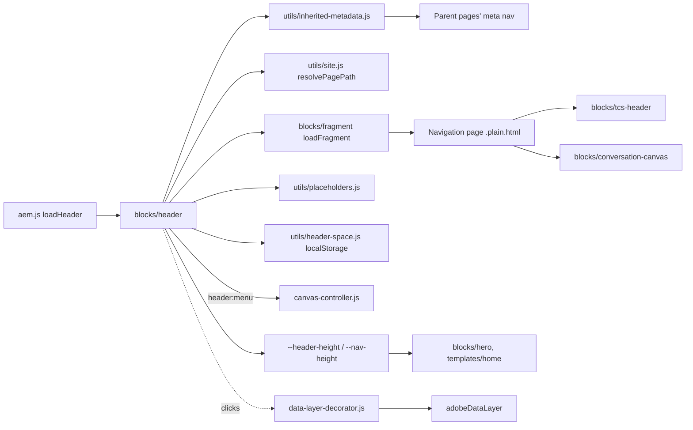

## For QA and Support Teams

| Test ID | Scenario | Configuration | Expected result |
| ------- | -------- | ------------- | --------------- |
| HEADER-QA-01 | Default header | Page without Navigation, locale `/en` | `/en/references/nav` loaded; logos visible |
| HEADER-QA-02 | Area header | Area top page with Navigation `references/nav-careers` | Child pages show the careers menu (new session) |
| HEADER-QA-03 | Missing nav page | Navigation pointing to an unpublished page | Falls back to `references/nav`; no error |
| HEADER-QA-04 | No nav page at all | New locale without `references/nav` | Empty header, its space kept, page usable |
| HEADER-QA-05 | Desktop logo bar | 1440px | TCS left, TATA right, 124px, no menu button |
| HEADER-QA-06 | Tablet menu | 1024px, open the menu | Full screen at "Menu", page doesn't scroll, `main` / `footer` inert |
| HEADER-QA-07 | Levels | Open a section, then Back | Sub-list with the label as title, focus on Back; Back focuses the section button |
| HEADER-QA-08 | Linked label | Section label is a link | Link navigates; arrow button "Show {label} menu" opens the level |
| HEADER-QA-09 | Keyboard | Escape with the menu open; Tab past the last row | Menu closes, focus on the menu button; tabbing out closes it |
| HEADER-QA-10 | Breakpoint change | Open the menu at 1024px, resize to 1300px | Menu state reset, page scroll unlocked |
| HEADER-QA-11 | Light hero | First section a light Hero, 1440px | Header without band over the hero; hero doesn't move when the header loads (TCS Header option Auto; Always / Never: TCS-HEADER-QA-12 to 15) |
| HEADER-QA-12 | Header Canvas | Nav page with a Canvas section, Home | Row at the bottom of the first screen; floats on scroll; hidden while the tablet menu is open |
| HEADER-QA-13 | Positional nav page | Nav page without TCS Header block | Sections 1–3 are brand, menu, tools |
| HEADER-QA-14 | Placeholders | `/de-de` page | Button names from the German placeholders |
| HEADER-QA-15 | Data layer | Click a logo and the menu button | `cmp:click` on `component.header-1` with `link` / `button` |
| HEADER-QA-16 | Layout shift | Load two pages in a row | No shift when the header arrives (remembered height) |

## Troubleshooting

| Symptom | Likely cause | Diagnostic steps | Resolution | Verification |
| ------- | ------------ | ---------------- | ---------- | ------------ |
| Header empty | Neither the configured nor the default nav page is published (F-80) | Network: `{nav}.plain.html` status | Publish `references/nav` (and the configured page) | Header shows |
| Area shows the default header | Navigation not set on a parent, or cached inherited value (F-35) | Check the page and parents' `<meta name="nav">`; new private window | Set Navigation on the area top page and publish | Area header in a new session |
| No navigation on desktop | Expected: desktop is the logo bar (F-72) | — | Add a Conversation Canvas to the page or nav page | Canvas navigation visible |
| Text "Button" or boilerplate items | Nav page holds placeholder content (F-74) | Open the nav page | Author the logos and the menu | Real header |
| A section's page can't be reached | Label typed outside the list item, or old content before 2.2 | Inspect the list structure | Make the label the linked list item holding the nested list | Link and arrow button |
| Menu stays open / page doesn't scroll | Script error during toggle | Console; `nav[data-expanded]`, `body` `overflow-y` | Reload; report with the console log | Menu closes, scroll restored |
| English button names on another locale | Placeholders keys missing | `/{locale}/placeholders.json` | Add the keys | Translated names |
| Logos missing | DAM assets not uploaded / published (F-77) | Image requests in Network | Upload and publish the SVGs, select them in the TCS Header | Logos visible |

Evidence to collect: page URL, viewport width, the `nav` meta value of the page and its parents, the network status of the nav page request, console errors, a screenshot. Don't collect cookies or tokens.

## Performance Considerations

- Lazy phase (`loadLazy`); `reserveHeaderSpace()` runs in the eager phase so the header's space (`--header-reserved`, or the height remembered per breakpoint) is kept and nothing shifts when it arrives.
- The default nav page request starts immediately (most pages use it), in parallel with the parent-page lookup and the placeholders; a page with its own Navigation still requests the default (it's the fallback).
- Header, footer, fragment, TCS Header and Conversation Canvas modules and stylesheets are preloaded on every page (`preloadBlockModules(CHROME_BLOCKS)`, handover 2.36).
- Listeners: one `matchMedia` change listener, `keydown` on `window`, `focusout` on the nav, one `ResizeObserver` on `<header>`.
- The header Canvas is out of the flow and the reserve is the logo bar only (F-98): no layout shift from the Canvas.
- High-cost configuration: a deep inheritance chain (many parent pages without a Navigation value) adds one parallel request per parent page in the first session.

## Security and Privacy

- Fragment paths go through `loadFragment`: only root-relative same-site paths are fetched (not `//`); content is the site's own `.plain.html`.
- Links are as authored; the header adds no query strings and stores only the header height (`localStorage`) and the inherited values (`sessionStorage`), no personal data.

## Known Limitations

| Limitation | Impact | Workaround | Planned correction |
| ---------- | ------ | ---------- | ------------------ |
| No navigation in the desktop header (product decision, F-72) | A page without a Conversation Canvas has no desktop navigation | Author a Canvas on the page or the nav page | Not recorded (F-72 open, Product Owner / Design) |
| Inherited Navigation cached per browser session (F-35) | A changed parent value shows in a new session | Test in a private window | Not recorded |
| Nav pages hold boilerplate content (F-74) and the logos aren't in DAM yet (F-77) | Placeholder header content | Author the nav pages; upload the SVG logos | Not recorded (content tasks) |
| Figma deviations for accessibility (F-75): darker arrows, inset rows | Visual difference from Figma | — | Design review |
| On desktop the nav landmark "Main navigation" holds only the two logo links (audit, docs/audit/blocks/group-d-forms-media-chrome.md) | Landmark name slightly inaccurate | — | Not planned |
| No hover-to-open and no outside-click handler; closing relies on focus leaving the nav | A tap on the menu background keeps it open (by design, F-71) | Escape or the close button | Not planned |

## Related Documentation

- [Blocks documentation](../README.md)
- [TCS Header](../tcs-header/README.md) (logos on the nav page)
- [Conversation Canvas](../conversation-canvas/README.md) (header Canvas, floating journey)
- [Fragment](../fragment/README.md), [Footer](../footer/README.md)
- Page property model: [`models/_page.json`](../../models/_page.json)
- Utilities: [`utils/inherited-metadata.js`](../../utils/inherited-metadata.js), [`utils/header-space.js`](../../utils/header-space.js), [`utils/site.js`](../../utils/site.js), [utils README](../../utils/README.md), [decorators README](../../decorators/README.md)
- Tests: [`test/conversation-canvas/canvas-journey.test.mjs`](../../test/conversation-canvas/canvas-journey.test.mjs), [`test/site/index-root.test.mjs`](../../test/site/index-root.test.mjs)
- Handover: [handover 6.1 Header Block (6.1.18 TCS Header)](../../docs/handover/TCS-CORP-HANDOVER.md)

<!-- BEGIN GENERATED: usage (npm run build:docs) -->

No block library or curated design page using this block was recorded in the library snapshot.

Project-wide standards: [knowledge base](../../docs/handover/knowledge-base/README.md) ([block governance](../../docs/handover/knowledge-base/blocks.md)).

<!-- END GENERATED: usage -->

## Change History

| Version | Change | Source | Date |
| ------- | ------ | ------ | ---- |
| Not recorded | README generated from verified implementation and approved handover documentation | Repository review | Not recorded |
| Handover 2.2 | TCS Header: desktop logo bar (124px, navigation in the Conversation Canvas), tablet / mobile menu one level at a time, linked labels keep their link, `--nav-height` 7.75rem from 1200px (F-70 to F-76) | docs/handover revision history | 16 October 2026 |
| Handover 2.3 | Floating Canvas journey hidden while the header menu is open (`header:menu`) | docs/handover revision history | 16 October 2026 |
| Handover 2.4 | Logo sizes per breakpoint, one DAM asset per logo (F-77) | docs/handover revision history | 16 October 2026 |
| Handover 2.6 | Fallback to `references/nav` when the configured Navigation page can't load (F-80); desktop header over a light hero | docs/handover revision history | 16 October 2026 |
| Handover 2.13 | Nav page and placeholders loaded in parallel, default nav started at once | docs/handover revision history | 17 October 2026 |
| Handover 2.14 | Language master pages inherit Navigation up to its root page (F-91) | docs/handover revision history | 17 October 2026 |
| Handover 2.15 | Header space reserved until it loads (`--header-reserved`, `utils/header-space.js`, F-93) | docs/handover revision history | 18 October 2026 |
| Handover 2.21 | Header and Canvas as two zones: the reserve is the logo bar, the Canvas row on the bottom of the Home hero (F-98) | docs/handover revision history | 19 October 2026 |
| Handover 2.27 | Block ecosystem audit: the page behind the full-screen menu made inert (D-D-26) | docs/handover revision history; docs/audit/BLOCK-ECOSYSTEM-AUDIT.md | 19 October 2026 |
| Handover 2.29 | Re-audit: no menu button without a menu (R-D-14) | docs/handover revision history; docs/audit/REAUDIT-2026-10-20.md | 20 October 2026 |
| Handover 2.36 | Header blocks' modules and stylesheets preloaded (load time, F-106) | docs/handover revision history | 20 October 2026 |
