# Hero

The Hero is the large, full-width opening banner of a page: an image or a Lottie animation fills the banner (or sits whole inside it), an overlay keeps the text readable, and a content block with an optional icon, eyebrow, title, description and calls to action (CTAs) is placed at one of nine positions. It implements the TCS.com Design System Figma "L1 Header" variations (`blocks/hero/hero.css`).

| Attribute | Value |
| --------- | ----- |
| Technical name | `hero` (template name "Hero", resource type `core/franklin/components/block/v1/block`) |
| Display name | Hero |
| Block type | Container block (not key-value): one row per authored field group, plus CTA item rows |
| Status | Active |
| Parent / children | Added to a Section, Columns Container, Gen Carousel or Tabs Container (filters `section`, `columns-container`, `gen-carousel`, `tabs`); children: CTA items (`hero-cta`, filter `hero`) |
| Owner / version / date | Owner: Not recorded; version: 1.0 (handover 6.10.8); date: Not recorded |

## Overview

**Business purpose.** Give key landing pages a brand-consistent first impression: one headline, supporting imagery or motion, and one or more CTAs that route visitors to the next step. As the first block of a page the Hero image is usually the Largest Contentful Paint (LCP) element, so `hero.js` loads it first.

**User experience.** Visitors see a banner at least 35rem high (62.5rem from 1200px, at most the first screen as the page's first block) with the media behind an overlay and the content block on top. On tablets (600px to 1199px, Figma Hero Header 1:3172) the content fills the width between 2rem paddings (at most 62.5rem): a 3rem icon 0.5rem above a 0.875rem eyebrow, a 3.125rem title (3.75rem lines) 1.5rem below it, and 2.5rem to 3rem high CTAs with 0.875rem text. From 1200px the title is 4rem and the eyebrow 1rem, 2.5rem above it; the icon is 3rem from 600px. A Lottie animation loops behind the content with a pause / play button in the bottom-right corner. CTAs are pill buttons (Primary, Secondary) or text links with an arrow (Default).

**Templates / page types.** Any page. On Page Type `home` the Home template (`templates/home/home.css`) makes the opening Hero fill the first screen and keeps its content clear of the header Conversation Canvas row; on tablets (600px to 1199px, Figma Hero Header 1:3172: fill width, hug height) it is as high as its content instead, with 6rem above it and 18.5rem below it. On `article`, `blog` and `press-release` pages the template adds a [Page Header](../page-header/README.md), which holds the page's H1.

**Data source.** Authored fields only. The Hero reads no page metadata, tags, taxonomy, data sheet or query index; it reads the placeholders sheet only for the new-tab hint (when a CTA opens a new tab), the Lottie pause / play labels and, in Universal Editor, the empty-item hint.

**Related blocks.** [Page Header](../page-header/README.md) (metadata-driven title area of templated pages), the Teaser block (`blocks/teaser`, a smaller promotion in the page flow sharing the Lotto image type), [Gen Carousel](../gen-carousel/README.md) (rotates Heroes or Teasers as slides), [Button Block](../button-block/README.md) (same button decorator and styles).

**When to use.** At the top of a landing, home or campaign page that needs a visual banner with a single strong headline and a few prominent CTAs; as a slide of a Gen Carousel.

**When not to use.** On article, blog and press-release pages (use the Page Header); for a smaller promotion inside the page flow (use the Teaser); for lists of pages or cards (List, Cards, Filter List); for a background video (not implemented in the Hero; use the Video or Embed block); for several banners in a row (use a Gen Carousel section).

**Realistic use cases.**

- The opening banner of a locale home page (`/en`, `/de-de`, ...).
- A service or industry landing page with a photograph, an H1 and two CTAs.
- A campaign page with a Lottie animation as the background (Hero Image type Lotto).
- An annual report banner whose chart illustration must be shown whole (Hero View Contained image).
- A brand statement on a navy or black overlay with white text.
- A "Discover our story" banner whose CTA scrolls to a section of the same page (down arrow).

## Visual Reference

<!-- BEGIN GENERATED: screenshots (npm run build:docs) -->

Screenshots of the handover (6.10 Hero Block), taken on the preview with sample content; they show the rendering at the time of the handover revision that added them (later changes are in the sections below and the handover's revision history):

**Desktop rendering** — The Hero at 1440 px: photo-1.svg full width under the 80 % white overlay; centred, the 3rem square-3 icon, the brand-blue eyebrow 'Enterprise AI', the 4rem H1 'Building on belief', the grey description 'Our AI-led services help enterprises grow, transform and compete with confidence.' and the buttons 'Talk to our experts' (Primary, filled) and 'Explore our services' (Secondary, outline) side by side.

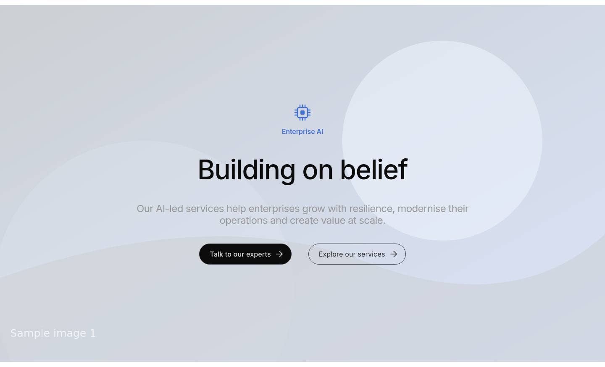

**Tablet rendering** — The same Hero at 768 px: a banner at least 40rem high, photo-1.svg cropped to its centre, the 2.5rem icon, the eyebrow 'Enterprise AI', the 2.5rem H1 'Building on belief', the 1rem description and the two CTAs, all centred; the CTAs wrap only when they do not fit in one row.

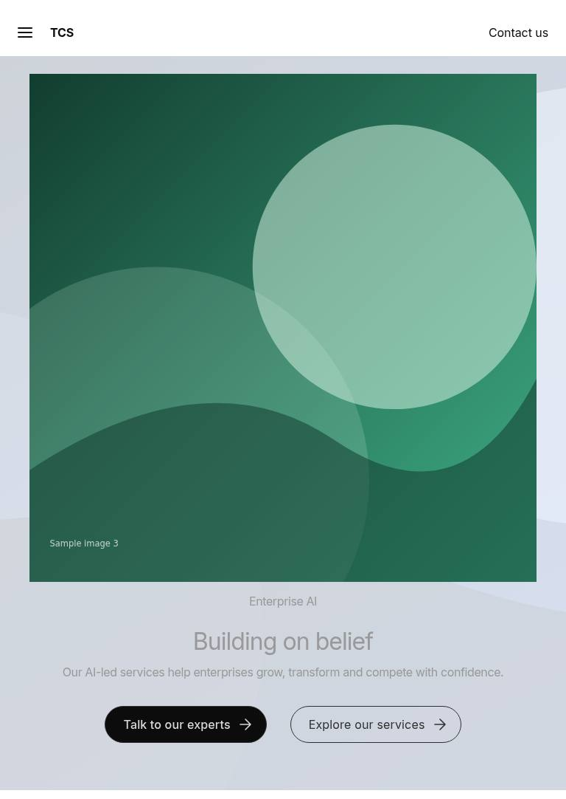

**Mobile rendering** — The Hero at 375 px: a banner at least 35rem high with photo-1.svg cropped to its centre; the icon, the eyebrow 'Enterprise AI', the 2.5rem H1 'Building on belief' and the 1rem description stacked and centred, the CTAs 'Talk to our experts' and 'Explore our services' wrapping one per line when they do not fit side by side.

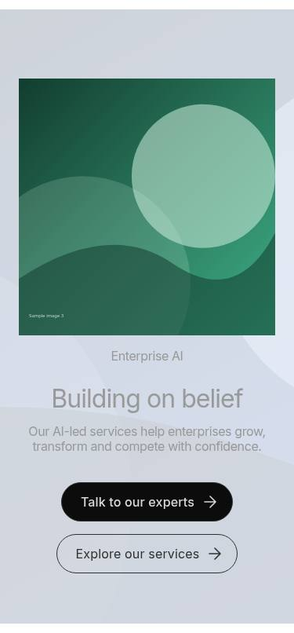

**Default image hero** — The Hero at 1440 px: photo-2.svg (alt 'Consultants reviewing a transformation roadmap') full width under the 80 % white overlay, with the brand-blue eyebrow 'Consulting', the H1 'Transform with confidence', the grey description and the buttons 'Talk to our experts' (Primary, filled) and 'Explore our services' (Secondary, outline) side by side, centred.

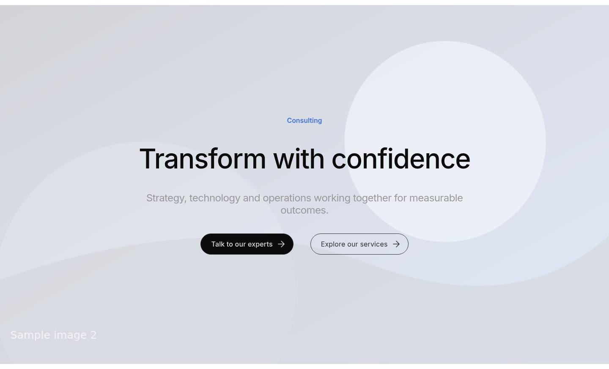

**Lottie animation hero** — The Hero at 1440 px with Hero Image type Lotto: the pulsing-circle animation.json playing behind the content with no overlay (Light, no overlay); centred, the eyebrow 'AI and automation', the H1 'Intelligence in motion', the description and the buttons 'Talk to our experts' (Primary, filled) and 'Explore our services' (Secondary, outline) side by side; the round pause button 1rem from the bottom-right corner.

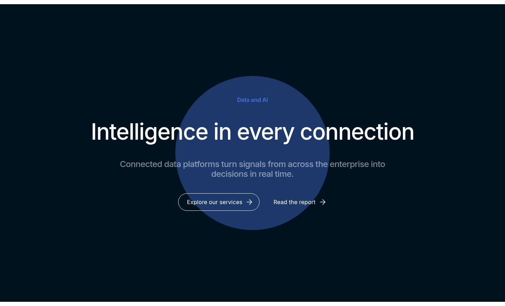

**Contained image hero** — The Hero at 1440 px: the bar chart chart.svg shown whole and centred with no overlay (Contained image, Light, no overlay); at the top, centred, the eyebrow 'Annual report 2026', the H1 'Growth you can measure', the description and one Primary button 'Read the report'.

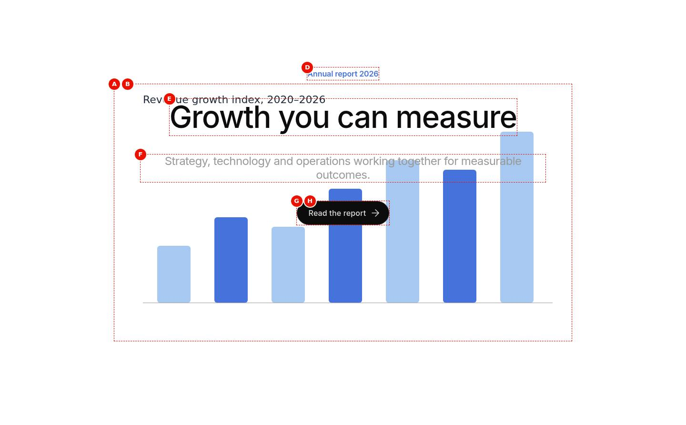

**Hero without media** — The Hero at 1440 px without an image: a plain white banner with no overlay; centred, the brand-blue eyebrow 'About us', the H1 'Technology that moves business forward', the grey description and the buttons 'Talk to our experts' (Primary, filled) and 'Explore our services' (Secondary, outline) side by side.

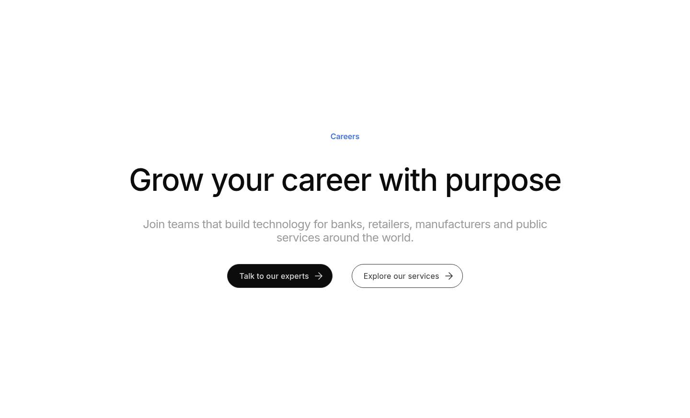

**Default light overlay** — The Hero at 1440 px with BG Color Default: photo-3.svg under an 80 % white overlay, the brand-blue eyebrow 'Enterprise AI', the dark H1 'Building on belief', the grey description and the buttons 'Talk to our experts' (Primary, filled) and 'Explore our services' (Secondary, outline) side by side, centred.

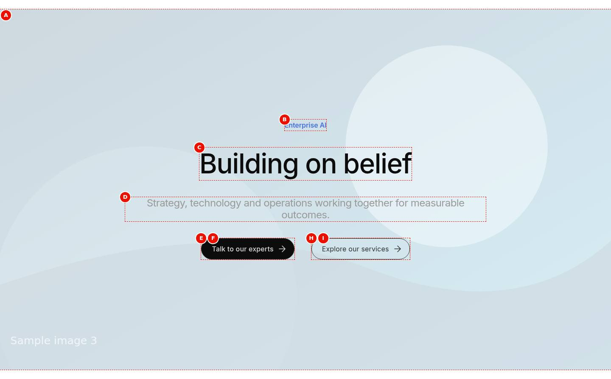

**Light background without overlay** — The Hero at 1440 px with BG Color Light, no overlay: the light gradient light.svg at full strength, with the brand-blue eyebrow 'Enterprise AI', the dark H1 'Building on belief', the grey description and the buttons 'Talk to our experts' (Primary, filled) and 'Explore our services' (Secondary, outline) side by side, centred.

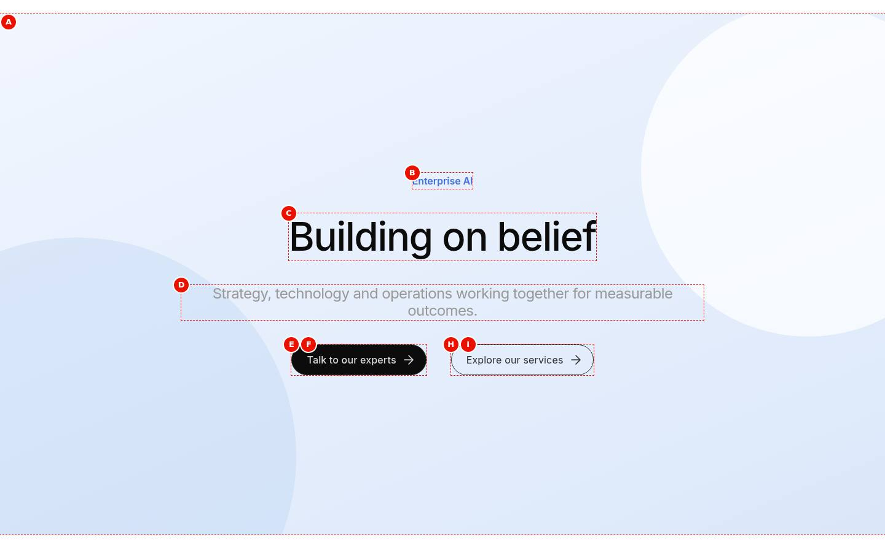

**Dark blue overlay** — The Hero at 1440 px with BG Color Dark blue: photo-4.svg under an 80 % navy overlay, the eyebrow 'Enterprise AI' still brand blue, the white H1 'Building on belief', the 50 % white description, an outline 'Talk to our experts' button and a text link 'Explore our services' with an arrow, both white, centred.

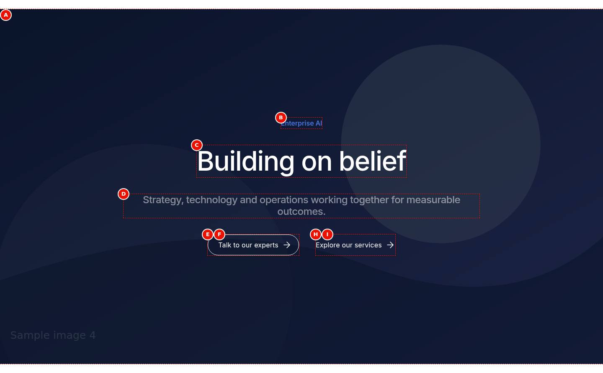

**Subtle dark blue overlay** — The Hero at 1440 px with BG Color Dark blue (subtle): photo-5.svg under a 60 % navy overlay, more visible than with Dark blue; the brand-blue eyebrow 'Enterprise AI', the white H1 'Building on belief', the 50 % white description, an outline 'Talk to our experts' button and a text link 'Explore our services' with an arrow, both white, centred.

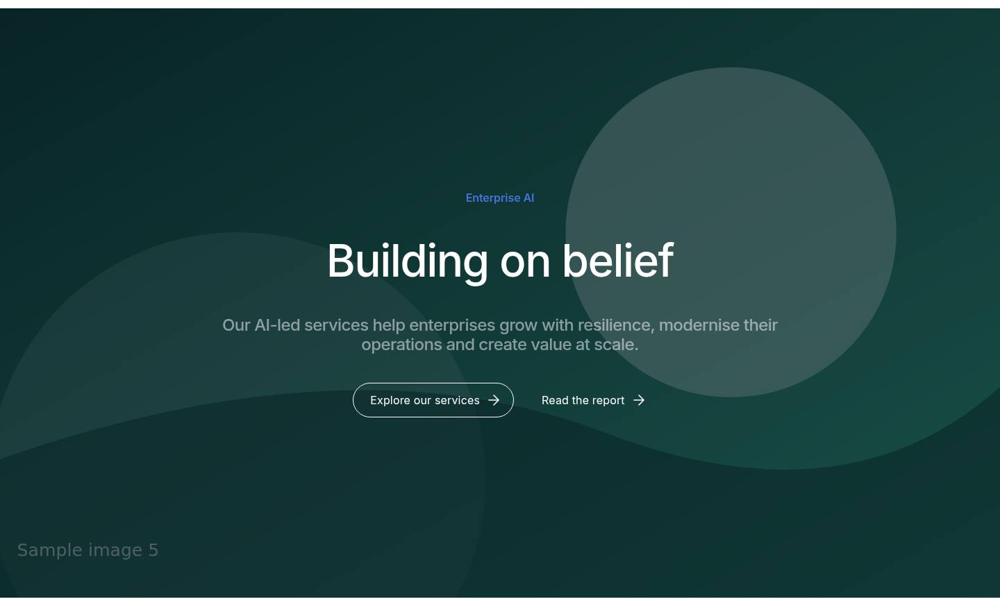

**Black overlay** — The Hero at 1440 px with BG Color Black: photo-6.svg under an 80 % black overlay; the brand-blue eyebrow 'Enterprise AI', the white H1 'Building on belief', the 50 % white description, an outline 'Talk to our experts' button and a text link 'Explore our services' with an arrow, both white, centred.

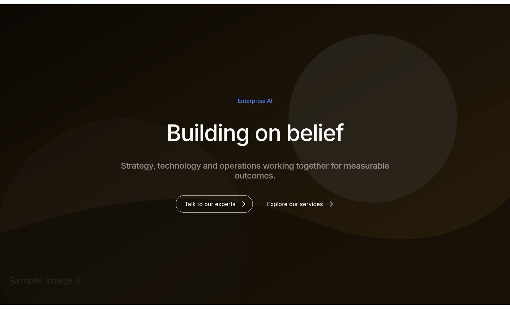

**Content at the top** — The Hero at 1440 px: photo-7.svg under the 80 % white overlay with the brand-blue eyebrow 'Manufacturing', the H1 'Reimagine your operations', the grey description and the buttons 'Talk to our experts' (Primary, filled) and 'Explore our services' (Secondary, outline) side by side; with Vertical Alignment Top the centred content starts right below the 7.5rem top padding, leaving the lower part of the image free.

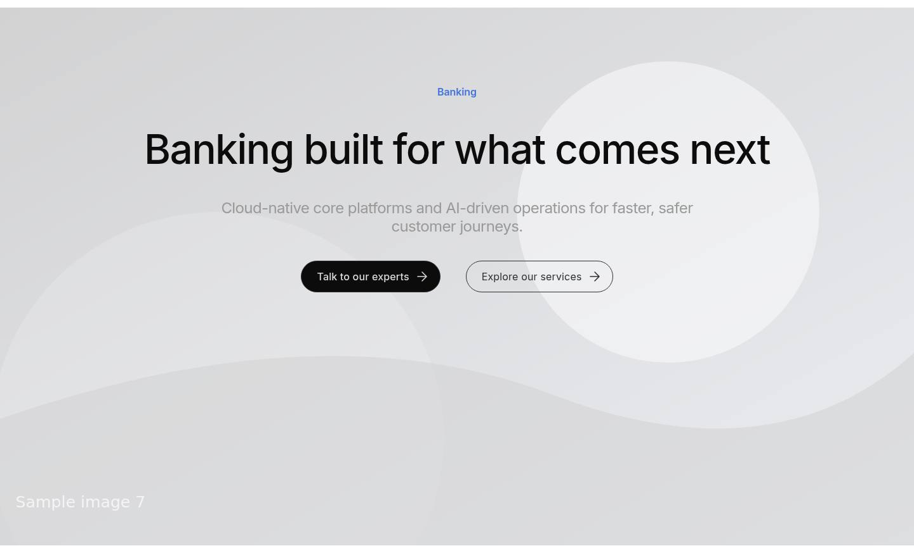

**Content in the middle** — The Hero at 1440 px: photo-7.svg under the 80 % white overlay with the brand-blue eyebrow 'Manufacturing', the H1 'Reimagine your operations', the grey description and the buttons 'Talk to our experts' (Primary, filled) and 'Explore our services' (Secondary, outline) side by side; with the default Middle the content is centred vertically and horizontally.

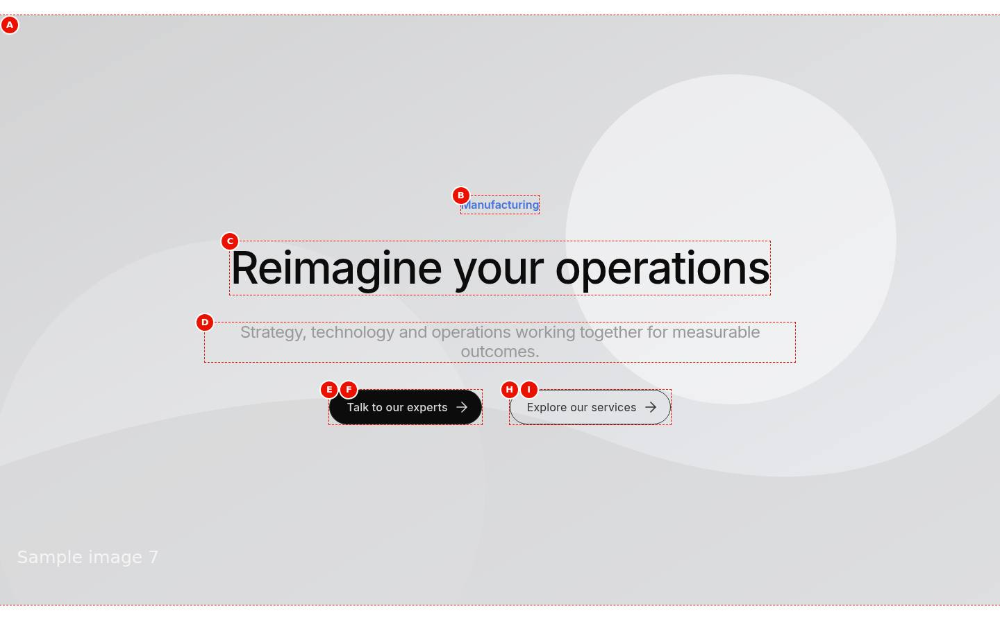

**Content at the bottom** — The Hero at 1440 px: photo-7.svg under the 80 % white overlay with the brand-blue eyebrow 'Manufacturing', the H1 'Reimagine your operations', the grey description and the buttons 'Talk to our experts' (Primary, filled) and 'Explore our services' (Secondary, outline) side by side; with Vertical Alignment Bottom the centred content rests above the 7.5rem bottom padding, leaving the upper part of the image free.

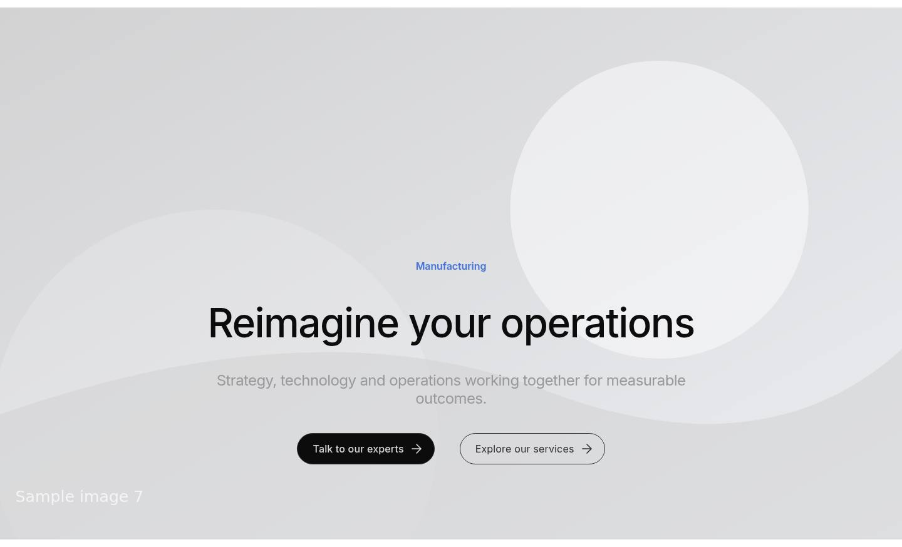

**Content on the left** — The Hero at 1440 px: wide.svg under the 80 % white overlay with the brand-blue eyebrow 'Manufacturing', the H1 'Reimagine your operations', the grey description and the buttons 'Talk to our experts' (Primary, filled) and 'Explore our services' (Secondary, outline) side by side; with Horizontal Alignment Left and Left align the 47.5rem content block sits on the left, its text and CTAs left aligned.

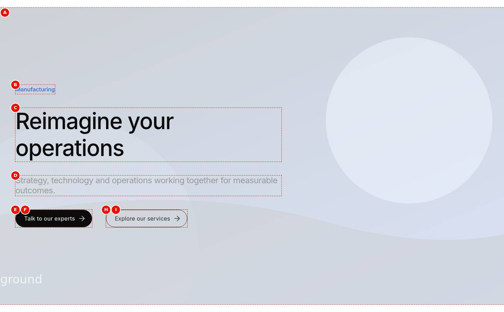

**Content in the centre** — The Hero at 1440 px: wide.svg under the 80 % white overlay with the brand-blue eyebrow 'Manufacturing', the H1 'Reimagine your operations', the grey description and the buttons 'Talk to our experts' (Primary, filled) and 'Explore our services' (Secondary, outline) side by side; with the default Center and Center align the content block and its text are centred.

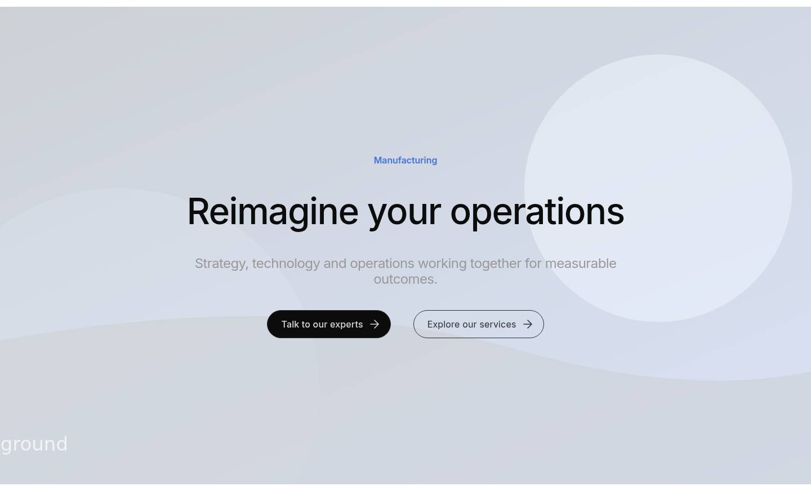

**Content on the right** — The Hero at 1440 px: wide.svg under the 80 % white overlay with the brand-blue eyebrow 'Manufacturing', the H1 'Reimagine your operations', the grey description and the buttons 'Talk to our experts' (Primary, filled) and 'Explore our services' (Secondary, outline) side by side; with Horizontal Alignment Right and Right align the 47.5rem content block sits on the right, its text and CTAs right aligned.

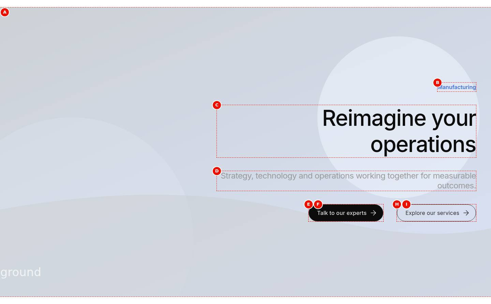

**Left-aligned text** — The Hero at 1440 px: photo-2.svg under the white overlay; inside the centred content block the square-3 icon, the eyebrow 'Manufacturing', the H1 'Reimagine your operations', the description and the Primary and Secondary CTAs all start at its left edge (Text Alignment Left align).

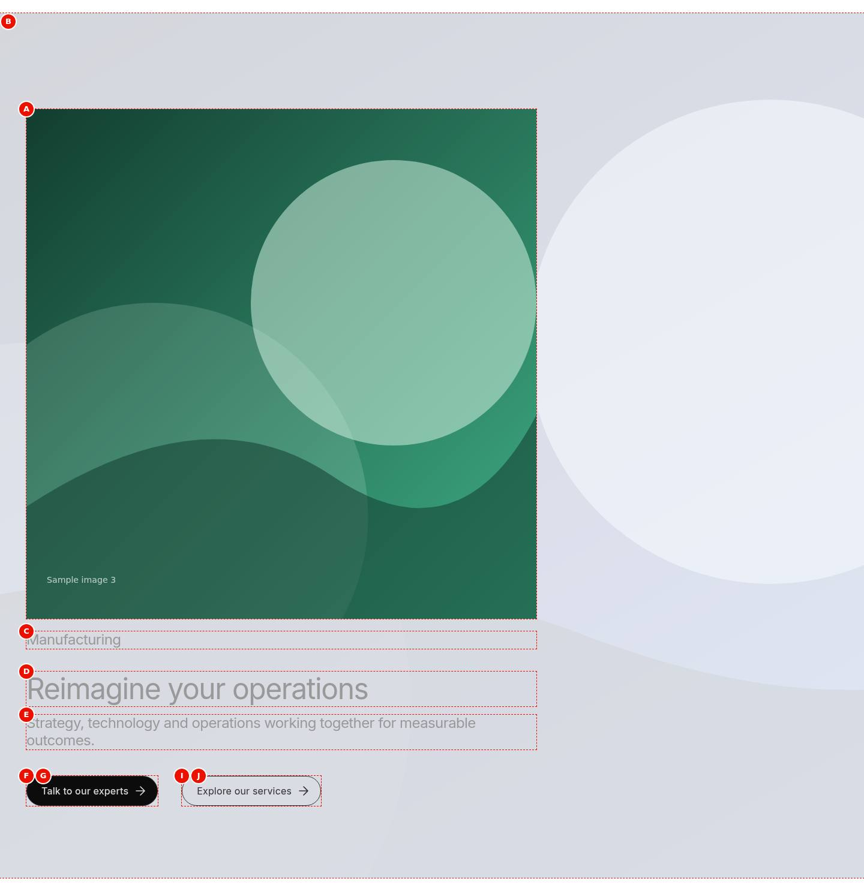

**Centred text** — The Hero at 1440 px: photo-2.svg under the white overlay; the square-3 icon, the eyebrow 'Manufacturing', the H1 'Reimagine your operations', the description and the Primary and Secondary CTAs all centred in the content block (default Center align).

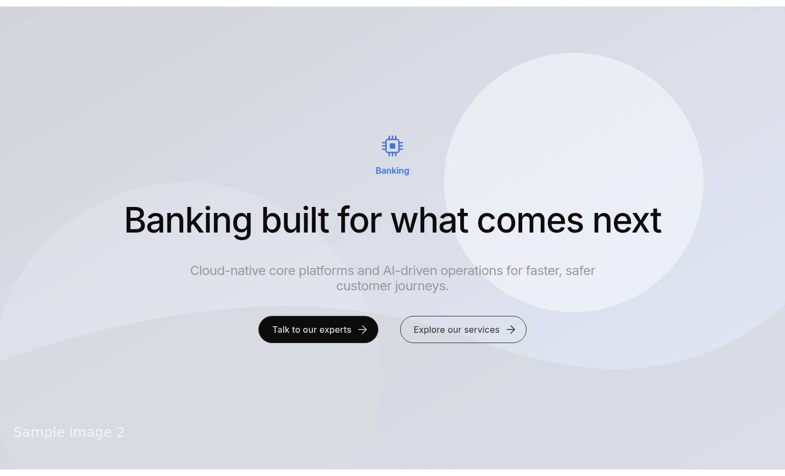

**Right-aligned text** — The Hero at 1440 px: photo-2.svg under the white overlay; inside the centred content block the square-3 icon, the eyebrow 'Manufacturing', the H1 'Reimagine your operations', the description and the Primary and Secondary CTAs all aligned to its right edge (Text Alignment Right align).

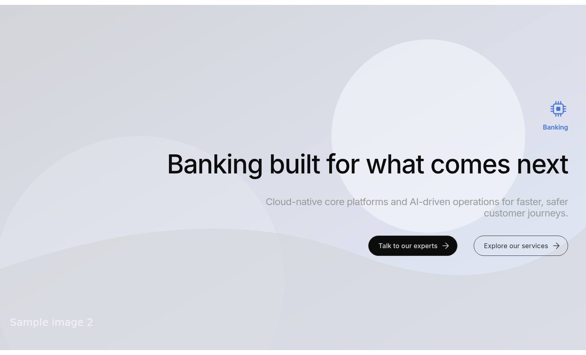

**No motion** — The Hero at 1440 px: photo-4.svg under the 80 % navy overlay with the brand-blue eyebrow 'Cloud', the white H1 'Accelerate your growth', the 50 % white description and an outline 'Talk to our experts' button and a text link 'Explore our services' with an arrow, both white, centred and fully visible with no entrance animation (Motion Type None).

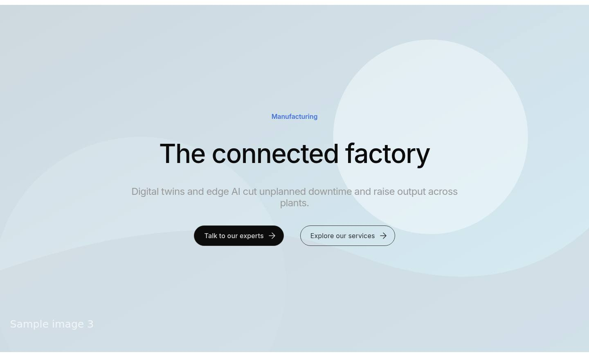

**Fade-in motion** — The Hero at 1440 px: photo-4.svg under the 80 % navy overlay with the brand-blue eyebrow 'Cloud', the white H1 'Accelerate your growth', the 50 % white description and an outline 'Talk to our experts' button and a text link 'Explore our services' with an arrow, both white; a frame about 250 ms into the 800 ms Fade in, the whole content block half transparent while the image is static.

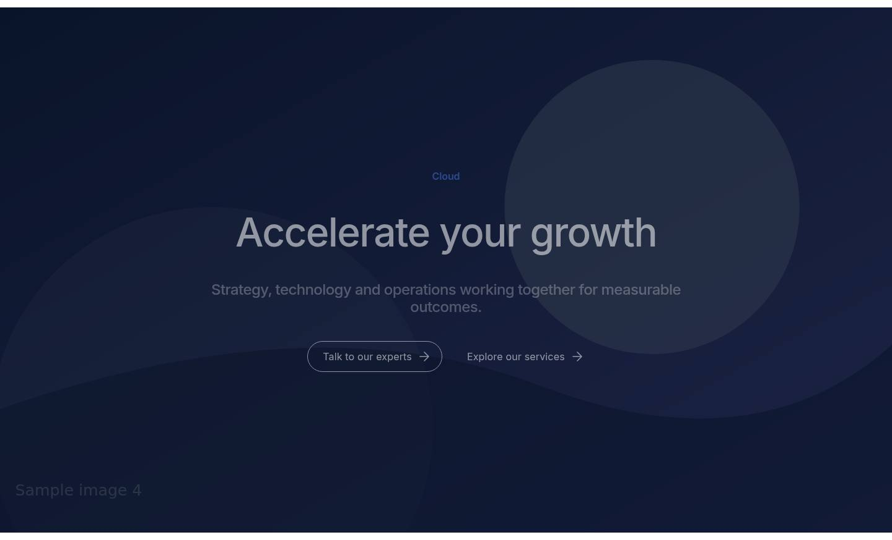

**Slide-up motion** — The Hero at 1440 px: photo-4.svg under the 80 % navy overlay with the brand-blue eyebrow 'Cloud', the white H1 'Accelerate your growth', the 50 % white description and an outline 'Talk to our experts' button and a text link 'Explore our services' with an arrow, both white; a frame about 300 ms into the 800 ms Slide up, the content block slightly below its final place and partly transparent.

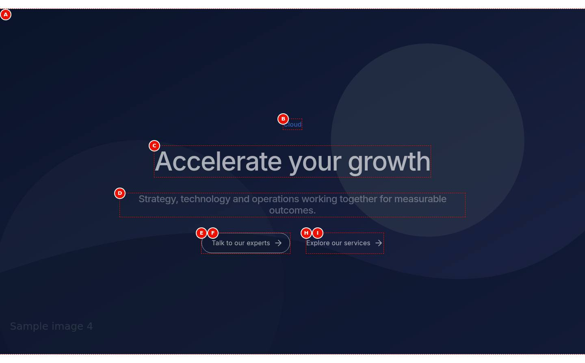

**Zoom motion** — The Hero at 1440 px: photo-4.svg under the 80 % navy overlay with the brand-blue eyebrow 'Cloud', the white H1 'Accelerate your growth', the 50 % white description and an outline 'Talk to our experts' button and a text link 'Explore our services' with an arrow, both white; a frame about 300 ms into the 1600 ms Zoom (image), the photograph slightly enlarged while the text is fully visible.

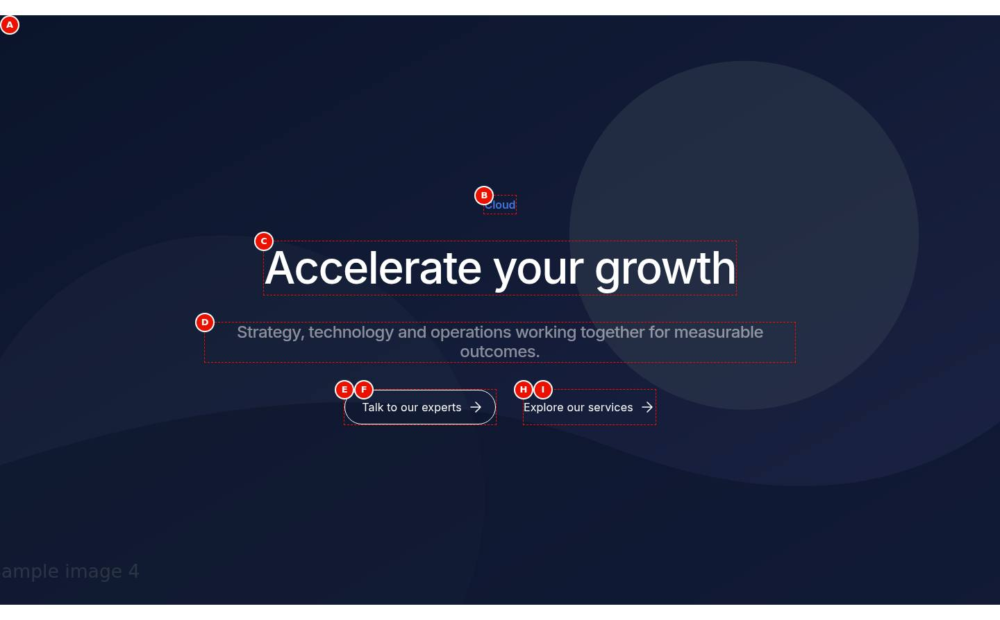

**Default CTA view** — A crop of the CTA row of a Hero at 1440 px (title 'Building on belief' over photo-3.svg): the CTA 'Explore our services' (CTA view Default) as dark text with a trailing right arrow, no border or fill.


**Primary CTA** — A crop of the CTA row of a Hero at 1440 px (title 'Building on belief' over photo-3.svg): the Primary CTA 'Talk to our experts' as a pill-shaped filled black button with white text and a right arrow.

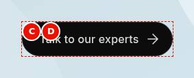

**Secondary CTA** — A crop of the CTA row of a Dark blue Hero at 1440 px (title 'Building on belief' over photo-3.svg under the navy overlay): the Secondary CTA 'Explore our services' as a pill-shaped outline button with white border, white text and a right arrow.


**Right arrow CTA** — A crop of the CTA row of a Hero at 1440 px (title 'Building on belief' over photo-3.svg): the text CTA 'Explore our services' (CTA view Default, CTA Arrow Right) with a right-pointing arrow after the text.

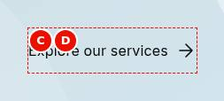

**Down arrow CTA** — A crop of the CTA row of a Hero at 1440 px (title 'Building on belief' over photo-3.svg): the text CTA 'Discover our story' (link #anchor-our-story, CTA Arrow Down) with a down-pointing arrow after the text.

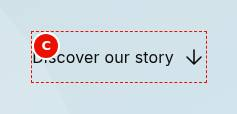

**New-window CTA** — A crop of the CTA row of a Hero at 1440 px (title 'Building on belief' over photo-3.svg): the Primary button 'Read the full report' in its hover state; it links to https://www.example.com/reports/ai-outlook-2026.pdf and opens in a new tab, with no visible new-tab hint.

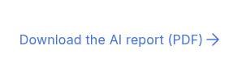

**Hero with an H2 title** — The Hero at 1440 px: photo-8.svg under the 80 % white overlay with the eyebrow 'Industries', the title 'Industries we serve', the description and one Primary button 'Explore industries', centred; it looks the same as an H1 Hero, but the title is an h2 element.

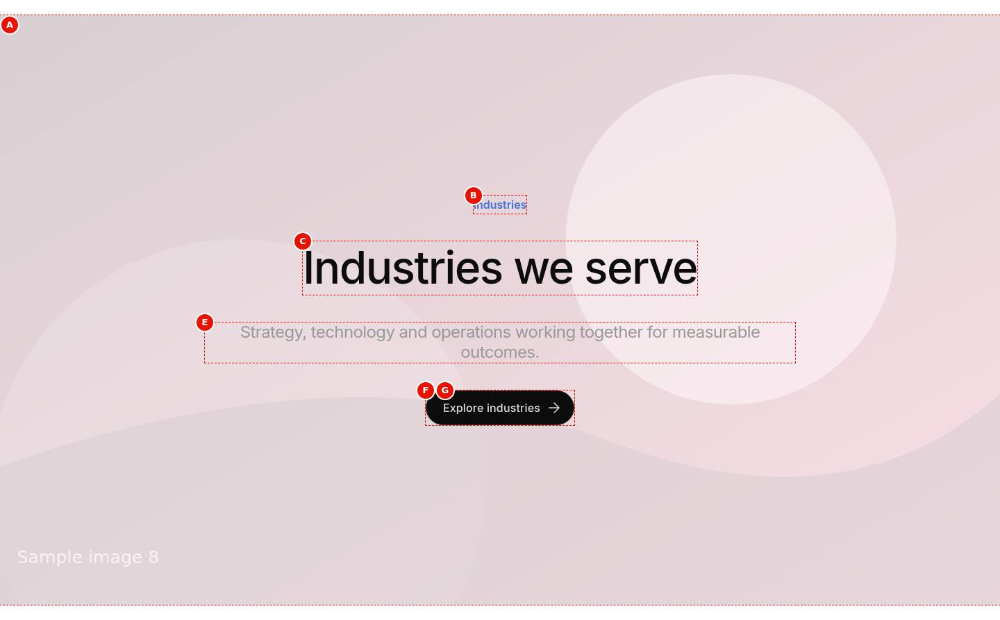

**Universal Editor canvas** — The Hero at 1440 px in Universal Editor Edit mode (annotated preview, not a Universal Editor screenshot): the Enterprise AI banner selected, with A on the block, B on photo-1.svg, C on the square-3 icon, D on 'Enterprise AI', E on 'Building on belief', F on the description and G on the two CTAs. (Annotated preview in editor mode with sample content; letters as in the annotations list, not a Universal Editor screenshot; file screenshots/hero-authoring-view.jpg)

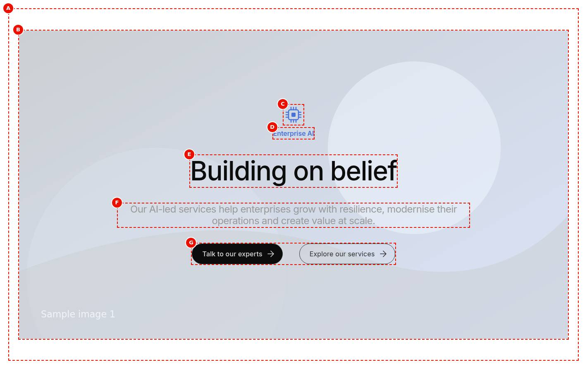

**Properties panel** — The Hero properties panel with its five tabs (Image, Content, Links, Style, Additional), the Image tab open showing Icon, Icon Image Alt Text, Hero Image type, Hero Image Path, Hero Image alt text and Hero View. (Dialog reference generated from the component model, not a Universal Editor screenshot; file screenshots/hero-properties-panel.jpg)

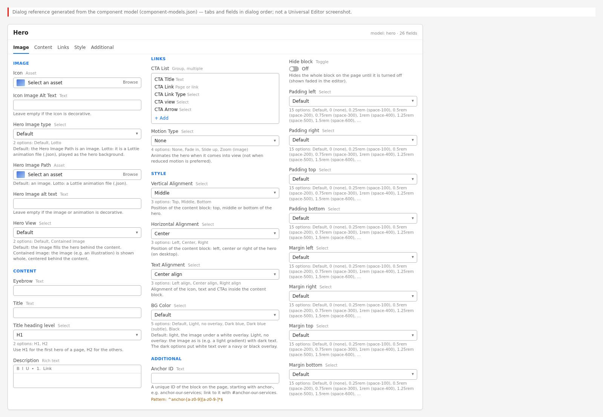

Universal Editor dialogs (no screenshot exists yet; to be captured on AEM author):

```text
[Screenshot Placeholder]

File name:
hero-dialog-content-desktop.png

Purpose:
The Content tab of the Hero properties in Universal Editor, with the fields of the table "Content tab — Hero" in Authorable Fields below.

Annotations:
A = Icon
B = Icon Image Alt Text
C = Hero Image type
D = Hero Image Path
E = Hero Image alt text
F = Hero View
G = Eyebrow
H = Title
I = Title heading level
J = Description
```

```text
[Screenshot Placeholder]

File name:
hero-dialog-style-desktop.png

Purpose:
The Style tab of the Hero properties in Universal Editor, with the fields of the table "Style tab — Hero" in Authorable Fields below.

Annotations:
A = Vertical Alignment
B = Horizontal Alignment
C = Text Alignment
D = BG Color
E = Icon color
```

```text
[Screenshot Placeholder]

File name:
hero-dialog-additional-desktop.png

Purpose:
The Additional tab of the Hero properties in Universal Editor, with the fields of the table "Additional tab — Hero" in Authorable Fields below.

Annotations:
A = Anchor ID
B = Hide block
C = Animation Type
D = Motion Speed
E = Animation Trigger
F = Background animation
G = Padding left
H = Padding right
I = Padding top
J = Padding bottom
```

```text
[Screenshot Placeholder]

File name:
hero-cta-dialog-fields-desktop.png

Purpose:
The dialog of the CTA properties in Universal Editor, with the fields of the table "Fields — CTA" in Authorable Fields below.

Annotations:
A = CTA Link
B = CTA Title
C = CTA Link Type
D = CTA view
E = CTA Arrow
```

<!-- END GENERATED: screenshots -->

States without a screenshot:

```text
[Screenshot Placeholder]

File name:
hero-added-editor-desktop.png

Purpose:
The Hero just added to a Section in Universal Editor, with the template defaults (Middle, Center, Center align, H1) and no content yet.

Annotations:
A = Hero in the content tree
B = Add (+) of the Hero (offers CTA)
C = Properties panel with the Content, Style and Additional tabs
```

```text
[Screenshot Placeholder]

File name:
hero-cta-editor-placeholder-desktop.png

Purpose:
A CTA item just added with Add, before its CTA Link is filled: the dashed editor placeholder with the itemEditorHint text in the CTA row (Universal Editor only).

Annotations:
A = Dashed CTA placeholder
B = Placeholder text "Not shown yet: fill in this item's properties."
C = CTA item selected in the content tree
```

```text
[Screenshot Placeholder]

File name:
hero-lottie-focus-desktop.png

Purpose:
A Lotto Hero with keyboard focus on the pause / play button, and the same button after activation (label switched from "Pause animation" to "Play animation").

Annotations:
A = Animation pause / play button with focus ring
B = Lottie animation behind the overlay
```

```text
[Screenshot Placeholder]

File name:
hero-cta-focus-desktop.png

Purpose:
Keyboard focus on a Primary and a Default (text with arrow) CTA, on the Default overlay and on BG Color Dark blue.

Annotations:
A = Focused Primary CTA
B = Focused Default CTA (tertiary) with arrow
```

```text
[Screenshot Placeholder]

File name:
hero-lottie-failed-desktop.png

Purpose:
A Lotto Hero whose animation file could not be loaded (e.g. the JSON asset is not published): the animation and its pause / play button are hidden, the overlay and the content remain.

Annotations:
A = Hero without animation
B = Content block still rendered
```

```text
[Screenshot Placeholder]

File name:
hero-empty-editor-desktop.png

Purpose:
A Hero without any content in Universal Editor (an empty banner of the minimum height) and the same Hero on the page.

Annotations:
A = Empty Hero banner
```

```text
[Screenshot Placeholder]

File name:
hero-align-left-mobile.png

Purpose:
Horizontal Alignment Left below 900px: the content block takes the full width (the 47.5rem limit applies from 900px).

Annotations:
A = Content block at full width
B = Left-aligned text and CTAs
```

## For Content Authors

1. **Add the block.** In Universal Editor select a Section, a Columns Container column, a Gen Carousel or a Tabs Container in the content tree, choose **Add (+)** and pick **Hero**. A new Hero stores Vertical Alignment Middle, Horizontal Alignment Center, Text Alignment Center align and Title heading level H1.
2. **Open its properties.** Select the Hero in the content tree; the properties panel shows the **Content**, **Style** and **Additional** tabs.
3. **Enter content (Content tab).** Choose a **Hero Image Path** and enter its **Hero Image alt text** (leave the alt empty only for a decorative image). Enter the **Eyebrow**, **Title** and **Description**; set **Title heading level** to H1 for the page's main Hero, H2 for any other. Add an **Icon** (with **Icon Image Alt Text**) only if the design needs it.
4. **Select variations.** For an animation set **Hero Image type** to Lotto and choose a Lottie `.json` file as the Hero Image Path. For an illustration that must be shown whole set **Hero View** to Contained image. On the **Style** tab choose **Vertical Alignment**, **Horizontal Alignment**, **Text Alignment** and **BG Color**.
5. **Add CTAs.** Select the Hero, choose **Add (+)** and pick **CTA**. Fill **CTA Link** (required) and **CTA Title**; choose **CTA view** (Default text link, Primary, Secondary), **CTA Arrow** (Auto, Right, Down) and **CTA Link Type** (Open in New Window only when needed). Reorder CTAs by dragging them in the content tree; the page shows them in that order.
6. **Additional tab.** Set an Anchor ID, Hide block, animations or spacing only when needed (see [Authorable Fields](#authorable-fields)).
7. **Preview.** Switch Universal Editor to Preview (animations play only there) or open the page on aem.page; check desktop, tablet and mobile widths.
8. **Publish.** Publish the page with its referenced assets. A Lottie `.json` file is served only once it is published itself (images travel with the page).
9. **Validate the published output.** On aem.live check the image loads with its alt text, exactly one H1 is on the page, every CTA goes to the right target, and a Lottie animation plays and pauses.

**Minimum required content:** a Title (a Hero without one renders, but has no heading). **Recommended:** a Hero Image with alt text, an Eyebrow, a Description and one or two CTAs. **Optional:** Icon, Lotto, Contained image, alignments, BG Color, Additional tab options.

## Authorable Fields

<!-- BEGIN GENERATED: fields (npm run build:docs) -->

### Hero (`hero`)

Model `hero`; template name "Hero" (the block class AEM renders); children: `hero-cta`.

Stored on a new component (definition template): `classes_alignment` = `"align-middle"`, `content_titleType` = `"h1"`, `classes_horizontal` = `"align-center"`, `classes_textAlignment` = `"text-center"`.

#### Content tab — Hero

| Field label | Property | Type | Required | Default | Allowed values | Author guidance | Example |
| ----------- | -------- | ---- | -------- | ------- | -------------- | --------------- | ------- |
| Icon | `content_icon` | reference | No | — | — | — | /content/dam/tcs-corp/block-library/images/square-sample-3.jpg |
| Icon Image Alt Text | `content_iconAlt` | text | No | — | — | Leave empty if the icon is decorative. Delivered with `content_icon` (field collapse). | — |
| Hero Image type | `classes_media` | select | No | "" | Default (""), Lotto (`lottie`) | Default: the Hero Image Path is an image. Lotto: it is a Lottie animation file (.json), played as the hero background. Delivered as a block class. | lottie |
| Hero Image Path | `image` | reference | No | — | — | Default: an image. Lotto: a Lottie animation file (.json). | /content/dam/tcs-corp/block-library/images/wide-sample.jpg |
| Hero Image alt text | `imageAlt` | text | No | — | — | Leave empty if the image or animation is decorative. Delivered with `image` (field collapse). | Consultants reviewing a transformation roadmap |
| Hero View | `classes` | select | No | "" | Default (""), Contained image (`media-contained`) | Default: the image fills the hero behind the content. Contained image: the image (e.g. an illustration) is shown whole, centered behind the content. | media-contained |
| Eyebrow | `content_eyebrow` | text | No | — | — | — | Enterprise AI |
| Title | `content_title` | text | No | — | — | — | Building on belief |
| Title heading level | `content_titleType` | select | No | `h1` | H1 (`h1`), H2 (`h2`) | Use H1 for the first hero of a page, H2 for the others. Delivered with `content_title` (field collapse). | h1 |
| Description | `content_description` | richtext | No | "" | — | — | — |
| CTA List | `ctas` | container (multiple) | No | — | — | CTAs authored before CTA items. Add CTAs to the hero with Add (CTA) instead. | — |
| CTA List › CTA Title | `ctaText` | text | No | — | — | — | — |
| CTA List › CTA Link | `cta` | aem-content | No | — | — | — | — |
| CTA List › CTA Link Type | `ctaTarget` | select | No | "" | Default (""), Open in New Window (`new-window`) | — | — |
| CTA List › CTA view | `ctaType` | select | No | "" | Default (""), Primary (`primary`), Secondary (`secondary`) | — | — |
| CTA List › CTA Arrow | `ctaArrow` | select | No | `right` | Right (`right`), Down (`down`) | Direction of the arrow next to the CTA text. | — |

#### Style tab — Hero

| Field label | Property | Type | Required | Default | Allowed values | Author guidance | Example |
| ----------- | -------- | ---- | -------- | ------- | -------------- | --------------- | ------- |
| Vertical Alignment | `classes_alignment` | select | No | `align-middle` | Top (`align-top`), Middle (`align-middle`), Bottom (`align-bottom`) | Position of the content block: top, middle or bottom of the hero. Delivered as a block class. | align-top |
| Horizontal Alignment | `classes_horizontal` | select | No | `align-center` | Left (`align-left`), Center (`align-center`), Right (`align-right`) | Position of the content block: left, center or right of the hero (on desktop). Delivered as a block class. | align-left |
| Text Alignment | `classes_textAlignment` | select | No | `text-center` | Left align (`text-left`), Center align (`text-center`), Right align (`text-right`) | Alignment of the icon, text and CTAs inside the content block. Delivered as a block class. | text-left |
| BG Color | `classes_background` | select | No | "" | Default (""), Light, no overlay (`bg-light`), Dark blue (`bg-dark`), Dark blue (subtle) (`bg-dark-subtle`), Black (`bg-black`) | Default: light, the image under a white overlay. Light, no overlay: the image as is (e.g. a light gradient) with dark text. The dark options put white text over a navy or black overlay. Delivered as a block class. | bg-dark |
| Icon color | `classes_iconcolor` | select | No | "" | Default (as authored) (""), Black (`icon-black`), White (`icon-white`), Blue (`icon-blue`) | Colour of the icon above the title, for a single-colour SVG icon. Default keeps the icon as authored. Delivered as a block class. | — |

#### Additional tab — Hero

| Field label | Property | Type | Required | Default | Allowed values | Author guidance | Example |
| ----------- | -------- | ---- | -------- | ------- | -------------- | --------------- | ------- |
| Anchor ID | `classes_anchor` | text | No | — | regExp: ^anchor-[a-z0-9][a-z0-9-]*$; customErrorMsg: Start with anchor-, then lower-case letters, digits and hyphens. | A unique ID of the block on the page, starting with anchor-, e.g. anchor-our-services; link to it with #anchor-our-services. Delivered as a block class. | — |
| Hide block | `classes_hideblock` | boolean | No | `false` | on / off | Hides the whole block on the page until it is turned off (shown faded in the editor). Delivered as a block class. | — |
| Animation Type | `classes_animation` | select | No | "" | None (""), Fade in (`motion-fade-in`), Fade up (`motion-fade-up`), Fade down (`motion-fade-down`), Fade left (`motion-fade-left`), Fade right (`motion-fade-right`), Slide up (`motion-slide-up`), Slide down (`motion-slide-down`), Slide left (`motion-slide-left`), Slide right (`motion-slide-right`), Scale in (`motion-scale-in`) | How the block's content appears; repeated items (cards, list items, accordion items, columns) appear one after another. None: shown as is. Not played in the editor or when the visitor prefers reduced motion. Delivered as a block class. | motion-fade-in |
| Motion Speed | `classes_animationspeed` | select | No | "" | Medium (""), Fast (`motion-fast`), Slow (`motion-slow`) | How fast the block's animations run (Animation Type 0.3 / 0.6 / 0.9 s; the Background animation takes 1.5 times as long). Shown when (`classes_animation` is set and `classes_animation` is not empty) or (`classes_bganimation` is set and `classes_bganimation` is not empty). Delivered as a block class. | motion-slow |
| Animation Trigger | `classes_animationtrigger` | select | No | "" | On Scroll / Viewport Entry (""), On Page Load (`motion-on-load`) | When the block's animations run. On Scroll: when the block comes into view (at once if it is in view when the page opens). On Page Load: as soon as the block is ready, wherever it is on the page. Shown when (`classes_animation` is set and `classes_animation` is not empty) or (`classes_bganimation` is set and `classes_bganimation` is not empty). Delivered as a block class. | motion-on-load |
| Background animation | `classes_bganimation` | select | No | "" | None (""), Fade in (`bg-motion-fade-in`), Reveal from the centre (`bg-motion-reveal`), Wipe left to right (`bg-motion-wipe-right`), Wipe right to left (`bg-motion-wipe-left`), Wipe bottom to top (`bg-motion-wipe-up`), Scale reveal (`bg-motion-scale`) | How the block's background (its colour, image or overlay as set in the block) appears. It doesn't animate the content: see Animation Type. Motion Speed and Animation Trigger apply to it too. Not played in the editor or when the visitor prefers reduced motion. Delivered as a block class. | bg-motion-scale |
| Padding left | `classes_paddingleft` | select | No | "" | Default (""), 0 (none) (`pl-0`), 0.25rem (space-100) (`pl-100`), 0.5rem (space-200) (`pl-200`), 0.75rem (space-300) (`pl-300`), 1rem (space-400) (`pl-400`), 1.25rem (space-500) (`pl-500`), 1.5rem (space-600) (`pl-600`), 2rem (space-800) (`pl-800`), 2.5rem (space-1000) (`pl-1000`), 3rem (space-1200) (`pl-1200`), 4rem (space-1600) (`pl-1600`), 5rem (space-2000) (`pl-2000`), 6rem (space-2400) (`pl-2400`), 7.5rem (space-3000) (`pl-3000`) | Delivered as a block class. | — |
| Padding right | `classes_paddingright` | select | No | "" | Default (""), 0 (none) (`pr-0`), 0.25rem (space-100) (`pr-100`), 0.5rem (space-200) (`pr-200`), 0.75rem (space-300) (`pr-300`), 1rem (space-400) (`pr-400`), 1.25rem (space-500) (`pr-500`), 1.5rem (space-600) (`pr-600`), 2rem (space-800) (`pr-800`), 2.5rem (space-1000) (`pr-1000`), 3rem (space-1200) (`pr-1200`), 4rem (space-1600) (`pr-1600`), 5rem (space-2000) (`pr-2000`), 6rem (space-2400) (`pr-2400`), 7.5rem (space-3000) (`pr-3000`) | Delivered as a block class. | — |
| Padding top | `classes_paddingtop` | select | No | "" | Default (""), 0 (none) (`pt-0`), 0.25rem (space-100) (`pt-100`), 0.5rem (space-200) (`pt-200`), 0.75rem (space-300) (`pt-300`), 1rem (space-400) (`pt-400`), 1.25rem (space-500) (`pt-500`), 1.5rem (space-600) (`pt-600`), 2rem (space-800) (`pt-800`), 2.5rem (space-1000) (`pt-1000`), 3rem (space-1200) (`pt-1200`), 4rem (space-1600) (`pt-1600`), 5rem (space-2000) (`pt-2000`), 6rem (space-2400) (`pt-2400`), 7.5rem (space-3000) (`pt-3000`) | Delivered as a block class. | — |
| Padding bottom | `classes_paddingbottom` | select | No | "" | Default (""), 0 (none) (`pb-0`), 0.25rem (space-100) (`pb-100`), 0.5rem (space-200) (`pb-200`), 0.75rem (space-300) (`pb-300`), 1rem (space-400) (`pb-400`), 1.25rem (space-500) (`pb-500`), 1.5rem (space-600) (`pb-600`), 2rem (space-800) (`pb-800`), 2.5rem (space-1000) (`pb-1000`), 3rem (space-1200) (`pb-1200`), 4rem (space-1600) (`pb-1600`), 5rem (space-2000) (`pb-2000`), 6rem (space-2400) (`pb-2400`), 7.5rem (space-3000) (`pb-3000`) | Delivered as a block class. | — |
| Margin left | `classes_marginleft` | select | No | "" | Default (""), 0 (none) (`ml-0`), 0.25rem (space-100) (`ml-100`), 0.5rem (space-200) (`ml-200`), 0.75rem (space-300) (`ml-300`), 1rem (space-400) (`ml-400`), 1.25rem (space-500) (`ml-500`), 1.5rem (space-600) (`ml-600`), 2rem (space-800) (`ml-800`), 2.5rem (space-1000) (`ml-1000`), 3rem (space-1200) (`ml-1200`), 4rem (space-1600) (`ml-1600`), 5rem (space-2000) (`ml-2000`), 6rem (space-2400) (`ml-2400`), 7.5rem (space-3000) (`ml-3000`) | Delivered as a block class. | — |
| Margin right | `classes_marginright` | select | No | "" | Default (""), 0 (none) (`mr-0`), 0.25rem (space-100) (`mr-100`), 0.5rem (space-200) (`mr-200`), 0.75rem (space-300) (`mr-300`), 1rem (space-400) (`mr-400`), 1.25rem (space-500) (`mr-500`), 1.5rem (space-600) (`mr-600`), 2rem (space-800) (`mr-800`), 2.5rem (space-1000) (`mr-1000`), 3rem (space-1200) (`mr-1200`), 4rem (space-1600) (`mr-1600`), 5rem (space-2000) (`mr-2000`), 6rem (space-2400) (`mr-2400`), 7.5rem (space-3000) (`mr-3000`) | Delivered as a block class. | — |
| Margin top | `classes_margintop` | select | No | "" | Default (""), 0 (none) (`mt-0`), 0.25rem (space-100) (`mt-100`), 0.5rem (space-200) (`mt-200`), 0.75rem (space-300) (`mt-300`), 1rem (space-400) (`mt-400`), 1.25rem (space-500) (`mt-500`), 1.5rem (space-600) (`mt-600`), 2rem (space-800) (`mt-800`), 2.5rem (space-1000) (`mt-1000`), 3rem (space-1200) (`mt-1200`), 4rem (space-1600) (`mt-1600`), 5rem (space-2000) (`mt-2000`), 6rem (space-2400) (`mt-2400`), 7.5rem (space-3000) (`mt-3000`) | Delivered as a block class. | — |
| Margin bottom | `classes_marginbottom` | select | No | "" | Default (""), 0 (none) (`mb-0`), 0.25rem (space-100) (`mb-100`), 0.5rem (space-200) (`mb-200`), 0.75rem (space-300) (`mb-300`), 1rem (space-400) (`mb-400`), 1.25rem (space-500) (`mb-500`), 1.5rem (space-600) (`mb-600`), 2rem (space-800) (`mb-800`), 2.5rem (space-1000) (`mb-1000`), 3rem (space-1200) (`mb-1200`), 4rem (space-1600) (`mb-1600`), 5rem (space-2000) (`mb-2000`), 6rem (space-2400) (`mb-2400`), 7.5rem (space-3000) (`mb-3000`) | Delivered as a block class. | — |

### CTA (`hero-cta`)

Model `hero-cta`; template name "CTA" (the block class AEM renders).

#### Fields — CTA

| Field label | Property | Type | Required | Default | Allowed values | Author guidance | Example |
| ----------- | -------- | ---- | -------- | ------- | -------------- | --------------- | ------- |
| CTA Link | `link` | aem-content | Yes | — | — | — | — |
| CTA Title | `linkText` | text | No | — | — | Delivered with `link` (field collapse). | — |
| CTA Link Type | `linkTarget` | select | No | "" | Default (""), Open in New Window (`new-window`) | — | — |
| CTA view | `linkStyle` | select | No | "" | Default (""), Primary (`primary`), Secondary (`secondary`) | — | — |
| CTA Arrow | `linkArrow` | select | No | "" | Auto (down for links to sections of this page) (""), Right (`right`), Down (`down`) | Direction of the arrow next to the CTA text. | — |

<!-- END GENERATED: fields -->

Notes on the significant fields (the tables above list every field, default and allowed value):

- **Hero Image Path / Hero Image type.** With Default the reference renders as a `<picture>` covering the banner (`object-fit: cover`). With Lotto and a `.json` link the Lottie player renders an SVG animation instead (`createAnimation`, class `hero-animation`). With Lotto and an image, the image is shown; with Default and a `.json` link, no media is rendered.
- **Hero Image alt text.** Becomes the image's `alt`. For a Lottie file AEM delivers the alt as the link text; `animationLabel` (`utils/media.js`) reads it and the animation gets `role="img"` and `aria-label`; without an alt it is `aria-hidden="true"`.
- **Icon / Icon Image Alt Text.** The first stand-alone picture before the title becomes `div.hero-icon` (`--icon-size-l`, 3rem from 900px); further pictures go to the description.
- **Eyebrow.** Rendered as `p.hero-eyebrow` only when there is a Title; without a Title every text element goes to the description.
- **Title / Title heading level.** The heading level collapses into the title (AEM delivers an `h1` or `h2`); it becomes `.hero-title`. Accessibility and SEO: one H1 per page.
- **Description.** Rich text in `div.hero-description` (omitted when empty).
- **CTA (item) fields.** CTA view Primary / Secondary render `a.button.primary` / `a.button.secondary`; Default renders `a.button.tertiary` (text with an arrow). CTA Arrow Down, or Auto with a link starting with `#`, adds `hero-cta-down` (down arrow). Open in New Window sets `target="_blank"`, `rel="noopener noreferrer"` and appends the visually hidden placeholder text `opensInNewTab` ("(opens in a new tab)"). A CTA without a link isn't rendered (in Universal Editor it is a dashed placeholder).
- **BG Color.** Default: white overlay at 80 %. Light, no overlay: the image as is. Dark blue: navy overlay at 80 %; Dark blue (subtle): 60 %; Black: black at 80 %; the dark options switch the title to white, the description to 50 % white (85 % on Dark blue (subtle)), the eyebrow to `--brand-300` (white on Dark blue (subtle)) and Secondary / Default CTAs to white. Without media no overlay is drawn.
- **Alignments.** Vertical and Horizontal Alignment position the content block (nine positions); Text Alignment aligns the icon, text and CTAs inside it. Heroes authored before Text Alignment existed follow their Horizontal Alignment.
- **Data-layer impact.** None of the fields changes the data-layer entry except the Title (its text is the component's `dc:title`) and Anchor ID (the component id).
- **Legacy mapping.** CTAs authored in the former **CTA List** composite multifield (`ctas`: CTA Title, CTA Link, CTA Link Type, CTA view as bold / italic, CTA Arrow) are still read and shown before the CTA items. The former **Motion Type** values (`motion-fade`, `motion-slide`, `motion-zoom`) are mapped by `mapLegacyMotion` to Fade in, Fade up and Background Scale reveal, played Slow unless a Motion Speed is set, and only when the block has no Animation Type / Background animation of its own.
- **Additional tab.** Anchor ID, Hide block, spacing, Animation Type, Motion Speed, Animation Trigger and, because the Hero has an authored background, **Background animation**: see AGENTS.md "Additional tab" and "Animation and skeletons". The content animation moves `.hero-content`; the background animation the media and the overlay.

## Screenshot-Based Authoring Steps

### Authoring Step 1: Add the Hero

```text
[Screenshot Placeholder]

File name:
hero-authoring-step-1.png

Purpose:
The Hero added to the first Section of the page in Universal Editor.

Annotations:
A = Section selected in the content tree
B = Add (+) menu with Hero
C = New Hero with the template defaults
```

### Values to Enter

| Callout | Field | Value | Reason | Expected result |
| ------- | ----- | ----- | ------ | --------------- |
| A | (content tree) | First Section of the page | The opening Hero is the LCP element | Section selected |
| B | Add (+) | Hero | Adds the block | An empty Hero appears |
| C | (properties) | — | Template defaults are stored | Middle, Center, Center align, H1 |

Author action: select the Section, choose Add (+), pick Hero. Expected preview: an empty banner of the minimum height. Expected published result: nothing visible until content is entered. Business rule: only containers whose filter lists `hero` offer it. Validation: the Hero appears in the content tree under the Section. Common mistake: adding the Hero inside a Tabs Container's tab when it should open the page; resolution: move it to the first Section.

### Authoring Step 2: Image and content

```text
[Screenshot Placeholder]

File name:
hero-authoring-step-2.png

Purpose:
The Content tab with the image, alt text, eyebrow, title, heading level and description filled.

Annotations:
A = Hero Image Path
B = Hero Image alt text
C = Eyebrow
D = Title
E = Title heading level
F = Description
```

### Values to Enter

| Callout | Field | Value | Reason | Expected result |
| ------- | ----- | ----- | ------ | --------------- |
| A | Hero Image Path | /content/dam/tcs-corp/block-library/images/wide-sample.jpg | Cover image | The image fills the banner under the white overlay |
| B | Hero Image alt text | Consultants reviewing a transformation roadmap | Text alternative (WCAG 1.1.1) | `alt` on the image |
| C | Eyebrow | Enterprise AI | Topic label above the title | Brand-coloured eyebrow |
| D | Title | Building on belief | The page's headline | Large title |
| E | Title heading level | H1 | First Hero of the page | `h1.hero-title` |
| F | Description | Our AI-led services help enterprises grow, transform and compete with confidence. | Supporting sentence | Grey description below the title |

Author action: open the Content tab and enter the values. Expected preview: centred eyebrow, title and description over the softened image. Expected published result: the same, the image loaded eagerly with high priority in the first section. Business rule: the eyebrow only shows when there is a title. Validation: one `h1` on the page. Common mistake: leaving the alt empty for an informative image; resolution: describe the image.

### Authoring Step 3: CTAs

```text
[Screenshot Placeholder]

File name:
hero-authoring-step-3.png

Purpose:
Two CTA items added to the Hero with Add, the first one's dialog open.

Annotations:
A = CTA Link
B = CTA Title
C = CTA view
D = CTA Arrow
E = CTA Link Type
```

### Values to Enter

| Callout | Field | Value | Reason | Expected result |
| ------- | ----- | ----- | ------ | --------------- |
| A | CTA Link | /en/contact (first CTA), /en/services (second CTA) | Destination | Links rendered |
| B | CTA Title | Talk to our experts / Explore our services | Visible label and accessible name | Button labels |
| C | CTA view | Primary / Secondary | Primary action first | Filled and outline pill buttons |
| D | CTA Arrow | Auto | Arrow right for other pages, down for `#` links | Right arrows |
| E | CTA Link Type | Default | Same tab | No `target` attribute |

Author action: select the Hero, Add (+) › CTA, fill the dialog; repeat for the second CTA. Expected preview: two CTAs side by side below the description, wrapping when they don't fit. Expected published result: the same. Business rule: CTA Link is required; a CTA without a link isn't rendered. Validation: both CTAs open their pages. Common mistake: entering a CTA Title without a CTA Link (the editor shows a dashed placeholder); resolution: fill CTA Link.

### Authoring Step 4: Style

```text
[Screenshot Placeholder]

File name:
hero-authoring-step-4.png

Purpose:
The Style tab with the content block moved to the left and a dark overlay.

Annotations:
A = Vertical Alignment
B = Horizontal Alignment
C = Text Alignment
D = BG Color
```

### Values to Enter

| Callout | Field | Value | Reason | Expected result |
| ------- | ----- | ----- | ------ | --------------- |
| A | Vertical Alignment | Middle | Content in the vertical centre | Centred vertically |
| B | Horizontal Alignment | Left | Keep the image subject on the right free | Content block on the left, at most 47.5rem wide from 900px |
| C | Text Alignment | Left align | Text follows the block's position | Text and CTAs start at the left |
| D | BG Color | Dark blue | Brand statement with white text | Navy overlay, white title, light eyebrow |

Author action: open the Style tab and choose the values. Expected preview: white text on the navy overlay, content on the left. Expected published result: the same. Business rule: Text Alignment is independent of Horizontal Alignment. Validation: text contrast is readable at the text position. Common mistake: Light, no overlay over a busy photograph; resolution: choose Default or a dark BG Color.

### Authoring Step 5: Preview, publish and verify

```text
[Screenshot Placeholder]

File name:
hero-authoring-step-5.png

Purpose:
The Hero in Universal Editor Preview at desktop width, compared with the published page.

Annotations:
A = Preview toggle
B = Published Hero
```

### Values to Enter

| Callout | Field | Value | Reason | Expected result |
| ------- | ----- | ----- | ------ | --------------- |
| A | Preview | On | Animations play only in Preview | The Hero as visitors see it |
| B | Publish | Publish with referenced assets | The image must be published | The Hero on aem.live |

Author action: switch to Preview, then publish. Expected result: the published Hero matches the preview. Validation: image request succeeds, alt text present, CTAs work. Common mistake: a Lotto Hero whose `.json` asset wasn't published (empty background on the published page); resolution: publish the asset.

## Variations

The variations are the select values of the model (`blocks/hero/_hero.json`), delivered as block classes. They combine freely.

### Default image (Hero Image type Default, Hero View Default)

Purpose: a photograph covering the whole banner. Use for most heroes; not for illustrations that must not be cropped. Required: Hero Image Path, alt text (or decorative). Rendering: `div.hero-media > picture` absolutely positioned behind the content, `object-fit: cover`, under the BG Color overlay; the block gets `hero-has-media`. Desktop / tablet / mobile: the image is cropped around its centre into the banner's height. Accessibility: the `alt` names the image. Data layer: no change. Personalization and fallback: no personalization; without an image the hero renders without media.

```text
[Screenshot Placeholder]

File name:
hero-default-image-mobile.png

Purpose:
The Default image Hero at 375px: the image cropped to the centre of the 35rem banner.

Annotations:
A = Cropped cover image
B = Content block
```

### Lotto (`lottie`)

Purpose: a looping Lottie animation as the background. Use for campaign pages with an approved Lottie JSON; not when the animation carries information the text doesn't. Required: Hero Image type Lotto, Hero Image Path a `.json` file; optional alt text. Rendering: `div.hero-media > div.hero-animation` (SVG renderer, `xMidYMid meet`, looping) and a pause / play `button.animation-toggle` appended to the block, 1rem (`--space-400`) from the bottom-right corner. The player loads when the hero is within 200px of the viewport, in idle time; the animation pauses off screen and starts paused on its first frame for reduced motion. If the file fails, the animation and its button are hidden. Accessibility: WCAG 2.2.2 pause control with localised labels (`pauseAnimation`, `playAnimation`). Data layer: a click on the button is a `cmp:click` with `interaction: animation`. Fallback: with Lotto and an image, the image is shown.

```text
[Screenshot Placeholder]

File name:
hero-lottie-tablet.png

Purpose:
The Lotto Hero at 768px with the pause / play button in the bottom-right corner.

Annotations:
A = Lottie animation
B = Pause / play button
```

### Contained image (`media-contained`)

Purpose: show an illustration or chart whole, centred behind the content. Use for artwork that must not be cropped; not for photographs meant to fill the banner. Rendering: the media becomes a centred flex box with `--space-600` padding and the image `object-fit: contain`. Usually paired with BG Color Light, no overlay. Accessibility and data layer as Default.

```text
[Screenshot Placeholder]

File name:
hero-contained-image-mobile.png

Purpose:
The Contained image Hero at 375px: the whole illustration visible inside the banner.

Annotations:
A = Contained illustration
B = Content block
```

### Text only (no media)

Purpose: a plain banner without image. Rendering: no `hero-media`, no `hero-has-media`, no overlay; the block background is `--color-bg-default` (navy or black with the dark BG Colors). Use for simple statement pages.

### BG Color: Default, Light no overlay (`bg-light`), Dark blue (`bg-dark`), Dark blue subtle (`bg-dark-subtle`), Black (`bg-black`)

Purpose: readability of the text over the media. Rendering and colours as in [Authorable Fields](#authorable-fields). Use a dark option for white text on photographs; Light, no overlay only with light, calm images. Accessibility: the dark colours were adjusted for WCAG 1.4.3 (re-audit R-B-4); the Default overlay's eyebrow contrast awaits design sign-off.

```text
[Screenshot Placeholder]

File name:
hero-bg-dark-subtle-mobile.png

Purpose:
BG Color Dark blue (subtle) at 375px: white eyebrow, white title and 85 % white description over the 60 % navy overlay.

Annotations:
A = White eyebrow
B = Description at 85 % white
C = White Secondary CTA
```

### Vertical Alignment: Top, Middle, Bottom (`align-top`, `align-middle`, `align-bottom`)

Positions the content block in the banner's height (`justify-content`). Middle is the template default.

### Horizontal Alignment: Left, Center, Right (`align-left`, `align-center`, `align-right`)

Positions the content block across the banner. From 900px Left and Right limit the content block to 47.5rem; below 900px it is full width.

### Text Alignment: Left, Center, Right align (`text-left`, `text-center`, `text-right`)

Aligns the icon, text and CTAs inside the content block. Center align is the template default.

### CTA view, CTA Arrow and CTA Link Type (item options)

Default (text with arrow, `tertiary`), Primary, Secondary; Arrow Auto / Right / Down; Link Type Default / Open in New Window. See [Authorable Fields](#authorable-fields).

### Title heading level H2

For any Hero other than the page's main one: the title renders as `h2.hero-title` with the same styles as an H1.

## Complete Authoring Example

Scenario: the opening banner of the English Enterprise AI landing page.

| Field | Example value | Guidance |
| ----- | ------------- | -------- |
| Hero Image type | Default | A photograph |
| Hero Image Path | /content/dam/tcs-corp/block-library/images/wide-sample.jpg | A wide image with a centred subject |
| Hero Image alt text | Consultants reviewing a transformation roadmap | Describe what the image shows |
| Eyebrow | Enterprise AI | Short topic label |
| Title | Building on belief | One headline |
| Title heading level | H1 | The page's only H1 |
| Description | Our AI-led services help enterprises grow, transform and compete with confidence. | One or two sentences |
| CTA 1 | Talk to our experts, /en/contact, Primary, Auto | The main action |
| CTA 2 | Explore our services, /en/services, Secondary, Auto | The secondary action |
| Vertical / Horizontal / Text Alignment | Middle / Center / Center align | Template defaults |
| BG Color | Default | White overlay, dark text |

Steps: add the Hero to the first Section (Authoring Step 1), fill the Content tab (Step 2), add the two CTAs (Step 3), keep the Style defaults, preview and publish (Step 5).

Expected output: a centred banner with the brand-blue eyebrow, the dark H1, the grey description and a filled and an outline button side by side over the softened photograph.

Responsive: 35rem high on phones and tablets, 62.5rem from 1200px (at most the first screen below the header in the first section); CTAs wrap when they don't fit.

Accessibility: one H1, image alt text, CTAs with meaningful text, keyboard reachable.

Analytics / data layer: the Hero is `hero-1` (or its Anchor ID) with `dc:title` "Building on belief"; each CTA click is a `cmp:click`.

Personalization fallback: none; the authored content is what renders.

Pre-publish checklist:

- [ ] Exactly one H1 on the page.
- [ ] Image alt text entered (or the image is decorative).
- [ ] Every CTA has a CTA Link and a meaningful CTA Title.
- [ ] Open in New Window used only where needed.
- [ ] Text readable over the image at desktop, tablet and mobile.
- [ ] Referenced assets (and any Lottie `.json`) published.
- [ ] Hide block is off.

## Content and Asset Guidelines

- **Titles.** One message; use H1 only for the page's main Hero.
- **Descriptions.** One or two sentences; the description is limited to 53.125rem wide, the title to 72.5rem.
- **Eyebrows.** A short topic label; shown only with a title.
- **CTAs and links.** Action-oriented labels that make sense out of context; use Down arrows only for in-page anchors (`#anchor-...`). No verified technical limit on the number of CTAs was identified; the row wraps.
- **Images and alt text.** Wide images with the subject in the centre (the cover crop keeps the centre); describe informative images, leave the alt empty only for decorative ones. No verified aspect ratio or minimum size is enforced by the code.
- **Icons.** A small square image or SVG; shown at the `--icon-size-l` token size, 3rem from 900px.
- **Lottie.** A Lottie JSON for the SVG renderer from AEM Assets; it must be published separately (non-image DAM files aren't delivered with the page).
- **Tags and metadata.** None: the Hero has no tag field and reads no metadata.
- **Min / max items.** No verified technical limit was identified (CTAs, description length).
- **Asset source.** AEM Assets (DAM).
- **Loading.** In the first section of the page the hero image gets `loading="eager"` and `fetchpriority="high"`; elsewhere the delivered loading applies. The Lottie player loads lazily near the viewport.
- **Missing asset fallback.** Without media the Hero renders as a text banner without overlay; a Lottie that fails is hidden with its button.

## Accessibility

- **Semantic HTML.** The title is the authored `h1` / `h2`; CTAs are `<a href>` links styled as buttons; the pause / play control is a `<button>`.
- **Headings.** Title heading level H1 or H2; one H1 per page (two Heroes, or a Hero and a Page Header, may produce two H1s).
- **Keyboard and focus.** CTAs and the pause / play button are in the tab order with the site's focus styles; on dark backgrounds hover and focus keep visible colours.
- **Accessible names.** CTA text; the animation toggle's `aria-label` ("Pause animation" / "Play animation", from placeholders).
- **Alt text.** Image `alt`; Lottie `role="img"` with `aria-label`, or `aria-hidden="true"` when decorative; icon alt.
- **Link purpose.** New-tab CTAs append visually hidden "(opens in a new tab)" (placeholder `opensInNewTab`).
- **Reduced motion.** The Lottie starts paused on its first frame; Additional tab animations don't play.
- **Contrast.** Dark BG Colors switch text and CTA colours (eyebrow `--brand-300` or white); Light, no overlay depends on the image.
- **Error / loading / empty states.** A failed Lottie is hidden with its control; no loading state (the Hero doesn't wait for data).
- **Reflow.** The content block is fluid; CTAs wrap.

Author responsibilities: alt texts, one H1, meaningful CTA labels, readable text over the chosen image and BG Color, Open in New Window only where needed.

Developer responsibilities: keep the toggle reachable above the overlay, keep `announceNewTab` on new-window CTAs, keep contrast of the dark variants, keep the eager loading of the first-section image.

| Key | Expected behavior |
| --- | ----------------- |
| Tab / Shift+Tab | Moves through the CTAs and the animation pause / play button |
| Enter | Follows the focused CTA |
| Enter / Space | Pauses or plays the Lottie animation when the toggle has focus |

## Data Layer and Analytics

- **Component.** `decorators/data-layer-decorator.js` adds the Hero to `window.adobeDataLayer` once decorated: `@type` `tcs-corp/components/hero`, id = the Anchor ID (block id) else `hero-{n}` in page order (`data-cmp-id`), `parentId` the page (or the enclosing block), `dc:title` the text of its first heading.
- **Variation.** Not pushed (the classes aren't part of the entry).
- **Item positions.** The CTAs have no `data-cmp-position`.
- **Impressions.** No impression event; the component entry is pushed once.
- **Interactions.** CTA clicks are captured centrally; the Hero adds `data-cmp-interaction="animation"` on the Lottie toggle (set by the animation decorator). The Hero pushes no event of its own.

| Trigger | Data-layer event | Required properties | Analytics behavior |
| ------- | ---------------- | ------------------- | ------------------ |
| Block decorated | component entry | `@type`, `parentId`, `dc:title` | State of the page's components |
| CTA click | `cmp:click` | `interaction: link`, `dc:title` (link text, including the hidden new-tab hint), `xdm:linkURL`, `xdm:linkType` (`other`, `exit`, `download`), `breakpoint` | Link tracking |
| Lottie pause / play click | `cmp:click` | `interaction: animation`, `dc:title` (the button's label at the time of the click), `breakpoint` | Control usage |

The intended path is Adobe Client Data Layer → Adobe Data Collection (Tags) → AEP Web SDK → Edge Network → Analytics / CJA, but Tags and the Web SDK aren't configured yet (blocked: measurement plan). No consent mechanism is implemented.

## Personalization

This block does not currently expose verified personalization behavior. There is no Adobe Target or Adobe Journey Optimizer integration in the repository; the authored default content is what renders for every visitor.

## Responsive Behavior

| Viewport | Layout | Image behavior | Interaction behavior |
| -------- | ------ | -------------- | -------------------- |
| < 600px | Min height 35rem; padding `--space-1600` block, `--space-600` inline; content full width | Cover crop around the centre; Contained image padded `--space-600` | CTAs wrap; toggle bottom right |
| >= 600px | Min height 40rem; inline padding `--space-1000` | As above | As above |
| >= 900px | Min height 53.125rem; padding `--space-3000` block, 2.75rem inline; larger gaps; eyebrow `--body-font-size-s`; Left / Right content limited to 47.5rem | Icon 3rem | As above |
| First section (all widths) | Min height at most the screen below the header bar (`100dvh - --nav-height`); taller content grows the hero | Eager, high-priority image | — |
| First section, under the header (all widths) | A light Hero (not Dark blue, subtle or Black) lies under the header: its min height and top padding grow by the header height (at most the screen); with the TCS Header's Header over the first block Always any Hero does, with Never none | As above | As above |

## For Developers

<!-- BEGIN GENERATED: files (npm run build:docs) -->

```text
blocks/hero/
├── README.md
├── _hero.json
├── hero.css
└── hero.js
```

| Decorator/Utility | Purpose | Execution or dependency point |
| ----------------- | ------- | ----------------------------- |
| [`scripts/scripts.js`](../../scripts/scripts.js) | Page decoration (moveInstrumentation and shared page helpers) | `hero.js`: { moveInstrumentation } |
| [`decorators/animation-decorator.js`](../../decorators/animation-decorator.js) | `createAnimation`, `playAnimation` (Lottie animations of the Lotto image type, loaded when near the viewport; a pause / play button as `element.animationToggle`, WCAG 2.2.2; paused for reduced motion) | `hero.js`: { createAnimation } |
| [`decorators/button-decorator.js`](../../decorators/button-decorator.js) | `decorateButton` (option `newTabHint`: a link opening a new tab says so), `createButton`, `setButtonDisabled`, `setButtonAlignment`, `removeButtonDecoration` | `hero.js`: { decorateButton } |
| [`decorators/editor-item-decorator.js`](../../decorators/editor-item-decorator.js) | `buildEditorItems`, `editorItemHint` (in Universal Editor, an item the block doesn't render yet, e.g. a CTA just added, as a dashed placeholder the author can select; styles in `styles/lazy-styles.css`; the hint loaded o | `hero.js`: { buildEditorItems, editorItemHint } |
| [`utils/buttons.js`](../../utils/buttons.js) | `BUTTON_VIEWS`, `BUTTON_TYPES`, `BUTTON_ALIGNMENTS`, `pick`, `readButtonOptions` | `hero.js`: { readButtonOptions } |
| [`utils/cells.js`](../../utils/cells.js) | `itemRows`, `KEY_VALUE_ITEM`, `FIELD_ROW_ITEM` (the item rows of a block: by model in the editor, by their cells on the page), `withoutTabCells` (drops the empty cell AEM renders for each dialog tab of an item model), `m | `hero.js`: { FIELD_ROW_ITEM, itemRows } |
| [`utils/links.js`](../../utils/links.js) | `NEW_WINDOW`, `linkOf`, `linkPathsOf` (the paths of a page property, one or many), `readLinkItems` (CTA lists with Link Type and the items' other select values), `readLinkRows` (the same from link item rows, e.g. Hero CT | `hero.js`: { NEW_WINDOW, readLinkItems, readLinkRows } |
| [`utils/motion.js`](../../utils/motion.js) | `CONTENT_MOTIONS`, `BACKGROUND_MOTIONS`, `contentMotionOf`, `backgroundMotionOf` (the Content animation / Background animation of the Additional tab, read from the block classes `motion-*` / `bg-motion-*`; unknown values | `hero.js`: { addLegacyMotion } |
| [`utils/media.js`](../../utils/media.js) | `isYoutube`, `isVimeo`, `isAnimation`, `youtubeEmbedUrl`, `vimeoEmbedUrl`, `videoType` | `hero.js`: { animationLabel, isAnimation } |
| [`utils/placeholders.js`](../../utils/placeholders.js) | `getPlaceholders`, `loadPlaceholders`, `fillPlaceholder` (UI text from the locale's placeholders, with English fallbacks) | `hero.js`: { getPlaceholders } |

<!-- END GENERATED: files -->

**Responsibilities.** `hero.js` sorts the authored rows into media, content and CTA cells, builds `div.hero-media`, `div.hero-content` and `div.hero-ctas`, decorates the CTAs and maps the legacy Motion Type. `hero.css` holds the layout, the nine positions, the overlays and the dark-variant colours through custom properties (`--hero-*`).

**Input DOM.** One cell per row, in any order (`readCells`): the media cell (only one picture and no text, or only one animation link whose text is its link text), the CTA List cell (legacy multifield: only links and `new-window` / `right` / `down` values, no heading), and the content cell (the first other cell; further cells, including the empty rows AEM delivers for dialog tabs, are appended to it). CTA items (`hero-cta`) arrive as rows after the block's own rows, one cell per field (link, link target, style, arrow); `itemRows(block, ['hero-cta'], FIELD_ROW_ITEM)` finds them by model in Universal Editor and by their 2+ cells on the page (`test/items/item-rows.test.mjs`).

**Rendered DOM.**

```html
<div class="hero align-middle align-center text-center hero-has-media block" data-block-name="hero">
  <div class="hero-media"><picture>…</picture></div>
  <div class="hero-content">
    <div class="hero-icon"><picture>…</picture></div>
    <p class="hero-eyebrow">…</p>
    <h1 class="hero-title">…</h1>
    <div class="hero-description"><p>…</p></div>
    <div class="hero-ctas"><a class="button primary" href="…">…</a><a class="button tertiary hero-cta-down" href="#…">…</a></div>
  </div>
  <button class="animation-toggle …" data-cmp-interaction="animation"></button>
</div>
```

The toggle exists only for Lotto. `hero-has-media` is set only when media rendered.

**Decoration flow.** `decorate(block)`: find CTA item rows → read the other rows → `editorItemHint` (placeholders only in Universal Editor) → load placeholders for `opensInNewTab` only when a CTA opens a new tab → `buildMedia` (eager / high priority image in the first section, or `createAnimation`) → `buildContent` → `buildCtas` (`readLinkItems` for the legacy multifield, `readLinkRows` for items, `decorateButton` with `view: 'button'`, `moveInstrumentation` from each item row) → move Universal Editor instrumentation to the new elements → `block.replaceChildren` → `mapLegacyMotion`.

**Events and async behavior.** `decorate` awaits the placeholders only in the editor or when a CTA opens a new tab. The Lottie player loads asynchronously (`playAnimation`: `onVisible` with 200px root margin, then idle); `animation:failed` hides the animation and its toggle. Motion is prepared afterwards by `decorators/motion-decorator.js` (targets `:scope > .hero-content`, background layers `:scope > .hero-media` with the overlay).

**Error handling.** A Lottie failure logs `failed to play the Lottie animation` and hides the animation; missing placeholders fall back to English; CTAs without links are dropped (shown as editor placeholders in Universal Editor).

**Exported functions.** Only the default `decorate`.

**Parent / child contracts.** As a Gen Carousel slide the Hero is decorated normally and then moved into a slide by `blocks/gen-carousel/gen-carousel.js`. `styles/styles.css` and `templates/home/home.css` select `main > .section:first-child .hero` (header over a light hero, Home first screen; with `<html data-header-overlay>` from the TCS Header); keep the `bg-dark`, `bg-dark-subtle`, `bg-black` class names.

**Data-layer hooks.** `data-cmp-interaction="animation"` on the toggle; nothing else.

## Extending the Block

1. **Add a value or field** in `blocks/hero/_hero.json` (a `classes_*` select for a new variation: it arrives as a block class and doesn't shift rows), then run `npm run build:json` and `npm run lint`.
2. **Map it to rendering** in `hero.css` (preferably by setting `--hero-*` custom properties under `.hero.<class>`) or in `hero.js` if the DOM changes; keep the content cell recognition in `readCells` working (a new non-class field adds a row).
3. **Responsive and accessibility.** Mobile-first rules with the 600 / 900 / 1200px queries, rem sizes; check contrast for any new overlay colour and keep keyboard access.
4. **Data layer.** Describe new interactive elements with `data-cmp-interaction` instead of pushing events.
5. **Tests.** Item layout changes must keep `test/items/item-rows.test.mjs` passing (the `hero-cta` cells `link`, `linkTarget`, `linkStyle`, `linkArrow`); animation fields are checked by `test/motion/motion.test.mjs`. Run `npm test`.
6. **Backward compatibility.** Don't name fields ending in Text, Title, Type, Alt or MimeType unless they should collapse into their base field; the Hero gets an empty row per dialog tab (handled by `readCells`); keep reading the legacy `ctas` multifield and Motion Type classes.
7. **Block library and docs.** Add an example to the Hero block library pages, update this README and run `npm run build:docs`; run `npm run build:modules` after changing imports.

## For Site Administrators

- **Availability.** Offered in the `section`, `columns-container`, `gen-carousel` and `tabs` filters; the CTA item is offered only inside the Hero (filter `hero`).
- **Model governance.** The definition, model and filter live in `blocks/hero/_hero.json`, aggregated into `component-definition.json`, `component-models.json` and `component-filters.json` by `npm run build:json`.
- **Allowed children.** CTA (`hero-cta`) only.
- **Publishing dependencies.** Images are published with the page; Lottie `.json` files must be published themselves.
- **Localization.** All visible text is authored per locale; UI text comes from the locale's placeholders.

| Dependency | Purpose | Location | Impact if unavailable |
| ---------- | ------- | -------- | --------------------- |
| DAM images | Hero image, icon | AEM Assets | Hero renders without media / icon |
| DAM Lottie JSON | Lotto animation | AEM Assets (published) | Animation and toggle hidden |
| Placeholder `opensInNewTab` | New-tab hint | `/{locale}/placeholders.json` | English fallback "(opens in a new tab)" |
| Placeholders `pauseAnimation`, `playAnimation` | Toggle labels | `/{locale}/placeholders.json` | English fallbacks |
| Placeholder `itemEditorHint` | Empty CTA item in the editor | `/{locale}/placeholders.json` | English fallback |
| Lottie player | Animation playback | `scripts/lib/lottie/` via `utils/lottie.js` | Animation not shown |
| Icons `arrow-down.svg` (and the button icons) | CTA arrows | `icons/` | Arrow missing |

Migration: content authored with the CTA List multifield or Motion Type still renders; the re-audit (R-B-6) recommends migrating Motion Type to the Additional tab's Animation Type, because the old value can't be changed in the dialog.

## For Architects

- **Role.** The primary above-the-fold banner; the LCP element when it opens the page.
- **Content model.** A block with a model of three tabs (Content, Style, Additional) and CTA items; options as block classes.
- **Rendering and data source.** Client-side decoration of the server-delivered HTML; authored content only (no metadata, index or sheets except placeholders).
- **Container / child model.** Child of sections and container sections; parent of CTA items.
- **Dependencies.** Button, animation and editor-item decorators; buttons, cells, links, motion, media and placeholders utils.
- **Data layer / Web SDK / Target.** In the data layer as `tcs-corp/components/hero`; Web SDK and Target not integrated.
- **Consent and identity.** None handled by the block.
- **Caching.** Page HTML and assets cached by the Edge Delivery CDN; the Lottie player and JSON as static resources.
- **Performance.** Eager, high-priority first-section image; Lottie loaded lazily near the viewport in idle time.
- **Security.** Authored links only; new-window links get `rel="noopener noreferrer"`.
- **Scalability.** No per-instance network requests besides the Lottie file and the shared placeholders.

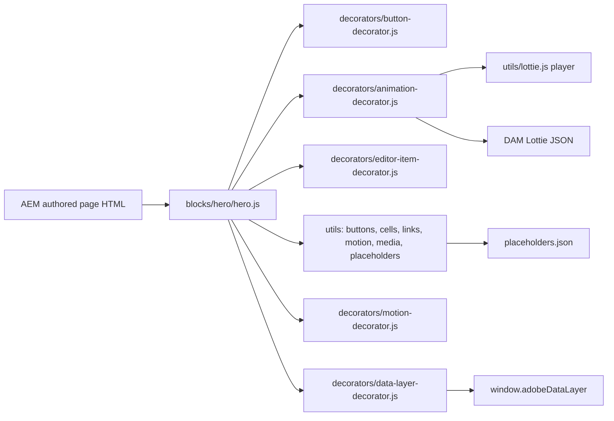

## For QA and Support Teams

| Test ID | Scenario | Configuration | Expected result |
| ------- | -------- | ------------- | --------------- |
| HERO-QA-01 | Default Hero | Image, alt, eyebrow, H1 title, description, Primary and Secondary CTA | Centred content over the white overlay; image `alt` set; eager / high priority in the first section |
| HERO-QA-02 | Lotto | Hero Image type Lotto, published `.json`, alt | Animation plays; toggle pauses / plays; label switches |
| HERO-QA-03 | Lotto, file missing | Unpublished or invalid `.json` | Animation and toggle hidden; console error; content renders |
| HERO-QA-04 | Lotto with reduced motion | OS reduced motion on | Animation shows its first frame, paused; Play starts it |
| HERO-QA-05 | Contained image | Hero View Contained image, Light no overlay | Whole image visible, centred |
| HERO-QA-06 | Text only | No image | No overlay, no `hero-has-media` |
| HERO-QA-07 | BG Colors | Each of Default, Light, Dark blue, Dark blue (subtle), Black | Overlay and text colours as specified; text readable |
| HERO-QA-08 | Nine positions | Each Vertical × Horizontal Alignment | Content block placed accordingly; 47.5rem limit from 900px for Left / Right |
| HERO-QA-09 | Text Alignment | Left, Center, Right align | Icon, text and CTAs aligned inside the block |
| HERO-QA-10 | CTA views and arrows | Default, Primary, Secondary; Arrow Auto with `#anchor-...`, Down, Right | Tertiary text link, filled, outline; down arrow for in-page links |
| HERO-QA-11 | New window CTA | CTA Link Type Open in New Window | `target="_blank"`, `rel="noopener noreferrer"`, hidden "(opens in a new tab)" |
| HERO-QA-12 | CTA without link | CTA item without CTA Link | Not rendered on the page; dashed placeholder in the editor |
| HERO-QA-13 | H2 title | Title heading level H2 | `h2.hero-title` |
| HERO-QA-14 | Multiple instances | Two Heroes on a page, the second in a later section | Ids `hero-1`, `hero-2`; only the first-section Hero image gets `loading="eager"` / `fetchpriority="high"` |
| HERO-QA-15 | Viewports | 375, 768, 1024, 1440px | Min heights and paddings as in Responsive Behavior; no horizontal overflow |
| HERO-QA-16 | Keyboard | Tab through the Hero | CTAs and toggle focusable with visible focus |
| HERO-QA-17 | Data layer | Click a CTA and the toggle | `cmp:click` with `interaction` `link` / `animation` and the Hero's id |
| HERO-QA-18 | Legacy content | Hero with CTA List multifield and Motion Type | CTAs render before CTA items; Motion Type plays as the mapped animation |
| HERO-QA-19 | Additional tab | Anchor ID, Hide block, Background animation | Block id set; hidden on the page; background animates once (not in the editor) |

## Troubleshooting

| Symptom | Likely cause | Diagnostic steps | Resolution | Verification |
| ------- | ------------ | ---------------- | ---------- | ------------ |
| No animation behind the content | Hero Image type Default with a `.json` file; JSON asset not published; invalid Lottie | Check the block has class `lottie`; Network: `.json` status; console `failed to play the Lottie animation` | Set Lotto; publish the asset; re-export the Lottie | Animation plays on the published page |
| Animation shows its first frame only | Visitor prefers reduced motion | Check the OS setting | Expected; Play starts it | Toggle plays it |
| Two H1s on the page | Several Heroes with H1, or a Hero on a templated page with Page Header | Search the DOM for `h1` | Set Title heading level H2 on the others; use the Page Header on templated pages | One `h1` |
| A CTA is missing | CTA item without CTA Link | Open the CTA item | Fill CTA Link | CTA renders |
| CTA arrow points down for a normal link | CTA Arrow Down, or Auto with a `#` link | Check CTA Arrow / CTA Link | Set CTA Arrow Right | Right arrow |
| Text hard to read | Light, no overlay on a busy image; Dark blue (subtle) on a bright image | Contrast checker at the text | Choose Default or a dark BG Color, or another image | Contrast at least 4.5:1 (3:1 large text) |
| Hero missing on the published page | Hide block on | Block has class `hideblock` | Turn Hide block off and publish | Hero visible |
| Old Motion Type can't be changed | Legacy `motion-*` class from content authored before | Inspect the authored classes | Migrate to Animation Type (re-audit R-B-6) | Animation as chosen |
| Slow LCP on a page opening with a Hero | Background animation on the first Hero (F-94) | Lighthouse LCP | Use Background animation below the fold | LCP improves |

Evidence to collect (no secrets): page URL, viewport, the block's classes and rendered HTML, console errors, Network status of the image / `.json`, the data-layer entries.

## Performance Considerations

- **Loading phase.** In the first section the Hero is decorated in the eager phase; its image gets `loading="eager"` and `fetchpriority="high"`.
- **No waiting.** On the page `decorate` loads placeholders only when a CTA opens a new tab (the editor hint only in Universal Editor).
- **Lottie.** The player (`utils/lottie.js`) loads once per page, when the animation is within 200px of the viewport, in idle time (200ms timeout fallback); the animation pauses off screen.
- **DOM size.** At most the media, the content and the toggle.
- **Listeners / observers.** Visibility observers of the animation decorator; the shared motion IntersectionObserver.
- **Layout shift.** The Hero has a minimum height; a light Hero in the first section reserves the header height (at every width) (`--header-height`, `--header-reserved`); with the TCS Header's Header over the first block Always any first Hero does, with Never none (`<html data-header-overlay>`, remembered for the next pages; a visitor's first page with Always / Never can shift once, KB-D-052).
- **High-cost configurations.** Background animation on the first Hero delays the LCP image paint (F-94); large Lottie files.

## Security and Privacy

- Links are authored in AEM; the block doesn't validate or rewrite URLs. New-window links get `rel="noopener noreferrer"`.
- No HTML is injected from external sources; the Lottie JSON is loaded from the authored DAM path by the vendored player.
- No query strings are read; no personal data is collected. The data layer records link text and URL of clicked CTAs.

## Known Limitations

| Limitation | Impact | Workaround | Planned correction |
| ---------- | ------ | ---------- | ------------------ |
| No background video | Video banners can't be built with the Hero | Use the Video or Embed block | Not recorded |
| Lottie JSON served only once published (R-B-2) | Empty background on preview / live if not published | Publish the asset | Operations |
| Motion Type authored before can't be changed in the dialog (R-B-6) | Legacy animation stays | Migrate to Animation Type | Content migration |
| Default overlay eyebrow contrast (R-B-4) | Brand eyebrow over the white overlay | — | Design sign-off pending |
| Background animation delays LCP on the first Hero (F-94) | Slower LCP | Use it below the fold | Not planned |
| Legacy CTA List items keep their stored CTA Arrow "right" (F-55) | No automatic down arrow for `#` links in those items | Choose Down, or re-create as CTA items (Auto) | Not planned |

## Related Documentation

- [Blocks documentation](../README.md)
- [Page Header](../page-header/README.md), [Gen Carousel](../gen-carousel/README.md), [Teaser](../teaser/README.md), [Button Block](../button-block/README.md)
- Model: [`_hero.json`](./_hero.json)
- Tests: [`test/items/item-rows.test.mjs`](../../test/items/item-rows.test.mjs), [`test/motion/motion.test.mjs`](../../test/motion/motion.test.mjs)
- [Handover 6.10 Hero Block](../../docs/handover/TCS-CORP-HANDOVER.md)
- [Animation report](../../docs/animation/README.md)

<!-- BEGIN GENERATED: usage (npm run build:docs) -->

Pages of the block library package 1.0.14 (language master, `/content/tcs-corp/language-master/en`) that contain the block, 182 instance(s) in total:
- Block library: `block-library/animation/background-animation`, `block-library/animation/background-by-block`, `block-library/animation/content-animation`, `block-library/animation/speed-and-trigger`, `block-library/gen-carousel/auto`, `block-library/gen-carousel/hero-slides`, `block-library/gen-carousel/manual-and-auto`, `block-library/gen-carousel/single-slide`, `block-library/hero/hero-ctas`, `block-library/hero/hero-motion`, `block-library/hero/hero-overview`, `block-library/hero/hero-styles`, `block-library/templates/home-template`
- Curated design pages: `curated-design-pages/home`, `curated-design-pages/insights`, `curated-design-pages/media-and-investor`, `curated-design-pages/what-we-do`, `curated-design-pages/who-we-are`
- Other pages: `dummy-pages/about-tcs`, `dummy-pages/accessibility`, `dummy-pages/ai-at-scale`, `dummy-pages/careers`, `dummy-pages/careers/experienced-professionals`, `dummy-pages/careers/graduates`, `dummy-pages/case-studies`, `dummy-pages/case-studies/better-operational-decisions-connected-intelligence`, `dummy-pages/case-studies/increasing-streaming-hours-uk-platform`, `dummy-pages/case-studies/intelligence-in-everyday-employee-services`, `dummy-pages/case-studies/modernising-core-banking-for-a-regional-bank`, `dummy-pages/case-studies/orchestrating-vehicle-app-charging-service-experience`, `dummy-pages/case-studies/personalised-banking-at-scale`, `dummy-pages/case-studies/real-time-network-resilience-for-a-bank`, `dummy-pages/case-studies/reimagine-customer-service-with-people-and-agents`, `dummy-pages/case-studies/reimagining-in-home-entertainment-experience`, `dummy-pages/case-studies/transforming-overnight-liquidity-modelling`, `dummy-pages/contact`, `dummy-pages/cookie-policy`, `dummy-pages/core-modernisation`, `dummy-pages/customer-experience`, `dummy-pages/cyber-resilience`, `dummy-pages/explore-insights`, `dummy-pages/formula-e-sponsorship`, `dummy-pages/human-ai-service-autonomy-model`, `dummy-pages/inclusion-and-belonging`, `dummy-pages/industries`, `dummy-pages/industries/banking`, `dummy-pages/industries/communications-media-information`, `dummy-pages/industries/cpg-distribution`, `dummy-pages/industries/education`, `dummy-pages/insights`, `dummy-pages/insights/adobe-experience-platform-insights`, `dummy-pages/insights/agentic-ai-banking-operations`, `dummy-pages/insights/agentic-ai-in-hr-chros-future-ready-enterprises`, `dummy-pages/insights/ai-agents-for-customer-service`, `dummy-pages/insights/ai-agents-in-everyday-banking`, `dummy-pages/insights/ai-agents-need-guardrails-not-just-goals`, `dummy-pages/insights/ai-driven-transformation`, `dummy-pages/insights/ai-ready-data-centre-infrastructure-report`, `dummy-pages/insights/audience-growth-stagnant-streaming-market`, `dummy-pages/insights/banking-industry-innovation`, `dummy-pages/insights/beyond-transactions-towards-the-agentic-bank`, `dummy-pages/insights/cloud-modernization-strategy`, `dummy-pages/insights/confidence-in-a-connected-world`, `dummy-pages/insights/connected-factories-industrial-ai`, `dummy-pages/insights/customer-data-platforms`, `dummy-pages/insights/data-centre-becomes-intelligence-factory`, `dummy-pages/insights/decision-intelligence-report`, `dummy-pages/insights/decision-twins-testing-strategy`, `dummy-pages/insights/digital-commerce-trends`, `dummy-pages/insights/enabling-banking-innovation-resilience-core-modernisation`, `dummy-pages/insights/enterprise-data-modernization`, `dummy-pages/insights/fighting-fraud-with-agentic-ai`, `dummy-pages/insights/five-decisions-data-centre-strategy`, `dummy-pages/insights/foresight-factory-floor-digital-twin-logistics`, `dummy-pages/insights/future-of-customer-experience`, `dummy-pages/insights/generative-ai-in-enterprises`, `dummy-pages/insights/hyper-personalization-at-scale`, `dummy-pages/insights/multimodal-ai-evidence-based-engineering-assurance`, `dummy-pages/insights/payments-and-real-time-finance`, `dummy-pages/insights/real-world-impact-tcs-wisdom-ai`, `dummy-pages/insights/reimagining-how-your-business-works`, `dummy-pages/insights/retailers-journey-to-smarter-fulfilment`, `dummy-pages/insights/rethinking-kyc-with-ai-agents`, `dummy-pages/insights/simulating-supply-chain-disruption-digital-twin`, `dummy-pages/insights/skies-of-the-future-aerospace-strategies`, `dummy-pages/insights/smarter-lending-with-ai-agents`, `dummy-pages/insights/sustainable-scale-economics-of-compute`, `dummy-pages/insights/tcs-launches-next-gen-soc-services`, `dummy-pages/insights/the-self-defending-bank`, `dummy-pages/insights/why-premiumisation-is-reshaping-indias-cpg-industry`, `dummy-pages/insights/why-supply-chains-need-a-resilience-reset`, `dummy-pages/investors`, `dummy-pages/investors/annual-report`, `dummy-pages/investors/annual-report/financial-review`, `dummy-pages/investors/annual-report/governance-and-sustainability`, `dummy-pages/investors/annual-report/strategy-and-business-review`, `dummy-pages/investors/ceo-letters`, `dummy-pages/investors/ceo-letters/client-priorities-shared-progress`, `dummy-pages/investors/ceo-letters/innovation-with-purpose`, `dummy-pages/investors/ceo-letters/investing-in-people-and-skills`, `dummy-pages/investors/ceo-letters/responsible-growth-priorities`, `dummy-pages/investors/letter-from-the-chairman`, `dummy-pages/learning-and-growth`, `dummy-pages/marathon-sponsorship`, `dummy-pages/newsroom`, `dummy-pages/newsroom/best-buy-gcc-transition-to-tcs`, `dummy-pages/newsroom/industrial-intelligence-foundry`, `dummy-pages/newsroom/inside-the-technology-powering-marathon-race-day`, `dummy-pages/newsroom/media-kit`, `dummy-pages/newsroom/mystate-selects-tcs-bancs`, `dummy-pages/newsroom/next-gen-system-on-chip-design-services`, `dummy-pages/newsroom/personalising-the-streaming-experience`, `dummy-pages/newsroom/tcs-google-cloud-ai-native-autonomous-enterprises`, `dummy-pages/newsroom/tcs-iem-kolkata-ai-centre-of-excellence`, `dummy-pages/newsroom/tcs-jaguar-renew-formula-e-sponsorship`, `dummy-pages/newsroom/tcs-partners-manageengine-sovereign-cloud`, `dummy-pages/newsroom/tcs-q2-fy27-results-announced`, `dummy-pages/newsroom/tcs-technology-innovation-partner-jfk-terminal-one`, `dummy-pages/our-people`, `dummy-pages/our-story`, `dummy-pages/privacy-notice`, `dummy-pages/products`, `dummy-pages/products/cognix`, `dummy-pages/products/tcs-add`, `dummy-pages/products/tcs-bancs`, `dummy-pages/products/twinx-operations-optimisation`, `dummy-pages/products/twinx-strategic-marketing`, `dummy-pages/research-and-innovation`, `dummy-pages/services`, `dummy-pages/services/ai-and-data`, `dummy-pages/services/banking-operations`, `dummy-pages/services/cloud`, `dummy-pages/services/customer-experience`, `dummy-pages/services/cybersecurity`, `dummy-pages/services/engineering`, `dummy-pages/services/enterprise-transformation`, `dummy-pages/services/risk-and-compliance`, `dummy-pages/solutions`, `dummy-pages/terms-of-use`, `dummy-pages/transformation-themes`, `dummy-pages/what-we-do`

Project-wide standards: [knowledge base](../../docs/handover/knowledge-base/README.md) ([block governance](../../docs/handover/knowledge-base/blocks.md)).

<!-- END GENERATED: usage -->

## Change History

| Version | Change | Source | Date |
| ------- | ------ | ------ | ---- |
| Not recorded | README generated from verified implementation and approved handover documentation | Repository review | Not recorded |
| Handover 2.8 | Dialog reduced to Content / Style / Additional (Image, Content, Links merged into Content) | docs/handover revision history | 17 October 2026 |
| Handover 2.10 | CTAs as CTA items (`hero-cta`) instead of the CTA List multifield, which is still read | docs/handover revision history | 17 October 2026 |
| Handover 2.18 | Additional tab Content animation and Background animation | docs/handover revision history | 18 October 2026 |
| Handover 2.27 | Motion Type removed from the dialog (block ecosystem audit) | docs/handover revision history | 19 October 2026 |
| Handover 2.29 | Re-audit: new-tab hint, Lottie alt text and failed files, dark Hero eyebrow contrast | docs/handover revision history | 20 October 2026 |
