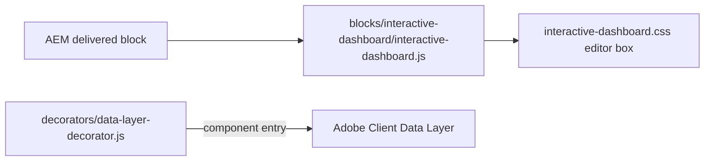

# Interactive Dashboard

The Interactive Dashboard block is a placeholder reserved for a future interactive data
dashboard. Its design, content model and logic have not been defined. The block renders nothing on
the site; in Universal Editor edit mode it shows a dashed, selectable box labelled "Interactive
Dashboard (placeholder)". It isn't offered in any component filter, so authors can't add it; its
definition and model stay so an instance authored before remains editable.

| Attribute | Value |
| --------- | ----- |
| Technical name | `interactive-dashboard` (template name "Interactive Dashboard", block class `interactive-dashboard`) |
| Display name | Interactive Dashboard |
| Block type | Independent block (placeholder; no fields except the Additional tab) |
| Status | Experimental (placeholder) |
| Parent / children | In no component filter (cannot be added); no child items |
| Owner / version / date | Not recorded |

## Overview

**Business purpose.** Reserve a component name, the Additional options and a data-layer entry for
a future dashboard (for example interactive figures or KPIs). Requirements, data source and design
are not recorded.

**User experience.** Visitors see nothing. Authors see a dashed box in edit mode.

**Templates / page types.** None use it.

**Data source.** None: no sheets, query index, metadata, taxonomy or placeholders.

**Related blocks.** [Table](../table/README.md) and Table List (tabular data available today),
[Cards](../cards/README.md) / [List](../list/README.md) (statistic-style cards),
[Embed](../embed/README.md) (an external dashboard a provider allows to be framed).

**When to use.** Not for new content (it can't be added); an existing instance only reserves a
position on draft or block library pages.

**When not to use.** On any published page: it shows nothing and may leave an empty gap.

**Realistic use cases.** None today.

## Visual Reference

<!-- BEGIN GENERATED: screenshots (npm run build:docs) -->

Screenshots of the handover (6.31 Interactive Dashboard Block), taken on the preview with sample content; they show the rendering at the time of the handover revision that added them (later changes are in the sections below and the handover's revision history):

| Screenshot | Shows |
| ---------- | ----- |
| [Desktop rendering](../../docs/handover/screenshots/interactive-dashboard-desktop-view.jpg) | A page on aem.page at 1440 px: the H2 Performance insights with the line Key figures from our latest annual report, updated every quarter., empty space where the Interactive Dashboard section is, then the H2 Read the full report and its line about downloading the report. |
| [Tablet rendering](../../docs/handover/screenshots/interactive-dashboard-tablet-view.jpg) | The same draft page at 768 px: Performance insights with its line, blank space where the hidden Interactive Dashboard section is, then Read the full report and its line; no dashboard is visible. |
| [Mobile rendering](../../docs/handover/screenshots/interactive-dashboard-mobile-view.jpg) | The draft page at 375 px: the H2 Performance insights and Key figures from our latest annual report, updated every quarter., then directly the H2 Read the full report and Download the report for the detailed figures by industry and region.; no dashboard appears. |
| [Universal Editor canvas](../../docs/handover/screenshots/interactive-dashboard-authoring-view.jpg) | The draft page in Universal Editor edit mode at 1440 px: Performance insights and its line, then a dashed, rounded grey box with the centred text Interactive Dashboard (placeholder) and marker A, then Read the full report and its line. (Annotated preview in editor mode with sample content; letters as in the annotations list, not a Universal Editor screenshot; file screenshots/interactive-dashboard-authoring-view.jpg) |
| [Properties panel](../../docs/handover/screenshots/interactive-dashboard-properties-panel.jpg) | Properties panel of the block showing only the Additional tab. (Dialog reference generated from the component model, not a Universal Editor screenshot; file screenshots/interactive-dashboard-properties-panel.jpg) |

Universal Editor dialogs (no screenshot exists yet; to be captured on AEM author):

```text
[Screenshot Placeholder]

File name:
interactive-dashboard-dialog-additional-desktop.png

Purpose:
The Additional tab of the Interactive Dashboard properties in Universal Editor, with the fields of the table "Additional tab — Interactive Dashboard" in Authorable Fields below.

Annotations:
A = Anchor ID
B = Hide block
C = Animation Type
D = Motion Speed
E = Animation Trigger
F = Padding left
G = Padding right
H = Padding top
I = Padding bottom
J = Margin left
```

<!-- END GENERATED: screenshots -->

States without a screenshot:

```text
[Screenshot Placeholder]

File name:
interactive-dashboard-authoring-universal-editor-desktop.png

Purpose:
An existing Interactive Dashboard selected in Universal Editor edit mode (real editor, not an annotated preview): the dashed placeholder box and the properties panel with only the Additional tab.

Annotations:
A = The placeholder box "Interactive Dashboard (placeholder)"
B = The Additional tab
C = The block in the content tree
```

```text
[Screenshot Placeholder]

File name:
interactive-dashboard-hidden-editor-desktop.png

Purpose:
The placeholder with Hide block on in edit mode: faded with a dashed outline.

Annotations:
A = The faded placeholder
```

## For Content Authors

1. **Adding the block:** not possible; the Interactive Dashboard is in no component filter.
2. **An existing instance:** select it in the content tree (or on the canvas in edit mode); its
   properties have only the **Additional** tab.
3. **Content:** the block has no content fields; anything placed in it is discarded.
4. **Preview:** in Preview mode and on the site the block is not shown.
5. **Publish:** don't publish pages that rely on it; delete the block (or the empty section) before
   publishing, or turn on Hide block.
6. **Validate:** on the preview host the page shows no gap where the block was.

**Minimum required / recommended / optional:** not applicable.

## Authorable Fields

<!-- BEGIN GENERATED: fields (npm run build:docs) -->

### Interactive Dashboard (`interactive-dashboard`)

Model `interactive-dashboard`; template name "Interactive Dashboard" (the block class AEM renders).

#### Additional tab — Interactive Dashboard

| Field label | Property | Type | Required | Default | Allowed values | Author guidance | Example |
| ----------- | -------- | ---- | -------- | ------- | -------------- | --------------- | ------- |
| Anchor ID | `classes_anchor` | text | No | — | regExp: ^anchor-[a-z0-9][a-z0-9-]*$; customErrorMsg: Start with anchor-, then lower-case letters, digits and hyphens. | A unique ID of the block on the page, starting with anchor-, e.g. anchor-our-services; link to it with #anchor-our-services. Delivered as a block class. | — |
| Hide block | `classes_hideblock` | boolean | No | `false` | on / off | Hides the whole block on the page until it is turned off (shown faded in the editor). Delivered as a block class. | — |
| Animation Type | `classes_animation` | select | No | "" | None (""), Fade in (`motion-fade-in`), Fade up (`motion-fade-up`), Fade down (`motion-fade-down`), Fade left (`motion-fade-left`), Fade right (`motion-fade-right`), Slide up (`motion-slide-up`), Slide down (`motion-slide-down`), Slide left (`motion-slide-left`), Slide right (`motion-slide-right`), Scale in (`motion-scale-in`) | How the block's content appears; repeated items (cards, list items, accordion items, columns) appear one after another. None: shown as is. Not played in the editor or when the visitor prefers reduced motion. Delivered as a block class. | — |
| Motion Speed | `classes_animationspeed` | select | No | "" | Medium (""), Fast (`motion-fast`), Slow (`motion-slow`) | How fast the animation runs: 0.3, 0.6 or 0.9 seconds. Shown when `classes_animation` is set and `classes_animation` is not empty. Delivered as a block class. | — |
| Animation Trigger | `classes_animationtrigger` | select | No | "" | On Scroll / Viewport Entry (""), On Page Load (`motion-on-load`) | When the block's animations run. On Scroll: when the block comes into view (at once if it is in view when the page opens). On Page Load: as soon as the block is ready, wherever it is on the page. Shown when `classes_animation` is set and `classes_animation` is not empty. Delivered as a block class. | — |
| Padding left | `classes_paddingleft` | select | No | "" | Default (""), 0 (none) (`pl-0`), 0.25rem (space-100) (`pl-100`), 0.5rem (space-200) (`pl-200`), 0.75rem (space-300) (`pl-300`), 1rem (space-400) (`pl-400`), 1.25rem (space-500) (`pl-500`), 1.5rem (space-600) (`pl-600`), 2rem (space-800) (`pl-800`), 2.5rem (space-1000) (`pl-1000`), 3rem (space-1200) (`pl-1200`), 4rem (space-1600) (`pl-1600`), 5rem (space-2000) (`pl-2000`), 6rem (space-2400) (`pl-2400`), 7.5rem (space-3000) (`pl-3000`) | Delivered as a block class. | — |
| Padding right | `classes_paddingright` | select | No | "" | Default (""), 0 (none) (`pr-0`), 0.25rem (space-100) (`pr-100`), 0.5rem (space-200) (`pr-200`), 0.75rem (space-300) (`pr-300`), 1rem (space-400) (`pr-400`), 1.25rem (space-500) (`pr-500`), 1.5rem (space-600) (`pr-600`), 2rem (space-800) (`pr-800`), 2.5rem (space-1000) (`pr-1000`), 3rem (space-1200) (`pr-1200`), 4rem (space-1600) (`pr-1600`), 5rem (space-2000) (`pr-2000`), 6rem (space-2400) (`pr-2400`), 7.5rem (space-3000) (`pr-3000`) | Delivered as a block class. | — |
| Padding top | `classes_paddingtop` | select | No | "" | Default (""), 0 (none) (`pt-0`), 0.25rem (space-100) (`pt-100`), 0.5rem (space-200) (`pt-200`), 0.75rem (space-300) (`pt-300`), 1rem (space-400) (`pt-400`), 1.25rem (space-500) (`pt-500`), 1.5rem (space-600) (`pt-600`), 2rem (space-800) (`pt-800`), 2.5rem (space-1000) (`pt-1000`), 3rem (space-1200) (`pt-1200`), 4rem (space-1600) (`pt-1600`), 5rem (space-2000) (`pt-2000`), 6rem (space-2400) (`pt-2400`), 7.5rem (space-3000) (`pt-3000`) | Delivered as a block class. | — |
| Padding bottom | `classes_paddingbottom` | select | No | "" | Default (""), 0 (none) (`pb-0`), 0.25rem (space-100) (`pb-100`), 0.5rem (space-200) (`pb-200`), 0.75rem (space-300) (`pb-300`), 1rem (space-400) (`pb-400`), 1.25rem (space-500) (`pb-500`), 1.5rem (space-600) (`pb-600`), 2rem (space-800) (`pb-800`), 2.5rem (space-1000) (`pb-1000`), 3rem (space-1200) (`pb-1200`), 4rem (space-1600) (`pb-1600`), 5rem (space-2000) (`pb-2000`), 6rem (space-2400) (`pb-2400`), 7.5rem (space-3000) (`pb-3000`) | Delivered as a block class. | — |
| Margin left | `classes_marginleft` | select | No | "" | Default (""), 0 (none) (`ml-0`), 0.25rem (space-100) (`ml-100`), 0.5rem (space-200) (`ml-200`), 0.75rem (space-300) (`ml-300`), 1rem (space-400) (`ml-400`), 1.25rem (space-500) (`ml-500`), 1.5rem (space-600) (`ml-600`), 2rem (space-800) (`ml-800`), 2.5rem (space-1000) (`ml-1000`), 3rem (space-1200) (`ml-1200`), 4rem (space-1600) (`ml-1600`), 5rem (space-2000) (`ml-2000`), 6rem (space-2400) (`ml-2400`), 7.5rem (space-3000) (`ml-3000`) | Delivered as a block class. | — |
| Margin right | `classes_marginright` | select | No | "" | Default (""), 0 (none) (`mr-0`), 0.25rem (space-100) (`mr-100`), 0.5rem (space-200) (`mr-200`), 0.75rem (space-300) (`mr-300`), 1rem (space-400) (`mr-400`), 1.25rem (space-500) (`mr-500`), 1.5rem (space-600) (`mr-600`), 2rem (space-800) (`mr-800`), 2.5rem (space-1000) (`mr-1000`), 3rem (space-1200) (`mr-1200`), 4rem (space-1600) (`mr-1600`), 5rem (space-2000) (`mr-2000`), 6rem (space-2400) (`mr-2400`), 7.5rem (space-3000) (`mr-3000`) | Delivered as a block class. | — |
| Margin top | `classes_margintop` | select | No | "" | Default (""), 0 (none) (`mt-0`), 0.25rem (space-100) (`mt-100`), 0.5rem (space-200) (`mt-200`), 0.75rem (space-300) (`mt-300`), 1rem (space-400) (`mt-400`), 1.25rem (space-500) (`mt-500`), 1.5rem (space-600) (`mt-600`), 2rem (space-800) (`mt-800`), 2.5rem (space-1000) (`mt-1000`), 3rem (space-1200) (`mt-1200`), 4rem (space-1600) (`mt-1600`), 5rem (space-2000) (`mt-2000`), 6rem (space-2400) (`mt-2400`), 7.5rem (space-3000) (`mt-3000`) | Delivered as a block class. | — |
| Margin bottom | `classes_marginbottom` | select | No | "" | Default (""), 0 (none) (`mb-0`), 0.25rem (space-100) (`mb-100`), 0.5rem (space-200) (`mb-200`), 0.75rem (space-300) (`mb-300`), 1rem (space-400) (`mb-400`), 1.25rem (space-500) (`mb-500`), 1.5rem (space-600) (`mb-600`), 2rem (space-800) (`mb-800`), 2.5rem (space-1000) (`mb-1000`), 3rem (space-1200) (`mb-1200`), 4rem (space-1600) (`mb-1600`), 5rem (space-2000) (`mb-2000`), 6rem (space-2400) (`mb-2400`), 7.5rem (space-3000) (`mb-3000`) | Delivered as a block class. | — |

<!-- END GENERATED: fields -->

What the table doesn't show:

- The model has only the Additional tab (AGENTS.md "Additional tab"); its values arrive as block
  classes. Anchor ID becomes the block's id, but links to it don't scroll (the block isn't
  displayed). Hide block hides the block's wrapper too (outside edit mode). Animation fields have no
  visible effect (nothing is shown).
- **Rendering result:** none on the site; the editor box.
- **Accessibility / data-layer impact:** see the sections below.
- **Legacy mapping:** none.

## Screenshot-Based Authoring Steps

### Authoring Step 1: Find an existing instance

```text
[Screenshot Placeholder]

File name:
interactive-dashboard-authoring-step-1.png

Purpose:
The content tree with the Interactive Dashboard selected and the placeholder box on the canvas.

Annotations:
A = The block in the content tree
B = The placeholder box
```

### Values to Enter

| Callout | Field | Value | Reason | Expected result |
| ------- | ----- | ----- | ------ | --------------- |
| A | (selection) | Interactive Dashboard | Locate the placeholder | The box is highlighted |

**Author action:** select the block in the content tree. **Expected preview:** nothing.
**Expected published result:** nothing. **Business rules:** the block can't be added again once
deleted. **Validation:** switch to Preview: the box disappears. **Common mistakes:** looking for it
in Preview mode.

### Authoring Step 2: Remove it before publishing

```text
[Screenshot Placeholder]

File name:
interactive-dashboard-authoring-step-2.png

Purpose:
The delete action on the selected block in the content tree.

Annotations:
A = Delete
```

### Values to Enter

| Callout | Field | Value | Reason | Expected result |
| ------- | ----- | ----- | ------ | --------------- |
| A | (action) | Delete | Nothing should depend on a placeholder | The block is gone from the page |

**Author action:** delete the block (and the section if it is now empty). **Expected result:** no
gap on the preview host. **Common mistakes:** leaving an empty section with its own spacing.

### Authoring Step 3: Hide it instead

```text
[Screenshot Placeholder]

File name:
interactive-dashboard-authoring-step-3.png

Purpose:
The Additional tab with Hide block on.

Annotations:
A = Hide block
```

### Values to Enter

| Callout | Field | Value | Reason | Expected result |
| ------- | ----- | ----- | ------ | --------------- |
| A | Hide block | On | Keep the position in a draft without a gap | The block and its wrapper are hidden outside edit mode |

**Validation:** preview host shows no gap. **Common mistakes:** linking to its Anchor ID.

## Variations

### Editor placeholder (Universal Editor edit mode)

- **Rendering:** the emptied block with `data-placeholder="Interactive Dashboard"`; under
  `html.adobe-ue-edit` it is a grid at least 10rem tall with a 2px dashed
  `--color-border-secondary` border, `--radius-l` corners and the centred text "Interactive
  Dashboard (placeholder)" (CSS `::before`, fixed English).
- **Accessibility / data layer / personalization:** editor only; not applicable.

### Published and preview rendering (empty)

- **Rendering:** `.interactive-dashboard:empty { display: none }`: nothing at any viewport.

## Complete Authoring Example

Scenario: a draft annual report page holding the placeholder between two text sections, cleaned up
before publishing.

| Field | Example value | Guidance |
| ----- | ------------- | -------- |
| Anchor ID | (empty) | Don't link to the placeholder |
| Hide block | On | Or delete the block |

**Steps:** select the block, turn on Hide block (or delete it), preview, publish.

**Expected output:** the two text sections follow each other without a gap.

**Responsive / accessibility:** nothing rendered at any viewport; nothing announced.

**Analytics / data layer:** the block still has a component entry while it is on the page.

**Personalization fallback:** none.

**Pre-publish checklist:**

1. No live page relies on the dashboard.
2. No link points to its Anchor ID.
3. No empty gap on the preview host.

## Content and Asset Guidelines

Not applicable: no titles, descriptions, links, images, icons, tags or metadata. No verified
technical limit was identified. Anything authored inside the block is discarded.

## Accessibility

- **Semantics:** none on the site (`display: none`, not in the accessibility tree).
- **Keyboard, focus, names, announcements:** nothing to reach.
- **Reduced motion:** not applicable.
- **Empty state:** always empty; the editor box is for authors only.

**Author responsibilities:** don't reference the dashboard in page content ("see the dashboard
below").

**Developer responsibilities:** a future implementation must meet WCAG 2.1 AA (text alternatives
for charts, keyboard operation, no colour-only encoding) and take its UI text from placeholders.

The block handles no keys.

## Data Layer and Analytics

`decorators/data-layer-decorator.js` adds every `.block`, so the placeholder gets a component entry
`tcs-corp/components/interactive-dashboard` (id = Anchor ID else `interactive-dashboard-{n}`,
without `dc:title`). The block adds no `data-cmp-*` attributes.

| Trigger | Data-layer event | Required properties | Analytics behavior |
| ------- | ---------------- | ------------------- | ------------------ |
| Block decorated | component state | `@type`, `parentId` | An untitled component entry (noise) |

No interaction events exist. The intended path is Adobe Client Data Layer, then Adobe Data
Collection (Tags), the AEP Web SDK, the Edge Network and Analytics / CJA, but Tags and the Web SDK
aren't configured yet (blocked: measurement plan); no consent mechanism is implemented.

## Personalization

This block does not currently expose verified personalization behavior. There is no Adobe Target
or Journey Optimizer integration in the repository; the block renders nothing for any visitor.

## Responsive Behavior

`interactive-dashboard.css` has no media queries.

| Viewport | Layout | Image behavior | Interaction behavior |
| -------- | ------ | -------------- | -------------------- |
| All viewports | Not displayed on the site; in edit mode a box at least 10rem tall | — | None |

## For Developers

<!-- BEGIN GENERATED: files (npm run build:docs) -->

```text
blocks/interactive-dashboard/
├── README.md
├── _interactive-dashboard.json
├── interactive-dashboard.css
└── interactive-dashboard.js
```

The block imports no shared decorator or utility.

<!-- END GENERATED: files -->

**JavaScript (`interactive-dashboard.js`).** `decorate(block)` (synchronous) calls
`block.replaceChildren()` and sets `data-placeholder="Interactive Dashboard"`. Nothing else.

**CSS (`interactive-dashboard.css`).** `.interactive-dashboard:empty` hidden;
`.adobe-ue-edit .interactive-dashboard:empty` the dashed box with the `::before` label from
`data-placeholder`.

**Input DOM.** Not key-value; AEM delivers an empty row for the Additional tab (discarded);
Additional values as block classes.

**Rendered DOM contract.** `div.interactive-dashboard.block[data-placeholder="Interactive Dashboard"]`,
empty (the block options decorator sets the id from an `anchor-…` class).

**Events, async behavior, error handling, exports.** None beyond `decorate`.

## Extending the Block

1. **Define the requirements** (data source, design, interactions) with the product owner first.
2. **Model:** add Content fields to `_interactive-dashboard.json` (respecting the delivery rules:
   tab rows, field collapse, `classes_*`), keep the Additional tab last; `npm run build:json`,
   `npm run lint`.
3. **Availability:** add `interactive-dashboard` to the filters where it should be offered
   (`models/_section.json`, the Columns Container and Tabs filters) and regenerate the aggregates.
4. **Rendering:** replace `decorate`; use decorators / utils for shared behaviour; load data through
   `renderWhenLoaded` (skeleton) if it comes from the query index or sheets; placeholders for UI text.
5. **Animation:** add the block to `CONTENT_TARGETS` in `decorators/motion-decorator.js` if items
   should stagger.
6. **Data layer:** describe controls with `data-cmp-interaction`; push state with
   `pushComponentEvent`.
7. **Tests, library, docs:** unit tests for pure logic in `test/`, a block library page, this README,
   `npm run build:docs`, `npm run build:modules` after adding imports.

## For Site Administrators

- **Availability:** in no filter (`component-filters.json`); the definition and model stay in the
  aggregates so an existing instance stays editable.
- **Governance:** `_interactive-dashboard.json`.
- **Allowed children:** none.
- **Publishing dependencies and localization:** none (the editor label is fixed English).

| Dependency | Purpose | Location | Impact if unavailable |
| ---------- | ------- | -------- | --------------------- |
| Universal Editor edit-mode class `adobe-ue-edit` | Shows the editor box | Universal Editor | The box isn't shown; select the block in the content tree |
| Block options decorator | Anchor ID, Hide block, spacing | `decorators/block-options-decorator.js` | Additional values without effect |

**Deprecation / migration:** before go-live, search the content for `interactive-dashboard` and
remove instances from live pages.

## For Architects

- **Role:** reserved component name; no rendering, data or interactivity.
- **Content model:** Additional tab only; not offered to authors.
- **Data layer / Web SDK / Target:** an untitled component entry; nothing else.
- **Consent, identity, caching, security:** not applicable (no requests, no content).
- **Performance:** two small files loaded with the section when an instance exists.



## For QA and Support Teams

| Test ID | Scenario | Configuration | Expected result |
| ------- | -------- | ------------- | --------------- |
| INTERACTIVE-DASHBOARD-QA-01 | Availability | Add (+) in a Section, Columns Container, Tabs Container | Interactive Dashboard not offered |
| INTERACTIVE-DASHBOARD-QA-02 | Site rendering | Existing instance, preview host | Nothing displayed at 1440 / 768 / 390 px |
| INTERACTIVE-DASHBOARD-QA-03 | Editor | Edit mode | Dashed box "Interactive Dashboard (placeholder)", at least 10rem |
| INTERACTIVE-DASHBOARD-QA-04 | Preview mode | Universal Editor Preview | Box hidden |
| INTERACTIVE-DASHBOARD-QA-05 | Authored content | Rows inside the block | Discarded |
| INTERACTIVE-DASHBOARD-QA-06 | Hide block | On | Wrapper hidden; faded in edit mode |
| INTERACTIVE-DASHBOARD-QA-07 | Data layer | Instance on the page | One component entry, no events |
| INTERACTIVE-DASHBOARD-QA-08 | Regression | Library page `block-library/interactive-dashboard/interactive-dashboard` | Still editable in the editor |

## Troubleshooting

| Symptom | Likely cause | Diagnostic steps | Resolution | Verification |
| ------- | ------------ | ---------------- | ---------- | ------------ |
| Nothing on the published page | By design | Inspect: empty `div.interactive-dashboard` | Remove the block; use Table, Cards or Embed | Intended content shows |
| Not offered in Add (+) | Not in any filter (by design) | `component-filters.json` | None until it is implemented | — |
| Box not visible in the editor | Preview mode | Editor mode toggle | Switch to edit mode or use the content tree | Box appears |
| Empty gap on the page | The section keeps its spacing | Inspect the section | Delete the block / section, or Hide block | No gap |
| Anchor link doesn't scroll | Target is `display: none` | Check the id | Remove the link | — |
| Data layer lists the component | Every block is tracked | `window.adobeDataLayer` | Remove the block, or ignore the type | — |

Evidence to collect: page URL and the block's markup (no secrets involved).

## Performance Considerations

Negligible: the block's JS (13 lines) and CSS load with its section; no requests, observers or
listeners.

## Security and Privacy

No content, links, external requests or data. Nothing to sanitise.

## Known Limitations

| Limitation | Impact | Workaround | Planned correction |
| ---------- | ------ | ---------- | ------------------ |
| Placeholder only: no content model, rendering, data or interactivity | No dashboard | Table, Cards, Embed | Not recorded (requirements: owner product owner) |
| Not offered in any filter | Can't be added | — | When implemented |
| Editor label is fixed English | Not translated | — | Not recorded |
| Still tracked in the data layer; its section may leave empty space | Reporting noise; gaps | Remove from pages | Not planned |

## Related Documentation

- [Blocks documentation](../README.md)
- [Table](../table/README.md), [Embed](../embed/README.md), [Cards](../cards/README.md), [List](../list/README.md)
- [Model and definition](_interactive-dashboard.json)
- [Animation report](../../docs/animation/README.md)
- [Handover 6.31 Interactive Dashboard Block](../../docs/handover/TCS-CORP-HANDOVER.md)

<!-- BEGIN GENERATED: usage (npm run build:docs) -->

Pages of the block library package 1.0.13 (language master, `/content/tcs-corp/language-master/en`) that contain the block, 1 instance(s) in total:
- Block library: `block-library/interactive-dashboard/interactive-dashboard`

<!-- END GENERATED: usage -->

## Change History

| Version | Change | Source | Date |
| ------- | ------ | ------ | ---- |
| Not recorded | README generated from verified implementation and approved handover documentation | Repository review | Not recorded |
| Handover 2.18 | Additional tab content animation fields added to the model | docs/handover revision history | 18 October 2026 |
| Handover 2.27 | Block audit: the placeholder no longer offered to authors (D-B-17: removed from the section and Columns Container filters; definition and model kept) | docs/handover revision history; docs/audit/BLOCK-ECOSYSTEM-AUDIT.md | 19 October 2026 |
