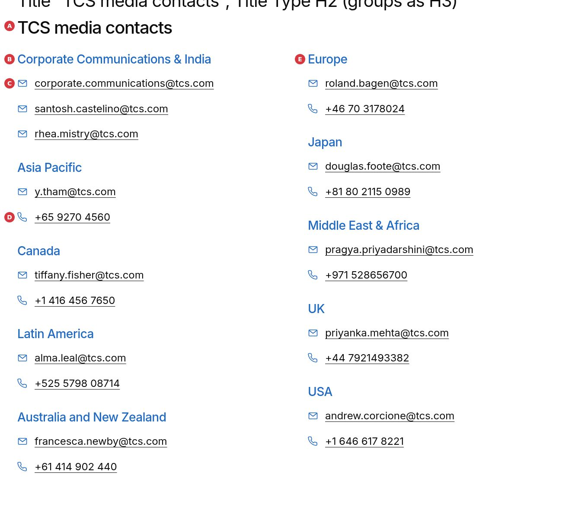
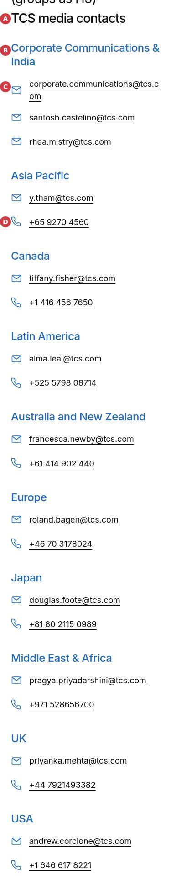
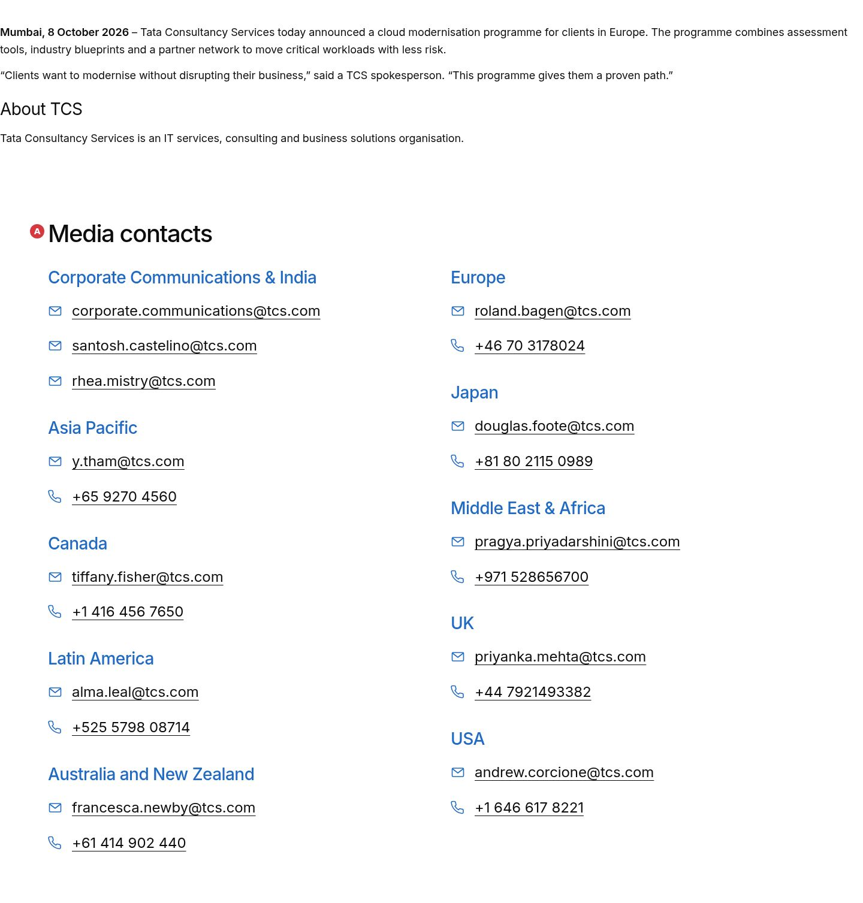

# Media Contacts

The Media Contacts block lists the media relations contacts of the locale's **Media Contacts** data sheet (`/{locale}/data/media-contacts.json`) under an authored title. Contacts with the same designation and region are one group: the group's heading ("Corporate Communications & India") and its e-mail addresses and phone numbers one below the other, each with a mail or phone icon. It follows the "TCS media contacts" section of the tcs.com press releases. It is a key-value block (Title, Title Type and the Additional tab); `blocks/media-contacts/media-contacts.js` loads the sheet and renders the groups.

| Attribute | Value |
| --------- | ----- |
| Technical name | `media-contacts` (model `media-contacts`, template name "Media Contacts") |
| Display name | Media Contacts |
| Block type | Key-value block (`key-value: true`), no item children; content from a data sheet |
| Status | Active |
| Parent / children | Parents: Section, Columns Container, Tabs Container (filters `section`, `columns-container`, `tabs`). Children: none |
| Owner / version / date | Not recorded / 1.0 (handover 2.41, chapter 6.33) / 22 October 2026 |

## Overview

- **Business purpose:** journalists find the right press contact for their region at the end of every press release, from one list maintained in one place (the sheet).
- **User experience:** the title (e.g. "TCS media contacts"), then the groups: the brand-blue group heading and, below it, each e-mail address and phone number as an underlined link with its icon. Two columns from 900px (filled top to bottom), one column below.
- **Templates / page types:** press releases (Page Type `press-release`). The Press Release template no longer adds the contacts by itself: authors add this block (KB-D-054 in the knowledge base decision log).
- **Data source:** the Media Contacts sheet of the page's locale (`utils/data.js` `getMediaContacts`): the rows whose `region` is the page's `region` metadata, else all rows. Placeholders `mediaContacts`, `email`, `phone`, `mediaContactsEditorHint`.
- **Related blocks:** Page Header (the press release's header), Teaser and List (the other press release sections).
- **When to use:** on press releases and media pages that should show the press contacts.
- **When not to use:** for one-off contacts of a single page (author a Text with links, or a Teaser); for contacts that aren't in the Media Contacts sheet.
- **Realistic use cases:** the "TCS media contacts" section at the end of a press release; a newsroom contact page; a regional press page whose `region` metadata shows only that region's contacts.

## Visual Reference

<!-- BEGIN GENERATED: screenshots (npm run build:docs) -->

Screenshots of the handover (6.33 Media Contacts Block), taken on the preview with sample content; they show the rendering at the time of the handover revision that added them (later changes are in the sections below and the handover's revision history):

**Desktop rendering** — The Media Contacts block at 1440 px on the block library page Media Contacts variations: the H2 TCS media contacts, then two columns filled top to bottom: Corporate Communications & India with three e-mail addresses one below the other, Asia Pacific, Canada, Latin America and Australia and New Zealand on the left; Europe, Japan, Middle East & Africa, UK and USA on the right, each with an e-mail address and a phone number, a blue mail or phone icon before each underlined link.



**Mobile rendering** — The same block at 375 px: the H2 TCS media contacts and the groups in one column, Corporate Communications & India with its three e-mail addresses, then Asia Pacific, Canada and the other regions, each address and number on its own line with its icon.



**Regional variation** — The block library page Media Contacts: one region at 1440 px, whose region metadata is Europe: the H2 Media contacts in Europe and the single group Europe with roland.bagen@tcs.com and +46 70 3178024.


**Default title** — The second example of the variations page at 1440 px: the block without a Title shows the heading Media contacts (placeholder) above the same groups.


**Press release template** — The end of the block library page Press release template at 1440 px: the release text with About TCS, then the Media Contacts block with the H2 Media contacts and the groups in two columns; the Press Release template no longer appends a section of its own.



Universal Editor dialogs (no screenshot exists yet; to be captured on AEM author):

```text
[Screenshot Placeholder]

File name:
media-contacts-dialog-content-desktop.png

Purpose:
The Content tab of the Media Contacts properties in Universal Editor, with the fields of the table "Content tab — Media Contacts" in Authorable Fields below.

Annotations:
A = Title
B = Title Type
```

```text
[Screenshot Placeholder]

File name:
media-contacts-dialog-additional-desktop.png

Purpose:
The Additional tab of the Media Contacts properties in Universal Editor, with the fields of the table "Additional tab — Media Contacts" in Authorable Fields below.

Annotations:
A = Anchor ID
B = Hide block
C = Animation Type
D = Motion Speed
E = Animation Trigger
F = Padding left
G = Padding right
H = Padding top
I = Padding bottom
J = Margin left
```

<!-- END GENERATED: screenshots -->

The state below has no screenshot yet (Universal Editor isn't reachable from the preview).

```text
[Screenshot Placeholder]

File name:
media-contacts-empty-editor.png

Purpose:
The block in Universal Editor when the sheet has no contacts: the title and the hint "The contacts come from the Media Contacts sheet …".

Annotations:
A = Title
B = Editor hint (not shown on the published page, where the block is hidden)
```

## For Content Authors

1. **Add the block.** In Universal Editor, select a Section (or a Columns Container column or a Tabs Container), choose Add (+) and pick **Media Contacts**.
2. **Open its properties.** Select the block in the canvas or the content tree. It has two tabs: Content and Additional.
3. **Enter the title.** Title, e.g. "TCS media contacts", and Title Type (H2 by default; the group headings are one level below).
4. **The contacts.** They aren't typed into the block: they come from the locale's Media Contacts sheet (`/content/tcs-corp/{country}/{language}/data/media-contacts`). Ask whoever maintains the sheet to add or change a contact; every page with the block updates.
5. **Region.** The page's `region` metadata (metadata sheet) selects the contacts of that region; without matching rows (or without a region, e.g. Global) all contacts show.
6. **Child items:** none.
7. **Preview** at desktop and mobile widths, then **publish** the page. Publish the sheet too when it changed.
8. **Validate** on the published page: the groups, the links (mailto: / tel:) and the heading levels.

Minimum content: none (without a Title the heading is "Media contacts"). Recommended: Title. Required elsewhere: at least one row in the Media Contacts sheet.

## Authorable Fields

<!-- BEGIN GENERATED: fields (npm run build:docs) -->

### Media Contacts (`media-contacts`)

Model `media-contacts`; template name "Media Contacts" (the block class AEM renders); key-value block (one row per property).

Stored on a new component (definition template): `titleType` = `"h2"`.

#### Content tab — Media Contacts

| Field label | Property | Type | Required | Default | Allowed values | Author guidance | Example |
| ----------- | -------- | ---- | -------- | ------- | -------------- | --------------- | ------- |
| Title | `title` | text | No | — | — | The heading above the contacts, e.g. "TCS media contacts". Empty: "Media contacts" (placeholder mediaContacts). The contacts come from the locale's Media Contacts sheet (data/media-contacts): those of the page's region, else all of them. | Media contacts |
| Title Type | `titleType` | select | No | `h2` | H1 (`h1`), H2 (`h2`), H3 (`h3`), H4 (`h4`), H5 (`h5`), H6 (`h6`) | Heading level of the Title; the contact groups are one level below. Delivered with `title` (field collapse). | h2 |

#### Additional tab — Media Contacts

| Field label | Property | Type | Required | Default | Allowed values | Author guidance | Example |
| ----------- | -------- | ---- | -------- | ------- | -------------- | --------------- | ------- |
| Anchor ID | `classes_anchor` | text | No | — | regExp: ^anchor-[a-z0-9][a-z0-9-]*$; customErrorMsg: Start with anchor-, then lower-case letters, digits and hyphens. | A unique ID of the block on the page, starting with anchor-, e.g. anchor-our-services; link to it with #anchor-our-services. Delivered as a block class. | — |
| Hide block | `classes_hideblock` | boolean | No | `false` | on / off | Hides the whole block on the page until it is turned off (shown faded in the editor). Delivered as a block class. | — |
| Animation Type | `classes_animation` | select | No | "" | None (""), Fade in (`motion-fade-in`), Fade up (`motion-fade-up`), Fade down (`motion-fade-down`), Fade left (`motion-fade-left`), Fade right (`motion-fade-right`), Slide up (`motion-slide-up`), Slide down (`motion-slide-down`), Slide left (`motion-slide-left`), Slide right (`motion-slide-right`), Scale in (`motion-scale-in`) | How the block's content appears; repeated items (cards, list items, accordion items, columns) appear one after another. None: shown as is. Not played in the editor or when the visitor prefers reduced motion. Delivered as a block class. | motion-fade-up |
| Motion Speed | `classes_animationspeed` | select | No | "" | Medium (""), Fast (`motion-fast`), Slow (`motion-slow`) | How fast the block's animations run (Animation Type 0.3 / 0.6 / 0.9 s; the Background animation takes 1.5 times as long). Shown when (`classes_animation` is set and `classes_animation` is not empty) or (`classes_bganimation` is set and `classes_bganimation` is not empty). Delivered as a block class. | — |
| Animation Trigger | `classes_animationtrigger` | select | No | "" | On Scroll / Viewport Entry (""), On Page Load (`motion-on-load`) | When the block's animations run. On Scroll: when the block comes into view (at once if it is in view when the page opens). On Page Load: as soon as the block is ready, wherever it is on the page. Shown when (`classes_animation` is set and `classes_animation` is not empty) or (`classes_bganimation` is set and `classes_bganimation` is not empty). Delivered as a block class. | — |
| Padding left | `classes_paddingleft` | select | No | "" | Default (""), 0 (none) (`pl-0`), 0.25rem (space-100) (`pl-100`), 0.5rem (space-200) (`pl-200`), 0.75rem (space-300) (`pl-300`), 1rem (space-400) (`pl-400`), 1.25rem (space-500) (`pl-500`), 1.5rem (space-600) (`pl-600`), 2rem (space-800) (`pl-800`), 2.5rem (space-1000) (`pl-1000`), 3rem (space-1200) (`pl-1200`), 4rem (space-1600) (`pl-1600`), 5rem (space-2000) (`pl-2000`), 6rem (space-2400) (`pl-2400`), 7.5rem (space-3000) (`pl-3000`) | Delivered as a block class. | — |
| Padding right | `classes_paddingright` | select | No | "" | Default (""), 0 (none) (`pr-0`), 0.25rem (space-100) (`pr-100`), 0.5rem (space-200) (`pr-200`), 0.75rem (space-300) (`pr-300`), 1rem (space-400) (`pr-400`), 1.25rem (space-500) (`pr-500`), 1.5rem (space-600) (`pr-600`), 2rem (space-800) (`pr-800`), 2.5rem (space-1000) (`pr-1000`), 3rem (space-1200) (`pr-1200`), 4rem (space-1600) (`pr-1600`), 5rem (space-2000) (`pr-2000`), 6rem (space-2400) (`pr-2400`), 7.5rem (space-3000) (`pr-3000`) | Delivered as a block class. | — |
| Padding top | `classes_paddingtop` | select | No | "" | Default (""), 0 (none) (`pt-0`), 0.25rem (space-100) (`pt-100`), 0.5rem (space-200) (`pt-200`), 0.75rem (space-300) (`pt-300`), 1rem (space-400) (`pt-400`), 1.25rem (space-500) (`pt-500`), 1.5rem (space-600) (`pt-600`), 2rem (space-800) (`pt-800`), 2.5rem (space-1000) (`pt-1000`), 3rem (space-1200) (`pt-1200`), 4rem (space-1600) (`pt-1600`), 5rem (space-2000) (`pt-2000`), 6rem (space-2400) (`pt-2400`), 7.5rem (space-3000) (`pt-3000`) | Delivered as a block class. | — |
| Padding bottom | `classes_paddingbottom` | select | No | "" | Default (""), 0 (none) (`pb-0`), 0.25rem (space-100) (`pb-100`), 0.5rem (space-200) (`pb-200`), 0.75rem (space-300) (`pb-300`), 1rem (space-400) (`pb-400`), 1.25rem (space-500) (`pb-500`), 1.5rem (space-600) (`pb-600`), 2rem (space-800) (`pb-800`), 2.5rem (space-1000) (`pb-1000`), 3rem (space-1200) (`pb-1200`), 4rem (space-1600) (`pb-1600`), 5rem (space-2000) (`pb-2000`), 6rem (space-2400) (`pb-2400`), 7.5rem (space-3000) (`pb-3000`) | Delivered as a block class. | — |
| Margin left | `classes_marginleft` | select | No | "" | Default (""), 0 (none) (`ml-0`), 0.25rem (space-100) (`ml-100`), 0.5rem (space-200) (`ml-200`), 0.75rem (space-300) (`ml-300`), 1rem (space-400) (`ml-400`), 1.25rem (space-500) (`ml-500`), 1.5rem (space-600) (`ml-600`), 2rem (space-800) (`ml-800`), 2.5rem (space-1000) (`ml-1000`), 3rem (space-1200) (`ml-1200`), 4rem (space-1600) (`ml-1600`), 5rem (space-2000) (`ml-2000`), 6rem (space-2400) (`ml-2400`), 7.5rem (space-3000) (`ml-3000`) | Delivered as a block class. | — |
| Margin right | `classes_marginright` | select | No | "" | Default (""), 0 (none) (`mr-0`), 0.25rem (space-100) (`mr-100`), 0.5rem (space-200) (`mr-200`), 0.75rem (space-300) (`mr-300`), 1rem (space-400) (`mr-400`), 1.25rem (space-500) (`mr-500`), 1.5rem (space-600) (`mr-600`), 2rem (space-800) (`mr-800`), 2.5rem (space-1000) (`mr-1000`), 3rem (space-1200) (`mr-1200`), 4rem (space-1600) (`mr-1600`), 5rem (space-2000) (`mr-2000`), 6rem (space-2400) (`mr-2400`), 7.5rem (space-3000) (`mr-3000`) | Delivered as a block class. | — |
| Margin top | `classes_margintop` | select | No | "" | Default (""), 0 (none) (`mt-0`), 0.25rem (space-100) (`mt-100`), 0.5rem (space-200) (`mt-200`), 0.75rem (space-300) (`mt-300`), 1rem (space-400) (`mt-400`), 1.25rem (space-500) (`mt-500`), 1.5rem (space-600) (`mt-600`), 2rem (space-800) (`mt-800`), 2.5rem (space-1000) (`mt-1000`), 3rem (space-1200) (`mt-1200`), 4rem (space-1600) (`mt-1600`), 5rem (space-2000) (`mt-2000`), 6rem (space-2400) (`mt-2400`), 7.5rem (space-3000) (`mt-3000`) | Delivered as a block class. | — |
| Margin bottom | `classes_marginbottom` | select | No | "" | Default (""), 0 (none) (`mb-0`), 0.25rem (space-100) (`mb-100`), 0.5rem (space-200) (`mb-200`), 0.75rem (space-300) (`mb-300`), 1rem (space-400) (`mb-400`), 1.25rem (space-500) (`mb-500`), 1.5rem (space-600) (`mb-600`), 2rem (space-800) (`mb-800`), 2.5rem (space-1000) (`mb-1000`), 3rem (space-1200) (`mb-1200`), 4rem (space-1600) (`mb-1600`), 5rem (space-2000) (`mb-2000`), 6rem (space-2400) (`mb-2400`), 7.5rem (space-3000) (`mb-3000`) | Delivered as a block class. | — |

<!-- END GENERATED: fields -->

Notes on the significant fields:

- **Title / Title Type:** the heading of the block at the Title Type level (`buildHeading`); empty, it is the placeholder `mediaContacts` ("Media contacts") at that level. The group headings are one level below (H3 under an H2, at most H6).
- **The sheet's columns:** `id`, `name`, `designation`, `email`, `phone`, `region`. A row needs an id, a name, an e-mail address or a phone number. Rows with the same designation and region (case and spacing ignored) are one group, in the sheet's order; the group heading is "designation & region", or the one that is set. A name, when set, is shown above its contact's links.
- **Additional tab:** Anchor ID, Hide block, the animations (the title and the groups animate one after another) and Padding / Margin, as described in AGENTS.md "Additional tab".

## Screenshot-Based Authoring Steps

### Authoring Step 1: Add the Media Contacts block

Select the Section at the end of the press release, choose Add (+) and pick Media Contacts.

### Values to Enter

| Field | Value |
| ----- | ----- |
| (none) | The block is added with Title Type H2 |

### Authoring Step 2: Title

Open the properties panel (Content tab).

### Values to Enter

| Field | Value |
| ----- | ----- |
| Title | TCS media contacts |
| Title Type | H2 |

### Authoring Step 3: Check the contacts

Switch to Preview: the groups of the Media Contacts sheet appear. If the hint "The contacts come from the Media Contacts sheet …" shows, the sheet has no rows yet.

### Values to Enter

| Field | Value |
| ----- | ----- |
| Media Contacts sheet | One row per e-mail address or phone number: `designation` (e.g. Corporate Communications), `region` (e.g. India), `email`, `phone` |

## Variations

### Default (all contacts)

A page whose `region` is Global (or empty, or without matching rows) lists every contact of the sheet.

### Regional

A page whose `region` matches rows of the sheet (e.g. `Europe`) lists only those rows.

### Without a Title

The heading is the placeholder "Media contacts".

## Complete Authoring Example

Scenario: the migrated press release "TCS BaNCS for Treasury marks its entry into Sri Lanka with Indian Bank" (`/content/tcs-corp/language-master/en/curated-design-pages/forms/…`).

| Field | Example value | Guidance |
| ----- | ------------- | -------- |
| Title | TCS media contacts | As on tcs.com |
| Title Type | H2 | Under the page's H1 |
| Page metadata `region` | Global | All contacts |
| Sheet rows | 12 rows: Corporate Communications / India × 3 e-mail addresses; Asia Pacific, Canada, Latin America, Australia and New Zealand, Europe, Japan, Middle East & Africa, UK, USA with an e-mail address and a phone number each | One row per contact |

- **Expected output:** "TCS media contacts", then 10 groups in two columns (5 + 5) from 900px.
- **Accessibility:** an `<h2>`, ten `<h3>` group headings, lists of links named "Email: …" / "Phone: …".
- **Analytics / data layer:** a `tcs-corp/components/media-contacts` entry; clicks as `cmp:click` with `interaction` email / phone and the group as `value`, without the address.
- **Personalization fallback:** all contacts when the page's region has none.

Pre-publish checklist: the sheet is published; the designations and regions are spelled the same in every row of a group; the title fits the page outline.

## Content and Asset Guidelines

- **Title:** short ("TCS media contacts", "Press contacts").
- **Sheet:** one row per e-mail address or phone number; write phone numbers as they should read (+65 9270 4560); the link keeps only the digits and a leading +.
- **Personal data:** the sheet is published as JSON (`/{locale}/data/media-contacts.json`); list business contact details that may be public only.
- **Icons:** `icons/mail.svg` and `icons/phone.svg`, coloured by CSS (brand blue).
- **Limits:** no verified technical limit; long addresses wrap.

## Accessibility

- **Semantic HTML:** the title is a heading; the groups are a list, each with its heading (one level below the title) and a list of links.
- **Link names:** each link starts with a visually hidden "Email:" / "Phone:" (placeholders `email`, `phone`), so its purpose is clear out of context; the icons are CSS backgrounds without text.
- **Keyboard and focus:** links are reachable with Tab and have a visible focus outline.
- **Contrast:** text in `--color-text-default`, headings and icons in `--color-text-brand` (5.4:1 on white).
- **Reflow:** one column below 900px; long addresses wrap (`overflow-wrap: anywhere`).
- **Reduced motion:** the Additional tab's animations don't play for visitors who prefer reduced motion or in the editor.
- **Loading:** while the sheet loads for longer than 150ms, a skeleton marked `aria-busy` (hidden from assistive technology) holds the place.

Author responsibilities: choose the heading level. Sheet owners: consistent designations and regions.

## Data Layer and Analytics

- **Component:** `decorators/data-layer-decorator.js` adds the block once rendered: `@type` `tcs-corp/components/media-contacts`, id = the Anchor ID else `media-contacts-{n}`, `dc:title` = the title.
- **Item positions:** each group has `data-cmp-position` (1, 2, …).
- **Interactions:** the links carry `data-cmp-interaction` (`email` / `phone`) and `data-cmp-value` (the group heading).

| Trigger | Data-layer event | Required properties | Analytics behavior |
| ------- | ---------------- | ------------------- | ------------------ |
| Block rendered | component state (`component.{id}`) | `@type`, `parentId`, `dc:title` | Component inventory of the page |
| Click on an e-mail address | `cmp:click` | `interaction` `email`, `dc:title` `email`, `xdm:linkURL` `mailto:`, `xdm:linkType` `other`, `value` (group), `position` | Contact interest per group, without the address |
| Click on a phone number | `cmp:click` | `interaction` `phone`, `dc:title` `phone`, `xdm:linkURL` `tel:`, `xdm:linkType` `other`, `value`, `position` | As above |

The data layer never records the address or number: `decorators/data-layer-decorator.js` reports every `mailto:` / `tel:` link of the site by its kind (`utils/privacy.js` `contactLinkKind`). Tags and the Web SDK aren't configured yet.

## Personalization

The page's `region` metadata selects the contacts (`utils/data.js` `inRegion`); it is page metadata, not the visitor's location. No Adobe Target or AJO integration.

## Responsive Behavior

| Viewport | Layout | Image behavior | Interaction behavior |
| -------- | ------ | -------------- | -------------------- |
| Below 900px (mobile, tablet) | One column; group headings at `--heading-font-size-l`, links at `--heading-font-size-m` | Icons 1.5rem | Tap a link to write or call |
| 900px and wider (desktop) | Two columns (`columns: 2`, gap 4rem), filled top to bottom, a group never split | Icons 1.5rem | As above |

## For Developers

<!-- BEGIN GENERATED: files (npm run build:docs) -->

```text
blocks/media-contacts/
├── README.md
├── _media-contacts.json
├── media-contacts-data.js
├── media-contacts.css
└── media-contacts.js
```

| Decorator/Utility | Purpose | Execution or dependency point |
| ----------------- | ------- | ----------------------------- |
| [`decorators/contact-list-decorator.js`](../../decorators/contact-list-decorator.js) | `buildContactGroups` (groups of contacts, each with its heading and its mail / phone links one below the other; the links carry `data-cmp-interaction` email / phone) | `media-contacts.js`: { buildContactGroups } |
| [`decorators/heading-decorator.js`](../../decorators/heading-decorator.js) | `buildHeading` (Title + Title Type), `HEADINGS` | `media-contacts.js`: { buildHeading, HEADINGS } |
| [`decorators/skeleton-decorator.js`](../../decorators/skeleton-decorator.js) | `renderWhenLoaded` (a block from data that may take time: directly within 150ms, else after a skeleton so its section is shown; removed on success and failure), `skeletonWhile` (a skeleton in a part that fills in by itse | `media-contacts.js`: { bone, renderWhenLoaded, skeletonElement } |
| [`utils/data.js`](../../utils/data.js) | `loadDataSheet`, `getAuthor`, `getAuthors`, `getLocations`, `getPartners`, `getSocialLinks`, `getMediaContacts`, `inRegion` (the locale's data sheets) | `media-contacts.js`: { getMediaContacts, inRegion } |
| [`utils/environment.js`](../../utils/environment.js) | `prefersReducedMotion`, `scrollBehavior`, `isEditing`, `isInEditor`, `isAuthor` (the page is rendered by AEM author, which has no query index) | `media-contacts.js`: { isAuthor, isEditing } |
| [`utils/metadata.js`](../../utils/metadata.js) | `getPageMetadata`, `getPageTags` (article:tag and the AEM page Tags published as `cq-tags`), `getPageLanguage` (page properties and bulk metadata columns: page-type, author-id, publish-date, reading-time, ...) | `media-contacts.js`: { getPageMetadata } |
| [`utils/placeholders.js`](../../utils/placeholders.js) | `getPlaceholders`, `loadPlaceholders`, `fillPlaceholder` (UI text from the locale's placeholders, with English fallbacks) | `media-contacts.js`: { getPlaceholders } |
| [`utils/properties.js`](../../utils/properties.js) | `readProperties`, `textOf`, `isOn`, `isOnByDefault` (a toggle that defaults to on), `optionOf`, `normalizeKey`, `textSource` (key-value block properties) | `media-contacts.js`: { readProperties, textOf } |

<!-- END GENERATED: files -->

- **JavaScript (`media-contacts.js`):** an async `decorate(block)`. It reads Title and Title Type (`readProperties`), requests the sheet and the placeholders, and renders through `renderWhenLoaded` (a skeleton when the sheet takes longer than 150ms). It selects the page region's rows (`inRegion`, else all), groups them (`media-contacts-data.js` `groupContacts`, `telHref`) and builds the list with `decorators/contact-list-decorator.js` `buildContactGroups`.
- **Pure logic (`media-contacts-data.js`):** `groupHeading`, `groupContacts`, `telHref`; unit tested in `test/media-contacts/media-contacts-data.test.mjs`.
- **CSS (`media-contacts.css`):** headings, links with `::before` icons (CSS masks of `icons/mail.svg` / `icons/phone.svg`), underlined text, two columns from 900px.
- **Input DOM:** key-value rows for `title` (with Title Type collapsed into it as the heading level) and `titleType`; the `classes_*` fields arrive as block classes.
- **Rendered DOM:**

```html
<div class="media-contacts block">
  <h2 class="media-contacts-title">TCS media contacts</h2>
  <ul class="contact-list-groups">
    <li class="contact-list-group" data-cmp-position="1">
      <h3 class="contact-list-heading">Corporate Communications &amp; India</h3>
      <ul class="contact-list-entries">
        <li class="contact-list-email">
          <a class="contact-list-link" href="mailto:…" data-cmp-interaction="email" data-cmp-value="Corporate Communications &amp; India">
            <span class="visually-hidden">Email: </span><span class="contact-list-text">…</span>
          </a>
        </li>
        <li class="contact-list-phone">…</li>
      </ul>
    </li>
  </ul>
</div>
```

- **Empty state:** no contacts: the block and its wrapper are hidden on the page; in Universal Editor and on AEM author the title and the hint `mediaContactsEditorHint` show.
- **Errors:** a failing sheet request counts as no contacts (`loadDataSheet`); a failing render is logged by `renderWhenLoaded`.
- **Motion:** `CONTENT_TARGETS['media-contacts']` animates the title and the groups one after another.

## Extending the Block

1. Add fields in `_media-contacts.json` (at most three short tabs, Additional last), run `npm run build:json`, `npm run lint`, `npm run build:docs`.
2. Respect the delivery rules (no Text / Title / Type / Alt / MimeType suffixes for values that must be read; no sample content in the template).
3. Keep the grouping in `media-contacts-data.js` pure and extend its tests.
4. A new sheet column: read it in `utils/data.js` `getMediaContacts` and document it in the knowledge base (content architecture, data sheets).
5. Keep link names and the data layer's address-free click events.

## For Site Administrators

- **Availability:** the `section`, `columns-container` and `tabs` filters.
- **Sheet:** `/content/tcs-corp/{country}/{language}/data/media-contacts` per locale (published at `/{locale}/data/media-contacts.json`, mapped in `paths.json`), excluded from the query index.
- **Publishing dependencies:** publish the sheet after changing it; the pages update without republishing.

| Dependency | Purpose | Location | Impact if unavailable |
| ---------- | ------- | -------- | --------------------- |
| Media Contacts sheet | The contacts | `/{locale}/data/media-contacts.json` | The block is hidden (hint in the editor) |
| Placeholders | Default title, link names, editor hint | `/{locale}/placeholders.json` | English fallbacks |
| Icons | Mail and phone icons | `icons/mail.svg`, `icons/phone.svg` | Links without icons |

## For Architects

- **Role:** a data-driven listing block; the sheet is the single source of the contacts.
- **Rendering:** client side from the sheet JSON (cached per page view by `utils/data.js`); the title is in the delivered HTML, the contacts are not (not indexed by search engines from the HTML).
- **Dependencies:** `decorators/contact-list-decorator.js`, `heading-decorator.js`, `skeleton-decorator.js`; `utils/data.js`, `environment.js`, `metadata.js`, `placeholders.js`, `properties.js`.
- **Privacy:** the data layer records the kind of contact link and the group, never the address (`utils/privacy.js`).
- **Replaces:** the Media contacts section the Press Release template appended at the end of the page (not in the content tree, not authorable).

```mermaid
graph LR
  AEM[AEM author: Media Contacts block] --> EDS[Edge Delivery HTML]
  SHEET[Media Contacts sheet] --> JSON[/locale/data/media-contacts.json]
  EDS --> JS[blocks/media-contacts/media-contacts.js]
  JSON --> JS
  JS --> CL[decorators/contact-list-decorator.js]
  EDS --> DL[decorators/data-layer-decorator.js]
  DL --> ACDL[Adobe Client Data Layer]
```

## For QA and Support Teams

| Test ID | Scenario | Configuration | Expected result |
| ------- | -------- | ------------- | --------------- |
| MC-QA-01 | Grouping | Three rows with the same designation and region | One heading, three links one below the other |
| MC-QA-02 | Heading | Designation empty, region "Asia Pacific" | Heading "Asia Pacific" |
| MC-QA-03 | Default title | Title empty | "Media contacts" at the Title Type level |
| MC-QA-04 | Heading levels | Title Type H2 | Group headings H3 |
| MC-QA-05 | Region | Page `region` Europe, rows for Europe | Only the Europe rows |
| MC-QA-06 | Region fallback | Page `region` Global | All rows |
| MC-QA-07 | Empty sheet | No rows | Block hidden on the page; hint in Universal Editor |
| MC-QA-08 | Links | E-mail and phone | `mailto:` with the address; `tel:` with digits and a leading + |
| MC-QA-09 | Layout | 375 / 768 / 1440px | One column below 900px; two columns filled top to bottom from 900px |
| MC-QA-10 | Data layer | Click an e-mail address | `cmp:click` with `interaction` email, `xdm:linkURL` `mailto:`, no address |
| MC-QA-11 | Screen reader | Read a link | "Email: address" / "Phone: number" |

## Troubleshooting

| Symptom | Likely cause | Diagnostic steps | Resolution | Verification |
| ------- | ------------ | ---------------- | ---------- | ------------ |
| The block doesn't show on the page | The sheet has no rows (or isn't published) | Open `/{locale}/data/media-contacts.json` | Add rows and publish the sheet | The groups appear |
| A group appears twice | Different spelling of the designation or region | Compare the rows | Spell them the same | One group |
| Only some contacts show | The page's `region` matches some rows | Check the page's `region` metadata | Change the region, or the rows' regions | The expected rows |
| A phone link dials a wrong number | Letters or extra characters in `phone` | Check the cell | Write the number with digits, spaces and a leading + | `tel:` link correct |

## Performance Considerations

- **Request:** one sheet request per page view (shared with other users of `utils/data.js`), plus the placeholders (already loaded by the page).
- **Skeleton:** only when the sheet takes longer than 150ms, so the section isn't held back.
- **DOM size:** a few elements per contact; no listeners.
- **Layout shift:** the block sits below the fold on press releases; above the fold, the skeleton reserves part of its height.

## Security and Privacy

- **Content:** text nodes only (`textContent`); no HTML from the sheet is injected.
- **Personal data:** the sheet's names, e-mail addresses and phone numbers are public by design; the data layer records none of them.
- **Links:** `mailto:` and `tel:` only.

## Known Limitations

| Limitation | Impact | Workaround | Planned correction |
| ---------- | ------ | ---------- | ------------------ |
| Contacts aren't in the delivered HTML | Search engines see them only after rendering | None needed for press contacts | Not planned |
| No per-block region | All blocks on a page use the page's `region` | Set the page's region | Not planned |
| Pages that relied on the template's Media contacts | They show no contacts until the block is added | Add the block (end of the page) | Not planned |

## Related Documentation

- [Blocks documentation](../README.md)
- [Page Header](../page-header/README.md)
- [Model: `_media-contacts.json`](_media-contacts.json)
- [Grouping tests](../../test/media-contacts/media-contacts-data.test.mjs)
- [Templates](../../templates/README.md)
- [Handover 6.33 Media Contacts Block](../../docs/handover/TCS-CORP-HANDOVER.md)

<!-- BEGIN GENERATED: usage (npm run build:docs) -->

Pages of the block library package 1.0.14 (language master, `/content/tcs-corp/language-master/en`) that contain the block, 6 instance(s) in total:
- Block library: `block-library/media-contacts/media-contacts-region`, `block-library/media-contacts/media-contacts-variations`, `block-library/templates/press-release-template`
- Curated design pages: `curated-design-pages/forms/tcs-bancs-for-treasury-marks-its-entry-into-sri-lanka-with-indian-bank`

Project-wide standards: [knowledge base](../../docs/handover/knowledge-base/README.md) ([block governance](../../docs/handover/knowledge-base/blocks.md)).

<!-- END GENERATED: usage -->

## Change History

| Version | Change | Source | Date |
| ------- | ------ | ------ | ---- |
| 1.0 | New block: the media contacts of the Media Contacts sheet as an authorable block, grouped by designation and region; the Press Release template no longer appends them | Feature branch feature/media-contacts-block | 22 October 2026 |
