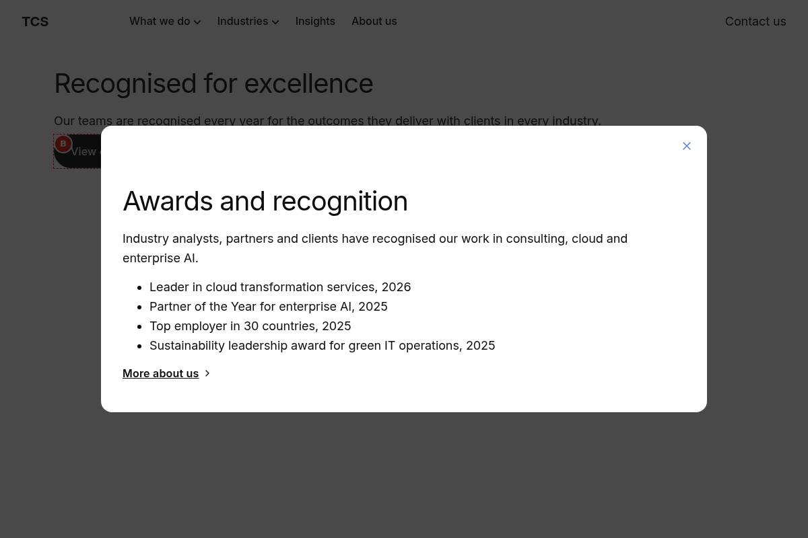
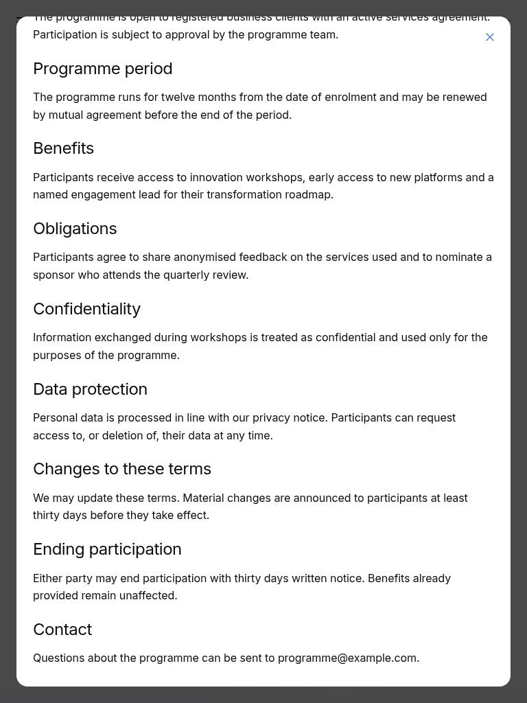
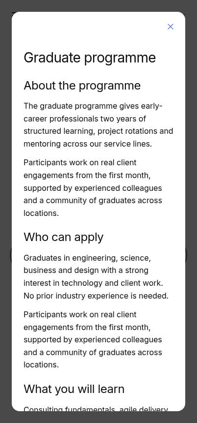
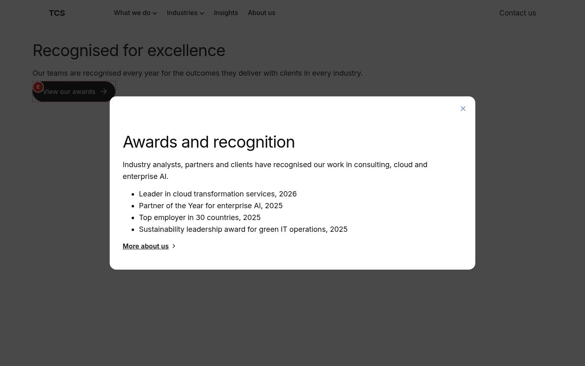
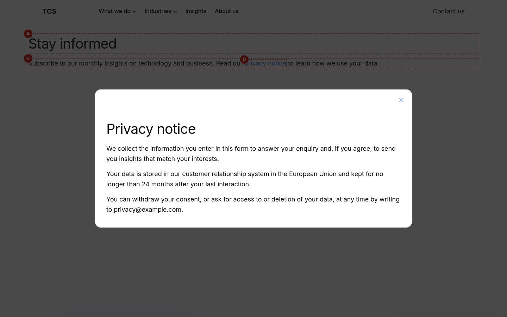
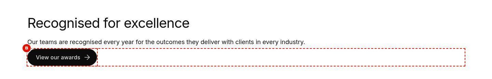
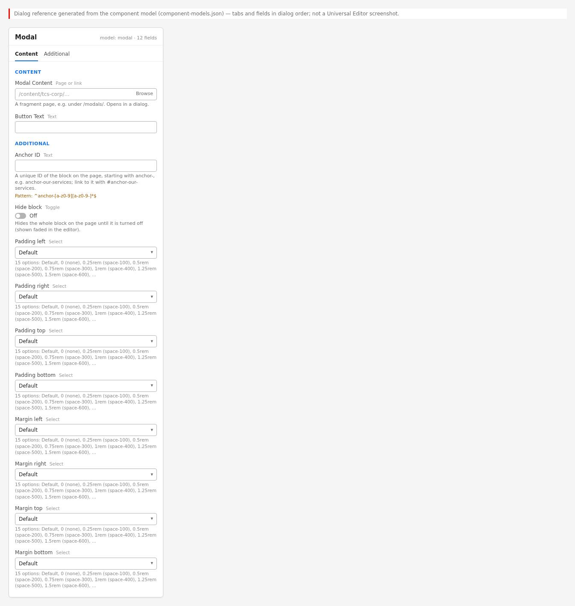
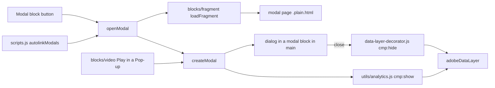

# Modal

Shows the content of a fragment page in a native `<dialog>` over the page (the Block Collection modal, adapted). An authored **Modal** block renders a button that opens the dialog; links whose path contains `/modal/` open as a modal anywhere on the page (`scripts/scripts.js` `autolinkModals`); other blocks (the Video block's Play in a Pop-up) use its exported `createModal()` / `openModal()`.

| Attribute | Value |
| --------- | ----- |
| Technical name | `modal` (`blocks/modal`) |
| Display name | Modal |
| Block type | Independent block (model `modal`, template name "Modal"; not key-value) plus a dialog block created at runtime |
| Status | Active |
| Parent / children | Parent: a section (`section` filter), a Columns Container column (`columns-container`) or a Tabs Container tab (`tabs`). Children: none authored; the dialog holds the fragment page's sections |
| Owner / version / date | Owner: Not recorded; version: Not recorded; date: Not recorded |

## Overview

**Business purpose.** Show supplementary content (details, terms, a short form, a video) without leaving the page; visitors return to the same place when they close it.

**User experience.** A primary button (for example "View our awards"); selecting it dims the page and opens a white dialog, centred, at most 56.25rem wide, with a close button at the top right; long content scrolls inside the dialog while the page behind stays still. The close button, Escape or a click on the backdrop closes it and focus returns to the button.

**Templates / page types.** Any page.

**Data source.** The fragment page named in Modal Content, fetched (`{path}.plain.html`) and decorated each time the dialog opens.

**Related blocks.** [Fragment](../fragment/README.md) (same loader, inline instead of a dialog), the Video block (`blocks/video`, Play in a Pop-up uses `createModal`), Form Variations (a form on a modal page), Button Block (a button linking to a `/modal/` page opens a modal too).

**When to use.** Short, secondary, self-contained content.

**When not to use.** Primary or indexable content (it is loaded from another page on demand), long articles, multi-step processes, content that must be shared by URL; automatic pop-ups on page load aren't implemented.

**Realistic use cases.** "View our awards" (block library `block-library/modal/modal-block`, fragment `modal/fragments/recognition`); "Read the programme terms" with long content (`modal-long-content`); "Contact our team" with a form (`modal-with-a-form`); a privacy notice linked from running text.

## Visual Reference

<!-- BEGIN GENERATED: screenshots (npm run build:docs) -->

Screenshots of the handover (6.23 Modal Block), taken on the preview with sample content; they show the rendering at the time of the handover revision that added them (later changes are in the sections below and the handover's revision history):

**Desktop rendering** — At 1200 px, after selecting View our awards: the page dimmed by the near-black 75 % backdrop and, centred over it, a white dialog 56.25rem wide with 1rem rounded corners, the close (X) button at the top right, the H2 Awards and recognition, the introduction, four bulleted awards and the link More about us, with 2rem padding.



**Tablet rendering** — At 768 px, after selecting Read the programme terms and scrolling inside the dialog: a white dialog 1.5rem from each screen edge over the dark backdrop, showing the middle of the programme terms (Heading 3 sections with their paragraphs), with the close (X) button still at the top right.



**Mobile rendering** — At 375 px, after selecting Read the programme terms: the dialog 1.5rem from each screen edge and as tall as the screen minus 3rem, showing the close (X) button at the top right, the H2 Programme terms, the introduction and the first Heading 3 sections; the rest scrolls inside.



**Modal block variation** — At 1440 px: the section with the H2 Recognised for excellence, the paragraph and the primary button View our awards, dimmed under the dark backdrop, and the awards dialog (56.25rem wide, the H2 Awards and recognition, four bulleted awards and More about us) open over it rather than next to it.



**Auto-linked modal variation** — At 1440 px: the H2 Stay informed and the paragraph with the inline link privacy notice, dimmed under the backdrop, and over them the dialog opened by that link with the close button, the H2 Privacy notice and three paragraphs.



**Universal Editor canvas** — Universal Editor edit mode at 1440 px: the section with the H2 Recognised for excellence, the paragraph and the primary button View our awards; letter A marks the Modal block and B its opener button. No dialog is open. (Annotated preview in editor mode with sample content; letters as in the annotations list, not a Universal Editor screenshot; file screenshots/modal-authoring-view.jpg)



**Properties panel** — The Modal properties panel with the Content tab (Modal Content picker and Button Text) and the Additional tab. (Dialog reference generated from the component model, not a Universal Editor screenshot; file screenshots/modal-properties-panel.jpg)



Universal Editor dialogs (no screenshot exists yet; to be captured on AEM author):

```text
[Screenshot Placeholder]

File name:
modal-dialog-content-desktop.png

Purpose:
The Content tab of the Modal properties in Universal Editor, with the fields of the table "Content tab — Modal" in Authorable Fields below.

Annotations:
A = Modal Content
B = Button Text
```

```text
[Screenshot Placeholder]

File name:
modal-dialog-additional-desktop.png

Purpose:
The Additional tab of the Modal properties in Universal Editor, with the fields of the table "Additional tab — Modal" in Authorable Fields below.

Annotations:
A = Anchor ID
B = Hide block
C = Padding left
D = Padding right
E = Padding top
F = Padding bottom
G = Margin left
H = Margin right
I = Margin top
J = Margin bottom
```

<!-- END GENERATED: screenshots -->

States without a screenshot:

```text
[Screenshot Placeholder]

File name:
modal-empty-editor-desktop.png

Purpose:
Universal Editor edit mode: a Modal without Modal Content shows its hint.

Annotations:
A = Hint "Modal: choose the page it opens, and its button text."
```

```text
[Screenshot Placeholder]

File name:
modal-focus-desktop.png

Purpose:
The open dialog with keyboard focus on the close button, and the opener focused again after Escape.

Annotations:
A = Close button with focus ring
B = Opener button focused after closing
```

```text
[Screenshot Placeholder]

File name:
modal-editor-preview-desktop.png

Purpose:
Universal Editor preview: the dialog centred in the visible part of the editor frame.

Annotations:
A = Dialog within the visible area
B = Backdrop
```

## For Content Authors

1. **Create the modal page** (a fragment page, e.g. under the locale's `modal/` or `references/` folder) and start it with a heading: the heading names the dialog.
2. **Publish the modal page.**
3. **Add the block** to the host page: section (or Columns Container column, or Tab) › Add › **Modal**.
4. **Open its properties.** Pick the page in **Modal Content** and enter the **Button Text** (a verb and an object, e.g. "View our awards").
5. **Additional tab** (optional): Anchor ID, Hide block, padding and margin apply to the button's block on the page, not to the dialog.
6. **Preview:** select the button (it works in Universal Editor preview too); check the dialog's content, scrolling and closing.
7. **Publish** the host page.
8. **Auto-linked alternative:** in any text or button, link to a page whose path contains `/modal/`: on the site, the link opens that page in a dialog.
9. **Validate** on the published site: the dialog opens, is named by its heading, closes with Escape and returns focus to the button.

Minimum required: Modal Content. Recommended: Button Text; a heading at the top of the modal page. Optional: the Additional tab.

## Authorable Fields

<!-- BEGIN GENERATED: fields (npm run build:docs) -->

### Modal (`modal`)

Model `modal`; template name "Modal" (the block class AEM renders).

#### Content tab — Modal

| Field label | Property | Type | Required | Default | Allowed values | Author guidance | Example |
| ----------- | -------- | ---- | -------- | ------- | -------------- | --------------- | ------- |
| Modal Content | `link` | aem-content | No | — | — | A fragment page, e.g. under /modal/. Opens in a dialog. | /language-master/en/block-library/modal/fragments/contact-form |
| Button Text | `linkText` | text | No | — | — | Delivered with `link` (field collapse). | Contact our team |

#### Additional tab — Modal

| Field label | Property | Type | Required | Default | Allowed values | Author guidance | Example |
| ----------- | -------- | ---- | -------- | ------- | -------------- | --------------- | ------- |
| Anchor ID | `classes_anchor` | text | No | — | regExp: ^anchor-[a-z0-9][a-z0-9-]*$; customErrorMsg: Start with anchor-, then lower-case letters, digits and hyphens. | A unique ID of the block on the page, starting with anchor-, e.g. anchor-our-services; link to it with #anchor-our-services. Delivered as a block class. | — |
| Hide block | `classes_hideblock` | boolean | No | `false` | on / off | Hides the whole block on the page until it is turned off (shown faded in the editor). Delivered as a block class. | — |
| Padding left | `classes_paddingleft` | select | No | "" | Default (""), 0 (none) (`pl-0`), 0.25rem (space-100) (`pl-100`), 0.5rem (space-200) (`pl-200`), 0.75rem (space-300) (`pl-300`), 1rem (space-400) (`pl-400`), 1.25rem (space-500) (`pl-500`), 1.5rem (space-600) (`pl-600`), 2rem (space-800) (`pl-800`), 2.5rem (space-1000) (`pl-1000`), 3rem (space-1200) (`pl-1200`), 4rem (space-1600) (`pl-1600`), 5rem (space-2000) (`pl-2000`), 6rem (space-2400) (`pl-2400`), 7.5rem (space-3000) (`pl-3000`) | Delivered as a block class. | — |
| Padding right | `classes_paddingright` | select | No | "" | Default (""), 0 (none) (`pr-0`), 0.25rem (space-100) (`pr-100`), 0.5rem (space-200) (`pr-200`), 0.75rem (space-300) (`pr-300`), 1rem (space-400) (`pr-400`), 1.25rem (space-500) (`pr-500`), 1.5rem (space-600) (`pr-600`), 2rem (space-800) (`pr-800`), 2.5rem (space-1000) (`pr-1000`), 3rem (space-1200) (`pr-1200`), 4rem (space-1600) (`pr-1600`), 5rem (space-2000) (`pr-2000`), 6rem (space-2400) (`pr-2400`), 7.5rem (space-3000) (`pr-3000`) | Delivered as a block class. | — |
| Padding top | `classes_paddingtop` | select | No | "" | Default (""), 0 (none) (`pt-0`), 0.25rem (space-100) (`pt-100`), 0.5rem (space-200) (`pt-200`), 0.75rem (space-300) (`pt-300`), 1rem (space-400) (`pt-400`), 1.25rem (space-500) (`pt-500`), 1.5rem (space-600) (`pt-600`), 2rem (space-800) (`pt-800`), 2.5rem (space-1000) (`pt-1000`), 3rem (space-1200) (`pt-1200`), 4rem (space-1600) (`pt-1600`), 5rem (space-2000) (`pt-2000`), 6rem (space-2400) (`pt-2400`), 7.5rem (space-3000) (`pt-3000`) | Delivered as a block class. | — |
| Padding bottom | `classes_paddingbottom` | select | No | "" | Default (""), 0 (none) (`pb-0`), 0.25rem (space-100) (`pb-100`), 0.5rem (space-200) (`pb-200`), 0.75rem (space-300) (`pb-300`), 1rem (space-400) (`pb-400`), 1.25rem (space-500) (`pb-500`), 1.5rem (space-600) (`pb-600`), 2rem (space-800) (`pb-800`), 2.5rem (space-1000) (`pb-1000`), 3rem (space-1200) (`pb-1200`), 4rem (space-1600) (`pb-1600`), 5rem (space-2000) (`pb-2000`), 6rem (space-2400) (`pb-2400`), 7.5rem (space-3000) (`pb-3000`) | Delivered as a block class. | — |
| Margin left | `classes_marginleft` | select | No | "" | Default (""), 0 (none) (`ml-0`), 0.25rem (space-100) (`ml-100`), 0.5rem (space-200) (`ml-200`), 0.75rem (space-300) (`ml-300`), 1rem (space-400) (`ml-400`), 1.25rem (space-500) (`ml-500`), 1.5rem (space-600) (`ml-600`), 2rem (space-800) (`ml-800`), 2.5rem (space-1000) (`ml-1000`), 3rem (space-1200) (`ml-1200`), 4rem (space-1600) (`ml-1600`), 5rem (space-2000) (`ml-2000`), 6rem (space-2400) (`ml-2400`), 7.5rem (space-3000) (`ml-3000`) | Delivered as a block class. | — |
| Margin right | `classes_marginright` | select | No | "" | Default (""), 0 (none) (`mr-0`), 0.25rem (space-100) (`mr-100`), 0.5rem (space-200) (`mr-200`), 0.75rem (space-300) (`mr-300`), 1rem (space-400) (`mr-400`), 1.25rem (space-500) (`mr-500`), 1.5rem (space-600) (`mr-600`), 2rem (space-800) (`mr-800`), 2.5rem (space-1000) (`mr-1000`), 3rem (space-1200) (`mr-1200`), 4rem (space-1600) (`mr-1600`), 5rem (space-2000) (`mr-2000`), 6rem (space-2400) (`mr-2400`), 7.5rem (space-3000) (`mr-3000`) | Delivered as a block class. | — |
| Margin top | `classes_margintop` | select | No | "" | Default (""), 0 (none) (`mt-0`), 0.25rem (space-100) (`mt-100`), 0.5rem (space-200) (`mt-200`), 0.75rem (space-300) (`mt-300`), 1rem (space-400) (`mt-400`), 1.25rem (space-500) (`mt-500`), 1.5rem (space-600) (`mt-600`), 2rem (space-800) (`mt-800`), 2.5rem (space-1000) (`mt-1000`), 3rem (space-1200) (`mt-1200`), 4rem (space-1600) (`mt-1600`), 5rem (space-2000) (`mt-2000`), 6rem (space-2400) (`mt-2400`), 7.5rem (space-3000) (`mt-3000`) | Delivered as a block class. | — |
| Margin bottom | `classes_marginbottom` | select | No | "" | Default (""), 0 (none) (`mb-0`), 0.25rem (space-100) (`mb-100`), 0.5rem (space-200) (`mb-200`), 0.75rem (space-300) (`mb-300`), 1rem (space-400) (`mb-400`), 1.25rem (space-500) (`mb-500`), 1.5rem (space-600) (`mb-600`), 2rem (space-800) (`mb-800`), 2.5rem (space-1000) (`mb-1000`), 3rem (space-1200) (`mb-1200`), 4rem (space-1600) (`mb-1600`), 5rem (space-2000) (`mb-2000`), 6rem (space-2400) (`mb-2400`), 7.5rem (space-3000) (`mb-3000`) | Delivered as a block class. | — |

<!-- END GENERATED: fields -->

Notes:

- **Modal Content.** Delivered as one link with its Button Text (field collapse: `linkText` into `link`). Absolute URLs are reduced to their path; the path must start with `/` (not `//`); the page is fetched each time the dialog opens; a failed request opens nothing and shows no message.
- **Button Text.** The opener's label; empty or equal to the URL → "Open" (placeholder `open`). A link title different from the text and the URL is copied to the button's `title`.
- **Rendering result.** A `<button type="button" aria-haspopup="dialog">` styled as a primary button (`decorateButton`, view button, type primary); there is no style option. The link's editor instrumentation moves to the button, so it stays selectable.
- **No Modal Content.** The block is empty on the site; in Universal Editor edit mode it shows "Modal: choose the page it opens, and its button text." (placeholder `modalEmpty`).
- **Accessibility impact.** The dialog's name is the modal page's first heading (an id `modal-title-{n}` is added if it has none), else "Dialog" (placeholder `dialog`); the close button is named "Close" (`close`).
- **Data layer impact.** `cmp:show` / `cmp:hide` with a stable dialog id (see [Data Layer and Analytics](#data-layer-and-analytics)).
- **Legacy mapping.** None.
- **Additional tab.** As every block (AGENTS.md "Additional tab"), without animation fields; the Anchor ID is also the opener's data-layer id.

## Screenshot-Based Authoring Steps

### Authoring Step 1: Create the modal page

```text
[Screenshot Placeholder]

File name:
modal-authoring-step-1.png

Purpose:
The modal page (recognition) in Universal Editor, starting with its heading.

Annotations:
A = Title "Awards and recognition"
B = Text with the list of awards
C = Button Block "More about us"
```

### Values to Enter

| Callout | Field | Value | Reason | Expected result |
| ------- | ----- | ----- | ------ | --------------- |
| A | Title | `Awards and recognition` | Names the dialog | `aria-labelledby` points to it |
| B | Text | Introduction and a bulleted list | Dialog content | Scrolls inside the dialog when long |
| C | Button Block | `More about us` | A next step | Link inside the dialog |

Values from `block-library/modal/fragments/recognition`. Business rule: the page must be published. Common mistake: no heading (screen readers announce "Dialog" only).

### Authoring Step 2: Add the Modal block

```text
[Screenshot Placeholder]

File name:
modal-authoring-step-2.png

Purpose:
The host page section with the Add menu and Modal highlighted.

Annotations:
A = Section
B = Modal in the component list
```

### Values to Enter

| Callout | Field | Value | Reason | Expected result |
| ------- | ----- | ----- | ------ | --------------- |
| B | Component | Modal | Opener button | Empty block with the editor hint |

Expected preview: the hint until Modal Content is set.

### Authoring Step 3: Modal Content and Button Text

```text
[Screenshot Placeholder]

File name:
modal-authoring-step-3.png

Purpose:
The Modal properties, Content tab.

Annotations:
A = Modal Content
B = Button Text
```

### Values to Enter

| Callout | Field | Value | Reason | Expected result |
| ------- | ----- | ----- | ------ | --------------- |
| A | Modal Content | `/language-master/en/block-library/modal/fragments/recognition` | The dialog's page | The dialog shows its content |
| B | Button Text | `View our awards` | Says what opens | Primary button "View our awards" |

Business rule: an empty Button Text shows "Open". Validation: the button opens the dialog in preview. Common mistake: a Button Text that repeats the URL.

### Authoring Step 4: Additional tab

```text
[Screenshot Placeholder]

File name:
modal-authoring-step-4.png

Purpose:
The Additional tab with the Anchor ID filled in.

Annotations:
A = Anchor ID
```

### Values to Enter

| Callout | Field | Value | Reason | Expected result |
| ------- | ----- | ----- | ------ | --------------- |
| A | Anchor ID | `anchor-modal-awards` (library sample) | Jump target and stable analytics id | Button block `id`; dialog id `anchor-modal-awards-dialog` in the data layer |

Common mistake: expecting the spacing fields to change the dialog (they apply to the button's block).

### Authoring Step 5: Publish and validate

```text
[Screenshot Placeholder]

File name:
modal-authoring-step-5.png

Purpose:
The published page with the dialog open over the dimmed page.

Annotations:
A = Opener button (behind the backdrop)
B = Dialog with its heading
C = Close button
```

### Values to Enter

| Callout | Field | Value | Reason | Expected result |
| ------- | ----- | ----- | ------ | --------------- |
| A | Publish | The modal page and the host page | Both are needed | The dialog opens on the live site |

Validation: Escape closes and focus returns to the button. Common mistake: publishing only the host page (the button does nothing).

## Variations

### Modal block (button opener)

- **Purpose:** an explicit button opening the dialog.
- **Required:** Modal Content. **Optional:** Button Text, Additional tab.
- **Rendering:** `div.modal.block > button.button.primary[aria-haspopup=dialog]`; on click a new `div.modal.block` is appended to `main` with the `dialog`. A double click opens one dialog.
- **Desktop / tablet / mobile:** see [Responsive Behavior](#responsive-behavior).
- **Accessibility:** native modal dialog; focus returns to the button.
- **Data layer:** opener click, then `cmp:show` / `cmp:hide` on `{opener id}-dialog`.
- **Personalization / fallback:** none; a modal page that can't load opens nothing.

```text
[Screenshot Placeholder]

File name:
modal-block-open-desktop.png

Purpose:
The awards dialog open from its button at 1440px.

Annotations:
A = Dialog
B = Close button
```

### Auto-linked `/modal/` link

- **Purpose:** open a modal from any link (text, button, header or footer) without a Modal block.
- **Configuration:** a link whose URL path contains `/modal/`.
- **Rendering:** a document click listener (`autolinkModals`, started in the lazy phase) prevents the navigation and calls `openModal(href, { opener })`; links already handled (`defaultPrevented`) are skipped.
- **Data layer:** dialog id `modal-{path as class name}`.
- **Note:** in Universal Editor the editor navigates to clicked links; use a Modal block to open dialogs there.

```text
[Screenshot Placeholder]

File name:
modal-auto-link-desktop.png

Purpose:
A dialog opened by an inline link to a /modal/ page.

Annotations:
A = Inline link
B = Dialog
```

### Component dialog (`createModal`)

- **Purpose:** the same dialog for block features: the Video block's Play in a Pop-up passes its player to `createModal([wrapper])`.
- **Rendering:** no fragment request; the content is the caller's nodes; naming, closing and data layer as above (id `modal-{n}`, no stable id passed).

```text
[Screenshot Placeholder]

File name:
modal-video-popup-desktop.png

Purpose:
A Video block playing in the dialog.

Annotations:
A = Video player in the dialog
B = Close button
```

### Long content

- **Purpose:** terms or details longer than the screen (library `modal-long-content`).
- **Rendering:** the dialog is never taller than the visible area minus twice its gap; the content scrolls inside (`overflow-y: auto`, `overscroll-behavior: contain`); the close button stays at the top (sticky); the page is locked (`body.modal-open`).

```text
[Screenshot Placeholder]

File name:
modal-long-content-mobile.png

Purpose:
The programme terms scrolled inside the dialog at 390px.

Annotations:
A = Sticky close button
B = Scrolled content
```

## Complete Authoring Example

Scenario: a "Contact our team" dialog with a form on the Get in touch page.

| Field | Example value | Guidance |
| ----- | ------------- | -------- |
| Modal page | `/content/tcs-corp/us/en/modal/contact-form` (library `block-library/modal/fragments/contact-form`) | A heading first, then the Form Variations block |
| Modal Content | The modal page | Same locale |
| Button Text | `Contact our team` | Verb and object |
| Additional › Anchor ID | `anchor-g01b-modal` (library sample) | Stable analytics id |

Steps: author and publish the modal page, add the Modal to the host page, fill in the fields, publish.

Expected output: a primary button; the dialog with the form opens over the page. Responsive: 1.5rem from the screen edges below 900px, at most 56.25rem wide from 900px. Accessibility: named by the form page's heading, Escape closes, focus back on the button. Analytics: `cmp:click` on `anchor-g01b-modal`, `cmp:show` / `cmp:hide` on `anchor-g01b-modal-dialog`, the form's own `cmp:submit`. Personalization fallback: none.

Pre-publish checklist:

- [ ] Modal page published, starting with a heading.
- [ ] Button Text filled in.
- [ ] No modal opened from inside a modal.
- [ ] Checked at 390px and 1440px, keyboard only.

## Content and Asset Guidelines

- **Headings.** Start every modal page with a heading (it names the dialog).
- **Button Text.** A verb and an object ("View our awards", "Read the programme terms"); avoid "Open" and "Click here".
- **Content length.** Short and single-purpose; long content scrolls but belongs on a page.
- **Images.** The content area is at most 56.25rem minus its padding; images as their blocks define.
- **Tags and metadata.** Not used; give modal pages a clear title for authors.
- **Min / max items.** No verified technical limit was identified.
- **Loading.** Nothing is loaded until the dialog opens (the modal stylesheet, the fragment page); the page is fetched again at each opening.
- **Missing page.** Nothing opens.

## Accessibility

- **Semantics.** Native `<dialog>` opened with `showModal()` (modal, the rest of the page inert); named by `aria-labelledby` (first heading) or `aria-label` "Dialog".
- **Opener.** A `<button>` with `aria-haspopup="dialog"` (a button, not a link, so it works in Universal Editor preview too).
- **Focus.** On open the browser focuses the first focusable element (the close button); on close focus returns to the opener passed explicitly (works in Safari, which doesn't focus clicked buttons).
- **Close.** Close button (icon button, `aria-label` and `title` "Close"), Escape (native), a click on the backdrop outside the dialog's box.
- **Scroll.** The page is locked while open; the dialog scrolls; in a frame (Universal Editor) the dialog is kept in the visible area and hidden until measured.
- **Reduced motion.** No animation in the block.

Author responsibilities: a heading at the top of every modal page, a descriptive Button Text, one purpose per dialog.

Developer responsibilities: keep `showModal()`, the naming, the explicit opener and the placeholders; never open a dialog without a visitor action.

| Key | Expected behavior |
| --- | ----------------- |
| Enter / Space | On the opener: opens the dialog; on the close button: closes it |
| Tab / Shift+Tab | Moves within the dialog (the page behind is inert) |
| Escape | Closes the dialog; focus returns to the opener |

## Data Layer and Analytics

- **Opener component.** The authored block (`modal-{n}`, or its Anchor ID), `@type` `tcs-corp/components/modal`, added after the main sections load.
- **Dialog id.** Stable: `{opener id}-dialog` for the Modal block, `modal-{path}` (`toClassName`) for auto-linked links; Video pop-ups get `modal-{n}`. The dialog block is created at opening and removed at closing; it is added to the component state only if it is open during the delayed `trackBlocks` pass.
- **Events.** `modal.js` pushes `cmp:show` on open (`pushComponentEvent`); `decorators/data-layer-decorator.js` pushes `cmp:hide` on the dialog's `close` event (any way of closing). Clicks are captured centrally.

| Trigger | Data-layer event | Required properties | Analytics behavior |
| ------- | ---------------- | ------------------- | ------------------ |
| Click on the opener | `cmp:click` | `eventInfo.path` `component.{opener id}`, `interaction` "button", `dc:title` (button text), `breakpoint` | Opener use |
| Dialog opened | `cmp:show` | `eventInfo.path` `component.{dialog id}`, `interaction` "dialog" | Dialog impression |
| Dialog closed (button, Escape, backdrop) | `cmp:hide` | `eventInfo.path` `component.{dialog id}`, `interaction` "dialog" | Dialog close |
| Click on the close button | `cmp:click` | `interaction` "button", `dc:title` "Close" | Close intent |
| Click on a link in the dialog | `cmp:click` | `xdm:linkURL`, `xdm:linkType` | Link from the dialog |

The intended flow is Adobe Client Data Layer → Adobe Data Collection (Tags) → AEP Web SDK → Edge Network → Analytics / CJA; Tags and the Web SDK aren't configured yet (blocked: measurement plan). No consent mechanism is implemented. Build rules on `interaction: "dialog"`.

## Personalization

This block does not currently expose verified personalization behavior. There is no Adobe Target or Journey Optimizer integration in the repository; the referenced modal page is what renders for every visitor.

## Responsive Behavior

| Viewport | Layout | Image behavior | Interaction behavior |
| -------- | ------ | -------------- | -------------------- |
| Below 900px | Dialog `calc(100vw - 3rem)` wide, gap 1.5rem above and below, content padding 0 1.5rem 1.5rem | As the content's blocks | Opener button; scroll inside the dialog; Escape, close button, backdrop close |
| 900px and above | Dialog `calc(100vw - 4rem)` wide, at most 56.25rem, gap 2.5rem, content padding 0 2rem 2rem | As above | As above |

The dialog is centred in the visible area (`--modal-top`, `--modal-height` in a frame, else the viewport) and never taller than it.

## For Developers

<!-- BEGIN GENERATED: files (npm run build:docs) -->

```text
blocks/modal/
├── README.md
├── _modal.json
├── modal.css
└── modal.js
```

| Decorator/Utility | Purpose | Execution or dependency point |
| ----------------- | ------- | ----------------------------- |
| [`blocks/fragment/fragment.js`](../../blocks/fragment/fragment.js) | — | `modal.js`: { loadFragment } |
| [`scripts/aem.js`](../../scripts/aem.js) | Edge Delivery core library (block loading, CSS, metadata, optimized pictures) | `modal.js`: { buildBlock, decorateBlock, loadBlock, loadCSS, toClassName, } |
| [`scripts/scripts.js`](../../scripts/scripts.js) | Page decoration (moveInstrumentation and shared page helpers) | `modal.js`: { moveInstrumentation } |
| [`decorators/button-decorator.js`](../../decorators/button-decorator.js) | `decorateButton` (option `newTabHint`: a link opening a new tab says so), `createButton`, `setButtonDisabled`, `setButtonAlignment`, `removeButtonDecoration` | `modal.js`: { decorateButton } |
| [`decorators/icon-button-decorator.js`](../../decorators/icon-button-decorator.js) | `createIconButton` | `modal.js`: { createIconButton } |
| [`decorators/data-layer-decorator.js`](../../decorators/data-layer-decorator.js) | `trackPage`, `trackBlocks`, `trackInteractions`, `componentIdOf` (Adobe Client Data Layer for every block, Core Components schema, read by Adobe Tags / Web SDK; see "Data layer" below) | `modal.js`: { componentIdOf } |
| [`utils/analytics.js`](../../utils/analytics.js) | `pushToDataLayer`, `pushComponents`, `pushComponentEvent` (Adobe Client Data Layer, Core Components schema; never throws) | `modal.js`: { pushComponentEvent } |
| [`utils/environment.js`](../../utils/environment.js) | `prefersReducedMotion`, `scrollBehavior`, `isEditing`, `isInEditor`, `isAuthor` (the page is rendered by AEM author, which has no query index) | `modal.js`: { isEditing } |
| [`utils/ids.js`](../../utils/ids.js) | `nextInstance`, `uniqueId`, `createIdFactory` (unique ids per block instance), `availableId` (an authored id kept, suffixed -2, -3, ... only when taken) | `modal.js`: { uniqueId } |
| [`utils/placeholders.js`](../../utils/placeholders.js) | `getPlaceholders`, `loadPlaceholders`, `fillPlaceholder` (UI text from the locale's placeholders, with English fallbacks) | `modal.js`: { getPlaceholders } |

<!-- END GENERATED: files -->

**Input DOM.** The Modal Content link with its collapsed Button Text (one `a[href]`, possibly in a `p.button-container`); the Additional tab as block classes.

**`decorate(block)`.** No link: empty block (edit mode: `p.modal-empty`). Else a `button` (text, `title`, `aria-haspopup`), `moveInstrumentation(link, button)`, `decorateButton(button, { view: 'button', type: 'primary' })`, click → `openModal(href, { opener: button, id: `${componentIdOf(block)}-dialog` })`.

**`openModal(fragmentUrl, { opener, id })`** (exported). Path from an absolute URL; a `Set` of paths being opened ignores repeated clicks; `loadFragment(path)`; `null` → nothing; `createModal(fragment.childNodes, { id: id || `modal-${toClassName(path)}` })`, then `showModal(opener)`.

**`createModal(contentNodes, { id })`** (exported). Placeholders; `loadCSS('blocks/modal/modal.css')`; `dialog > button.close-button + div.modal-content`; the name; a `modal` block built with `buildBlock`, given `data-cmp-id`, appended to `main`, decorated and loaded, then filled with the dialog. Returns `{ block, showModal(from) }`. `showModal` stores the opener, starts `trackVisibleArea` (only in a frame: an `IntersectionObserver` on the document and a non-passive `wheel` listener, both removed on close), calls `dialog.showModal()`, pushes `cmp:show`, resets the scroll and adds `body.modal-open`. On `close`: stops tracking, removes `modal-open`, removes the block, focuses the opener.

**Rendered DOM contract.**

```html
<div class="modal block" data-block-name="modal" data-cmp-id="anchor-modal-awards-dialog">
  <dialog aria-labelledby="modal-title-1" open>
    <button type="button" class="close-button button tertiary" aria-label="Close" title="Close"></button>
    <div class="modal-content">
      <div class="section">…<h2 id="modal-title-1">Awards and recognition</h2>…</div>
    </div>
  </dialog>
</div>
```

**Auto-link.** `scripts/scripts.js` `autolinkModals(doc)` (lazy phase) imports `blocks/modal/modal.js` on the first matching click.

**Error handling.** A failed fetch resolves to nothing (no dialog, no message); a network error rejects inside `openModal` (the `finally` clears the guard).

## Extending the Block

- **A field (e.g. a button style).** Add it to `_modal.json` (Additional tab last), `npm run build:json`, `npm run lint`. The block isn't key-value: each dialog tab adds an empty row, so read by `data-aue-prop` in the editor and skip empty rows; a field ending in Text, Title, Type or Alt collapses into its base field (use e.g. `buttonVariant`, as the Button Block does).
- **Rendering.** Keep the opener a `<button>` with `aria-haspopup`; pass a stable `id` to `openModal` / `createModal` from new callers.
- **Responsive.** `modal.css` uses the 900px breakpoint and `--modal-top` / `--modal-height`.
- **Accessibility.** Keep `showModal()`, the name, focus return and the close button.
- **Data layer.** Keep `cmp:show` here and `cmp:hide` from the central `close` listener.
- **Tests.** No unit test covers the block; `test/motion/motion.test.mjs` checks it has no animation fields.
- **Docs and modules.** Update this README (`npm run build:docs`) and the block library modal pages; `npm run build:modules` after changing imports.

## For Site Administrators

- **Availability.** Offered in the `section`, `columns-container` and `tabs` filters.
- **Governance.** Model in `blocks/modal/_modal.json`; keep `modals` folders for dialog content only (any link to them opens a dialog).
- **Publishing dependencies.** The modal pages (published with the host pages), `icons/close.svg`, placeholders. Pages in `references/` are excluded from the query index.
- **Localization.** One modal page per locale; translate `open`, `close`, `dialog`, `modalEmpty`.

| Dependency | Purpose | Location | Impact if unavailable |
| ---------- | ------- | -------- | --------------------- |
| Modal page | Dialog content | e.g. `/{locale}/modal/…` | Nothing opens |
| `blocks/fragment` `loadFragment` | Loads the page | `blocks/fragment/fragment.js` | No dialog content |
| Close icon | Close button | `icons/close.svg` | Button without icon (still named) |
| Placeholders `open`, `close`, `dialog`, `modalEmpty` | UI text | `/{locale}/placeholders.json` | English fallbacks |

## For Architects

- **Role.** On-demand presentation of a content page in a dialog; a shared dialog service for blocks.
- **Content model.** A link to a page; the page is the content.
- **Rendering.** Client-side; content fetched and decorated at each opening; the dialog lives in a temporary block in `main`.
- **Dependencies.** `blocks/fragment`, `scripts/aem.js` (`buildBlock`, `decorateBlock`, `loadBlock`, `loadCSS`, `toClassName`), `scripts/scripts.js` (`moveInstrumentation`, `autolinkModals`), `decorators/button-decorator.js`, `decorators/icon-button-decorator.js`, `decorators/data-layer-decorator.js`, `utils/analytics.js`, `utils/environment.js`, `utils/ids.js`, `utils/placeholders.js`.
- **Data layer / Web SDK / Target.** `cmp:show` / `cmp:hide`; no Target.
- **Consent and identity.** None.
- **Caching.** The modal page through the CDN and browser cache; no caching in code.
- **Performance.** No cost until opened.
- **Security.** Same-site root-relative paths only.



## For QA and Support Teams

| Test ID | Scenario | Configuration | Expected result |
| ------- | -------- | ------------- | --------------- |
| MODAL-QA-01 | Default | Modal Content and Button Text | Primary button; dialog with the page's content |
| MODAL-QA-02 | No Button Text | Modal Content only | Button "Open" |
| MODAL-QA-03 | No Modal Content | Empty block | Nothing on the site; hint in edit mode |
| MODAL-QA-04 | Unpublished page | Modal Content not published | Button does nothing, no error shown |
| MODAL-QA-05 | Name | Page with / without a heading | `aria-labelledby` the heading / `aria-label` "Dialog" |
| MODAL-QA-06 | Closing | Close button, Escape, backdrop click | Closes each way; focus back on the opener |
| MODAL-QA-07 | Double click | Double-click the opener | One dialog |
| MODAL-QA-08 | Long content | Terms page | Scrolls inside; sticky close button; page locked |
| MODAL-QA-09 | Auto-link | Inline link to a `/modal/` page | Opens a dialog instead of navigating |
| MODAL-QA-10 | Video pop-up | Video with Play in a Pop-up | Video in the dialog |
| MODAL-QA-11 | Universal Editor preview | Select the opener in preview | Dialog opens in the visible area of the frame |
| MODAL-QA-12 | Viewports | 390 / 1024 / 1440px | Widths as the Responsive Behavior table |
| MODAL-QA-13 | Data layer | Open and close | `cmp:click` opener; `cmp:show` / `cmp:hide` on `{opener id}-dialog` |
| MODAL-QA-14 | Multiple instances | Two Modal blocks | Each opens its own page; distinct dialog ids |
| MODAL-QA-15 | Safari focus | Open with the mouse, close with Escape | Focus returns to the button |

## Troubleshooting

| Symptom | Likely cause | Diagnostic steps | Resolution | Verification |
| ------- | ------------ | ---------------- | ---------- | ------------ |
| The button does nothing | Modal page not published, wrong path, or not a site path | Network: `{path}.plain.html` status | Publish / correct Modal Content | Dialog opens |
| No button | Modal Content empty, or Hide block on | Properties panel | Choose the page; switch Hide block off | Button visible |
| Button says "Open" | Button Text empty or equal to the URL | Properties panel | Enter a descriptive text | Correct label |
| A link opens a dialog (or navigates) unexpectedly | Its path contains `/modal/` (auto-link), or clicked before the lazy phase / in the editor | Check the URL | Move pages out of `modal` folders; use a Modal block in the editor | Intended behaviour on `.aem.page` |
| Screen readers say "Dialog" only | Modal page without a heading | Inspect `aria-label` | Add a heading | `aria-labelledby` set |
| Content unstyled or blocks missing | A block of the modal page failed | Console `failed to load …` | Fix the content; escalate block errors | Renders as on its page |
| No `cmp:show` / `cmp:hide` | Dialog didn't open; Tags not configured | `adobeDataLayer.filter((e) => e.eventInfo?.interaction === 'dialog')` | Fix the opening; configure Tags later | Events present |

Evidence to collect: host page URL, Modal Content value, network status of the modal page request, console errors, the data-layer entries. No cookies or tokens.

## Performance Considerations

- The authored block only builds a button (eager or lazy with its section); the modal stylesheet, the placeholders and the page are loaded when the dialog opens.
- Auto-link: one document click listener from the lazy phase; `modal.js` imported on the first matching click.
- The page is fetched and decorated again at each opening (no caching in code); the dialog block is removed on close.
- In a frame only: an `IntersectionObserver` (101 thresholds) and a non-passive `wheel` listener while open, both removed on close.

## Security and Privacy

- Only root-relative same-site paths are loaded (`loadFragment`); absolute URLs are reduced to their path.
- Auto-link checks only the path (`/modal/`), not the link's origin: an external link whose path contains `/modal/` would open the same path of this site instead of navigating.
- Content is the site's own HTML; no query strings, no personal data; form data in a dialog is handled by Form Variations.

## Known Limitations

| Limitation | Impact | Workaround | Planned correction |
| ---------- | ------ | ---------- | ------------------ |
| The Video pop-up player (`.modal .video-modal-player`, up to 75rem) is wider than the dialog (56.25rem) (F-51) | Player runs past the dialog edge at 1440px | — | Not recorded (F-51 open, P2) |
| The modal page is fetched at every opening | Repeated requests | — | Not planned |
| The opener is always a primary button (no style option, audit) | No secondary / tertiary opener | Use a Button Block linking to a `/modal/` page | Not recorded |
| Auto-link ignores the link's origin | External `/modal/` links don't navigate | Avoid such links | Not recorded |
| Auto-link starts in the lazy phase and not in Universal Editor (the editor navigates) | Early clicks navigate | Use a Modal block for editor previews | Not planned |
| A failed fetch shows no message | Silent failure | Publish the modal page | Not recorded |

## Related Documentation

- [Blocks documentation](../README.md)
- [Fragment](../fragment/README.md) (loader), [Header](../header/README.md) and [Footer](../footer/README.md) (links to `/modal/` pages open as modals)
- Model: [`_modal.json`](./_modal.json); auto-link: [`scripts/scripts.js`](../../scripts/scripts.js)
- [decorators README](../../decorators/README.md), [utils README](../../utils/README.md)
- Tests: [`test/motion/motion.test.mjs`](../../test/motion/motion.test.mjs)
- Handover: [handover 6.23 Modal Block](../../docs/handover/TCS-CORP-HANDOVER.md)

<!-- BEGIN GENERATED: usage (npm run build:docs) -->

Pages of the block library package 1.0.14 (language master, `/content/tcs-corp/language-master/en`) that contain the block, 3 instance(s) in total:
- Block library: `block-library/modal/modal-block`, `block-library/modal/modal-long-content`, `block-library/modal/modal-with-a-form`

Project-wide standards: [knowledge base](../../docs/handover/knowledge-base/README.md) ([block governance](../../docs/handover/knowledge-base/blocks.md)).

<!-- END GENERATED: usage -->

## Change History

| Version | Change | Source | Date |
| ------- | ------ | ------ | ---- |
| Not recorded | README generated from verified implementation and approved handover documentation | Repository review | Not recorded |
| Handover 2.27 | Block ecosystem audit: one dialog per double click (D-C-9), stable data-layer id from the opener / path (D-C-10), opener passed explicitly for focus return (D-C-11), editor hint without Modal Content (D-C-21) | docs/handover revision history; docs/audit/BLOCK-ECOSYSTEM-AUDIT.md | 19 October 2026 |
| Handover 2.29 | Re-audit: the Video pop-up in the dialog corrected | docs/handover revision history | 20 October 2026 |
