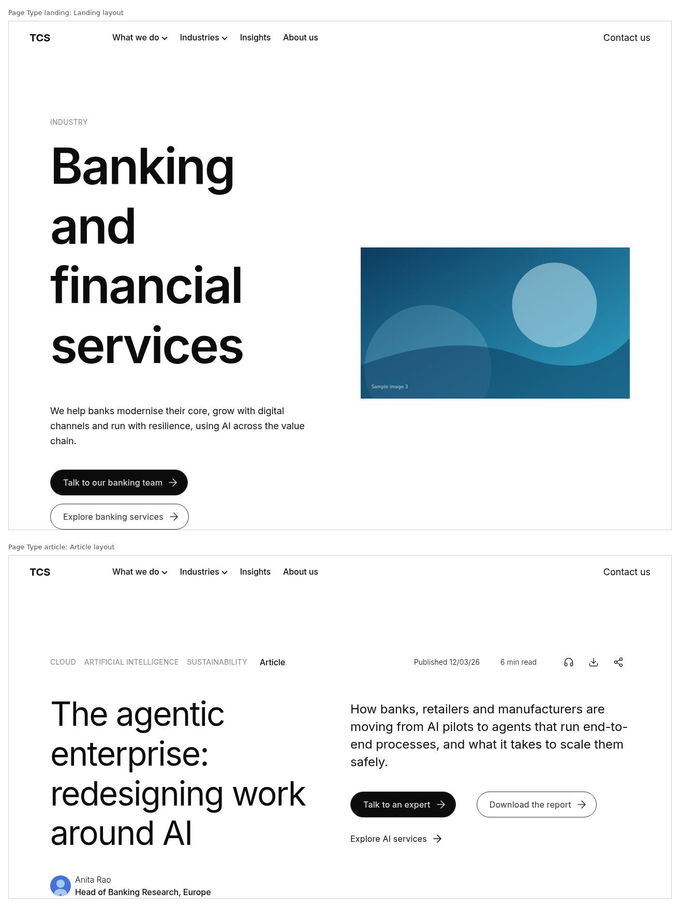
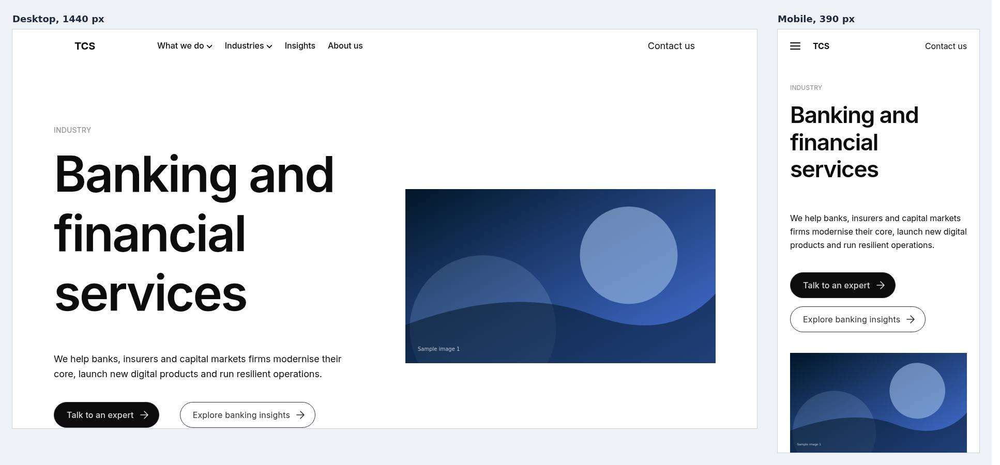
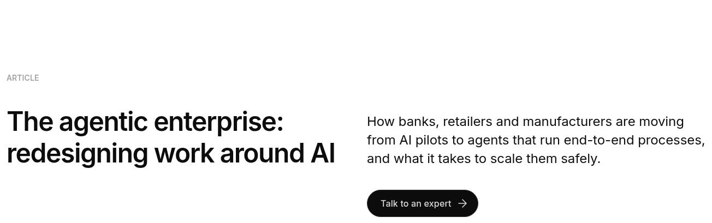
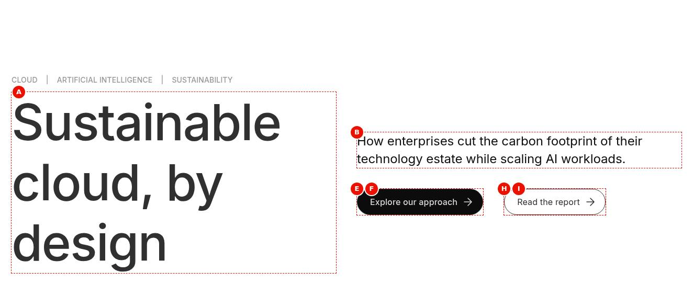
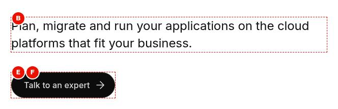
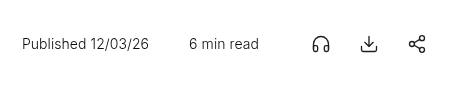
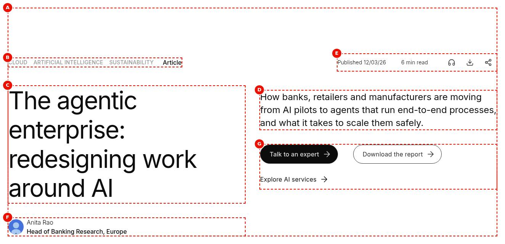
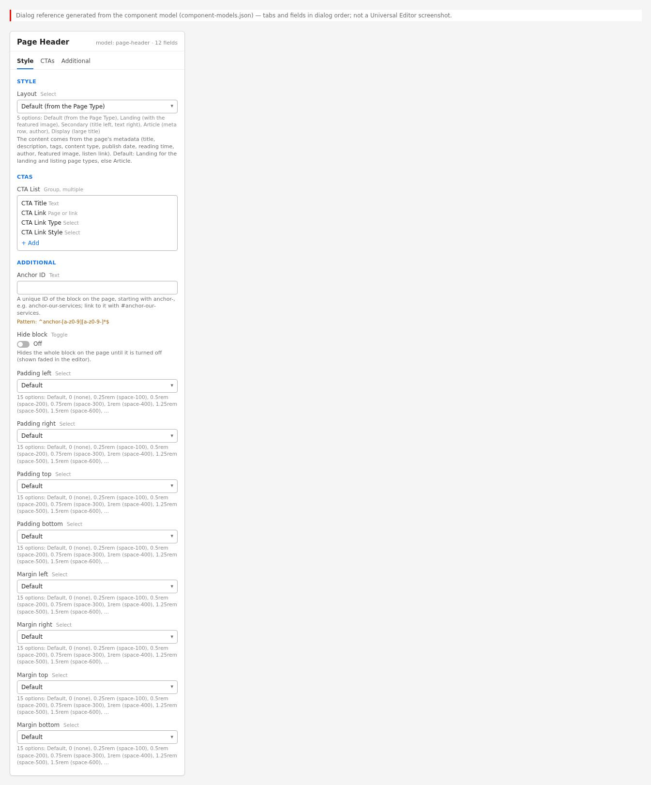
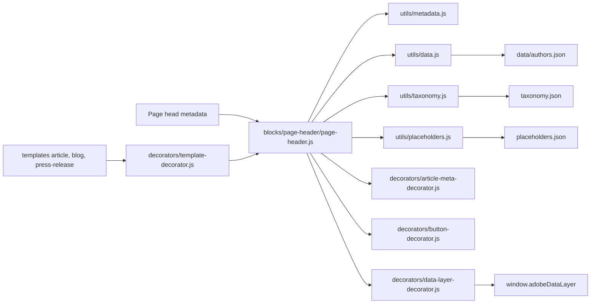

# Page Header

The Page Header is the title area at the top of a content page: eyebrow, H1 title, description and calls to action (CTAs) and, depending on the layout, tags, publish date, reading time, the author lockup, the listen / download / share actions or the featured image. All its text and images come from the page's metadata (page properties and the locale's bulk metadata sheet), the locale's Authors data sheet and taxonomy; authors only choose the Layout and add CTAs. The Article, Blog and Press Release templates add a Page Header automatically when the page has none. It implements the TCS.com Design System Figma "Secondary Page Header" / "L3 Header" (`blocks/page-header/page-header.css`).

| Attribute | Value |
| --------- | ----- |
| Technical name | `page-header` (template name "Page Header", resource type `core/franklin/components/block/v1/block`) |
| Display name | Page Header |
| Block type | Container block, key-value (one row per property), with CTA item rows |
| Status | Active |
| Parent / children | Added to a Section (filter `section`); added automatically by `templates/article`, `templates/blog` and `templates/press-release`; children: CTA items (`page-header-cta`, filter `page-header`) |
| Owner / version / date | Owner: Not recorded; version: 1.0 (handover 6.4.8); date: Not recorded |

## Overview

**Business purpose.** One consistent, design-system header for secondary pages (landing, listing, article, blog, press release, insight) whose title, description, tags, dates and author are always the values used for SEO, the query index, cards and listings, because they come from the same metadata.

**User experience.** Visitors see the page title as the H1, with an eyebrow (content type or tags), the description and CTAs. Article pages add a meta row (tags, content type, "Published" date, reading time, listen / download / share icon buttons) and the author's photo, name (linked to LinkedIn) and designation. Landing pages can show the featured image next to the text.

**Templates / page types.** Default layout: Landing for the page types `landing` and `listing`, Article for any other. The Article, Blog and Press Release templates insert an empty Page Header as the first section when the page has none (`decorators/template-decorator.js` `ensurePageHeader`); an authored one wins.

**Data source.** Page metadata (`utils/metadata.js` `getPageMetadata`: title, description, tags, page-type, content-type, publish-date, reading-time, author-id, author, featured-image, image-alt, listen-link), the Authors sheet (`/{locale}/data/authors.json`), the taxonomy (`/{locale}/taxonomy.json`) and placeholders.

**Related blocks.** [Hero](../hero/README.md) (the authored opening banner, e.g. on Home), the Teaser (`blocks/teaser`, shares `decorators/article-meta-decorator.js`), [List](../list/README.md) and Filter List (show the same metadata on cards).

**When to use.** As the first block of landing, listing, article, blog and press-release pages, once per page.

**When not to use.** On the Home page (use Hero or Gen Carousel); when the header needs content that isn't metadata (a video, an authored image per breakpoint: use Hero or Teaser); more than once per page (it renders an H1). There are no title or description fields: change the page properties or the metadata sheet instead.

**Realistic use cases.**

- A banking industry landing page: eyebrow "Industry", title, description, two CTAs and the featured image (Landing).
- An insight article: tags and content type, publish date, "6 min read", listen / download / share, the author from the Authors sheet (Article).
- A press release with the header added by the template (Article, no CTAs).
- A leadership page with the title on the left and the description and CTAs on the right (Secondary).
- A campaign page with a very large display title under its tags (Display).

## Visual Reference

<!-- BEGIN GENERATED: screenshots (npm run build:docs) -->

Screenshots of the handover (6.4 Page Header Block), taken on the preview with sample content; they show the rendering at the time of the handover revision that added them (later changes are in the sections below and the handover's revision history):

**Desktop rendering** — The article Page Header at 1440 px: the meta row with BANKING, ARTIFICIAL INTELLIGENCE and Insight on the left and Published 12/03/26, 6 min read and the headphones, download and share icons on the right; then the title and the Anita Rao lockup (Head of Banking Research, Europe) on the left, the description, Talk to an expert (black) and Download the report (outlined) on the right.


**Tablet rendering** — The same article at 1024 px and 768 px side by side. At 1024 px the meta row is one line and the title with the Anita Rao lockup and the description with the two CTAs are in two columns; at 768 px the labels and the info wrap onto two lines and title, lockup, description and CTAs stack in one column.


**Mobile rendering** — The article Page Header at 390 px: the meta row wraps onto three lines (BANKING, ARTIFICIAL INTELLIGENCE, Insight; Published 12/03/26 and 6 min read; the three icons), then the title, the Anita Rao lockup, the description, and Talk to an expert and Download the report stacked.


**Layout chosen by Page Type** — Two pages with Layout Default at 1200 px. Left, page-type landing: the Landing layout with INDUSTRY, Banking and financial services, the description and two CTAs beside the blue featured image. Right, Page Type Article: the meta row, the agentic AI title with the Anita Rao lockup, the description and one Talk to an expert button.



**Landing with image** — The Landing layout at 1440 px and 390 px. Desktop: INDUSTRY, the semibold 6rem title Banking and financial services, the description, Talk to an expert (black) and Explore banking insights (outlined) on the left, the blue sample image on the right. Mobile: the text and CTAs stacked, the image below them.



**Landing without image** — The Landing layout without a featured image at 1440 px: the INSIGHTS eyebrow, the very large semibold title All insights, the description Research, perspectives and case studies from our consultants and industry experts, and a black Subscribe to updates button, stacked on the left.


**Secondary layout** — The Secondary layout at 1440 px: the ABOUT US eyebrow above both columns, the semibold title Our leadership on the left; on the right, slightly lower, the description, Meet the board (black) and Corporate governance (outlined).



**Article layout** — The Article layout at 1440 px: BANKING, ARTIFICIAL INTELLIGENCE and Insight left in the meta row, Published 12/03/26, 6 min read and the headphones, download and share icons right; the title with the round Anita Rao photo, name and Head of Banking Research, Europe below it; the description, Talk to an expert and Download the report on the right.


**Display layout** — The Display layout at 1440 px: the tags CLOUD, ARTIFICIAL INTELLIGENCE and SUSTAINABILITY separated by vertical bars above the 6rem medium-weight dark slate title Sustainable cloud, by design on the left; the description, Explore our approach (black) and Read the report (outlined) vertically centred on the right.



**Template-generated header** — The header the Press Release template adds at 1440 px, cropped to the block: EUROPE, ARTIFICIAL INTELLIGENCE and Press Release left, Published 15/09/26, 3 min read and only the download and share icons right; the title TCS expands its AI innovation network in Europe left and the description right, with no author and no CTAs.


**Primary CTA** — The summary column of the Secondary header at 1440 px: the description Plan, migrate and run your applications on the cloud platforms that fit your business, and below it Talk to an expert as a black filled pill with white text and an arrow.



**Secondary CTA** — The summary column at 1440 px: the description, then Talk to an expert as a black filled pill and, beside it, Explore services as an outlined pill with dark text, both with an arrow.


**Text link CTA** — The summary column at 1440 px: the description, Talk to an expert (black pill) and Explore services (outlined pill) on one line, and below them View all case studies as a plain text link with an arrow.


**Name-only author** — The intro column of the Article header at 1440 px: the title Lessons from a mainframe-to-cloud migration over three lines and below it the name Jordan Example in light weight, with no photo, designation or link.


**Listen icon** — The info part of the article meta row at 1440 px: Published 12/03/26, 6 min read, then the headphones (listen), download and share icons.



**Universal Editor canvas** — The article Page Header at 1440 px in editor mode with markers A to G: A the block, B BANKING, ARTIFICIAL INTELLIGENCE and Insight, C the title, D the description, E the date, reading time and icons, F the Anita Rao lockup, G the two CTAs. There is no H: the featured image appears only in the Landing layout. (Annotated preview in editor mode with sample content; letters as in the annotations list, not a Universal Editor screenshot; file screenshots/page-header-authoring-view.jpg)



**Properties panel** — The Page Header properties with the Style tab (Layout select open), the CTAs tab with two CTA List items, and the Additional tab. (Dialog reference generated from the component model, not a Universal Editor screenshot; file screenshots/page-header-properties-panel.jpg)



Universal Editor dialogs (no screenshot exists yet; to be captured on AEM author):

```text
[Screenshot Placeholder]

File name:
page-header-dialog-style-desktop.png

Purpose:
The Style tab of the Page Header properties in Universal Editor, with the fields of the table "Style tab — Page Header" in Authorable Fields below.

Annotations:
A = Layout
```

```text
[Screenshot Placeholder]

File name:
page-header-dialog-ctas-desktop.png

Purpose:
The CTAs tab of the Page Header properties in Universal Editor, with the fields of the table "CTAs tab — Page Header" in Authorable Fields below.

Annotations:
A = CTA List
B = CTA List › CTA Title
C = CTA List › CTA Link
D = CTA List › CTA Link Type
E = CTA List › CTA Link Style
```

```text
[Screenshot Placeholder]

File name:
page-header-dialog-additional-desktop.png

Purpose:
The Additional tab of the Page Header properties in Universal Editor, with the fields of the table "Additional tab — Page Header" in Authorable Fields below.

Annotations:
A = Anchor ID
B = Hide block
C = Animation Type
D = Motion Speed
E = Animation Trigger
F = Padding left
G = Padding right
H = Padding top
I = Padding bottom
J = Margin left
```

```text
[Screenshot Placeholder]

File name:
page-header-cta-dialog-fields-desktop.png

Purpose:
The dialog of the CTA properties in Universal Editor, with the fields of the table "Fields — CTA" in Authorable Fields below.

Annotations:
A = CTA Link
B = CTA Title
C = CTA Link Type
D = CTA Link Style
```

<!-- END GENERATED: screenshots -->

States without a screenshot:

```text
[Screenshot Placeholder]

File name:
page-header-added-editor-desktop.png

Purpose:
The Page Header added to the first Section in Universal Editor, rendering the page's metadata with Layout Default.

Annotations:
A = Page Header in the content tree
B = Add (+) of the Page Header (offers CTA)
C = Properties panel with the Style, CTAs and Additional tabs
```

```text
[Screenshot Placeholder]

File name:
page-header-cta-editor-placeholder-desktop.png

Purpose:
A CTA item just added, before its CTA Link is filled: the dashed editor placeholder in the CTA row (Universal Editor only).

Annotations:
A = Dashed CTA placeholder with the itemEditorHint text
```

```text
[Screenshot Placeholder]

File name:
page-header-share-copied-desktop.png

Purpose:
The Article meta row after Share in a browser without a share dialog: the status text "Link copied to clipboard" below the actions for 3 seconds.

Annotations:
A = Share icon button
B = Status message
```

```text
[Screenshot Placeholder]

File name:
page-header-actions-focus-desktop.png

Purpose:
Keyboard focus on the listen, download and share icon buttons of the Article meta row.

Annotations:
A = Focused icon button with its tooltip
```

```text
[Screenshot Placeholder]

File name:
page-header-empty-metadata-desktop.png

Purpose:
A Page Header on a page without description, tags, dates or author (Article layout): only the H1 title remains.

Annotations:
A = Title only
```

```text
[Screenshot Placeholder]

File name:
page-header-secondary-mobile.png

Purpose:
The Secondary layout at 390px: eyebrow, title, description and CTAs stacked in one column.

Annotations:
A = Eyebrow
B = Title
C = Description and CTAs
```

```text
[Screenshot Placeholder]

File name:
page-header-display-mobile.png

Purpose:
The Display layout at 390px: the pipe-separated tags and the display title above the description and CTAs.

Annotations:
A = Tags eyebrow
B = Display title
```

## For Content Authors

1. **Check the page metadata first.** The header shows the page's Title (H1) and Description (page properties) and the metadata sheet's `content-type`, `publish-date` (YYYY-MM-DD), `reading-time` (a number), `author-id` (or `author`), `featured-image` (with `image-alt`) and `listen-link`, and the page tags. Article, blog and press-release pages get a Page Header automatically.
2. **Add the block (only if the page needs an authored one).** In Universal Editor select the first Section, choose **Add (+)** and pick **Page Header**. It is offered only in Sections.
3. **Open its properties.** Select the Page Header in the content tree; the panel shows **Style**, **CTAs** and **Additional**.
4. **Select the layout (Style tab).** Leave **Layout** on Default (Landing for landing / listing page types, else Article) or choose Landing, Secondary, Article or Display.
5. **Add CTAs.** Select the Page Header, choose **Add (+)** › **CTA**, fill **CTA Link** (required) and **CTA Title**, choose **CTA Link Style** (Primary Button by default, Secondary Button, Text link) and **CTA Link Type** (Open in New Window only when needed). Reorder CTAs by dragging them in the content tree.
6. **Additional tab.** Anchor ID, Hide block, Animation Type and spacing only when needed.
7. **Preview.** After changing page properties, reload the editor (metadata is read when the page loads); check desktop and mobile.
8. **Publish.** Publish the page; the Authors sheet, taxonomy and placeholders of the locale must be published too.
9. **Validate the published output.** One H1 equal to the page Title, the date as dd/mm/yy, the author lockup complete, tags with proper labels, CTAs working.

**Minimum required content:** a page Title. **Recommended:** Description, content-type, and for articles publish-date, reading-time and author-id. **Optional:** CTAs, featured-image (Landing), listen-link (Article), Layout, Additional tab options.

## Authorable Fields

<!-- BEGIN GENERATED: fields (npm run build:docs) -->

### Page Header (`page-header`)

Model `page-header`; template name "Page Header" (the block class AEM renders); key-value block (one row per property); children: `page-header-cta`.

#### Style tab — Page Header

| Field label | Property | Type | Required | Default | Allowed values | Author guidance | Example |
| ----------- | -------- | ---- | -------- | ------- | -------------- | --------------- | ------- |
| Layout | `classes` | select | No | "" | Default (from the Page Type) (""), Landing (with the featured image) (`landing`), Secondary (title left, text right) (`secondary`), Article (meta row, author) (`article`), Display (large title) (`display`) | The content comes from the page's metadata (title, description, tags, content type, publish date, reading time, author, featured image, listen link). Default: Landing for the landing and listing page types, else Article. | article |

#### CTAs tab — Page Header

| Field label | Property | Type | Required | Default | Allowed values | Author guidance | Example |
| ----------- | -------- | ---- | -------- | ------- | -------------- | --------------- | ------- |
| CTA List | `ctas` | container (multiple) | No | — | — | CTAs authored before CTA items. Add CTAs to the page header with Add (CTA) instead. | — |
| CTA List › CTA Title | `ctaText` | text | No | — | — | — | — |
| CTA List › CTA Link | `cta` | aem-content | No | — | — | — | — |
| CTA List › CTA Link Type | `ctaTarget` | select | No | "" | Default (""), Open in New Window (`new-window`) | — | — |
| CTA List › CTA Link Style | `ctaStyle` | select | No | `primary` | Text link (""), Primary Button (`primary`), Secondary Button (`secondary`) | — | — |

#### Additional tab — Page Header

| Field label | Property | Type | Required | Default | Allowed values | Author guidance | Example |
| ----------- | -------- | ---- | -------- | ------- | -------------- | --------------- | ------- |
| Anchor ID | `classes_anchor` | text | No | — | regExp: ^anchor-[a-z0-9][a-z0-9-]*$; customErrorMsg: Start with anchor-, then lower-case letters, digits and hyphens. | A unique ID of the block on the page, starting with anchor-, e.g. anchor-our-services; link to it with #anchor-our-services. Delivered as a block class. | — |
| Hide block | `classes_hideblock` | boolean | No | `false` | on / off | Hides the whole block on the page until it is turned off (shown faded in the editor). Delivered as a block class. | — |
| Animation Type | `classes_animation` | select | No | "" | None (""), Fade in (`motion-fade-in`), Fade up (`motion-fade-up`), Fade down (`motion-fade-down`), Fade left (`motion-fade-left`), Fade right (`motion-fade-right`), Slide up (`motion-slide-up`), Slide down (`motion-slide-down`), Slide left (`motion-slide-left`), Slide right (`motion-slide-right`), Scale in (`motion-scale-in`) | How the block's content appears; repeated items (cards, list items, accordion items, columns) appear one after another. None: shown as is. Not played in the editor or when the visitor prefers reduced motion. Delivered as a block class. | — |
| Motion Speed | `classes_animationspeed` | select | No | "" | Medium (""), Fast (`motion-fast`), Slow (`motion-slow`) | How fast the animation runs: 0.3, 0.6 or 0.9 seconds. Shown when `classes_animation` is set and `classes_animation` is not empty. Delivered as a block class. | — |
| Animation Trigger | `classes_animationtrigger` | select | No | "" | On Scroll / Viewport Entry (""), On Page Load (`motion-on-load`) | When the block's animations run. On Scroll: when the block comes into view (at once if it is in view when the page opens). On Page Load: as soon as the block is ready, wherever it is on the page. Shown when `classes_animation` is set and `classes_animation` is not empty. Delivered as a block class. | — |
| Padding left | `classes_paddingleft` | select | No | "" | Default (""), 0 (none) (`pl-0`), 0.25rem (space-100) (`pl-100`), 0.5rem (space-200) (`pl-200`), 0.75rem (space-300) (`pl-300`), 1rem (space-400) (`pl-400`), 1.25rem (space-500) (`pl-500`), 1.5rem (space-600) (`pl-600`), 2rem (space-800) (`pl-800`), 2.5rem (space-1000) (`pl-1000`), 3rem (space-1200) (`pl-1200`), 4rem (space-1600) (`pl-1600`), 5rem (space-2000) (`pl-2000`), 6rem (space-2400) (`pl-2400`), 7.5rem (space-3000) (`pl-3000`) | Delivered as a block class. | — |
| Padding right | `classes_paddingright` | select | No | "" | Default (""), 0 (none) (`pr-0`), 0.25rem (space-100) (`pr-100`), 0.5rem (space-200) (`pr-200`), 0.75rem (space-300) (`pr-300`), 1rem (space-400) (`pr-400`), 1.25rem (space-500) (`pr-500`), 1.5rem (space-600) (`pr-600`), 2rem (space-800) (`pr-800`), 2.5rem (space-1000) (`pr-1000`), 3rem (space-1200) (`pr-1200`), 4rem (space-1600) (`pr-1600`), 5rem (space-2000) (`pr-2000`), 6rem (space-2400) (`pr-2400`), 7.5rem (space-3000) (`pr-3000`) | Delivered as a block class. | — |
| Padding top | `classes_paddingtop` | select | No | "" | Default (""), 0 (none) (`pt-0`), 0.25rem (space-100) (`pt-100`), 0.5rem (space-200) (`pt-200`), 0.75rem (space-300) (`pt-300`), 1rem (space-400) (`pt-400`), 1.25rem (space-500) (`pt-500`), 1.5rem (space-600) (`pt-600`), 2rem (space-800) (`pt-800`), 2.5rem (space-1000) (`pt-1000`), 3rem (space-1200) (`pt-1200`), 4rem (space-1600) (`pt-1600`), 5rem (space-2000) (`pt-2000`), 6rem (space-2400) (`pt-2400`), 7.5rem (space-3000) (`pt-3000`) | Delivered as a block class. | — |
| Padding bottom | `classes_paddingbottom` | select | No | "" | Default (""), 0 (none) (`pb-0`), 0.25rem (space-100) (`pb-100`), 0.5rem (space-200) (`pb-200`), 0.75rem (space-300) (`pb-300`), 1rem (space-400) (`pb-400`), 1.25rem (space-500) (`pb-500`), 1.5rem (space-600) (`pb-600`), 2rem (space-800) (`pb-800`), 2.5rem (space-1000) (`pb-1000`), 3rem (space-1200) (`pb-1200`), 4rem (space-1600) (`pb-1600`), 5rem (space-2000) (`pb-2000`), 6rem (space-2400) (`pb-2400`), 7.5rem (space-3000) (`pb-3000`) | Delivered as a block class. | — |
| Margin left | `classes_marginleft` | select | No | "" | Default (""), 0 (none) (`ml-0`), 0.25rem (space-100) (`ml-100`), 0.5rem (space-200) (`ml-200`), 0.75rem (space-300) (`ml-300`), 1rem (space-400) (`ml-400`), 1.25rem (space-500) (`ml-500`), 1.5rem (space-600) (`ml-600`), 2rem (space-800) (`ml-800`), 2.5rem (space-1000) (`ml-1000`), 3rem (space-1200) (`ml-1200`), 4rem (space-1600) (`ml-1600`), 5rem (space-2000) (`ml-2000`), 6rem (space-2400) (`ml-2400`), 7.5rem (space-3000) (`ml-3000`) | Delivered as a block class. | — |
| Margin right | `classes_marginright` | select | No | "" | Default (""), 0 (none) (`mr-0`), 0.25rem (space-100) (`mr-100`), 0.5rem (space-200) (`mr-200`), 0.75rem (space-300) (`mr-300`), 1rem (space-400) (`mr-400`), 1.25rem (space-500) (`mr-500`), 1.5rem (space-600) (`mr-600`), 2rem (space-800) (`mr-800`), 2.5rem (space-1000) (`mr-1000`), 3rem (space-1200) (`mr-1200`), 4rem (space-1600) (`mr-1600`), 5rem (space-2000) (`mr-2000`), 6rem (space-2400) (`mr-2400`), 7.5rem (space-3000) (`mr-3000`) | Delivered as a block class. | — |
| Margin top | `classes_margintop` | select | No | "" | Default (""), 0 (none) (`mt-0`), 0.25rem (space-100) (`mt-100`), 0.5rem (space-200) (`mt-200`), 0.75rem (space-300) (`mt-300`), 1rem (space-400) (`mt-400`), 1.25rem (space-500) (`mt-500`), 1.5rem (space-600) (`mt-600`), 2rem (space-800) (`mt-800`), 2.5rem (space-1000) (`mt-1000`), 3rem (space-1200) (`mt-1200`), 4rem (space-1600) (`mt-1600`), 5rem (space-2000) (`mt-2000`), 6rem (space-2400) (`mt-2400`), 7.5rem (space-3000) (`mt-3000`) | Delivered as a block class. | — |
| Margin bottom | `classes_marginbottom` | select | No | "" | Default (""), 0 (none) (`mb-0`), 0.25rem (space-100) (`mb-100`), 0.5rem (space-200) (`mb-200`), 0.75rem (space-300) (`mb-300`), 1rem (space-400) (`mb-400`), 1.25rem (space-500) (`mb-500`), 1.5rem (space-600) (`mb-600`), 2rem (space-800) (`mb-800`), 2.5rem (space-1000) (`mb-1000`), 3rem (space-1200) (`mb-1200`), 4rem (space-1600) (`mb-1600`), 5rem (space-2000) (`mb-2000`), 6rem (space-2400) (`mb-2400`), 7.5rem (space-3000) (`mb-3000`) | Delivered as a block class. | — |

### CTA (`page-header-cta`)

Model `page-header-cta`; template name "CTA" (the block class AEM renders).

Stored on a new component (definition template): `linkStyle` = `"primary"`.

#### Fields — CTA

| Field label | Property | Type | Required | Default | Allowed values | Author guidance | Example |
| ----------- | -------- | ---- | -------- | ------- | -------------- | --------------- | ------- |
| CTA Link | `link` | aem-content | Yes | — | — | — | — |
| CTA Title | `linkText` | text | No | — | — | Delivered with `link` (field collapse). | — |
| CTA Link Type | `linkTarget` | select | No | "" | Default (""), Open in New Window (`new-window`) | — | — |
| CTA Link Style | `linkStyle` | select | No | `primary` | Text link (`tertiary`), Primary Button (`primary`), Secondary Button (`secondary`) | — | — |

<!-- END GENERATED: fields -->

Notes on the significant fields:

- **Layout.** Becomes the block class (`landing`, `secondary`, `article`, `display`); any other layout class is removed and the resolved one added. Default resolves from the Page Type (`page-type`, else `template` metadata).
- **CTA (item) fields.** CTA Link Style Primary / Secondary render `a.button.primary` / `a.button.secondary`; Text link (`tertiary`, or empty in content authored before) renders `a.button.tertiary`. A new CTA stores Primary Button (definition template). Open in New Window sets `target="_blank"`, `rel="noopener noreferrer"` and appends the visually hidden placeholder `opensInNewTab`. A CTA without a link isn't rendered (in Universal Editor it is a dashed placeholder, `itemEditorHint`).
- **Metadata (not dialog fields).** Title → `h1.page-header-title`; Description → `div.page-header-description`; content-type → eyebrow (Landing, Secondary) or `p.page-header-collection` (Article); tags → `ul.page-header-tags` (Article meta row; Display eyebrow; Landing / Secondary eyebrow when there is no content-type), labels from the taxonomy, else derived from the tag ID; publish-date (`publication-date` as a fallback) → "Published" + `<time>` (dd/mm/yy); reading-time → "{n} min read" for a number; author-id → Authors sheet name, designation and region, image, LinkedIn; author → name only; featured-image and image-alt → the Landing image; listen-link → the listen action.
- **Accessibility impact.** One H1 per page; the featured image's alt comes from `image-alt` (empty: decorative); the author image is decorative (`alt=""`).
- **Data-layer impact.** The H1 text is the component's `dc:title`; CTAs and the actions are tracked as clicks.
- **Legacy mapping.** CTAs authored in the former **CTA List** composite multifield (`ctas`: CTA Title, CTA Link, CTA Link Type, CTA Link Style) are still read and shown before the CTA items; a style stored as empty renders as a Text link.
- **Additional tab.** Anchor ID, Hide block, Animation Type, Motion Speed, Animation Trigger and spacing (no Background animation): see AGENTS.md "Additional tab" and "Animation and skeletons". The content animation moves the block as a whole.

## Screenshot-Based Authoring Steps

### Authoring Step 1: Prepare the page metadata

```text
[Screenshot Placeholder]

File name:
page-header-authoring-step-1.png

Purpose:
The page properties (Title, Description, Page Type) and the locale metadata sheet row of the page.

Annotations:
A = Title
B = Description
C = Page Type
D = Metadata sheet row (content-type, publish-date, reading-time, author-id)
```

### Values to Enter

| Callout | Field | Value | Reason | Expected result |
| ------- | ----- | ----- | ------ | --------------- |
| A | Title (page properties) | Cloud transformation for banks | The H1 | `h1.page-header-title` |
| B | Description (page properties) | How banks modernise their core on the cloud. | Supporting text | Description beside the title |
| C | Page Type | article | Default layout | Article layout |
| D | content-type / publish-date / reading-time / author-id | Insight / 2026-03-12 / 6 / an author-id of the Authors sheet | Meta row and author | "Insight", "Published 12/03/26", "6 min read", the author lockup |

Author action: edit the page properties and the metadata sheet, publish the sheet. Expected preview: the Article header with the meta row. Business rule: the date must be ISO (YYYY-MM-DD) to be formatted. Validation: `<meta name="publish-date">` in the page source. Common mistake: typing the date as "March 12" (shown as typed); resolution: use YYYY-MM-DD.

### Authoring Step 2: Add the Page Header and choose the layout

```text
[Screenshot Placeholder]

File name:
page-header-authoring-step-2.png

Purpose:
The Page Header added to the first Section, the Style tab with the Layout select open.

Annotations:
A = Page Header in the content tree
B = Layout
```

### Values to Enter

| Callout | Field | Value | Reason | Expected result |
| ------- | ----- | ----- | ------ | --------------- |
| A | Add (+) | Page Header | Authored header (pages without a template header) | Header from metadata |
| B | Layout | Secondary (title left, text right) | Title and description side by side | Eyebrow above two columns from 900px |

Author action: select the first Section, Add (+) › Page Header, open Style, choose Layout. Expected preview: the chosen layout. Business rule: only one Page Header per page; the templates don't add another when one is authored. Validation: the block has the layout class. Common mistake: leaving Default on a page whose page-type is set by a sheet row to `landing`; resolution: choose the layout explicitly.

### Authoring Step 3: Add CTAs

```text
[Screenshot Placeholder]

File name:
page-header-authoring-step-3.png

Purpose:
Two CTA items in the content tree, the first one's dialog open.

Annotations:
A = CTA Link
B = CTA Title
C = CTA Link Type
D = CTA Link Style
```

### Values to Enter

| Callout | Field | Value | Reason | Expected result |
| ------- | ----- | ----- | ------ | --------------- |
| A | CTA Link | /en/contact (first), /en/services (second) | Destinations | Links rendered |
| B | CTA Title | Talk to an expert / Explore services | Labels | Button texts |
| C | CTA Link Type | Default | Same tab | No `target` |
| D | CTA Link Style | Primary Button / Secondary Button | One primary action | Black filled and outlined pill buttons |

Author action: Add (+) › CTA twice, fill each dialog. Expected preview: the CTAs below the description. Business rule: CTA Link is required. Validation: both CTAs open their pages. Common mistake: a CTA Title without a CTA Link (dashed placeholder in the editor, nothing on the page); resolution: fill the link.

### Authoring Step 4: Preview, publish and verify

```text
[Screenshot Placeholder]

File name:
page-header-authoring-step-4.png

Purpose:
The published Article header compared with the Universal Editor preview.

Annotations:
A = H1 title
B = Meta row
C = Author lockup
D = CTAs
```

### Values to Enter

| Callout | Field | Value | Reason | Expected result |
| ------- | ----- | ----- | ------ | --------------- |
| A | Preview | Reload the editor | Metadata is read on load | The header shows the new values |
| B | Publish | Page, metadata sheet, Authors sheet, taxonomy | All sources live | The header complete on aem.live |

Author action: reload, preview, publish. Validation: one H1, labels from the taxonomy, author complete. Common mistake: the Authors sheet not published (no lockup); resolution: publish `data/authors`.

## Variations

The layouts are the Layout select values in `blocks/page-header/_page-header.json`; Default resolves in `page-header.js` `layoutOf`.

### Default (from the Page Type)

Purpose: the right layout without a choice: Landing for `landing` / `listing`, else Article. Use on template pages. Rendering: as the resolved layout. The automatic header of the templates always uses Default.

### Landing (`landing`)

Purpose: landing and listing pages with a large title and, optionally, the featured image. Required: Title; optional Description, content-type, CTAs, featured-image (+ image-alt). Rendering: `div.page-header-intro` with eyebrow, title (`--display-font-size-1`, semibold; 6rem from 900px), description and CTAs; `div.page-header-media` with the featured image; with an image the block gets `page-header-has-image` and, from 900px, a two-column grid (`--space-2000` gap). The image is requested 1200px wide from 900px, 750px below, eager with high priority when it is same-origin site media (`/media_`). Without an image the text stacks on the left.

```text
[Screenshot Placeholder]

File name:
page-header-landing-tablet.png

Purpose:
The Landing layout with a featured image at 768px: text and CTAs stacked, the image below them (two columns only from 900px).

Annotations:
A = Intro column
B = Featured image
```

### Secondary (`secondary`)

Purpose: title on one side, description and CTAs on the other. Rendering: the eyebrow above `div.page-header-columns` (intro: semibold title; summary: description and CTAs, `--space-300` lower from 900px); two columns from 900px.

### Article (`article`)

Purpose: articles, blogs, insights, press releases. Rendering: `div.page-header-meta-row` (labels: tags and `p.page-header-collection`; info: date, reading time, `div.page-header-actions` with listen (only with listen-link), download (prints the page) and share (device share dialog, else copies the URL with a `role="status"` message for 3 seconds)), then the columns (intro: title at `--display-font-size-2` and the author lockup; summary: description and CTAs).

```text
[Screenshot Placeholder]

File name:
page-header-article-no-author-desktop.png

Purpose:
The Article layout on a page without author-id and author: no lockup under the title.

Annotations:
A = Title without author
B = Meta row
```

### Display (`display`)

Purpose: a very large statement title under the tags. Rendering: the tags separated by "|" as the eyebrow, the title at `--display-font-size-1` (6rem from 900px, medium weight, `--color-text-neutral`), the summary vertically centred from 900px.

### Automatic Page Header (templates)

The Article, Blog and Press Release templates prepend an empty `div.page-header` in its own section when the page has none; it renders with Default layout and no CTAs.

### Author from the Authors sheet / from Author metadata

With `author-id` found in the Authors sheet: photo (2.5rem circle), name linked to LinkedIn in a new tab (with the new-tab hint) and "designation, region". With only `author`: the name alone. Without either: no lockup.

## Complete Authoring Example

Scenario: an insight article page on the English site.

| Field | Example value | Guidance |
| ----- | ------------- | -------- |
| Title (page properties) | Cloud transformation for banks | Becomes the H1 |
| Description (page properties) | How banks modernise their core on the cloud. | One or two sentences |
| Page Type | article | Default layout Article |
| content-type (metadata) | Insight | One or two words |
| Tags (page properties) | Banking, Artificial intelligence (taxonomy tags) | 1–4 tags |
| publish-date (metadata) | 2026-03-12 | ISO date |
| reading-time (metadata) | 6 | A number |
| author-id (metadata) | An id listed in `/en/data/authors.json` | Maintained in the Authors sheet |
| Layout | Default | Resolves to Article |
| CTA 1 | Talk to an expert, /en/contact, Primary Button | Main action |

Steps: set the page properties and the metadata row (Authoring Step 1); the article template adds the header (or add it, Step 2); add the CTA (Step 3); publish and verify (Step 4).

Expected output: the meta row (tags, "Insight" | "Published 12/03/26", "6 min read", download and share), the H1 with the author lockup, the description and the CTA.

Responsive: one column below 900px, two columns from 900px; the meta row wraps.

Accessibility: one H1, `<time datetime>`, named icon buttons, announced share status, LinkedIn new-tab hint.

Analytics / data layer: `page-header-1` with `dc:title` "Cloud transformation for banks"; clicks on the CTA, LinkedIn, download and share.

Personalization fallback: none; the metadata is what renders.

Pre-publish checklist:

- [ ] Page Title and Description final (they are the H1 and the description).
- [ ] publish-date in YYYY-MM-DD; reading-time a number.
- [ ] author-id present in the locale's Authors sheet (published).
- [ ] Tags present in the locale's taxonomy.
- [ ] Only one Page Header and one H1 on the page.
- [ ] Every CTA has a link.

## Content and Asset Guidelines

- **Titles and descriptions.** Edited in the page properties, not in the block; keep them consistent with `meta-title` / `meta-description` (the block reads the page Title and Description as delivered, before the SEO decorator applies those columns).
- **Eyebrows.** The content-type (one or two words), else the tags.
- **CTAs and links.** Start with a verb; one Primary Button. No verified technical limit on the number of CTAs was identified.
- **Images and alt text.** `featured-image` (Landing only) with `image-alt`; no aspect ratio is enforced (full column width, height automatic). Use DAM images delivered as site media so they load eagerly. Author photos are shown as a 2.5rem circle (`object-fit: cover`) and are decorative.
- **Icons.** `icons/headphones.svg`, `download.svg`, `share.svg` (code).
- **Tags and metadata.** Taxonomy tags with titles in each locale's taxonomy; dates as YYYY-MM-DD (shown as dd/mm/yy in every locale).
- **Min / max items.** No verified technical limit was identified.
- **Loading.** The Landing image is eager with high priority only for same-origin `/media_` URLs; other URLs are a plain lazy `` (F-14).
- **Missing-asset fallback.** Missing metadata parts are left out; a missing Authors sheet or taxonomy gives no author and ID-derived tag labels.

## Accessibility

- **Semantic HTML.** `h1` title, `ul` tags, `<time datetime>` dates, `<a>` CTAs and listen link, `<button>` download and share.
- **Headings.** Always H1: one Page Header per page and no other H1 (e.g. a Hero with H1).
- **Keyboard and focus.** CTAs, LinkedIn link and the icon buttons are in the tab order; icon buttons turn brand-coloured on hover and focus.
- **Accessible names.** Icon buttons named from placeholders (`listenToThisPage`, `downloadThisPage`, `shareThisPage`).
- **Alt text.** Featured image from `image-alt` (empty: decorative); author image decorative.
- **Link purpose.** New-tab CTAs and the LinkedIn link append "(opens in a new tab)" (placeholder `opensInNewTab`).
- **Announcements.** The share fallback writes "Link copied to clipboard" (`linkCopied`) into a `role="status"` element.
- **Reduced motion.** Additional tab animations don't play for reduced motion or in the editor.
- **Contrast.** Text uses the theme tokens (`--color-text-default`, `--color-text-secondary`).
- **Empty states.** Parts without data are left out.
- **Reflow.** One column below 900px; the meta row and CTAs wrap.

Author responsibilities: meaningful Title, Description and tags, `image-alt` for informative featured images, one H1, CTA labels that make sense out of context.

Developer responsibilities: keep the H1, the `role="status"` message, the named icon buttons and the new-tab hints.

| Key | Expected behavior |
| --- | ----------------- |
| Tab / Shift+Tab | Moves through the listen link, download and share buttons, the LinkedIn link and the CTAs |
| Enter | Follows the focused link |
| Enter / Space | Activates download (print dialog) or share |

## Data Layer and Analytics

- **Component.** `@type` `tcs-corp/components/page-header`, id = Anchor ID else `page-header-{n}`, `dc:title` the H1 text, `parentId` the page.
- **Variation.** Not pushed.
- **Interactions.** Captured centrally by `decorators/data-layer-decorator.js`; the actions carry `data-cmp-interaction` `listen`, `download` and `share` (set by `decorators/article-meta-decorator.js`). The block pushes no events of its own.

| Trigger | Data-layer event | Required properties | Analytics behavior |
| ------- | ---------------- | ------------------- | ------------------ |
| Block decorated | component entry | `@type`, `parentId`, `dc:title` | State |
| CTA click | `cmp:click` | `interaction: link`, `dc:title`, `xdm:linkURL`, `xdm:linkType`, `breakpoint` | Link tracking |
| LinkedIn author link | `cmp:click` | `interaction: link`, `xdm:linkType: exit` | Exit link |
| Listen | `cmp:click` | `interaction: listen`, `xdm:linkURL` (`xdm:linkType` `download` for file links such as `.mp3`) | Audio use |
| Download | `cmp:click` | `interaction: download`, `dc:title` | Print / PDF use |
| Share | `cmp:click` | `interaction: share`, `dc:title` | Share use |

The intended path is Adobe Client Data Layer → Adobe Data Collection (Tags) → AEP Web SDK → Edge Network → Analytics / CJA, but Tags and the Web SDK aren't configured yet (blocked: measurement plan). No consent mechanism is implemented.

## Personalization

This block does not currently expose verified personalization behavior. There is no Adobe Target or Adobe Journey Optimizer integration in the repository; the page's metadata renders for every visitor.

## Responsive Behavior

| Viewport | Layout | Image behavior | Interaction behavior |
| -------- | ------ | -------------- | -------------------- |
| < 900px | One column; top padding `--space-1000`; parts stacked with `--space-1000` gaps | Landing image below the text, full width; `<picture>` source 750px | Meta row, tags, CTAs wrap |
| >= 900px | Top padding `--space-3000`; title side and summary side in two equal columns; Landing with image a two-column grid (`--space-2000` gap); Landing and Display titles 6rem | Landing image beside the text; source 1200px | As above |

## For Developers

<!-- BEGIN GENERATED: files (npm run build:docs) -->

```text
blocks/page-header/
├── README.md
├── _page-header.json
├── page-header.css
└── page-header.js
```

| Decorator/Utility | Purpose | Execution or dependency point |
| ----------------- | ------- | ----------------------------- |
| [`scripts/scripts.js`](../../scripts/scripts.js) | Page decoration (moveInstrumentation and shared page helpers) | `page-header.js`: { moveInstrumentation } |
| [`decorators/article-meta-decorator.js`](../../decorators/article-meta-decorator.js) | `buildPublished`, `buildReadingTime`, `buildPageActions` (listen / download / share), `buildAuthorLockup` | `page-header.js`: { buildAuthorLockup, buildPageActions, buildPublished, buildReadingTime, } |
| [`decorators/button-decorator.js`](../../decorators/button-decorator.js) | `decorateButton` (option `newTabHint`: a link opening a new tab says so), `createButton`, `setButtonDisabled`, `setButtonAlignment`, `removeButtonDecoration` | `page-header.js`: { decorateButton } |
| [`decorators/editor-item-decorator.js`](../../decorators/editor-item-decorator.js) | `buildEditorItems`, `editorItemHint` (in Universal Editor, an item the block doesn't render yet, e.g. a CTA just added, as a dashed placeholder the author can select; styles in `styles/lazy-styles.css`; the hint loaded o | `page-header.js`: { buildEditorItems, editorItemHint } |
| [`decorators/link-decorator.js`](../../decorators/link-decorator.js) | `setLinkTarget` (open in a new window), `announceNewTab` (tells screen reader users a link opens in a new tab: hidden text, or added to its aria-label) | `page-header.js`: { announceNewTab, setLinkTarget } |
| [`decorators/responsive-image-decorator.js`](../../decorators/responsive-image-decorator.js) | `buildImage` (image from a URL; site media optimized) | `page-header.js`: { buildImage } |
| [`decorators/tag-decorator.js`](../../decorators/tag-decorator.js) | `buildTagList` | `page-header.js`: { buildTagList } |
| [`utils/cells.js`](../../utils/cells.js) | `itemRows`, `KEY_VALUE_ITEM`, `FIELD_ROW_ITEM` (the item rows of a block: by model in the editor, by their cells on the page), `withoutTabCells` (drops the empty cell AEM renders for each dialog tab of an item model), `m | `page-header.js`: { KEY_VALUE_ITEM, itemRows } |
| [`utils/data.js`](../../utils/data.js) | `loadDataSheet`, `getAuthor`, `getAuthors`, `getLocations`, `getPartners`, `getSocialLinks`, `getMediaContacts`, `inRegion` (the locale's data sheets) | `page-header.js`: { getAuthor } |
| [`utils/links.js`](../../utils/links.js) | `NEW_WINDOW`, `linkOf`, `linkPathsOf` (the paths of a page property, one or many), `readLinkItems` (CTA lists with Link Type and the items' other select values), `readLinkRows` (the same from link item rows, e.g. Hero CT | `page-header.js`: { readLinkItems, readLinkRows } |
| [`utils/metadata.js`](../../utils/metadata.js) | `getPageMetadata`, `getPageTags` (article:tag and the AEM page Tags published as `cq-tags`), `getPageLanguage` (page properties and bulk metadata columns: page-type, author-id, publish-date, reading-time, ...) | `page-header.js`: { getPageMetadata } |
| [`utils/placeholders.js`](../../utils/placeholders.js) | `getPlaceholders`, `loadPlaceholders`, `fillPlaceholder` (UI text from the locale's placeholders, with English fallbacks) | `page-header.js`: { getPlaceholders } |
| [`utils/properties.js`](../../utils/properties.js) | `readProperties`, `textOf`, `isOn`, `isOnByDefault` (a toggle that defaults to on), `optionOf`, `normalizeKey`, `textSource` (key-value block properties) | `page-header.js`: { optionOf, readProperties } |
| [`utils/taxonomy.js`](../../utils/taxonomy.js) | `loadTaxonomy`, `resolveTags` (tag labels from the locale's taxonomy) | `page-header.js`: { resolveTags } |

<!-- END GENERATED: files -->

**Responsibilities.** `page-header.js` reads the Layout and the legacy CTA List (`readProperties`), the CTA items (`itemRows(block, ['page-header-cta'], KEY_VALUE_ITEM)`), the page metadata, the author and the tags, and builds the layout's DOM. `page-header.css` styles the four layouts, with one breakpoint (900px).

**Input DOM.** Key-value rows (`classes` → Layout; `ctas` → the legacy multifield cell); CTA item rows after them with three cells (link, link type, style; `test/items/item-rows.test.mjs`). The template-added block is an empty `div.page-header`.

**Rendered DOM.**

```text
div.page-header.<layout>[.page-header-has-image]
├── div.page-header-meta-row (article)
│   ├── div.page-header-labels > ul.page-header-tags > li[data-tag], p.page-header-collection
│   └── div.page-header-info > p.page-header-date > time, p.page-header-reading-time,
│       div.page-header-actions > (a|button).button.tertiary.icon-button…, p.page-header-status[role=status]
├── p.page-header-eyebrow | ul.page-header-tags (secondary: above the columns)
├── div.page-header-columns (secondary, article, display)
│   ├── div.page-header-intro > [eyebrow (display)], h1.page-header-title, [div.page-header-author]
│   └── div.page-header-summary > div.page-header-description, div.page-header-ctas > a.button
├── div.page-header-intro (landing: eyebrow, title, description, CTAs)
└── div.page-header-media > picture | img (landing)
```

**Decoration flow.** Read properties and CTA rows → `getPageMetadata()` → in parallel `getPlaceholders()`, `resolveTags(metadata.tags)`, `getAuthor(metadata.authorId)`, `editorItemHint(ctaRows)` → `layoutOf` → build title, tags, eyebrow, description, CTAs (`decorateButton` with `newTabHint`, `moveInstrumentation` from each item row, `buildEditorItems` for items without link) → assemble the layout → replace the layout class, toggle `page-header-has-image` → `replaceChildren` with the non-empty parts.

**Events and async behavior.** `decorate` awaits placeholders, the taxonomy (only when the page has tags) and the Authors sheet (only with an author-id), each fetched once per page. Share uses `navigator.share`, else `navigator.clipboard.writeText`; errors (dismissed dialog, blocked clipboard) are ignored.

**Error handling.** Missing sheets resolve to empty results (`.catch`), so the header renders without author and with ID-derived tag labels; missing metadata parts are omitted.

**Exported functions.** Only the default `decorate`.

**Parent / child contracts.** `decorators/template-decorator.js` `ensurePageHeader` checks `main .page-header` before adding one. Only the `section` filter offers the Page Header (not Columns Containers, Tabs Containers or Gen Carousels).

**Data-layer hooks.** `data-cmp-interaction` `listen` / `download` / `share` on the actions.

## Extending the Block

1. **Add a layout** to the Layout select in `_page-header.json` and to `LAYOUTS` in `page-header.js`, build its branch in `decorate` and its styles under `.page-header.<layout>`; run `npm run build:json` and `npm run lint`.
2. **Show another metadata column**: read it in `utils/metadata.js` `getPageMetadata` (and index it in `helix-query.yaml` if listings need it), then render it in the layouts; text that isn't metadata belongs in placeholders.
3. **Responsive and accessibility.** Mobile first with the 900px query (add 600 / 1200px only when needed), rem sizes, theme tokens for text; keep one H1.
4. **Data layer.** Use `data-cmp-interaction` for new actions.
5. **Tests.** Keep `test/items/item-rows.test.mjs` passing for `page-header-cta` (cells `link`, `linkTarget`, `linkStyle`); animation fields are checked by `test/motion/motion.test.mjs`. Run `npm test`.
6. **Backward compatibility.** Key-value block: don't use grouped (`prefix_name`) fields; fields ending in Text, Title, Type, Alt or MimeType collapse into their base field; keep reading the legacy `ctas` multifield and the empty style value.
7. **Block library and docs.** Update the Page Header library pages and this README, run `npm run build:docs`; `npm run build:modules` after changing imports.

## For Site Administrators

- **Availability.** Offered in the `section` filter; CTA items only inside the Page Header (filter `page-header`). Added automatically by the Article, Blog and Press Release templates.
- **Model governance.** `blocks/page-header/_page-header.json`, aggregated by `npm run build:json`.
- **Allowed children.** CTA (`page-header-cta`).
- **Publishing dependencies.** The locale's metadata sheet (applied once listed in the site configuration's `metadata.source`), Authors sheet, taxonomy and placeholders must be published.
- **Localization.** Each locale has its own sheets, taxonomy (language sheet) and placeholders; the date format dd/mm/yy is the same everywhere.

| Dependency | Purpose | Location | Impact if unavailable |
| ---------- | ------- | -------- | --------------------- |
| Page properties | Title, Description, Page Type, Tags | AEM page | No H1 / description; Default layout falls back to Article |
| Bulk metadata sheet | content-type, publish-date, reading-time, author-id, author, featured-image, image-alt, listen-link, page-type | `/{locale}/metadata.json` | Those parts are left out |
| Authors sheet | Author lockup | `/{locale}/data/authors.json` | No lockup (only the `author` name if set) |
| Taxonomy | Tag labels | `/{locale}/taxonomy.json` | Labels derived from tag IDs |
| Placeholders | `published`, `minRead`, `listenToThisPage`, `downloadThisPage`, `shareThisPage`, `linkCopied`, `opensInNewTab`, `itemEditorHint` | `/{locale}/placeholders.json` | English fallbacks |
| Icons | Action icons | `icons/headphones.svg`, `download.svg`, `share.svg` | Icons missing |

## For Architects

- **Role.** Metadata-driven page title area; usually the first section and the LCP area of templated pages.
- **Content model.** Key-value block with one authored option (Layout) and CTA items; everything else from metadata, sheets and taxonomy.
- **Rendering and data source.** Client-side, from `<head>` metadata of the delivered page plus three JSON resources (placeholders, taxonomy, Authors sheet), each cached per page.
- **Container / child model.** Child of Sections (or inserted by templates); parent of CTA items.
- **Dependencies.** Article meta, button, editor item, link, responsive image and tag decorators; cells, data, links, metadata, placeholders, properties and taxonomy utils.
- **Data layer / Web SDK / Target.** In the data layer as `tcs-corp/components/page-header`; no Web SDK or Target.
- **Consent and identity.** None handled.
- **Caching.** HTML and sheets cached by the Edge Delivery CDN.
- **Performance.** The block waits for its JSON resources before rendering; the Landing site-media image is eager with high priority.
- **Security.** Text is set with `textContent`; links come from authored metadata and sheets.
- **Scalability.** One fetch per resource per page, shared with other blocks.



## For QA and Support Teams

| Test ID | Scenario | Configuration | Expected result |
| ------- | -------- | ------------- | --------------- |
| PAGE-HEADER-QA-01 | Default on an article | Layout Default, page-type article | Article layout |
| PAGE-HEADER-QA-02 | Default on a landing page | Layout Default, page-type landing (sheet) | Landing layout |
| PAGE-HEADER-QA-03 | Landing with image | featured-image as site media, image-alt | Two columns from 900px; image eager, `fetchpriority="high"`, alt set |
| PAGE-HEADER-QA-04 | Landing without image | No featured-image | Text stacked, no `page-header-has-image` |
| PAGE-HEADER-QA-05 | Secondary | Layout Secondary | Eyebrow above the title column and the summary column |
| PAGE-HEADER-QA-06 | Article | publish-date, reading-time, author-id, tags, listen-link | Meta row with date dd/mm/yy, "{n} min read", three actions; author lockup |
| PAGE-HEADER-QA-07 | Display | Layout Display, tags | Pipe-separated tags above the display title |
| PAGE-HEADER-QA-08 | Template header | Article / Blog / Press Release page without a Page Header | Header added as the first section |
| PAGE-HEADER-QA-09 | CTA styles | Primary Button, Secondary Button, Text link; Open in New Window | `primary`, `secondary`, `tertiary`; new tab with hidden hint |
| PAGE-HEADER-QA-10 | Author from metadata | `author` only | Name only, no photo or link |
| PAGE-HEADER-QA-11 | Missing sheets | Authors sheet / taxonomy unpublished | Header renders; no lockup; ID-derived labels |
| PAGE-HEADER-QA-12 | Non-ISO date | publish-date "March 12" | Shown as typed after "Published" |
| PAGE-HEADER-QA-13 | Share | Browser with and without `navigator.share` | Share dialog, or "Link copied to clipboard" for 3 s |
| PAGE-HEADER-QA-14 | Keyboard | Tab through the header | Actions and links focusable with visible focus |
| PAGE-HEADER-QA-15 | Data layer | Click CTA, download, share, listen | `cmp:click` with `link`, `download`, `share`, `listen` |
| PAGE-HEADER-QA-16 | Viewports | 390, 768, 1024, 1440px | One column below 900px, two from 900px; no overflow |
| PAGE-HEADER-QA-17 | Legacy content | CTA List multifield with an empty style | CTAs render (Text link for the empty style) before CTA items |
| PAGE-HEADER-QA-18 | One H1 | Page with a Page Header | Exactly one `h1` |

## Troubleshooting

| Symptom | Likely cause | Diagnostic steps | Resolution | Verification |
| ------- | ------------ | ---------------- | ---------- | ------------ |
| Title or description wrong / missing | Page properties not updated or not republished | Page source: `og:title`, `description` | Update the page properties; publish | H1 matches the Title |
| Wrong layout | Default with an unexpected page-type (e.g. a sheet row) | `<meta name="page-type">`; block classes | Choose the Layout explicitly or fix the sheet | Expected layout class |
| No author lockup | author-id missing from the Authors sheet, sheet not published, or layout not Article | `<meta name="author-id">`; open `/{locale}/data/authors.json` | Fix the author row; publish | Lockup shows |
| Tags show technical labels | Tag missing from the locale taxonomy / language sheet | Open `/{locale}/taxonomy.json` | Add / translate the tag; publish | Proper labels |
| Date not formatted | publish-date not ISO | Check the metadata value | Use YYYY-MM-DD | dd/mm/yy with `datetime` |
| Landing image loads late | featured-image not same-origin site media (F-14) | `img` with `loading="lazy"`, no `<picture>` | Use DAM / site media | Eager, high priority |
| Share does nothing | No share dialog and clipboard blocked | Test on HTTPS, check permissions | Use the HTTPS hosts | Dialog or message |
| Two H1s | Hero with H1 or a second Page Header | List headings | Change other H1s to H2; keep one Page Header | One H1 |

Evidence to collect (no secrets): URL, viewport, the page's `<meta>` tags, the rendered block HTML, Network status of the three JSON resources, console errors.

## Performance Considerations

- **Initialization.** Usually in the first section (eager phase); rendering waits for placeholders, the taxonomy (only with tags) and the Authors sheet (only with an author-id), fetched in parallel and cached per page.
- **Images.** Landing site-media images are eager with `fetchpriority="high"` (1200px / 750px sources); other URLs are lazy plain images (F-14); author images go through the same helper.
- **DOM size.** Small; no observers; listeners only on the download and share buttons.
- **Layout shift.** The header renders after its data arrives; the template-inserted block is empty until then.
- **High-cost configurations.** None identified beyond the Landing image size.

## Security and Privacy

- All metadata text is inserted with `textContent` (no HTML injection).
- Link URLs (CTAs, listen-link, LinkedIn) come from authored content and sheets; they aren't validated. The LinkedIn link opens with `rel="noopener noreferrer"`.
- Share passes the current URL and page title to the device share dialog or the clipboard; no data is sent elsewhere. No personal data beyond the published author details is used.

## Known Limitations

| Limitation | Impact | Workaround | Planned correction |
| ---------- | ------ | ---------- | ------------------ |
| A featured image that isn't same-origin site media is lazy-loaded (F-14) | Slower LCP on landing pages | Use DAM images delivered as site media | Not recorded |
| Page Type offers home, article, blog, press-release; landing / listing only via the metadata sheet (F-12) | Default can't resolve to Landing from page properties | Set page-type in the sheet or choose Landing | Not recorded (open: one list of page types, O-11) |
| Only the English taxonomy is published (F-09) | ID-derived tag labels in other locales | Publish each locale's taxonomy | Not recorded |
| Date format dd/mm/yy in every locale | Not localised | — | Not recorded |
| Metadata changes are read when the page loads | Editor shows old values until reloaded | Reload the editor | Not planned |

## Related Documentation

- [Blocks documentation](../README.md)
- [Hero](../hero/README.md), [Teaser](../teaser/README.md), [List](../list/README.md), [Filter List](../filter-list/README.md)
- Model: [`_page-header.json`](./_page-header.json)
- Templates: [`templates/README.md`](../../templates/README.md)
- Tests: [`test/items/item-rows.test.mjs`](../../test/items/item-rows.test.mjs)
- [Handover 6.4 Page Header Block](../../docs/handover/TCS-CORP-HANDOVER.md)

<!-- BEGIN GENERATED: usage (npm run build:docs) -->

Pages of the block library package 1.0.14 (language master, `/content/tcs-corp/language-master/en`) that contain the block, 19 instance(s) in total:
- Block library: `block-library/page-header/article`, `block-library/page-header/article-default`, `block-library/page-header/cta-primary`, `block-library/page-header/cta-secondary`, `block-library/page-header/cta-text-link`, `block-library/page-header/default-by-page-type`, `block-library/page-header/display`, `block-library/page-header/guest-author`, `block-library/page-header/landing`, `block-library/page-header/landing-default`, `block-library/page-header/landing-featured-image`, `block-library/page-header/landing-text-only`, `block-library/page-header/secondary`, `block-library/page-header/tablet-widths`, `block-library/page-header/tags-and-content-type`
- Curated design pages: `curated-design-pages/case-study`, `curated-design-pages/collection`, `curated-design-pages/forms/tcs-bancs-for-treasury-marks-its-entry-into-sri-lanka-with-indian-bank`, `curated-design-pages/story`

Project-wide standards: [knowledge base](../../docs/handover/knowledge-base/README.md) ([block governance](../../docs/handover/knowledge-base/blocks.md)).

<!-- END GENERATED: usage -->

## Change History

| Version | Change | Source | Date |
| ------- | ------ | ------ | ---- |
| Not recorded | README generated from verified implementation and approved handover documentation | Repository review | Not recorded |
| Handover 2.10 | CTAs as CTA items (`page-header-cta`) instead of the CTA List multifield, which is still read (F-87: a Page Header with CTAs was left out on published pages) | docs/handover revision history | 17 October 2026 |
| Handover 2.17 | Item children in the Page Header field specification | docs/handover revision history | 18 October 2026 |
| Handover 2.18 | Additional tab Content animation | docs/handover revision history | 18 October 2026 |
