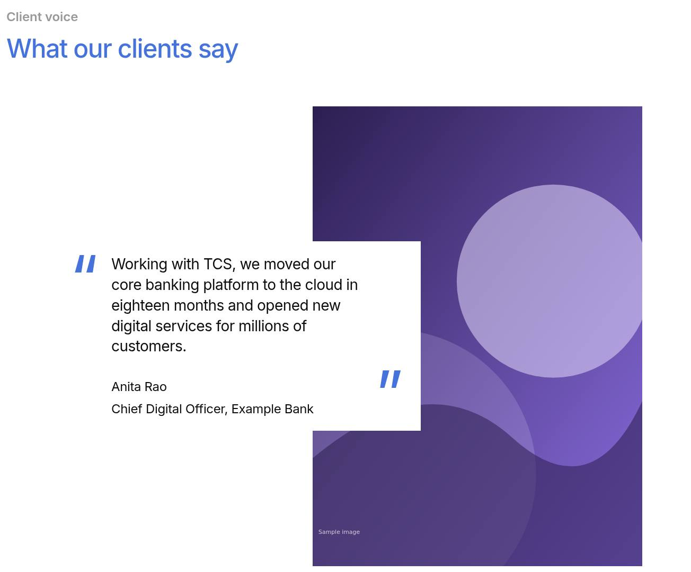
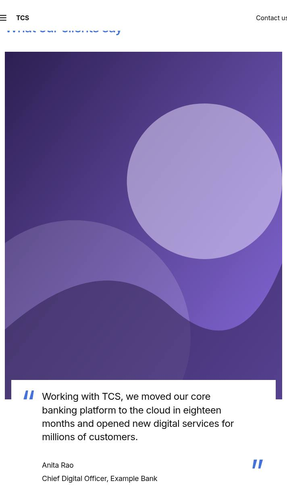
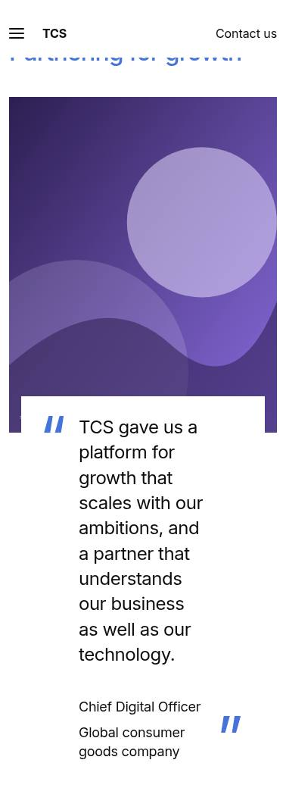
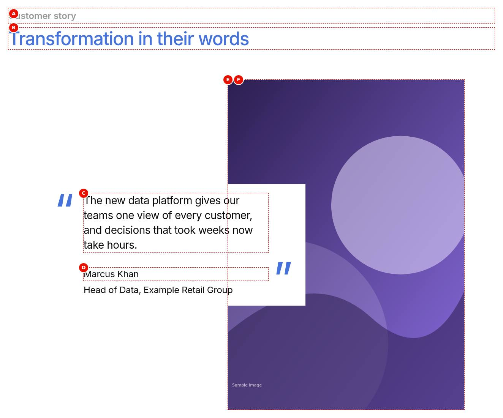
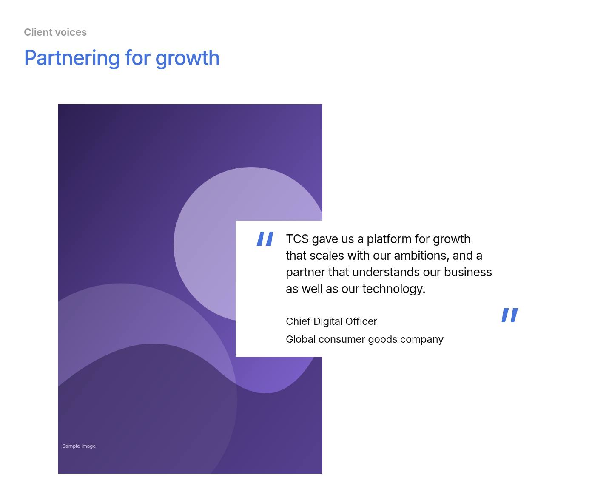
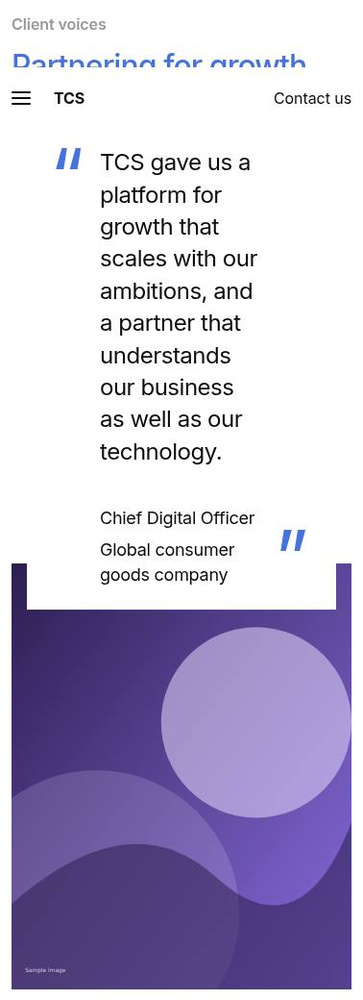
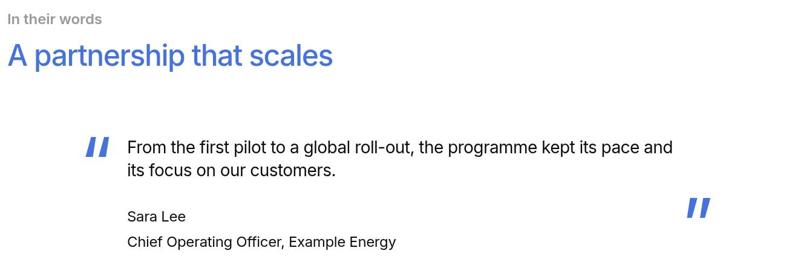
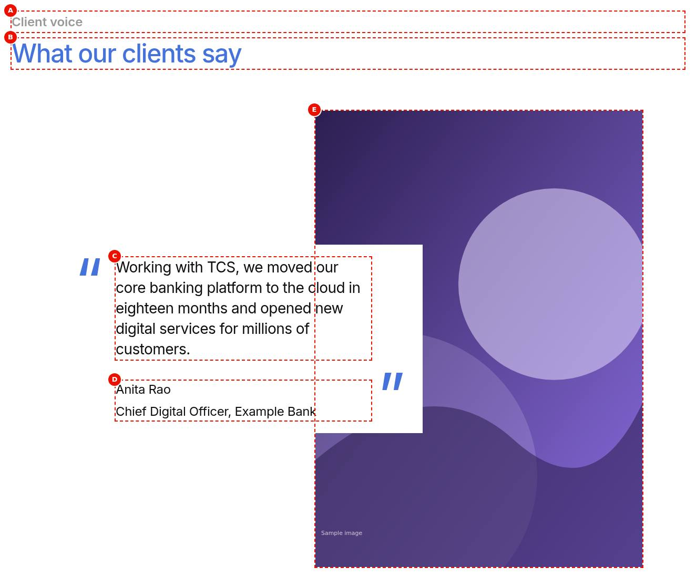
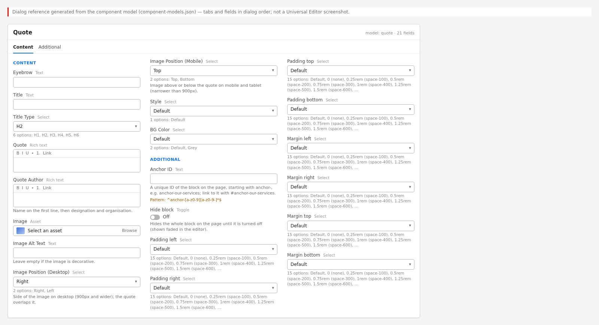
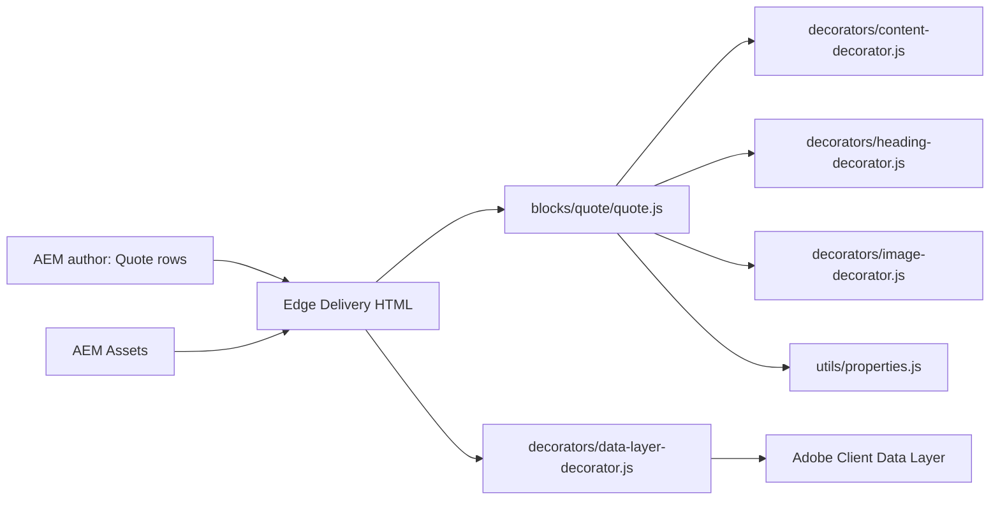

# Quote

The Quote block shows one attributed statement, for example from a client, partner or TCS leader, as a card with large brand-blue quotation marks. The card overlaps a portrait image. An optional eyebrow and title sit above it. The block implements the TCS.com Design System Figma frame "Text & Image Overlap" (2590-300067). It is a key-value block: Universal Editor stores one row per property, and `blocks/quote/quote.js` turns the rows into a header, a quote card and an image.

| Attribute | Value |
| --------- | ----- |
| Technical name | `quote` (model `quote`, template name "Quote") |
| Display name | Quote |
| Block type | Key-value block (`key-value: true`), no item children |
| Status | Active |
| Parent / children | Parents: Section, Columns Container, Tabs Container (filters `section`, `columns-container`, `tabs`). Children: none |
| Owner / version / date | Not recorded / Not recorded / Not recorded |

## Overview

- **Business purpose:** gives one voice visual weight. The statement sits next to a portrait, so it reads as a credible endorsement that is clearly attributed to a person.
- **User experience:** on desktop (900px and wider), a white card holds the quote and its author and overlaps the portrait, which sits on the right or the left. On mobile and tablet the image comes first (or last), and the card overlaps its bottom (or top) edge. With no image, the card stands on its own.
- **Templates / page types:** any page. No template adds the block.
- **Data source:** authored fields only. The block reads no sheet, placeholder, taxonomy, metadata or query index.
- **Related blocks:** Testimonial (`blocks/testimonial`) for a centred testimonial with a small round photo and stats. Teaser (`blocks/teaser`) for image and text with calls to action.
- **When to use:** a single statement deserves emphasis and should be attributed to a named person, ideally with a portrait.
- **When not to use:** to add a call to action (the block has no CTA field; use a Teaser). To show stats or several quotes in one block (use a Testimonial, or one Quote per Gen Carousel slide). For a short inline quotation in running text (use rich text).
- **Realistic use cases:** a client quote on a case study page; a leadership statement on a corporate page; a partner endorsement; a pull quote in an article.

## Visual Reference

<!-- BEGIN GENERATED: screenshots (npm run build:docs) -->

Screenshots of the handover (6.12 Quote Block), taken on the preview with sample content; they show the rendering at the time of the handover revision that added them (later changes are in the sections below and the handover's revision history):

**Desktop rendering** — The Quote at 1440 px: the grey eyebrow Client voice and the brand-blue H2 What our clients say above a white card with large blue opening and closing quote marks, holding the quote Working with TCS, we moved our core banking platform… and Anita Rao / Chief Digital Officer, Example Bank; the card on the left overlaps the portrait tall.svg on the right and is vertically centred against it.



**Tablet rendering** — The Quote at 768 px in the stacked layout: Client voice and the H2 What our clients say on top, tall.svg across the block width at 4 : 5, and the white card with 5rem quote marks, the quote and Anita Rao / Chief Digital Officer, Example Bank overlapping the image's bottom edge, inset 1rem on each side.



**Mobile rendering** — The Quote at 375 px: Client voice and What our clients say stacked, tall.svg full width at 4 : 5, and the white card with the smaller 5rem blue quote marks, the quote and Anita Rao / Chief Digital Officer, Example Bank overlapping the image's bottom edge by 3rem.



**Default variation** — The Quote at 1440 px on a white background: the eyebrow Customer story and the H2 Transformation in their words above the white card with the data platform quote and Marcus Khan / Head of Data, Example Retail Group; the card on the left overlaps the portrait tall.svg on the right.



**Image Left variation** — The Quote at 1440 px with Image Position (Desktop) Left: Partner perspective and the H2 Built on shared ambition above; the portrait tall.svg on the left and the white card with the connected factory quote and Sara Lee / VP Operations, Example Manufacturing on the right, overlapping the image's right edge.



**Image Bottom (mobile) variation** — The Quote at 375 px with Image Position (Mobile) Bottom: Client voice and What our clients say on top, then the white card with 5rem quote marks, the quote and Anita Rao / Chief Digital Officer, Example Bank, and below it tall.svg full width at 4 : 5, its top edge overlapped by the card.



**Grey background variation** — The Quote at 1440 px with BG Color Grey: the whole block and the card are light grey with 7.5rem / 5rem padding; Leadership insight and the H2 Resilience as a strategy above the card with the security quote and Marcus Khan / Chief Information Security Officer, Example Insurance, overlapping tall.svg on the right.


**Text-only variation** — The Quote at 1440 px without an image: In their words and the H2 A partnership that scales above a white card centred in the 70rem body, with the large blue quote marks around the roll-out quote and Sara Lee / Chief Operating Officer, Example Energy.



**Universal Editor canvas** — The Quote in Universal Editor edit mode at 1440 px, selected, with letters A on the eyebrow Client voice, B on the H2 What our clients say, C on the quote text, D on Anita Rao / Chief Digital Officer, Example Bank and E on the portrait tall.svg, which the card overlaps on the right. An annotated preview, not a Universal Editor screenshot. (Annotated preview in editor mode with sample content; letters as in the annotations list, not a Universal Editor screenshot; file screenshots/quote-authoring-view.jpg)



**Properties panel** — The Universal Editor properties panel of the Quote block showing the Content tab with all fields and the Additional tab header. (Dialog reference generated from the component model, not a Universal Editor screenshot; file screenshots/quote-properties-panel.jpg)



Universal Editor dialogs (no screenshot exists yet; to be captured on AEM author):

```text
[Screenshot Placeholder]

File name:
quote-dialog-content-desktop.png

Purpose:
The Content tab of the Quote properties in Universal Editor, with the fields of the table "Content tab — Quote" in Authorable Fields below.

Annotations:
A = Eyebrow
B = Title
C = Title Type
D = Quote
E = Quote Author
F = Image
G = Image Alt Text
H = Image Position (Desktop)
I = Image Position (Mobile)
J = BG Color
```

```text
[Screenshot Placeholder]

File name:
quote-dialog-additional-desktop.png

Purpose:
The Additional tab of the Quote properties in Universal Editor, with the fields of the table "Additional tab — Quote" in Authorable Fields below.

Annotations:
A = Anchor ID
B = Hide block
C = Animation Type
D = Motion Speed
E = Animation Trigger
F = Background animation
G = Padding left
H = Padding right
I = Padding top
J = Padding bottom
```

<!-- END GENERATED: screenshots -->

The states below have no screenshot yet.

```text
[Screenshot Placeholder]

File name:
quote-image-left-tablet.png

Purpose:
Image Position (Desktop) Left at 768px: below 900px the desktop side has no effect, and the image stays above the card.

Annotations:
A = Eyebrow and title
B = Image (4:5)
C = Quote card overlapping the image's bottom edge
```

```text
[Screenshot Placeholder]

File name:
quote-grey-background-mobile.png

Purpose:
BG Color Grey at 375px: the grey panel with 2.5rem / 1.5rem padding, the image and the grey card.

Annotations:
A = Grey block background
B = Image
C = Quote card
```

```text
[Screenshot Placeholder]

File name:
quote-text-only-mobile.png

Purpose:
A Quote without an image at 375px: the card with 5rem quote marks, without an overlap.

Annotations:
A = Opening quote mark
B = Quote text
C = Quote Author (figcaption)
D = Closing quote mark
```

```text
[Screenshot Placeholder]

File name:
quote-empty-editor-desktop.png

Purpose:
A Quote just added in Universal Editor with no content: nothing renders inside the block, so select it in the content tree.

Annotations:
A = The empty block in the canvas
B = The Quote node in the content tree
```

## For Content Authors

1. **Add the block.** In Universal Editor, select a Section, a Columns Container column or a Tabs Container. Choose Add (+) and pick **Quote**.
2. **Open its properties.** Select the block in the canvas or the content tree to open the properties panel. It has two tabs: Content and Additional.
3. **Enter content.** On the Content tab, fill in Eyebrow, Title, Quote and Quote Author. Put the name on the first line of Quote Author, then the designation and organisation. Don't type quotation marks: the block adds them.
4. **Add the image.** Select a portrait in Image, then write Image Alt Text, or leave it empty if the image is decorative.
5. **Choose the variation.** Set Image Position (Desktop) to Right or Left, Image Position (Mobile) to Top or Bottom, and BG Color to Default or Grey.
6. **Child items:** the Quote has none. Each Quote holds one statement.
7. **Preview.** Switch Universal Editor to Preview, then check the page at desktop width (900px and wider) and at a mobile width.
8. **Publish.** Publish the page together with the image (referenced assets in the Publish dialog).
9. **Validate.** On the published page, check the quote marks, the overlap, the alt text (browser inspector) and the heading level.

Minimum content: a Quote or a Quote Author (otherwise there is no card). Recommended: Title, Quote, Quote Author, Image and Image Alt Text. Optional: Eyebrow, BG Color, and the image positions (Right / Top by default).

## Authorable Fields

<!-- BEGIN GENERATED: fields (npm run build:docs) -->

### Quote (`quote`)

Model `quote`; template name "Quote" (the block class AEM renders); key-value block (one row per property).

Stored on a new component (definition template): `titleType` = `"h2"`, `imagePosition` = `"right"`, `imagePositionMobile` = `"top"`.

#### Content tab — Quote

| Field label | Property | Type | Required | Default | Allowed values | Author guidance | Example |
| ----------- | -------- | ---- | -------- | ------- | -------------- | --------------- | ------- |
| Eyebrow | `eyebrow` | text | No | — | — | — | Client voice |
| Title | `title` | text | No | — | — | — | What our clients say |
| Title Type | `titleType` | select | No | `h2` | H1 (`h1`), H2 (`h2`), H3 (`h3`), H4 (`h4`), H5 (`h5`), H6 (`h6`) | Delivered with `title` (field collapse). | h2 |
| Quote | `quote` | richtext | No | "" | — | — | — |
| Quote Author | `author` | richtext | No | "" | — | Name on the first line, then designation and organisation. | — |
| Image | `image` | reference | No | — | — | — | /content/dam/tcs-corp/block-library/images/tall-sample.jpg |
| Image Alt Text | `imageAlt` | text | No | — | — | Leave empty if the image is decorative. Delivered with `image` (field collapse). | Portrait of Anita Rao |
| Image Position (Desktop) | `imagePosition` | select | No | `right` | Right (`right`), Left (`left`) | Side of the image on desktop (900px and wider); the quote overlaps it. | left |
| Image Position (Mobile) | `imagePositionMobile` | select | No | `top` | Top (`top`), Bottom (`bottom`) | Image above or below the quote on mobile and tablet (narrower than 900px). | bottom |
| BG Color | `bgColor` | select | No | "" | Default (""), Grey (`grey`) | — | grey |

#### Additional tab — Quote

| Field label | Property | Type | Required | Default | Allowed values | Author guidance | Example |
| ----------- | -------- | ---- | -------- | ------- | -------------- | --------------- | ------- |
| Anchor ID | `classes_anchor` | text | No | — | regExp: ^anchor-[a-z0-9][a-z0-9-]*$; customErrorMsg: Start with anchor-, then lower-case letters, digits and hyphens. | A unique ID of the block on the page, starting with anchor-, e.g. anchor-our-services; link to it with #anchor-our-services. Delivered as a block class. | — |
| Hide block | `classes_hideblock` | boolean | No | `false` | on / off | Hides the whole block on the page until it is turned off (shown faded in the editor). Delivered as a block class. | — |
| Animation Type | `classes_animation` | select | No | "" | None (""), Fade in (`motion-fade-in`), Fade up (`motion-fade-up`), Fade down (`motion-fade-down`), Fade left (`motion-fade-left`), Fade right (`motion-fade-right`), Slide up (`motion-slide-up`), Slide down (`motion-slide-down`), Slide left (`motion-slide-left`), Slide right (`motion-slide-right`), Scale in (`motion-scale-in`) | How the block's content appears; repeated items (cards, list items, accordion items, columns) appear one after another. None: shown as is. Not played in the editor or when the visitor prefers reduced motion. Delivered as a block class. | motion-fade-in |
| Motion Speed | `classes_animationspeed` | select | No | "" | Medium (""), Fast (`motion-fast`), Slow (`motion-slow`) | How fast the block's animations run (Animation Type 0.3 / 0.6 / 0.9 s; the Background animation takes 1.5 times as long). Shown when (`classes_animation` is set and `classes_animation` is not empty) or (`classes_bganimation` is set and `classes_bganimation` is not empty). Delivered as a block class. | — |
| Animation Trigger | `classes_animationtrigger` | select | No | "" | On Scroll / Viewport Entry (""), On Page Load (`motion-on-load`) | When the block's animations run. On Scroll: when the block comes into view (at once if it is in view when the page opens). On Page Load: as soon as the block is ready, wherever it is on the page. Shown when (`classes_animation` is set and `classes_animation` is not empty) or (`classes_bganimation` is set and `classes_bganimation` is not empty). Delivered as a block class. | — |
| Background animation | `classes_bganimation` | select | No | "" | None (""), Fade in (`bg-motion-fade-in`), Reveal from the centre (`bg-motion-reveal`), Wipe left to right (`bg-motion-wipe-right`), Wipe right to left (`bg-motion-wipe-left`), Wipe bottom to top (`bg-motion-wipe-up`), Scale reveal (`bg-motion-scale`) | How the block's background (its colour, image or overlay as set in the block) appears. It doesn't animate the content: see Animation Type. Motion Speed and Animation Trigger apply to it too. Not played in the editor or when the visitor prefers reduced motion. Delivered as a block class. | bg-motion-fade-in |
| Padding left | `classes_paddingleft` | select | No | "" | Default (""), 0 (none) (`pl-0`), 0.25rem (space-100) (`pl-100`), 0.5rem (space-200) (`pl-200`), 0.75rem (space-300) (`pl-300`), 1rem (space-400) (`pl-400`), 1.25rem (space-500) (`pl-500`), 1.5rem (space-600) (`pl-600`), 2rem (space-800) (`pl-800`), 2.5rem (space-1000) (`pl-1000`), 3rem (space-1200) (`pl-1200`), 4rem (space-1600) (`pl-1600`), 5rem (space-2000) (`pl-2000`), 6rem (space-2400) (`pl-2400`), 7.5rem (space-3000) (`pl-3000`) | Delivered as a block class. | — |
| Padding right | `classes_paddingright` | select | No | "" | Default (""), 0 (none) (`pr-0`), 0.25rem (space-100) (`pr-100`), 0.5rem (space-200) (`pr-200`), 0.75rem (space-300) (`pr-300`), 1rem (space-400) (`pr-400`), 1.25rem (space-500) (`pr-500`), 1.5rem (space-600) (`pr-600`), 2rem (space-800) (`pr-800`), 2.5rem (space-1000) (`pr-1000`), 3rem (space-1200) (`pr-1200`), 4rem (space-1600) (`pr-1600`), 5rem (space-2000) (`pr-2000`), 6rem (space-2400) (`pr-2400`), 7.5rem (space-3000) (`pr-3000`) | Delivered as a block class. | — |
| Padding top | `classes_paddingtop` | select | No | "" | Default (""), 0 (none) (`pt-0`), 0.25rem (space-100) (`pt-100`), 0.5rem (space-200) (`pt-200`), 0.75rem (space-300) (`pt-300`), 1rem (space-400) (`pt-400`), 1.25rem (space-500) (`pt-500`), 1.5rem (space-600) (`pt-600`), 2rem (space-800) (`pt-800`), 2.5rem (space-1000) (`pt-1000`), 3rem (space-1200) (`pt-1200`), 4rem (space-1600) (`pt-1600`), 5rem (space-2000) (`pt-2000`), 6rem (space-2400) (`pt-2400`), 7.5rem (space-3000) (`pt-3000`) | Delivered as a block class. | — |
| Padding bottom | `classes_paddingbottom` | select | No | "" | Default (""), 0 (none) (`pb-0`), 0.25rem (space-100) (`pb-100`), 0.5rem (space-200) (`pb-200`), 0.75rem (space-300) (`pb-300`), 1rem (space-400) (`pb-400`), 1.25rem (space-500) (`pb-500`), 1.5rem (space-600) (`pb-600`), 2rem (space-800) (`pb-800`), 2.5rem (space-1000) (`pb-1000`), 3rem (space-1200) (`pb-1200`), 4rem (space-1600) (`pb-1600`), 5rem (space-2000) (`pb-2000`), 6rem (space-2400) (`pb-2400`), 7.5rem (space-3000) (`pb-3000`) | Delivered as a block class. | — |
| Margin left | `classes_marginleft` | select | No | "" | Default (""), 0 (none) (`ml-0`), 0.25rem (space-100) (`ml-100`), 0.5rem (space-200) (`ml-200`), 0.75rem (space-300) (`ml-300`), 1rem (space-400) (`ml-400`), 1.25rem (space-500) (`ml-500`), 1.5rem (space-600) (`ml-600`), 2rem (space-800) (`ml-800`), 2.5rem (space-1000) (`ml-1000`), 3rem (space-1200) (`ml-1200`), 4rem (space-1600) (`ml-1600`), 5rem (space-2000) (`ml-2000`), 6rem (space-2400) (`ml-2400`), 7.5rem (space-3000) (`ml-3000`) | Delivered as a block class. | — |
| Margin right | `classes_marginright` | select | No | "" | Default (""), 0 (none) (`mr-0`), 0.25rem (space-100) (`mr-100`), 0.5rem (space-200) (`mr-200`), 0.75rem (space-300) (`mr-300`), 1rem (space-400) (`mr-400`), 1.25rem (space-500) (`mr-500`), 1.5rem (space-600) (`mr-600`), 2rem (space-800) (`mr-800`), 2.5rem (space-1000) (`mr-1000`), 3rem (space-1200) (`mr-1200`), 4rem (space-1600) (`mr-1600`), 5rem (space-2000) (`mr-2000`), 6rem (space-2400) (`mr-2400`), 7.5rem (space-3000) (`mr-3000`) | Delivered as a block class. | — |
| Margin top | `classes_margintop` | select | No | "" | Default (""), 0 (none) (`mt-0`), 0.25rem (space-100) (`mt-100`), 0.5rem (space-200) (`mt-200`), 0.75rem (space-300) (`mt-300`), 1rem (space-400) (`mt-400`), 1.25rem (space-500) (`mt-500`), 1.5rem (space-600) (`mt-600`), 2rem (space-800) (`mt-800`), 2.5rem (space-1000) (`mt-1000`), 3rem (space-1200) (`mt-1200`), 4rem (space-1600) (`mt-1600`), 5rem (space-2000) (`mt-2000`), 6rem (space-2400) (`mt-2400`), 7.5rem (space-3000) (`mt-3000`) | Delivered as a block class. | — |
| Margin bottom | `classes_marginbottom` | select | No | "" | Default (""), 0 (none) (`mb-0`), 0.25rem (space-100) (`mb-100`), 0.5rem (space-200) (`mb-200`), 0.75rem (space-300) (`mb-300`), 1rem (space-400) (`mb-400`), 1.25rem (space-500) (`mb-500`), 1.5rem (space-600) (`mb-600`), 2rem (space-800) (`mb-800`), 2.5rem (space-1000) (`mb-1000`), 3rem (space-1200) (`mb-1200`), 4rem (space-1600) (`mb-1600`), 5rem (space-2000) (`mb-2000`), 6rem (space-2400) (`mb-2400`), 7.5rem (space-3000) (`mb-3000`) | Delivered as a block class. | — |

<!-- END GENERATED: fields -->

Notes on the significant fields (see the tables above for labels, values and defaults):

- **Title / Title Type:** the title renders as a heading at the Title Type level. Without a Title Type, it uses a heading level found in the authored title, else H2 (`buildHeading`). The heading becomes the block's `dc:title` in the data layer.
- **Quote:** renders as a `<blockquote>`. **Quote Author** renders as the `<figcaption>`, and both sit in a `<figure>`. The quotation marks are CSS content with empty alternative text, so screen readers don't read them.
- **Image / Image Alt Text:** the picture comes from the image cell. Image Alt Text replaces its alt, and an image without alt text gets `alt=""` (decorative). Without a picture, the block doesn't get `quote-has-media`, so there is no overlap.
- **Image Position (Desktop):** Left adds `image-left` and only takes effect from 900px. **Image Position (Mobile):** Bottom adds `image-bottom` and only takes effect below 900px. A missing or unknown value means Right / Top.
- **BG Color:** Grey adds `bg-grey`: a grey block and card with their own padding (see Responsive Behavior). Unlike the Teaser's BG Color, this one adds padding.
- **Legacy mapping:** the select values are also read from block classes (`optionOf`), so a `grey`, `left` or `bottom` class has the same effect as the field. The Style field was removed in handover 2.27; the block doesn't read it.
- **Additional tab:** Anchor ID, Hide block, the animations and Padding / Margin, as described in AGENTS.md "Additional tab". Background animation applies to the block's background colour (white by default, grey with BG Color Grey). The Additional tab's padding classes override the Grey padding.

## Screenshot-Based Authoring Steps

### Authoring Step 1: Add the Quote

```text
[Screenshot Placeholder]

File name:
quote-authoring-step-1.png

Purpose:
The section's Add (+) menu with Quote selected.

Annotations:
A = Section in the content tree
B = Add (+)
C = Quote
```

### Values to Enter

| Callout | Field | Value | Reason | Expected result |
| ------- | ----- | ----- | ------ | --------------- |
| A | (content tree) | Select the section | The Quote is allowed in sections | The section is selected |
| B | Add (+) | Quote | Adds the block | An empty Quote appears; nothing renders yet |

Author action: select the section, choose Add (+) and pick Quote. Expected preview: an empty block (it renders nothing until it has content). Expected published result: nothing until content is added. Business rule: one statement per Quote. Validation: the Quote node appears in the content tree. Common mistake: looking for the block in a Teaser or a List; it is only offered in sections, Columns Container columns and Tabs Containers.

### Authoring Step 2: Eyebrow and title

```text
[Screenshot Placeholder]

File name:
quote-authoring-step-2.png

Purpose:
The Content tab with Eyebrow, Title and Title Type filled in.

Annotations:
A = Eyebrow
B = Title
C = Title Type
```

### Values to Enter

| Callout | Field | Value | Reason | Expected result |
| ------- | ----- | ----- | ------ | --------------- |
| A | Eyebrow | Client voice | Context above the title | Grey semibold label |
| B | Title | What our clients say | Section heading | Brand-blue heading |
| C | Title Type | H2 | Fits under the page's H1 | An `<h2>` |

Author action: type the eyebrow and title, and keep Title Type H2 unless the page outline needs another level. Expected preview: the eyebrow and title above the body. Expected published result: the same, with the title as a real heading. Business rule: use one H1 per page. Validation: inspect the heading level. Common mistake: choosing H1 for a quote in the middle of a page; change it to H2 or H3.

### Authoring Step 3: The quote and its author

```text
[Screenshot Placeholder]

File name:
quote-authoring-step-3.png

Purpose:
The Quote and Quote Author rich text fields filled in.

Annotations:
A = Quote
B = Quote Author (two lines)
```

### Values to Enter

| Callout | Field | Value | Reason | Expected result |
| ------- | ----- | ----- | ------ | --------------- |
| A | Quote | Working with TCS, we moved our core banking platform to the cloud in eighteen months and opened new digital services for millions of customers. | The statement | The text inside large blue quote marks |
| B | Quote Author | Anita Rao (line 1), Chief Digital Officer, Example Bank (line 2) | Attribution | Two lines below the quote |

Author action: type the quote without quotation marks, then the author on two lines (two paragraphs). Expected preview: the card with the opening and closing marks. Expected published result: a `<blockquote>` and a `<figcaption>` in a `<figure>`. Business rule: keep the wording approved by the person quoted. Validation: only the large blue marks are visible. Common mistake: typing quotation marks, which shows them twice; remove them.

### Authoring Step 4: Image and positions

```text
[Screenshot Placeholder]

File name:
quote-authoring-step-4.png

Purpose:
Image, Image Alt Text, Image Position (Desktop) and Image Position (Mobile) set.

Annotations:
A = Image
B = Image Alt Text
C = Image Position (Desktop)
D = Image Position (Mobile)
```

### Values to Enter

| Callout | Field | Value | Reason | Expected result |
| ------- | ----- | ----- | ------ | --------------- |
| A | Image | /content/dam/tcs-corp/block-library/images/tall-sample.jpg | The portrait the card overlaps | The block gets `quote-has-media` |
| B | Image Alt Text | Portrait of Anita Rao | Describes the image | The image's alt |
| C | Image Position (Desktop) | Left | Mirror the layout | Image on the left from 900px |
| D | Image Position (Mobile) | Bottom | Lead with the quote on small screens | Image below the card below 900px |

Author action: select the portrait, write the alt text, and choose the positions. Expected preview: at 900px and wider, the image is on the chosen side and the card overlaps it; below 900px, the image is above or below the card. Expected published result: the same; the image must be published with the page. Business rule: use a portrait image with the face in the upper-middle area (4:5 on mobile, 622:869 on desktop, cropped). Validation: check at 375px, 768px and 1440px. Common mistake: expecting Left to apply on a tablet; it only applies from 900px.

### Authoring Step 5: BG Color and publishing

```text
[Screenshot Placeholder]

File name:
quote-authoring-step-5.png

Purpose:
BG Color Grey selected and the Publish dialog listing the page and its image.

Annotations:
A = BG Color
B = Publish dialog with the referenced image
```

### Values to Enter

| Callout | Field | Value | Reason | Expected result |
| ------- | ----- | ----- | ------ | --------------- |
| A | BG Color | Grey | Set the quote apart from the page | Grey block and card with padding |
| B | Publish | Page and referenced assets | The image must be live too | The published page shows the portrait |

Author action: choose Grey, preview, then publish the page with its references. Expected preview: a grey panel. Expected published result: the grey Quote with the portrait. Business rule: Default or Grey only. Validation: open the published page and check the image loads. Common mistake: publishing the page without the image, so the card renders without the portrait.

## Variations

### Default (image right, image top on mobile)

- **Purpose:** the standard overlap layout. **When to use:** most quotes with a portrait. **When not to use:** without a portrait (see Text only).
- **Fields:** Quote or Quote Author (required for the card), Image (for the overlap); Eyebrow, Title, Image Alt Text are optional. **Dialog configuration:** none beyond the defaults (Right / Top).
- **Rendering:** desktop (900px and wider): a 498 : 204 : 418 grid, up to 70rem wide; the card spans the first two columns and the image the last two, so they overlap. Tablet and mobile: the image first, at 4:5, and the card overlapping its bottom edge by 3rem, inset 1rem.
- **Accessibility:** reading order header, card, image (the image is placed first visually below 900px by CSS order only). **Data layer:** the block entry only. **Personalization and fallback:** none; the authored content renders.

```text
[Screenshot Placeholder]

File name:
quote-default-tablet.png

Purpose:
The default Quote at 768px: image first, card overlapping its bottom edge.

Annotations:
A = Header
B = Image
C = Card
```

### Image Left (desktop)

- **Purpose:** a mirrored layout, for example to alternate with a neighbouring block. **Configuration:** Image Position (Desktop) Left (class `image-left`).
- **Rendering:** from 900px the grid is 418 : 204 : 498, with the image on the left and the card overlapping its right edge. Below 900px it is the same as Default.
- **Accessibility, data layer, personalization:** as Default.

```text
[Screenshot Placeholder]

File name:
quote-image-left-mobile.png

Purpose:
Image Position (Desktop) Left at 375px: the same stacked layout as Default.

Annotations:
A = Image
B = Card
```

### Image Bottom (mobile and tablet)

- **Purpose:** lead with the quote on small screens. **Configuration:** Image Position (Mobile) Bottom (class `image-bottom`).
- **Rendering:** below 900px the image moves below the card, and the card overlaps its top edge by 3rem. From 900px it has no effect.
- **Accessibility, data layer, personalization:** as Default.

```text
[Screenshot Placeholder]

File name:
quote-image-bottom-tablet.png

Purpose:
Image Position (Mobile) Bottom at 768px: the card first, the image below it.

Annotations:
A = Card
B = Image
```

### Grey background

- **Purpose:** set the quote apart from white content. **Configuration:** BG Color Grey (class `bg-grey`).
- **Rendering:** the block and the card are grey (`--color-bg-secondary`), with 2.5rem / 1.5rem padding, and 7.5rem / 5rem from 900px.
- **Accessibility:** the text keeps the default text tokens. **Data layer, personalization:** as Default.

```text
[Screenshot Placeholder]

File name:
quote-grey-background-tablet.png

Purpose:
BG Color Grey at 768px.

Annotations:
A = Grey padding
B = Card
```

### Text only (no image)

- **Purpose:** a pull quote without a portrait. **Configuration:** leave Image empty.
- **Rendering:** no `quote-has-media`; the card stands alone, centred in the 70rem body from 900px, with the same quote marks.
- **Accessibility, data layer, personalization:** as Default.

```text
[Screenshot Placeholder]

File name:
quote-text-only-tablet.png

Purpose:
A Quote without an image at 768px.

Annotations:
A = Card without overlap
```

## Complete Authoring Example

Scenario: a client quote on an English case study page.

| Field | Example value | Guidance |
| ----- | ------------- | -------- |
| Eyebrow | Client voice | A few words of context |
| Title | What our clients say | Short and descriptive |
| Title Type | H2 | Fits under the page's H1 |
| Quote | Working with TCS, we moved our core banking platform to the cloud in eighteen months and opened new digital services for millions of customers. | No typed quotation marks |
| Quote Author | Anita Rao / Chief Digital Officer, Example Bank (two lines) | Name first |
| Image | /content/dam/tcs-corp/block-library/images/tall-sample.jpg | Portrait |
| Image Alt Text | Portrait of Anita Rao | Identifies the person |
| Image Position (Desktop) | Right | Default |
| Image Position (Mobile) | Top | Default |
| BG Color | Default | White |

Steps: add the Quote to the section, fill in the Content tab as above, preview at 1440px and 375px, then publish the page with the image.

- **Expected output:** the eyebrow and H2 above a white card with blue quote marks, which overlaps the portrait on the right.
- **Responsive:** from 900px, the overlap grid; below it, the image on top and the card overlapping its bottom edge.
- **Accessibility:** an `<h2>`, then a `<figure>` with `<blockquote>` and `<figcaption>`, and an image with alt text.
- **Analytics / data layer:** a `tcs-corp/components/quote` entry with `dc:title` "What our clients say".
- **Personalization fallback:** none; this content is what every visitor sees.

Pre-publish checklist: no typed quotation marks; the author name is spelled as approved; the alt text is set (or deliberately empty); the image is published; the heading level fits the page; checked at desktop and mobile widths.

## Content and Asset Guidelines

- **Eyebrow:** a few words of context (for example "Client voice"). **Title:** a short, descriptive heading.
- **Quote:** the approved statement only, without quotation marks. **Quote Author:** the name on the first line, then the designation and organisation.
- **Links / CTAs:** the block has no CTA field. A link in the rich text is rendered by the page's content decorators: a standalone link in its own paragraph becomes a button (`decorators/content-buttons-decorator.js`).
- **Images and alt text:** use portrait images. They are cropped with `object-fit: cover` to 4:5 below 900px and to 622:869 from 900px. Alt text identifies the person; leave it empty only if the image adds nothing.
- **Icons, tags and metadata:** none.
- **Limits:** no verified technical limit was identified for text length; the block holds one quote.
- **Asset source:** AEM Assets. **Loading:** the block keeps the delivered picture (lazy by default). In the first section, the page loader makes the first image eager (`waitForFirstImage`).
- **Missing asset:** without a picture, the card renders without the image and without the overlap.

## Accessibility

- **Semantic HTML:** the title is a real heading. The quote and its author are a `<figure>` with a `<blockquote>` and a `<figcaption>` as its direct child. The quotation marks are decorative SVG backgrounds of empty `::before` / `::after` boxes (`icons/quote-open.svg`, `icons/quote-close.svg`), so screen readers don't announce them.
- **Headings:** Title Type sets the level; pick the one that fits the page outline.
- **Keyboard and focus:** the block adds no interactive elements. Links inside the rich text keep the site's focus styles.
- **Alt text:** Image Alt Text, else `alt=""` (decorative).
- **Reduced motion:** the Additional tab's animations don't play for visitors who prefer reduced motion or in the editor.
- **Contrast:** text uses the default text and brand tokens on a white or grey card.
- **Reflow:** the layout stacks below 900px.
- **Empty states:** parts without content aren't rendered; an empty block renders nothing.

Author responsibilities: choose the heading level, write meaningful alt text, don't type quotation marks, and keep link text descriptive.

Developer responsibilities: keep the `figure` / `blockquote` / `figcaption` structure and the hidden quote-mark text, and keep the reading order (card before image in the DOM).

The block handles no keys itself; links in the rich text behave as normal links.

## Data Layer and Analytics

- **Component:** `decorators/data-layer-decorator.js` (`trackBlocks`) adds the block once the sections have loaded: `@type` `tcs-corp/components/quote`, id = the block's id (Anchor ID) else `quote-{n}` (`data-cmp-id`), `parentId` (the page or the enclosing block), `dc:title` = the first heading.
- **Variation:** not recorded in the data layer.
- **Item positions:** none (no items).
- **Interactions:** the block sets no `data-cmp-*` attributes and pushes no events itself. Clicks on links in the quote or author text are captured centrally.

| Trigger | Data-layer event | Required properties | Analytics behavior |
| ------- | ---------------- | ------------------- | ------------------ |
| Block decorated and sections loaded | component state (`component.{id}`) | `@type`, `parentId`, `dc:title` | Component inventory of the page |
| Click on a link in the Quote or Quote Author | `cmp:click` | `interaction` (`link`), `dc:title`, `xdm:linkURL`, `xdm:linkType`, `breakpoint` | Link click attributed to the Quote |

The intended path is Adobe Client Data Layer, then Adobe Data Collection (Tags), the AEP Web SDK, the Edge Network, and finally Analytics / CJA. Tags and the Web SDK aren't configured yet (blocked: measurement plan). No consent mechanism is implemented.

## Personalization

This block does not currently expose verified personalization behavior. The repository has no Adobe Target or AJO integration, and the authored content is what renders for every visitor.

## Responsive Behavior

| Viewport | Layout | Image behavior | Interaction behavior |
| -------- | ------ | -------------- | -------------------- |
| Below 900px (mobile, tablet) | Header, then image and card stacked; the card overlaps the image by 3rem and is inset 1rem; Grey padding 2.5rem / 1.5rem; quote marks 1.9167rem x 3.8333rem | 4:5 crop, full width; first (Top) or last (Bottom, `image-bottom`) | None |
| 900px and wider (desktop) | Body up to 70rem, centred; with an image, a 498 : 204 : 418 grid (418 : 204 : 498 with `image-left`) with the card overlapping the image; Grey padding 7.5rem / 5rem; quote marks 2.875rem x 5.75rem | 622:869 crop; right or left | None |

## For Developers

<!-- BEGIN GENERATED: files (npm run build:docs) -->

```text
blocks/quote/
├── README.md
├── _quote.json
├── quote.css
└── quote.js
```

| Decorator/Utility | Purpose | Execution or dependency point |
| ----------------- | ------- | ----------------------------- |
| [`decorators/content-decorator.js`](../../decorators/content-decorator.js) | `fromCell` (property content into an element, keeping editor instrumentation) | `quote.js`: { fromCell } |
| [`decorators/heading-decorator.js`](../../decorators/heading-decorator.js) | `buildHeading` (Title + Title Type), `HEADINGS` | `quote.js`: { buildHeading } |
| [`decorators/image-decorator.js`](../../decorators/image-decorator.js) | `pictureOf` (image with its alt text field) | `quote.js`: { pictureOf } |
| [`utils/properties.js`](../../utils/properties.js) | `readProperties`, `textOf`, `isOn`, `isOnByDefault` (a toggle that defaults to on), `optionOf`, `normalizeKey`, `textSource` (key-value block properties) | `quote.js`: { optionOf, readProperties, textOf } |

<!-- END GENERATED: files -->

- **JavaScript (`quote.js`):** a synchronous `decorate(block)`. It reads the rows with `readProperties` and resolves BG Color, Image Position (Desktop) and Image Position (Mobile) with `optionOf` (row value, else a matching block class). It then builds the header, the card and the media, and replaces the block's children.
- **CSS (`quote.css`):** the stacked layout, the 900px overlap grid, the quote marks as `::before` / `::after` of `.quote-card`, and the Grey colours and padding.
- **Input DOM:** key-value rows `<div><div>name</div><div>value</div></div>` for `eyebrow`, `title`, `titleType`, `quote`, `author`, `image` (with `imageAlt`; with field collapse the alt may arrive in the image cell), `imagePosition`, `imagePositionMobile` and `bgColor`. The `classes_*` fields arrive as block classes.
- **Rendered DOM:**

```html
<div class="quote block quote-has-media image-left bg-grey">
  <div class="quote-header">
    <p class="quote-eyebrow">…</p>
    <h2 class="quote-title">…</h2>
  </div>
  <div class="quote-body">
    <div class="quote-card">
      <figure class="quote-card-text">
        <blockquote class="quote-text">…</blockquote>
        <figcaption class="quote-author">…</figcaption>
      </figure>
    </div>
    <div class="quote-media"><picture>…</picture></div>
  </div>
</div>
```

- **Block classes set by the code:** `bg-grey` (removed first, then re-added), `quote-has-media`, `image-left`, `image-bottom` (toggled on each decoration).
- **Decoration flow:** read the properties, build the header (eyebrow `fromCell`, title `buildHeading`), build the card (only children with text), add the picture (`pictureOf`), set the classes, `replaceChildren`. Parts without content are left out.
- **Events and async behavior:** none; no network requests.
- **Error handling:** no try / catch in the block. Missing cells give empty parts.
- **Exports:** the default `decorate` only.
- **Editor:** `fromCell`, `buildHeading` and `pictureOf` move the Universal Editor instrumentation to the rendered elements, so in-place editing keeps working.
- **Data-layer hooks:** none in the block (see Data Layer and Analytics).
- **Motion:** `decorators/motion-decorator.js` animates the block's direct children (`quote: { targets: ':scope > *' }`) and its background colour (`BACKGROUNDS.quote`).

## Extending the Block

1. **Add a field or value** in `blocks/quote/_quote.json` (keep at most three short tabs, with Additional last). Then run `npm run build:json` and `npm run lint`.
2. **Respect the delivery rules:** don't end a field name that must be read in Text, Title, Type, Alt or MimeType (field collapse); don't use grouped (`prefix_name`) fields in this key-value block; put options that should become classes in `classes_*` fields; no sample content in the definition template.
3. **Map it to rendering** in `quote.js` (read with `readProperties` / `optionOf`) and style it in `quote.css`, scoped to `.quote`, mobile first, with `min-width` media queries and rem sizes.
4. **Responsive and accessibility:** keep the figure structure, the hidden quote marks and the DOM order.
5. **Data layer:** describe new interactive elements with `data-cmp-interaction` / `data-cmp-value`; the central decorator captures their clicks.
6. **Tests:** `test/motion/motion.test.mjs` checks the Additional tab fields of every model (the Quote is a background block). Add unit tests for any new pure logic.
7. **Backward compatibility:** keep reading the existing property names and the class fallbacks (`optionOf`).
8. **Library and docs:** add an example to the block library page `block-library/quote/quote-variations`, then regenerate this README with `npm run build:docs`. Run `npm run build:modules` after changing imports.

## For Site Administrators

- **Availability:** offered in the `section`, `columns-container` and `tabs` filters (`component-filters.json`).
- **Governance:** the model is in `blocks/quote/_quote.json`, aggregated into `component-models.json`, `component-definition.json` and `component-filters.json` by `npm run build:json`.
- **Allowed children:** none.
- **Publishing dependencies:** the portrait in AEM Assets must be published with the page. No fragments, sheets, placeholder keys, taxonomy or query index are used.
- **Localization:** the text is authored per locale site; translate the eyebrow, title, quote and designation, and keep the person's name as approved.

| Dependency | Purpose | Location | Impact if unavailable |
| ---------- | ------- | -------- | --------------------- |
| Portrait image | The image the card overlaps | AEM Assets (`/content/dam/...`) | The card renders alone, without the overlap |
| Quote model and filters | Dialog and placement | `blocks/quote/_quote.json`, `component-*.json` | The block can't be added or edited |
| Block options and motion | Additional tab | `decorators/block-options-decorator.js`, `decorators/motion-decorator.js`, `styles/styles.css` | Anchor, hide, spacing or animation don't apply |

Deprecation: the Quote / Testimonial Style field was removed in handover 2.27.

## For Architects

- **Role:** a presentational, authored-content block with no data source.
- **Content model:** a key-value block, with one row per property and no children.
- **Rendering:** client-side decoration of the delivered rows. The text is in the delivered HTML.
- **Dependencies:** `decorators/content-decorator.js`, `decorators/heading-decorator.js`, `decorators/image-decorator.js`, `utils/properties.js`; global block options, motion and data-layer decorators.
- **Data layer / Web SDK / Target:** a component entry and central click capture only. Tags, the Web SDK and Target aren't integrated.
- **Consent and identity:** none.
- **Caching:** part of the page HTML on the Edge Delivery CDN.
- **Performance:** synchronous, no requests. Its modules are preloaded from `scripts/module-graph.js`.
- **Security:** authored content only. No HTML is injected from external sources.
- **Scalability:** many instances per page are independent.



## For QA and Support Teams

| Test ID | Scenario | Configuration | Expected result |
| ------- | -------- | ------------- | --------------- |
| QUOTE-QA-01 | Default | Eyebrow, Title, Quote, Quote Author, Image, Image Alt Text | Overlap on the right from 900px; image above the card below 900px |
| QUOTE-QA-02 | Image Left | Image Position (Desktop) Left | Image on the left from 900px; unchanged below 900px |
| QUOTE-QA-03 | Image Bottom | Image Position (Mobile) Bottom | Image below the card below 900px; unchanged from 900px |
| QUOTE-QA-04 | Grey background | BG Color Grey | Grey block and card, 2.5rem / 1.5rem padding, 7.5rem / 5rem from 900px |
| QUOTE-QA-05 | Text only | No Image | No `quote-has-media`; the card alone |
| QUOTE-QA-06 | Missing content | Only a Title | Header only, no body |
| QUOTE-QA-07 | Decorative image | Image without alt text | `alt=""` |
| QUOTE-QA-08 | Heading level | Title Type H3 | An `<h3 class="quote-title">` |
| QUOTE-QA-09 | Multiple instances | Two Quotes on one page | Each decorates independently; data-layer ids `quote-1`, `quote-2` (or their Anchor IDs) |
| QUOTE-QA-10 | Viewports | 375 / 768 / 1440px | Stacked below 900px, grid from 900px |
| QUOTE-QA-11 | Keyboard | Link in the Quote Author | Reachable with Tab, visible focus |
| QUOTE-QA-12 | Data layer | Load the page | `component.{id}` with `@type` `tcs-corp/components/quote`; a click on a link pushes `cmp:click` |
| QUOTE-QA-13 | Dark Section | Quote inside a Section with Style Dark | Check the contrast of the white card's text (the theme contract turns text tokens light) |
| QUOTE-QA-14 | Existing content | Quotes authored before (with block classes `grey`, `left`, `bottom`) | Rendered as the matching field values |

## Troubleshooting

| Symptom | Likely cause | Diagnostic steps | Resolution | Verification |
| ------- | ------------ | ---------------- | ---------- | ------------ |
| The card doesn't overlap the image | No picture in Image (empty or broken reference) | Inspect the block: no `quote-has-media`, no `.quote-media` | Select the image again and publish it with the page | The block has `quote-has-media` |
| Image Position has no effect | Checked at the wrong width (Left from 900px, Bottom below 900px), or no image | Check the classes `image-left` / `image-bottom` and the viewport width | Resize past / below 900px; set an image | The image moves at the right widths |
| Double quotation marks | Marks typed in the Quote | Read the Quote rich text | Remove the typed marks | Only the blue marks remain |
| The face is cut off | 4:5 / 622:869 cover crop | Compare the image's proportions | Use a portrait with the face in the upper-middle area | Check at 375 / 768 / 1440px |
| The block is empty | No Quote, Quote Author, Title, Eyebrow or Image | Inspect the rows in the editor | Fill in the content | The card renders |
| Wrong heading level | Title Type | Inspect the title element | Set Title Type | The expected `h1`–`h6` |

Evidence to collect: the page URL (preview or live), viewport width, browser, a screenshot, and the block's outer HTML from the inspector. Don't include credentials or author session data.

## Performance Considerations

- **Initialization:** synchronous decoration without network requests, in the eager phase when the block is in the first section, else lazily with its section.
- **Images:** the authored, optimized picture; lazy, except the first section's first image (`waitForFirstImage`).
- **Dynamic imports:** none in the block. Its modules are preloaded (`scripts/module-graph.js`).
- **DOM size:** a handful of elements. No listeners or observers in the block (the motion decorator observes animated blocks only).
- **Layout shift:** the image has a fixed aspect ratio (4:5, 622:869), so its box is reserved.
- **High-cost configurations:** an animation in the first section delays the paint of its content (handover F-94: Content animation also delays the text paint). Use the animations below the fold.

## Security and Privacy

- **Links:** authored links are used as delivered; the block adds none.
- **Sanitization:** the block moves the delivered DOM nodes; it builds no HTML from strings.
- **External content:** none. **Query strings:** not read.
- **Data minimization:** no personal data is collected. The data layer records the title and clicked link text and URL only.

## Known Limitations

| Limitation | Impact | Workaround | Planned correction |
| ---------- | ------ | ---------- | ------------------ |
| No CTA field | A quote can't carry a styled call to action | Put a link in its own paragraph in the Quote or Quote Author (it becomes a button), or add a Teaser or Button below | Not planned |
| Image Position (Desktop) applies only from 900px and Image Position (Mobile) only below 900px | Authors checking the wrong width see no change | Validate both widths in preview | Not planned |
| Fixed cover crops (4:5, 622:869) | Landscape or tight images lose their edges | Use portrait images with space around the face | Not planned |

## Related Documentation

- [Blocks documentation](../README.md)
- [Testimonial](../testimonial/README.md) and [Teaser](../teaser/README.md)
- [Model: `_quote.json`](_quote.json)
- [Motion tests](../../test/motion/motion.test.mjs)
- [Animation and skeletons](../../docs/animation/README.md)
- [Handover 6.12 Quote Block](../../docs/handover/TCS-CORP-HANDOVER.md)

<!-- BEGIN GENERATED: usage (npm run build:docs) -->

Pages of the block library package 1.0.13 (language master, `/content/tcs-corp/language-master/en`) that contain the block, 12 instance(s) in total:
- Block library: `block-library/animation/background-by-block`, `block-library/columns-container/columns-of-blocks`, `block-library/quote/quote-variations`
- Curated design pages: `curated-design-pages/insights`, `curated-design-pages/who-we-are`

Project-wide standards: [knowledge base](../../docs/handover/knowledge-base/README.md) ([block governance](../../docs/handover/knowledge-base/blocks.md)).

<!-- END GENERATED: usage -->

## Change History

| Version | Change | Source | Date |
| ------- | ------ | ------ | ---- |
| Not recorded | README generated from verified implementation and approved handover documentation | Repository review | Not recorded |
| Handover 2.18 | Background animation and Content animation on the Additional tab (Quote among the background blocks) | docs/handover revision history | 18 October 2026 |
| Handover 2.27 | Block ecosystem audit: the Quote / Testimonial Style field removed | docs/handover revision history | 19 October 2026 |
