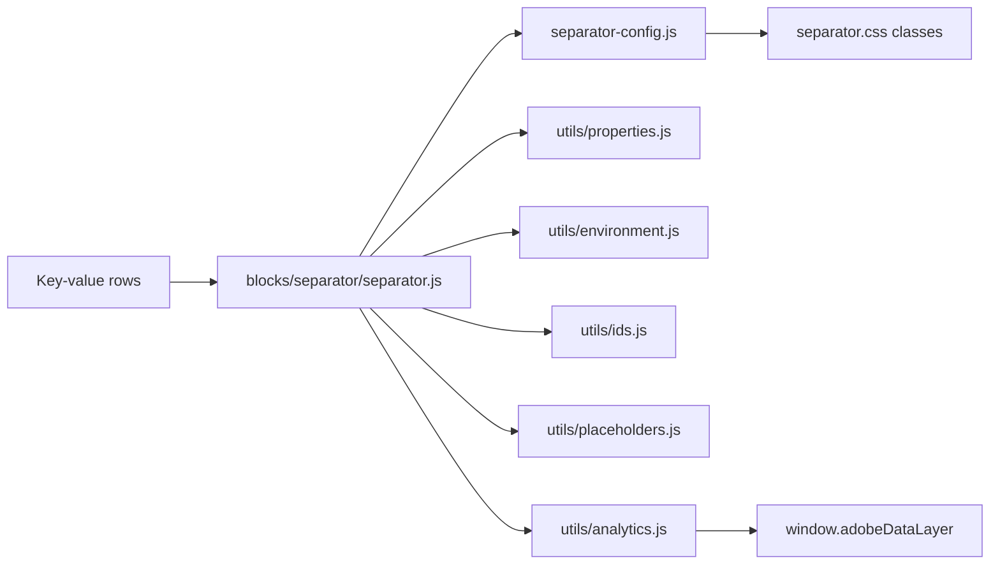

# Separator

The AEM Core Components **Separator** for Edge Delivery Services (xwalk / Universal Editor): a horizontal division between content, rendered as one native `<hr>`, with design-system variants, themes, widths, alignment, decorations, spacing and separate desktop / tablet / mobile settings. It is either a semantic thematic break or a purely decorative line, and can be spacing only.

| Attribute | Value |
| --------- | ----- |
| Technical name | `separator` (template name "Separator", resource type `core/franklin/components/block/v1/block`) |
| Display name | Separator |
| Block type | Independent block, key-value (one row per property), no items |
| Status | Active |
| Parent / children | Added to a Section, a Columns Container column or a Tabs Container (filters `section` in `models/_section.json`, `columns-container`, `tabs`); no children |
| Owner / version / date | Owner: Not recorded; version: 1.0 (handover 6.26.8); date: Not recorded |

## Overview

**Business purpose.** Structure long pages visually and semantically with one consistent, design-system-controlled divider that authors configure without CSS, that is accessible (semantic thematic break or decorative) and that never breaks the layout on any device.

**User experience.** Visitors see a line (solid, dashed, dotted or gradient) of a chosen colour, thickness and width, optionally with a dot, square or diamond at its start, centre or end, with space above and below. Screen reader users hear a separator only when it is Semantic.

**Templates / page types.** Any page, any section that offers it.

**Data source.** Its own settings only; no metadata, tags, sheets or index. Placeholders are read only in Universal Editor, for the editor notes.

**Related blocks.** Sections (spacing; Theme Auto follows the `dark` / `brand` section classes), [List](../list/README.md) and [Cards](../cards/README.md) (their own dividers), the Table block, the Anchor List (in-page navigation by Anchor ID), [Columns Container](../columns-container/README.md) (a desktop-only divider between columns).

**When to use.** The topic changes within a section (Accessibility mode **Semantic**); a visual division between content of the same topic helps scanning (**Decorative**, the default).

**When not to use.** Only to add space when the section spacing is enough (or deliberately use Line style None with spacing); to separate items of a list, cards or table rows (those blocks have their own dividers); several in a row; as a heading replacement (a separator doesn't name the next section).

**Realistic use cases.**

| Purpose | Settings |
| ------- | -------- |
| Between two stories | Semantic, Accessible label "End of the story", Default |
| A light rule under a section intro | Decorative, Subtle, 50%, Center |
| A brand accent under a title | Decorative, Branded, 25%, Start, Desktop top spacing None |
| Edge-to-edge in a section | Variant Full width (or Separator width Full bleed) |
| A desktop-only divider of two columns | Show on tablet and Show on mobile off |
| A decorated chapter break | Semantic, Line thickness Medium, 50%, Center, Center decoration Diamond |
| Space only | Decorative, Line style None, Desktop top spacing XL |

## Visual Reference

<!-- BEGIN GENERATED: screenshots (npm run build:docs) -->

Screenshots of the handover (6.26 Separator Block), taken on the preview with sample content; they show the rendering at the time of the handover revision that added them (later changes are in the sections below and the handover's revision history):

| Screenshot | Shows |
| ---------- | ----- |
| [Desktop rendering](../../docs/handover/screenshots/separator-desktop-view.jpg) | The section at 1440 px: a paragraph, a Default separator (solid 1px slate 400 line across the 1280 px content width), a second paragraph, the H3 Our approach, a Branded separator (2px brand 500 line, 25% wide, at the start edge) below the heading, and the last paragraph. |
| [Tablet rendering](../../docs/handover/screenshots/separator-tablet-view.jpg) | The section at 1024 px: four paragraphs; a full-width thin grey separator after the first, a separator at 50% of the content width, centred, after the second, and no separator between the third and fourth paragraphs because Show on tablet is off. |
| [Mobile rendering](../../docs/handover/screenshots/separator-mobile-view.jpg) | The section at 390 px: a thin grey separator directly under the first paragraph (Mobile top spacing None), the second paragraph, then a thin grey full-bleed separator touching both screen edges, and the banking paragraph. |
| [Variation example](../../docs/handover/screenshots/separator-decorative.jpg) | The section at 1440 px: the consulting paragraph, a Default Decorative separator (solid 1px slate 400 line across the content width with 1.5rem above and below) and the cloud migration paragraph. The image shows only the page; no accessibility tree is visible. |
| [Variation example](../../docs/handover/screenshots/separator-semantic.jpg) | The section at 1440 px: the case study about a European bank, a Default separator in Semantic mode (a thin slate 400 line, visually identical to a decorative one), and the case study about a global retailer. The accessible name End of the story is in the markup, not visible. |
| [Variation example](../../docs/handover/screenshots/separator-spacing-only.jpg) | The section at 1440 px: the consulting paragraph, a gap of 4rem (Desktop top spacing XL, bottom None) with no line, and the cloud migration paragraph. |
| [Variation example](../../docs/handover/screenshots/separator-variant-default.jpg) | The section at 1440 px: the consulting paragraph, a Default separator (solid 1px slate 400 #b2b2b2 line, 100% of the content width, centred) and the cloud migration paragraph. |
| [Variation example](../../docs/handover/screenshots/separator-variant-subtle.jpg) | The section at 1440 px: the H2 Industries we serve, the introduction paragraph, a Subtle separator (solid 1px very light grey 200 #e6e6e6 line across the content width) and the banking paragraph. |
| [Variation example](../../docs/handover/screenshots/separator-variant-strong.jpg) | The section at 1440 px: the H3 Banking and its paragraph, a Strong separator (solid 2px slate 900 #303030 line across the content width), then the H3 Retail and its paragraph. |
| [Variation example](../../docs/handover/screenshots/separator-variant-inset.jpg) | The section at 1440 px: the consulting paragraph, an Inset separator (solid 1px slate 400 line that stops 2.5rem short of the left and right content edges) and the cloud migration paragraph. |
| [Variation example](../../docs/handover/screenshots/separator-variant-full-width.jpg) | The section at 1440 px: the consulting paragraph, a Full width separator (solid 1px slate 400 line that extends over the 5rem section padding on both sides to the full 1440 px) and the cloud migration paragraph. |
| [Variation example](../../docs/handover/screenshots/separator-variant-dotted.jpg) | The section at 1440 px: the consulting paragraph, a Dotted separator (a 2px dotted slate 400 line across the content width) and the cloud migration paragraph. |
| [Variation example](../../docs/handover/screenshots/separator-variant-dashed.jpg) | The section at 1440 px: the consulting paragraph, a Dashed separator (a 1px dashed slate 400 line across the content width) and the cloud migration paragraph. |
| [Variation example](../../docs/handover/screenshots/separator-variant-gradient.jpg) | The section at 1440 px: the consulting paragraph, a Gradient separator (a 2px brand 500 blue line across the content width that fades to transparent at both ends) and the cloud migration paragraph. |
| [Variation example](../../docs/handover/screenshots/separator-variant-branded.jpg) | The section at 1440 px: the H2 Our approach, directly below it a Branded separator (solid 2px brand 500 #4673db line, 25% of the content width, at the start edge) and the industries paragraph. |
| [Variation example](../../docs/handover/screenshots/separator-variant-custom.jpg) | The section at 1440 px: the consulting paragraph, a Custom separator (a 3px dashed accent-yellow #e8b931 line, 75% of the content width, aligned to the end) and the cloud migration paragraph. |
| [Variation example](../../docs/handover/screenshots/separator-theme-auto.jpg) | The page at 1440 px: a white section with two paragraphs and a Default separator between them, followed by a Highlight section (light grey background) with the same Default separator between two paragraphs; both lines are the same slate 400 grey. |
| [Variation example](../../docs/handover/screenshots/separator-theme-light.jpg) | The section at 1440 px on the light.svg background image: two paragraphs with a separator between them using Theme Light background, a thin slate 400 line across the content width. |
| [Variation example](../../docs/handover/screenshots/separator-theme-dark.jpg) | The section at 1440 px on the dark photo-1.svg background image: a Strong separator with Theme Dark background, a 2px light grey (slate 200 #e3e3e3) line across the content width with 4rem above and below. |
| [Variation example](../../docs/handover/screenshots/separator-theme-brand.jpg) | The section at 1440 px on the light.svg background image: two paragraphs with a Default separator in Theme Brand background between them, a thin brand 500 blue line across the content width. |
| [Variation example](../../docs/handover/screenshots/separator-contrast-high.jpg) | A Highlight section (light grey background) at 1440 px: two paragraphs with a separator in Background contrast High between them, a thin slate 900 #303030 line instead of the default slate 400. |
| [Variation example](../../docs/handover/screenshots/separator-opacity.jpg) | The section at 1440 px: four paragraphs, each followed by a Strong separator (2px slate 900 line across the content width) at Line opacity 100%, 75%, 50% and 25%, getting lighter from top to bottom. |
| [Variation example](../../docs/handover/screenshots/separator-partial-width.jpg) | The section at 1440 px: three paragraphs, each followed by a thin slate 400 separator, centred, at 25%, 50% and 75% of the content width (about 320, 640 and 960 px). |
| [Variation example](../../docs/handover/screenshots/separator-content-width.jpg) | A full-width section at 2560 px: two paragraphs with a separator in Separator width Content width between them; the thin slate 400 line is capped at 90rem (1440 px) and centred, narrower than the section's 110rem content area. |
| [Variation example](../../docs/handover/screenshots/separator-full-bleed.jpg) | The section at 390 px: two paragraphs with a Branded separator between them in Separator width Full bleed and Respect content maximum width off; the 2px brand 500 line runs across the full 390 px, over the 1.5rem section padding on both sides. |
| [Variation example](../../docs/handover/screenshots/separator-max-width.jpg) | The section at 1440 px: two paragraphs with a separator at Separator width 100% and Maximum width Medium (640px) between them; the thin slate 400 line is 40rem long and centred. |
| [Variation example](../../docs/handover/screenshots/separator-stretch.jpg) | The section at 1440 px: two paragraphs with a separator between them whose Separator width is 25% but Stretch to container width is on, so the thin slate 400 line fills the full content width. |
| [Variation example](../../docs/handover/screenshots/separator-decoration-dot.jpg) | The section at 1440 px: two paragraphs with a Default separator between them carrying a Center decoration Dot, a 0.5625rem slate 400 circle centred on the thin line. |
| [Variation example](../../docs/handover/screenshots/separator-decoration-square.jpg) | The section at 1440 px: two paragraphs with a Default separator between them carrying Start decoration Square and End decoration Square, small slate 400 squares at both ends of the thin line. |
| [Variation example](../../docs/handover/screenshots/separator-decoration-diamond.jpg) | The section at 1440 px: two paragraphs with a separator between them at Line thickness Medium (2px), Separator width 50% (640 px, centred) and Center decoration Diamond, a 0.75rem rotated square at the middle of the line. |
| [Variation example](../../docs/handover/screenshots/separator-hidden-desktop.jpg) | The section at 1440 px: the two paragraphs follow each other with no separator and no extra space between them, because the separator's Show on desktop is off. The screenshot shows only the desktop width. |
| [Variation example](../../docs/handover/screenshots/separator-hidden-tablet.jpg) | The section at 1024 px: the two paragraphs follow each other without a separator, because Show on tablet is off. The screenshot shows only the tablet width. |
| [Variation example](../../docs/handover/screenshots/separator-hidden-mobile.jpg) | The section at 390 px: the two paragraphs follow each other without a separator, because Show on mobile is off. The screenshot shows only the mobile width. |
| [Variation example](../../docs/handover/screenshots/separator-hidden-all.jpg) | Universal Editor edit mode at 1440 px: between the two paragraphs a dashed outline box containing the thin line and the small grey note Separator hidden on all devices. Preview and the published page show nothing there. |
| [Variation example](../../docs/handover/screenshots/separator-desktop-overrides.jpg) | The section at 1440 px: two paragraphs with a separator between them using Desktop width 50%, Desktop thickness Medium (2px) and Desktop alignment Start; the slate 400 line is 640 px long at the start edge. |
| [Variation example](../../docs/handover/screenshots/separator-tablet-overrides.jpg) | The section at 1024 px: two paragraphs with a separator between them using Tablet width 75% and Tablet alignment Center; the thin slate 400 line is about 708 px long and centred. Desktop width 50% applies only from 1200 px. |
| [Variation example](../../docs/handover/screenshots/separator-mobile-overrides.jpg) | The section at 390 px: two paragraphs with a separator between them that is a 1px accent-yellow line at 100% of the content width, from Mobile width 100% and Mobile thickness Thin overriding the Appearance values 25% and Medium. |
| [Variation example](../../docs/handover/screenshots/separator-desktop-spacing.jpg) | The section at 1440 px: the H2 Our approach, directly below it a thin slate 400 full-width separator with Desktop top spacing None, then 2.5rem (Large) of space and the paragraph. |
| [Variation example](../../docs/handover/screenshots/separator-tablet-spacing.jpg) | The section at 1024 px: two paragraphs with a thin slate 400 full-width separator between them and Tablet top and bottom spacing Small, 1rem above and below the line. |
| [Variation example](../../docs/handover/screenshots/separator-mobile-spacing.jpg) | The section at 390 px: two paragraphs with a thin slate 400 full-width separator between them and Mobile top and bottom spacing XS, 0.5rem above and below the line. |
| [Variation example](../../docs/handover/screenshots/separator-section-padding.jpg) | A Highlight section (light grey background) at 1440 px: a thin slate 400 full-width separator as the first element with Use section padding on, so the line sits directly at the top of the section content, followed by the H2 Industries we serve and the paragraph. |
| [Variation example](../../docs/handover/screenshots/separator-animate-fade.jpg) | The section at 1440 px: two paragraphs with a separator with Animate on view Fade between them, captured half-way through the fade, the thin slate 400 line at reduced opacity. A single frame is shown. |
| [Variation example](../../docs/handover/screenshots/separator-animate-draw-start.jpg) | The section at 1440 px: two paragraphs with a separator with Animate on view Draw from start between them, captured half-way: the thin slate 400 line has grown from the left edge to about 45% of its length. A single frame is shown. |
| [Variation example](../../docs/handover/screenshots/separator-animate-draw-center.jpg) | The section at 1440 px: two paragraphs with a separator with Animate on view Draw from center between them, captured half-way: the thin slate 400 line has grown from its centre to about 45% of its length. A single frame is shown. |
| [Variation example](../../docs/handover/screenshots/separator-analytics.jpg) | The section at 1440 px: two paragraphs with a semantic default separator between them, and below a dark console panel showing the data layer entry for separator-chapter-break: @type tcs-corp/components/separator, dc:title Chapter break, xdm:variant default, xdm:accessibilityMode semantic, xdm:theme auto, xdm:lineStyle solid, xdm:visibility desktop,tablet,mobile. |
| [Universal Editor canvas](../../docs/handover/screenshots/separator-authoring-view.jpg) | An annotated edit-mode view at 1440 px (not a Universal Editor screenshot): a 50% separator with a centre diamond (A block, B rule, C decoration) between two paragraphs, and below it a separator hidden on all devices shown as a dashed box with the note Separator hidden on all devices (D). (Annotated preview in editor mode with sample content; letters as in the annotations list, not a Universal Editor screenshot; file screenshots/separator-authoring-view.jpg) |
| [Properties panel](../../docs/handover/screenshots/separator-properties-panel.jpg) | The properties panel of a selected Separator with its tabs General, Appearance, Responsive, Spacing, Advanced and Additional; the General tab open. (Dialog reference generated from the component model, not a Universal Editor screenshot; file screenshots/separator-properties-panel.jpg) |

Universal Editor dialogs (no screenshot exists yet; to be captured on AEM author):

```text
[Screenshot Placeholder]

File name:
separator-dialog-general-desktop.png

Purpose:
The General tab of the Separator properties in Universal Editor, with the fields of the table "General tab — Separator" in Authorable Fields below.

Annotations:
A = Component ID
B = Accessibility mode
C = Accessible label
D = Separator variant
E = Theme
```

```text
[Screenshot Placeholder]

File name:
separator-dialog-style-desktop.png

Purpose:
The Style tab of the Separator properties in Universal Editor, with the fields of the table "Style tab — Separator" in Authorable Fields below.

Annotations:
A = Line style
B = Line thickness
C = Line colour
D = Line opacity
E = Separator width
F = Maximum width
G = Alignment
H = Start decoration
I = Center decoration
J = End decoration
```

```text
[Screenshot Placeholder]

File name:
separator-dialog-additional-desktop.png

Purpose:
The Additional tab of the Separator properties in Universal Editor, with the fields of the table "Additional tab — Separator" in Authorable Fields below.

Annotations:
A = Anchor ID
B = Hide block
C = Padding left
D = Padding right
E = Padding top
F = Padding bottom
G = Margin left
H = Margin right
I = Margin top
J = Margin bottom
```

<!-- END GENERATED: screenshots -->

States without a screenshot:

```text
[Screenshot Placeholder]

File name:
separator-added-editor-desktop.png

Purpose:
A new Separator added to a Section in Universal Editor, with the stored defaults (Decorative, Default, Theme Auto, shown on every device).

Annotations:
A = Separator in the content tree
B = The default line on the canvas
C = Properties panel with the General, Style and Additional tabs
```

```text
[Screenshot Placeholder]

File name:
separator-invisible-semantic-editor-desktop.png

Purpose:
Universal Editor edit mode: a Semantic separator with Line style None and its editor note "Semantic separator without a line: screen readers announce a break nobody sees".

Annotations:
A = Editor note
B = Space kept by the separator
```

```text
[Screenshot Placeholder]

File name:
separator-rtl-desktop.png

Purpose:
A Branded 25% separator with Alignment Start on a right-to-left page: the line sits at the right edge; Draw from start grows from the right.

Annotations:
A = Line at the start (right) edge
```

```text
[Screenshot Placeholder]

File name:
separator-forced-colors-desktop.png

Purpose:
Windows high contrast (forced colours): the line, a gradient line and the decorations drawn in the system text colour.

Annotations:
A = Line in CanvasText
B = Decoration in CanvasText
```

```text
[Screenshot Placeholder]

File name:
separator-bg-dark-section-desktop.png

Purpose:
A Default separator with Theme Auto in a Section with Style Dark, next to one with Theme Dark background, to compare the palettes.

Annotations:
A = Theme Auto on Section Style Dark
B = Theme Dark background
```

## For Content Authors

1. **Add the block.** In Universal Editor select a Section, a Columns Container column or a Tabs Container, choose **Add (+)** and pick **Separator**. A new separator stores Decorative, Default, Theme Auto, Line opacity 100%, Maximum width None, Alignment Center, shown on desktop / tablet / mobile, Respect content maximum width on, no animation and Show when printed.
2. **Open its properties.** Select it in the content tree; the panel shows **General**, **Style** and **Additional**.
3. **General tab.** Choose **Accessibility mode**: Semantic for a real change of topic (optionally an **Accessible label**, e.g. "End of the case study"), Decorative for a visual division. Choose a **Separator variant** and, when the background isn't a section style (e.g. an image), a **Theme**.
4. **Style tab, the look.** Leave Line style, Line thickness, Line colour and Separator width on "As the variant" to keep the variant, or override them; set **Line opacity**, **Maximum width**, **Alignment** and the **Start / Center / End decoration**.
5. **Style tab, per device.** Turn **Show on desktop / tablet / mobile** off where it isn't wanted; set **Desktop / Tablet / Mobile width, thickness and alignment** ("As Appearance" keeps the values above) and **top / bottom spacing** per device (Default 1.5rem, i.e. 24px); turn on **Use section padding** to drop the separator's own spacing.
6. **Style tab, extras.** **Animate on view** (Fade, Draw from start, Draw from center) with its **Reduced motion fallback**; **Print**; **Analytics** with an **Analytics label**.
7. **Additional tab.** Anchor ID, Hide block and Padding / Margin (no animation fields: the Separator has its own Animate on view).
8. **Preview and publish.** Check the separator at desktop (from 1200px), tablet (600–1199px) and mobile (under 600px) widths in Preview; publish the page.
9. **Validate the published output.** The line appears only on the intended devices with the intended spacing; a Semantic separator is in the accessibility tree as a separator.

**Minimum required content:** none (an empty separator is a Default, Decorative line). **Recommended:** the right Accessibility mode. **Optional:** everything else.

## Authorable Fields

<!-- BEGIN GENERATED: fields (npm run build:docs) -->

### Separator (`separator`)

Model `separator`; template name "Separator" (the block class AEM renders); key-value block (one row per property).

Stored on a new component (definition template): `accessibilityMode` = `"decorative"`, `variant` = `"default"`, `theme` = `"auto"`, `lineOpacity` = `"100"`, `maxWidth` = `"none"`, `alignment` = `"center"`, `showDesktop` = `true`, `showTablet` = `true`, `showMobile` = `true`, `respectMaxWidth` = `true`, `animateOnView` = `"none"`, `printVisibility` = `"show"`.

#### General tab — Separator

| Field label | Property | Type | Required | Default | Allowed values | Author guidance | Example |
| ----------- | -------- | ---- | -------- | ------- | -------------- | --------------- | ------- |
| Component ID | `componentId` | text | No | — | regExp: ^[A-Za-z][A-Za-z0-9_-]*$; customErrorMsg: Start with a letter; use letters, digits, - and _. | Unique on the page (letters, digits, - and _). Used by CSS, analytics, tests and links to #id, so changing it changes those. Empty: generated (separator-1, separator-2, ... in page order). Kept for separators authored before; see the other settings. Shown when `componentId` is set. | separator-chapter-break |
| Accessibility mode | `accessibilityMode` | select | No | `decorative` | Decorative (visual only) (`decorative`), Semantic (a thematic break) (`semantic`) | Semantic: screen readers announce a separator (a change of topic). Decorative: hidden from them (visual division only). | decorative |
| Accessible label | `accessibleLabel` | text | No | — | — | Optional. Names the break for screen readers, e.g. "End of the case study". Most separators need none. Shown when `accessibilityMode` is `semantic`. | End of the story |
| Separator variant | `variant` | select | No | `default` | Default (`default`), Subtle (`subtle`), Strong (`strong`), Inset (`inset`), Full width (`full-width`), Dotted (`dotted`), Dashed (`dashed`), Gradient (`gradient`), Branded (`branded`) | A preset of line style, thickness, colour and width; the Appearance settings override it. | branded |
| Theme | `theme` | select | No | `auto` | Auto (as the section) (`auto`), Light background (`light`), Dark background (`dark`), Brand background (`brand`) | — | light |

#### Style tab — Separator

| Field label | Property | Type | Required | Default | Allowed values | Author guidance | Example |
| ----------- | -------- | ---- | -------- | ------- | -------------- | --------------- | ------- |
| Line style | `lineStyle` | select | No | "" | As the variant (""), Solid (`solid`), Dashed (`dashed`), Dotted (`dotted`), Gradient (`gradient`), None (spacing only) (`none`) | None keeps the spacing without a line. A semantic separator stays a break for screen readers but shows nothing; prefer Decorative or remove it. | none |
| Line thickness | `lineThickness` | select | No | "" | As the variant (""), Thin (1px) (`thin`), Medium (2px) (`medium`), Thick (3px) (`thick`) | — | thick |
| Line colour | `lineColor` | select | No | "" | As the variant (""), Default (`default`), Subtle (`subtle`), Neutral (`neutral`), Strong (`strong`), Primary (brand) (`primary`), Secondary (light brand) (`secondary`), Accent (`accent`), Inverse (on dark) (`inverse`) | — | accent |
| Line opacity | `lineOpacity` | select | No | `100` | 25% (`25`), 50% (`50`), 75% (`75`), 100% (`100`) | — | 100 |
| Separator width | `width` | select | No | "" | As the variant (""), 25% (`25-percent`), 50% (`50-percent`), 75% (`75-percent`), 100% (`100-percent`), Content width (`content-width`), Full bleed (section edge to edge) (`full-bleed`) | — | 25-percent |
| Maximum width | `maxWidth` | select | No | `none` | None (`none`), Small (320px) (`small`), Medium (640px) (`medium`), Large (960px) (`large`), Extra large (1280px) (`extra-large`), Content container (`content-container`) | — | medium |
| Alignment | `alignment` | select | No | `center` | Start (`start`), Center (`center`), End (`end`) | For partial widths. Start and end follow the reading direction (right to left languages too). | start |
| Start decoration | `startDecoration` | select | No | `none` | None (`none`), Dot (`dot`), Square (`square`), Diamond (`diamond`) | — | square |
| Center decoration | `centerDecoration` | select | No | `none` | None (`none`), Dot (`dot`), Square (`square`), Diamond (`diamond`) | — | dot |
| End decoration | `endDecoration` | select | No | `none` | None (`none`), Dot (`dot`), Square (`square`), Diamond (`diamond`) | — | square |
| Background contrast | `contrastMode` | select | No | `standard` | Standard (`standard`), High (stronger line) (`high`) | High: a stronger colour, e.g. on busy or tinted backgrounds. Kept for separators authored before; see the other settings. Shown when `contrastMode` is `high`. | high |
| Show on desktop | `showDesktop` | boolean | No | `true` | on / off | — | false |
| Show on tablet | `showTablet` | boolean | No | `true` | on / off | — | false |
| Show on mobile | `showMobile` | boolean | No | `true` | on / off | — | false |
| Desktop width | `desktopWidth` | select | No | `inherit` | As Appearance (`inherit`), 25% (`25-percent`), 50% (`50-percent`), 75% (`75-percent`), 100% (`100-percent`), Content width (`content-width`), Full bleed (section edge to edge) (`full-bleed`) | 1200px and wider | 50-percent |
| Desktop thickness | `desktopThickness` | select | No | `inherit` | As Appearance (`inherit`), Thin (1px) (`thin`), Medium (2px) (`medium`), Thick (3px) (`thick`) | — | medium |
| Desktop alignment | `desktopAlignment` | select | No | `inherit` | As Appearance (`inherit`), Start (`start`), Center (`center`), End (`end`) | — | start |
| Tablet width | `tabletWidth` | select | No | `inherit` | As Appearance (`inherit`), 25% (`25-percent`), 50% (`50-percent`), 75% (`75-percent`), 100% (`100-percent`), Content width (`content-width`), Full bleed (section edge to edge) (`full-bleed`) | 600 to 1199px | 50-percent |
| Tablet thickness | `tabletThickness` | select | No | `inherit` | As Appearance (`inherit`), Thin (1px) (`thin`), Medium (2px) (`medium`), Thick (3px) (`thick`) | — | thick |
| Tablet alignment | `tabletAlignment` | select | No | `inherit` | As Appearance (`inherit`), Start (`start`), Center (`center`), End (`end`) | — | center |
| Mobile width | `mobileWidth` | select | No | `inherit` | As Appearance (`inherit`), 25% (`25-percent`), 50% (`50-percent`), 75% (`75-percent`), 100% (`100-percent`), Content width (`content-width`), Full bleed (section edge to edge) (`full-bleed`) | up to 599px | 100-percent |
| Mobile thickness | `mobileThickness` | select | No | `inherit` | As Appearance (`inherit`), Thin (1px) (`thin`), Medium (2px) (`medium`), Thick (3px) (`thick`) | — | thin |
| Mobile alignment | `mobileAlignment` | select | No | `inherit` | As Appearance (`inherit`), Start (`start`), Center (`center`), End (`end`) | — | center |
| Desktop top spacing | `desktopTopSpacing` | select | No | `default` | Default (`default`), None (`none`), 2XS (4px) (`2xs`), XS (8px) (`xs`), Small (16px) (`small`), Medium (24px) (`medium`), Large (40px) (`large`), XL (64px) (`xl`), 2XL (80px) (`2xl`) | — | xl |
| Desktop bottom spacing | `desktopBottomSpacing` | select | No | `default` | Default (`default`), None (`none`), 2XS (4px) (`2xs`), XS (8px) (`xs`), Small (16px) (`small`), Medium (24px) (`medium`), Large (40px) (`large`), XL (64px) (`xl`), 2XL (80px) (`2xl`) | — | none |
| Tablet top spacing | `tabletTopSpacing` | select | No | `default` | Default (`default`), None (`none`), 2XS (4px) (`2xs`), XS (8px) (`xs`), Small (16px) (`small`), Medium (24px) (`medium`), Large (40px) (`large`), XL (64px) (`xl`), 2XL (80px) (`2xl`) | — | small |
| Tablet bottom spacing | `tabletBottomSpacing` | select | No | `default` | Default (`default`), None (`none`), 2XS (4px) (`2xs`), XS (8px) (`xs`), Small (16px) (`small`), Medium (24px) (`medium`), Large (40px) (`large`), XL (64px) (`xl`), 2XL (80px) (`2xl`) | — | small |
| Mobile top spacing | `mobileTopSpacing` | select | No | `default` | Default (`default`), None (`none`), 2XS (4px) (`2xs`), XS (8px) (`xs`), Small (16px) (`small`), Medium (24px) (`medium`), Large (40px) (`large`), XL (64px) (`xl`), 2XL (80px) (`2xl`) | — | none |
| Mobile bottom spacing | `mobileBottomSpacing` | select | No | `default` | Default (`default`), None (`none`), 2XS (4px) (`2xs`), XS (8px) (`xs`), Small (16px) (`small`), Medium (24px) (`medium`), Large (40px) (`large`), XL (64px) (`xl`), 2XL (80px) (`2xl`) | — | xs |
| Use section padding | `useSectionPadding` | boolean | No | `false` | on / off | On: no spacing of its own (the section's spacing only), so there's no double spacing. | true |
| Stretch to container width | `stretchToContainer` | boolean | No | `false` | on / off | The line fills its container on every breakpoint. Kept for separators authored before; see the other settings. Shown when `stretchToContainer` is `true`. | true |
| Respect content maximum width | `respectMaxWidth` | boolean | No | `true` | on / off | Never wider than the site's content width (also full bleed). | false |
| Animate on view | `animateOnView` | select | No | `none` | None (`none`), Fade (`fade`), Draw from start (`draw-from-start`), Draw from center (`draw-from-center`) | Once, when the separator scrolls into view. | fade |
| Reduced motion fallback | `reducedMotionFallback` | select | No | `static` | Show immediately (`static`), Short fade (`fade`) | For visitors who prefer reduced motion. Shown when `animateOnView` is not `none`. | static |
| Print | `printVisibility` | select | No | `show` | Show when printed (`show`), Hide when printed (`hide`) | — | hide |
| Analytics | `analyticsEnabled` | boolean | No | `false` | on / off | Adds the separator to the Adobe Data Layer (no interaction events). | true |
| Analytics label | `analyticsLabel` | text | No | — | — | Shown when `analyticsEnabled` is `true`. | Chapter break |

#### Additional tab — Separator

| Field label | Property | Type | Required | Default | Allowed values | Author guidance | Example |
| ----------- | -------- | ---- | -------- | ------- | -------------- | --------------- | ------- |
| Anchor ID | `classes_anchor` | text | No | — | regExp: ^anchor-[a-z0-9][a-z0-9-]*$; customErrorMsg: Start with anchor-, then lower-case letters, digits and hyphens. | A unique ID of the block on the page, starting with anchor-, e.g. anchor-our-services; link to it with #anchor-our-services. Delivered as a block class. | — |
| Hide block | `classes_hideblock` | boolean | No | `false` | on / off | Hides the whole block on the page until it is turned off (shown faded in the editor). Delivered as a block class. | — |
| Padding left | `classes_paddingleft` | select | No | "" | Default (""), 0 (none) (`pl-0`), 0.25rem (space-100) (`pl-100`), 0.5rem (space-200) (`pl-200`), 0.75rem (space-300) (`pl-300`), 1rem (space-400) (`pl-400`), 1.25rem (space-500) (`pl-500`), 1.5rem (space-600) (`pl-600`), 2rem (space-800) (`pl-800`), 2.5rem (space-1000) (`pl-1000`), 3rem (space-1200) (`pl-1200`), 4rem (space-1600) (`pl-1600`), 5rem (space-2000) (`pl-2000`), 6rem (space-2400) (`pl-2400`), 7.5rem (space-3000) (`pl-3000`) | Delivered as a block class. | — |
| Padding right | `classes_paddingright` | select | No | "" | Default (""), 0 (none) (`pr-0`), 0.25rem (space-100) (`pr-100`), 0.5rem (space-200) (`pr-200`), 0.75rem (space-300) (`pr-300`), 1rem (space-400) (`pr-400`), 1.25rem (space-500) (`pr-500`), 1.5rem (space-600) (`pr-600`), 2rem (space-800) (`pr-800`), 2.5rem (space-1000) (`pr-1000`), 3rem (space-1200) (`pr-1200`), 4rem (space-1600) (`pr-1600`), 5rem (space-2000) (`pr-2000`), 6rem (space-2400) (`pr-2400`), 7.5rem (space-3000) (`pr-3000`) | Delivered as a block class. | — |
| Padding top | `classes_paddingtop` | select | No | "" | Default (""), 0 (none) (`pt-0`), 0.25rem (space-100) (`pt-100`), 0.5rem (space-200) (`pt-200`), 0.75rem (space-300) (`pt-300`), 1rem (space-400) (`pt-400`), 1.25rem (space-500) (`pt-500`), 1.5rem (space-600) (`pt-600`), 2rem (space-800) (`pt-800`), 2.5rem (space-1000) (`pt-1000`), 3rem (space-1200) (`pt-1200`), 4rem (space-1600) (`pt-1600`), 5rem (space-2000) (`pt-2000`), 6rem (space-2400) (`pt-2400`), 7.5rem (space-3000) (`pt-3000`) | Delivered as a block class. | — |
| Padding bottom | `classes_paddingbottom` | select | No | "" | Default (""), 0 (none) (`pb-0`), 0.25rem (space-100) (`pb-100`), 0.5rem (space-200) (`pb-200`), 0.75rem (space-300) (`pb-300`), 1rem (space-400) (`pb-400`), 1.25rem (space-500) (`pb-500`), 1.5rem (space-600) (`pb-600`), 2rem (space-800) (`pb-800`), 2.5rem (space-1000) (`pb-1000`), 3rem (space-1200) (`pb-1200`), 4rem (space-1600) (`pb-1600`), 5rem (space-2000) (`pb-2000`), 6rem (space-2400) (`pb-2400`), 7.5rem (space-3000) (`pb-3000`) | Delivered as a block class. | — |
| Margin left | `classes_marginleft` | select | No | "" | Default (""), 0 (none) (`ml-0`), 0.25rem (space-100) (`ml-100`), 0.5rem (space-200) (`ml-200`), 0.75rem (space-300) (`ml-300`), 1rem (space-400) (`ml-400`), 1.25rem (space-500) (`ml-500`), 1.5rem (space-600) (`ml-600`), 2rem (space-800) (`ml-800`), 2.5rem (space-1000) (`ml-1000`), 3rem (space-1200) (`ml-1200`), 4rem (space-1600) (`ml-1600`), 5rem (space-2000) (`ml-2000`), 6rem (space-2400) (`ml-2400`), 7.5rem (space-3000) (`ml-3000`) | Delivered as a block class. | — |
| Margin right | `classes_marginright` | select | No | "" | Default (""), 0 (none) (`mr-0`), 0.25rem (space-100) (`mr-100`), 0.5rem (space-200) (`mr-200`), 0.75rem (space-300) (`mr-300`), 1rem (space-400) (`mr-400`), 1.25rem (space-500) (`mr-500`), 1.5rem (space-600) (`mr-600`), 2rem (space-800) (`mr-800`), 2.5rem (space-1000) (`mr-1000`), 3rem (space-1200) (`mr-1200`), 4rem (space-1600) (`mr-1600`), 5rem (space-2000) (`mr-2000`), 6rem (space-2400) (`mr-2400`), 7.5rem (space-3000) (`mr-3000`) | Delivered as a block class. | — |
| Margin top | `classes_margintop` | select | No | "" | Default (""), 0 (none) (`mt-0`), 0.25rem (space-100) (`mt-100`), 0.5rem (space-200) (`mt-200`), 0.75rem (space-300) (`mt-300`), 1rem (space-400) (`mt-400`), 1.25rem (space-500) (`mt-500`), 1.5rem (space-600) (`mt-600`), 2rem (space-800) (`mt-800`), 2.5rem (space-1000) (`mt-1000`), 3rem (space-1200) (`mt-1200`), 4rem (space-1600) (`mt-1600`), 5rem (space-2000) (`mt-2000`), 6rem (space-2400) (`mt-2400`), 7.5rem (space-3000) (`mt-3000`) | Delivered as a block class. | — |
| Margin bottom | `classes_marginbottom` | select | No | "" | Default (""), 0 (none) (`mb-0`), 0.25rem (space-100) (`mb-100`), 0.5rem (space-200) (`mb-200`), 0.75rem (space-300) (`mb-300`), 1rem (space-400) (`mb-400`), 1.25rem (space-500) (`mb-500`), 1.5rem (space-600) (`mb-600`), 2rem (space-800) (`mb-800`), 2.5rem (space-1000) (`mb-1000`), 3rem (space-1200) (`mb-1200`), 4rem (space-1600) (`mb-1600`), 5rem (space-2000) (`mb-2000`), 6rem (space-2400) (`mb-2400`), 7.5rem (space-3000) (`mb-3000`) | Delivered as a block class. | — |

<!-- END GENERATED: fields -->

Notes on the significant fields (the tables above give every label, default and allowed value). Each value is normalized by `separator-config.js` from a controlled list into a block class; the CSS maps the classes to custom properties and site tokens:

| Field | Block class | Rendering, accessibility and data layer |
| ----- | ----------- | --------------------------------------- |
| Component ID | block `id` | Sanitized (lower case; letters, digits, `-`, `_`; a leading non-letter gets `separator-`); a duplicate on the page gets a numeric suffix; it replaces the Anchor ID; empty: the Anchor ID, else `separator-1`, `separator-2`, … in page order |
| Accessibility mode | `semantic` / `decorative` | Semantic: an exposed `<hr>` (always rendered, even with Line style None); Decorative: the line is `aria-hidden="true"` |
| Accessible label | — | `aria-label` on the `<hr>`, Semantic only, at most 120 characters |
| Separator variant | `variant-*` | A preset of line style, thickness, colour and width (`VARIANT_PRESETS`); Inset also indents the line by `--space-1000` on both sides |
| Theme | `theme-*` | Light, Dark or Brand palette; Auto uses the light palette, and the dark / brand palette inside `.section.dark` / `.section.brand` |
| Line style | `line-*` | Solid, dashed, dotted, gradient (fades out at both ends); None: no line (Decorative: no `<hr>` at all) |
| Line thickness | `thickness-*` | `--border-width-100` / `200` / `300` |
| Line colour | `color-*` | The theme palette's token (`--color-border-*`, `--slate-*`, `--brand-*`, `--white-*`) |
| Line opacity | `opacity-*` | 0.25 / 0.5 / 0.75 / 1 |
| Separator width | `width-*` | A share of the container; Content width caps at `--content-max-width`; Full bleed extends over the section's `--section-padding-inline` |
| Maximum width | `max-*` | 20rem, 40rem, 60rem, 80rem or `--content-max-width` |
| Alignment | `align-*` | Flex `justify-content` start / center / end (logical: follows the reading direction) |
| Decorations | `decorated` | `span.separator-decoration` elements, `aria-hidden`, sized from the thickness; none without a visible line |
| Background contrast | `contrast-high` | The strong colour of the palette instead of the Line colour |
| Show on … | `hide-{bp}`, `hidden-all` | `display: none` in that breakpoint (no spacing kept); hidden everywhere: a dashed placeholder in the editor |
| Per-breakpoint width / thickness / alignment | `{bp}-width-*`, `{bp}-thickness-*`, `{bp}-align-*` | Applied only within the breakpoint's range; widths other than Full bleed reset the bleed |
| Top / bottom spacing | `{bp}-top-*`, `{bp}-bottom-*` | Padding (never collapses): None 0, 2XS `--space-100`, XS `--space-200`, Small `--space-400`, Medium `--space-600`, Large `--space-1000`, XL `--space-1600`, 2XL `--space-2000`; Default `--space-600` |
| Use section padding | `section-padding` | No own vertical spacing on any breakpoint |
| Stretch to container width | `stretch` | The line fills its container whatever the width settings (maximum widths still apply) |
| Respect content maximum width | `respect-max` | Caps the line at `--content-max-width`, full bleed included |
| Animate on view | `animate-*`, `motion-*` | Once, when 10 % is in view (IntersectionObserver) |
| Print | `print-hide` | Hidden when printed; otherwise printed at full opacity |
| Analytics / Analytics label | `data-analytics` | On: one data-layer state entry with the label as `dc:title` (at most 120 characters); off: the separator isn't tracked |

**Legacy mapping.** Values authored before are still read: Separator width "Auto" (`auto`, rendered as 100 %) and variant "Custom" (`custom-design`, rendered as Default) were removed from the dialog (block ecosystem audit, handover 2.27); Component ID, Background contrast and Stretch to container width are shown in the dialog only when a separator already has a value ("Kept for separators authored before"). Widths written as "50%" or "50 percent" are read as `50-percent`; booleans accept true / yes / on / 1 / y and false / no / off / 0 / n; unknown values fall back to the defaults.

**Additional tab.** Anchor ID, Hide block and Padding / Margin: see AGENTS.md "Additional tab". The Separator has no Animation Type, Motion Speed or Animation Trigger (it animates with Animate on view; `test/motion/motion.test.mjs` checks it is left out). The Additional tab's Padding top / bottom classes can override the separator's own spacing (handover 6.26.13, Issue 5).

## Screenshot-Based Authoring Steps

### Authoring Step 1: Add a semantic separator

```text
[Screenshot Placeholder]

File name:
separator-authoring-step-1.png

Purpose:
The General tab of a new Separator with Semantic mode and an Accessible label.

Annotations:
A = Accessibility mode
B = Accessible label
C = Separator variant
D = Theme
```

### Values to Enter

| Callout | Field | Value | Reason | Expected result |
| ------- | ----- | ----- | ------ | --------------- |
| A | Accessibility mode | Semantic (a thematic break) | The topic changes | `<hr>` exposed to screen readers |
| B | Accessible label | End of the story | Names the break | `aria-label="End of the story"` |
| C | Separator variant | Default | Standard rule | Solid thin line, 100 % |
| D | Theme | Auto (as the section) | Plain section | Light palette |

Author action: Add (+) › Separator between two stories; open General. Expected preview: a thin grey line with 1.5rem above and below. Expected published result: the same. Business rule: the label is used only in Semantic mode. Validation: the accessibility tree shows a separator named "End of the story". Common mistake: Semantic for a purely visual rule; resolution: Decorative.

### Authoring Step 2: A branded accent

```text
[Screenshot Placeholder]

File name:
separator-authoring-step-2.png

Purpose:
The Style tab of a Branded separator at 25 % width, aligned to the start.

Annotations:
A = Separator variant (General tab)
B = Separator width
C = Alignment
D = Desktop top spacing
```

### Values to Enter

| Callout | Field | Value | Reason | Expected result |
| ------- | ----- | ----- | ------ | --------------- |
| A | Separator variant | Branded | Brand accent | Solid medium brand line |
| B | Separator width | 25% | Short accent | A quarter of the content width |
| C | Alignment | Start | Under the start of the title | Line at the start edge |
| D | Desktop top spacing | None | Directly under the title | No gap above on desktop |

Author action: set the values. Expected preview: a short brand line directly under the title on desktop. Business rule: Start follows the reading direction. Validation: check at 1440px and 390px. Common mistake: changing Line colour away from "As the variant" and losing the brand colour; resolution: reset to "As the variant".

### Authoring Step 3: Per-device settings

```text
[Screenshot Placeholder]

File name:
separator-authoring-step-3.png

Purpose:
The per-device fields of the Style tab: Show on tablet and mobile off.

Annotations:
A = Show on desktop
B = Show on tablet
C = Show on mobile
D = Desktop width
```

### Values to Enter

| Callout | Field | Value | Reason | Expected result |
| ------- | ----- | ----- | ------ | --------------- |
| A | Show on desktop | On | Divider between desktop columns | Visible from 1200px |
| B | Show on tablet | Off | Columns stack | Hidden 600–1199px, no spacing |
| C | Show on mobile | Off | Columns stack | Hidden under 600px, no spacing |
| D | Desktop width | As Appearance | Keep the Appearance width | Unchanged on desktop |

Author action: set the toggles. Expected preview: the line only at desktop widths. Business rule: hidden on every device shows nothing on the page and a dashed note in the editor. Validation: resize the preview across 600px and 1200px. Common mistake: turning all three off; resolution: delete the separator instead.

### Authoring Step 4: Preview, publish and verify

```text
[Screenshot Placeholder]

File name:
separator-authoring-step-4.png

Purpose:
The published separators at desktop and mobile widths compared with the preview.

Annotations:
A = Semantic separator
B = Branded accent
C = Desktop-only divider (absent on mobile)
```

### Values to Enter

| Callout | Field | Value | Reason | Expected result |
| ------- | ----- | ----- | ------ | --------------- |
| A | Preview | On, at 1440px and 390px | Per-device settings | The intended lines per width |
| B | Publish | The page | Live page | The same on aem.live |

Author action: preview at several widths, publish. Validation: one line per intended separator and device. Common mistake: double spacing with the section spacing; resolution: Use section padding or smaller spacing.

## Variations

The variations are the values of `_separator.json`, normalized by `separator-config.js` (`VARIANTS`, `THEMES`, `LINE_STYLES`, `WIDTHS`, `ANIMATIONS`, …) and styled in `separator.css`.

### Semantic, Decorative, Spacing only

| What it is | Settings | Screen readers | Markup |
| ---------- | -------- | -------------- | ------ |
| Thematic break (the topic changes) | Accessibility mode **Semantic** | Announce a separator (with the Accessible label as its name, if set) | `hr.separator-rule` (`aria-label` when labelled) |
| Visual division only | **Decorative** (default) | Ignore it | `div.separator-line[aria-hidden="true"] > hr` |
| Spacing only | Decorative + Line style **None** | Nothing | No `<hr>`; the block keeps its spacing |

A Semantic separator with Line style None is still a break for screen readers but nothing is visible; the editor warns about it (placeholder `separatorInvisible`).

### Variants: Default, Subtle, Strong, Inset, Full width, Dotted, Dashed, Gradient, Branded

Presets (`VARIANT_PRESETS`): Default solid thin default 100 %; Subtle solid thin subtle 100 %; Strong solid medium strong 100 %; Inset solid thin default 100 % with a `--space-1000` inset; Full width solid thin default full bleed; Dotted dotted medium default; Dashed dashed thin default; Gradient gradient medium primary; Branded solid medium primary 100 %. Any Style setting other than "As the variant" overrides the preset.

```text
[Screenshot Placeholder]

File name:
separator-variants-mobile.png

Purpose:
All nine variants stacked at 390px, each labelled.

Annotations:
A = Default
B = Inset (indented)
C = Full width (over the section padding)
D = Gradient
```

### Themes: Auto, Light, Dark, Brand

Auto follows the section: the dark palette inside `.section.dark`, the brand palette inside `.section.brand`, else the light palette. Choose Light, Dark or Brand when the background isn't such a section (an image, or Section Style Dark / Dark Green, whose theme contract changes only `--color-border-brand`, i.e. the Primary colour).

### Widths, maximum width, alignment, stretch

25 / 50 / 75 / 100 %, Content width, Full bleed; Maximum width Small to Extra large or Content container; Alignment Start / Center / End (logical, right-to-left aware); Stretch to container width (legacy) fills the container; Respect content maximum width caps every width at `--content-max-width`. Full bleed uses the section's inline padding, so it never overflows the page.

### Decorations: dot, square, diamond

At the start, centre and / or end of the line; visual only (`aria-hidden`), coloured as the line, sized with the thickness.

### Responsive visibility and overrides

Show on desktop / tablet / mobile; per-breakpoint width, thickness, alignment and spacing ("As Appearance" / Default keep the general values).

```text
[Screenshot Placeholder]

File name:
separator-responsive-overrides-tablet.png

Purpose:
A separator with Desktop width 50 %, Tablet width 75 % and Mobile width 100 % at 1024px: the tablet value applies.

Annotations:
A = Line at 75 % on tablet
```

### Animate on view: Fade, Draw from start, Draw from center

Once, when 10 % of the block is in view: the line fades in (0.6s opacity) or scales from its start (right in right-to-left) or centre. For reduced motion: Show immediately (no animation is prepared) or Short fade (opacity only). The hidden starting state exists only after the script added `animate-ready`, so a failure never hides the line.

### Print and Analytics

Hide when printed removes it from print; Analytics on adds its state to the data layer (see [Data Layer and Analytics](#data-layer-and-analytics)).

## Complete Authoring Example

Scenario: a chapter break between two case studies on a long article page.

| Field | Example value | Guidance |
| ----- | ------------- | -------- |
| Accessibility mode | Semantic (a thematic break) | The topic changes |
| Accessible label | End of the story | Short, translated per locale |
| Separator variant | Default | Standard rule |
| Theme | Auto (as the section) | Plain section |
| Line thickness | Medium (2px) | A stronger break |
| Separator width | 50% | Centred half-width rule |
| Center decoration | Diamond | Chapter mark |
| Desktop top / bottom spacing | Large (40px) / Large (40px) | Room around the break |
| Show on desktop / tablet / mobile | On / On / On | Everywhere |
| Animate on view | None | Static |
| Analytics / Analytics label | On / Chapter break | State in the data layer |

Steps: add the separator between the two stories (Authoring Step 1), set the Style values (Step 2), keep it visible everywhere (Step 3), preview and publish (Step 4).

Expected output: a 2px grey line at half the content width, centred, with a diamond in its middle and 2.5rem above and below on desktop (1.5rem default on tablet and mobile).

Responsive: the desktop spacing applies from 1200px; tablet and mobile use the default spacing.

Accessibility: a named separator in the accessibility tree; the diamond is hidden from assistive technology.

Analytics / data layer: one state entry `tcs-corp/components/separator` with `dc:title` "Chapter break"; no events.

Personalization fallback: none; the authored separator renders.

Pre-publish checklist:

- [ ] Semantic only for real topic changes; never Semantic with Line style None.
- [ ] Visible on the intended devices (not hidden everywhere).
- [ ] No double spacing with the section spacing.
- [ ] Line visible on its background (Theme / Background contrast).
- [ ] Accessible label translated per locale.

## Content and Asset Guidelines

- **Titles, descriptions, eyebrows, CTAs, links, images, icons.** Not applicable: the separator renders no text, links or images on the published page.
- **Labels.** Accessible label and Analytics label are cut to 120 characters (handover recommendation: about 60 and 40); keep the Analytics label and Component ID identical across locales, translate the Accessible label.
- **Tags and metadata.** None.
- **Min / max items.** No verified technical limit was identified.
- **Asset source / loading / fallback.** None (no assets).

## Accessibility

- **Semantic HTML.** One native `<hr>`; Semantic exposes it as a separator, Decorative hides the line wrapper with `aria-hidden="true"`; decorations are always `aria-hidden`.
- **Headings.** None; don't use separators instead of headings.
- **Keyboard and focus.** Nothing focusable: no text, links, buttons, `tabindex`, `role` or handlers.
- **Accessible names.** The Accessible label as `aria-label` (most screen readers read it as the separator's name, not all).
- **Reduced motion.** Show immediately or Short fade; the draw transform is disabled for reduced motion.
- **Contrast.** Choose Strong / High contrast and 100 % opacity for lines that carry meaning; forced colours draw the line, the gradient and the decorations in `CanvasText`.
- **Editor states.** Warnings (hidden everywhere, semantic without a line) appear only in Universal Editor edit mode.
- **Reflow.** Widths are relative; full bleed never overflows the page.

Author responsibilities: Semantic only for topic changes, a label for important breaks, visible lines on their backgrounds.

Developer responsibilities: keep the single `<hr>`, `aria-hidden` on decorative parts, the forced-colours and reduced-motion rules, and the animation's never-hidden fallback.

The Separator handles no keys (it has no interactive element).

## Data Layer and Analytics

- **Component.** With Analytics on, `separator.js` pushes one state entry (`pushComponents(analyticsEntry(config, id))`): id = the separator's `id`, `@type` `tcs-corp/components/separator`, `dc:title` (Analytics label), `xdm:variant`, `xdm:accessibilityMode`, `xdm:theme`, `xdm:lineStyle`, `xdm:visibility` (the breakpoints it is shown on, or `none`).
- **Generic tracking.** The block always has `data-analytics`: `off` (Analytics off, the default: not tracked at all) or `custom` (the separator pushes its own state); `decorators/data-layer-decorator.js` skips both for the generic component entry.
- **Events.** None: a separator has no interactions.

| Trigger | Data-layer event | Required properties | Analytics behavior |
| ------- | ---------------- | ------------------- | ------------------ |
| Decorated with Analytics on | component state entry | `@type`, `xdm:variant`, `xdm:accessibilityMode`, `xdm:theme`, `xdm:lineStyle`, `xdm:visibility`, optional `dc:title` | Inventory of separators on the page |
| Decorated with Analytics off | none | — | Not tracked |

The intended path is Adobe Client Data Layer → Adobe Data Collection (Tags) → AEP Web SDK → Edge Network → Analytics / CJA, but Tags and the Web SDK aren't configured yet (blocked: measurement plan). No consent mechanism is implemented.

## Personalization

This block does not currently expose verified personalization behavior. There is no Adobe Target or Adobe Journey Optimizer integration in the repository; the authored separator renders for every visitor.

## Responsive Behavior

| Viewport | Layout | Image behavior | Interaction behavior |
| -------- | ------ | -------------- | -------------------- |
| < 600px (mobile) | `hide-mobile`, `mobile-width-*`, `mobile-thickness-*`, `mobile-align-*`, `mobile-top-*` / `mobile-bottom-*` apply | No images | None |
| 600–1199px (tablet) | The `tablet-*` classes apply | No images | None |
| >= 1200px (desktop) | The `desktop-*` classes apply | No images | None |
| All | General settings where no breakpoint value is set; print and forced-colours rules | — | Animation once on view |

The CSS uses range media queries (`width < 600px`, `600px <= width < 1200px`, `width >= 1200px`), so a breakpoint value applies only within its range; there are no resize listeners.

## For Developers

<!-- BEGIN GENERATED: files (npm run build:docs) -->

```text
blocks/separator/
├── README.md
├── _separator.json
├── separator-config.js
├── separator.css
└── separator.js
```

| Decorator/Utility | Purpose | Execution or dependency point |
| ----------------- | ------- | ----------------------------- |
| [`utils/analytics.js`](../../utils/analytics.js) | `pushToDataLayer`, `pushComponents`, `pushComponentEvent` (Adobe Client Data Layer, Core Components schema; never throws) | `separator.js`: { pushComponents } |
| [`utils/environment.js`](../../utils/environment.js) | `prefersReducedMotion`, `scrollBehavior`, `isEditing`, `isInEditor`, `isAuthor` (the page is rendered by AEM author, which has no query index) | `separator.js`: { isEditing, prefersReducedMotion } |
| [`utils/ids.js`](../../utils/ids.js) | `nextInstance`, `uniqueId`, `createIdFactory` (unique ids per block instance), `availableId` (an authored id kept, suffixed -2, -3, ... only when taken) | `separator.js`: { uniqueId } |
| [`utils/placeholders.js`](../../utils/placeholders.js) | `getPlaceholders`, `loadPlaceholders`, `fillPlaceholder` (UI text from the locale's placeholders, with English fallbacks) | `separator.js`: { getPlaceholders } |
| [`utils/properties.js`](../../utils/properties.js) | `readProperties`, `textOf`, `isOn`, `isOnByDefault` (a toggle that defaults to on), `optionOf`, `normalizeKey`, `textSource` (key-value block properties) | `separator.js`: { readProperties, textOf } |

<!-- END GENERATED: files -->

**Responsibilities.** `separator-config.js` normalizes the properties into a safe configuration and the block classes (no DOM; unit tested in `test/separator/separator-config.test.mjs`). `separator.js` reads the properties once, sets the id and classes and renders the rule, decorations, editor note, animation and data layer. `separator.css` does all styling and responsive behavior.

**Input DOM.** Key-value rows (`readProperties`: two-cell rows; keys matched case- and separator-insensitively, e.g. `accessibilityMode` → `accessibilitymode`); an authored `<hr>` in the block is reused (its attributes other than `class` removed), extra ones dropped. The Additional tab arrives as block classes.

**Rendered DOM (published).**

```html
<div class="separator block semantic variant-branded theme-auto line-solid thickness-medium color-primary opacity-100 width-25-percent max-none align-start respect-max hide-mobile" id="separator-1" data-separator-ready="true" data-analytics="off">
  <div class="separator-line">
    <hr class="separator-rule" aria-label="End of the story">
    <span class="separator-decoration separator-decoration-center separator-decoration-diamond" aria-hidden="true"></span>
  </div>
</div>
```

Decorative: `div.separator-line` gets `aria-hidden="true"`. Edit mode with a warning: `p.separator-editor-note` after the line. At runtime: `animate-ready`, `reduced-motion`, `is-visible`. Class names follow the repository's `block-part` convention (a BEM `separator__rule` maps to `separator-rule`).

**Decoration flow.** Once per block (`data-separator-ready`) → `normalizeConfig(readBlockConfig(block))` → `validateConfig` (warning codes `hidden-everywhere`, `invisible-semantic`) → `idOf` → `classesOf` → the line (`hasRule`), `renderDecorations`, `applyAccessibilityMode` → editor note (placeholders loaded only in edit mode with a warning) → `replaceChildren` → `initializeAnimation` → `initializeAnalytics`.

**CSS.** Classes set custom properties (`--separator-color`, `--separator-thickness`, `--separator-width`, `--separator-bleed`, `--separator-max`, `--separator-cap`, `--separator-limit`, `--separator-justify`, `--separator-inset`, `--separator-space-top` / `-bottom`); breakpoint classes override them inside range media queries. Palettes per theme map to site tokens; no new global tokens.

**Events and async behavior.** IntersectionObserver (threshold 0.1) only when an animation is set and not for reduced motion with Show immediately; it disconnects after the first intersection.

**Error handling.** Unknown values fall back to defaults; animation set-up errors remove `animate-ready`; analytics errors never affect rendering; `?debug=separator` logs the configuration, the warnings and duplicate Component IDs (`console.debug`).

**Exported functions.** `separator.js`: `decorate` (default), `readBlockConfig`. `separator-config.js`: `BREAKPOINTS`, the option lists (`MODES`, `VARIANTS`, `THEMES`, `LINE_STYLES`, `THICKNESSES`, `COLORS`, `OPACITIES`, `WIDTHS`, `MAX_WIDTHS`, `ALIGNMENTS`, `DECORATIONS`, `CONTRASTS`, `SPACINGS`, `ANIMATIONS`, `MOTION_FALLBACKS`, `PRINT`), `VARIANT_PRESETS`, `pick`, `flag`, `sanitizeComponentId`, `normalizeConfig`, `validateConfig`, `hasRule`, `decorationsOf`, `classesOf`, `analyticsEntry`.

**Parent / child contracts.** Theme Auto reads the ancestor `.section.dark` / `.section.brand`; Full bleed uses the section's `--section-padding-inline`. `decorators/block-options-decorator.js` gives a separator with an Anchor ID its id before decoration; a Component ID replaces it.

**Without JavaScript.** Edge Delivery shows the page only after its scripts run, so the separator is always decorated; it has no runtime dependency beyond that.

## Extending the Block

1. **Add a variant.** Add a row to `VARIANT_PRESETS` and the name to `VARIANTS` in `separator-config.js`, the option to `_separator.json`, and its classes to `separator.css` if the preset needs more than the line settings; run `npm run build:json` and `npm run lint`.
2. **Add a field or value.** Add it to `_separator.json` (a plain name: key-value blocks don't deliver grouped `prefix_name` fields, and names ending in Text, Title, Type, Alt or MimeType collapse), normalize it in `normalizeConfig` with `pick` / `flag` and a controlled list, map it in `classesOf` and style the class.
3. **Responsive.** Add the breakpoint classes inside the three range media queries.
4. **Accessibility.** Keep one `<hr>`; anything visual only is `aria-hidden`.
5. **Data layer.** Extend `analyticsEntry` (state only).
6. **Tests.** Extend `test/separator/separator-config.test.mjs` (defaults, options, presets, legacy values, visibility, warnings, analytics) and run `npm test`.
7. **Backward compatibility.** Keep reading removed values (`auto` width, `custom-design` variant) and the legacy-only fields.
8. **Block library and docs.** Update the Separator library pages (`separator-variations`, `option-reference`, `theme-auto`) and this README, run `npm run build:docs`; `npm run build:modules` after changing imports.

## For Site Administrators

- **Availability.** Offered in the `section` (`models/_section.json`), `columns-container` and `tabs` filters.
- **Model governance.** `blocks/separator/_separator.json`, aggregated by `npm run build:json`; the stored defaults come from the definition template.
- **Allowed children.** None.
- **Publishing dependencies.** None on the published page; the placeholders `separatorHidden` and `separatorInvisible` are used only in the editor.
- **Localization.** Translate the Accessible label; Start / End follow the reading direction.

| Dependency | Purpose | Location | Impact if unavailable |
| ---------- | ------- | -------- | --------------------- |
| Placeholders `separatorHidden`, `separatorInvisible` | Editor notes | `/{locale}/placeholders.json` | English fallbacks (editor only) |
| Site tokens | Colours, widths, spacing, thicknesses | `styles/styles.css` | Default browser `<hr>` look |
| IntersectionObserver | Animate on view | Browser | No animation (line shown) |

Deprecation / migration: Width "Auto" and variant "Custom" are no longer offered (values still read); content authored with them can be migrated to "100%" / "Default".

## For Architects

- **Role.** A structural, content-free block.
- **Content model.** Key-value block with controlled options; all values normalized into classes (no authored text becomes a class, style or markup).
- **Rendering and data source.** Client-side, from its own rows; CSS-only responsive behavior.
- **Container / child model.** Child of sections and container sections; no children.
- **Dependencies.** analytics, environment, ids, placeholders and properties utils; no decorators.
- **Data layer / Web SDK / Target.** Optional state entry; no events; no Web SDK or Target.
- **Consent and identity.** None handled.
- **Caching.** Page HTML on the Edge Delivery CDN; no requests on the published page.
- **Performance.** No network calls on the published page, no resize listeners, an observer only with an animation.
- **Security.** Controlled lists; sanitized ids; text only in `aria-label` and the data layer.
- **Scalability.** Many separators per page cost one small DOM subtree each.



## For QA and Support Teams

| Test ID | Scenario | Configuration | Expected result |
| ------- | -------- | ------------- | --------------- |
| SEPARATOR-QA-01 | Default | New separator | Decorative thin line, 100 %, centred, 1.5rem above and below, `aria-hidden` |
| SEPARATOR-QA-02 | Semantic with label | Semantic, "End of the story" | `hr` exposed with `aria-label` |
| SEPARATOR-QA-03 | Spacing only | Decorative, Line style None | No `hr`; spacing kept |
| SEPARATOR-QA-04 | Invisible semantic | Semantic, Line style None | `hr` without visible line; editor note in edit mode only |
| SEPARATOR-QA-05 | Variants | Each of the nine variants | Presets as documented; overrides win |
| SEPARATOR-QA-06 | Themes | Light, Dark, Brand; Auto in `.section.dark` | Palettes switch |
| SEPARATOR-QA-07 | Widths | 25 / 50 / 75 / 100 %, Content width, Full bleed, Maximum width, Stretch | Correct widths; no page overflow |
| SEPARATOR-QA-08 | Alignment RTL | Start on a right-to-left page | Line at the right edge |
| SEPARATOR-QA-09 | Decorations | Start, center, end shapes; Line style None | Shapes shown; none without a line |
| SEPARATOR-QA-10 | Visibility | Each Show on … off; all off | Hidden in that range without spacing; all off: nothing on the page, dashed note in the editor |
| SEPARATOR-QA-11 | Overrides | Desktop / Tablet / Mobile width, thickness, alignment, spacing | Each applies only in its range |
| SEPARATOR-QA-12 | Use section padding | On | No own vertical spacing |
| SEPARATOR-QA-13 | Animation | Fade, Draw from start, Draw from center; reduced motion static / fade | Plays once on view; reduced motion as chosen; never left hidden |
| SEPARATOR-QA-14 | Print | Hide when printed | Absent from print; otherwise printed at full opacity |
| SEPARATOR-QA-15 | Forced colours | Windows high contrast | Line and decorations in `CanvasText` |
| SEPARATOR-QA-16 | Component ID | Duplicate Component IDs | Second gets a suffix; `?debug=separator` logs it |
| SEPARATOR-QA-17 | Analytics | On with label; off | One state entry; off: `data-analytics="off"`, nothing pushed |
| SEPARATOR-QA-18 | Legacy values | Width `auto`, variant `custom-design`, "50%" | Rendered as 100 %, Default, 50 % |
| SEPARATOR-QA-19 | Viewports | 390, 768, 1024, 1440px | Per-breakpoint settings at the right widths |

## Troubleshooting

| Symptom | Likely cause | Diagnostic steps | Resolution | Verification |
| ------- | ------------ | ---------------- | ---------- | ------------ |
| Separator not visible | All Show on … off; Hide block on; Decorative with Line style None; low opacity / subtle colour | Edit mode note; Additional tab; `?debug=separator` on preview | Turn on the devices, turn off Hide block, choose a visible style | Line in Preview at all intended widths |
| Editor note "Semantic separator without a line" | Semantic with Line style None | General and Style tabs | Decorative (spacing only) or a visible style | Note gone |
| Theme Auto stays light on a dark background | Auto follows only `.section.dark` / `.section.brand` (not background images or Section Style Dark / Dark Green) | Inspect the section's classes | Set Theme Dark or Brand; consider High contrast | Line visible |
| Double spacing | 1.5rem default spacing plus section spacing | Inspect the block's padding | Use section padding or smaller spacing | Gaps as designed |
| Spacing settings have no effect | Use section padding on; Additional Padding top / bottom override; wrong preview width | Check the fields and the width | Turn them off; preview at the breakpoint | Gap changes |
| Anchor links don't jump | A Component ID replaces the Anchor ID, or was sanitized / suffixed | Inspect the block `id`; `?debug=separator` | Link to the actual id or clear the Component ID | Link scrolls |
| Animation doesn't play | Reduced motion with Show immediately; already in view on load (plays at once); no IntersectionObserver | OS setting; classes `animate-ready` / `is-visible` | Expected behavior | Plays when scrolled into view |

Evidence to collect (no secrets): URL, viewport, the block's classes and `id`, the `?debug=separator` console output, the section's classes.

## Performance Considerations

- **Initialization.** Synchronous on the published page (placeholders are awaited only in edit mode with a warning); decorated with its section.
- **Images / dynamic imports / network.** None.
- **DOM size.** One line wrapper, one `<hr>` and up to three decorations.
- **Listeners / observers.** No resize listeners (responsive behavior is CSS); one IntersectionObserver only with an animation, disconnected after it runs.
- **Layout shift.** Spacing is fixed by classes (padding), so the block doesn't shift after decoration.
- **High-cost configurations.** None identified.

## Security and Privacy

- Every value comes from a controlled list; unknown values fall back to the defaults, so no authored text becomes a class name, style or markup.
- The Component ID is sanitized before it becomes the `id`; the Accessible and Analytics labels are cut to 120 characters and set as attribute / data-layer text only.
- No links, external content or query strings, except the `?debug=separator` switch (console output only). No personal data.

## Known Limitations

| Limitation | Impact | Workaround | Planned correction |
| ---------- | ------ | ---------- | ------------------ |
| The visual presentation uses the site's tokens until the Figma designs are applied | Colours / sizes may differ from the final design | — | Not recorded |
| A brand-icon decoration needs an approved icon asset | Only dot, square and diamond | — | Not recorded |
| No free-form CSS class or colour fields (controlled options only, by the design system) | Custom looks need a new option | Add a variant / option | Not planned |
| An Accessible label is read as the separator's name by most screen readers, not all | Name not announced everywhere | Use headings for important structure | Not planned |
| Theme Auto follows only `.section.dark` / `.section.brand`; Section Style Dark / Dark Green don't switch its palette (F-21) | Light-palette line on dark sections | Choose Theme Dark or Brand | Not recorded |
| Duplicate controls kept for content authored before (Component ID, Background contrast, Stretch; audit D-D-17) | Two ways to set id, colour and width | Use the main fields | Not recorded |

## Related Documentation

- [Blocks documentation](../README.md)
- [Columns Container](../columns-container/README.md), [List](../list/README.md), [Cards](../cards/README.md)
- Model: [`_separator.json`](./_separator.json); configuration: [`separator-config.js`](./separator-config.js)
- Section filter: [`models/_section.json`](../../models/_section.json)
- Tests: [`test/separator/separator-config.test.mjs`](../../test/separator/separator-config.test.mjs)
- [Handover 6.26 Separator Block](../../docs/handover/TCS-CORP-HANDOVER.md)

<!-- BEGIN GENERATED: usage (npm run build:docs) -->

Pages of the block library package 1.0.13 (language master, `/content/tcs-corp/language-master/en`) that contain the block, 118 instance(s) in total:
- Block library: `block-library/separator/option-reference`, `block-library/separator/separator-variations`, `block-library/separator/theme-auto`

<!-- END GENERATED: usage -->

## Change History

| Version | Change | Source | Date |
| ------- | ------ | ------ | ---- |
| Not recorded | README generated from verified implementation and approved handover documentation | Repository review | Not recorded |
| Handover 2.8 | Dialog reduced to General / Style / Additional (fields and stored values unchanged) | docs/handover revision history | 17 October 2026 |
| Handover 2.27 | Width "Auto" and variant "Custom" removed from the dialog (values still read) | docs/handover revision history | 19 October 2026 |
