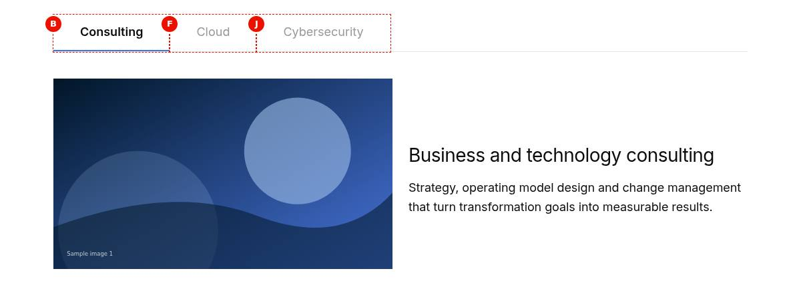
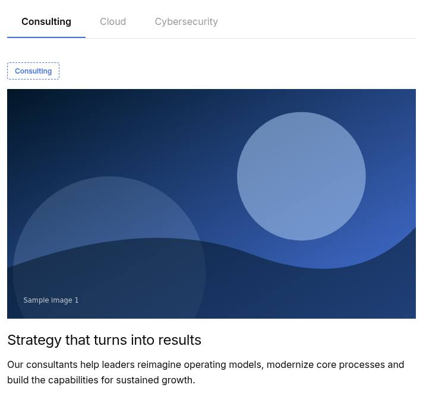
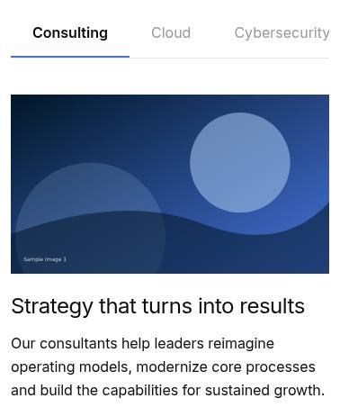
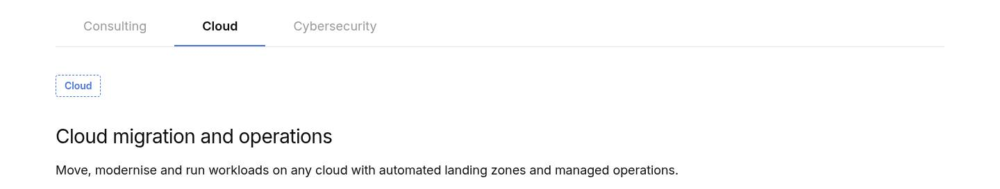
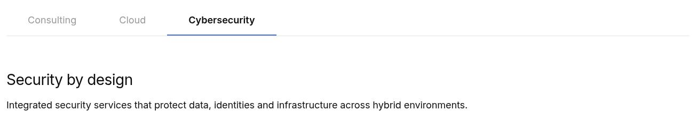
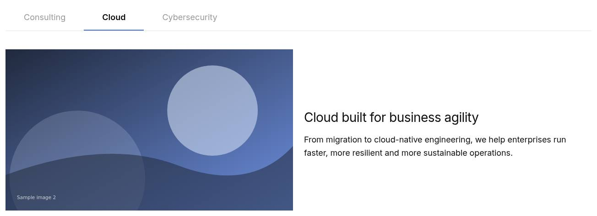
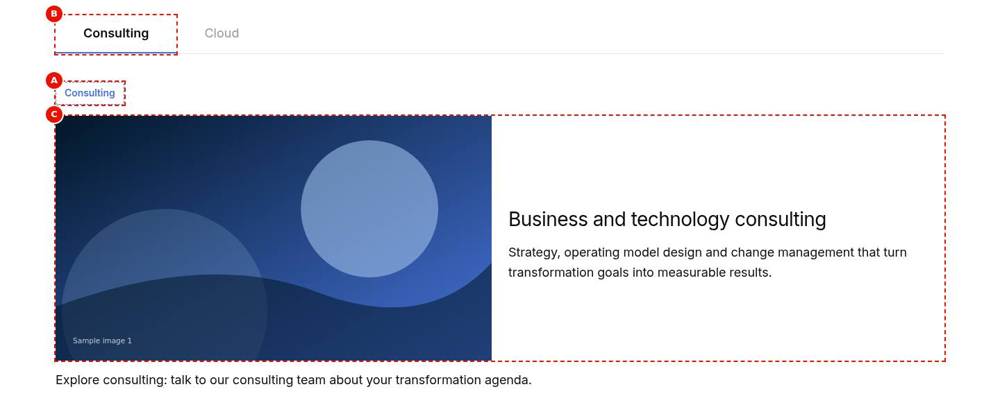
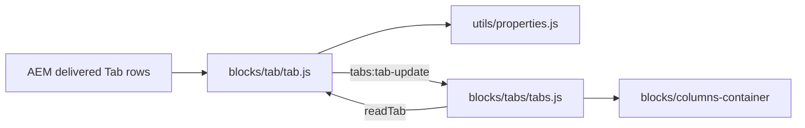

# Tab

The Tab is the item that starts a tab in a [Tabs Container](../tabs/README.md): it holds the tab's Title, ID, Active tab and Columns per row, and the components after it, up to the next Tab, are the tab's content. On the page it renders nothing of its own (its Title becomes the tab button); in Universal Editor edit mode it is a dashed label at the top of its panel, so authors can select it and edit its properties.

| Attribute | Value |
|---|---|
| Technical name | `tab` (component id, model and block class) |
| Display name | Tab |
| Block type | Child item (marker block, key-value) |
| Status | Active |
| Parent / children | Parent: [Tabs Container](../tabs/README.md) (`tabs` filter only). Children: none; its content is the components after it, including [Column Breaks](../column-break/README.md) |
| Owner / version / date | Not recorded |

## Overview

**Business purpose.** A simple, visible marker for "a new tab starts here", so tabbed content is built on the page with the standard components.

**User experience.** Visitors never see the Tab itself: its Title is the label of a tab button and its content is the panel. Authors see it in edit mode as a dashed chip with the Title.

**Templates / page types.** Any page that has a Tabs Container. **Data source:** its own fields.

**Related blocks.** [Tabs](../tabs/README.md) (builds the tab list from the Tabs), [Column Break](../column-break/README.md) (columns in a tab), [Columns Container](../columns-container/README.md) (the layout built in the tab). The Tabs block (`tabs-block`) has its own Tab items (`tabs-item`, with a Fragment), documented in the [Tabs README](../tabs/README.md); they aren't this block.

**When to use.** Inside a Tabs Container, once at the start of every tab.

**When not to use.** Outside a Tabs Container (it is offered only there; elsewhere it would show as a visible chip); in a Tabs block (use its Tab items).

**Realistic use cases.** Starting the tabs Consulting, Cloud and Cybersecurity of a services Tabs Container; naming a tab for links (`#cloud`); choosing the tab shown when the page opens; laying out a tab's content in two columns.

## Visual Reference

<!-- BEGIN GENERATED: screenshots (npm run build:docs) -->

Screenshots of the handover (6.22 Tab Block), taken on the preview with sample content; they show the rendering at the time of the handover revision that added them (later changes are in the sections below and the handover's revision history):

**Desktop rendering** — A Tabs Container at 1200 px on the page: the Tab markers' Titles appear only as the tab buttons Consulting (selected), Cloud and Cybersecurity; no marker is visible in the panel, which shows the Columns with photo-1.svg on the left and the H3 Business and technology consulting with its text on the right.



**Tablet rendering** — The same Tabs Container at 768 px in Universal Editor edit mode: the tab list Consulting (selected), Cloud and Cybersecurity, the dashed brand chip Consulting at the top of the panel, and below it the stacked Columns with photo-1.svg, the H3 Business and technology consulting and its text.



**Mobile rendering** — The Tabs Container at 375 px on the page: the tab list shows Consulting (selected), Cloud and a cut-off Cybersecu..., no marker in the panel; the Consulting panel is stacked: photo-1.svg, the H3 Business and technology consulting on two lines and its text.



**Standard Tab variation** — Edit mode at 1440 px after selecting the Cloud tab button: Cloud is selected in the tab list Consulting, Cloud, Cybersecurity; the dashed chip Cloud sits at the top of the panel, followed by the H3 Cloud migration and operations and its text.



**Active Tab variation** — A Tabs Container at 1440 px loaded with its third tab, Cybersecurity, selected because that Tab has Active tab on; the panel shows the Columns with photo-3.svg on the left and the H3 Cyber defence and resilience with its text on the right.



**Tab with ID variation** — The services page at 1440 px after #cloud is added to the address: the page has scrolled past the H1 and image so the Tabs sit just below the header area, with Cloud selected and its Columns (photo-2.svg, the H3 Cloud migration and operations and its text) shown; the footer's floating Ask us a question bar is at the bottom. The address bar itself is not in the screenshot.



**Universal Editor canvas** — Edit mode preview at 1440 px with letters: A on the dashed Tab chip Consulting at the top of the panel, B on the selected tab button Consulting (Cloud next to it), C on the Columns with photo-1.svg and the H3; the Text Explore consulting: talk to our consulting team about your transformation agenda follows outside C. No content tree is shown. (Annotated preview in editor mode with sample content; letters as in the annotations list, not a Universal Editor screenshot; file screenshots/tab-authoring-view.jpg)



**Properties panel** — The properties panel of a Tab with the Content tab (Title, ID, Active tab) and the Additional tab. (Dialog reference generated from the component model, not a Universal Editor screenshot; file screenshots/tab-properties-panel.jpg)


Universal Editor dialogs (no screenshot exists yet; to be captured on AEM author):

```text
[Screenshot Placeholder]

File name:
tab-dialog-content-desktop.png

Purpose:
The Content tab of the Tab properties in Universal Editor, with the fields of the table "Content tab — Tab" in Authorable Fields below.

Annotations:
A = Title
B = ID
C = Active tab
D = Columns per row
```

```text
[Screenshot Placeholder]

File name:
tab-dialog-additional-desktop.png

Purpose:
The Additional tab of the Tab properties in Universal Editor, with the fields of the table "Additional tab — Tab" in Authorable Fields below.

Annotations:
A = Hide block
```

<!-- END GENERATED: screenshots -->

States without a screenshot:

```text
[Screenshot Placeholder]

File name:
tab-columns-per-row-desktop.png

Purpose:
A Tab with Columns per row 2: the tab's content after its two Column Breaks laid out in two columns, a heading above them.

Annotations:
A = Tab chip (edit mode)
B = Heading before the first Column Break
C = Two columns
```

```text
[Screenshot Placeholder]

File name:
tab-hidden-editor-desktop.png

Purpose:
A Tab with Hide block on, in Universal Editor edit mode: its chip shown dimmed; on the published page the tab and its content are absent.

Annotations:
A = Dimmed Tab chip
B = The tab button still present in edit mode
```

## For Content Authors

1. Select a [Tabs Container](../tabs/README.md) in the content tree, choose Add (+) and pick **Tab** (the Tab is offered only there).
2. Open the Tab's properties. In **Content**, enter the **Title** (required: the tab label).
3. Optionally enter an **ID** (lower-case letters, digits and hyphens, e.g. `cloud`): links to `#cloud` open the tab. Leave it empty for an id made from the Tabs Container's Anchor name (`{anchor}-item-{n}`).
4. Turn on **Active tab** on the one tab that should be shown when the page loads (none: the first tab).
5. If the tab's content has [Column Breaks](../column-break/README.md), choose **Columns per row** (Automatic, 1, 2, 3, 4).
6. After the Tab, add the tab's components. Add the next Tab after them.
7. To move a tab, move the Tab and its components together; to remove a tab from the page temporarily, turn on **Hide block** in the **Additional** tab.
8. Preview: click the tab in the tab list; publish the page; on the published page check the label, the content and links to the ID.

**Minimum required:** Title. **Recommended:** an ID on tabs that are linked to. **Optional:** Active tab, Columns per row, Hide block.

## Authorable Fields

<!-- BEGIN GENERATED: fields (npm run build:docs) -->

### Tab (`tab`)

Model `tab`; template name "Tab" (the block class AEM renders); key-value block (one row per property).

#### Content tab — Tab

| Field label | Property | Type | Required | Default | Allowed values | Author guidance | Example |
| ----------- | -------- | ---- | -------- | ------- | -------------- | --------------- | ------- |
| Title | `title` | text | Yes | — | — | The label of the tab. The components after this Tab, up to the next Tab, are its content. | Consulting |
| ID | `tabId` | text | No | — | regExp: ^#?[a-z0-9][a-z0-9-]*$; customErrorMsg: Lower-case letters, digits and hyphens, e.g. overview. | Links to #ID open this tab (deep link), e.g. overview (lowercase, no spaces). Leave empty for an id from the Tabs ID. | consulting |
| Active tab | `activeTab` | boolean | No | — | on / off | Shows this tab when the page loads (the first tab if no tab is active). | true |
| Columns per row | `classes_perrow` | select | No | "" | Automatic (""), 1 (`per-row-1`), 2 (`per-row-2`), 3 (`per-row-3`), 4 (`per-row-4`) | When the tab's content has Column Breaks: how many columns sit side by side (Automatic: as many as there are Column Breaks, at most 4). Delivered as a block class. | per-row-2 |

#### Additional tab — Tab

| Field label | Property | Type | Required | Default | Allowed values | Author guidance | Example |
| ----------- | -------- | ---- | -------- | ------- | -------------- | --------------- | ------- |
| Hide block | `classes_hideblock` | boolean | No | `false` | on / off | Hides the tab and its content on the page (shown dimmed in the editor). Delivered as a block class. | — |

<!-- END GENERATED: fields -->

Notes on the fields:

- **Title** (`title`): the tab button's text and the `dc:title` of the panel in the data layer; empty: "Tab {n}" (placeholder `tabNumber`, applied by the Tabs). Changing it in the editor updates the tab button at once (`tabs:tab-update`).
- **ID** (`tabId`): normalized with `toClassName` and used as the panel's `id` and `data-tab-id`; an id already on the page gets `-2`, `-3`. A link to `#id` (or the Anchor List) opens the tab and scrolls to it.
- **Active tab** (`activeTab`): only the value `true` counts; with several active Tabs the first wins; a `#hash` naming another tab wins over it.
- **Columns per row** (`classes_perrow`, block class `per-row-1` to `per-row-4`): applied to the columns the Tabs build from the tab's Column Breaks; Automatic: as many as there are Column Breaks, at most 4. No effect without Column Breaks.
- **Hide block** (`classes_hideblock`): the Additional tab has only this field (see AGENTS.md "Additional tab" for its general behavior). On a Tab it hides the tab button and its whole content on the page; in edit mode the tab stays and its chip is dimmed.
- **Legacy mapping:** `readTab` reads key-value rows (`title`, `tabid`, `activetab`) and, if none, one row per field in dialog order (the last cell of each row).
- **Template:** a new Tab stores no Title (the definition template has none), so an untouched Tab is labelled "Tab {n}".

## Screenshot-Based Authoring Steps

### Authoring Step 1: Add a Tab

```text
[Screenshot Placeholder]

File name:
tab-authoring-step-1.png

Purpose:
The Add (+) menu of a selected Tabs Container with Tab highlighted, and the new Tab's dashed chip in the panel.

Annotations:
A = Tabs Container selected in the content tree
B = Tab in the component list
C = New Tab chip
```

### Values to Enter

| Callout | Field | Value | Reason | Expected result |
|---|---|---|---|---|
| A | Content tree | Tabs Container | The Tab is offered only in a Tabs Container | Add (+) lists Tab |
| B | Add (+) | Tab | Starts a new tab | A new tab button "Tab {n}" until a Title is entered |

Author action: select the Tabs Container, add a Tab. Expected preview: a new tab button and, in edit mode, the chip. Published: the tab button. Business rule: the Tab is the first item of its tab. Validation: the new tab appears in the tab list. Common mistake: adding the components before the Tab; resolution: move them after it.

### Authoring Step 2: Enter Title and ID

```text
[Screenshot Placeholder]

File name:
tab-authoring-step-2.png

Purpose:
The Tab's Content tab with Title Consulting and ID consulting entered.

Annotations:
A = Title
B = ID
C = Tab button updated with the Title
```

### Values to Enter

| Callout | Field | Value | Reason | Expected result |
|---|---|---|---|---|
| A | Title | Consulting | The tab label | Tab button "Consulting" |
| B | ID | consulting | Deep links (`#consulting`) | Panel id `consulting` |

Author action: enter the Title and ID. Expected preview: the label updates at once; the ID applies after the container is rendered again (reload the editor). Published: `page#consulting` opens the tab. Business rule: IDs are lower case with hyphens (validated). Validation: inspect the panel id or follow the link. Common mistake: `#My Tab` in links; resolution: use the exact ID.

### Authoring Step 3: Choose the tab shown first

```text
[Screenshot Placeholder]

File name:
tab-authoring-step-3.png

Purpose:
Active tab turned on for the Cloud Tab, and the page loaded with Cloud selected.

Annotations:
A = Active tab toggle
B = Cloud selected on load
```

### Values to Enter

| Callout | Field | Value | Reason | Expected result |
|---|---|---|---|---|
| A | Active tab | On | Show Cloud first | Cloud selected on load |

Author action: turn on Active tab on one Tab only. Expected preview: after a reload, the tab is selected. Published: selected on a fresh load (without a `#hash`). Business rule: the first active Tab wins; the editor keeps the tab shown before a re-render. Validation: load the page without a hash. Common mistake: several Tabs active; resolution: leave one.

### Authoring Step 4: Lay out the tab in columns

```text
[Screenshot Placeholder]

File name:
tab-authoring-step-4.png

Purpose:
Columns per row 2 on the Tab, with two Column Breaks after it, and the resulting two columns.

Annotations:
A = Columns per row
B = First Column Break
C = Second Column Break
```

### Values to Enter

| Callout | Field | Value | Reason | Expected result |
|---|---|---|---|---|
| A | Columns per row | 2 | Two columns side by side | `per-row-2` on the columns in the panel |
| B / C | Column name (Column Break) | Image / Text | Editor labels | Labels in edit mode only |

Author action: set Columns per row, add Column Breaks and their components after the Tab. Expected preview: two columns from 900px (after a reload for a changed Columns per row). Published: the same. Business rule: content between the Tab and the first Column Break stays above the columns. Validation: check at desktop and mobile widths. Common mistake: expecting Columns per row without Column Breaks to do anything; resolution: add Column Breaks.

## Variations

### Standard Tab

Title only (ID empty, Active tab off). Renders a tab button with the Title; the panel id is `{base}-item-{n}`. Use it for tabs nobody links to.

```text
[Screenshot Placeholder]

File name:
tab-standard-mobile.png

Purpose:
A standard Tab at mobile width: its tab button in the scrolling tab list and its panel content stacked.

Annotations:
A = Tab button
B = Panel content
```

### Active Tab

Active tab on: the tab shown when the page loads (unless a `#hash` or an editor re-render chooses another). Use it on one Tab at most.

### Tab with ID (deep link)

ID set: the panel's id is the ID, so `#id` links and Anchor List links open the tab and scroll to it below the fixed header. Keep IDs identical across locales.

### Tab with columns (Columns per row)

With Column Breaks in its content, the tab's content from the first Column Break is laid out by a Columns Container block in the panel with the chosen Columns per row; gap medium, top alignment, side by side from 900px. See [Column Break](../column-break/README.md).

### Hidden Tab (Hide block)

Hide block on: the tab and its content are left out of the page (the group is dropped when not in edit mode); in edit mode the tab stays and its chip is dimmed, so the author can turn it off again.

## Complete Authoring Example

Scenario: the Cloud tab of a services Tabs Container, linked from an email and shown first, with an image and a text side by side.

| Field | Example value | Guidance |
|---|---|---|
| Title | Cloud | 1 to 3 words, unique in the Tabs |
| ID | cloud | Lower case; the same in every locale |
| Active tab | On | Only this Tab |
| Columns per row | 2 | With two Column Breaks after the Tab |
| Hide block | Off | — |

Steps: add the Tab after the Consulting tab's content (Step 1), enter Title and ID (Step 2), turn on Active tab (Step 3), add a Title "Cloud migration and operations", then Column Break, Image (with alt text), Column Break, Text (Step 4).

Expected output: the tab button "Cloud" selected on load; `#cloud` opens it. Responsive: the two columns stack below 900px. Accessibility: the button is a `role="tab"` named "Cloud", its panel labelled by it. Analytics: the panel is a `tcs-corp/components/tabs/item` named "Cloud"; showing it later pushes `cmp:show`. Personalization fallback: none.

Pre-publish checklist: Title entered; ID unique and used exactly in links; one Active tab in the container; the components sit after the Tab and before the next one.

## Content and Asset Guidelines

- **Title:** short and descriptive (the handover recommends 1 to 3 words, about 25 characters); avoid "Tab 1" style labels; translate per locale.
- **ID:** lower-case letters, digits and hyphens (validated `^#?[a-z0-9][a-z0-9-]*$`); unique on the page.
- **Content:** start the tab's content with a heading that repeats or extends the Title.
- **Images, icons, CTAs, tags:** none on the Tab itself (they belong to the components after it).
- **Min / max:** no verified technical limit was identified.

## Accessibility

- The Tab adds no semantics of its own on the page: its Title becomes the accessible name of a `role="tab"` button, which labels its panel (`aria-labelledby`).
- The chip (`p.tab-title`) is shown only in edit mode; on the page its wrapper is hidden with `display: none`, so screen readers don't announce it.
- Hidden Tabs are removed from the tab list and the panels (not only visually hidden).

**Author responsibilities:** unique, descriptive Titles; a heading at the start of the tab's content; IDs that make sense in links.

**Developer responsibilities:** keep the Title as the tab button's text; keep the chip hidden outside edit mode (`blocks/tabs/tabs.css`); keep `data-analytics="off"`.

Keyboard behavior is the Tabs' (see the [Tabs accessibility section](../tabs/README.md#accessibility)); the Tab handles no keys.

## Data Layer and Analytics

- The Tab is `data-analytics="off"`: it isn't a data-layer component and no click is measured on it.
- Its Title is the `dc:title` of its panel (`tcs-corp/components/tabs/item`, pushed by `blocks/tabs/tabs.js`) and of the `cmp:show` pushed when the tab is shown after the first one; its ID is the panel id used as the component id.
- The path Adobe Client Data Layer → Adobe Data Collection (Tags) → AEP Web SDK → Edge Network → Analytics / CJA is the intended one, but Tags and the Web SDK aren't configured yet (blocked: measurement plan). No consent mechanism is implemented.

| Trigger | Data-layer event | Required properties | Analytics behavior |
|---|---|---|---|
| Page load | component state (by the Tabs) | panel id (the Tab's ID or `{base}-item-{n}`), `dc:title` (the Title) | The tab is listed as a panel |
| Its tab shown (not on load) | `cmp:show` (by the Tabs) | panel id, `dc:title` | Tab view |

## Personalization

This block does not currently expose verified personalization behavior. There is no Adobe Target or AJO integration in the repository; the authored Tab and its content render for every visitor.

## Responsive Behavior

The Tab's CSS has no media query: it is hidden on the page at every width and shown as a chip in edit mode at every width. The tab button and the columns built from its Column Breaks follow the [Tabs](../tabs/README.md#responsive-behavior) and [Columns Container](../columns-container/README.md#responsive-behavior) rules.

| Viewport | Layout | Image behavior | Interaction behavior |
|---|---|---|---|
| All widths | Hidden on the page; dashed chip in edit mode | None | None on the page; selectable in the editor |

## For Developers

<!-- BEGIN GENERATED: files (npm run build:docs) -->

```text
blocks/tab/
├── README.md
├── _tab.json
├── tab.css
└── tab.js
```

| Decorator/Utility | Purpose | Execution or dependency point |
| ----------------- | ------- | ----------------------------- |
| [`scripts/aem.js`](../../scripts/aem.js) | Edge Delivery core library (block loading, CSS, metadata, optimized pictures) | `tab.js`: { toClassName } |
| [`utils/properties.js`](../../utils/properties.js) | `readProperties`, `textOf`, `isOn`, `isOnByDefault` (a toggle that defaults to on), `optionOf`, `normalizeKey`, `textSource` (key-value block properties) | `tab.js`: { isOn, readProperties, textOf } |

<!-- END GENERATED: files -->

**Responsibilities.** `tab.js` reads the Tab's fields (`readTab`, exported for `blocks/tabs/tabs.js`) and decorates the marker (label chip, `data-analytics="off"`, `tabs:tab-update`). `tab.css` styles the chip. The hiding on the page is in `blocks/tabs/tabs.css` (`.tabs > .tabs-panel > div:has(> .tab)`, shown again under `html.adobe-ue-edit`).

**Input DOM.** A key-value block (`div.tab`) with rows `title`, `tabid` / `tabId`, `activetab`; classes from the `classes_*` fields (`per-row-N`, `hideblock`). Without key rows, one row per field in dialog order (Title, ID, Active tab: the last cell of each row).

**Rendered DOM.**

```html
<div class="tab block per-row-2" data-tab-title="Cloud" data-tab-id="cloud" data-tab-active="true" data-analytics="off">
  <p class="tab-title">Cloud</p>
</div>
```

**Decoration flow.** The Tabs block is loaded before the Tabs in its section, so `blocks/tabs/tabs.js` calls `readTab` on the undecorated Tab; `readTab` caches the values on `data-tab-title`, `data-tab-id`, `data-tab-active` so the later `decorate` (and re-reads) find them after the rows are gone. `decorate` then replaces the rows with `p.tab-title` and dispatches `tabs:tab-update` (bubbling, `detail`: `title`, `id`, `active`); the Tabs update the label of the tab whose panel contains the Tab.

**Exports.** `readTab(block)` → `{ title, id, active }`; `default decorate(block)`.

**Parent / child contracts.** The Tabs read `per-row-N` and `hideblock` from the Tab's classes (`groupContainerTabs`); a Tab with `hideblock` drops its group when not editing.

**Error handling.** Missing fields give an empty Title (the Tabs use "Tab {n}"), an empty ID and Active off.

## Extending the Block

1. Add a field in `_tab.json`, run `npm run build:json` and `npm run lint`.
2. Read it in `readTab` (add its normalized key to `FIELDS` in dialog order and cache it on a `data-tab-*` attribute) and use it in `blocks/tabs/tabs.js` `groupContainerTabs`. A `classes_*` field arrives as a block class instead (as Columns per row).
3. Delivery rules: don't end field names in Text, Title, Type, Alt or MimeType; no sample value in the definition template.
4. Data layer: the Tab stays `data-analytics="off"`; describe any new data on the panel in `tabs.js`.
5. Backward compatibility: keep reading key-value and per-field rows.
6. No unit test covers the Tab; check the block library pages listed below. Update this README and run `npm run build:docs`; `npm run build:modules` after changing imports.

## For Site Administrators

- **Availability:** offered only in the `tabs` filter (inside a Tabs Container).
- **Model governance:** `blocks/tab/_tab.json` (definition `tab`, model `tab`, no filter).
- **Allowed children:** none.
- **Publishing dependencies:** none of its own; the placeholder `tabNumber` (via the Tabs) for an empty Title.

| Dependency | Purpose | Location | Impact if unavailable |
|---|---|---|---|
| Tabs Container | Builds the tab from the Tab | `blocks/tabs` | The Tab shows as a chip and no tabs are built |
| Placeholder `tabNumber` | Label of a Tab without Title | `/{locale}/placeholders.json` | English fallback "Tab {n}" |

**Localization:** translate the Title; keep the ID the same across locales.

## For Architects

- **Role:** a marker block inside a section container: it delimits groups of sibling components, because Edge Delivery doesn't nest blocks in blocks.
- **Content model:** key-value block `tab`; its `classes_*` fields arrive as block classes (it is a block, not a section).
- **Rendering:** read by the Tabs before its own decoration; values cached in data attributes.
- **Data layer / Target / consent:** none of its own.
- **Performance / security:** negligible (no network, no listeners).



## For QA and Support Teams

| Test ID | Scenario | Configuration | Expected result |
|---|---|---|---|
| TAB-QA-01 | Standard | Title only | Tab button with the Title; panel id `{base}-item-{n}` |
| TAB-QA-02 | Empty Title | Title empty | Label "Tab {n}" |
| TAB-QA-03 | ID | ID `cloud`; open `#cloud` | Tab opens; panel id `cloud` |
| TAB-QA-04 | Duplicate ID | Two Tabs with ID `cloud` | Second panel `cloud-2` |
| TAB-QA-05 | Active | Active tab on the third Tab | Third tab selected on load |
| TAB-QA-06 | Columns per row | 2, with three Column Breaks | Two columns per row, the third in a new row |
| TAB-QA-07 | Hide block | On | Tab and content absent on the page; dimmed chip in edit mode |
| TAB-QA-08 | Chip | Published page | No chip visible |
| TAB-QA-09 | Live label | Change the Title in the editor | Tab button updates at once |
| TAB-QA-10 | Data layer | Inspect `adobeDataLayer` | No component for the Tab; the panel named by the Title |

## Troubleshooting

| Symptom | Likely cause | Diagnostic steps | Resolution | Verification |
|---|---|---|---|---|
| Label "Tab 2" instead of the Title | Empty Title, or content before the first Tab | Select the Tab; check the tree order | Enter the Title; move stray components | Labels are the Titles |
| Chip visible on the page | The Tab isn't in a Tabs Container | Check the section for `tabs-section` | Move or delete the Tab | No chip |
| ID doesn't work in links | Normalized or de-duplicated id | Inspect the panel id | Use the exact ID | Link opens the tab |
| Active tab ignored | Another active Tab, a `#hash`, or the editor keeps the shown tab | Load without hash; check all Tabs | One Active tab; reload | Correct tab on load |
| ID, Active, Columns per row or Hide block change has no effect in the editor | Applied when the container is rendered again (R-C-7) | Reload the editor | Reload | Applied |
| Component in the wrong tab | Its position in the tree | Check the tree order | Move it after its Tab | Correct panel |

Evidence to collect: page URL, the Tab's data attributes (`data-tab-*`) and classes, the panel ids.

## Performance Considerations

No network requests, observers or listeners; one small DOM replacement. The Tab is loaded as a block of its section (its CSS and JS are fetched once per page).

## Security and Privacy

The Title is set with `textContent`; the ID is normalized with `toClassName`. No personal data.

## Known Limitations

| Limitation | Impact | Workaround | Planned correction |
|---|---|---|---|
| ID, Active tab, Columns per row and Hide block changes apply only when the Tabs Container is rendered again (re-audit R-C-7, deferred) | No immediate feedback in the editor | Reload the editor | Not recorded |
| A Tab outside a Tabs Container shows its chip on the page | Visible stray label | Keep Tabs in Tabs Containers (the filter offers it only there) | Not planned |
| Gap, alignment and breakpoint of the columns in a tab aren't authorable | Fixed medium gap, top, from 900px | Use a Columns Container section | Not planned |

## Related Documentation

- [Blocks documentation](../README.md)
- [Tabs](../tabs/README.md) (parent: Tabs Container)
- [Column Break](../column-break/README.md) (columns in a tab)
- [Columns Container](../columns-container/README.md)
- Model: [`_tab.json`](_tab.json)
- Re-audit: [`docs/audit/REAUDIT-2026-10-20.md`](../../docs/audit/REAUDIT-2026-10-20.md)
- [Handover 6.22 Tab Block](../../docs/handover/TCS-CORP-HANDOVER.md)

<!-- BEGIN GENERATED: usage (npm run build:docs) -->

Pages of the block library package 1.0.13 (language master, `/content/tcs-corp/language-master/en`) that contain the block, 53 instance(s) in total:
- Block library: `block-library/tabs/tab`, `block-library/tabs/tab-deep-link`, `block-library/tabs/tabs-fixed-width`, `block-library/tabs/tabs-section`

Project-wide standards: [knowledge base](../../docs/handover/knowledge-base/README.md) ([block governance](../../docs/handover/knowledge-base/blocks.md)).

<!-- END GENERATED: usage -->

## Change History

| Version | Change | Source | Date |
|---|---|---|---|
| Not recorded | README generated from verified implementation and approved handover documentation | Repository review | Not recorded |
| Handover 2.28 | New Tab field Columns per row: a tab's Column Breaks lay its content out in columns | docs/handover revision history | 20 October 2026 |
| Handover 2.29 | Block ecosystem re-audit: sample content removed from templates (re-audit R-C-10: the Tab no longer stores the title "Tab"; Tab IDs validated) | docs/handover revision history | 20 October 2026 |
