# Table List

The Table List is a divided, text-led list of items (industries, solutions, products) under a heading with an optional call to action. Each item has a title, an optional number and trademark sign, a description and a link shown as an arrow, a diagonal arrow or a button. It implements the TCS DS Figma "List" variations 1 to 3 (Variation 1 industries, Variation 2 solutions, Variation 3 products) and the TCS Designs - Prototypes Figma "List Item - Industry" list as Variation 4 (segments: the What we do "Deep expertise, across industries" and Industry "Segments we serve" sections). It is a key-value block: the items are **Table List Item** children added with Add, and `blocks/table-list/table-list.js` rebuilds the header and the item rows in place.

| Attribute | Value |
| --------- | ----- |
| Technical name | `table-list` (model `table-list`, template name "Table List"); item `table-list-card` (model `table-list-card`, template name "Table List Item") |
| Display name | Table List; item Table List Item |
| Block type | Key-value block (`key-value: true`) with item children |
| Status | Active |
| Parent / children | Parents: Section, Columns Container, Tabs Container (filters `section`, `columns-container`, `tabs`). Children: Table List Item (`table-list-card`), filter `table-list` |
| Owner / version / date | Not recorded / Not recorded / Not recorded |

## Overview

- **Business purpose:** presents a short, scannable list of offerings (industries served, transformation solutions, products and platforms) with a strong typographic style and a clear path to each detail page, without images.
- **User experience:** a heading with a call to action (filled button, outline button or text link) on the right (below it when they don't fit), then rows separated by dividers. Variation 1: title, description and an arrow; Variation 2: description, a large title and an outline button; Variation 3: description, a number with a very large title and a diagonal arrow; Variation 4: a wide title, a narrow grey description and an arrow, the row highlighted on hover and keyboard focus. With an arrow the whole row is clickable.
- **Templates / page types:** any page (allowed in every section); typically the home page and landing pages (the curated design pages `home`, `what-we-do`, `product`, `industry-landing-page`, `case-study`, `collection` use it).
- **Data source:** authored fields only; UI text (View all, Explore, accessible names) from the locale's placeholders. No page metadata, tags, query index or images.
- **Related blocks:** [Cards](../cards/README.md) and [List](../list/README.md) (image cards), [Filter List](../filter-list/README.md) (metadata-driven lists), [Table](../table/README.md) (tabular data), [Accordion](../accordion/README.md), [Anchor List](../anchor-list/README.md).
- **When to use:** up to 10 items that each link to a page, where typography, not imagery, carries the design.
- **When not to use:** more than 10 items or lists that should update from page metadata (List, Filter List); image cards (Cards, List); tabular data with columns (Table); expandable content (Accordion).
- **Realistic use cases:** a home page "Industries we serve" list with a "View all industries" button; "Our transformation solutions" with an outline "Explore" button per row; "Products & Platforms" with numbered product names and trademark signs (TwinX™, ignio®).

## Visual Reference

<!-- BEGIN GENERATED: screenshots (npm run build:docs) -->

Screenshots of the handover (6.18 Table List Block), taken on the preview with sample content; they show the rendering at the time of the handover revision that added them (later changes are in the sections below and the handover's revision history):

**Desktop rendering** — The Table List (Variation 1) at 1440 px, inset 5rem: the 3rem heading Industries we serve with a filled View all button at the right, then four rows Banking, Retail, Manufacturing and Insurance with the description in the middle column and a grey arrow, thin dividers between rows, no numbers.

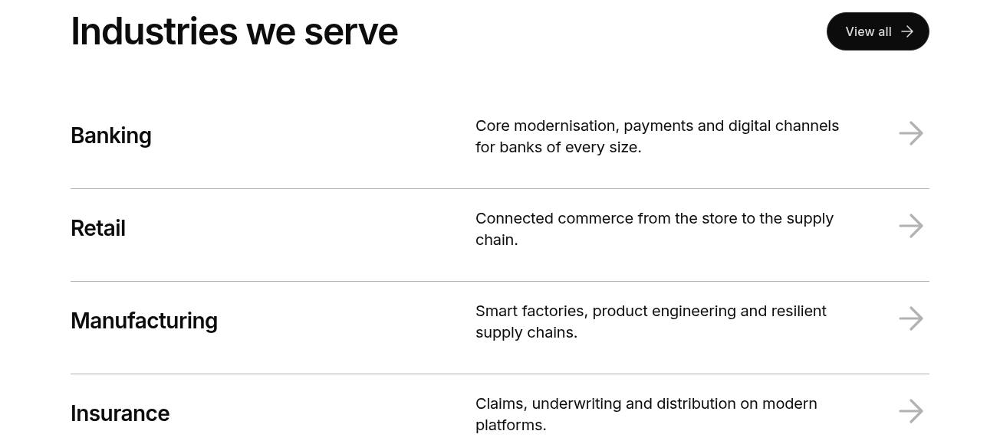

**Tablet rendering** — The same Table List at 768 px: the 2.5rem heading with the View all button beside it, four rows in three columns (title, description, arrow) and no numbers.

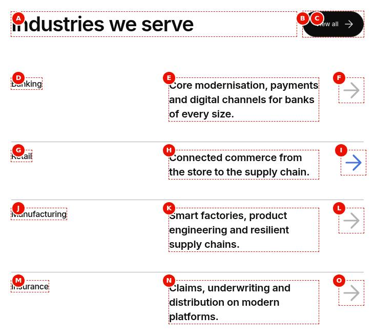

**Mobile rendering** — The Table List at 375 px: the 2rem heading with the View all button below it, then rows 01 Banking to 04 Insurance with the number and title on the first line, the description below and the arrow at the right.

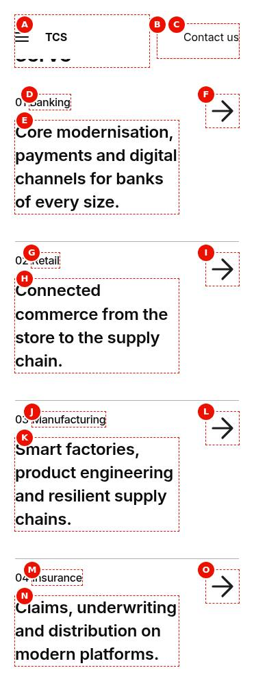

**Variation 1 (industries)** — Close-up of the Variation 1 items at 1440 px: four rows with the semibold titles Banking, Retail, Manufacturing and Insurance, the description in the middle column and a grey right arrow; no numbers and no divider under the last row.

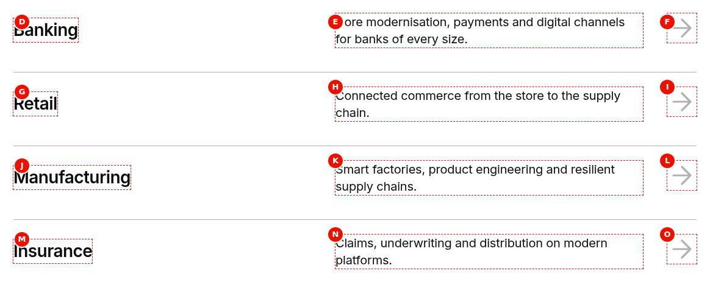

**Variation 2 (solutions)** — The Variation 2 Table List at 1440 px: the heading Our transformation solutions with an outline All solutions button, then four rows (Cognitive operations, Enterprise cloud, Cybersecurity, AI and data) with the description at the left, the 4rem title right-aligned and an outline Explore button; no numbers.

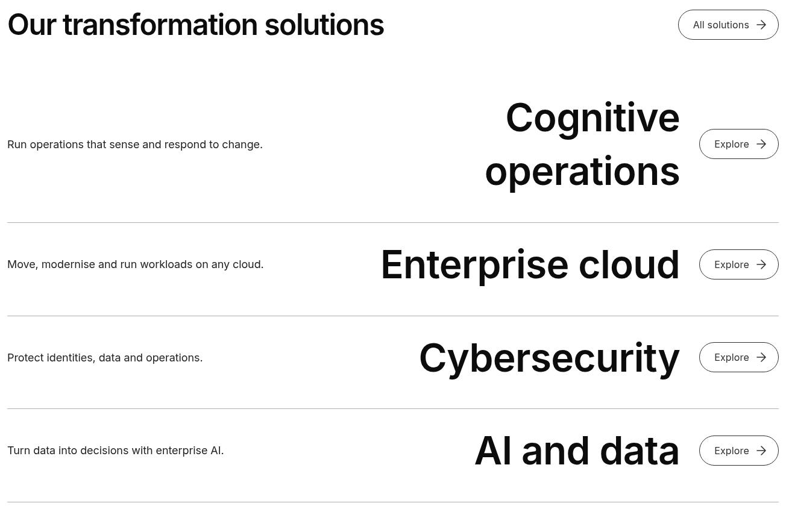

**Variation 3 (products)** — The Variation 3 Table List at 1440 px: the regular-weight heading Products & Platforms with the text link All Products & Platforms, then rows with the description at the left, a grey number and a 5.625rem name (01 TwinX™, 02 ignio®, 03 TCS BaNCS®, 04 Quartz™) and a diagonal arrow, with 2px light grey dividers.

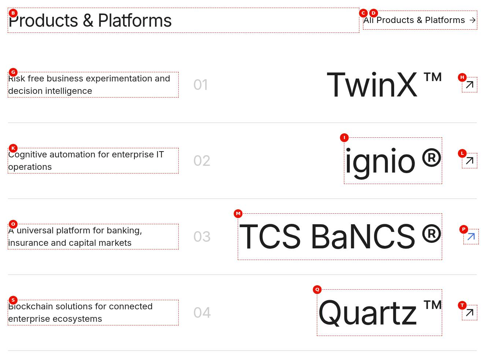

**Filled button call to action** — Close-up of the header at 1440 px: the heading Industries we serve with a filled brand button View all industries at the right.


**Outline button call to action** — Close-up of the header at 1440 px: the heading Our transformation solutions with an outline button All solutions at the right.

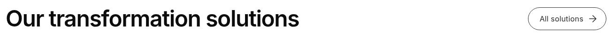

**Text link call to action** — Close-up of the header at 1440 px: the regular-weight heading Products & Platforms with the text link All Products & Platforms at the right.

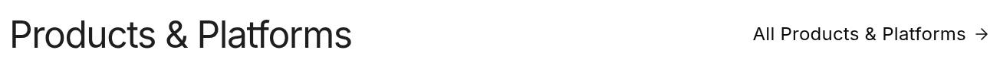

**Numbers shown** — The Variation 1 Table List at 1440 px with Numbers Show: the heading and View all button, then three rows 01 Banking, 02 Retail and 03 Manufacturing with descriptions and arrows.

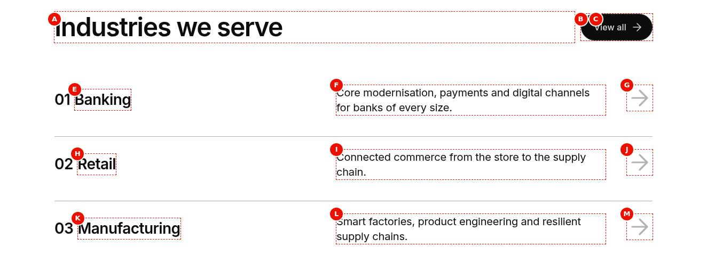

**Numbers on mobile only** — Two frames side by side: at 375 px the rows read 01 Banking, 02 Retail and 03 Manufacturing with the View all button under the heading; at 1024 px the same rows show Banking, Retail and Manufacturing without numbers.

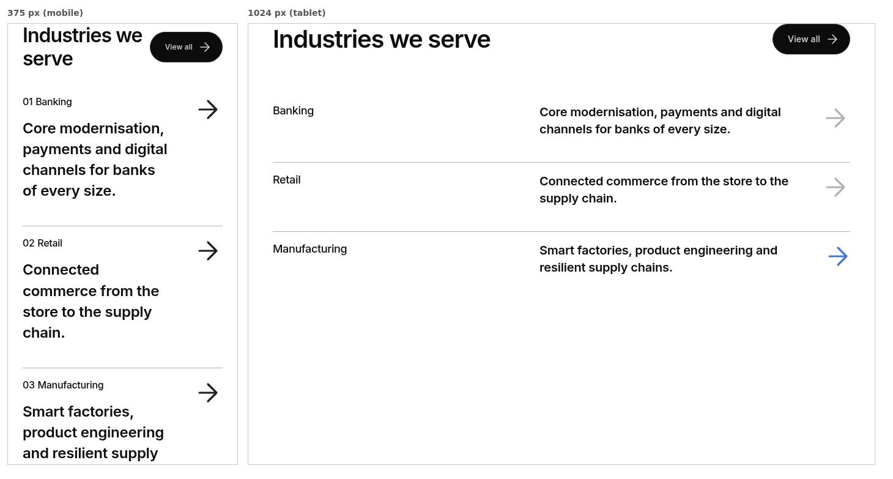

**Numbers hidden** — The Variation 3 Table List at 1440 px with Numbers Hide: the heading and text link, then three rows TwinX™, ignio® and TCS BaNCS® with descriptions and diagonal arrows and no numbers.

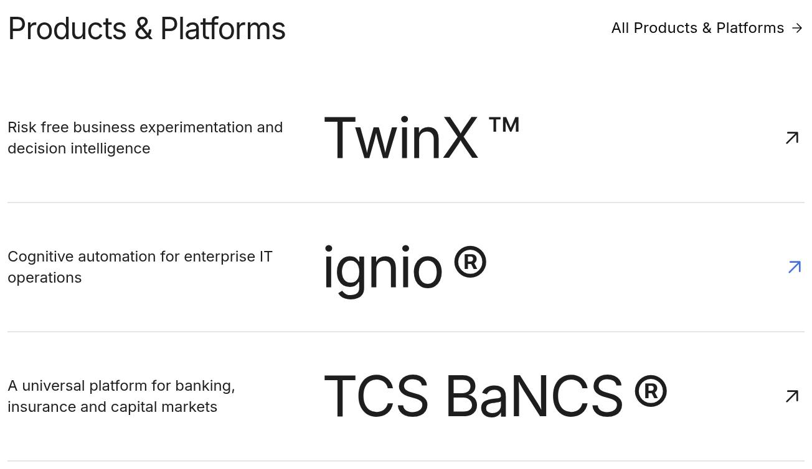

**Arrow item link** — The Variation 1 Table List at 1440 px with only the heading Industries we serve (no call to action) and three rows Banking, Retail and Manufacturing; the pointer is on Banking, whose arrow is brand blue and moved slightly right.

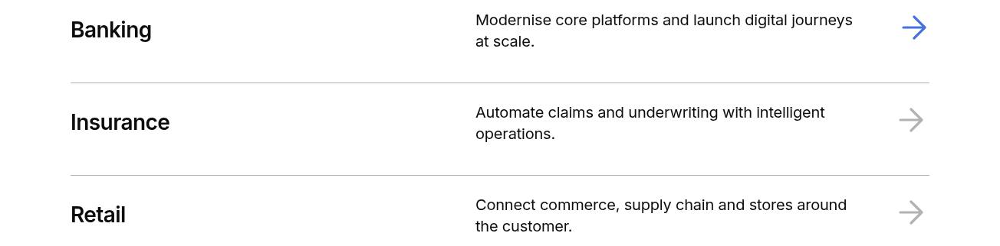

**Diagonal arrow item link** — Close-up of the first product row at 1440 px: the description Risk free business experimentation and decision intelligence at the left, 01 and the large title TwinX™, and an up-right arrow at the right.

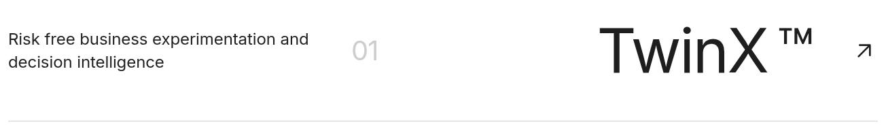

**Button item link** — Close-up of the first solution row at 1440 px: the description Run operations that sense and respond to change. at the left, the 4rem title Cognitive operations and an outline Explore button at the right.

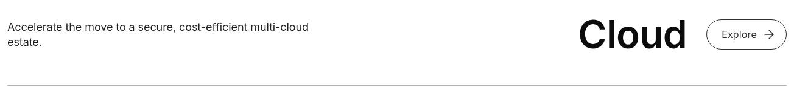

**No motion** — The Variation 1 Table List at 1440 px with Motion None: the heading with the filled View all button and the four rows Banking, Retail, Manufacturing and Insurance all fully visible.

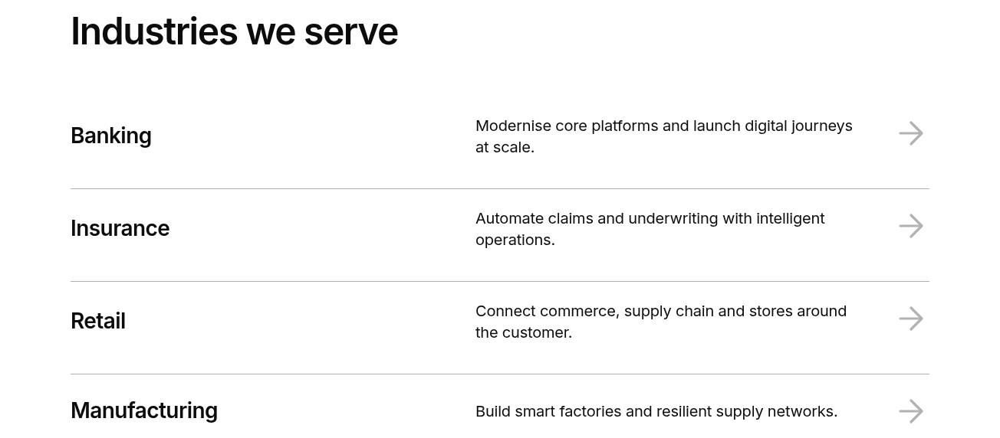

**Fade motion** — The Variation 1 Table List at 1440 px during Fade, captured slowed and staggered: Banking fully visible, Retail and Manufacturing partly faded in and Insurance still nearly transparent below the heading and View all button.

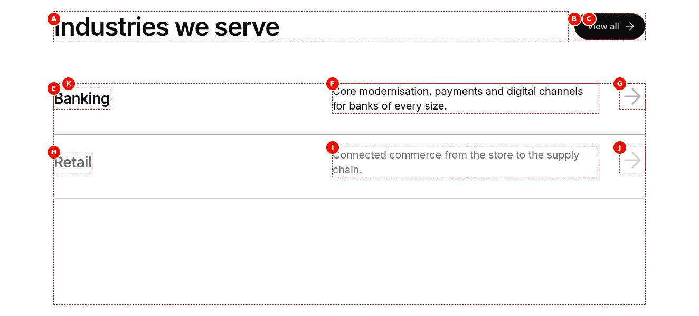

**Slide motion** — The Variation 1 Table List at 1440 px during Slide, captured slowed and staggered: the upper rows in place, the lower rows up to 1.25rem lower and partly transparent while rising.

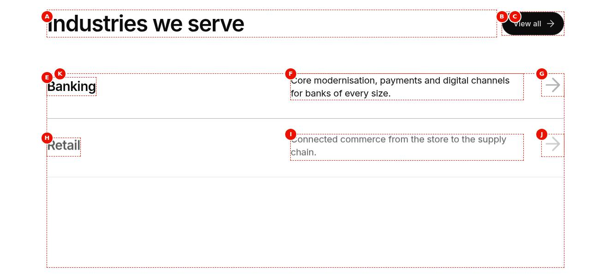

**Reveal motion** — The Variation 1 Table List at 1440 px during Reveal, captured slowed and staggered: Banking fully revealed, the next rows partly uncovered from the top down and Insurance still clipped.

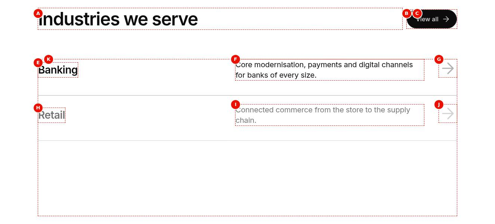

**Trademark sign** — Close-up of the product items at 1440 px: 01 TwinX™, 02 ignio®, 03 TCS BaNCS® and 04 Quartz™ with the signs raised at title size after each name, descriptions at the left and diagonal arrows.

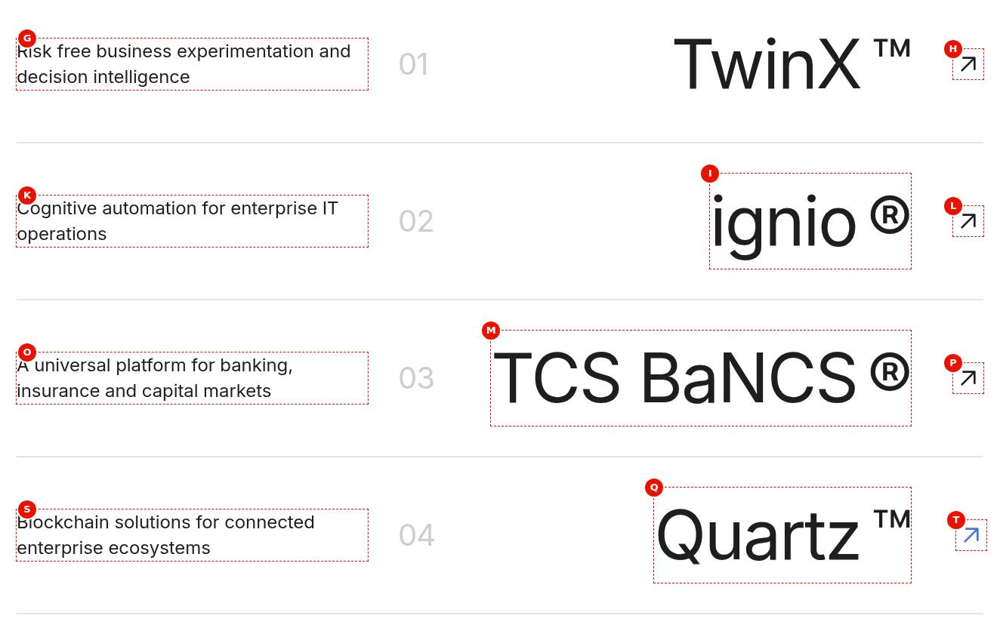

**Universal Editor canvas** — The Variation 3 Table List selected in Universal Editor at 1440 px, annotated: A the heading Products & Platforms, B the text link All Products & Platforms, C the number 01, D the title TwinX™, E its description, F the diagonal arrow, with three rows (TwinX, ignio, TCS BaNCS) and G the content tree with three Table List Item children. (Annotated preview in editor mode with sample content; letters as in the annotations list, not a Universal Editor screenshot; file screenshots/table-list-authoring-view.jpg)

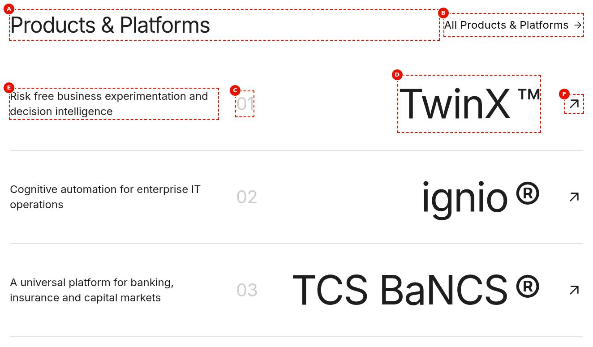

**Properties panel** — The properties panel of the Table List with the tabs Content, Call to action, Items and Additional, and, for a selected item, the Table List Item panel with Number, Title, Trademark, Description, Link and Button text. (Dialog reference generated from the component model, not a Universal Editor screenshot; file screenshots/table-list-properties-panel.jpg)

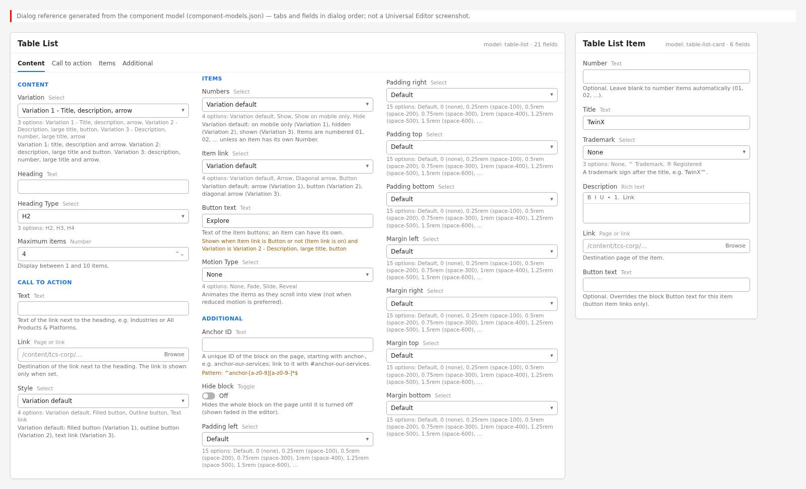

Universal Editor dialogs (no screenshot exists yet; to be captured on AEM author):

```text
[Screenshot Placeholder]

File name:
table-list-dialog-content-desktop.png

Purpose:
The Content tab of the Table List properties in Universal Editor, with the fields of the table "Content tab — Table List" in Authorable Fields below.

Annotations:
A = Variation
B = Background color
C = Heading
D = Heading Type
E = Eyebrow
F = Heading position
G = Maximum items
H = Text
I = Link
J = Style
```

```text
[Screenshot Placeholder]

File name:
table-list-dialog-items-desktop.png

Purpose:
The Items tab of the Table List properties in Universal Editor, with the fields of the table "Items tab — Table List" in Authorable Fields below.

Annotations:
A = Numbers
B = Item link
C = Button text
D = Gray descriptions
```

```text
[Screenshot Placeholder]

File name:
table-list-dialog-additional-desktop.png

Purpose:
The Additional tab of the Table List properties in Universal Editor, with the fields of the table "Additional tab — Table List" in Authorable Fields below.

Annotations:
A = Anchor ID
B = Hide block
C = Animation Type
D = Motion Speed
E = Animation Trigger
F = Padding left
G = Padding right
H = Padding top
I = Padding bottom
J = Margin left
```

```text
[Screenshot Placeholder]

File name:
table-list-card-dialog-fields-desktop.png

Purpose:
The dialog of the Table List Item properties in Universal Editor, with the fields of the table "Fields — Table List Item" in Authorable Fields below.

Annotations:
A = Number
B = Title
C = Trademark
D = Description
E = Link
F = Button text
```

<!-- END GENERATED: screenshots -->

The handover screenshots predate handover 2.8 and 2.27: the properties panel reference shows four tabs (Content, Call to action, Items, Additional), the dialog now has **Content**, **Items** and **Additional**; the "Fade / Slide / Reveal motion" screenshots show the former Motion Type field, which was removed (stored values now play as the Additional tab's Animation Type, see [Legacy Motion Type](#legacy-motion-type)). The states below have no screenshot yet.

```text
[Screenshot Placeholder]

File name:
table-list-universal-editor-desktop.png

Purpose:
A Table List selected in Universal Editor (AEM author) with the content tree showing its Table List Item children and the properties panel with the Content / Items / Additional tabs.

Annotations:
A = Table List in the content tree
B = Table List Item children
C = Properties panel tabs
D = Rendered rows on the canvas
```

```text
[Screenshot Placeholder]

File name:
table-list-editor-extra-items-desktop.png

Purpose:
In Universal Editor edit mode, items above Maximum items shown dimmed (still selectable), and an item button without a Link shown as a non-focusable preview.

Annotations:
A = Items within Maximum items
B = Dimmed extra item
C = Button preview without a Link
```

```text
[Screenshot Placeholder]

File name:
table-list-focus-desktop.png

Purpose:
Keyboard focus on an item arrow (outline, arrow moved and brand coloured) and on an item button.

Annotations:
A = Focused arrow
B = Focused Explore button
```

```text
[Screenshot Placeholder]

File name:
table-list-solutions-mobile.png

Purpose:
Variation 2 at 375px: description, large title and the outline button stacked in each row.

Annotations:
A = Description
B = Title
C = Explore button
```

```text
[Screenshot Placeholder]

File name:
table-list-products-mobile.png

Purpose:
Variation 3 at 375px: description above the number and large title, diagonal arrow on the right.

Annotations:
A = Description
B = Number and title with trademark
C = Diagonal arrow
```

## For Content Authors

1. **Add the block.** In Universal Editor select a Section, a Columns Container column or a Tabs Container, use **Add (+)** and choose **Table List**.
2. **Open its properties.** Select the Table List (not an item); the properties panel has the tabs **Content**, **Items** and **Additional**.
3. **Choose the Variation first (Content tab).** It sets the defaults of the call to action Style, Numbers and Item link.
4. **Enter the heading and call to action (Content tab).** Heading and Heading Type (H2, H3, H4); Maximum items (1–10, default 4); the call to action Text, Link and Style.
5. **Set the item options (Items tab).** Numbers, Item link and, for buttons, the Button text (default "Explore" in the page language).
6. **Add items.** Select the Table List and use **Add (+)** → **Table List Item**. Fill Title, Description and Link; Number (blank for automatic 01, 02, …), Trademark and Button text are optional. Drag items in the content tree to reorder them.
7. **Raise Maximum items** when you add more than 4 items; items above it aren't shown on the page (dimmed in the editor).
8. **Preview** in Universal Editor Preview or on aem.page, at mobile (below 600px), tablet (600–1199px) and desktop (1200px and wider).
9. **Publish** the page from AEM; make sure the linked pages are published.
10. **Validate the published output:** every arrow or button opens its page, the call to action renders, numbers and trademark signs are right.

- **Minimum required:** no field is required in the model; for a useful list: a Heading and items with a Title and a Link.
- **Recommended:** Variation; Heading; call to action Text and Link; a Description per item; Maximum items matching the item count.
- **Optional:** Heading Type, call to action Style, Numbers, Item link, Button text (block and item), item Number and Trademark, the Additional tab.

## Authorable Fields

<!-- BEGIN GENERATED: fields (npm run build:docs) -->

### Table List (`table-list`)

Model `table-list`; template name "Table List" (the block class AEM renders); key-value block (one row per property); children: `table-list-card`.

Stored on a new component (definition template): `variations` = `"industries"`, `backgroundColor` = `"white"`, `listHeadingType` = `"h2"`, `maxCards` = `4`, `ctaStyle` = `""`, `hideButton` = `false`, `numbers` = `""`, `itemAction` = `""`, `grayDescriptions` = `false`.

#### Content tab — Table List

| Field label | Property | Type | Required | Default | Allowed values | Author guidance | Example |
| ----------- | -------- | ---- | -------- | ------- | -------------- | --------------- | ------- |
| Variation | `variations` | select | No | `industries` | Variation 1 - Title, description, arrow (`industries`), Variation 2 - Description, large title, button (`solutions`), Variation 3 - Description, number, large title, arrow (`products`), Variation 4 - Wide title, grey description, arrow (row hover) (`segments`), Variation 5 - Label, large description (steps) (`approach`), Variation 6 - Description, right-aligned title, small arrow (`platforms`) | Variation 1: title, description and arrow. Variation 2: description, large title and button. Variation 3: description, number, large title and arrow. Variation 4: wide title, narrow grey description and arrow; the row is highlighted on hover. Variation 5: small label and large description (steps, without links). Variation 6: description, large right-aligned title and a small arrow. | solutions |
| Background color | `backgroundColor` | select | No | `white` | White (default) (`white`), Black (`black`), Dark Green (`dark-green`), Navy (`navy`) | Choose the background color for the Table List. | — |
| Heading | `listHeading` | text | No | "" | — | — | Industries we serve |
| Heading Type | `listHeadingType` | select | No | `h2` | H2 (`h2`), H3 (`h3`), H4 (`h4`) | Delivered with `listHeading` (field collapse). | h2 |
| Eyebrow | `listEyebrow` | text | No | "" | — | Optional. A short label above the heading, e.g. Models & Data. | — |
| Heading position | `headerPosition` | select | No | "" | Above the list (""), Beside the list (`beside`) | Beside the list: the eyebrow, heading and call to action in a column on the left of the list from 900px wide (above it on smaller screens), with a larger statement-style heading. | — |
| Maximum items | `maxCards` | number | No | `4` | numberMin: 1; numberMax: 10; customErrorMsg: Maximum items must be between 1 and 10. | Display between 1 and 10 items. | 3 |
| Text | `viewAllLabel` | text | No | "" | — | Text of the link next to the heading, e.g. Industries or All Products & Platforms. | View all |
| Link | `viewAllLink` | aem-content | No | — | — | Destination of the link next to the heading. The link is shown only when set. | /language-master/en/dummy-pages/industries |
| Style | `ctaStyle` | select | No | "" | Variation default (""), Filled button (`primary`), Outline button (`secondary`), Text link (`tertiary`) | Variation default: filled button (Variation 1), outline button (Variations 2, 4, 5 and 6), text link (Variation 3). | primary |
| Hide button | `hideButton` | boolean | No | `false` | on / off | Hides the heading call to action and all item buttons and arrows. The heading and item content remain visible. | — |

#### Items tab — Table List

| Field label | Property | Type | Required | Default | Allowed values | Author guidance | Example |
| ----------- | -------- | ---- | -------- | ------- | -------------- | --------------- | ------- |
| Numbers | `numbers` | select | No | "" | Variation default (""), Show (`show`), Show on mobile only (`mobile`), Hide (`hide`) | Variation default: on mobile only (Variation 1), hidden (Variations 2, 4, 5 and 6), shown (Variation 3). Items are numbered 01, 02, ... unless an item has its own Number. | show |
| Item link | `itemAction` | select | No | "" | Variation default (""), Arrow (`arrow`), Diagonal arrow (`arrow-up-right`), Circled arrow (`arrow-circle`), Button (`button`) | Variation default: arrow (Variations 1, 4, 5 and 6; Variation 5 shows it only on items with a Link), button (Variation 2), diagonal arrow (Variation 3). | arrow |
| Button text | `itemButtonLabel` | text | No | — | — | Default: Explore (in the page language). Shown when `itemAction` is `button` or (`itemAction` is off or empty and `variations` is `solutions`). | Explore |
| Gray descriptions | `grayDescriptions` | boolean | No | `false` | on / off | Use secondary gray text for item descriptions instead of the default text color. Shown when `backgroundColor` is `white`. | — |

#### Additional tab — Table List

| Field label | Property | Type | Required | Default | Allowed values | Author guidance | Example |
| ----------- | -------- | ---- | -------- | ------- | -------------- | --------------- | ------- |
| Anchor ID | `classes_anchor` | text | No | — | regExp: ^anchor-[a-z0-9][a-z0-9-]*$; customErrorMsg: Start with anchor-, then lower-case letters, digits and hyphens. | A unique ID of the block on the page, starting with anchor-, e.g. anchor-our-services; link to it with #anchor-our-services. Delivered as a block class. | — |
| Hide block | `classes_hideblock` | boolean | No | `false` | on / off | Hides the whole block on the page until it is turned off (shown faded in the editor). Delivered as a block class. | — |
| Animation Type | `classes_animation` | select | No | "" | None (""), Fade in (`motion-fade-in`), Fade up (`motion-fade-up`), Fade down (`motion-fade-down`), Fade left (`motion-fade-left`), Fade right (`motion-fade-right`), Slide up (`motion-slide-up`), Slide down (`motion-slide-down`), Slide left (`motion-slide-left`), Slide right (`motion-slide-right`), Scale in (`motion-scale-in`) | How the block's content appears; repeated items (cards, list items, accordion items, columns) appear one after another. None: shown as is. Not played in the editor or when the visitor prefers reduced motion. Delivered as a block class. | motion-fade-in |
| Motion Speed | `classes_animationspeed` | select | No | "" | Medium (""), Fast (`motion-fast`), Slow (`motion-slow`) | How fast the animation runs: 0.3, 0.6 or 0.9 seconds. Shown when `classes_animation` is set and `classes_animation` is not empty. Delivered as a block class. | motion-slow |
| Animation Trigger | `classes_animationtrigger` | select | No | "" | On Scroll / Viewport Entry (""), On Page Load (`motion-on-load`) | When the block's animations run. On Scroll: when the block comes into view (at once if it is in view when the page opens). On Page Load: as soon as the block is ready, wherever it is on the page. Shown when `classes_animation` is set and `classes_animation` is not empty. Delivered as a block class. | — |
| Padding left | `classes_paddingleft` | select | No | "" | Default (""), 0 (none) (`pl-0`), 0.25rem (space-100) (`pl-100`), 0.5rem (space-200) (`pl-200`), 0.75rem (space-300) (`pl-300`), 1rem (space-400) (`pl-400`), 1.25rem (space-500) (`pl-500`), 1.5rem (space-600) (`pl-600`), 2rem (space-800) (`pl-800`), 2.5rem (space-1000) (`pl-1000`), 3rem (space-1200) (`pl-1200`), 4rem (space-1600) (`pl-1600`), 5rem (space-2000) (`pl-2000`), 6rem (space-2400) (`pl-2400`), 7.5rem (space-3000) (`pl-3000`) | Delivered as a block class. | — |
| Padding right | `classes_paddingright` | select | No | "" | Default (""), 0 (none) (`pr-0`), 0.25rem (space-100) (`pr-100`), 0.5rem (space-200) (`pr-200`), 0.75rem (space-300) (`pr-300`), 1rem (space-400) (`pr-400`), 1.25rem (space-500) (`pr-500`), 1.5rem (space-600) (`pr-600`), 2rem (space-800) (`pr-800`), 2.5rem (space-1000) (`pr-1000`), 3rem (space-1200) (`pr-1200`), 4rem (space-1600) (`pr-1600`), 5rem (space-2000) (`pr-2000`), 6rem (space-2400) (`pr-2400`), 7.5rem (space-3000) (`pr-3000`) | Delivered as a block class. | — |
| Padding top | `classes_paddingtop` | select | No | "" | Default (""), 0 (none) (`pt-0`), 0.25rem (space-100) (`pt-100`), 0.5rem (space-200) (`pt-200`), 0.75rem (space-300) (`pt-300`), 1rem (space-400) (`pt-400`), 1.25rem (space-500) (`pt-500`), 1.5rem (space-600) (`pt-600`), 2rem (space-800) (`pt-800`), 2.5rem (space-1000) (`pt-1000`), 3rem (space-1200) (`pt-1200`), 4rem (space-1600) (`pt-1600`), 5rem (space-2000) (`pt-2000`), 6rem (space-2400) (`pt-2400`), 7.5rem (space-3000) (`pt-3000`) | Delivered as a block class. | — |
| Padding bottom | `classes_paddingbottom` | select | No | "" | Default (""), 0 (none) (`pb-0`), 0.25rem (space-100) (`pb-100`), 0.5rem (space-200) (`pb-200`), 0.75rem (space-300) (`pb-300`), 1rem (space-400) (`pb-400`), 1.25rem (space-500) (`pb-500`), 1.5rem (space-600) (`pb-600`), 2rem (space-800) (`pb-800`), 2.5rem (space-1000) (`pb-1000`), 3rem (space-1200) (`pb-1200`), 4rem (space-1600) (`pb-1600`), 5rem (space-2000) (`pb-2000`), 6rem (space-2400) (`pb-2400`), 7.5rem (space-3000) (`pb-3000`) | Delivered as a block class. | — |
| Margin left | `classes_marginleft` | select | No | "" | Default (""), 0 (none) (`ml-0`), 0.25rem (space-100) (`ml-100`), 0.5rem (space-200) (`ml-200`), 0.75rem (space-300) (`ml-300`), 1rem (space-400) (`ml-400`), 1.25rem (space-500) (`ml-500`), 1.5rem (space-600) (`ml-600`), 2rem (space-800) (`ml-800`), 2.5rem (space-1000) (`ml-1000`), 3rem (space-1200) (`ml-1200`), 4rem (space-1600) (`ml-1600`), 5rem (space-2000) (`ml-2000`), 6rem (space-2400) (`ml-2400`), 7.5rem (space-3000) (`ml-3000`) | Delivered as a block class. | — |
| Margin right | `classes_marginright` | select | No | "" | Default (""), 0 (none) (`mr-0`), 0.25rem (space-100) (`mr-100`), 0.5rem (space-200) (`mr-200`), 0.75rem (space-300) (`mr-300`), 1rem (space-400) (`mr-400`), 1.25rem (space-500) (`mr-500`), 1.5rem (space-600) (`mr-600`), 2rem (space-800) (`mr-800`), 2.5rem (space-1000) (`mr-1000`), 3rem (space-1200) (`mr-1200`), 4rem (space-1600) (`mr-1600`), 5rem (space-2000) (`mr-2000`), 6rem (space-2400) (`mr-2400`), 7.5rem (space-3000) (`mr-3000`) | Delivered as a block class. | — |
| Margin top | `classes_margintop` | select | No | "" | Default (""), 0 (none) (`mt-0`), 0.25rem (space-100) (`mt-100`), 0.5rem (space-200) (`mt-200`), 0.75rem (space-300) (`mt-300`), 1rem (space-400) (`mt-400`), 1.25rem (space-500) (`mt-500`), 1.5rem (space-600) (`mt-600`), 2rem (space-800) (`mt-800`), 2.5rem (space-1000) (`mt-1000`), 3rem (space-1200) (`mt-1200`), 4rem (space-1600) (`mt-1600`), 5rem (space-2000) (`mt-2000`), 6rem (space-2400) (`mt-2400`), 7.5rem (space-3000) (`mt-3000`) | Delivered as a block class. | — |
| Margin bottom | `classes_marginbottom` | select | No | "" | Default (""), 0 (none) (`mb-0`), 0.25rem (space-100) (`mb-100`), 0.5rem (space-200) (`mb-200`), 0.75rem (space-300) (`mb-300`), 1rem (space-400) (`mb-400`), 1.25rem (space-500) (`mb-500`), 1.5rem (space-600) (`mb-600`), 2rem (space-800) (`mb-800`), 2.5rem (space-1000) (`mb-1000`), 3rem (space-1200) (`mb-1200`), 4rem (space-1600) (`mb-1600`), 5rem (space-2000) (`mb-2000`), 6rem (space-2400) (`mb-2400`), 7.5rem (space-3000) (`mb-3000`) | Delivered as a block class. | — |

### Table List Item (`table-list-card`)

Model `table-list-card`; template name "Table List Item" (the block class AEM renders).

#### Fields — Table List Item

| Field label | Property | Type | Required | Default | Allowed values | Author guidance | Example |
| ----------- | -------- | ---- | -------- | ------- | -------------- | --------------- | ------- |
| Number | `number` | text | No | "" | — | Optional. Leave blank to number items automatically (01, 02, ...). | — |
| Title | `title` | text | No | — | — | — | — |
| Trademark | `trademark` | select | No | "" | None (""), ™ Trademark (`tm`), ® Registered (`r`) | A trademark sign after the title, e.g. TwinX™. | — |
| Description | `description` | richtext | No | — | — | — | — |
| Link | `link` | aem-content | No | "" | — | Destination page of the item. | — |
| Button text | `linkText` | text | No | "" | — | Optional. Overrides the block Button text for this item (button item links only). Delivered with `link` (field collapse). | — |

<!-- END GENERATED: fields -->

Notes the tables can't show:

- **Variation:** becomes the block class (`industries`, `solutions`, `products`, `segments`, `approach`, `platforms`; Variation 6 adds `solutions` too); any other value gives `industries`. Defaults per variation: industries = filled button, numbers on mobile only, arrow; solutions = outline button, numbers hidden, button; products = text link, numbers shown, diagonal arrow; segments = outline button (on the light grey background), numbers hidden, arrow; approach and platforms = outline button, numbers hidden, arrow (approach: only on items with a Link). An explicit Style, Numbers or Item link overrides them.
- **Heading / Heading Type:** Heading Type collapses into the Heading (field collapse): the level is read from the delivered heading element (`h2`, `h3` or `h4`, else `h2`); only the text is kept. Item titles are one level below the heading (`h3` under `h2`); without a heading they are `h2`.
- **Maximum items:** clamped to 1–10, 4 when empty or not a number. Items above it are left out on the page; in Universal Editor they stay selectable, dimmed (`table-list-item-hidden`).
- **Text / Link / Style (call to action):** rendered when a Link or Text is set; on the page only with a Link (the editor shows a non-focusable preview without one). Text defaults to "View all" (placeholder `viewAll`). Link values: a page, `/path`, `#anchor` or `http(s)://…`; AEM content paths become published paths (`toSitePath`); other values (e.g. `mailto:`) are ignored.
- **Numbers:** Show renders the item's Number or the zero-padded position (01, 02, …); Show on mobile only hides the numbers from 600px (`numbers-mobile`); Hide renders none.
- **Item link:** Arrow and Diagonal arrow are links covering the whole row (accessible name "Explore {title}", placeholder `exploreItem`); Button is an outline button (accessible name "{text}: {title}", placeholder `itemLinkLabel`). Without a Link an arrow is a decorative `span` and a button is shown only in the editor.
- **Button text:** the item's Button text (the Link's text, collapsed into the Link), else the block's Button text, else "Explore" (placeholder `explore`); a text equal to the URL or looking like a path is ignored.
- **Trademark:** `tm` appends ™, `r` appends ® to the title in a `sup`; don't type the signs into the Title.
- **Description:** rich text (paragraphs and lists) is kept, plain text becomes one paragraph; links inside it stay clickable above the row's arrow link.
- **Item without a title:** no empty heading on the page (kept in the editor so it can be filled in).
- **Legacy values still read:** the stored Motion Type (`motion`: none, fade, slide, reveal), removed from the dialog, and the legacy header item (heading | link) of lists created before the heading and link were block fields; see [Variations](#variations).
- **Data layer:** no field changes the data layer; the block is tracked centrally (see Data Layer and Analytics).
- **Additional tab:** Anchor ID, Hide block, Animation Type / Motion Speed / Animation Trigger, padding and margin, as described in AGENTS.md "Additional tab" and "Animation and skeletons"; the animation plays on the items (`.table-list-item`), one after another.

## Screenshot-Based Authoring Steps

### Authoring Step 1: Add the Table List and choose the variation

```text
[Screenshot Placeholder]

File name:
table-list-authoring-step-1.png

Purpose:
The Table List added to a section, with the Content tab open and the Variation selected.

Annotations:
A = Variation
B = Heading
C = Heading Type
D = Maximum items
```

### Values to Enter

| Callout | Field | Value | Reason | Expected result |
| ------- | ----- | ----- | ------ | --------------- |
| A | Variation | Variation 1 - Title, description, arrow | Industries list | Class `industries`; filled button, numbers on mobile, arrows by default |
| B | Heading | Industries we serve | The list heading | H2 heading |
| C | Heading Type | H2 | Under the page H1 | Item titles H3 |
| D | Maximum items | 4 | Four industries | Four rows shown |

- **Author action:** Add (+) → Table List; select it and fill the Content tab.
- **Expected preview:** the heading; no rows until items are added.
- **Business rules:** Maximum items accepts 1–10 (the dialog validates it).
- **Validation:** heading level fits the page outline.
- **Common mistakes:** choosing the variation last and then overriding its defaults by hand.

### Authoring Step 2: Call to action

```text
[Screenshot Placeholder]

File name:
table-list-authoring-step-2.png

Purpose:
The call to action fields on the Content tab and the rendered link next to the heading.

Annotations:
A = Text
B = Link
C = Style
D = Rendered call to action
```

### Values to Enter

| Callout | Field | Value | Reason | Expected result |
| ------- | ----- | ----- | ------ | --------------- |
| A | Text | View all industries | Specific label | Button text |
| B | Link | /en/industries (page picker) | Overview page | The call to action renders on the page |
| C | Style | Variation default | Filled button for Variation 1 | `button primary` |

- **Author action:** fill Text, pick the Link, keep Style on Variation default.
- **Expected preview / published result:** the button on the right of the heading (below it on narrow screens).
- **Business rules:** without a Link the call to action shows only in the editor.
- **Common mistakes:** a `mailto:` link or text without `/` or `http` (ignored, no call to action).

### Authoring Step 3: Item options

```text
[Screenshot Placeholder]

File name:
table-list-authoring-step-3.png

Purpose:
The Items tab with Numbers, Item link and Button text.

Annotations:
A = Numbers
B = Item link
C = Button text
```

### Values to Enter

| Callout | Field | Value | Reason | Expected result |
| ------- | ----- | ----- | ------ | --------------- |
| A | Numbers | Show | Numbered rows at every width | 01, 02, … before the titles |
| B | Item link | Arrow | Whole row clickable | Right arrow per row |
| C | Button text | Explore | Only for Button item links | Not shown with Arrow |

- **Author action:** open the Items tab and set the options; Button text appears when Item link is Button (or Variation default on Variation 2).
- **Business rules:** item Numbers override the automatic numbering.
- **Common mistakes:** expecting numbers on desktop with Show on mobile only.

### Authoring Step 4: Add the items

```text
[Screenshot Placeholder]

File name:
table-list-authoring-step-4.png

Purpose:
A Table List Item selected in the content tree with its fields.

Annotations:
A = Number
B = Title
C = Trademark
D = Description
E = Link
F = Button text
```

### Values to Enter

| Callout | Field | Value | Reason | Expected result |
| ------- | ----- | ----- | ------ | --------------- |
| A | Number | (empty) | Automatic numbering | 01 |
| B | Title | Banking | Item heading | H3 "Banking" |
| C | Trademark | None | Not a product name | No sign |
| D | Description | One sentence about the industry | Short and meaningful | Description column |
| E | Link | /en/industries/banking | Detail page | Arrow covers the row, named "Explore Banking" |
| F | Button text | (empty) | Arrow items don't use it | — |

- **Author action:** select the Table List, Add (+) → Table List Item; repeat; drag to reorder.
- **Expected preview:** rows in content tree order; extra items above Maximum items dimmed.
- **Business rules:** an item without a Link has a decorative arrow (not clickable) or, with Button, no button on the page.
- **Common mistakes:** typing ™ / ® into the Title (use Trademark); forgetting the Link.

### Authoring Step 5: Preview, publish and validate

```text
[Screenshot Placeholder]

File name:
table-list-authoring-step-5.png

Purpose:
The published Table List on aem.live at desktop width.

Annotations:
A = Heading and call to action
B = Rows
C = Arrows
```

### Values to Enter

| Callout | Field | Value | Reason | Expected result |
| ------- | ----- | ----- | ------ | --------------- |
| A | Hide block (Additional) | Off | Show the block | Block visible |
| B | Animation Type (Additional) | None | Optional entrance animation | Rows shown as is |
| C | Anchor ID (Additional) | anchor-industries | Optional deep link | Block id `anchor-industries` |

- **Author action:** preview at 375, 768 and 1440px; publish the page.
- **Expected published result:** the same rows as the preview, without dimmed extra items.
- **Validation:** click every arrow and button; check translated "View all" / "Explore" on other locales.
- **Common mistakes:** linked pages not published (404).

## Variations

Personalization and fallback are the same for all: no personalization; the authored content renders.

### Variation 1 - Industries (`industries`, default)

- **Purpose / when to use:** a list of industries or capabilities with a title, a short description and an arrow.
- **Fields:** Title, Description, Link per item; Heading and call to action.
- **Dialog:** Variation 1; defaults: Style filled button, Numbers on mobile only, Item link Arrow.
- **Rendering:** rows `main | description | action`; no divider below the last row.
- **Responsive:** below 600px number and title above the description (the description in larger type); from 600px three columns; from 1200px the block is inset (`padding-inline: var(--space-2000)`) and the title emphasised (1.75rem semibold).
- **Accessibility:** arrow link "Explore {title}" covers the row.
- **Data layer:** clicks `interaction: link`.

```text
[Screenshot Placeholder]

File name:
table-list-industries-tablet.png

Purpose:
Variation 1 at 768px: title, description and arrow in three columns, no numbers (mobile only).

Annotations:
A = Title
B = Description
C = Arrow
```

### Variation 2 - Solutions (`solutions`)

- **Purpose / when to use:** transformation solutions with a large name and an explicit "Explore" button.
- **Fields:** Title (up to about 25 characters recommended), Description, Link; Button text optional.
- **Dialog:** Variation 2; defaults: Style outline button, Numbers hidden, Item link Button.
- **Rendering:** `description | main | action`; title right-aligned from 600px; outline button `secondary`.
- **Responsive:** stacked below 600px; title 2.5rem below 1200px, 4rem from 1200px.
- **Accessibility:** button named "{text}: {title}".
- **Data layer:** button clicks `interaction: link`, `dc:title` the accessible name.

```text
[Screenshot Placeholder]

File name:
table-list-solutions-tablet.png

Purpose:
Variation 2 at 768px: description, right-aligned title and the Explore button.

Annotations:
A = Description
B = Title
C = Explore button
```

### Variation 3 - Products (`products`)

- **Purpose / when to use:** products and platforms with numbers and trademark signs.
- **Fields:** Title (up to about 15 characters recommended), Trademark, Description, Link; Number optional.
- **Dialog:** Variation 3; defaults: Style text link, Numbers shown, Item link Diagonal arrow.
- **Rendering:** `description | main | action` with 2px light grey dividers; the number in `--slate-500` (3:1 for large text).
- **Responsive:** title 3rem below 600px, 3.5rem from 600px, 5.625rem from 1200px; desktop columns 476 : 695 : auto.
- **Accessibility:** diagonal arrow link "Explore {title}" (the trademark sign isn't part of the name).
- **Data layer:** clicks `interaction: link`.

```text
[Screenshot Placeholder]

File name:
table-list-products-tablet.png

Purpose:
Variation 3 at 768px: description, number and large title with trademark, diagonal arrow.

Annotations:
A = Description
B = Number
C = Title with trademark
D = Diagonal arrow
```

### Variation 4 - Segments (`segments`)

Source: TCS Designs - Prototypes Figma, component "List Item - Industry" in the "Industries" sections of L1 What we do ("Deep expertise, across industries", desktop / tablet / mobile frames, with the "Industries" call to action) and L2 Industry ("Segments we serve", no call to action, with the hover state).

- **Purpose / when to use:** a directory of industries, segments or offerings where the name leads and a short grey sentence supports it; up to 10 rows, each linking to a page.
- **Fields:** Title, Description, Link per item; Heading and call to action. No new fields: the variation uses the existing ones.
- **Dialog:** Variation 4; defaults: Style outline button (`secondary`, drawn on the light grey `--color-bg-secondary` background on a white Table List), Numbers hidden, Item link Arrow. Style, Numbers, Item link, Button text, Background color and Hide button work as for the other variations.
- **Rendering:** rows `main | description | action`; title 1.75rem medium at every width; description `--color-text-secondary`, 1.25rem medium from 600px (1rem below); 3rem arrow in `--slate-500`; a 1px `--slate-400` divider below every row, the last one too; row padding 2.5rem / 1.25rem / 3.75rem. The block keeps the Figma gutter itself: 1rem / 2.5rem / 5rem from the edge (below 600px / from 600px / from 900px) in a full-width section (the default Section width; a fixed-width section adds its own gutter), and the Figma section padding (2.5rem / 5rem / 7.5rem) inside a background colour of its own.
- **Dark backgrounds** (Black, Dark Green, Navy; Figma "Models & Data"): white titles, descriptions in 80% `--slate-300` (7.7:1 on navy, 8.1:1 on black), arrows in 40% white (3.8:1; white on hover and focus).
- **States:** a row with an arrow link gets the `--color-bg-secondary` background and a `--color-text-default` arrow on hover and when its arrow has keyboard focus (5% white on the dark backgrounds); the arrow doesn't move. Rows with a Button item link or without a Link aren't highlighted (the row isn't the link).
- **Responsive:** the rows follow the width of the list (a container query on `.table-list-items`), not of the screen, so they fit in the Figma columns too: below 25.5rem title, description and the arrow stacked (arrow below the description, Figma mobile); from 25.5rem title above description (12px apart) with the arrow beside them (Figma 476 and 628px columns); from 44.5rem title | description (at most 21.15rem, the Figma's 338px) | arrow. The header: below 600px the call to action below the heading (heading 1.75rem), from 600px beside it when it fits (heading 2.5rem).
- **Accessibility:** arrow link "Explore {title}" covers the row; the description keeps 6.9:1 on white (the Figma's 80% opacity grey would give 4.3:1, below WCAG 1.4.3), the arrow 3:1 (the Figma's `--slate-400` gives 2:1, below WCAG 1.4.11); hover and focus give the same highlight.
- **Data layer:** clicks `interaction: link`.

```text
[Screenshot Placeholder]

File name:
table-list-segments-desktop.png

Purpose:
Variation 4 at 1440px: the heading "Segments we serve", four rows with the wide title, the narrow grey description and the arrow, the second row hovered (light grey background, dark arrow).

Annotations:
A = Heading
B = Title
C = Description
D = Arrow
E = Hovered row
```

```text
[Screenshot Placeholder]

File name:
table-list-segments-mobile.png

Purpose:
Variation 4 at 375px: the heading with the Industries call to action below it, rows with the title, description and the arrow stacked.

Annotations:
A = Heading
B = Call to action
C = Title
D = Description
E = Arrow
```

### Variation 5 - Approach (`approach`)

Source: TCS Designs - Prototypes Figma, L3 Case Study / Customer Story, "Rail - 3 col" (node 57:36224), the "Approach" section: DEFINE, DESIGN, DELIVER on `#003b39`.

- **Purpose / when to use:** steps, phases or principles: a short label and a sentence or two each, usually without links.
- **Fields:** the item Title is the label, Description the text; Link optional. Heading; call to action optional.
- **Dialog:** Variation 5 and Background color Dark Green (the Figma); defaults: Style outline button, Numbers hidden, Item link Arrow, shown only on items with a Link (no decorative arrow).
- **Rendering:** the label 1.25rem medium uppercase (`text-transform`: type it in normal case) in `--slate-300` on dark (7.8:1 on Dark Green), `--color-text-secondary` on white; the description 1.75rem medium (1.5rem below 600px), white on dark; a 1px divider below every row (`--slate-600` on dark); rows 2.5rem / 3.75rem padding, 1.5rem apart; the Figma 80px heading-to-list gap and 120px section padding (7.5rem from 1200px).
- **Responsive:** rows follow the list width: below 44rem the label above the description; from 44rem label | description (23.55rem, the Figma's 376.8px). The Figma has no tablet or mobile frame for this section: the narrow layout is the block's.
- **Not reproduced:** the Figma truncates the description after four lines (its text box is named "5 lines max"); the block shows the whole description, so authored text is never hidden. Keep descriptions to about five lines (about 120 characters).
- **Accessibility:** labels are headings (h3 under the h2 heading); without Links the rows have no focusable element.

### Variation 6 - Platforms (`platforms`)

Source: TCS Designs - Prototypes Figma, L2 Products, "Rail - 3 col" (node 57:35705), "Our transformation solutions" (TwinX™, Cognix™, BaNCS™, ADD™).

- **Purpose / when to use:** products or platforms with a large name, a one-line promise and a link.
- **Fields:** Title, Trademark, Description, Link per item; Heading.
- **Dialog:** Variation 6; defaults: Style outline button, Numbers hidden, Item link Arrow.
- **Rendering:** built on Variation 2 (the block gets the `solutions` class too and keeps its type: description 1.125rem regular `--grey-900`, title 2.5rem / 4rem semibold right-aligned); differences: a 24px arrow (`--icon-size-s`) centred on the first line of the title, the description at the top of the row, the Figma row spacing (2.5rem above, 3.75rem below, 1.5rem apart) and gutter (as Variation 4).
- **Responsive:** as Variation 2: stacked below 600px (description, title, arrow); from 600px description | right-aligned title | arrow. The Figma has a desktop frame only.
- **Accessibility:** arrow link "Explore {title}" (the trademark sign isn't part of the name).

### Eyebrow, Heading position, Navy and Circled arrow

Added for the TCS Designs - Prototypes Figma, L1 What we do, "Human + AI autonomy model" (node 57:16935): the "Models & Data" list (Variation 4 with Eyebrow "Models & Data", a statement Heading, Heading position Beside, Background color Navy, Numbers Show, Item link Circled arrow, Maximum items 5). Each works with every variation.

- **Eyebrow** (`listEyebrow`): a short label on its own line above the heading, 1rem semibold (0.875rem from 600 to 1199px when beside).
- **Heading position** (`headerPosition`): Above the list (default) or Beside the list: from 900px the header (eyebrow, heading, call to action) is the left of two equal columns, 24px apart (Figma 628 + 24 + 628px; 24px from the edge between 900 and 1199px, Figma tablet), above the list before; the heading becomes a statement: medium weight, line height 1.2, 1.75 / 2 / 2.5rem; dividers 24px below the rows, none below the last (Figma).
- **Background color Navy** (`navy`): `--brand-600` (#011627) with the light theme of Black and Dark Green.
- **Item link Circled arrow** (`arrow-circle`): `icons/arrow-right-circle.svg` (a 42px circle with an 18px arrow in the 48px box, the Figma "Arrow right-circle").
- **Delivery:** both fields are key-value properties; the reader matches them after the fields authored before them (`FIELDS`), so unkeyed rows of older lists aren't shifted.

### Call to action style, Numbers and Item link options

Style (Filled button `primary`, Outline button `secondary`, Text link `tertiary`), Numbers (Show, Show on mobile only, Hide: class `numbers-{show,mobile,hide}`) and Item link (Arrow, Diagonal arrow, Button) can be combined with any variation; "Variation default" keeps the variation's value.

### Legacy Motion Type

Lists authored before the Additional tab's Animation Type have a stored Motion Type (`motion`): Fade, Slide and Reveal are applied as Animation Type Fade in, Slide up and Fade up, at Motion Speed Slow unless a speed is set (`addLegacyMotion`), and only when no Animation Type is set. Not for new authoring: use the Additional tab.

### Legacy header item

Lists created before the heading and call to action were block fields have a header row (heading | link; the former "Table List Header" component, no longer offered). It is still read: its heading when the block Heading is empty, its link when the block Link and Text are empty. Not for new authoring.

## Complete Authoring Example

Scenario: Products & Platforms showcase (Variation 3, handover 6.18.17).

| Field | Example value | Guidance |
| ----- | ------------- | -------- |
| Variation | Variation 3 - Description, number, large title, arrow | Sets text link, numbers, diagonal arrows |
| Heading | Products & Platforms | H2 by default |
| Text / Link / Style | All Products & Platforms / /en/products / Text link | Specific call to action |
| Item 1: Title, Trademark | TwinX, ™ Trademark | Select the sign, don't type it |
| Item 1: Description | Risk free business experimentation and decision intelligence | About 160 characters at most |
| Item 1: Link | /en/products/twinx | Published product page |
| Item 2 | ignio, ® Registered, Cognitive automation for enterprise IT operations, /en/products/ignio | Same structure |
| Item 3 | TCS BaNCS, ® Registered, A universal platform for banking, insurance and capital markets, /en/products/bancs | Same structure |
| Item 4 | Quartz, ™ Trademark, Blockchain solutions for connected enterprise ecosystems, /en/products/quartz | Four items fit Maximum items 4 |

Steps: add the Table List; choose Variation 3; fill the heading and call to action; add four items; preview at 375, 768 and 1440px; publish.

- **Expected output:** the heading with the text link; rows 01 TwinX™, 02 ignio®, 03 TCS BaNCS®, 04 Quartz™ with descriptions and diagonal arrows; item titles H3; AEM paths in links become published paths.
- **Responsive:** stacked description above number and title below 600px; side by side from 600px.
- **Accessibility:** arrows named "Explore TwinX", …; the list is `role="list"`.
- **Analytics / data layer:** `table-list-1` (or the Anchor ID) in the data layer; arrow clicks `cmp:click` with `interaction: link`.
- **Personalization fallback:** none; the authored rows render.
- **Pre-publish checklist:** call to action renders; every arrow navigates; numbers as intended at 375 and 1024px; no more than Maximum items intended; trademark signs not doubled; linked pages published.

## Content and Asset Guidelines

- **Heading:** up to about 50 characters (recommendation from the handover, not enforced).
- **Item titles:** Variation 1 up to about 40 characters, Variation 2 about 25, Variation 3 about 15 (very large type), Variation 4 about 45 (e.g. "Communication, Media & Information Services"); plain text (formatting is dropped). Expect longer titles in other languages.
- **Descriptions:** about 120 characters (Variation 3: 160); one sentence that makes sense without the title.
- **CTAs and links:** a specific call to action ("View all industries"); short verbs for item buttons ("Explore", "Discover"); link to canonical published pages with the page picker. Only `/`, `#` and `http(s)` links are supported.
- **Images and icons:** none authored; the arrows are `icons/arrow-right.svg`, `icons/arrow-up-right.svg` and `icons/arrow-right-circle.svg` masks.
- **Tags and metadata:** not used.
- **Min / max items:** at most 10 shown (Maximum items 1–10, default 4); recommended 3–8 (Variation 1) or 3–6 (Variations 2 and 3).
- **Missing content:** an item without a Link has a decorative arrow or no button; without a Description no description column; without a title no heading.

## Accessibility

- **Semantic HTML:** the items container is `role="list"`, each row `role="listitem"`; item titles are headings one level below the list heading.
- **Headings:** the list heading at Heading Type (H2–H4); items one level lower (`h2` without a heading).
- **Keyboard and focus:** arrows are links with a visible focus outline; on focus and hover the arrow turns brand coloured and moves; buttons follow the button decorator; links inside descriptions stay reachable and clickable.
- **Accessible names:** arrows "Explore {title}" (else "Explore"); item buttons "{text}: {title}"; the call to action uses its text. The name uses the title, else the description, else the link text.
- **Unlinked states:** an arrow without a Link is `aria-hidden`; button and call to action previews without a Link (editor only) are `aria-hidden` with `tabindex="-1"`.
- **Reduced motion:** the arrow transition is off; the Additional tab animation doesn't play.
- **Contrast:** the products number uses `--slate-500` (3:1 for large text, per the CSS comment); text uses the theme tokens (`--color-text-default`).
- **Empty states:** no empty headings on the page; no loading state (authored content).
- **Reflow:** single column stacks below 600px.

**Author responsibilities:** a Link on every item; Heading Type without skipped levels; Trademark instead of typed signs; descriptions meaningful on their own; specific call to action text.

**Developer responsibilities:** keep `role="list"` / `role="listitem"`, the heading levels and the accessible names from placeholders; keep the focus outline and the description links above the arrow overlay.

| Key | Expected behavior |
| --- | ----------------- |
| Tab / Shift+Tab | Moves through the call to action, description links and each item's arrow or button |
| Enter | Follows the focused link (arrows, buttons and the call to action are links) |

## Data Layer and Analytics

- **Component:** registered centrally by `decorators/data-layer-decorator.js` (`trackBlocks`): `@type: tcs-corp/components/table-list`, `parentId` the page, `dc:title` the block's first heading. The id is the block id (Anchor ID), else `table-list-{n}`; items have no component id of their own.
- **Interactions:** the block sets no `data-cmp-*` attributes and makes no `pushComponentEvent` call; link clicks are captured as `cmp:click` with `interaction: link` and the block's path, without a position.
- **Path:** Adobe Client Data Layer → Adobe Data Collection (Tags) → AEP Web SDK → Edge Network → Analytics / CJA is the intended path, but Tags and the Web SDK aren't configured yet (blocked: measurement plan). No consent mechanism is implemented.

| Trigger | Data-layer event | Required properties | Analytics behavior |
| ------- | ---------------- | ------------------- | ------------------ |
| Block decorated | `component` state | `@type`, `parentId`, `dc:title` | Impression of the block |
| Item arrow | `cmp:click` | `path: component.{block id}`, `interaction: link`, `dc:title` ("Explore {title}"), `xdm:linkURL`, `xdm:linkType` (`other`, `exit`, `download`), `breakpoint` | Item click (no position) |
| Item button | `cmp:click` | as above, `dc:title` "{text}: {title}" | Item click |
| Call to action | `cmp:click` | as above, `dc:title` the link text | CTA click |
| Link inside a description | `cmp:click` | as above | Inline link click |

## Personalization

This block does not currently expose verified personalization behavior. There is no Adobe Target or Adobe Journey Optimizer integration in the repository; the authored list is what renders for every visitor.

## Responsive Behavior

| Viewport | Layout | Image behavior | Interaction behavior |
| -------- | ------ | -------------- | -------------------- |
| Mobile (below 600px) | Heading 2rem (Variation 4: 1.75rem); call to action wraps below the heading when it doesn't fit (Variation 4: always below); Variation 1: number and title above the description, arrow on the right; Variation 2: description, title and button stacked; Variation 3: description above number and title, arrow on the right; Variation 4: title, description and arrow stacked | No images; SVG arrow masks | Numbers shown with Show and Show on mobile only |
| Tablet (600–1199px) | Heading 2.5rem; rows side by side: `main description action` (Variations 1 and 4) or `description main action` (Variations 2 and 3, title right-aligned); Variation 4 description column at most 21.15rem from 900px | — | Show on mobile only hides the numbers |
| Desktop (1200px and wider) | Heading 3rem (Variation 4: 2.5rem); Variation 1 inset by `--space-2000` with emphasised titles; Variation 2 title 4rem; Variation 3 title 5.625rem in 476 : 695 : auto columns; Variation 4 `1fr : 21.15rem : auto` | — | Hover on a row (any width) moves its arrow and turns it brand coloured; Variation 4: the row turns light grey and the arrow dark (also on keyboard focus), the arrow doesn't move |
| By list width (Variations 4 and 5) | Rows switch on the width of the list, not the screen (container query `table-list-items`): Variation 4 stacked below 25.5rem, title above description with the arrow beside from 25.5rem, three columns from 44.5rem; Variation 5 label above description below 44rem, beside it from 44rem. Variations 4–6 keep the Figma gutter (1 / 2.5 / 5rem); Heading position Beside: two columns from 900px | — | Variation 6: 24px arrow centred on the title |

## For Developers

<!-- BEGIN GENERATED: files (npm run build:docs) -->

```text
blocks/table-list/
├── README.md
├── _table-list.json
├── table-list.css
└── table-list.js
```

| Decorator/Utility | Purpose | Execution or dependency point |
| ----------------- | ------- | ----------------------------- |
| [`scripts/scripts.js`](../../scripts/scripts.js) | Page decoration (moveInstrumentation and shared page helpers) | `table-list.js`: { moveInstrumentation } |
| [`decorators/button-decorator.js`](../../decorators/button-decorator.js) | `decorateButton` (option `newTabHint`: a link opening a new tab says so), `createButton`, `setButtonDisabled`, `setButtonAlignment`, `removeButtonDecoration` | `table-list.js`: { decorateButton } |
| [`utils/buttons.js`](../../utils/buttons.js) | `BUTTON_VIEWS`, `BUTTON_TYPES`, `BUTTON_ALIGNMENTS`, `pick`, `readButtonOptions` | `table-list.js`: { pick } |
| [`utils/environment.js`](../../utils/environment.js) | `prefersReducedMotion`, `scrollBehavior`, `isEditing`, `isInEditor`, `isAuthor` (the page is rendered by AEM author, which has no query index) | `table-list.js`: { isEditing } |
| [`utils/cells.js`](../../utils/cells.js) | `itemRows`, `KEY_VALUE_ITEM`, `FIELD_ROW_ITEM` (the item rows of a block: by model in the editor, by their cells on the page), `withoutTabCells` (drops the empty cell AEM renders for each dialog tab of an item model), `m | `table-list.js`: { matchCells } |
| [`utils/properties.js`](../../utils/properties.js) | `readProperties`, `textOf`, `isOn`, `isOnByDefault` (a toggle that defaults to on), `optionOf`, `normalizeKey`, `textSource` (key-value block properties) | `table-list.js`: { isOn, normalizeKey, textOf } |
| [`utils/urls.js`](../../utils/urls.js) | `toSitePath` (AEM content paths to published paths, e.g. `/content/tcs-corp/de/de-de/x.html` → `/de-de/x`) | `table-list.js`: { toSitePath } |
| [`utils/placeholders.js`](../../utils/placeholders.js) | `getPlaceholders`, `loadPlaceholders`, `fillPlaceholder` (UI text from the locale's placeholders, with English fallbacks) | `table-list.js`: { fillPlaceholder, getPlaceholders } |
| [`utils/motion.js`](../../utils/motion.js) | `CONTENT_MOTIONS`, `BACKGROUND_MOTIONS`, `contentMotionOf`, `backgroundMotionOf` (the Content animation / Background animation of the Additional tab, read from the block classes `motion-*` / `bg-motion-*`; unknown values | `table-list.js`: { addLegacyMotion } |

<!-- END GENERATED: files -->

- **JavaScript (`table-list.js`):** `decorate` loads the placeholders, reads the block (`readBlock`), adds the classes `{variation}` and `numbers-{value}`, maps a stored Motion Type (`addLegacyMotion`), builds the header (`buildHeader`) and the items (`decorateItem`), and replaces the block's children with the header and `div.table-list-items`.
- **CSS (`table-list.css`):** grid areas per variation, mobile first with `min-width` 600px and 1200px; arrows as CSS masks; the arrow link's `::after` covers the row; description links raised above it.
- **Input DOM:** key-value rows (`name | value`, keys compared by `normalizeKey` against `FIELDS`); when no row is keyed, single-cell rows are matched to the fields in model order by content (`matchCells` with `PROPERTY_MATCHERS`). Item rows: in the editor `data-aue-model="table-list-card"`; on the page rows with more than two cells. Item cells (number, title, trademark, description, link) are matched by content (`ITEM_MATCHERS`: a 1–3 digit number, `tm` / `r`, a link), so fields AEM leaves out don't shift the others. A two-cell row that isn't a property (or `data-aue-model="table-list-header"`) is the legacy header.
- **Rendered DOM:** `div.table-list.{variation}.numbers-{show|mobile|hide}` > `div.table-list-header` (`h2|h3|h4.table-list-heading`, `p.table-list-cta > a.button`) and `div.table-list-items[role=list]` > `div.table-list-item[role=listitem]` (the authored row, kept for its instrumentation) > `div.table-list-main` (`span.table-list-number`, `hN.table-list-title` with `sup.table-list-trademark`), `div.table-list-description`, `div.table-list-action` (`a.table-list-arrow.{arrow|arrow-up-right}`, `span.table-list-arrow` or `a.button.secondary`). Editor only: `table-list-item-hidden`.
- **Decoration flow:** synchronous after the placeholders are loaded; no observers or listeners besides the click guard on editor-only previews.
- **Error handling:** invalid select values fall back to the variation defaults; unsupported links are ignored; missing cells render nothing.
- **Exports:** default `decorate` only.
- **Parent / child contracts:** item rows are reused (`row.className = 'table-list-item'`), the header row's and cells' instrumentation is moved (`moveInstrumentation`), so Universal Editor selection keeps working.
- **Data-layer hooks:** none of its own (central tracking).

## Extending the Block

1. **A dialog field or value:** edit `blocks/table-list/_table-list.json`, run `npm run build:json` and `npm run lint`.
2. **Map it to rendering:** add the normalized key to `FIELDS` (in model order) and a matcher to `PROPERTY_MATCHERS`; read it in `readBlock`. A new variation needs `VARIATIONS`, `VARIATION_DEFAULTS` and its CSS (scoped to `.table-list.{variation}`, mobile first, rem).
3. **A new item field:** add it to `ITEM_FIELDS` and `ITEM_MATCHERS`; keep the matchers distinct so unset fields don't shift the cells.
4. **Delivery rules:** names ending in Text, Title, Type, Alt or MimeType collapse into their base field (as `listHeadingType` and `linkText` do on purpose); Additional tab values arrive as `classes_*` block classes; adding dialog tabs to the item model adds empty tab cells to its rows.
5. **Accessibility and data layer:** names from placeholders (add keys to all locale sheets); describe new interactions with `data-cmp-interaction` if they need their own name.
6. **Tests:** no unit tests exist for this block; add pure helpers under `test/` if logic grows.
7. **Backward compatibility:** keep reading `motion` and the legacy header row.
8. **Docs:** update the block library pages (`block-library/table-list/…`) and this README (`npm run build:docs`); run `npm run build:modules` after changing imports.

## For Site Administrators

- **Availability:** offered in Sections, Columns Container columns and Tabs Containers (`component-filters.json`: `section`, `columns-container`, `tabs`); the `table-list` filter allows only Table List Item.
- **Model governance:** `blocks/table-list/_table-list.json`; the legacy Table List Header definition and model were removed (its rows are still read).
- **Publishing dependencies:** the locale's placeholders sheet; the linked pages. No DAM assets, fragments, taxonomy or query index.
- **Localization:** translate headings, texts and titles per locale; the placeholder keys must exist in every locale.

| Dependency | Purpose | Location | Impact if unavailable |
| ---------- | ------- | -------- | --------------------- |
| Placeholders sheet | `viewAll`, `explore`, `itemLinkLabel` (`{text}: {title}`), `exploreItem` (`Explore {title}`) | `/{locale}/placeholders.json` | English fallbacks |
| Arrow icons | Arrow masks | `icons/arrow-right.svg`, `icons/arrow-up-right.svg` | No visible arrow |
| Site locale mapping | AEM paths to published paths | `utils/urls.js` `toSitePath`, `utils/site.js` | AEM paths not converted |
| Motion styles | Additional tab animation | `styles/motion.css`, `decorators/motion-decorator.js` | Rows shown without animation |

## For Architects

- **Role:** a text-led, curated list with six Figma layouts.
- **Content model:** key-value container (`table-list`) with item children (`table-list-card`).
- **Rendering and data source:** client-side decoration of authored HTML; only the placeholders sheet is fetched.
- **Dependencies:** `decorators/button-decorator.js`, `utils/buttons.js`, `utils/cells.js`, `utils/properties.js`, `utils/urls.js`, `utils/environment.js`, `utils/placeholders.js`, `utils/motion.js`, `scripts/scripts.js` (`moveInstrumentation`).
- **Data layer / Web SDK / Target:** central tracking only; Tags, Web SDK and Target aren't configured.
- **Consent and identity:** none implemented; no personal data.
- **Caching:** the content is part of the page HTML cached by the Edge Delivery CDN; the placeholders sheet is fetched once per page.
- **Performance:** no images, light DOM work; suitable for the first section.
- **Security:** only `/`, `#` and `http(s)` destinations; text via `textContent`.
- **Scalability:** at most 10 rows rendered.

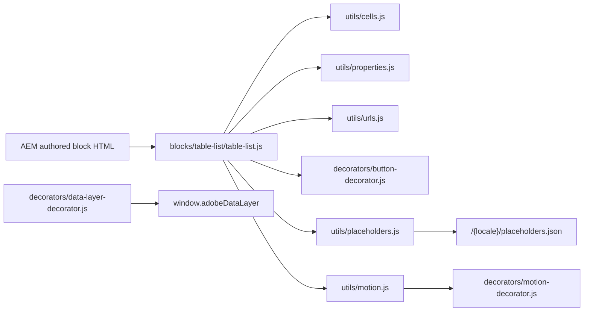

## For QA and Support Teams

| Test ID | Scenario | Configuration | Expected result |
| ------- | -------- | ------------- | --------------- |
| TABLE-LIST-QA-01 | Default | New block, 4 items with title, description, link | Variation 1: filled call to action (with a Link), arrows, numbers only below 600px |
| TABLE-LIST-QA-02 | Variation 2 | Variation 2 | Outline call to action, no numbers, outline Explore buttons |
| TABLE-LIST-QA-03 | Variation 3 | Variation 3, trademarks | Text link, numbers 01–04, diagonal arrows, ™ / ® after titles |
| TABLE-LIST-QA-04 | Option overrides | Style Text link, Numbers Hide, Item link Button on Variation 1 | Overrides applied |
| TABLE-LIST-QA-05 | Maximum items | 6 items, Maximum items 4 | 4 rows on the page; 2 dimmed in the editor |
| TABLE-LIST-QA-06 | Heading Type | H3 | `h3` heading, `h4` item titles |
| TABLE-LIST-QA-07 | Missing links | Item without Link (Arrow, then Button) | Decorative arrow; no button on the page, preview in the editor |
| TABLE-LIST-QA-08 | Unsupported link | Call to action Link `mailto:` | No call to action |
| TABLE-LIST-QA-09 | AEM path | Link `/content/tcs-corp/us/en/products.html` | `href="/en/products"` |
| TABLE-LIST-QA-10 | Custom numbers | Item Number 10 | "10" instead of the position |
| TABLE-LIST-QA-11 | Multiple instances | Two Table Lists | Ids `table-list-1`, `table-list-2` in the data layer |
| TABLE-LIST-QA-12 | Viewports | 375, 768, 1024, 1440px | Layout per variation as in Responsive Behavior |
| TABLE-LIST-QA-13 | Keyboard | Tab through the block | Focus outline on arrows; Enter follows links; description links reachable |
| TABLE-LIST-QA-14 | Data layer | Click an arrow and the call to action | `cmp:click`, `interaction: link`, `dc:title` "Explore {title}" / link text |
| TABLE-LIST-QA-15 | Legacy motion | Block with stored `motion` = fade | Rows fade in (Animation Type Fade in, slow) outside the editor |
| TABLE-LIST-QA-16 | Legacy header regression | Block with a heading / link header row | Header rendered from it |
| TABLE-LIST-QA-17 | Reduced motion | `prefers-reduced-motion: reduce` | No animation, no arrow transition |
| TABLE-LIST-QA-18 | Variation 4 | Variation 4, 4 items, call to action Text and Link | Outline call to action on light grey, no numbers, arrows; title / description / arrow columns from 600px, description at most 21.15rem from 900px; divider below the last row |
| TABLE-LIST-QA-19 | Variation 4 states | Hover a row, then Tab to its arrow | Row background `--color-bg-secondary`, arrow dark, focus outline on the arrow; a Button item link row isn't highlighted |
| TABLE-LIST-QA-20 | Variation 4 mobile | 375px | Call to action below the heading; title, description and arrow stacked |
| TABLE-LIST-QA-22 | Variation 5 | Variation 5, Dark Green, three items without Link | Uppercase labels beside 23.55rem descriptions from 44rem, no arrows, dividers below every row |
| TABLE-LIST-QA-23 | Variation 6 | Variation 6, four items with Trademark ™ and Links | Description top left, right-aligned 4rem title with ™, 24px arrow centred on the title |
| TABLE-LIST-QA-24 | Models & Data | Variation 4, Navy, Eyebrow, Heading position Beside, Numbers Show, Circled arrow | Two columns from 900px; titles above descriptions; circled arrows 40% white; no divider below the last row |
| TABLE-LIST-QA-25 | Narrow list | Variation 4 or 5 in a Columns Container column | Rows switch layout by the list width (container query), not the screen width |
| TABLE-LIST-QA-21 | Variation 4 dark | Background color Black or Dark Green | Light text, white arrow, transparent outline call to action; hover 5% white |

## Troubleshooting

| Symptom | Likely cause | Diagnostic steps | Resolution | Verification |
| ------- | ------------ | ---------------- | ---------- | ------------ |
| Some items are missing | Maximum items (default 4) lower than the item count | Check Content › Maximum items; dimmed items in the editor | Raise it (up to 10) or remove items | All items appear |
| Call to action missing | Link empty or unsupported | Check the Link value | Pick a page or a full URL | Call to action renders |
| Arrow not clickable / no button | Item Link empty or unsupported | Select the item, check Link | Set the Link | Arrow or button navigates |
| Wrong button text | Item Button text empty or equal to the URL; Item link not Button | Check item and block Button text | Set the texts; Item link Button | Expected text |
| Heading Type has no effect | Heading delivered without a heading element | Inspect the page's `.plain.html` listHeading cell | Re-select Heading Type and re-enter the Heading; escalate if it persists | Heading at the chosen level |
| Item visible in the editor, missing on the page | A two-cell row read as the legacy header | Count the row's cells in `.plain.html` | Fill the item's other fields; escalate to development | Item renders on preview |
| Unexpected numbers | Show on mobile only or Hide default; Number not 1–3 digits | Check Items › Numbers and item Numbers | Set Numbers Show; use values like 01 | Numbers as intended |
| Rows appear late | An Animation Type (or a stored Motion Type) is set | Check the Additional tab | Animation Type None | Rows visible at once |

Evidence to collect: page URL (preview / live), viewport width, the block's `.plain.html` rows, the block classes, console messages, the relevant `window.adobeDataLayer` entries. No credentials or tokens.

## Performance Considerations

- **Initialization:** decorated with its section; waits for the placeholders sheet (shared by all blocks, cached).
- **Images:** none; arrows are CSS masks of SVG icons.
- **Dynamic imports / requests:** none of its own.
- **DOM size:** at most 10 rows on the page; the authored rows are reused.
- **Listeners / observers:** none on the page (a click guard only on editor previews); the motion decorator observes the block when an animation is set.
- **Layout shift risks:** the block rebuilds its children on decoration; items above Maximum items are left out.
- **High-cost configurations:** none identified.

## Security and Privacy

- Link values are accepted only as `#anchor`, `/path` or `http(s)://…`; anything else (e.g. `javascript:`, `mailto:`) is ignored. Same-origin paths are normalized with `toSitePath`.
- Headings, titles, numbers and button texts are set with `textContent`; the description is the AEM-delivered rich text moved as is.
- No external content, query string handling or personal data.

## Known Limitations

| Limitation | Impact | Workaround | Planned correction |
| ---------- | ------ | ---------- | ------------------ |
| At most 10 items | Longer lists need another block | List or Filter List | Not planned |
| Titles and headings are plain text | Formatting is dropped | — | Not recorded |
| Only `/`, `#` and `http(s)` links | No `mailto:` / `tel:` | — | Not recorded |
| No images | Text-led only | Cards or List | Not planned |
| A two-cell row without editor instrumentation is read as the legacy header | An item may disappear on the published page | Fill the item's other fields | To be confirmed (handover 6.18.13 Issue 6) |
| The legacy header item can't be added any more but is still read | Old lists keep their header | Move it into the block fields | Not recorded |
| Item clicks carry no position or item id | Item-level reporting only by `dc:title` / URL | — | Not recorded |
| No unit tests | Regressions found only by manual checks | QA table above | Not recorded |

## Related Documentation

- [Blocks documentation](../README.md)
- [Cards](../cards/README.md), [List](../list/README.md), [Filter List](../filter-list/README.md), [Table](../table/README.md), [Accordion](../accordion/README.md), [Anchor List](../anchor-list/README.md)
- Model: [`_table-list.json`](_table-list.json)
- [Animation and skeletons](../../docs/animation/README.md)
- [Table List showcase](../../docs/showcase/table-list-showcase.md): every variation (70) on 14 Universal Editor pages, `block-library/table-list/table-list-showcase-01` … `-14` of the language master; content package `docs/showcase/tcs-corp-table-list-showcase-content-1.1.0.zip`, built by `node tools/showcase/build-table-list-showcase.mjs` from `tools/showcase/table-list-showcase-data.mjs` (add a variation there when the block gets one)
- [Handover 6.18 Table List Block](../../docs/handover/TCS-CORP-HANDOVER.md)

<!-- BEGIN GENERATED: usage (npm run build:docs) -->

Pages of the block library package 1.0.14 (language master, `/content/tcs-corp/language-master/en`) that contain the block, 23 instance(s) in total:
- Block library: `block-library/animation/repeated-items`, `block-library/table-list/item-actions`, `block-library/table-list/motion`, `block-library/table-list/numbers`, `block-library/table-list/numbers-on-mobile`, `block-library/table-list/table-list`
- Curated design pages: `curated-design-pages/case-study`, `curated-design-pages/collection`, `curated-design-pages/home`, `curated-design-pages/industry-landing-page`, `curated-design-pages/product`, `curated-design-pages/what-we-do`

Project-wide standards: [knowledge base](../../docs/handover/knowledge-base/README.md) ([block governance](../../docs/handover/knowledge-base/blocks.md)).

<!-- END GENERATED: usage -->

## Change History

| Version | Change | Source | Date |
| ------- | ------ | ------ | ---- |
| Not recorded | README generated from verified implementation and approved handover documentation | Repository review | Not recorded |
| Handover 2.8 | Dialog tabs Content / Items / Additional | docs/handover revision history | 17 October 2026 |
| Handover 2.18 | Additional tab Content animation; Table List Motion Type kept, replaced by the new fields when set | docs/handover revision history | 18 October 2026 |
| Handover 2.27 | Block ecosystem audit: Table List Motion Type removed from the dialog (it duplicated Animation Type); library content migrated | docs/handover revision history | 19 October 2026 |
| Handover 2.31 | Verified on aem.live: Table List items without sample text | docs/handover revision history | 20 October 2026 |
| Handover 2.43 | Variation 5 - Approach (`approach`) and Variation 6 - Platforms (`platforms`); Eyebrow (`listEyebrow`), Heading position (`headerPosition`), Background color Navy and Item link Circled arrow (`icons/arrow-right-circle.svg`), for the prototypes Figma Case Study, Product and What we do sections; Variation 4 rows follow the list width, keep the Figma gutter and the Figma dark colours; Variations 1–3 unchanged (computed styles compared at 375, 1024 and 1440px) | docs/handover revision history | 23 October 2026 |
| Handover 2.42 | Variation 4 - Segments (`segments`) from the TCS Designs - Prototypes Figma "List Item - Industry"; Variations 1–3, fields and stored values unchanged (computed styles compared before / after at 375, 1024 and 1440px) | docs/handover revision history | 23 October 2026 |
