# Table

The Table block presents structured, comparable information as a native, accessible HTML
`table`, built from Row items of one to five rich-text columns. The first row is the column
header row unless No Header is chosen, the first column can hold row headers (First Column
Header), the heading directly before the table names it, and a table wider than its container
scrolls inside a labelled region keyboard users can focus. It is based on the Block Collection
table.

| Attribute | Value |
| --------- | ----- |
| Technical name | `table` (template name "Table", block class `table`) |
| Display name | Table |
| Block type | Container block with Row items |
| Status | Active |
| Parent / children | Added to a Section, a Columns Container column or a Tabs Container tab (filters `section`, `columns-container`, `tabs`); children: Row (`table-row`, `table-col-2`, `table-col-3`, `table-col-4`, `table-col-5`, one per Columns setting) |
| Owner / version / date | Not recorded |

## Overview

**Business purpose.** Publish tabular data (facts, comparisons, schedules, specifications) that is
readable on every device, understood by screen readers and indexable, without images of tables.

**User experience.** A full-width table with a semibold header row on a 2px rule, light row
separators, optional zebra stripes or cell borders; on narrow screens a wide table scrolls
sideways inside the block while the page stays put.

**Templates / page types.** Any page type.

**Data source.** The Row items authored in the block; the heading before it names the table.

**Related blocks.** Table List (`blocks/table-list`, list-style rows with actions), Columns
Container (layout, not data), List / Cards (collections of items).

**When to use.** Two-dimensional data where each value relates to a row and a column; up to five
columns of short values.

**When not to use.** Page layout or side-by-side content (Columns Container); a single list (a
bulleted list or List / Cards); more than five columns, merged cells, sorting, filtering or
pagination (not implemented).

**Realistic use cases.**

- Quarterly results in a press release (Quarter, Revenue, Growth, Margin).
- Key facts as label / value rows (Founded, Headquarters, Employees, Countries).
- An event agenda (Time, Session, Speaker).
- Capability by region matrix with row headers.

## Visual Reference

<!-- BEGIN GENERATED: screenshots (npm run build:docs) -->

Screenshots of the handover (6.25 Table Block), taken on the preview with sample content; they show the rendering at the time of the handover revision that added them (later changes are in the sections below and the handover's revision history):

**Desktop rendering** — At 1440 px: the H2 Quarterly results above a full-width 4-column table, the header row Quarter, Revenue, Growth, Margin in semibold with a 2px dark rule below, and four body rows Q1 FY26 to Q4 FY26 separated by light 1px rules, text 1.125rem.


**Tablet rendering** — At 768 px: the H2 Quarterly results and the same 4-column table (Quarter, Revenue, Growth, Margin; Q1 FY26 to Q4 FY26) still fitting the content width, with the smaller 0.75rem text used below 900 px.

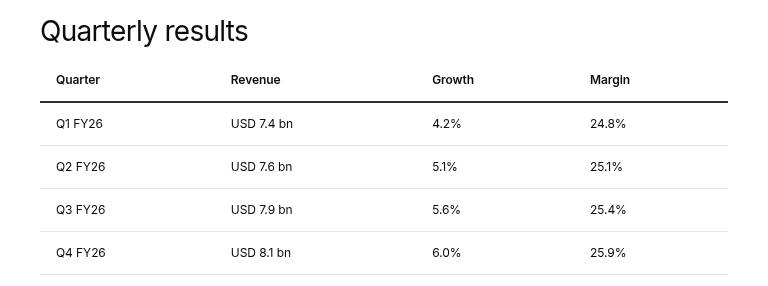

**Mobile rendering** — At 390 px: the H2 Industry capabilities and a 5-column table wider than the screen, showing its first columns with the rest reachable by horizontal scrolling, and a 2px brand-blue focus outline around the block after pressing Tab.

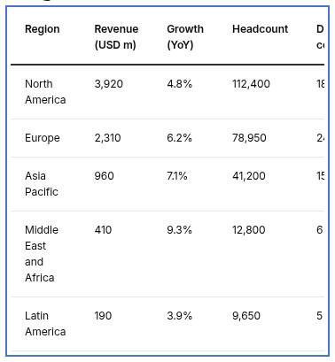

**Variation example** — At 1440 px: the H2 Service availability above a 3-column table with the semibold header row Service, Region, Availability on a 2px dark rule and three body rows (Cloud migration, Enterprise AI platform, Quantum readiness assessment) with light separators.

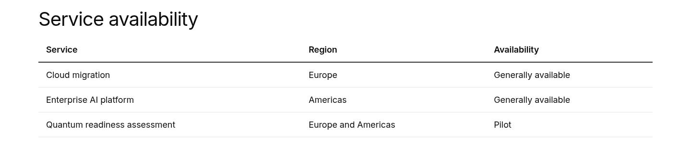

**Variation example** — At 1440 px: the H2 Key facts above a 2-column table without a header row: four rows Founded 1968, Headquarters Mumbai, India, Employees More than 600,000 and Countries 55, all in regular weight, with a 2px dark rule above the first row.

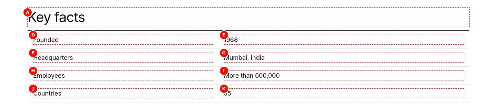

**Variation example** — At 1440 px: the H2 Capabilities by region above a 4-column matrix: the header row Capability, Europe, Americas, Asia Pacific and, in each body row, the first cell (Cloud operations, Enterprise AI, Cyber defence centre) in semibold as the row title, values Available, Pilot or Planned.

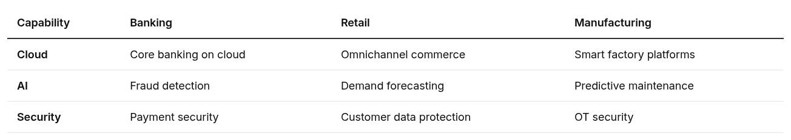

**Variation example** — At 1440 px: the H2 Company facts above a 2-column table without a header row and with a 2px dark rule above the first row; the labels Founded, Headquarters, Employees and Countries in semibold, the values 1968, Mumbai, India, More than 600,000 and 55 in regular weight.

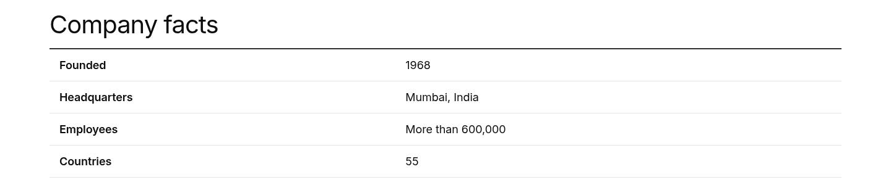

**Variation example** — At 1440 px: the H2 Our offices above a 3-column table with the header row Office, Region, Focus and eight body rows from Amsterdam to Toronto; the 1st, 3rd, 5th and 7th body rows (Amsterdam, Frankfurt, Madrid, Paris) on a light grey background.

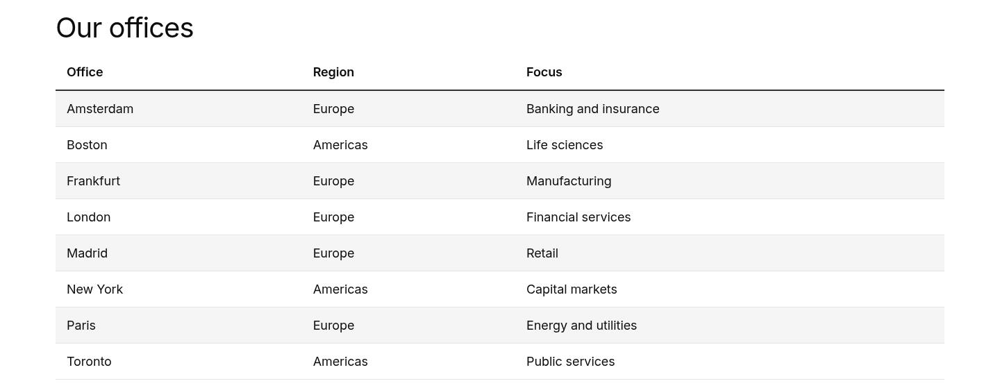

**Variation example** — At 1440 px: the H2 Revenue share by region above a 5-column numeric table, the header row Region, FY22, FY23, FY24, FY25 and four rows (Europe, North America, Asia Pacific, Rest of world) with percentages, a 1px light grey border around every cell.

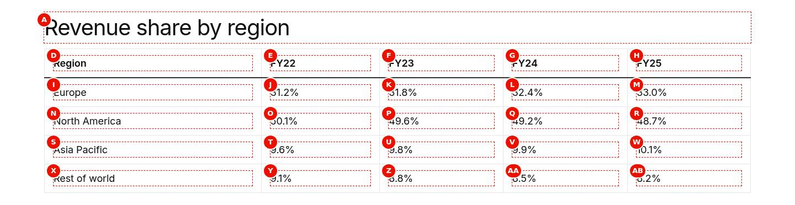

**Variation example** — At 1440 px: the H2 What we offer above a one-column table with the semibold header cell Offerings and four rows Consulting, Cloud, Cybersecurity and Enterprise AI separated by light rules.

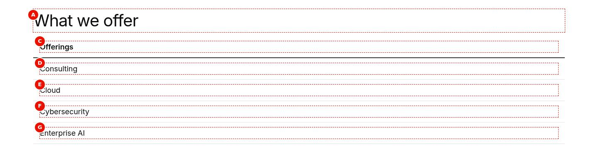

**Variation example** — At 1440 px: the H2 Glossary above a 2-column table with the header row Term, Definition and three rows defining Agentic AI, Hybrid cloud and Zero trust in full sentences.

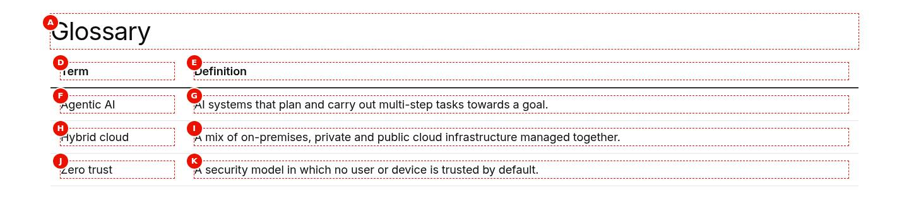

**Variation example** — At 1440 px: the H2 Agenda above a 3-column table with the header row Time, Session, Speaker and three rows: 09:00 Welcome and keynote with Anita Rao, 10:00 Modernising the core on hybrid cloud with Marcus Khan, 11:15 Panel: security by design with Sara Lee.

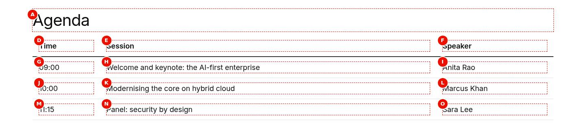

**Variation example** — At 1440 px: the H2 Quarterly results above a 4-column table, the header row Quarter, Revenue, Growth, Margin in semibold and four body rows Q1 FY26 to Q4 FY26 with revenue, growth and margin figures.

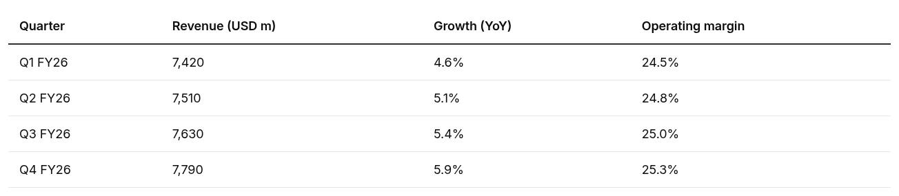

**Variation example** — At 1440 px: the H2 Industry capabilities above a 5-column table, the header row Capability, Banking, Retail, Manufacturing, Insurance and four rows (Cloud migration, Enterprise AI, Cybersecurity, Consulting), fitting the desktop width without scrolling.

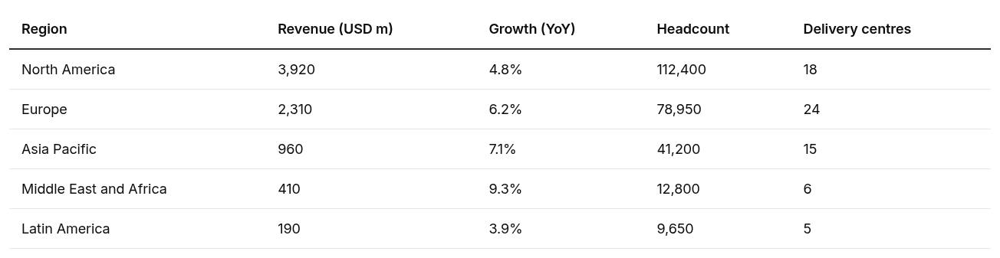

**Variation example** — At 390 px: the H2 Industry capabilities and the 5-column table scrolled sideways inside the block to its middle columns, with the 2px brand-blue focus outline around the block after pressing Tab; the page itself does not scroll.

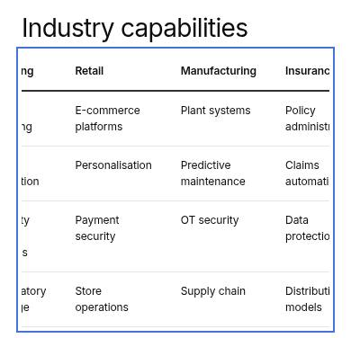

**Universal Editor canvas** — Universal Editor edit mode at 1440 px: the H2 Client offices (A) above a 3-column Table (B) with the header row Office, Region, Focus (C) and four body rows Amsterdam to London, the second row hovered; D marks a cell, E a body Row. F, the Add (+) of the Table in the content tree, is not on the canvas. (Annotated preview in editor mode with sample content; letters as in the annotations list, not a Universal Editor screenshot; file screenshots/table-authoring-view.jpg)

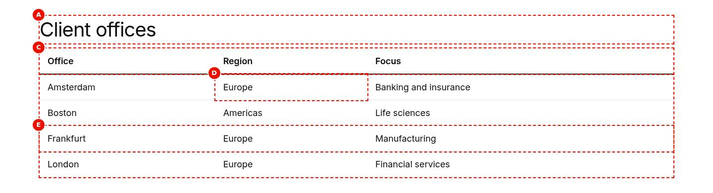

**Properties panel** — The properties panel of the selected Table showing the Content tab (Options multiselect with Border and Header groups, Columns select) and the Additional tab. (Dialog reference generated from the component model, not a Universal Editor screenshot; file screenshots/table-properties-panel.jpg)

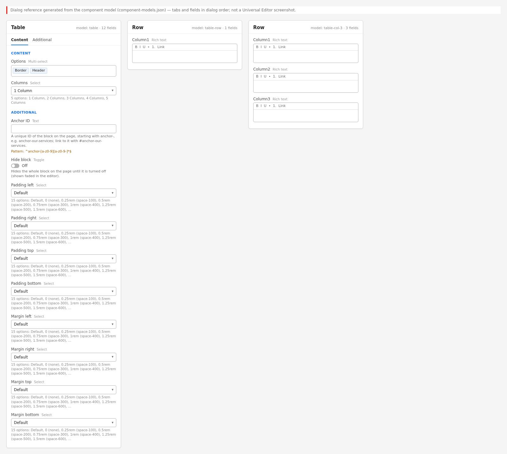

Universal Editor dialogs (no screenshot exists yet; to be captured on AEM author):

```text
[Screenshot Placeholder]

File name:
table-dialog-content-desktop.png

Purpose:
The Content tab of the Table properties in Universal Editor, with the fields of the table "Content tab — Table" in Authorable Fields below.

Annotations:
A = Options
B = Columns
```

```text
[Screenshot Placeholder]

File name:
table-dialog-additional-desktop.png

Purpose:
The Additional tab of the Table properties in Universal Editor, with the fields of the table "Additional tab — Table" in Authorable Fields below.

Annotations:
A = Anchor ID
B = Hide block
C = Animation Type
D = Motion Speed
E = Animation Trigger
F = Padding left
G = Padding right
H = Padding top
I = Padding bottom
J = Margin left
```

```text
[Screenshot Placeholder]

File name:
table-row-dialog-fields-desktop.png

Purpose:
The dialog of the Row properties in Universal Editor, with the fields of the table "Fields — Row" in Authorable Fields below.

Annotations:
A = Column 1
```

```text
[Screenshot Placeholder]

File name:
table-col-2-dialog-fields-desktop.png

Purpose:
The dialog of the Row properties in Universal Editor, with the fields of the table "Fields — Row" in Authorable Fields below.

Annotations:
A = Column 1
B = Column 2
```

```text
[Screenshot Placeholder]

File name:
table-col-3-dialog-fields-desktop.png

Purpose:
The dialog of the Row properties in Universal Editor, with the fields of the table "Fields — Row" in Authorable Fields below.

Annotations:
A = Column 1
B = Column 2
C = Column 3
```

```text
[Screenshot Placeholder]

File name:
table-col-4-dialog-fields-desktop.png

Purpose:
The dialog of the Row properties in Universal Editor, with the fields of the table "Fields — Row" in Authorable Fields below.

Annotations:
A = Column 1
B = Column 2
C = Column 3
D = Column 4
```

```text
[Screenshot Placeholder]

File name:
table-col-5-dialog-fields-desktop.png

Purpose:
The dialog of the Row properties in Universal Editor, with the fields of the table "Fields — Row" in Authorable Fields below.

Annotations:
A = Column 1
B = Column 2
C = Column 3
D = Column 4
E = Column 5
```

<!-- END GENERATED: screenshots -->

States without a screenshot:

```text
[Screenshot Placeholder]

File name:
table-authoring-universal-editor-desktop.png

Purpose:
The Table selected in Universal Editor with the properties panel (Options, Columns) and its Rows in the content tree.

Annotations:
A = Options multiselect
B = Columns select
C = Rows in the content tree
D = Add (+) offering the Row of the chosen column count
```

```text
[Screenshot Placeholder]

File name:
table-striped-bordered-mobile.png

Purpose:
Striped and Bordered combined at 390 px, scrolled sideways inside the block.

Annotations:
A = Striped body rows
B = Cell borders
C = The scroll region
```

```text
[Screenshot Placeholder]

File name:
table-padded-rows-desktop.png

Purpose:
A table whose Rows have different column counts (Columns changed after Rows were added): shorter rows padded with empty cells.

Annotations:
A = The padded empty cells
```

```text
[Screenshot Placeholder]

File name:
table-empty-editor-desktop.png

Purpose:
A Table without Rows in Universal Editor: nothing visible on the canvas; the block is selectable in the content tree.

Annotations:
A = The empty block position
B = The Table in the content tree
```

## For Content Authors

1. **Add the block.** Select a Section, a Columns Container column or a Tabs Container tab, choose
   Add (+) and pick **Table**.
2. **Open its properties.** Select the Table; the panel has the **Content** and **Additional**
   tabs.
3. **Choose Columns first.** Set **Columns** (1 to 5); it decides which Row the Add (+) of the
   Table offers. Changing it later affects only Rows added afterwards.
4. **Choose Options.** In **Options** select Striped and / or Bordered (Border group), No Header
   and / or First Column Header (Header group), or nothing.
5. **Add the Rows.** Select the Table, choose Add (+) and pick **Row**; fill Column 1 to Column N.
   Add the header Row first (unless No Header); reorder Rows by dragging them in the content tree.
6. **Name the table.** Put a heading (Title) as the last element right before the Table in the same
   section.
7. **Preview** at desktop, tablet and mobile widths; check that only the table scrolls on mobile.
8. **Publish** the page.
9. **Validate the published output:** header row, row headers and options look as intended; a
   screen reader announces the table with the heading's name.

**Minimum required:** at least one Row (an empty Table renders nothing visible).
**Recommended:** a header Row, a heading right before the table, the right Columns before adding
Rows. **Optional:** Options, the Additional tab.

## Authorable Fields

<!-- BEGIN GENERATED: fields (npm run build:docs) -->

### Table (`table`)

Model `table`; template name "Table" (the block class AEM renders); children: `table-row`.

#### Content tab — Table

| Field label | Property | Type | Required | Default | Allowed values | Author guidance | Example |
| ----------- | -------- | ---- | -------- | ------- | -------------- | --------------- | ------- |
| Options | `classes` | multiselect | No | "" | Border (`undefined`), Header (`undefined`) | — | — |
| Columns | `filter` | select | No | `table` | 1 Column (`table`), 2 Columns (`table-2-columns`), 3 Columns (`table-3-columns`), 4 Columns (`table-4-columns`), 5 Columns (`table-5-columns`) | — | table-4-columns |

#### Additional tab — Table

| Field label | Property | Type | Required | Default | Allowed values | Author guidance | Example |
| ----------- | -------- | ---- | -------- | ------- | -------------- | --------------- | ------- |
| Anchor ID | `classes_anchor` | text | No | — | regExp: ^anchor-[a-z0-9][a-z0-9-]*$; customErrorMsg: Start with anchor-, then lower-case letters, digits and hyphens. | A unique ID of the block on the page, starting with anchor-, e.g. anchor-our-services; link to it with #anchor-our-services. Delivered as a block class. | — |
| Hide block | `classes_hideblock` | boolean | No | `false` | on / off | Hides the whole block on the page until it is turned off (shown faded in the editor). Delivered as a block class. | — |
| Animation Type | `classes_animation` | select | No | "" | None (""), Fade in (`motion-fade-in`), Fade up (`motion-fade-up`), Fade down (`motion-fade-down`), Fade left (`motion-fade-left`), Fade right (`motion-fade-right`), Slide up (`motion-slide-up`), Slide down (`motion-slide-down`), Slide left (`motion-slide-left`), Slide right (`motion-slide-right`), Scale in (`motion-scale-in`) | How the block's content appears; repeated items (cards, list items, accordion items, columns) appear one after another. None: shown as is. Not played in the editor or when the visitor prefers reduced motion. Delivered as a block class. | — |
| Motion Speed | `classes_animationspeed` | select | No | "" | Medium (""), Fast (`motion-fast`), Slow (`motion-slow`) | How fast the animation runs: 0.3, 0.6 or 0.9 seconds. Shown when `classes_animation` is set and `classes_animation` is not empty. Delivered as a block class. | — |
| Animation Trigger | `classes_animationtrigger` | select | No | "" | On Scroll / Viewport Entry (""), On Page Load (`motion-on-load`) | When the block's animations run. On Scroll: when the block comes into view (at once if it is in view when the page opens). On Page Load: as soon as the block is ready, wherever it is on the page. Shown when `classes_animation` is set and `classes_animation` is not empty. Delivered as a block class. | — |
| Padding left | `classes_paddingleft` | select | No | "" | Default (""), 0 (none) (`pl-0`), 0.25rem (space-100) (`pl-100`), 0.5rem (space-200) (`pl-200`), 0.75rem (space-300) (`pl-300`), 1rem (space-400) (`pl-400`), 1.25rem (space-500) (`pl-500`), 1.5rem (space-600) (`pl-600`), 2rem (space-800) (`pl-800`), 2.5rem (space-1000) (`pl-1000`), 3rem (space-1200) (`pl-1200`), 4rem (space-1600) (`pl-1600`), 5rem (space-2000) (`pl-2000`), 6rem (space-2400) (`pl-2400`), 7.5rem (space-3000) (`pl-3000`) | Delivered as a block class. | — |
| Padding right | `classes_paddingright` | select | No | "" | Default (""), 0 (none) (`pr-0`), 0.25rem (space-100) (`pr-100`), 0.5rem (space-200) (`pr-200`), 0.75rem (space-300) (`pr-300`), 1rem (space-400) (`pr-400`), 1.25rem (space-500) (`pr-500`), 1.5rem (space-600) (`pr-600`), 2rem (space-800) (`pr-800`), 2.5rem (space-1000) (`pr-1000`), 3rem (space-1200) (`pr-1200`), 4rem (space-1600) (`pr-1600`), 5rem (space-2000) (`pr-2000`), 6rem (space-2400) (`pr-2400`), 7.5rem (space-3000) (`pr-3000`) | Delivered as a block class. | — |
| Padding top | `classes_paddingtop` | select | No | "" | Default (""), 0 (none) (`pt-0`), 0.25rem (space-100) (`pt-100`), 0.5rem (space-200) (`pt-200`), 0.75rem (space-300) (`pt-300`), 1rem (space-400) (`pt-400`), 1.25rem (space-500) (`pt-500`), 1.5rem (space-600) (`pt-600`), 2rem (space-800) (`pt-800`), 2.5rem (space-1000) (`pt-1000`), 3rem (space-1200) (`pt-1200`), 4rem (space-1600) (`pt-1600`), 5rem (space-2000) (`pt-2000`), 6rem (space-2400) (`pt-2400`), 7.5rem (space-3000) (`pt-3000`) | Delivered as a block class. | — |
| Padding bottom | `classes_paddingbottom` | select | No | "" | Default (""), 0 (none) (`pb-0`), 0.25rem (space-100) (`pb-100`), 0.5rem (space-200) (`pb-200`), 0.75rem (space-300) (`pb-300`), 1rem (space-400) (`pb-400`), 1.25rem (space-500) (`pb-500`), 1.5rem (space-600) (`pb-600`), 2rem (space-800) (`pb-800`), 2.5rem (space-1000) (`pb-1000`), 3rem (space-1200) (`pb-1200`), 4rem (space-1600) (`pb-1600`), 5rem (space-2000) (`pb-2000`), 6rem (space-2400) (`pb-2400`), 7.5rem (space-3000) (`pb-3000`) | Delivered as a block class. | — |
| Margin left | `classes_marginleft` | select | No | "" | Default (""), 0 (none) (`ml-0`), 0.25rem (space-100) (`ml-100`), 0.5rem (space-200) (`ml-200`), 0.75rem (space-300) (`ml-300`), 1rem (space-400) (`ml-400`), 1.25rem (space-500) (`ml-500`), 1.5rem (space-600) (`ml-600`), 2rem (space-800) (`ml-800`), 2.5rem (space-1000) (`ml-1000`), 3rem (space-1200) (`ml-1200`), 4rem (space-1600) (`ml-1600`), 5rem (space-2000) (`ml-2000`), 6rem (space-2400) (`ml-2400`), 7.5rem (space-3000) (`ml-3000`) | Delivered as a block class. | — |
| Margin right | `classes_marginright` | select | No | "" | Default (""), 0 (none) (`mr-0`), 0.25rem (space-100) (`mr-100`), 0.5rem (space-200) (`mr-200`), 0.75rem (space-300) (`mr-300`), 1rem (space-400) (`mr-400`), 1.25rem (space-500) (`mr-500`), 1.5rem (space-600) (`mr-600`), 2rem (space-800) (`mr-800`), 2.5rem (space-1000) (`mr-1000`), 3rem (space-1200) (`mr-1200`), 4rem (space-1600) (`mr-1600`), 5rem (space-2000) (`mr-2000`), 6rem (space-2400) (`mr-2400`), 7.5rem (space-3000) (`mr-3000`) | Delivered as a block class. | — |
| Margin top | `classes_margintop` | select | No | "" | Default (""), 0 (none) (`mt-0`), 0.25rem (space-100) (`mt-100`), 0.5rem (space-200) (`mt-200`), 0.75rem (space-300) (`mt-300`), 1rem (space-400) (`mt-400`), 1.25rem (space-500) (`mt-500`), 1.5rem (space-600) (`mt-600`), 2rem (space-800) (`mt-800`), 2.5rem (space-1000) (`mt-1000`), 3rem (space-1200) (`mt-1200`), 4rem (space-1600) (`mt-1600`), 5rem (space-2000) (`mt-2000`), 6rem (space-2400) (`mt-2400`), 7.5rem (space-3000) (`mt-3000`) | Delivered as a block class. | — |
| Margin bottom | `classes_marginbottom` | select | No | "" | Default (""), 0 (none) (`mb-0`), 0.25rem (space-100) (`mb-100`), 0.5rem (space-200) (`mb-200`), 0.75rem (space-300) (`mb-300`), 1rem (space-400) (`mb-400`), 1.25rem (space-500) (`mb-500`), 1.5rem (space-600) (`mb-600`), 2rem (space-800) (`mb-800`), 2.5rem (space-1000) (`mb-1000`), 3rem (space-1200) (`mb-1200`), 4rem (space-1600) (`mb-1600`), 5rem (space-2000) (`mb-2000`), 6rem (space-2400) (`mb-2400`), 7.5rem (space-3000) (`mb-3000`) | Delivered as a block class. | — |

### Row (`table-row`)

Model `table-row`; template name "Row" (the block class AEM renders).

#### Fields — Row

| Field label | Property | Type | Required | Default | Allowed values | Author guidance | Example |
| ----------- | -------- | ---- | -------- | ------- | -------------- | --------------- | ------- |
| Column 1 | `column1text` | richtext | No | — | — | — | — |

### Row (`table-col-2`)

Model `table-col-2`; template name "Row" (the block class AEM renders).

#### Fields — Row

| Field label | Property | Type | Required | Default | Allowed values | Author guidance | Example |
| ----------- | -------- | ---- | -------- | ------- | -------------- | --------------- | ------- |
| Column 1 | `column1text` | richtext | No | — | — | — | — |
| Column 2 | `column2text` | richtext | No | — | — | — | — |

### Row (`table-col-3`)

Model `table-col-3`; template name "Row" (the block class AEM renders).

#### Fields — Row

| Field label | Property | Type | Required | Default | Allowed values | Author guidance | Example |
| ----------- | -------- | ---- | -------- | ------- | -------------- | --------------- | ------- |
| Column 1 | `column1text` | richtext | No | — | — | — | — |
| Column 2 | `column2text` | richtext | No | — | — | — | — |
| Column 3 | `column3text` | richtext | No | — | — | — | — |

### Row (`table-col-4`)

Model `table-col-4`; template name "Row" (the block class AEM renders).

#### Fields — Row

| Field label | Property | Type | Required | Default | Allowed values | Author guidance | Example |
| ----------- | -------- | ---- | -------- | ------- | -------------- | --------------- | ------- |
| Column 1 | `column1text` | richtext | No | — | — | — | — |
| Column 2 | `column2text` | richtext | No | — | — | — | — |
| Column 3 | `column3text` | richtext | No | — | — | — | — |
| Column 4 | `column4text` | richtext | No | — | — | — | — |

### Row (`table-col-5`)

Model `table-col-5`; template name "Row" (the block class AEM renders).

#### Fields — Row

| Field label | Property | Type | Required | Default | Allowed values | Author guidance | Example |
| ----------- | -------- | ---- | -------- | ------- | -------------- | --------------- | ------- |
| Column 1 | `column1text` | richtext | No | — | — | — | — |
| Column 2 | `column2text` | richtext | No | — | — | — | — |
| Column 3 | `column3text` | richtext | No | — | — | — | — |
| Column 4 | `column4text` | richtext | No | — | — | — | — |
| Column 5 | `column5text` | richtext | No | — | — | — | — |

<!-- END GENERATED: fields -->

What the tables don't show:

- **Options (`classes`)** is a grouped multiselect; its values become block classes: Striped
  (`striped`: odd body rows on `--color-bg-secondary`), Bordered (`bordered`: a 1px border on every
  cell), No Header (`no-header`: no `thead`; a 2px rule above the first body row), First Column
  Header (`row-header`: the first cell of each body row is a `th scope="row"`). They combine.
- **Columns (`filter`)** selects the component filter of the Table (`table`, `table-2-columns` …
  `table-5-columns`), i.e. which Row model Add offers; the code doesn't read it.
- **Row (Column 1 … Column 5)** are rich text; each Row becomes one `tr`, each column one cell, in
  authored order. Rows of different column counts are padded with empty cells to the widest row.
  New Rows are empty (no sample text in the templates).
- **Accessibility impact:** the header row and row headers become `th` with `scope`; the heading
  before the block names the table (`aria-labelledby`) and the scroll region.
- **Data-layer impact:** none of the fields adds tracking attributes; links in cells are tracked
  centrally.
- **Links in cells:** a link alone in its paragraph is turned into a link button by the content
  buttons decorator before the block is decorated (bold → primary, italic → secondary).
- **Legacy mapping:** none.
- **Additional tab:** as on every block (AGENTS.md "Additional tab"; Animation Type moves the
  block).

## Screenshot-Based Authoring Steps

### Authoring Step 1: Add the Table and set Columns

```text
[Screenshot Placeholder]

File name:
table-authoring-step-1.png

Purpose:
The Table added to a section, the Columns select open on 4 Columns.

Annotations:
A = The Table in the content tree
B = Columns
```

### Values to Enter

| Callout | Field | Value | Reason | Expected result |
| ------- | ----- | ----- | ------ | --------------- |
| A | Component | Table | Adds the block | An empty Table |
| B | Columns | 4 Columns | Quarter, Revenue, Growth, Margin | Add (+) offers Rows with Column 1 to Column 4 |

**Author action:** add the Table and set Columns before adding Rows. **Expected preview:** nothing
visible yet. **Expected published result:** nothing until Rows exist. **Business rules:** Columns
doesn't convert existing Rows. **Validation:** Add (+) on the Table shows a Row with four fields.
**Common mistakes:** adding Rows with 1 Column first.

### Authoring Step 2: Add the header Row and the data Rows

```text
[Screenshot Placeholder]

File name:
table-authoring-step-2.png

Purpose:
The first Row filled with the column titles and a data Row selected in the content tree.

Annotations:
A = Header Row
B = Column 1 to Column 4 of a Row
C = The rendered header row on the canvas
```

### Values to Enter

| Callout | Field | Value | Reason | Expected result |
| ------- | ----- | ----- | ------ | --------------- |
| A | Row 1: Column 1 … Column 4 | Quarter / Revenue / Growth / Margin | Column headers | Semibold header row on a 2px rule |
| B | Row 2: Column 1 | Q1 FY26 | First data row | A body row below the header |

**Author action:** add Rows with Add (+) on the Table and fill them; drag to reorder. **Expected
preview:** the header row, then the data rows with light separators. **Expected published
result:** the same `table`. **Business rules:** the first Row is the header unless No Header is
selected. **Validation:** count the cells of every row. **Common mistakes:** the header Row isn't
first; units missing in the headers ("Revenue (USD bn)").

### Authoring Step 3: Choose the Options

```text
[Screenshot Placeholder]

File name:
table-authoring-step-3.png

Purpose:
The Options multiselect with Striped and First Column Header selected, and the result on the canvas.

Annotations:
A = Options
B = Striped rows
C = Row headers in the first column
```

### Values to Enter

| Callout | Field | Value | Reason | Expected result |
| ------- | ----- | ----- | ------ | --------------- |
| A | Options | Striped, First Column Header | Long table with row labels | Odd body rows grey; first cells semibold row headers |

**Author action:** select the options. **Expected preview / published result:** as described.
**Business rules:** Striped and Bordered combine with everything; No Header and First Column Header
combine (label / value tables). **Validation:** inspect the first column in the accessibility
tree (row headers). **Common mistakes:** No Header on data whose columns need names.

### Authoring Step 4: Name the table

```text
[Screenshot Placeholder]

File name:
table-authoring-step-4.png

Purpose:
A Title directly before the Table in the same section.

Annotations:
A = Title before the Table
B = The Table
```

### Values to Enter

| Callout | Field | Value | Reason | Expected result |
| ------- | ----- | ----- | ------ | --------------- |
| A | Title (component) | Quarterly results | Names the table for screen readers | The table is labelled "Quarterly results" |

**Author action:** add a Title as the last element before the Table. **Expected result:** the
heading gets an id and the table `aria-labelledby`; a scrolling table's region is named after it.
**Common mistakes:** the heading is in another section or followed by a Text: the table is unnamed
and the region is called "Table".

## Variations

### Standard (header row)

- **Purpose:** most tables. **Fields:** Rows, the first one the headers; no Options.
- **Rendering:** `thead` with the first row (`th scope="col"`), `tbody` with the others.
- **Accessibility:** column headers announced with each cell.

### No Header

- **Purpose:** data whose meaning is obvious without column names. **Options:** No Header.
- **Rendering:** no `thead`; a 2px rule above the first body row; all cells `td` (unless First
  Column Header).

### First Column Header

- **Purpose:** row labels (a matrix, specifications). **Options:** First Column Header.
- **Rendering:** the first cell of every body row is `th scope="row"` (semibold, start-aligned); the
  header row's first cell stays a column header.

### Row headers only (No Header + First Column Header)

- **Purpose:** label / value tables (Founded 1968, Headquarters Mumbai, India).
- **Rendering:** no `thead`; semibold row headers in the first column.

### Striped

- **Purpose:** long tables. **Rendering:** odd body rows (1st, 3rd, …) on `--color-bg-secondary`.

### Bordered

- **Purpose:** dense numeric tables. **Rendering:** a 1px `--color-border-default` border on every
  cell.

### 1 to 5 Columns

- **Purpose:** the number of fields per Row (Row models `table-row`, `table-col-2` …
  `table-col-5`). **Dialog:** Columns, before adding Rows.

### Scroll region (automatic)

- **Rendering:** while the table is wider than the block (`scrollWidth > clientWidth + 1`, watched
  with a ResizeObserver), the block gets `tabindex="0"`, `role="region"` and an `aria-label` (the
  heading's text, else the placeholder `table`, "Table"); removed when it fits. The block scrolls
  horizontally (`overflow-x: auto`) and shows a 2px brand focus outline.
- **Responsive:** typical on mobile for 4 and 5 columns.

```text
[Screenshot Placeholder]

File name:
table-row-headers-only-mobile.png

Purpose:
A No Header + First Column Header table at 390 px.

Annotations:
A = Row headers
B = Values
```

Personalization and fallback: none for any variation; every visitor sees the authored rows.

## Complete Authoring Example

Scenario: key facts on an About page as a label / value table.

| Field | Example value | Guidance |
| ----- | ------------- | -------- |
| Title before the block | Key facts | Names the table |
| Columns | 2 Columns | Label and value |
| Options | No Header, First Column Header | Labels are row headers |
| Row 1 | Founded / 1968 | One fact per Row |
| Row 2 | Headquarters / Mumbai, India | |
| Row 3 | Employees / More than 600,000 | |
| Row 4 | Countries / 55 | |

**Steps:** add the Title, then the Table; set Columns and Options; add the four Rows; preview;
publish.

**Expected output:** a 2-column table with a 2px rule above the first row, semibold labels and
regular values, light separators.

**Responsive:** fits at every width; text `--body-font-size-s` below 900px, `--body-font-size-m`
from 900px.

**Accessibility:** labels are `th scope="row"`; the table is labelled "Key facts".

**Analytics / data layer:** `tcs-corp/components/table` (`table-1`); no events unless cells hold
links.

**Personalization fallback:** none.

**Pre-publish checklist:**

1. Columns matches every Row (no padded empty cells).
2. The header Row is first (or No Header is selected).
3. A heading is directly before the table.
4. Units are in the headers; numbers formatted for the locale.
5. Only the table scrolls at 390 px.
6. No empty header cells.

## Content and Asset Guidelines

- **Headers:** short (units in the header); never leave header cells empty.
- **Cells:** short values; descriptive link text inside sentences (a link alone in a cell paragraph
  becomes a link button).
- **Images, icons, tags, metadata:** not part of the design; the block reads no tags or metadata.
- **Min / max items:** 1 to 5 columns (the Row models); no verified technical limit on the number
  of Rows was identified.
- **Localization:** translate every cell; check that translated text doesn't widen the table much;
  number and date formats aren't localised by the block.
- **Missing content:** a Table without Rows renders an empty `table` (nothing visible).

## Accessibility

- **Semantics:** a real `table` with `thead` / `tbody`, `th scope="col"` and `th scope="row"`.
- **Headings and name:** the heading directly before the block (last element of the previous
  default content wrapper, or the previous sibling of the block's wrapper) gets an id
  (`table-title-N`) if needed, and the table `aria-labelledby` to it.
- **Keyboard and focus:** a table wider than its container becomes a focusable, named region with a
  visible focus outline, so keyboard users can scroll it with the arrow keys.
- **Reflow:** no page-level horizontal scrolling; the block scrolls.
- **Contrast:** text `--color-text-default`; on dark section backgrounds the theme tokens apply.
- **Reduced motion:** the Additional tab animation doesn't play.
- **Empty state:** an empty table (no rows) is invisible.

**Author responsibilities:** a heading before every table, a header Row (or row headers), no layout
tables, no empty header cells, units in headers.

**Developer responsibilities:** keep the `scope` attributes, the naming from the heading and the
scroll region with its label from placeholders.

| Key | Expected behavior |
| --- | ----------------- |
| Tab | Moves focus to the table's scroll region when the table overflows, then to links in cells |
| Arrow Left / Arrow Right | Scroll the focused region horizontally (browser behaviour) |

## Data Layer and Analytics

`decorators/data-layer-decorator.js` adds the block as `tcs-corp/components/table`, id = Anchor ID
else `table-{n}`; `dc:title` only if a heading is inside the block (normally not). The block adds no
`data-cmp-*` attributes and pushes nothing itself.

| Trigger | Data-layer event | Required properties | Analytics behavior |
| ------- | ---------------- | ------------------- | ------------------ |
| Block decorated | component state | `@type`, `parentId` | One entry per table |
| Click on a link in a cell | `cmp:click` | `interaction` `link`, `dc:title`, `xdm:linkURL`, `xdm:linkType` (`other`, `exit`, `download`), `breakpoint` | Link and download tracking |

The intended path is Adobe Client Data Layer, then Adobe Data Collection (Tags), the AEP Web SDK,
the Edge Network and Analytics / CJA, but Tags and the Web SDK aren't configured yet (blocked:
measurement plan); no consent mechanism is implemented.

## Personalization

This block does not currently expose verified personalization behavior. There is no Adobe Target
or Journey Optimizer integration in the repository; every visitor sees the authored rows.

## Responsive Behavior

| Viewport | Layout | Image behavior | Interaction behavior |
| -------- | ------ | -------------- | -------------------- |
| Below 900px | Full width; text `--body-font-size-s` (0.75rem in `styles/styles.css` below 900px) | No images by design | A table wider than the block scrolls inside it (focusable region) |
| 900px and wider | Full width; text `--body-font-size-m` (1.125rem from 900px) | — | Scroll region only if the table still overflows |

## For Developers

<!-- BEGIN GENERATED: files (npm run build:docs) -->

```text
blocks/table/
├── README.md
├── _table.json
├── table.css
└── table.js
```

| Decorator/Utility | Purpose | Execution or dependency point |
| ----------------- | ------- | ----------------------------- |
| [`scripts/scripts.js`](../../scripts/scripts.js) | Page decoration (moveInstrumentation and shared page helpers) | `table.js`: { moveInstrumentation } |
| [`utils/ids.js`](../../utils/ids.js) | `nextInstance`, `uniqueId`, `createIdFactory` (unique ids per block instance), `availableId` (an authored id kept, suffixed -2, -3, ... only when taken) | `table.js`: { uniqueId } |
| [`utils/placeholders.js`](../../utils/placeholders.js) | `getPlaceholders`, `loadPlaceholders`, `fillPlaceholder` (UI text from the locale's placeholders, with English fallbacks) | `table.js`: { getPlaceholders } |

<!-- END GENERATED: files -->

**JavaScript (`table.js`).** `decorate` awaits the placeholders, skips the leading empty rows AEM
delivers for the dialog tabs (`isTabRow`: at most one cell, no text, no image or link), and turns
every following row into a `tr` (`moveInstrumentation(row, tr)`) and every cell into a `td` or
`th` (`moveInstrumentation(cell, td)`, content moved as authored). The first row goes to `thead`
unless `no-header`; with `row-header` the first cell of body rows is a row header. Rows are padded
to the widest row. `headingBefore` finds the naming heading; `uniqueId('table-title')` gives it an
id. The block's children are replaced with the table; a ResizeObserver toggles `tabindex`, `role`
and `aria-label` on the block. The module exports only `decorate`.

**CSS (`table.css`).** Scoped to `.table.block`; `overflow-x: auto`; header rule, body separators,
`no-header`, `striped`, `bordered`, row header styles; one media query at 900px.

**Input DOM.** Not key-value: empty rows for the Content and Additional tabs, then one row per Row
item with one cell per column field. Options and the Additional tab arrive as block classes.

**Rendered DOM contract.** `.table.block[.striped][.bordered][.no-header][.row-header]`
`[tabindex="0"][role="region"][aria-label]` > `table[aria-labelledby]` > `thead > tr > th[scope=col]`,
`tbody > tr > (th[scope=row]) td`.

**Events and async behavior.** One ResizeObserver per table (never disconnected); no network
requests besides the placeholders.

**Error handling.** No Rows: an empty `table` with an empty `tbody`. Malformed rows are padded.

**Parent / child contracts.** Row items are plain rows; Universal Editor instrumentation moves to
the `tr` / cells, so in-place editing of cells keeps working.

## Extending the Block

1. **A new option:** add a value to the `classes` multiselect in `_table.json`, style it as
   `.table.block.{value}`; `npm run build:json`, `npm run lint`.
2. **More columns:** add a `table-col-N` model and definition, a filter `table-N-columns` and a
   Columns option in `_table.json`; the code needs no change.
3. **Responsive / accessibility:** keep `th` scopes, the heading name and the scroll region.
4. **Data layer:** links in cells are tracked centrally; mark other controls with
   `data-cmp-interaction`.
5. **Tests:** no block-specific unit tests exist; a pure row-to-table function would be testable in
   `test/` with Node's test runner.
6. **Backward compatibility:** tab rows must keep being skipped (AGENTS.md delivery rules); keep the
   row padding for Rows authored with another Columns value.
7. **Library and docs:** update the block library page, this README, `npm run build:docs`;
   `npm run build:modules` after changing imports.

## For Site Administrators

- **Availability:** in the `section`, `columns-container` and `tabs` filters.
- **Governance:** `_table.json` (block, five Row models, five filters); aggregates generated.
- **Allowed children:** Row of the selected Columns filter only.
- **Localization:** cell text per locale; placeholder `table` per locale.

| Dependency | Purpose | Location | Impact if unavailable |
| ---------- | ------- | -------- | --------------------- |
| Placeholder `table` | Region name without a heading | `/{locale}/placeholders.json` | English "Table" |
| Content buttons decorator | Links alone in a cell paragraph become link buttons | `decorators/content-buttons-decorator.js` | Links stay plain |
| ResizeObserver | Scroll-region detection | Browser | No region attributes (the table still scrolls) |

## For Architects

- **Role:** presentational container block; no data fetching.
- **Content model:** block with Options and Columns (a filter switch) and Row items of 1 to 5
  rich-text fields.
- **Rendering:** client-side conversion of delivered rows into a semantic table.
- **Dependencies:** `scripts/scripts.js` (`moveInstrumentation`), `utils/ids.js`,
  `utils/placeholders.js`.
- **Data layer / Web SDK / Target:** generic component state and link clicks only.
- **Consent / identity / security:** no personal data, no external content.
- **Caching / performance:** part of the page HTML (CDN); tiny JS and CSS; one ResizeObserver.
- **Scalability:** DOM size grows with rows × columns; very long tables are better split.

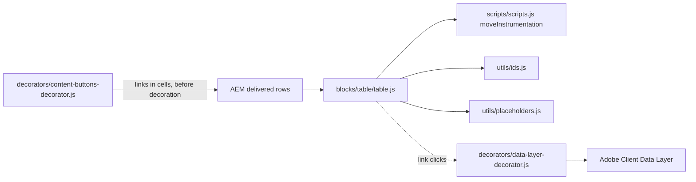

## For QA and Support Teams

| Test ID | Scenario | Configuration | Expected result |
| ------- | -------- | ------------- | --------------- |
| TABLE-QA-01 | Standard | 4 Columns, header Row + 4 Rows | `thead` with `th scope="col"`; 4 body rows |
| TABLE-QA-02 | No Header | No Header | No `thead`; 2px rule above row 1 |
| TABLE-QA-03 | First Column Header | First Column Header | First body cells `th scope="row"` |
| TABLE-QA-04 | Row headers only | No Header + First Column Header | Label / value table |
| TABLE-QA-05 | Striped / Bordered | Each and both | Odd body rows grey / cell borders |
| TABLE-QA-06 | Column counts | 1 to 5 Columns | Add offers the matching Row |
| TABLE-QA-07 | Mixed Rows | Columns changed after Rows | Shorter rows padded with empty cells |
| TABLE-QA-08 | Tab rows | Table authored in AEM | No empty first row; header is the first Row |
| TABLE-QA-09 | Name | Heading right before / not before | `aria-labelledby` present / absent; region "Table" |
| TABLE-QA-10 | Scroll region | 5 Columns at 390 px | Block focusable, named, scrolls; page doesn't |
| TABLE-QA-11 | Resize | Widen the window to 1440 px | Region attributes removed when it fits |
| TABLE-QA-12 | Empty | No Rows | Nothing visible |
| TABLE-QA-13 | Links in cells | Link alone / in a sentence | Link button / inline link; `cmp:click` |
| TABLE-QA-14 | Multiple instances | Two tables | `table-1`, `table-2`; distinct `table-title-N` ids |
| TABLE-QA-15 | Editor | Edit a cell in Universal Editor | Edits in place; the block re-renders |

## Troubleshooting

| Symptom | Likely cause | Diagnostic steps | Resolution | Verification |
| ------- | ------------ | ---------------- | ---------- | ------------ |
| First data row shown as header | The first Row is the header unless No Header | Check Options | Add a header Row first, or select No Header | Header as intended |
| Add offers one-column Rows | Columns is 1 Column | Check Columns | Set Columns; recreate the Rows | New Rows have N fields |
| Empty cells at row ends | Rows of different column counts | Count fields per Row | Recreate short Rows with the right Columns | All rows equal |
| Page scrolls sideways on mobile | A wide element (long URL) or large margins | Device mode; find the overflowing element | Link text instead of URLs; reset margins | Only the table scrolls |
| Screen reader says "Table" | No heading directly before the block | Check `aria-labelledby` and the preceding element | Put the heading right before the Table | Region named after the heading |
| A cell link looks like a button | Link alone in its paragraph (content buttons decorator) | Check the cell's rich text | Write the link inside a sentence | Inline link |
| The first Row disappears | It is empty and has at most one cell (read as a tab row) | Check the first Row's content | Fill or delete the empty Row | The header row shows |

Evidence to collect (no secrets): page URL, `.plain.html` of the block, a screenshot at the failing
width, the block's classes and the accessibility tree of the table.

## Performance Considerations

- Decorated with its section (eager in the first section, else lazy); no images; only placeholders
  fetched.
- Rendered once (no layout shift after decoration); the ResizeObserver only toggles attributes.
- DOM size grows with the rows; split very long tables under separate headings.

## Security and Privacy

- Cell content is moved as delivered by AEM (no HTML strings built); no external content, query
  strings or personal data.

## Known Limitations

| Limitation | Impact | Workaround | Planned correction |
| ---------- | ------ | ---------- | ------------------ |
| Maximum 5 columns | Wider data doesn't fit | Split the table | Not recorded |
| No merged cells, sorting, filtering, `caption`, column alignment or sticky headers | Limited table features | Simplify the data | Not recorded |
| No stacked mobile layout | Wide tables scroll | Fewer columns | Not recorded |
| Changing Columns doesn't convert existing Rows | Padded empty cells | Recreate the Rows | Not planned |
| Only the heading immediately before names the table | Unnamed table otherwise | Place the heading right before | Not recorded |
| An empty first Row with at most one cell is skipped as a tab row | The next Row becomes the header | Don't leave the first Row empty | Not recorded |

## Related Documentation

- [Blocks documentation](../README.md)
- [Columns Container](../columns-container/README.md), [Table List block](../table-list/table-list.js)
- [Model, definitions and filters](_table.json)
- [Content buttons decorator](../../decorators/content-buttons-decorator.js)
- [Block name test](../../test/models/block-names.test.mjs)
- [Handover 6.25 Table Block](../../docs/handover/TCS-CORP-HANDOVER.md)

<!-- BEGIN GENERATED: usage (npm run build:docs) -->

Pages of the block library package 1.0.14 (language master, `/content/tcs-corp/language-master/en`) that contain the block, 12 instance(s) in total:
- Block library: `block-library/table/table`

Project-wide standards: [knowledge base](../../docs/handover/knowledge-base/README.md) ([block governance](../../docs/handover/knowledge-base/blocks.md)).

<!-- END GENERATED: usage -->

## Change History

| Version | Change | Source | Date |
| ------- | ------ | ------ | ---- |
| Not recorded | README generated from verified implementation and approved handover documentation | Repository review | Not recorded |
| Handover 2.18 | Additional tab content animation (Animation Type, Motion Speed, Animation Trigger) | docs/handover revision history | 18 October 2026 |
| Handover 2.27 | Block audit: the Table header taken from the tab rows corrected (tab rows skipped); ragged rows padded (D-D-14) | docs/handover revision history; docs/audit/BLOCK-ECOSYSTEM-AUDIT.md | 19 October 2026 |
| Handover 2.29 | Re-audit: Row templates no longer store "Column1" … (R-D-9); sample content removed from templates | docs/handover revision history; docs/audit/REAUDIT-2026-10-20.md | 20 October 2026 |
