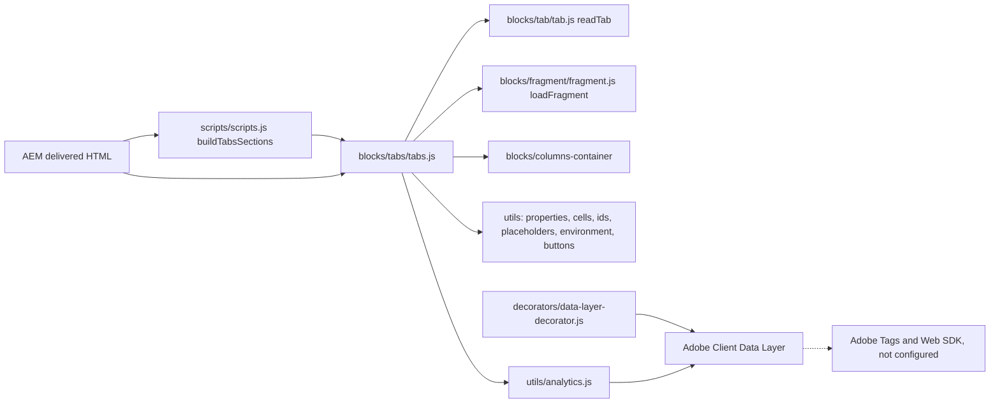

# Tabs

Tabs show one of several related views at a time, under a tab list. The block has two authoring forms that render the same tab list and panels: the **Tabs Container**, a section whose Tab items start the tabs and whose components after each Tab are its content, and the **Tabs** block, a block in a section whose Tab items each show a fragment page.

| Attribute | Value |
|---|---|
| Technical name | `tabs` (block folder and block class); components `tabs` (Tabs Container section), `tabs-block` (Tabs block), `tabs-item` (Tab item of the Tabs block) |
| Display name | Tabs Container; Tabs |
| Block type | Container (section) and block |
| Status | Active |
| Parent / children | Tabs Container: added to the page (`main` filter); children [Tab](../tab/README.md), [Column Break](../column-break/README.md) and the components of the `tabs` filter. Tabs block: added in a Section, a Tabs Container or a Columns Container; children Tab items (`tabs-item`) |
| Owner / version / date | Not recorded |

## Overview

**Business purpose.** Related views of one topic (service lines, industries, regions, reporting periods) share one area of the page: visitors switch between them without scrolling past the others, and every view stays one selection or one `#id` link away.

**User experience.** A row of tab buttons (or, from 900px, a column on the left with Orientation Vertical) above the panel of the selected tab. Clicking a tab or using the arrow keys shows its panel; links to a tab's ID (or to anything inside a tab) open that tab and scroll to it.

**The two forms.**

| Form | Component | Where the content comes from | Use it when |
|---|---|---|---|
| Tabs Container | `tabs` (a section) | The components after each [Tab](../tab/README.md) item, up to the next Tab, authored on the page | Each tab has its own content on this page (text, images, buttons, blocks, columns) |
| Tabs block | `tabs-block` (a block) | The Fragment page chosen on each Tab item (`tabs-item`) | The same tab content is reused on several pages and maintained once |

**Templates / page types.** Any page; no template adds Tabs. **Data source:** authored content only (Tabs Container) or fragment pages (Tabs block); placeholders for UI text. No query index, sheet or taxonomy.

**Related blocks.** [Tab](../tab/README.md) (the tab marker of a Tabs Container), [Column Break](../column-break/README.md) (columns inside a tab), [Columns Container](../columns-container/README.md) (the layout built in a tab with Column Breaks), the Fragment block (`blocks/fragment/fragment.js`, which loads the Tabs block's fragment pages), Accordion (collapsible alternative), Anchor List (its links open tabs through the `tabs:reveal` event).

**When to use.** Two or more parallel, mutually exclusive views with short labels, where visitors usually need one view at a time.

**When not to use.** Content that must be compared side by side or read in sequence (use default content or a [Columns Container](../columns-container/README.md)); many short question / answer items (use the Accordion); a single tab (use a normal section); navigation between pages (use the header or an Anchor List); content that must be visible without interaction (legal notices, the page's main call to action).

**Realistic use cases.** A services overview with the tabs Consulting, Cloud and Cybersecurity, each a heading, a text and a two-column image and text layout (Tabs Container); an industries panel reused on several landing pages (Tabs block with fragment pages under the locale's `references/` or a fragments folder); investor information by period.

## Visual Reference

<!-- BEGIN GENERATED: screenshots (npm run build:docs) -->

Screenshots of the handover (6.21 Tabs Block), taken on the preview with sample content; they show the rendering at the time of the handover revision that added them (later changes are in the sections below and the handover's revision history):

| Screenshot | Shows |
| ---------- | ----- |
| [Desktop rendering](../../docs/handover/screenshots/tabs-desktop-view.jpg) | The Tabs Container at 1440 px: an Underline tab list Consulting, Cloud, Cybersecurity, Data and AI with Cloud selected (semibold, brand underline) above a grey divider; below it the Cloud panel, a Columns with photo-2.svg on the left and the H3 Cloud migration and operations with its text on the right. |
| [Tablet rendering](../../docs/handover/screenshots/tabs-tablet-view.jpg) | The same Tabs at 768 px: the four labels Consulting, Cloud, Cybersecurity, Data and AI fit in one row with Cloud underlined, so the list does not scroll here; the Cloud Columns is stacked, photo-2.svg above the H3 Cloud migration and operations and its text. |
| [Mobile rendering](../../docs/handover/screenshots/tabs-mobile-view.jpg) | The Tabs at 375 px: the tab list shows Consulting, Cloud (selected, underlined) and a cut-off Cybersecu..., with Data and AI off-screen to the right; below it the Cloud panel stacked: photo-2.svg, the H3 Cloud migration and operations on two lines and its text. |
| [Tabs Container variation](../../docs/handover/screenshots/tabs-container-mode.jpg) | A Tabs Container at 1440 px with the tabs Consulting (selected), Cloud and Cybersecurity; the Consulting panel shows the H3 Business and technology consulting, a Columns with photo-1.svg on the left and its text on the right, and the black primary button Explore consulting with an arrow below. |
| [Tabs block variation](../../docs/handover/screenshots/tabs-block-fragments.jpg) | A Tabs block at 1440 px with the tabs Consulting (selected), Cloud and Cybersecurity; the panel shows the fragment page consulting-overview: the H2 Consulting that delivers outcomes and its text, then the Cards heading Consulting capabilities and three cards Strategy, Operations and Change with images, titles and descriptions. |
| [Underline style](../../docs/handover/screenshots/tabs-style-underline.jpg) | Underline tabs at 1440 px: the plain labels Banking (selected, semibold, 3px brand underline), Retail and Manufacturing on a thin grey divider, and below it the Banking text Modern core banking, payments and risk platforms that help banks serve customers in real time. |
| [Boxed style](../../docs/handover/screenshots/tabs-style-boxed.jpg) | Boxed tabs at 1440 px: Banking (selected) is a white box with a thin border and brand-coloured text, open towards the panel; Retail and Manufacturing are light grey boxes with rounded top corners, 0.25rem apart; below, the Banking text. |
| [Pills style](../../docs/handover/screenshots/tabs-style-pills.jpg) | Pill tabs at 1440 px: Banking (selected) is a pill filled with the brand blue and white text; Retail and Manufacturing are outlined pills 0.5rem apart, with no divider under the list; below, the Banking text. |
| [Left alignment](../../docs/handover/screenshots/tabs-alignment-left.jpg) | Left-aligned Underline tabs at 1440 px: Consulting (selected), Cloud and Cybersecurity start at the left edge of the content area with free space on the right of the divider; below, the Consulting text Strategy, operating model design and change management that turn transformation goals into measurable results. |
| [Center alignment](../../docs/handover/screenshots/tabs-alignment-center.jpg) | Centre-aligned Underline tabs at 1440 px: Consulting (selected), Cloud and Cybersecurity centred above the full-width grey divider; below, the left-aligned Consulting text. There is no centred Title above the tabs in this example (the chapter caption mentions one). |
| [Full width alignment](../../docs/handover/screenshots/tabs-alignment-stretch.jpg) | Full width (stretch) Underline tabs at 1440 px: Consulting (selected, its underline a third of the width), Cloud and Cybersecurity share the full width of the content area with their labels centred in each third; below, the Consulting text. |
| [Horizontal orientation](../../docs/handover/screenshots/tabs-orientation-horizontal.jpg) | Horizontal Underline tabs at 1440 px: Consulting (selected), Cloud, Cybersecurity and Data and AI in one row above the panel; the Consulting panel shows a Columns with photo-1.svg on the left and the H3 Business and technology consulting with its text on the right. |
| [Vertical orientation](../../docs/handover/screenshots/tabs-orientation-vertical.jpg) | Vertical Underline tabs at 1200 px: a left column with a thin left border listing Banking, Financial Services and Insurance (selected, semibold, 3px brand left border, wrapped on three lines), Retail and Consumer Goods, Manufacturing and Energy and Utilities; on the right the panel with the H3 Banking, Financial Services and Insurance and its text. |
| [Full Width section](../../docs/handover/screenshots/tabs-width-full.jpg) | A Full Width Tabs Container on a 1920 px screen: the tabs Consulting (selected), Cloud and Cybersecurity and the divider span the page width inside the 5rem section padding; the Consulting Columns stretches across, a large photo-1.svg on the left and the H3 Business and technology consulting with its text on the right. |
| [Fixed Width section](../../docs/handover/screenshots/tabs-width-fixed.jpg) | A Fixed Width Tabs Container on a 1920 px screen: the tabs Consulting (selected), Cloud and Cybersecurity and the Consulting Columns are centred at the 90rem content width, with empty space on both sides; photo-1.svg on the left, the H3 Business and technology consulting with its text on the right. |
| [Universal Editor canvas](../../docs/handover/screenshots/tabs-authoring-view.jpg) | Edit mode preview at 1440 px with letters: D on the selected tab Consulting (A on the Tabs and B on the tab list sit under D at the same corner), C on the dashed Tab chip Consulting, E on the Columns with photo-1.svg and the H3, and G on a second, empty Tabs Container showing Add a Tab, then the components of the tab after it. No content tree is shown and F is not marked. (Annotated preview in editor mode with sample content; letters as in the annotations list, not a Universal Editor screenshot; file screenshots/tabs-authoring-view.jpg) |
| [Properties panel](../../docs/handover/screenshots/tabs-properties-panel.jpg) | The properties panel of a Tabs Container with its four tabs (Properties, Accessibility, Styles, Additional), next to the properties of a Tabs block Tab item with its Tab and Fragment tabs. (Dialog reference generated from the component model, not a Universal Editor screenshot; file screenshots/tabs-properties-panel.jpg) |

Universal Editor dialogs (no screenshot exists yet; to be captured on AEM author):

```text
[Screenshot Placeholder]

File name:
tabs-dialog-content-desktop.png

Purpose:
The Content tab of the Tabs Container properties in Universal Editor, with the fields of the table "Content tab — Tabs Container" in Authorable Fields below.

Annotations:
A = Component
B = Anchor name
C = Width Type
D = Label
```

```text
[Screenshot Placeholder]

File name:
tabs-dialog-styles-desktop.png

Purpose:
The Styles tab of the Tabs Container properties in Universal Editor, with the fields of the table "Styles tab — Tabs Container" in Authorable Fields below.

Annotations:
A = Style
B = Alignment
C = Orientation
```

```text
[Screenshot Placeholder]

File name:
tabs-dialog-additional-desktop.png

Purpose:
The Additional tab of the Tabs Container properties in Universal Editor, with the fields of the table "Additional tab — Tabs Container" in Authorable Fields below.

Annotations:
A = Anchor ID
B = Hide block
C = Animation Type
D = Motion Speed
E = Animation Trigger
F = Padding left
G = Padding right
H = Padding top
I = Padding bottom
J = Margin left
```

```text
[Screenshot Placeholder]

File name:
tabs-block-dialog-content-desktop.png

Purpose:
The Content tab of the Tabs properties in Universal Editor, with the fields of the table "Content tab — Tabs" in Authorable Fields below.

Annotations:
A = Tab ID prefix
B = Label
```

```text
[Screenshot Placeholder]

File name:
tabs-block-dialog-styles-desktop.png

Purpose:
The Styles tab of the Tabs properties in Universal Editor, with the fields of the table "Styles tab — Tabs" in Authorable Fields below.

Annotations:
A = Style
B = Alignment
C = Orientation
```

```text
[Screenshot Placeholder]

File name:
tabs-block-dialog-additional-desktop.png

Purpose:
The Additional tab of the Tabs properties in Universal Editor, with the fields of the table "Additional tab — Tabs" in Authorable Fields below.

Annotations:
A = Anchor ID
B = Hide block
C = Padding left
D = Padding right
E = Padding top
F = Padding bottom
G = Margin left
H = Margin right
I = Margin top
J = Margin bottom
```

```text
[Screenshot Placeholder]

File name:
tabs-item-dialog-tab-desktop.png

Purpose:
The Tab tab of the Tab properties in Universal Editor, with the fields of the table "Tab tab — Tab" in Authorable Fields below.

Annotations:
A = Title
B = ID
C = Active tab
```

```text
[Screenshot Placeholder]

File name:
tabs-item-dialog-fragment-desktop.png

Purpose:
The Fragment tab of the Tab properties in Universal Editor, with the fields of the table "Fragment tab — Tab" in Authorable Fields below.

Annotations:
A = Fragment
```

<!-- END GENERATED: screenshots -->

The handover screenshots above show the Tabs Container panels with the built-in Columns block, which is no longer offered (a tab now lays out columns with Column Breaks). The states below have no screenshot yet.

```text
[Screenshot Placeholder]

File name:
tabs-column-breaks-desktop.png

Purpose:
A Tabs Container tab whose content has two Column Breaks: a heading above the columns, then two columns side by side (Columns per row 2 on the Tab).

Annotations:
A = Tab list with the selected tab
B = Content before the first Column Break (heading above the columns)
C = First column
D = Second column
```

```text
[Screenshot Placeholder]

File name:
tabs-editor-empty-desktop.png

Purpose:
Universal Editor edit mode: an empty Tabs Container showing the hint "Add a Tab, then the components of the tab after it." and an empty Tabs block showing "Add a Tab, then choose the Fragment it shows in the Tab properties."

Annotations:
A = Empty Tabs Container hint
B = Empty Tabs block hint
```

```text
[Screenshot Placeholder]

File name:
tabs-focus-desktop.png

Purpose:
Keyboard focus: the focus outline on a tab button after moving with the arrow keys, and the focus outline on the panel after pressing Tab.

Annotations:
A = Focused tab button (brand outline)
B = Focused panel (brand outline, 0.25rem offset)
```

```text
[Screenshot Placeholder]

File name:
tabs-nested-desktop.png

Purpose:
A Tabs block inside a tab of a Tabs Container: the inner tabs keep their own Style and Orientation.

Annotations:
A = Outer tab list (Tabs Container)
B = Inner tab list (Tabs block)
C = Inner panel
```

## For Content Authors

**Tabs Container (tabs built on the page)**

1. On the page, choose Add (+) where sections are added and pick **Tabs Container**.
2. Select the Tabs Container to open its properties. In **Content**, enter a **Label** that names the group for screen readers (for example "Our services"); optionally an **Anchor name** (the section id; also the prefix of tab ids without their own ID) and the **Width Type**.
3. In **Styles**, choose the **Style** (Underline, Boxed, Pills), **Alignment** (Left, Center, Full width (stretch)) and **Orientation** (Horizontal, Vertical).
4. Inside the Tabs Container, add a **Tab** and enter its **Title** (required: the tab label). Optionally enter an **ID** for links (`#consulting`) and turn on **Active tab** for the tab shown first. See [Tab](../tab/README.md).
5. After the Tab, add the components of that tab (Text, Title, Image, Button, Teaser, Cards, a Tabs block, and the other components the container allows). Then add the next Tab and its components, and so on.
6. For columns inside a tab, add a **Column Break** after the Tab, then the components of the first column, another Column Break, then the components of the second column. Set **Columns per row** on the Tab. Content between the Tab and the first Column Break stays above the columns. See [Column Break](../column-break/README.md).
7. To reorder tabs, move a Tab and its components together in the content tree; a component belongs to the Tab above it.

**Tabs block (tabs of fragment pages)**

1. In a Section (or inside a Tabs Container or Columns Container), choose Add (+) and pick **Tabs**.
2. In its properties, enter the **Label** and optionally a **Tab ID prefix**; set Style, Alignment and Orientation in **Styles**; the **Additional** tab has the block options.
3. Inside the block, add a **Tab** item per tab. In its **Tab** tab enter the **Title**, optionally the **ID** and **Active tab**; in its **Fragment** tab choose the **Fragment** page whose content the tab shows.
4. Reorder the Tab items in the content tree to reorder the tabs.

**Preview, publish and validate**

1. Switch Universal Editor to Preview and click each tab; check the tab shown first.
2. Publish the page. For the Tabs block, publish the fragment pages too (a fragment that isn't published leaves its panel empty).
3. On the published page, check each tab, the keyboard (arrow keys), and any `#id` links to tabs.

**Minimum required:** a Tabs Container with at least one Tab with a Title and content after it; or a Tabs block with at least one Tab item with a Title and a Fragment. **Recommended:** a Label, a unique Title per tab, an ID on tabs that are linked to, and a heading at the start of each panel. **Optional:** Active tab, Style, Alignment, Orientation, Width Type, Column Breaks, the Additional tab.

## Authorable Fields

<!-- BEGIN GENERATED: fields (npm run build:docs) -->

### Tabs Container (`tabs`)

Model `tabs`; template name "Tabs" (the block class AEM renders); children: `tab`, `column-break`, `text`, `image`, `button-block`, `title`, `hero`, `teaser`, `quote`, `testimonial`, `anchor-list`, `accordion`, `table`, `table-list`, `list`, `separator`, `embed`, `video`, `modal`, `form-variations`, `filter-list`, `cards`, `fragment`, `tabs-block`.

Stored on a new component (definition template): `style` = `"tabs-section"`, `tabsStyle` = `"underline"`, `tabsAlignment` = `"left"`, `tabsOrientation` = `"horizontal"`.

#### Content tab — Tabs Container

| Field label | Property | Type | Required | Default | Allowed values | Author guidance | Example |
| ----------- | -------- | ---- | -------- | ------- | -------------- | --------------- | ------- |
| Component | `style` | select | No | `tabs-section` | Tabs (`tabs-section`) | — | tabs-section |
| Anchor name | `anchorName` | text | No | — | regExp: ^#?[a-z0-9][a-z0-9-]*$; customErrorMsg: Lower-case letters, digits and hyphens, e.g. our-offices. | The section id: #links and Anchor List links jump to it; also the prefix of tab ids without their own ID. | — |
| Width Type | `sectionWidth` | select | No | `full-width` | Full Width (`full-width`), Fixed Width (`fixed-width`) | — | full-width |
| Label | `tabsAriaLabel` | text | No | — | — | Names the tab list for screen readers (aria-label), e.g. Our services. | Our services |

#### Styles tab — Tabs Container

| Field label | Property | Type | Required | Default | Allowed values | Author guidance | Example |
| ----------- | -------- | ---- | -------- | ------- | -------------- | --------------- | ------- |
| Style | `tabsStyle` | select | No | `underline` | Underline (`underline`), Boxed (`boxed`), Pills (`pills`) | — | underline |
| Alignment | `tabsAlignment` | select | No | `left` | Left (`left`), Center (`center`), Full width (stretch) (`stretch`) | — | left |
| Orientation | `tabsOrientation` | select | No | `horizontal` | Horizontal (`horizontal`), Vertical (`vertical`) | Vertical: the tab list is on the left of the content on desktop, above it on mobile. | horizontal |

#### Additional tab — Tabs Container

| Field label | Property | Type | Required | Default | Allowed values | Author guidance | Example |
| ----------- | -------- | ---- | -------- | ------- | -------------- | --------------- | ------- |
| Anchor ID | `containerAnchor` | text | No | — | regExp: ^anchor-[a-z0-9][a-z0-9-]*$; customErrorMsg: Start with anchor-, then lower-case letters, digits and hyphens. | The id of the tabs block itself (start with anchor-). Use Anchor name for links to the section. | — |
| Hide block | `containerHide` | boolean | No | `false` | on / off | Hides the whole block on the page until it is turned off (shown faded in the editor). | — |
| Animation Type | `containerAnimation` | select | No | "" | None (""), Fade in (`motion-fade-in`), Fade up (`motion-fade-up`), Fade down (`motion-fade-down`), Fade left (`motion-fade-left`), Fade right (`motion-fade-right`), Slide up (`motion-slide-up`), Slide down (`motion-slide-down`), Slide left (`motion-slide-left`), Slide right (`motion-slide-right`), Scale in (`motion-scale-in`) | How the block's content appears; repeated items (cards, list items, accordion items, columns) appear one after another. None: shown as is. Not played in the editor or when the visitor prefers reduced motion. | — |
| Motion Speed | `containerAnimationSpeed` | select | No | "" | Medium (""), Fast (`motion-fast`), Slow (`motion-slow`) | How fast the animation runs: 0.3, 0.6 or 0.9 seconds. Shown when `containerAnimation` is set and `containerAnimation` is not empty. | — |
| Animation Trigger | `containerAnimationTrigger` | select | No | "" | On Scroll / Viewport Entry (""), On Page Load (`motion-on-load`) | When the block's animations run. On Scroll: when the block comes into view (at once if it is in view when the page opens). On Page Load: as soon as the block is ready, wherever it is on the page. Shown when `containerAnimation` is set and `containerAnimation` is not empty. | — |
| Padding left | `containerPaddingLeft` | select | No | "" | Default (""), 0 (none) (`pl-0`), 0.25rem (space-100) (`pl-100`), 0.5rem (space-200) (`pl-200`), 0.75rem (space-300) (`pl-300`), 1rem (space-400) (`pl-400`), 1.25rem (space-500) (`pl-500`), 1.5rem (space-600) (`pl-600`), 2rem (space-800) (`pl-800`), 2.5rem (space-1000) (`pl-1000`), 3rem (space-1200) (`pl-1200`), 4rem (space-1600) (`pl-1600`), 5rem (space-2000) (`pl-2000`), 6rem (space-2400) (`pl-2400`), 7.5rem (space-3000) (`pl-3000`) | — | — |
| Padding right | `containerPaddingRight` | select | No | "" | Default (""), 0 (none) (`pr-0`), 0.25rem (space-100) (`pr-100`), 0.5rem (space-200) (`pr-200`), 0.75rem (space-300) (`pr-300`), 1rem (space-400) (`pr-400`), 1.25rem (space-500) (`pr-500`), 1.5rem (space-600) (`pr-600`), 2rem (space-800) (`pr-800`), 2.5rem (space-1000) (`pr-1000`), 3rem (space-1200) (`pr-1200`), 4rem (space-1600) (`pr-1600`), 5rem (space-2000) (`pr-2000`), 6rem (space-2400) (`pr-2400`), 7.5rem (space-3000) (`pr-3000`) | — | — |
| Padding top | `containerPaddingTop` | select | No | "" | Default (""), 0 (none) (`pt-0`), 0.25rem (space-100) (`pt-100`), 0.5rem (space-200) (`pt-200`), 0.75rem (space-300) (`pt-300`), 1rem (space-400) (`pt-400`), 1.25rem (space-500) (`pt-500`), 1.5rem (space-600) (`pt-600`), 2rem (space-800) (`pt-800`), 2.5rem (space-1000) (`pt-1000`), 3rem (space-1200) (`pt-1200`), 4rem (space-1600) (`pt-1600`), 5rem (space-2000) (`pt-2000`), 6rem (space-2400) (`pt-2400`), 7.5rem (space-3000) (`pt-3000`) | — | — |
| Padding bottom | `containerPaddingBottom` | select | No | "" | Default (""), 0 (none) (`pb-0`), 0.25rem (space-100) (`pb-100`), 0.5rem (space-200) (`pb-200`), 0.75rem (space-300) (`pb-300`), 1rem (space-400) (`pb-400`), 1.25rem (space-500) (`pb-500`), 1.5rem (space-600) (`pb-600`), 2rem (space-800) (`pb-800`), 2.5rem (space-1000) (`pb-1000`), 3rem (space-1200) (`pb-1200`), 4rem (space-1600) (`pb-1600`), 5rem (space-2000) (`pb-2000`), 6rem (space-2400) (`pb-2400`), 7.5rem (space-3000) (`pb-3000`) | — | — |
| Margin left | `containerMarginLeft` | select | No | "" | Default (""), 0 (none) (`ml-0`), 0.25rem (space-100) (`ml-100`), 0.5rem (space-200) (`ml-200`), 0.75rem (space-300) (`ml-300`), 1rem (space-400) (`ml-400`), 1.25rem (space-500) (`ml-500`), 1.5rem (space-600) (`ml-600`), 2rem (space-800) (`ml-800`), 2.5rem (space-1000) (`ml-1000`), 3rem (space-1200) (`ml-1200`), 4rem (space-1600) (`ml-1600`), 5rem (space-2000) (`ml-2000`), 6rem (space-2400) (`ml-2400`), 7.5rem (space-3000) (`ml-3000`) | — | — |
| Margin right | `containerMarginRight` | select | No | "" | Default (""), 0 (none) (`mr-0`), 0.25rem (space-100) (`mr-100`), 0.5rem (space-200) (`mr-200`), 0.75rem (space-300) (`mr-300`), 1rem (space-400) (`mr-400`), 1.25rem (space-500) (`mr-500`), 1.5rem (space-600) (`mr-600`), 2rem (space-800) (`mr-800`), 2.5rem (space-1000) (`mr-1000`), 3rem (space-1200) (`mr-1200`), 4rem (space-1600) (`mr-1600`), 5rem (space-2000) (`mr-2000`), 6rem (space-2400) (`mr-2400`), 7.5rem (space-3000) (`mr-3000`) | — | — |
| Margin top | `containerMarginTop` | select | No | "" | Default (""), 0 (none) (`mt-0`), 0.25rem (space-100) (`mt-100`), 0.5rem (space-200) (`mt-200`), 0.75rem (space-300) (`mt-300`), 1rem (space-400) (`mt-400`), 1.25rem (space-500) (`mt-500`), 1.5rem (space-600) (`mt-600`), 2rem (space-800) (`mt-800`), 2.5rem (space-1000) (`mt-1000`), 3rem (space-1200) (`mt-1200`), 4rem (space-1600) (`mt-1600`), 5rem (space-2000) (`mt-2000`), 6rem (space-2400) (`mt-2400`), 7.5rem (space-3000) (`mt-3000`) | — | — |
| Margin bottom | `containerMarginBottom` | select | No | "" | Default (""), 0 (none) (`mb-0`), 0.25rem (space-100) (`mb-100`), 0.5rem (space-200) (`mb-200`), 0.75rem (space-300) (`mb-300`), 1rem (space-400) (`mb-400`), 1.25rem (space-500) (`mb-500`), 1.5rem (space-600) (`mb-600`), 2rem (space-800) (`mb-800`), 2.5rem (space-1000) (`mb-1000`), 3rem (space-1200) (`mb-1200`), 4rem (space-1600) (`mb-1600`), 5rem (space-2000) (`mb-2000`), 6rem (space-2400) (`mb-2400`), 7.5rem (space-3000) (`mb-3000`) | — | — |

### Tabs (`tabs-block`)

Model `tabs-block`; template name "Tabs" (the block class AEM renders); key-value block (one row per property); children: `tabs-item`.

Stored on a new component (definition template): `tabsStyle` = `"underline"`, `tabsAlignment` = `"left"`, `tabsOrientation` = `"horizontal"`.

#### Content tab — Tabs

| Field label | Property | Type | Required | Default | Allowed values | Author guidance | Example |
| ----------- | -------- | ---- | -------- | ------- | -------------- | --------------- | ------- |
| Tab ID prefix | `tabsId` | text | No | — | — | Prefix of the tab ids (e.g. our-offerings-item-1); not an anchor: use Anchor ID for links. | our-offerings |
| Label | `tabsAriaLabel` | text | No | — | — | Names the tab list for screen readers (aria-label), e.g. Our services. | How we help |

#### Styles tab — Tabs

| Field label | Property | Type | Required | Default | Allowed values | Author guidance | Example |
| ----------- | -------- | ---- | -------- | ------- | -------------- | --------------- | ------- |
| Style | `tabsStyle` | select | No | `underline` | Underline (`underline`), Boxed (`boxed`), Pills (`pills`) | — | underline |
| Alignment | `tabsAlignment` | select | No | `left` | Left (`left`), Center (`center`), Full width (stretch) (`stretch`) | — | left |
| Orientation | `tabsOrientation` | select | No | `horizontal` | Horizontal (`horizontal`), Vertical (`vertical`) | Vertical: the tab list is on the left of the content on desktop, above it on mobile. | horizontal |

#### Additional tab — Tabs

| Field label | Property | Type | Required | Default | Allowed values | Author guidance | Example |
| ----------- | -------- | ---- | -------- | ------- | -------------- | --------------- | ------- |
| Anchor ID | `classes_anchor` | text | No | — | regExp: ^anchor-[a-z0-9][a-z0-9-]*$; customErrorMsg: Start with anchor-, then lower-case letters, digits and hyphens. | A unique ID of the block on the page, starting with anchor-, e.g. anchor-our-services; link to it with #anchor-our-services. Delivered as a block class. | — |
| Hide block | `classes_hideblock` | boolean | No | `false` | on / off | Hides the whole block on the page until it is turned off (shown faded in the editor). Delivered as a block class. | — |
| Padding left | `classes_paddingleft` | select | No | "" | Default (""), 0 (none) (`pl-0`), 0.25rem (space-100) (`pl-100`), 0.5rem (space-200) (`pl-200`), 0.75rem (space-300) (`pl-300`), 1rem (space-400) (`pl-400`), 1.25rem (space-500) (`pl-500`), 1.5rem (space-600) (`pl-600`), 2rem (space-800) (`pl-800`), 2.5rem (space-1000) (`pl-1000`), 3rem (space-1200) (`pl-1200`), 4rem (space-1600) (`pl-1600`), 5rem (space-2000) (`pl-2000`), 6rem (space-2400) (`pl-2400`), 7.5rem (space-3000) (`pl-3000`) | Delivered as a block class. | — |
| Padding right | `classes_paddingright` | select | No | "" | Default (""), 0 (none) (`pr-0`), 0.25rem (space-100) (`pr-100`), 0.5rem (space-200) (`pr-200`), 0.75rem (space-300) (`pr-300`), 1rem (space-400) (`pr-400`), 1.25rem (space-500) (`pr-500`), 1.5rem (space-600) (`pr-600`), 2rem (space-800) (`pr-800`), 2.5rem (space-1000) (`pr-1000`), 3rem (space-1200) (`pr-1200`), 4rem (space-1600) (`pr-1600`), 5rem (space-2000) (`pr-2000`), 6rem (space-2400) (`pr-2400`), 7.5rem (space-3000) (`pr-3000`) | Delivered as a block class. | — |
| Padding top | `classes_paddingtop` | select | No | "" | Default (""), 0 (none) (`pt-0`), 0.25rem (space-100) (`pt-100`), 0.5rem (space-200) (`pt-200`), 0.75rem (space-300) (`pt-300`), 1rem (space-400) (`pt-400`), 1.25rem (space-500) (`pt-500`), 1.5rem (space-600) (`pt-600`), 2rem (space-800) (`pt-800`), 2.5rem (space-1000) (`pt-1000`), 3rem (space-1200) (`pt-1200`), 4rem (space-1600) (`pt-1600`), 5rem (space-2000) (`pt-2000`), 6rem (space-2400) (`pt-2400`), 7.5rem (space-3000) (`pt-3000`) | Delivered as a block class. | — |
| Padding bottom | `classes_paddingbottom` | select | No | "" | Default (""), 0 (none) (`pb-0`), 0.25rem (space-100) (`pb-100`), 0.5rem (space-200) (`pb-200`), 0.75rem (space-300) (`pb-300`), 1rem (space-400) (`pb-400`), 1.25rem (space-500) (`pb-500`), 1.5rem (space-600) (`pb-600`), 2rem (space-800) (`pb-800`), 2.5rem (space-1000) (`pb-1000`), 3rem (space-1200) (`pb-1200`), 4rem (space-1600) (`pb-1600`), 5rem (space-2000) (`pb-2000`), 6rem (space-2400) (`pb-2400`), 7.5rem (space-3000) (`pb-3000`) | Delivered as a block class. | — |
| Margin left | `classes_marginleft` | select | No | "" | Default (""), 0 (none) (`ml-0`), 0.25rem (space-100) (`ml-100`), 0.5rem (space-200) (`ml-200`), 0.75rem (space-300) (`ml-300`), 1rem (space-400) (`ml-400`), 1.25rem (space-500) (`ml-500`), 1.5rem (space-600) (`ml-600`), 2rem (space-800) (`ml-800`), 2.5rem (space-1000) (`ml-1000`), 3rem (space-1200) (`ml-1200`), 4rem (space-1600) (`ml-1600`), 5rem (space-2000) (`ml-2000`), 6rem (space-2400) (`ml-2400`), 7.5rem (space-3000) (`ml-3000`) | Delivered as a block class. | — |
| Margin right | `classes_marginright` | select | No | "" | Default (""), 0 (none) (`mr-0`), 0.25rem (space-100) (`mr-100`), 0.5rem (space-200) (`mr-200`), 0.75rem (space-300) (`mr-300`), 1rem (space-400) (`mr-400`), 1.25rem (space-500) (`mr-500`), 1.5rem (space-600) (`mr-600`), 2rem (space-800) (`mr-800`), 2.5rem (space-1000) (`mr-1000`), 3rem (space-1200) (`mr-1200`), 4rem (space-1600) (`mr-1600`), 5rem (space-2000) (`mr-2000`), 6rem (space-2400) (`mr-2400`), 7.5rem (space-3000) (`mr-3000`) | Delivered as a block class. | — |
| Margin top | `classes_margintop` | select | No | "" | Default (""), 0 (none) (`mt-0`), 0.25rem (space-100) (`mt-100`), 0.5rem (space-200) (`mt-200`), 0.75rem (space-300) (`mt-300`), 1rem (space-400) (`mt-400`), 1.25rem (space-500) (`mt-500`), 1.5rem (space-600) (`mt-600`), 2rem (space-800) (`mt-800`), 2.5rem (space-1000) (`mt-1000`), 3rem (space-1200) (`mt-1200`), 4rem (space-1600) (`mt-1600`), 5rem (space-2000) (`mt-2000`), 6rem (space-2400) (`mt-2400`), 7.5rem (space-3000) (`mt-3000`) | Delivered as a block class. | — |
| Margin bottom | `classes_marginbottom` | select | No | "" | Default (""), 0 (none) (`mb-0`), 0.25rem (space-100) (`mb-100`), 0.5rem (space-200) (`mb-200`), 0.75rem (space-300) (`mb-300`), 1rem (space-400) (`mb-400`), 1.25rem (space-500) (`mb-500`), 1.5rem (space-600) (`mb-600`), 2rem (space-800) (`mb-800`), 2.5rem (space-1000) (`mb-1000`), 3rem (space-1200) (`mb-1200`), 4rem (space-1600) (`mb-1600`), 5rem (space-2000) (`mb-2000`), 6rem (space-2400) (`mb-2400`), 7.5rem (space-3000) (`mb-3000`) | Delivered as a block class. | — |

### Tab (`tabs-item`)

Model `tabs-item`; template name "Tab" (the block class AEM renders).

#### Tab tab — Tab

| Field label | Property | Type | Required | Default | Allowed values | Author guidance | Example |
| ----------- | -------- | ---- | -------- | ------- | -------------- | --------------- | ------- |
| Title | `title` | text | Yes | — | — | The label of the tab. | — |
| ID | `tabId` | text | No | — | regExp: ^#?[a-z0-9][a-z0-9-]*$; customErrorMsg: Lower-case letters, digits and hyphens, e.g. overview. | Links to #ID open this tab (deep link), e.g. overview (lowercase, no spaces). Leave empty for an id from the Tabs ID. | — |
| Active tab | `activeTab` | boolean | No | — | on / off | Shows this tab when the page loads (the first tab if no tab is active). | — |

#### Fragment tab — Tab

| Field label | Property | Type | Required | Default | Allowed values | Author guidance | Example |
| ----------- | -------- | ---- | -------- | ------- | -------------- | --------------- | ------- |
| Fragment | `fragment` | aem-content | No | — | — | A page whose content (any components, e.g. Columns, Title, Text, Image, Button) is shown in the tab. | — |

<!-- END GENERATED: fields -->

Notes on the fields (see the tables above for labels, values and defaults):

- **Component** (`style`, Tabs Container): its only value `tabs-section` makes the section a Tabs Container (`scripts.js` `buildTabsSections` looks for the class `tabs-section`). Keep it.
- **Label** (`tabsAriaLabel`): the tab list's `aria-label`; empty: the placeholder `tabs` ("Tabs"). Screen readers announce it with the tab list.
- **Anchor name** (`anchorName`, Tabs Container) and **Tab ID prefix** (`tabsId`, Tabs block): the base of the panel ids of tabs without an ID (`{base}-item-{n}`); without it the base is `tabs-{n}`. Anchor name is also the section id (`#our-services` scrolls to the section but doesn't change the tab).
- **Style**, **Alignment**, **Orientation** (`tabsStyle`, `tabsAlignment`, `tabsOrientation`): block classes (`underline` / `boxed` / `pills`, `left` / `center` / `stretch`, `horizontal` / `vertical`). The Tabs block accepts only these values (`pick`); the Tabs Container adds the delivered value as a class. Orientation Vertical also sets `aria-orientation="vertical"` on the tab list at every width; the layout is vertical only from 900px.
- **Width Type** (`sectionWidth`, Tabs Container): the section option (`fixed-width` class), as on sections.
- **Tab item Title / ID / Active tab** (`tabs-item`): the tab label (empty: placeholder `tabNumber`, "Tab {n}"), the panel id (normalized to lower case with hyphens; a taken id gets `-2`, `-3`) and the tab shown first (only the value `true` counts; the first active tab wins).
- **Fragment** (`tabs-item`): the page whose content the panel shows; it must be a site path (starting with `/`). The Tab of a Tabs Container has no Fragment.
- **Legacy mapping:** Tab items authored when the item had Content fields have more cells; the Fragment is read from the last cell. Tabs Containers holding built-in Columns blocks authored before keep rendering.
- **Additional tab:** see AGENTS.md "Additional tab". The Tabs block uses the `classes_*` fields (block classes; it has no animation fields). The Tabs Container uses the `container*` fields (AEM doesn't deliver a section's `classes_*` fields), which `scripts.js` `applySectionBlockOptions` turns into classes of the synthetic `tabs` block: Anchor ID, Hide block (hides the whole section on the page), Animation Type / Motion Speed / Animation Trigger (the whole block animates; Tabs is not in the motion decorator's `CONTENT_TARGETS`) and Padding / Margin.
- **Data layer:** each panel is a data-layer component (`tcs-corp/components/tabs/item`) whose title is the tab label; see [Data Layer and Analytics](#data-layer-and-analytics).

## Screenshot-Based Authoring Steps

### Authoring Step 1: Add the Tabs Container

```text
[Screenshot Placeholder]

File name:
tabs-authoring-step-1.png

Purpose:
The page's Add (+) menu with Tabs Container selected, and the new Tabs Container's Content tab.

Annotations:
A = Add (+) on the page
B = Tabs Container in the component list
C = Label field
```

### Values to Enter

| Callout | Field | Value | Reason | Expected result |
|---|---|---|---|---|
| A | Add (+) | Tabs Container | Tabs Containers are added where sections are added | An empty Tabs Container; in edit mode it shows "Add a Tab, then the components of the tab after it." |
| C | Label | Our services | Names the tab list for screen readers | `aria-label="Our services"` on the tab list |
| — | Width Type | Full Width | Default section width | The tabs span the content width |

Author action: add the Tabs Container, select it, enter the Label. Expected preview: the empty-state hint. Expected published result: nothing is shown until the container has a Tab. Business rule: keep Component set to Tabs. Validation: the section has the class `tabs-section`. Common mistake: adding a Section instead (it shows the content one below another, without tabs); resolution: add a Tabs Container and move the components into it.

### Authoring Step 2: Add the first Tab and its content

```text
[Screenshot Placeholder]

File name:
tabs-authoring-step-2.png

Purpose:
A Tab added inside the Tabs Container with its Content tab open, and a Title and Text added after it.

Annotations:
A = Tab chip in the panel (edit mode)
B = Title field of the Tab
C = ID field
D = Components after the Tab
```

### Values to Enter

| Callout | Field | Value | Reason | Expected result |
|---|---|---|---|---|
| B | Title | Consulting | The tab label | A tab button "Consulting" |
| C | ID | consulting | Links to `#consulting` open this tab | Panel id `consulting` |
| — | Active tab | On | Shows this tab when the page loads | Consulting is selected on load |
| D | Title, Text after the Tab | Business and technology consulting; a short paragraph | The tab's content | Shown in the Consulting panel |

Author action: inside the Tabs Container add a Tab, fill its fields, then add the components after it. Expected preview: the tab list with Consulting; in edit mode the dashed Tab chip at the top of the panel. Published: the chip is hidden; the content shows in the panel. Business rule: a component belongs to the Tab above it; content before the first Tab becomes an untitled first tab ("Tab 1"). Validation: the tab label matches the Title. Common mistake: components placed before the first Tab; resolution: move them after a Tab.

### Authoring Step 3: Add more tabs

```text
[Screenshot Placeholder]

File name:
tabs-authoring-step-3.png

Purpose:
The content tree of a Tabs Container with three Tabs (Consulting, Cloud, Cybersecurity), each followed by its components.

Annotations:
A = Tab Consulting and its components
B = Tab Cloud and its components
C = Tab Cybersecurity and its components
```

### Values to Enter

| Callout | Field | Value | Reason | Expected result |
|---|---|---|---|---|
| B | Title / ID | Cloud / cloud | Second tab | Tab button "Cloud", panel id `cloud` |
| C | Title / ID | Cybersecurity / cybersecurity | Third tab | Tab button "Cybersecurity", panel id `cybersecurity` |

Author action: add each Tab after the content of the previous tab. Expected preview: three tab buttons; selecting a component in the editor shows its tab. Published: one panel at a time. Business rule: keep Active tab on one Tab at most. Validation: each panel holds only its own content. Common mistake: a component dragged under the wrong Tab; resolution: move it in the content tree. Note: a change to a Tab's ID, Active tab, Columns per row or Hide block applies after a reload of the editor (the label updates at once).

### Authoring Step 4: Lay out a tab in columns

```text
[Screenshot Placeholder]

File name:
tabs-authoring-step-4.png

Purpose:
A tab with a heading, then two Column Breaks each followed by its components, and the Tab's Columns per row set to 2.

Annotations:
A = Columns per row on the Tab
B = Heading above the columns
C = First Column Break and its column
D = Second Column Break and its column
```

### Values to Enter

| Callout | Field | Value | Reason | Expected result |
|---|---|---|---|---|
| A | Columns per row (Tab) | 2 | Two columns side by side | `per-row-2` on the columns built in the panel |
| B | Title before the first Column Break | Business and technology consulting | Stays above the columns | A heading across the panel |
| C | Column name (Column Break) | Image | Tells the columns apart in the editor | Label "Image" in edit mode only |
| D | Column name (Column Break) | Text | — | Label "Text" in edit mode only |

Author action: after the Tab and the heading, add a Column Break, an Image, a Column Break, a Text. Expected preview: two columns from 900px, stacked below. Published: the same; Column Break labels are hidden. Business rule: in a tab, Gap, Vertical alignment and Side by side from aren't offered (medium gap, top, from Desktop 900px). Validation: the columns sit side by side at desktop width. Common mistake: expecting the Columns Container's Layout fields on the Tab; resolution: use a Columns Container section when those options are needed.

### Authoring Step 5: Style, preview and publish

```text
[Screenshot Placeholder]

File name:
tabs-authoring-step-5.png

Purpose:
The Styles tab of the Tabs Container with Style Boxed, Alignment Center and Orientation Horizontal, and the preview of the result.

Annotations:
A = Style
B = Alignment
C = Orientation
D = Preview of the tab list
```

### Values to Enter

| Callout | Field | Value | Reason | Expected result |
|---|---|---|---|---|
| A | Style | Underline | The default, as the Anchor List chapter nav | Brand underline under the selected tab |
| B | Alignment | Left | Default | Tabs start at the left |
| C | Orientation | Horizontal | Default | Tab list above the panel |

Author action: choose the styles, switch to Preview, click each tab, publish. Expected published result: the selected style at every width; tabs that don't fit scroll horizontally. Validation: arrow keys move between tabs; `#cloud` opens Cloud. Common mistake: Vertical tested in a narrow editor canvas (vertical only from 900px); resolution: check at desktop width.

## Variations

### Tabs Container (section mode)

**Purpose:** tabs whose content is authored on the page. **When to use:** content unique to this page. **When not to use:** content shared by several pages (use the Tabs block). **Required:** Component `tabs-section` (default), at least one Tab with a Title and content after it. **Optional:** Label, Anchor name, Width Type, Styles, Additional tab, Column Breaks. **Dialog:** model `tabs`. **Rendering:** `buildTabsSections` wraps the section content in a synthetic `tabs` block with `data-source="section"`; each Tab starts a group; the Tab wrappers stay in the panels (hidden on the page, shown in edit mode). **Desktop / tablet / mobile:** see [Responsive Behavior](#responsive-behavior). **Accessibility:** as below. **Data layer:** panels as components, `cmp:show` on change. **Personalization / fallback:** none; the authored content renders.

```text
[Screenshot Placeholder]

File name:
tabs-container-desktop.png

Purpose:
A Tabs Container at desktop width with three tabs and the first panel's own content.

Annotations:
A = Tab list
B = Selected tab
C = Panel content authored after the Tab
```

### Tabs block (fragment mode)

**Purpose:** tabs of reusable fragment pages. **When to use:** the same tabs on several pages. **When not to use:** content that exists only on this page. **Required:** at least one Tab item with a Title and a Fragment. **Optional:** Label, Tab ID prefix, Styles, Additional tab. **Dialog:** model `tabs-block`, items `tabs-item` (Tab / Fragment tabs). **Rendering:** each item's fragment is loaded (all in parallel) into a `.tabs-fragment` wrapper in its panel; each item's editor instrumentation moves to its panel. **Data layer / personalization:** as the container. A fragment that can't be loaded leaves its panel empty (no message on the page).

```text
[Screenshot Placeholder]

File name:
tabs-block-fragments-desktop.png

Purpose:
A Tabs block whose panel shows the content of its fragment page.

Annotations:
A = Tab list
B = Panel with the fragment's sections
```

### Style: Underline, Boxed, Pills

Underline (default): plain labels on a divider, the selected tab semibold with a brand bottom border. Boxed: grey boxes with rounded top corners; the selected one white with a border and brand text. Pills: outlined pills, no divider; the selected one filled with the brand colour. Available on both forms. **Accessibility:** state is shown by colour and border and by `aria-selected`. Choose the style that fits the surrounding design.

```text
[Screenshot Placeholder]

File name:
tabs-styles-desktop.png

Purpose:
The three Styles side by side: Underline, Boxed, Pills.

Annotations:
A = Underline
B = Boxed
C = Pills
```

### Alignment: Left, Center, Full width (stretch)

Left (default): tabs start at the left. Center: the tabs are centred (`justify-content: safe center`, so a list that overflows still scrolls from its start). Full width (stretch): the tabs share the width (`flex: 1 0 auto`). Use Full width for two to four short labels.

```text
[Screenshot Placeholder]

File name:
tabs-alignment-desktop.png

Purpose:
Left, Center and Full width (stretch) alignment of the same tab list.

Annotations:
A = Left
B = Center
C = Full width (stretch)
```

### Orientation: Horizontal, Vertical

Horizontal (default): the tab list above the panel. Vertical: from 900px a grid with the tab list on the left (`minmax(12.5rem, 1fr)`) and the panel on the right (`3fr`), labels wrapping; below 900px the list stays above the panel. Use Vertical for many or long labels (for example translated labels). `aria-orientation="vertical"` is set at every width, so Arrow Up / Down and Left / Right all work.

```text
[Screenshot Placeholder]

File name:
tabs-vertical-tablet.png

Purpose:
Orientation Vertical below 900px: the tab list stays above the panel.

Annotations:
A = Tab list above the panel
B = Panel
```

### Width Type: Full Width, Fixed Width (Tabs Container only)

The section option: Full Width (default) or Fixed Width (the `fixed-width` section, capped at the content width by `styles/styles.css`).

```text
[Screenshot Placeholder]

File name:
tabs-width-fixed-desktop.png

Purpose:
A Fixed Width Tabs Container on a wide screen, centred at the content width.

Annotations:
A = Tabs and panel at the content width
```

### Columns in a tab (Column Breaks)

**Purpose:** columns of components inside a tab (a section can't hold a Columns Container section). **Required:** a Column Break after the Tab, then that column's components; more Column Breaks for more columns. **Optional:** the Tab's Columns per row (Automatic: as many as there are Column Breaks, at most 4). **Rendering:** `columnsOf` builds a `columns-container` block in the panel (decorated while empty, then loaded with `loadBlock`); content before the first Column Break stays above it; the columns get the data-layer id `{panel id}-columns`. Gap, alignment and breakpoint are the Columns Container defaults (medium, top, side by side from 900px). See [Columns Container](../columns-container/README.md) and [Column Break](../column-break/README.md).

### Nested Tabs

A Tabs block can be added inside a tab of a Tabs Container (the `tabs` filter allows `tabs-block`). The CSS uses child selectors, so the inner Tabs keep their own Style and Orientation. Selecting a component in the editor or following a deep link opens the outer and the inner tab.

## Complete Authoring Example

Scenario: a services page shows three service lines in a Tabs Container; Cloud is linked from a campaign email as `#cloud`.

| Field | Example value | Guidance |
|---|---|---|
| Label | Our services | Describe the group |
| Style / Alignment / Orientation | Underline / Left / Horizontal | Defaults |
| Tab 1 Title / ID | Consulting / consulting | 1 to 3 words; lower-case ID |
| Tab 1 content | Title "Business and technology consulting", Text, Button "Explore consulting" | Start the panel with a heading |
| Tab 2 Title / ID / Active tab | Cloud / cloud / On | Shown first |
| Tab 2 content | Title, Column Break, Image (with alt text), Column Break, Text; Columns per row 2 | Heading above two columns |
| Tab 3 Title / ID | Cybersecurity / cybersecurity | — |

Steps: add the Tabs Container (Step 1), add the Tabs and their content (Steps 2–4), choose the styles (Step 5), preview, publish.

Expected output: three tab buttons, Cloud selected on load; `/page#consulting` opens Consulting and scrolls the Tabs below the fixed header. Responsive: the list scrolls horizontally if it doesn't fit; the Cloud columns sit side by side from 900px and stack below. Accessibility: tab list named "Our services", arrow keys move between tabs. Analytics: a tab change pushes `cmp:show` for its panel; clicks on the tab buttons push `cmp:click` (see below). Personalization fallback: none; the authored content shows.

Pre-publish checklist:

- Every Tab has a unique Title; at most one Active tab.
- Every panel starts with a heading; images have alt text.
- No component sits before the first Tab.
- IDs used in links match the Tab IDs exactly.
- Tabs block: every fragment page is published.

## Content and Asset Guidelines

- **Tab titles:** short (the handover recommends 1 to 3 words); tabs that don't fit scroll horizontally (`white-space: nowrap` in horizontal lists). Translated labels may be longer: consider Vertical.
- **Label:** a few words naming the group.
- **IDs:** lower-case letters, digits and hyphens (the model validates `^#?[a-z0-9][a-z0-9-]*$`); keep them identical across locales for links.
- **Panel content:** a heading that matches the tab, then the content; keep panels of similar length so the page doesn't jump between tabs. Each component follows its own guidelines (images, alt text, buttons, CTAs).
- **CTAs:** don't place the page's main call to action only in a tab that isn't shown first.
- **Images:** limited to the panel width (`max-width: 100%`, `height: auto`); loading follows the component (Image, Teaser, ...).
- **Min / max items:** no verified technical limit was identified (the tab list scrolls).
- **Tags and metadata:** not used.
- **Missing content:** an empty Title becomes "Tab {n}"; a Tabs Container or Tabs block without tabs renders nothing on the page (a hint in edit mode); a missing fragment leaves its panel empty.

## Accessibility

- **Semantics:** WAI-ARIA tabs pattern: `role="tablist"` (named by the Label or "Tabs"), `role="tab"` `<button>`s with `aria-selected` and `aria-controls`, `role="tabpanel"` panels with `aria-labelledby` and `hidden` when not shown.
- **Keyboard:** roving tabindex (only the selected tab is in the tab order); automatic activation (moving with the keys selects the tab); the panel is focusable (`tabIndex = 0`) so keyboard users reach its start.
- **Focus:** a visible brand outline on tab buttons (`:focus-visible`, inset) and on panels (0.25rem offset).
- **Headings:** the tab list adds no heading; authors start each panel with one.
- **Moving content:** when a panel is hidden its videos are paused and YouTube / Vimeo iframes get a pause command (WCAG 1.4.2).
- **Reduced motion:** the colour and border transitions of the tabs are switched off.
- **Deep links:** a link to a tab's ID or to anything inside a tab opens the tab(s), nested ones too, and scrolls below the fixed header (`scroll-margin-top: var(--nav-height)`).
- **Contrast:** text colours are design tokens (`--color-text-secondary`, `--color-text-default`, `--color-text-brand`, `--color-text-on-brand`).
- **Empty state:** nothing is rendered on the page; in edit mode a hint (placeholder text).
- **Reflow:** horizontal lists scroll inside their own box instead of widening the page.

**Author responsibilities:** fill the Label; use unique, descriptive Titles; start each panel with a heading; give images alt text; don't hide essential content in a non-default tab.

**Developer responsibilities:** keep the ARIA roles and the keyboard handler; keep UI text in placeholders (`tabs`, `tabNumber`, `tabsEmpty`, `tabsBlockEmpty`); keep media paused in hidden panels; keep the child selectors so nested Tabs keep their own style.

| Key | Expected behavior |
|---|---|
| Tab | Moves focus to the selected tab, then into the panel |
| Arrow Right / Arrow Down | Selects and focuses the next tab (wraps to the first) |
| Arrow Left / Arrow Up | Selects and focuses the previous tab (wraps to the last) |
| Home | Selects and focuses the first tab |
| End | Selects and focuses the last tab |
| Enter / Space | Activates the focused tab button (native button) |

## Data Layer and Analytics

- **Components:** the Tabs block is added by `decorators/data-layer-decorator.js` as `tcs-corp/components/tabs` (both forms; id: the block's id, else `tabs-{n}`). `tabs.js` adds each panel with `pushComponents` as `tcs-corp/components/tabs/item` (id: the panel id, `parentId`: the Tabs id, `dc:title`: the tab label). Columns built in a panel get `data-cmp-id="{panel id}-columns"`. Tab markers and Column Breaks are `data-analytics="off"` (not components).
- **Item positions:** not set (no `data-cmp-position`).
- **Events:** a tab change by click, keyboard, deep link, Anchor List link or editor selection pushes `cmp:show` for the new panel with its `dc:title` and dispatches the bubbling DOM event `tabs:change` (`detail`: `index`, `id`, `title`); the tab shown on load doesn't. Clicks on tab buttons are captured centrally as `cmp:click` (interaction `button`, `dc:title` the label, component the Tabs). Clicks on links in a panel's default content are attributed to the panel; links inside a block in the panel to that block.
- **Path:** Adobe Client Data Layer → Adobe Data Collection (Tags) → AEP Web SDK → Edge Network → Analytics / CJA is the intended path, but Tags and the Web SDK aren't configured yet (blocked: measurement plan). No consent mechanism is implemented.

| Trigger | Data-layer event | Required properties | Analytics behavior |
|---|---|---|---|
| Page load | component state | `tcs-corp/components/tabs`, `tcs-corp/components/tabs/item` per panel (`parentId`, `dc:title`) | Inventory of the tabs and panels |
| Another tab shown | `cmp:show` | panel id, `dc:title` | Tab views (not for the tab shown on load) |
| Click on a tab button | `cmp:click` | component (the Tabs), `interaction: button`, `dc:title`, `breakpoint` | Tab clicks |
| Click on a link in a panel | `cmp:click` | component (the panel or the block in it), `xdm:linkURL`, `xdm:linkType` | Link clicks |

## Personalization

This block does not currently expose verified personalization behavior. There is no Adobe Target or AJO integration in the repository; the authored content (or the fragment pages) is what renders for every visitor.

## Responsive Behavior

| Viewport | Layout | Image behavior | Interaction behavior |
|---|---|---|---|
| Below 900px | Tab list above the panels (also with Orientation Vertical); horizontal scrolling (scrollbar hidden) when the tabs don't fit; tab padding `--space-300` / `--space-600` | Images limited to the panel width | Tap or keys; scroll the tab list sideways |
| 900px and wider | Larger tab padding (`--space-1000`, pills `--space-800`); Orientation Vertical: grid with the tab list on the left (`minmax(12.5rem, 1fr)`) and the panel on the right (`3fr`), labels wrap | As above | Click or keys |

Columns built from Column Breaks in a tab stack below 900px and sit side by side from 900px (the Columns Container default).

## For Developers

<!-- BEGIN GENERATED: files (npm run build:docs) -->

```text
blocks/tabs/
├── README.md
├── _tabs.json
├── tabs.css
└── tabs.js
```

| Decorator/Utility | Purpose | Execution or dependency point |
| ----------------- | ------- | ----------------------------- |
| [`decorators/data-layer-decorator.js`](../../decorators/data-layer-decorator.js) | `trackPage`, `trackBlocks`, `trackInteractions`, `componentIdOf` (Adobe Client Data Layer for every block, Core Components schema, read by Adobe Tags / Web SDK; see "Data layer" below) | `tabs.js`: { componentIdOf } |
| [`utils/analytics.js`](../../utils/analytics.js) | `pushToDataLayer`, `pushComponents`, `pushComponentEvent` (Adobe Client Data Layer, Core Components schema; never throws) | `tabs.js`: { pushComponentEvent, pushComponents } |
| [`scripts/aem.js`](../../scripts/aem.js) | Edge Delivery core library (block loading, CSS, metadata, optimized pictures) | `tabs.js`: { decorateBlock, loadBlock, toClassName } |
| [`scripts/scripts.js`](../../scripts/scripts.js) | Page decoration (moveInstrumentation and shared page helpers) | `tabs.js`: { moveInstrumentation } |
| [`utils/buttons.js`](../../utils/buttons.js) | `BUTTON_VIEWS`, `BUTTON_TYPES`, `BUTTON_ALIGNMENTS`, `pick`, `readButtonOptions` | `tabs.js`: { pick } |
| [`utils/cells.js`](../../utils/cells.js) | `itemRows`, `KEY_VALUE_ITEM`, `FIELD_ROW_ITEM` (the item rows of a block: by model in the editor, by their cells on the page), `withoutTabCells` (drops the empty cell AEM renders for each dialog tab of an item model), `m | `tabs.js`: { withoutTabCells } |
| [`utils/environment.js`](../../utils/environment.js) | `prefersReducedMotion`, `scrollBehavior`, `isEditing`, `isInEditor`, `isAuthor` (the page is rendered by AEM author, which has no query index) | `tabs.js`: { isEditing } |
| [`utils/ids.js`](../../utils/ids.js) | `nextInstance`, `uniqueId`, `createIdFactory` (unique ids per block instance), `availableId` (an authored id kept, suffixed -2, -3, ... only when taken) | `tabs.js`: { availableId, uniqueId } |
| [`utils/placeholders.js`](../../utils/placeholders.js) | `getPlaceholders`, `loadPlaceholders`, `fillPlaceholder` (UI text from the locale's placeholders, with English fallbacks) | `tabs.js`: { getPlaceholders } |
| [`utils/properties.js`](../../utils/properties.js) | `readProperties`, `textOf`, `isOn`, `isOnByDefault` (a toggle that defaults to on), `optionOf`, `normalizeKey`, `textSource` (key-value block properties) | `tabs.js`: { isOn, normalizeKey, textOf } |
| [`blocks/fragment/fragment.js`](../../blocks/fragment/fragment.js) | — | `tabs.js`: { loadFragment } |
| [`blocks/tab/tab.js`](../../blocks/tab/tab.js) | — | `tabs.js`: { readTab } |

<!-- END GENERATED: files -->

**Responsibilities.** `tabs.js` builds the tab list and panels for both forms, the keyboard, deep links, editor integration and data layer; `tabs.css` styles the list, the three styles, alignment, vertical orientation and panels (child selectors only, so nested Tabs keep their own style), hides the Tab wrappers outside edit mode and styles the empty hint. `scripts/scripts.js` `buildTabsSections` creates the synthetic block of a Tabs Container.

**Input DOM.**

- Tabs Container: a section with the class `tabs-section` and the data attributes `data-tabsstyle`, `data-tabsalignment`, `data-tabsorientation`, `data-tabsarialabel` and `data-container*`. `buildTabsSections` creates `div.tabs[data-source="section"]`, adds the style values as classes and the Label as `data-label`, applies `applySectionBlockOptions` (container fields to classes) and `wrapSectionContent` (the section's wrappers move into the block; blocks among them are decorated).
- Tabs block: a key-value block: two-cell rows whose normalized key is `tabsid`, `tabsarialabel`, `tabsstyle`, `tabsalignment` or `tabsorientation` are properties; every other row is a Tab item, `ITEM_LAYOUT = [null, 'title', 'tabId', 'activeTab', null, 'fragment']` (an empty cell per dialog tab, dropped by `withoutTabCells`); the Fragment is a link or text in the last cell.

**Rendered DOM.**

```html
<div class="tabs block underline left horizontal" data-source="section" data-cmp-id="…">
  <div class="tabs-list" role="tablist" aria-label="Our services">
    <button type="button" class="tabs-tab" id="consulting-tab" role="tab" aria-controls="consulting" aria-selected="true" tabindex="0">Consulting</button>
  </div>
  <div class="tabs-panel" id="consulting" data-tab-id="consulting" data-cmp-id="consulting" role="tabpanel" tabindex="0" aria-labelledby="consulting-tab">
    <!-- Tabs Container: the authored wrappers (the Tab wrapper first); Tabs block: div.tabs-fragment -->
  </div>
</div>
```

**Decoration flow.**

1. Load placeholders. Container: `groupContainerTabs` (a wrapper with `:scope > .tab` starts a group; `readTab` reads Title, ID, Active tab; a Tab with `hideblock` drops its group outside edit mode; its `per-row-N` class is kept), then `columnsOf` per group. Block: `readBlockProperties` (classes, `data-label`), then `readItem` per item (fragments loaded in parallel with `loadFragment(path, row)`).
2. No group: the block is emptied; in edit mode a `p.tabs-empty` hint.
3. Panel ids are reserved first (`availableId`, plus a local set) as the Tab's ID or `{base}-item-{n}` (base: section id / Tab ID prefix, else `uniqueId('tabs')`); button ids `{panel}-tab`.
4. Panels pushed to the data layer; `select()` shows the first tab without notifying: the tab shown before an editor re-render (`shownTabs`, keyed by the `data-aue-resource`), else the tab holding the `#hash` target, else the first Active tab, else the first.
5. One `hashchange` listener per page (`listenToHash`); a page opened with a hash in a tab scrolls to it after `load`.

**Events.** Listened on the block: `click` (tab buttons), `keydown` (tab list), `aue:ui-select` (editor selection inside a panel selects it), `tabs:reveal` (bubbling, dispatched by deep links and the Anchor List: the panel containing the target opens), `tabs:tab-update` (dispatched by a re-rendered [Tab](../tab/README.md): updates the button label). Dispatched: `tabs:change` and `tabs:reveal`.

**Error handling.** A fragment that isn't a site path, fails to load, is the page itself or is already in the chain of including fragments gives an empty panel. Unknown Style / Alignment / Orientation values are ignored (Tabs block).

**Exports.** `default decorate(block)` only. It imports `readTab` from `blocks/tab/tab.js` and `loadFragment` from `blocks/fragment/fragment.js`.

**Parent / child contracts.** The Tab marker caches its fields on `data-tab-title`, `data-tab-id`, `data-tab-active` so `readTab` can be called before and after its own decoration. The columns built in a panel are a `columns-container` block (see [Columns Container](../columns-container/README.md)); Column Breaks keep their own decoration.

**Data-layer hooks.** `pushComponents`, `pushComponentEvent('cmp:show', …)`, `componentIdOf(block)`, `data-cmp-id` on panels and columns.

## Extending the Block

1. **A new Style, Alignment or Orientation value:** add the option in `_tabs.json` (models `tabs` and `tabs-block`), add it to `STYLES` / `ALIGNMENTS` / `ORIENTATIONS` in `tabs.js` (the Tabs block only accepts listed values), add the CSS with child selectors (`.tabs.newstyle > .tabs-list > .tabs-tab`), check focus and selected states and contrast.
2. **A new dialog field:** add it to the model in `_tabs.json`, run `npm run build:json` and `npm run lint`. For the Tabs block, add its normalized key to `BLOCK_FIELDS`; for the Tabs Container, read it from `section.dataset` in `buildTabsSections`. For a Tab item field, update `ITEM_LAYOUT` (an empty cell per dialog tab) and keep the Fragment last.
3. **Delivery rules:** don't end field names in Text, Title, Type, Alt or MimeType (they collapse); remember that the Tabs Container is a section (its `classes_*` fields aren't delivered: use `container*` names); no sample values in definition templates.
4. **Data layer:** keep `pushComponents` for panels and `cmp:show` on change; describe clicks with `data-cmp-*` attributes rather than pushing them.
5. **Tests:** no unit test covers the Tabs decoration; the model rules are checked by `test/motion/motion.test.mjs` (container fields) and `test/models/block-names.test.mjs` (template names). Check the block library pages listed below and nested Tabs, deep links and the editor.
6. **Backward compatibility:** keep reading Tab items with more cells (Fragment last) and Tabs Containers with built-in Columns.
7. Update this README and run `npm run build:docs`; run `npm run build:modules` after changing imports.

## For Site Administrators

- **Availability:** Tabs Container in the `main` filter (where sections are added); Tabs block in the `section`, `tabs` and `columns-container` filters. The `tabs` filter (inside a Tabs Container) offers Tab, Column Break, Text, Image, Button, Title, Hero, Teaser, Quote, Testimonial, Anchor List, Accordion, Table, Table List, List, Separator, Embed, Video, Modal, Form Variations, Filter List, Cards, Fragment and Tabs; not the Conversation Canvas (a Canvas in a hidden tab took over the floating Canvas, re-audit R-C-4). The `tabs-block` filter offers only Tab items.
- **Governance:** models in `blocks/tabs/_tabs.json` and `blocks/tab/_tab.json`; aggregate with `npm run build:json`.
- **Publishing dependencies:** the Tabs block's fragment pages must be published; placeholders.

| Dependency | Purpose | Location | Impact if unavailable |
|---|---|---|---|
| Placeholders `tabs`, `tabNumber`, `tabsEmpty`, `tabsBlockEmpty` | Tab list name, untitled tab label, editor hints | `/{locale}/placeholders.json` | English fallbacks are used |
| Fragment pages | Content of the Tabs block's tabs | Any site path (e.g. a `fragments` folder or `references/`) | The panel is empty |
| `blocks/columns-container`, `blocks/column-break` | Columns inside a tab | Repository | Column Breaks wouldn't lay out columns |
| `blocks/fragment/fragment.js` | Loads the fragment pages | Repository | Tabs block panels empty |

**Localization:** translate Titles and Labels per locale; keep IDs identical across locales; use locale-specific fragment pages.

## For Architects

- **Role:** a container component in two forms. The Tabs Container is a section container (like the Columns Container and Gen Carousel) because Edge Delivery allows one level of nesting: a section holds blocks and default content, so tab content made of blocks is a section whose content `scripts.js` wraps in a synthetic block. The Tabs block reuses fragment pages.
- **Content model:** section model `tabs` (data attributes), key-value block `tabs-block` with item `tabs-item`, marker block `tab` (key-value).
- **Rendering and data source:** client-side decoration of delivered HTML; fragment pages fetched as `{path}.plain.html` from the same origin.
- **Dependencies:** `utils/properties.js`, `utils/cells.js`, `utils/ids.js`, `utils/placeholders.js`, `utils/environment.js`, `utils/buttons.js` (`pick`), `utils/analytics.js`, `decorators/data-layer-decorator.js`, `scripts/aem.js`, `scripts/scripts.js`.
- **Data layer / Web SDK / Target:** ACDL only; Tags / Web SDK not configured; no Target.
- **Consent and identity:** none.
- **Caching:** fragment pages are cached like any page by the CDN; a session-level cache isn't implemented in `tabs.js`.
- **Performance / scalability:** all panels are in the DOM (hidden ones too); see [Performance Considerations](#performance-considerations).



## For QA and Support Teams

| Test ID | Scenario | Configuration | Expected result |
|---|---|---|---|
| TABS-QA-01 | Default Tabs Container | 3 Tabs with Titles and content, no Active tab | Underline tabs, first tab selected, one panel shown |
| TABS-QA-02 | Active tab | Active tab on the second Tab | Second tab selected on load |
| TABS-QA-03 | Deep link | Open the page with `#cloud` (Tab ID cloud) | Cloud selected; Tabs scrolled below the header |
| TABS-QA-04 | Deep link into a hidden tab | Link to an anchor inside a non-selected tab (Anchor List or `#id`) | Its tab opens, then the target scrolls into view |
| TABS-QA-05 | Styles | Underline, Boxed, Pills | Styles as described; selected state visible |
| TABS-QA-06 | Alignment | Left, Center, Full width (stretch) | Tabs aligned / stretched |
| TABS-QA-07 | Vertical | Orientation Vertical at 1440px and 390px | Left column from 900px; above the panel below |
| TABS-QA-08 | Column Breaks in a tab | Heading, 2 Column Breaks, Columns per row 2 | Heading above two columns from 900px; stacked below |
| TABS-QA-09 | Content before the first Tab | A Text before the first Tab | An extra first tab "Tab 1" |
| TABS-QA-10 | Hidden Tab | Hide block on one Tab | Tab and its content absent on the page; dimmed chip in edit mode |
| TABS-QA-11 | Tabs block | 2 Tab items with published fragments | Each panel shows its fragment |
| TABS-QA-12 | Missing fragment | Tab item with no or unpublished fragment | Empty panel, other tabs work |
| TABS-QA-13 | Empty | Tabs Container without Tabs | Nothing on the page; hint in edit mode |
| TABS-QA-14 | Keyboard | Arrow keys, Home, End, Tab | As in the key table; focus outline visible |
| TABS-QA-15 | Media in a hidden tab | Video playing, then another tab | The video pauses |
| TABS-QA-16 | Nested Tabs | Tabs block inside a tab, other Style | Inner tabs keep their own style |
| TABS-QA-17 | Multiple instances | Two Tabs Containers with the same Tab IDs | Unique ids (`-2` suffix); each works independently |
| TABS-QA-18 | Data layer | Switch tabs | `cmp:show` per change with the panel id; none on load; panels listed as `tabs/item` |
| TABS-QA-19 | Container Additional tab | Padding top, Hide block, Animation on a Tabs Container | Classes on the `tabs` block; Hide hides the section |
| TABS-QA-20 | Existing content | A Tabs Container holding built-in Columns authored before | Renders as before |

## Troubleshooting

| Symptom | Likely cause | Diagnostic steps | Resolution | Verification |
|---|---|---|---|---|
| Content shown without tabs | A Section instead of a Tabs Container, or Component not `tabs-section` | Inspect the section for the class `tabs-section` and `div.tabs-wrapper` | Use a Tabs Container; keep Component Tabs | Tab list appears |
| An extra "Tab 1" first | A component before the first Tab | Check the content tree order | Move it after a Tab | Only titled tabs |
| Tabs block panel empty | No Fragment, fragment not published, not a site path | Open `{fragment}.plain.html` on the same host; check the network panel | Choose and publish the fragment | Panel shows the fragment |
| Deep link opens the first tab | ID differs (normalized), de-duplicated (`-2`), or the link targets the button or section id | Inspect the panel `id` / `data-tab-id` | Use the exact Tab ID after `#` | The tab opens |
| Wrong tab on load | Several Active tabs, a `#hash`, or the editor keeps the tab shown before a re-render | Check Active tab on every Tab; load without hash | One Active tab | Correct tab on a fresh load |
| Vertical tabs horizontal | Below 900px (by design) or value not delivered | Check width; inspect for the `vertical` class | Test at 900px or wider; re-save | Left column from 900px |
| Tab option change without effect in the editor | Tab ID, Active tab, Columns per row, Hide block apply after a re-render of the container (R-C-7) | Reload the editor | Reload | Option applied |
| Tab chip visible on the page | A Tab outside a Tabs Container | Check the section class | Move or delete the Tab | No chip |

Evidence to collect (no secrets): page URL, viewport width, the section's classes and data attributes, the panel ids, console errors, the `adobeDataLayer` entries for the Tabs.

## Performance Considerations

- **Loading phase:** decorated with its section (eager for the first section, lazy otherwise); `loadSection` loads the synthetic `tabs` block before the blocks inside it.
- **Network:** placeholders (cached per locale); the Tabs block fetches one `.plain.html` per Tab item, in parallel, and waits for all before rendering; each fragment is decorated and its sections loaded.
- **Dynamic imports:** a tab with Column Breaks loads the `columns-container` block (CSS and JS) with `loadBlock`.
- **DOM:** every panel is in the DOM, hidden panels included, and the blocks in them are loaded; images follow their components' loading.
- **Listeners:** per block click / keydown / editor and reveal listeners; one `hashchange` listener per page.
- **Layout shift:** the tabs are built while the section is hidden until loaded; panels of different heights move the content below when switching (keep panels of similar length).
- **High-cost configurations:** many Tab items with large fragment pages; deeply nested Tabs.

## Security and Privacy

- Fragment paths are accepted only as same-origin site paths (start with `/`, not `//`); a fragment can't include the page itself or a fragment already in its chain.
- Labels are set with `textContent`; the hash is normalized with `toClassName` and escaped with `CSS.escape` before it is used in a selector.
- The pause command to embedded YouTube / Vimeo iframes is sent with `postMessage` to any origin; it carries only the pause command.
- No personal data is read or stored; the data layer receives tab labels and panel ids only.

## Known Limitations

| Limitation | Impact | Workaround | Planned correction |
|---|---|---|---|
| Changing a Tab's ID, Active tab, Columns per row or Hide block in Universal Editor applies only after the container is rendered again (re-audit R-C-7, deferred) | Authors don't see the change at once | Reload the editor | Not recorded |
| Gap, Vertical alignment and Side by side from aren't offered for columns in a tab | Columns in tabs always use the medium gap, top alignment and 900px breakpoint | Use a Columns Container section outside the tabs | Not planned |
| A Conversation Canvas isn't offered inside a Tabs Container | No Canvas in a tab | Place the Canvas outside the Tabs | Not planned |
| The tab shown on load pushes no `cmp:show` | The first view isn't counted as a tab view | Use the component state | Not recorded |
| `decodeURIComponent` of the address hash has no error handling | A malformed percent-encoded hash may stop the Tabs from being built | Avoid malformed links | Not recorded |
| A Tabs block panel whose fragment fails shows no message | An empty panel on the page | Publish the fragment | Not recorded |

## Related Documentation

- [Blocks documentation](../README.md)
- [Tab](../tab/README.md) (the tab marker of a Tabs Container)
- [Column Break](../column-break/README.md) (columns in a tab)
- [Columns Container](../columns-container/README.md) (the layout built in a tab)
- Model: [`_tabs.json`](_tabs.json); Tab model: [`../tab/_tab.json`](../tab/_tab.json)
- Tests: [`test/motion/motion.test.mjs`](../../test/motion/motion.test.mjs), [`test/models/block-names.test.mjs`](../../test/models/block-names.test.mjs)
- Re-audit: [`docs/audit/REAUDIT-2026-10-20.md`](../../docs/audit/REAUDIT-2026-10-20.md)
- [Handover 6.21 Tabs Block](../../docs/handover/TCS-CORP-HANDOVER.md)

<!-- BEGIN GENERATED: usage (npm run build:docs) -->

Pages of the block library package 1.0.13 (language master, `/content/tcs-corp/language-master/en`) that contain the block, 24 instance(s) in total:
- Block library: `block-library/tabs/tab`, `block-library/tabs/tab-deep-link`, `block-library/tabs/tabs-block`, `block-library/tabs/tabs-block-styles`, `block-library/tabs/tabs-block-with-fragments`, `block-library/tabs/tabs-fixed-width`, `block-library/tabs/tabs-section`

Project-wide standards: [knowledge base](../../docs/handover/knowledge-base/README.md) ([block governance](../../docs/handover/knowledge-base/blocks.md)).

<!-- END GENERATED: usage -->

## Change History

| Version | Change | Source | Date |
|---|---|---|---|
| Not recorded | README generated from verified implementation and approved handover documentation | Repository review | Not recorded |
| Handover 2.8 | Tabs dialog tabs Content / Styles / Additional (at most three tabs) | docs/handover revision history | 17 October 2026 |
| Handover 2.28 | Column Breaks in a tab lay out columns (Tab field Columns per row); the Tabs Container takes the components of a Columns Container column; built-in Columns no longer offered | docs/handover revision history | 20 October 2026 |
| Handover 2.29 | Re-audit: nested Tabs styling, Canvas in tabs, deep links into hidden tabs, media paused in hidden tabs, panels in the data layer | docs/handover revision history | 20 October 2026 |
| Handover 2.30 | The Tabs Container's Additional tab uses `container*` fields (AEM doesn't deliver a section's `classes_*`) | docs/handover revision history | 20 October 2026 |
