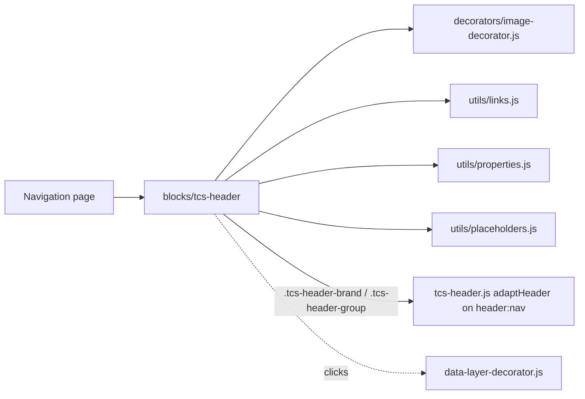

# TCS Header

A key-value block with the TCS and TATA logos, their alt texts and their links (Figma *New Screens from New DS*, "Nav Bar-NEW"). On the Navigation page it is the site header's logo source: [`blocks/header`](../header/README.md) takes its brand (TCS logo) and tools (TATA logo) from it. Placed anywhere else it renders the logo bar.

| Attribute | Value |
| --------- | ----- |
| Technical name | `tcs-header` (`blocks/tcs-header`) |
| Display name | TCS Header |
| Block type | Independent key-value block (model `tcs-header`, template name "TCS Header") |
| Status | Active |
| Parent / children | Parent: any section (`models/_section.json` filter `section`); used on the Navigation page, read by `blocks/header`. No children |
| Owner / version / date | Owner: Not recorded; version: Not recorded; date: Not recorded |

## Overview

**Business purpose.** Lets authors maintain the corporate logos of the header (image, alt text, link) on the Navigation page, so every page inherits them and an area can override them with its own Navigation page.

**User experience.** In the site header: the TCS logo at the left and the TATA logo (desktop: at the right; tablet / mobile: next to it) of the logo bar. Standalone: the same logos together on mobile and tablet, TCS left and TATA right from 1200px.

**Templates / page types.** Navigation pages in the locale's `references/` (block library: `block-library/header/nav-default`, `block-library/header/nav-careers`); technically any page section.

**Data source.** Its own fields; UI text (fallback names) from the locale's placeholders.

**Related blocks.** [Header](../header/README.md) (consumes it), [Conversation Canvas](../conversation-canvas/README.md) (a header Canvas may share its section).

**When to use.** In the first section of every Navigation page.

**When not to use.** As a content element on ordinary pages (the header already shows the logos); inside a Columns Container (not offered there).

**Realistic use cases.** The default nav page of a locale; an area nav page (`references/nav-careers`) with the same logos and its own menu; a landing page that shows the logo bar in a section (rare).

## Visual Reference

<!-- BEGIN GENERATED: screenshots (npm run build:docs) -->

Screenshots of the handover (6.1 Header Block), taken on the preview with sample content; they show the rendering at the time of the handover revision that added them (later changes are in the sections below and the handover's revision history):

**Desktop rendering** — The header at 1440 px in one 4rem row: TCS at the left, Services, Industries, Insights and About us, then Investors and the Contact us primary button at the right. Services is open: its chevron points up and a light grey 12.5rem panel with a pointer triangle lists Consulting, Cloud, Cybersecurity and AI and data.


**Tablet rendering** — The header at 768 px with the menu closed, in one 4rem row: the three-bar menu button at the left, TCS next to it and Investors with the Contact us button at the right; the four sections are hidden.


**Mobile rendering** — Two 390 px frames side by side. Menu closed: the menu button, TCS and the tools in one 4rem row. Menu open: the X icon and TCS, then Services with Consulting, Cloud, Cybersecurity and AI and data, Industries with Banking, Retail and Manufacturing, Insights and About us stacked, and Investors and Contact us at the bottom.


**Default navigation of the /en locale** — An /en content page at 1440 px with the header from /en/references/nav, all dropdowns closed: TCS, Services and Industries with chevrons, Insights, About us, Investors and the Contact us primary button, above the start of the page content.


**Area-specific navigation** — Two 1440 px headers one above the other (not side by side). Top, a page of /en: TCS, Services, Industries, Insights, About us, Investors, Contact us. Bottom, /en/careers/jobs inheriting nav-careers: TCS Careers, Find jobs with a chevron, Life at TCS, Locations, tcs.com and the Apply now primary button.


**An open dropdown** — The header at 1440 px with Services open: its chevron points up, and the light grey 12.5rem panel with the pointer triangle lists Consulting, Cloud, Cybersecurity and AI and data in regular weight, with Cloud underlined under the mouse pointer.


**Open mobile menu** — The header at 390 px with the menu open over the full height: the X icon and TCS on top, then Services with Consulting, Cloud, Cybersecurity and AI and data, Industries with Banking, Retail and Manufacturing, Insights and About us stacked, and Investors and Contact us at the bottom.


**Section label rendered as a button** — The header at 1440 px after Tab to Services and Enter: the Services button shows the keyboard focus ring and its chevron points up, and its dropdown lists Consulting, Cloud, Cybersecurity and AI and data.


**Linked label with dropdown toggle** — The header at 1440 px after Tab from the bold Industries link to its toggle and Enter: Industries stays a link with its chevron pointing up and the dropdown lists Banking, Retail and Manufacturing; no focus ring is visible because the toggle button is 0 × 0 (F-13).


**Plain first-level link** — The header at 1440 px with the pointer on Insights: Insights is underlined and has no chevron, like About us, while Services and Industries carry closed chevrons; no dropdown is open.


**Tools on the right of the header** — Two frames one above the other. Top, 1440 px: the full row with Investors as a link and the Contact us primary button at the right end. Bottom, 390 px with the menu closed: the menu button, TCS and the same two tools at the right of the 4rem row.


**Universal Editor canvas of the nav page** — references/nav opened directly in editor mode at 1440 px, rendered as an ordinary page under its own header: A the section with the TCS link, B the bulleted list, C Services with its four indented links, D one second-level link, E the section with Investors and the Contact us button. (Annotated preview in editor mode with sample content; letters as in the annotations list, not a Universal Editor screenshot; file screenshots/header-authoring-view.jpg)


**Properties used to choose the nav page** — Page Properties of a content page with the Navigation field (and Footer, 404 Page) highlighted; plus the properties panel of the Text component holding the list on the nav page. (Dialog reference generated from the component model, not a Universal Editor screenshot; file screenshots/header-properties-panel.jpg)


Universal Editor dialogs (no screenshot exists yet; to be captured on AEM author):

```text
[Screenshot Placeholder]

File name:
tcs-header-dialog-content-desktop.png

Purpose:
The Content tab of the TCS Header properties in Universal Editor, with the fields of the table "Content tab — TCS Header" in Authorable Fields below.

Annotations:
A = TCS Logo
B = TCS Logo Alt Text
C = TCS Logo Link
D = TATA Logo
E = TATA Logo Alt Text
F = TATA Logo Link
G = Header background
H = Header over hero
```

```text
[Screenshot Placeholder]

File name:
tcs-header-dialog-additional-desktop.png

Purpose:
The Additional tab of the TCS Header properties in Universal Editor, with the fields of the table "Additional tab — TCS Header" in Authorable Fields below.

Annotations:
A = Anchor ID
B = Hide block
C = Padding left
D = Padding right
E = Padding top
F = Padding bottom
G = Margin left
H = Margin right
I = Margin top
J = Margin bottom
```

<!-- END GENERATED: screenshots -->

The handover screenshots above are those of chapter 6.1 (the header) and predate the TCS Header of handover 2.2. States without a screenshot:

```text
[Screenshot Placeholder]

File name:
tcs-header-in-header-desktop.png

Purpose:
The site header at 1440px with the logos supplied by the nav page's TCS Header block.

Annotations:
A = a.tcs-header-brand (TCS logo, linked to Home)
B = a.tcs-header-group (TATA logo, linked to tata.com)
```

```text
[Screenshot Placeholder]

File name:
tcs-header-standalone-desktop.png

Purpose:
The TCS Header block in a page section at 1440px: TCS logo left, TATA logo right.

Annotations:
A = TCS logo
B = TATA logo
```

```text
[Screenshot Placeholder]

File name:
tcs-header-standalone-mobile.png

Purpose:
The standalone TCS Header block at 390px: both logos together at the left, 1rem gutter in a Full Width section.

Annotations:
A = TCS logo (1.2104rem high)
B = TATA logo (1.5rem high)
```

```text
[Screenshot Placeholder]

File name:
tcs-header-no-image-desktop.png

Purpose:
A TCS Header with a link but no image: the logo's name as a text link.

Annotations:
A = Text link "Tata Consultancy Services"
```

```text
[Screenshot Placeholder]

File name:
tcs-header-authoring-desktop.png

Purpose:
Universal Editor on the Navigation page with the TCS Header block selected in the first section.

Annotations:
A = TCS Header block in the content tree
B = Properties panel, Content tab
```

## For Content Authors

1. **Open the Navigation page** (`references/nav` of the locale, or the area's nav page) in Universal Editor.
2. **Add the block** to the first section: section › Add › **TCS Header** (offered in every section).
3. **Open its properties** (select the block, Properties panel).
4. **Content tab:** select the TCS Logo asset, enter TCS Logo Alt Text, choose the TCS Logo Link (the locale Home); select the TATA Logo, enter TATA Logo Alt Text, enter the TATA Logo Link (`https://www.tata.com`).
5. **Additional tab** (optional): Anchor ID, Hide block, padding and margin. On the Navigation page they have no effect in the site header.
6. **Preview** the nav page and a content page using it (desktop, tablet, mobile).
7. **Publish** the Navigation page and the logo assets.
8. **Validate** on the published site: both logos show, link to the right pages and are announced by their alt texts.

Minimum required: one logo image or one link. Recommended: both images (transparent SVG), both alt texts and both links. Optional: the Additional tab.

## Authorable Fields

<!-- BEGIN GENERATED: fields (npm run build:docs) -->

### TCS Header (`tcs-header`)

Model `tcs-header`; template name "TCS Header" (the block class AEM renders); key-value block (one row per property).

#### Content tab — TCS Header

| Field label | Property | Type | Required | Default | Allowed values | Author guidance | Example |
| ----------- | -------- | ---- | -------- | ------- | -------------- | --------------- | ------- |
| TCS Logo | `tcsLogo` | reference | No | — | — | — | /content/dam/tcs-corp/block-library/header/tcs-logo.png |
| TCS Logo Alt Text | `tcsLogoAlt` | text | No | `Tata Consultancy Services` | — | Names the logo link for screen readers. Delivered with `tcsLogo` (field collapse). | Tata Consultancy Services |
| TCS Logo Link | `tcsLogoLink` | aem-content | No | — | — | Usually the locale Home page. | /language-master/en/curated-design-pages/home |
| TATA Logo | `tataLogo` | reference | No | — | — | — | /content/dam/tcs-corp/block-library/header/tata-logo.png |
| TATA Logo Alt Text | `tataLogoAlt` | text | No | `TATA Group` | — | Names the logo link for screen readers. Delivered with `tataLogo` (field collapse). | TATA Group |
| TATA Logo Link | `tataLogoLink` | aem-content | No | — | — | Usually https://www.tata.com/. | https://www.tata.com |
| Header background | `classes` | select | No | "" | White (""), Grey (`bg-grey`) | The site header's background on the Navigation page. Over an opening hero the header is transparent. | — |
| Header over hero | `classes_overlay` | select | No | `overlay-hero` | Over an opening hero (Hero Placement) (`overlay-hero`), Solid (never over a hero) (`solid`) | Over an opening hero: the header lies over the hero that opens the page when the Hero's Placement is Page start (every width) or Automatic (desktop, light hero). Solid: the header always stays above the page. Delivered as a block class. | — |

#### Additional tab — TCS Header

| Field label | Property | Type | Required | Default | Allowed values | Author guidance | Example |
| ----------- | -------- | ---- | -------- | ------- | -------------- | --------------- | ------- |
| Anchor ID | `classes_anchor` | text | No | — | regExp: ^anchor-[a-z0-9][a-z0-9-]*$; customErrorMsg: Start with anchor-, then lower-case letters, digits and hyphens. | A unique ID of the block on the page, starting with anchor-, e.g. anchor-our-services; link to it with #anchor-our-services. Delivered as a block class. | — |
| Hide block | `classes_hideblock` | boolean | No | `false` | on / off | Hides the whole block on the page until it is turned off (shown faded in the editor). Delivered as a block class. | — |
| Padding left | `classes_paddingleft` | select | No | "" | Default (""), 0 (none) (`pl-0`), 0.25rem (space-100) (`pl-100`), 0.5rem (space-200) (`pl-200`), 0.75rem (space-300) (`pl-300`), 1rem (space-400) (`pl-400`), 1.25rem (space-500) (`pl-500`), 1.5rem (space-600) (`pl-600`), 2rem (space-800) (`pl-800`), 2.5rem (space-1000) (`pl-1000`), 3rem (space-1200) (`pl-1200`), 4rem (space-1600) (`pl-1600`), 5rem (space-2000) (`pl-2000`), 6rem (space-2400) (`pl-2400`), 7.5rem (space-3000) (`pl-3000`) | Delivered as a block class. | — |
| Padding right | `classes_paddingright` | select | No | "" | Default (""), 0 (none) (`pr-0`), 0.25rem (space-100) (`pr-100`), 0.5rem (space-200) (`pr-200`), 0.75rem (space-300) (`pr-300`), 1rem (space-400) (`pr-400`), 1.25rem (space-500) (`pr-500`), 1.5rem (space-600) (`pr-600`), 2rem (space-800) (`pr-800`), 2.5rem (space-1000) (`pr-1000`), 3rem (space-1200) (`pr-1200`), 4rem (space-1600) (`pr-1600`), 5rem (space-2000) (`pr-2000`), 6rem (space-2400) (`pr-2400`), 7.5rem (space-3000) (`pr-3000`) | Delivered as a block class. | — |
| Padding top | `classes_paddingtop` | select | No | "" | Default (""), 0 (none) (`pt-0`), 0.25rem (space-100) (`pt-100`), 0.5rem (space-200) (`pt-200`), 0.75rem (space-300) (`pt-300`), 1rem (space-400) (`pt-400`), 1.25rem (space-500) (`pt-500`), 1.5rem (space-600) (`pt-600`), 2rem (space-800) (`pt-800`), 2.5rem (space-1000) (`pt-1000`), 3rem (space-1200) (`pt-1200`), 4rem (space-1600) (`pt-1600`), 5rem (space-2000) (`pt-2000`), 6rem (space-2400) (`pt-2400`), 7.5rem (space-3000) (`pt-3000`) | Delivered as a block class. | — |
| Padding bottom | `classes_paddingbottom` | select | No | "" | Default (""), 0 (none) (`pb-0`), 0.25rem (space-100) (`pb-100`), 0.5rem (space-200) (`pb-200`), 0.75rem (space-300) (`pb-300`), 1rem (space-400) (`pb-400`), 1.25rem (space-500) (`pb-500`), 1.5rem (space-600) (`pb-600`), 2rem (space-800) (`pb-800`), 2.5rem (space-1000) (`pb-1000`), 3rem (space-1200) (`pb-1200`), 4rem (space-1600) (`pb-1600`), 5rem (space-2000) (`pb-2000`), 6rem (space-2400) (`pb-2400`), 7.5rem (space-3000) (`pb-3000`) | Delivered as a block class. | — |
| Margin left | `classes_marginleft` | select | No | "" | Default (""), 0 (none) (`ml-0`), 0.25rem (space-100) (`ml-100`), 0.5rem (space-200) (`ml-200`), 0.75rem (space-300) (`ml-300`), 1rem (space-400) (`ml-400`), 1.25rem (space-500) (`ml-500`), 1.5rem (space-600) (`ml-600`), 2rem (space-800) (`ml-800`), 2.5rem (space-1000) (`ml-1000`), 3rem (space-1200) (`ml-1200`), 4rem (space-1600) (`ml-1600`), 5rem (space-2000) (`ml-2000`), 6rem (space-2400) (`ml-2400`), 7.5rem (space-3000) (`ml-3000`) | Delivered as a block class. | — |
| Margin right | `classes_marginright` | select | No | "" | Default (""), 0 (none) (`mr-0`), 0.25rem (space-100) (`mr-100`), 0.5rem (space-200) (`mr-200`), 0.75rem (space-300) (`mr-300`), 1rem (space-400) (`mr-400`), 1.25rem (space-500) (`mr-500`), 1.5rem (space-600) (`mr-600`), 2rem (space-800) (`mr-800`), 2.5rem (space-1000) (`mr-1000`), 3rem (space-1200) (`mr-1200`), 4rem (space-1600) (`mr-1600`), 5rem (space-2000) (`mr-2000`), 6rem (space-2400) (`mr-2400`), 7.5rem (space-3000) (`mr-3000`) | Delivered as a block class. | — |
| Margin top | `classes_margintop` | select | No | "" | Default (""), 0 (none) (`mt-0`), 0.25rem (space-100) (`mt-100`), 0.5rem (space-200) (`mt-200`), 0.75rem (space-300) (`mt-300`), 1rem (space-400) (`mt-400`), 1.25rem (space-500) (`mt-500`), 1.5rem (space-600) (`mt-600`), 2rem (space-800) (`mt-800`), 2.5rem (space-1000) (`mt-1000`), 3rem (space-1200) (`mt-1200`), 4rem (space-1600) (`mt-1600`), 5rem (space-2000) (`mt-2000`), 6rem (space-2400) (`mt-2400`), 7.5rem (space-3000) (`mt-3000`) | Delivered as a block class. | — |
| Margin bottom | `classes_marginbottom` | select | No | "" | Default (""), 0 (none) (`mb-0`), 0.25rem (space-100) (`mb-100`), 0.5rem (space-200) (`mb-200`), 0.75rem (space-300) (`mb-300`), 1rem (space-400) (`mb-400`), 1.25rem (space-500) (`mb-500`), 1.5rem (space-600) (`mb-600`), 2rem (space-800) (`mb-800`), 2.5rem (space-1000) (`mb-1000`), 3rem (space-1200) (`mb-1200`), 4rem (space-1600) (`mb-1600`), 5rem (space-2000) (`mb-2000`), 6rem (space-2400) (`mb-2400`), 7.5rem (space-3000) (`mb-3000`) | Delivered as a block class. | — |

<!-- END GENERATED: fields -->

Notes on the significant fields:

- **TCS Logo / TATA Logo.** Rendered as the picture AEM delivers, inside `a.tcs-header-brand` / `a.tcs-header-group` (a `span` when the logo has no link). In the site header, the CSS sets the height per breakpoint (see [Content and Asset Guidelines](#content-and-asset-guidelines)).
- **TCS Logo Alt Text / TATA Logo Alt Text.** Fields ending in Alt collapse into their image (AEM delivery rule): the text arrives as the image's `alt`, not as a row of its own. It names the logo link for screen readers. When a linked logo has an empty alt, the code uses the placeholder `tcsLogo` ("Tata Consultancy Services") / `tataLogo` ("TATA Group").
- **TCS Logo Link / TATA Logo Link.** A link or text; a domain typed without a scheme (`www.tata.com`, `tata.com/…`) gets `https://` added, so it isn't a relative link. Without a link the logo isn't a link.
- **No image.** A logo with a link but no image renders its placeholder name as text in the link; without image and link it isn't rendered.
- **Data layer impact.** Logo clicks are `cmp:click` (see [Data Layer and Analytics](#data-layer-and-analytics)).
- **Legacy mapping.** None.
- **Additional tab.** As every block (AGENTS.md "Additional tab"), without animation fields; the styles apply only inside `main`, so on the Navigation page they don't reach the site header.

## Screenshot-Based Authoring Steps

### Authoring Step 1: Add the TCS Header to the Navigation page

```text
[Screenshot Placeholder]

File name:
tcs-header-authoring-step-1.png

Purpose:
The first section of the Navigation page with the Add menu open and TCS Header highlighted.

Annotations:
A = First section of the nav page
B = Add (+)
C = TCS Header in the component list
```

### Values to Enter

| Callout | Field | Value | Reason | Expected result |
| ------- | ----- | ----- | ------ | --------------- |
| A | Section | The first section of `references/nav` | The header reads the logos from the block, whatever its section | The block's section becomes the header's brand and tools |
| C | Component | TCS Header | Logo fields | An empty TCS Header block |

Author action: Add › TCS Header. Expected preview: an empty block until the fields are filled in. Business rule: one TCS Header per nav page (the header uses the first one). Validation: the content tree shows the block in the first section. Common mistake: adding it to a content page instead of the nav page; resolution: open the page's Navigation page.

### Authoring Step 2: The TCS logo

```text
[Screenshot Placeholder]

File name:
tcs-header-authoring-step-2.png

Purpose:
The Content tab with the TCS Logo fields filled in.

Annotations:
A = TCS Logo
B = TCS Logo Alt Text
C = TCS Logo Link
```

### Values to Enter

| Callout | Field | Value | Reason | Expected result |
| ------- | ----- | ----- | ------ | --------------- |
| A | TCS Logo | `/content/dam/tcs-corp/block-library/header/tcs-logo.png` (production: `/content/dam/tcs-corp/header/tcs-logo.svg`) | One asset for all breakpoints | TCS logo shown |
| B | TCS Logo Alt Text | `Tata Consultancy Services` | Names the link | Announced name |
| C | TCS Logo Link | `/language-master/en/curated-design-pages/home` (the locale Home) | Brand links Home | The logo is a link |

Expected published result: every page using the nav page shows the logo. Validation: the logo link's accessible name is the alt text. Common mistake: a JPG with a white background (F-81); use the transparent SVG.

### Authoring Step 3: The TATA logo

```text
[Screenshot Placeholder]

File name:
tcs-header-authoring-step-3.png

Purpose:
The Content tab with the TATA Logo fields filled in.

Annotations:
A = TATA Logo
B = TATA Logo Alt Text
C = TATA Logo Link
```

### Values to Enter

| Callout | Field | Value | Reason | Expected result |
| ------- | ----- | ----- | ------ | --------------- |
| A | TATA Logo | `/content/dam/tcs-corp/block-library/header/tata-logo.png` (production: `/content/dam/tcs-corp/header/tata-logo.svg`) | Group logo | TATA logo shown |
| B | TATA Logo Alt Text | `TATA Group` | Names the link | Announced name |
| C | TATA Logo Link | `https://www.tata.com` | Group site | Opens tata.com |

Business rule: `www.tata.com` without `https://` is completed by the code. Validation: the published link is `https://www.tata.com`. Common mistake: a relative path; resolution: enter the full address.

### Authoring Step 4: Preview and publish

```text
[Screenshot Placeholder]

File name:
tcs-header-authoring-step-4.png

Purpose:
A content page in preview at 1440px and 390px showing the logos from the nav page.

Annotations:
A = TCS logo in the header
B = TATA logo in the header
C = Menu button (390px)
```

### Values to Enter

| Callout | Field | Value | Reason | Expected result |
| ------- | ----- | ----- | ------ | --------------- |
| A | Publish | The Navigation page and both assets | Pages load the published nav page | Logos on the live site |

Validation: check the logo heights per breakpoint and both links. Common mistake: publishing the page but not the DAM assets.

## Variations

### On the Navigation page (header logos)

- **Purpose:** the site header's brand and tools.
- **When to use / not:** always on nav pages; not needed on positional nav pages authored before (brand, sections, tools), which still work.
- **Fields:** the six Content fields.
- **Rendering:** on the header's `header:nav` event, `tcs-header.js` (`adaptHeader`) replaces the block's section with `div.section.nav-brand > p > a.tcs-header-brand` and `div.section.nav-tools > p > a.tcs-header-group`; the first other section becomes the menu. A TCS Header in the same section as a Conversation Canvas is kept as the logo bar (only the Canvas goes to the header Canvas). Sizes and layout come from `header.css`.
- **Desktop / tablet / mobile:** as the [Header](../header/README.md).
- **Accessibility:** logo links named by their alt texts, inside the header's `nav`.
- **Data layer:** clicks report the header component (`header-1`).
- **Personalization / fallback:** none; an area nav page can use other logos.

```text
[Screenshot Placeholder]

File name:
tcs-header-in-header-desktop.png

Purpose:
The logos in the site header (see Visual Reference).

Annotations:
A = TCS logo
B = TATA logo
```

### In the site header: Figma styles and options

The TCS business logic and Figma styles of the site header are this block's; [`blocks/header`](../header/README.md) keeps the header's own behaviour (the nav page, sections, menu and levels, keyboard and focus, breakpoint reset, header Canvas host). `tcs-header.js` listens to the header's `header:nav` event (fired with the nav before it is decorated) and, when its nav page holds this block:

- **Logo bar:** its section becomes `div.section.nav-brand` (TCS logo) and `div.section.nav-tools` (TATA logo); the first other section that isn't a Conversation Canvas is the menu (`nav-sections`). Authored in the same section as a Canvas, the block stays in the nav (only the Canvas goes to the header Canvas).
- **Menu of a nav page without one:** the pages the header Canvas's menu lists (its **Menu root path** and **Menu depth**, read from the Canvas block's `data-menu-root` / `data-menu-depth`; `utils/query-index.js` `getPageTree`, the source of the Canvas menus), as the list markup of an authored menu, supplied as `detail.menu` (the header sets it up once the query index has loaded). No pages (e.g. a Menu root path on a page without child pages, F-109): no menu, and the console says `tcs-header: no menu, …`. The pages come from the published query index: on AEM author (Universal Editor, or the page opened on author) there is no index, so the header has no menu there (the Canvas menu says "No pages found"), and a changed Menu root path shows on the preview / live site once the nav page is previewed / published. A page below an unpublished folder page (e.g. `/en/dummy-pages`) is listed under its nearest indexed ancestor.
- **Header background** (`classes`): White (`''`) or Grey (`bg-grey`): the header block gets `tcs-header-bg-grey`, `--tcs-header-background` is `--color-bg-secondary` for the bar and the open menu. No dark option: the logos are dark artwork.
- **Header over hero** (`classes_overlay`): Over an opening hero (`overlay-hero`, default; content authored before has no value and behaves the same) or Solid (`solid`): `utils/header-overlay.js` `setHeaderSolid` marks `<header data-header-mode="solid">` and drops the heroes' `data-header-over`, so the header stays above every hero (console: `tcs-header: Header over hero is Solid, …`). With Solid, set the opening Hero's Placement to Below header: a Page start or Automatic hero is laid out under the header before the header loads, and moves down when it does (layout shift 0.07–0.09 measured).
- **One site navigation below 1200px:** once the header has a menu (the nav page's, or the header Canvas's pages), the block sets `html[data-site-menu="header"]`, and the Conversation Canvases hide their own site menu button and pop-over there (`data-canvas-control="site-menu"`, `blocks/conversation-canvas`); their search, voice and submit stay. Without a menu (e.g. F-109) nothing is set and the Canvas button stays, so a page never loses its navigation.
- **Turning the device** (orientation change) closes the open menu, through the header's own menu button (its state, ARIA, inert page and scroll lock stay the header's).
- **Menu icon** (Figma Mobile Nav 1124:27405 / 1124:25497): 32px button, three 2px lines 26px wide and 8px apart, `--color-icon-default`; the close icon is the header's.
- **Styles** (`tcs-header.css`, scoped to `header .header.tcs-header-site`): the bar's background, a transparent menu button, linked-section arrows on the right like the other rows, and over a hero with Placement Page start below 1200px: a transparent bar that scrolls away with the hero (no sticky transparent bar: no scroll behaviour is designed) and an open menu fixed over the window with the bar's background.

### Standalone logo bar

- **Purpose:** the logo bar inside a page section.
- **Rendering:** `div.tcs-header-bar` (flex, 1.7391rem gap between the logos; `justify-content: space-between` from 1200px). In a Full Width section (any section without `fixed-width`) the bar keeps the header's gutters (1rem / 1.5rem / 5rem); in a Fixed Width section the section gutter applies.
- **Accessibility / data layer:** the block is its own component (`tcs-header-1`); logo clicks `cmp:click`.

```text
[Screenshot Placeholder]

File name:
tcs-header-standalone-desktop.png

Purpose:
The standalone logo bar (see Visual Reference).

Annotations:
A = TCS logo
B = TATA logo
```

## Complete Authoring Example

Scenario: the default Navigation page of `/en` gets the corporate logos.

| Field | Example value | Guidance |
| ----- | ------------- | -------- |
| TCS Logo | `/content/dam/tcs-corp/header/tcs-logo.svg` | Transparent SVG exported from the Figma TCS Logo |
| TCS Logo Alt Text | `Tata Consultancy Services` | Translate per locale |
| TCS Logo Link | The `/en` Home page | |
| TATA Logo | `/content/dam/tcs-corp/header/tata-logo.svg` | Transparent SVG |
| TATA Logo Alt Text | `TATA Group` | |
| TATA Logo Link | `https://www.tata.com` | Full address |

Steps: open `/content/tcs-corp/us/en/references/nav`, add the TCS Header to the first section, fill in the fields, publish the page and the two SVGs.

Expected output: the header logo bar on every `/en` page. Responsive: heights 1.2104 / 1.9165 / 2.175rem (TCS) and 1.5 / 2.375 / 2.75rem (TATA). Accessibility: two named logo links. Analytics: logo clicks on `component.header-1`. Personalization fallback: none.

Pre-publish checklist:

- [ ] Both images selected (SVG), both alt texts, both links.
- [ ] Block in the nav page's first section, menu list in the next one.
- [ ] Assets published.
- [ ] Checked at 390px, 1024px, 1440px.

## Content and Asset Guidelines

- **Logos.** One asset per logo for every breakpoint (Figma uses the same vector at every size); upload SVGs to `/content/dam/tcs-corp/header/` (`tcs-logo.svg`, `tata-logo.svg`, F-77). The width follows the aspect ratio:

| Logo | Mobile | Tablet (>= 600px) | Desktop (>= 1200px) |
| ---- | ------ | ----------------- | ------------------- |
| TCS logo | 1.2104rem (19.4px) | 1.9165rem (30.7px) | 2.175rem (34.8px) |
| TATA logo | 1.5rem (24px) | 2.375rem (38px) | 2.75rem (44px) |

- **Alt text.** The organisation's name ("Tata Consultancy Services", "TATA Group"), translated per locale.
- **Links.** The locale Home for TCS; the full `https://` address for external links.
- **Icons, tags, metadata.** None.
- **Min / max items.** Two logos (fixed by the model).
- **Loading.** The images AEM delivers (no `createOptimizedPicture` in the block); in the header they load with the nav page in the lazy phase.
- **Missing asset.** Linked logo without image: its placeholder name as text; neither: nothing.

## Accessibility

- **Semantics.** Two links (or `span`s without a link) with the logo images; no heading.
- **Accessible names.** The image alt text; an empty alt on a linked logo is replaced by the placeholder name, so no link is unnamed.
- **Keyboard.** Standard link focus; nothing else to operate.
- **Contrast.** Text fallback in `--color-text-default`, bold.
- **Reflow.** The bar is a flex row; logos keep their aspect ratio.

Author responsibilities: alt texts naming the organisations, translated per locale; transparent logo assets.

Developer responsibilities: keep the alt-text fallback and the scheme completion; keep the classes `tcs-header-brand` / `tcs-header-group` (read by `blocks/header`).

| Key | Expected behavior |
| --- | ----------------- |
| Tab / Shift+Tab | Moves to each logo link |
| Enter | Follows the focused logo link |

## Data Layer and Analytics

- **Standalone:** the block is a component (`tcs-header-{n}`, `@type` `tcs-corp/components/tcs-header`) added by `trackBlocks`; logo clicks push `cmp:click` (`interaction` "link", `xdm:linkURL`, `xdm:linkType` `other` or `exit`). `dc:title` is the link's `aria-label` or text content, so an image-only logo link has an empty `dc:title` (the image's alt isn't read); identify the logo by `xdm:linkURL`.
- **On the Navigation page:** the block's section is replaced by the header's sections, so logo clicks report the header component.
- No `data-cmp-*` attributes and no own pushes.

| Trigger | Data-layer event | Required properties | Analytics behavior |
| ------- | ---------------- | ------------------- | ------------------ |
| Block tracked (standalone) | `component` entry | `@type`, `parentId` | Component inventory |
| Click on a logo | `cmp:click` | `eventInfo.path`, `interaction` "link", `xdm:linkURL`, `xdm:linkType`, `breakpoint` | Brand / group link click |

The intended flow is Adobe Client Data Layer → Adobe Data Collection (Tags) → AEP Web SDK → Edge Network → Analytics / CJA; Tags and the Web SDK aren't configured yet (blocked: measurement plan). No consent mechanism is implemented.

## Personalization

This block does not currently expose verified personalization behavior. There is no Adobe Target or Journey Optimizer integration in the repository; the authored logos are what renders.

## Responsive Behavior

| Viewport | Layout | Image behavior | Interaction behavior |
| -------- | ------ | -------------- | -------------------- |
| Mobile (< 600px) | Logos side by side at the left; 1rem gutter in a Full Width section | TCS 1.2104rem, TATA 1.5rem high | Links |
| Tablet (600–1199px) | As mobile; 1.5rem gutter | TCS 1.9165rem, TATA 2.375rem | Links |
| Desktop (>= 1200px) | TCS left, TATA right; 5rem gutter | TCS 2.175rem, TATA 2.75rem | Links |

In the site header the header's CSS applies (same heights).

## For Developers

<!-- BEGIN GENERATED: files (npm run build:docs) -->

```text
blocks/tcs-header/
├── README.md
├── _tcs-header.json
├── tcs-header.css
└── tcs-header.js
```

| Decorator/Utility | Purpose | Execution or dependency point |
| ----------------- | ------- | ----------------------------- |
| [`decorators/image-decorator.js`](../../decorators/image-decorator.js) | `pictureOf` (image with its alt text field) | `tcs-header.js`: { pictureOf } |
| [`utils/links.js`](../../utils/links.js) | `NEW_WINDOW`, `linkOf`, `linkPathsOf` (the paths of a page property, one or many), `readLinkItems` (CTA lists with Link Type and the items' other select values), `readLinkRows` (the same from link item rows, e.g. Hero CT | `tcs-header.js`: { linkOf } |
| [`utils/properties.js`](../../utils/properties.js) | `readProperties`, `textOf`, `isOn`, `isOnByDefault` (a toggle that defaults to on), `optionOf`, `normalizeKey`, `textSource` (key-value block properties) | `tcs-header.js`: { readProperties, textOf } |
| [`utils/placeholders.js`](../../utils/placeholders.js) | `getPlaceholders`, `loadPlaceholders`, `fillPlaceholder` (UI text from the locale's placeholders, with English fallbacks) | `tcs-header.js`: { getPlaceholders } |
| [`utils/query-index.js`](../../utils/query-index.js) | `getPages` (the current locale's pages from `/query-index.json`, or the language master's own pages while it is under review (`indexRoot`) with their metadata columns: tags, page and content type, dates, images, author,  | `tcs-header.js`: { getPageTree } |
| [`utils/header-overlay.js`](../../utils/header-overlay.js) | `headerOverMode` (whether the header lies over a hero: Placement, BG Color, opening position, Solid header; unit tested), `isHeaderSolid`, `setHeaderSolid`, `HEADER_OVER` (`data-header-over`: `all` / `desktop`), `HEADER_ | `tcs-header.js`: { setHeaderSolid, SOLID } |

<!-- END GENERATED: files -->

**Input DOM.** A key-value block: one row per delivered property (`readProperties`: `tcslogo`, `tcslogolink`, `tatalogo`, `tatalogolink`, plus the Additional tab classes). The alt fields aren't rows: they collapse into the images' `alt`.

**Decoration flow.** `readProperties(block)`, `getPlaceholders()`, then `buildLogo` per logo: `pictureOf(imageCell)` (moves the editor instrumentation to the picture), the alt fallback, the href (link `href` or cell text, `https://` added to a bare domain), an `a` or `span`; `block.replaceChildren(bar)`.

**Rendered DOM contract.**

```html
<div class="tcs-header block">
  <div class="tcs-header-bar">
    <a class="tcs-header-brand" href="/en/"><picture>…</picture></a>
    <a class="tcs-header-group" href="https://www.tata.com"><picture>…</picture></a>
  </div>
</div>
```

`blocks/header` relies on `.tcs-header`, `.tcs-header-brand` and `.tcs-header-group`.

**Events / async.** Awaits the placeholders; no listeners.

**Error handling.** Missing fields degrade (no image: text; nothing: logo left out).

**Exported functions.** Only the default `decorate(block)`.

## Extending the Block

- **A field or value.** Add it to `_tcs-header.json` (keep the Additional tab last), run `npm run build:json` and `npm run lint`. Key-value rules: no grouped fields (`prefix_name`); a name ending in Alt, Text, Title, Type or MimeType collapses into its base field.
- **Rendering.** Read it with `readProperties`; keep the two output classes for the header.
- **Responsive / accessibility.** Logo sizes are in `tcs-header.css` and, for the site header, `blocks/header/header.css`: change both. Every link needs a name.
- **Data layer.** Captured centrally.
- **Tests.** No unit test exists for the block; add one for new pure logic.
- **Backward compatibility.** Existing nav pages keep their values; keep `tcs-header-brand` / `tcs-header-group`.
- **Docs.** Update this README (`npm run build:docs`) and the block library nav pages; `npm run build:modules` after changing imports (the block is in `CHROME_BLOCKS`, preloaded on every page).

## For Site Administrators

- **Availability.** Offered in the `section` filter (`models/_section.json`), so authors can add it to any page section; not in the Columns Container or Tabs filters.
- **Governance.** Model in `blocks/tcs-header/_tcs-header.json`; the audit suggests a nav-page-only filter if the platform allows (docs/audit/blocks/group-d-forms-media-chrome.md).
- **Publishing dependencies.** The Navigation page; the logo assets (images travel with the page; publish them anyway).
- **Localization.** Alt texts per locale; placeholders `tcsLogo`, `tataLogo`.

| Dependency | Purpose | Location | Impact if unavailable |
| ---------- | ------- | -------- | --------------------- |
| Logo assets | The two logos | `/content/dam/tcs-corp/header/` | Logo names as text links |
| Navigation page | Hosts the block | `/{locale}/references/nav` | The header has no logos from it |
| Placeholders `tcsLogo`, `tataLogo` | Fallback names | `/{locale}/placeholders.json` | English fallbacks |

## For Architects

- **Role.** The authoring model of the header's logos (not a duplicate of the header, audit decision "Retain").
- **Content model.** Key-value block, two image + link pairs.
- **Rendering.** Client-side decoration; consumed by `blocks/header` after the nav fragment is decorated.
- **Dependencies.** `decorators/image-decorator.js` (`pictureOf`), `utils/links.js` (`linkOf`), `utils/properties.js`, `utils/placeholders.js`.
- **Data layer / Web SDK / Target.** Central click capture; no Target.
- **Consent, identity, caching.** None in the block; the nav page is CDN cached.
- **Performance.** No network request of its own beyond the placeholders (cached once per page).
- **Security.** Links as authored; only the scheme completion.



## For QA and Support Teams

| Test ID | Scenario | Configuration | Expected result |
| ------- | -------- | ------------- | --------------- |
| TCS-HEADER-QA-01 | Default | All six fields, on the nav page | Header shows both logos linked |
| TCS-HEADER-QA-02 | Standalone | Block in a page section, 1440px | TCS left, TATA right |
| TCS-HEADER-QA-03 | Standalone mobile | 390px, Full Width section | Logos together, 1rem gutter |
| TCS-HEADER-QA-04 | Fixed Width section | Block in a Fixed Width section | Section gutter, no extra padding |
| TCS-HEADER-QA-05 | No image | Link only | Text link with the placeholder name |
| TCS-HEADER-QA-06 | Empty alt | Image and link, alt empty | `img alt` is the placeholder name |
| TCS-HEADER-QA-07 | Bare domain | TATA Logo Link `www.tata.com` | `href="https://www.tata.com"` |
| TCS-HEADER-QA-08 | No link | Image only | `span` with the picture, not a link |
| TCS-HEADER-QA-09 | Positional nav page | Nav page without the block | Header still shows brand, menu, tools |
| TCS-HEADER-QA-10 | Canvas in the same section | TCS Header and a Conversation Canvas in one section | Logos in the bar, Canvas in the header Canvas |
| TCS-HEADER-QA-11 | Data layer | Click a logo (standalone) | `cmp:click` on `component.tcs-header-1` |

## Troubleshooting

| Symptom | Likely cause | Diagnostic steps | Resolution | Verification |
| ------- | ------------ | ---------------- | ---------- | ------------ |
| No logos in the header | Assets not uploaded / published (F-77), or block not on the nav page in use | Check the page's Navigation; image requests | Upload / publish the SVGs; edit the right nav page | Logos visible |
| Logo with a white box | JPG / PNG with background (F-81) | Inspect the asset | Use the transparent SVG | Clean logo |
| TATA link leads to a 404 on the site | Old content with a relative link | Inspect `href` | Enter `https://www.tata.com` | Correct target |
| Logo name shown as text | No image selected | Properties panel | Select the asset | Image shown |
| Spacing options have no effect in the header | Additional tab styles apply only inside `main` | — | Expected | — |

Evidence to collect: the nav page path, the rendered `a.tcs-header-*` markup, the asset paths, a screenshot per breakpoint.

## Performance Considerations

- Decorated with the nav page fragment in the lazy phase (or with its section on a page); module and stylesheet preloaded on every page (`CHROME_BLOCKS`).
- Images as delivered; no extra requests, observers or listeners. Small DOM (two links).

## Security and Privacy

- Links are as authored; a bare domain is completed with `https://`; no other URL validation or query strings; no personal data.

## Known Limitations

| Limitation | Impact | Workaround | Planned correction |
| ---------- | ------ | ---------- | ------------------ |
| The alt fields collapse into their images: without an image, the authored alt text isn't available | A linked logo without image shows the placeholder name, not the authored alt | Always select the image | Not planned (AEM delivery rule) |
| Offered in every section (`section` filter) | Authors may add it to content pages | Add it only to nav pages | Not recorded (audit suggestion: nav-page-only filter) |
| Logo assets not yet in DAM (F-77) | No logos until authored | Block library sample PNGs | Not recorded (content task) |
| Additional tab has no effect in the site header | Spacing / hide only on the nav page itself | — | Not planned |

## Related Documentation

- [Blocks documentation](../README.md)
- [Header](../header/README.md) (consumer), [Conversation Canvas](../conversation-canvas/README.md)
- Model: [`_tcs-header.json`](./_tcs-header.json)
- [decorators README](../../decorators/README.md), [utils README](../../utils/README.md)
- Tests: [`test/motion/motion.test.mjs`](../../test/motion/motion.test.mjs) (no animation fields expected on the TCS Header)
- Handover: [handover 6.1 Header Block (6.1.18 TCS Header)](../../docs/handover/TCS-CORP-HANDOVER.md)

<!-- BEGIN GENERATED: usage (npm run build:docs) -->

Pages of the block library package 1.0.13 (language master, `/content/tcs-corp/language-master/en`) that contain the block, 2 instance(s) in total:
- Block library: `block-library/header/nav-careers`, `block-library/header/nav-default`

Project-wide standards: [knowledge base](../../docs/handover/knowledge-base/README.md) ([block governance](../../docs/handover/knowledge-base/blocks.md)).

<!-- END GENERATED: usage -->

## Change History

| Version | Change | Source | Date |
| ------- | ------ | ------ | ---- |
| Not recorded | README generated from verified implementation and approved handover documentation | Repository review | Not recorded |
| Handover 2.2 | TCS Header (Figma *New Screens from New DS*) and the logo bar | docs/handover revision history | 16 October 2026 |
| Handover 2.4 | Logo sizes per breakpoint, one DAM asset per logo, authored in the TCS Header block (F-77) | docs/handover revision history | 16 October 2026 |
| Handover 2.27 | Block ecosystem audit: no-image fallback and unnamed TATA logo link corrected with placeholder names (D-D-25) | docs/handover revision history; docs/audit/BLOCK-ECOSYSTEM-AUDIT.md | 19 October 2026 |
| Handover 2.29 | Re-audit: logo links typed without `https://` completed (R-D-15) | docs/handover revision history; docs/audit/REAUDIT-2026-10-20.md | 20 October 2026 |
| Handover 2.31 | TATA logo link checked on the live pages (`https://www.tata.com`, "TATA Group") | docs/handover revision history | 20 October 2026 |
| Handover 2.41 | The site header's TCS business logic and Figma styles moved here from `blocks/header` (`header:nav`): logo bar, menu from the header Canvas's pages (F-109), Header background (White / Grey), Header over hero (Over an opening hero / Solid) | docs/handover revision history | 21 October 2026 |
