# Teaser

The Teaser is the site's most versatile single-message block. It combines a title with an optional eyebrow, tags, date, reading time, listen / download / share actions, author, description, image or Lottie animation, stats, links and a short description, in one of four layouts: Image & Text, Text split, Background image and Card. It implements the TCS.com Design System Figma frames "Text & Image", "2 Slot Section", "Text Section - 2 Columns", "Secondary Page Header", "Careers", "Media Coverage" and "Media Kit", plus the article header elements of "L3 Header". It is a key-value block: Links and Stats are Link and Stat items added to it with Add, and `blocks/teaser/teaser.js` rebuilds the rows into a media part and a content part.

| Attribute | Value |
| --------- | ----- |
| Technical name | `teaser` (model `teaser`, template name "Teaser") |
| Display name | Teaser |
| Block type | Key-value block (`key-value: true`) with item children |
| Status | Active |
| Parent / children | Parents: Section, Columns Container, Gen Carousel, Tabs Container (filters `section`, `columns-container`, `gen-carousel`, `tabs`). Children: Link (`teaser-link`) and Stat (`teaser-stat`), filter `teaser` |
| Owner / version / date | Not recorded / Not recorded / Not recorded |

## Overview

- **Business purpose:** presents one focused message (a service, an insight, a statistic-led story, a career call, a media resource) in an approved design-system layout, and leads the visitor on through clear links. One block covers many Figma frames.
- **User experience:**
  - **Image & Text:** the image beside the text (left or right from 600px) or above / below it. Without an image, the text is centred.
  - **Text split:** the eyebrow, tags and article meta across the top; the title and author on the left; the description, an optional image (for example a chart), stats, links and short description on the right (from 900px).
  - **Background image:** centred text over the image under a dark overlay.
  - **Card:** a rounded card with the image behind its text and the links at the bottom.
- **Templates / page types:** any page. Teasers are also the slides of a Gen Carousel section (block library `block-library/gen-carousel/teaser-slides`).
- **Data source:** authored fields and items. Tag labels come from the locale's taxonomy (`/{locale}/taxonomy.json`) and UI labels from its placeholders. The block reads no page metadata or query index.
- **Related blocks:** Hero (`blocks/hero`, the full-height opening banner, which shares the Lotto image type); Page Header (`blocks/page-header`, metadata-driven article header, which shares `decorators/article-meta-decorator.js`); Testimonial (shares `decorators/stats-decorator.js`); [Cards](../cards/README.md) and [List](../list/README.md) for collections (their "Display as teaser" is a card presentation, class `display-teaser`, not this block); [Columns Container](../columns-container/README.md).
- **When to use:** a single message that combines a heading with text, media, stats or links in the page flow, matching one of the Teaser's layouts.
- **When not to use:** for the first full-height banner (use the Hero); for article / blog / press-release headers built from page metadata (use the Page Header); for lists of several items (Cards, List, Filter List); for quotes (Quote, Testimonial); for video (the Teaser has no video media type).
- **Realistic use cases:** an Image & Text service promotion; a two-column "Text split" section with stats; a secondary page header (Top spacing "Page header"); an article-style header with date, reading time, actions and author; a careers call to action without an image; a sustainability banner (Background image); a media kit card (Card); a list of related resources (List link style); an animated Lottie illustration beside the text.

## Visual Reference

<!-- BEGIN GENERATED: screenshots (npm run build:docs) -->

Screenshots of the handover (6.11 Teaser Block), taken on the preview with sample content; they show the rendering at the time of the handover revision that added them (later changes are in the sections below and the handover's revision history):

**Desktop rendering** — An Image & Text teaser at 1440 px: the rounded 10:9 image photo-1 on the left; the brand-blue eyebrow Cloud services, the semibold title Modernise your core on any cloud, the grey description and the buttons Talk to an expert (primary) above Explore cloud services (secondary) on the right, vertically centred against the image.

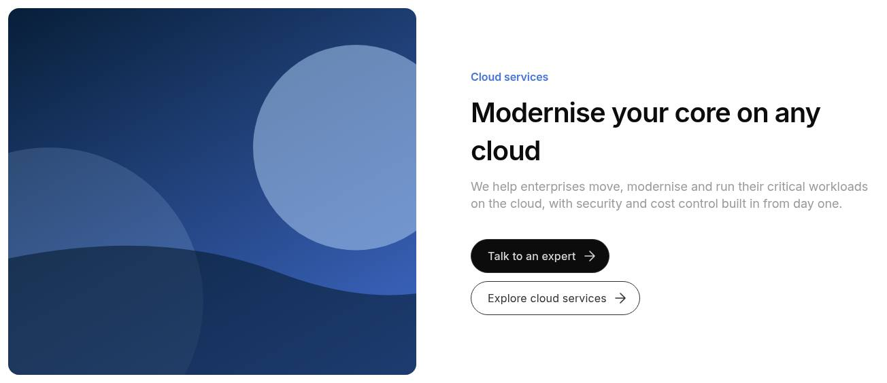

**Tablet rendering** — The same cloud services teaser at 768 px in one column: the rounded 10:9 image photo-1 full width on top, then the eyebrow Cloud services, the title Modernise your core on any cloud, the description and the stacked buttons Talk to an expert and Explore cloud services.

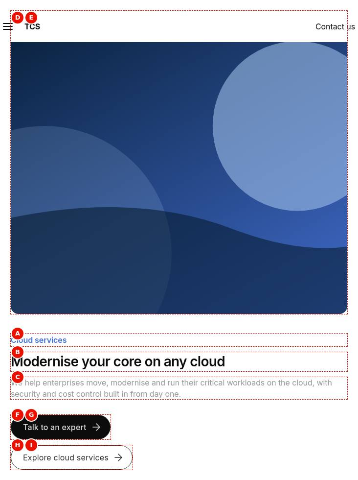

**Mobile rendering** — The cloud services teaser at 375 px: the rounded 10:9 image photo-1 on top, then the eyebrow Cloud services, the title Modernise your core on any cloud over two lines, the description and the stacked buttons Talk to an expert and Explore cloud services.

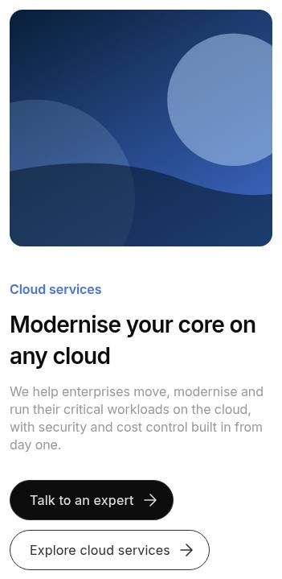

**Image & Text, image left** — An Image & Text teaser at 1440 px: the rounded 10:9 image photo-2 (consultants in a workshop) on the left; the brand-blue eyebrow Consulting, the semibold title Strategy that turns into results, the description and the buttons Talk to an expert and Explore cloud services on the right.

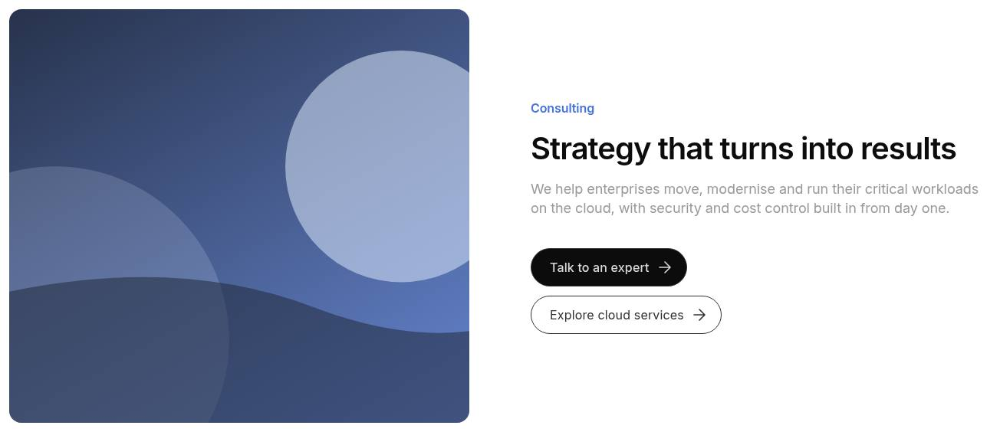

**Image & Text, image right** — An Image & Text teaser at 1440 px with Image position Right: on the left the eyebrow Cybersecurity, the title Resilience by design, the description and the buttons Talk to an expert and Explore cloud services; on the right the rounded 10:9 image photo-3.

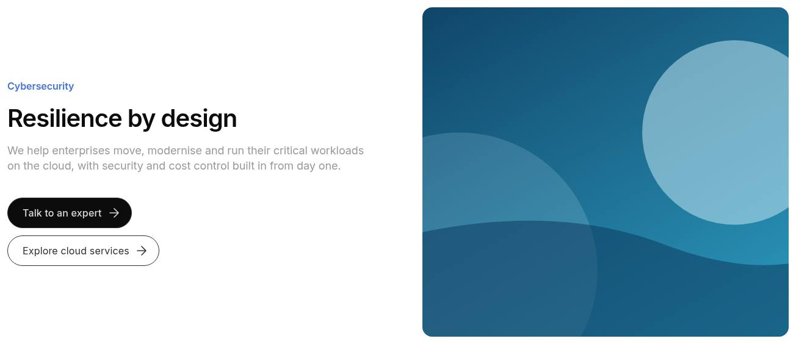

**Centred text teaser** — An Image & Text teaser without an image at 1440 px, centred in a 37.5rem column: the eyebrow Careers, the title Build the future with us at 3rem, the description and the buttons Search jobs (primary) above Life at TCS (secondary).


**Text split** — A Text split teaser at 1440 px: across the top the eyebrow Insights and the grey uppercase tags ARTIFICIAL INTELLIGENCE, BANKING and REPORT; the regular-weight title Turning enterprise data into decisions on the left; the description and the text links Read the report and Explore data and analytics on the right.

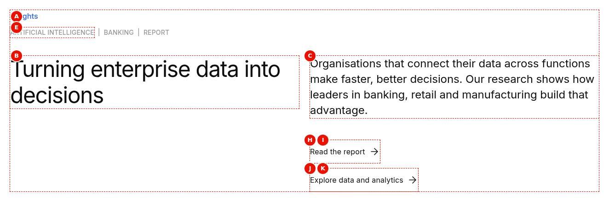

**Text split with a chart** — A Text split teaser at 1440 px: the eyebrow Insights and the regular-weight title Growth follows data maturity on the left; on the right the description and below it the bar chart chart.svg (Revenue growth index, 2020–2026) shown whole with square corners.

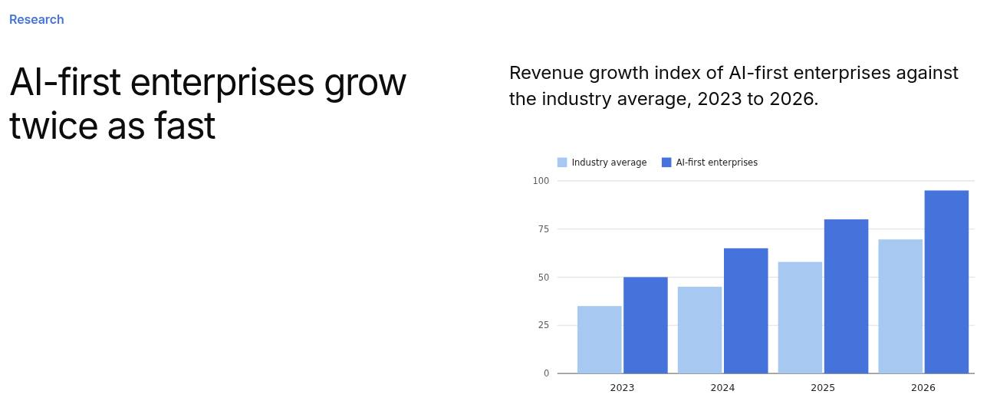

**Background image teaser** — A Background image teaser at 1440 px: wide.svg under a dark 60 % overlay with the centred brand-blue eyebrow Sustainability, the white title Technology for a net-zero future, the description and the white outline buttons Read the report and Our approach, stacked.

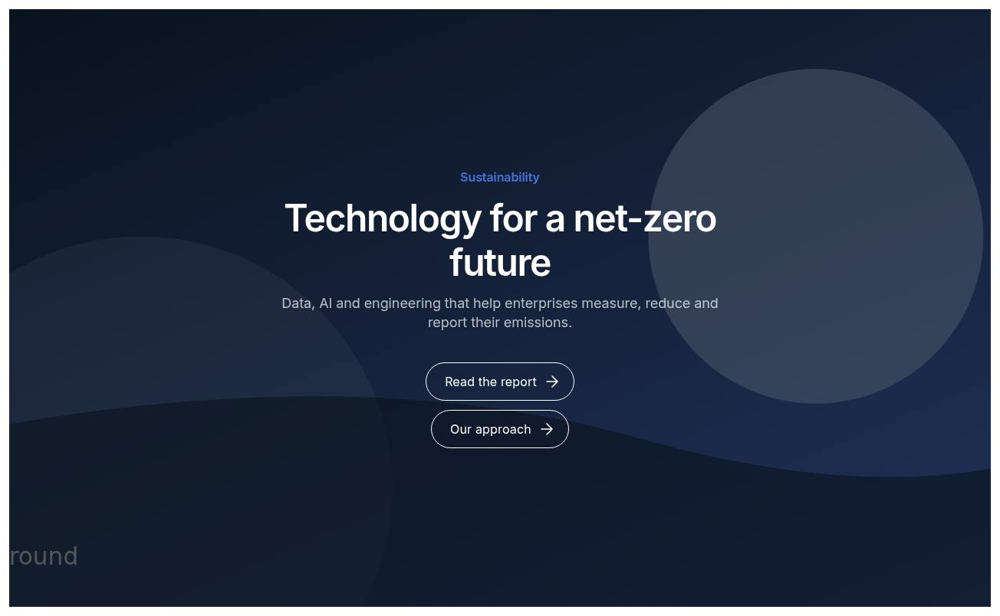

**Card teaser** — A Card teaser at 1440 px: a rounded card with photo-4 under a 70 % black overlay; the eyebrow Media kit and the white title Brand assets and company facts top left; at the bottom the description and the List rows Download the media kit and Contact the press office with a divider and right arrows.

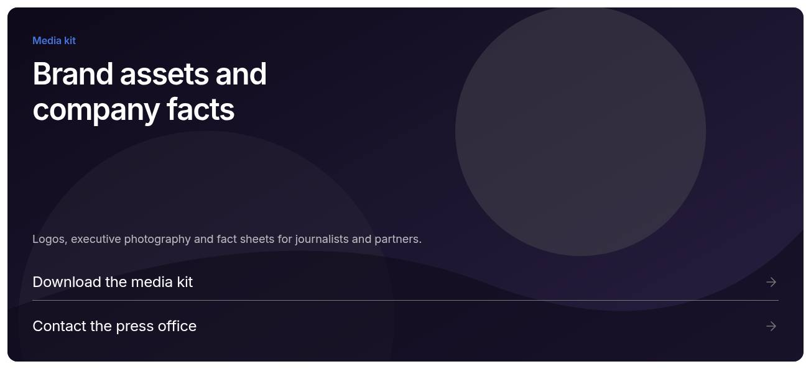

**Lottie teaser** — An Image & Text teaser at 1440 px with Image type Lotto: the Lottie animation.json (a blue shape) contained in the left media box with a round pause button at its bottom right; on the right the eyebrow Innovation, the title AI that learns with your business, the description and the buttons Talk to an expert and Explore cloud services.

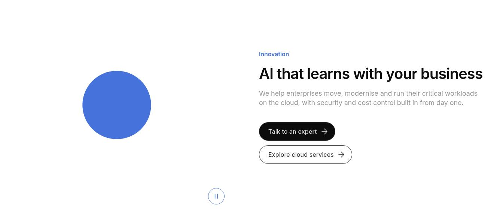

**Default mobile image position** — An Image & Text teaser at 375 px with Image position (mobile) Default: the rounded 10:9 image photo-5 on top, then the eyebrow Retail, the title Personalised experiences at scale, the description and the stacked buttons Talk to an expert and Explore cloud services.

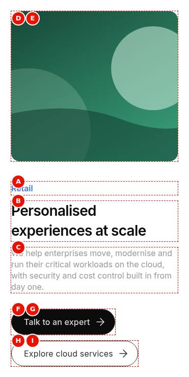

**Mobile image on top** — A Text split teaser at 375 px with Image position (mobile) Top: the eyebrow Insights, the title Growth follows data maturity, then the bar chart chart.svg, then the description Organisations that connect their data across functions…

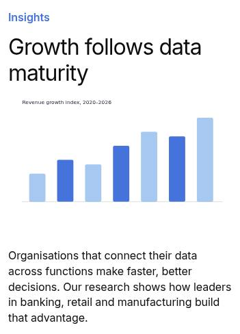

**Mobile image at the bottom** — An Image & Text teaser at 375 px with Image position (mobile) Bottom: the eyebrow Manufacturing, the title Smart factories, connected supply chains, the description and the stacked buttons Talk to an expert and Explore cloud services, then the rounded image photo-6 below the buttons.

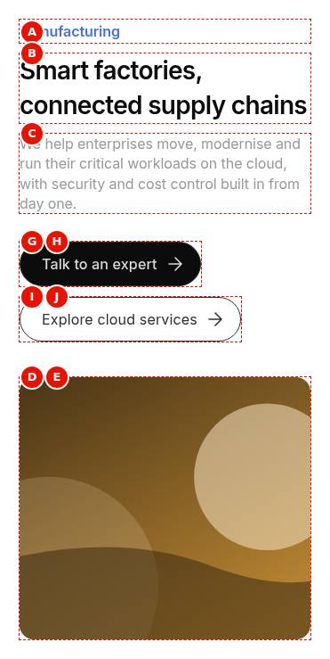

**10:9 image** — An Image & Text teaser at 1440 px: the image photo-2 cropped to 10:9 with rounded corners on the left; the brand-blue eyebrow Cloud services, the semibold title A default 10:9 image, the description and the button Talk to an expert on the right.

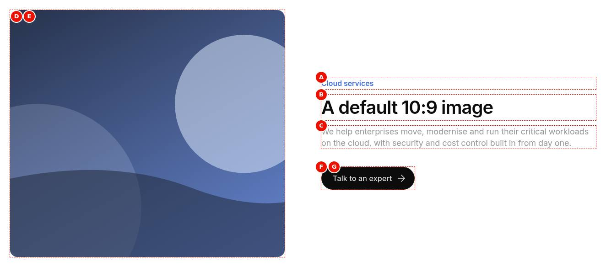

**8:9 image** — An Image & Text teaser at 1440 px: the image photo-3 cropped to a taller 8:9 portrait on the left; the brand-blue eyebrow Cloud services, the semibold title A portrait 8:9 image, the description and the button Talk to an expert on the right.

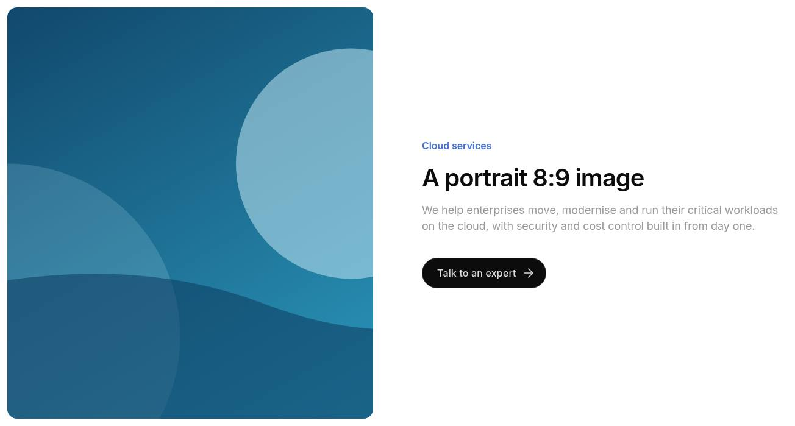

**Square image** — An Image & Text teaser at 1440 px: the image photo-5 as a rounded square (1:1) on the left; the brand-blue eyebrow Cloud services, the semibold title A square 1:1 image, the description and the button Talk to an expert on the right.

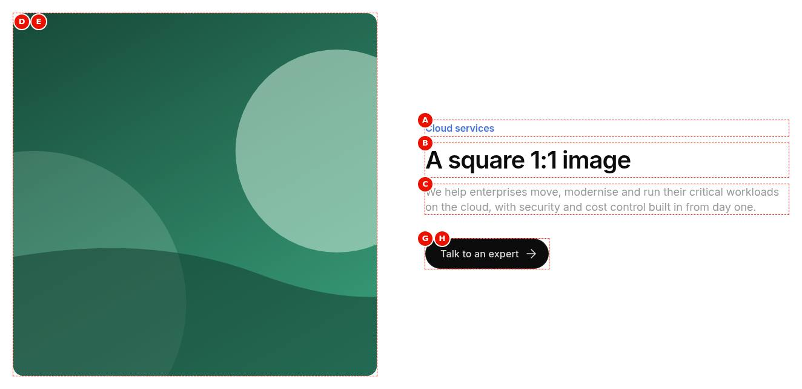

**Original ratio** — An Image & Text teaser at 1440 px: the wide image photo-6 uncropped at its own 16:9 proportion on the left; the brand-blue eyebrow Cloud services, the semibold title The image in its original ratio, the description and the button Talk to an expert vertically centred on the right.

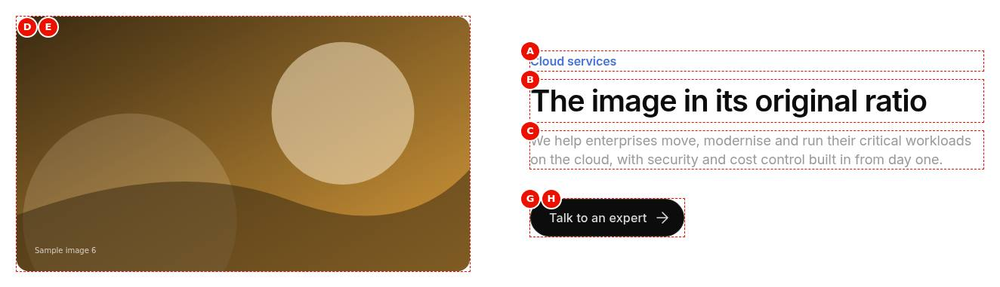

**Rounded corners** — An Image & Text teaser at 1440 px: the image photo-7 at 10:9 with 1rem rounded corners on the left; the brand-blue eyebrow Cloud services, the semibold title Rounded image corners, the description and the button Talk to an expert on the right.

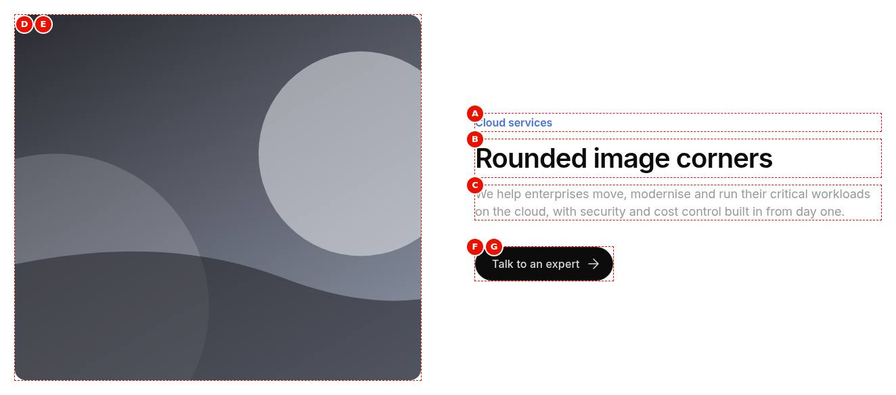

**Square corners** — An Image & Text teaser at 1440 px: the image photo-8 at 10:9 with sharp square corners on the left; the brand-blue eyebrow Cloud services, the semibold title Square image corners, the description and the button Talk to an expert on the right.

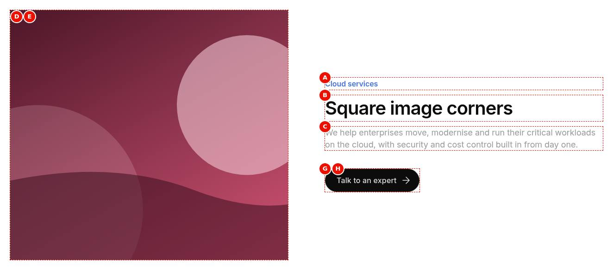

**No background colour** — An Image & Text teaser at 1440 px: on the white page without a panel, the rounded 10:9 image photo-2 on the left; the brand-blue eyebrow Cloud services, the semibold title Modernise your core on any cloud, the description and the buttons Talk to an expert and Explore cloud services on the right.

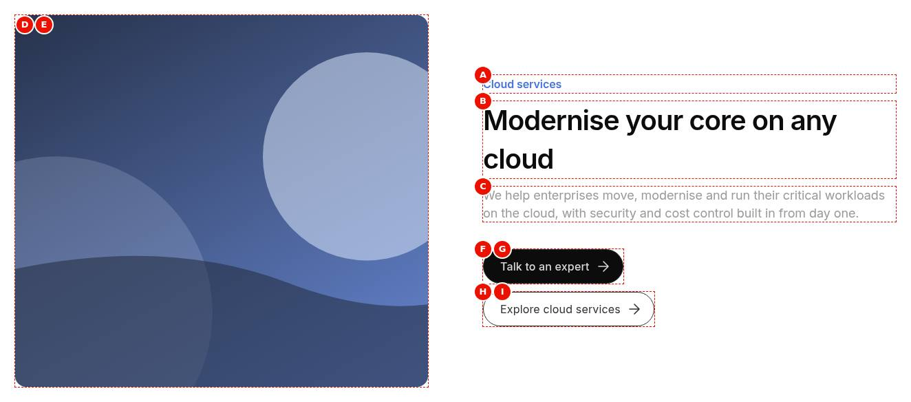

**Grey panel** — A Text split teaser at 1440 px on a padded light grey panel: the eyebrow Insights above, the regular-weight title Turning enterprise data into decisions on the left, the description and the text link Read the report on the right.

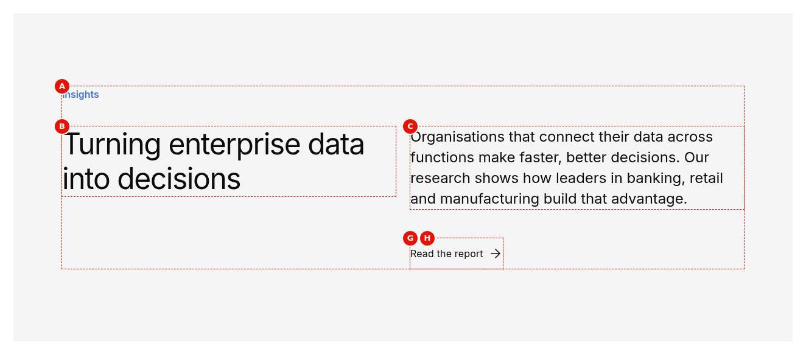

**Dark panel** — A Text split teaser at 1440 px on a near-black panel: the eyebrow Results and the white title Cloud modernisation in numbers on the left; on the right the description, the stats Lower operating cost 40%, Faster releases 3x and Applications migrated 1,200 in light blue, then Talk to an expert as a black button barely visible on the panel and the white outline Read the case studies.

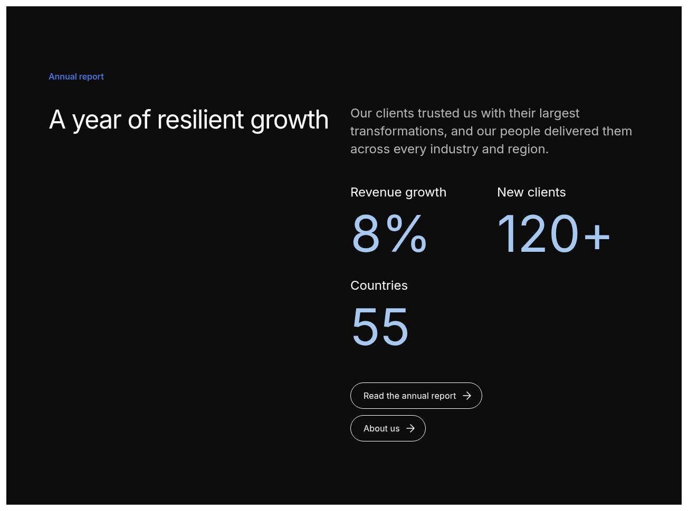

**Dark green panel** — A teaser without an image at 1440 px on a dark green panel, centred: the brand-blue eyebrow Sustainability, the white title Engineering a net-zero future, the description and the buttons Our commitments (black) above Read the report (white outline).

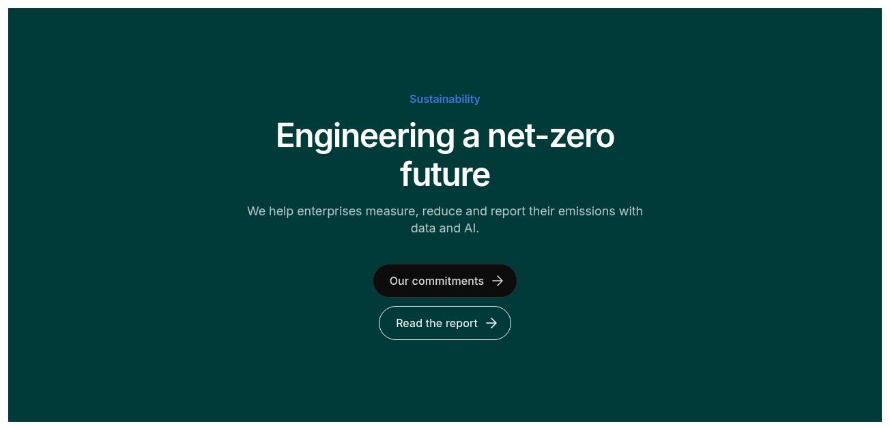

**Layout default alignment** — Two teasers at 1440 px stacked one above the other: first an Image & Text teaser with photo-2 on the left and the left-aligned title Left aligned by default with two buttons; below it a Background image teaser with wide.svg and the centred eyebrow Sustainability, title Centred by default and the white outline buttons Read the report and Our approach.

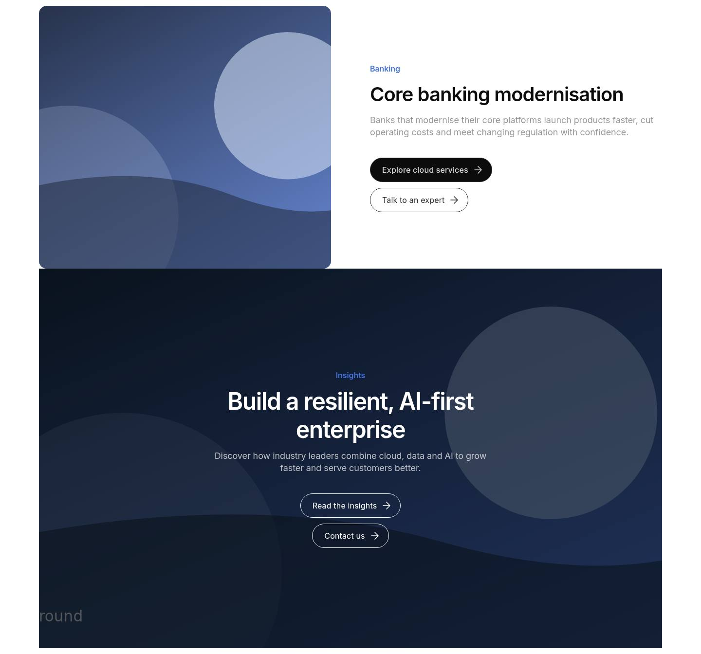

**Left-aligned text** — A Background image teaser at 1440 px with Text alignment Left: wide.svg under the dark overlay; the eyebrow Sustainability, the white title Left-aligned text over the image, the description and the white outline buttons Read the report and Our approach are left aligned within a text block that stays centred in the banner.

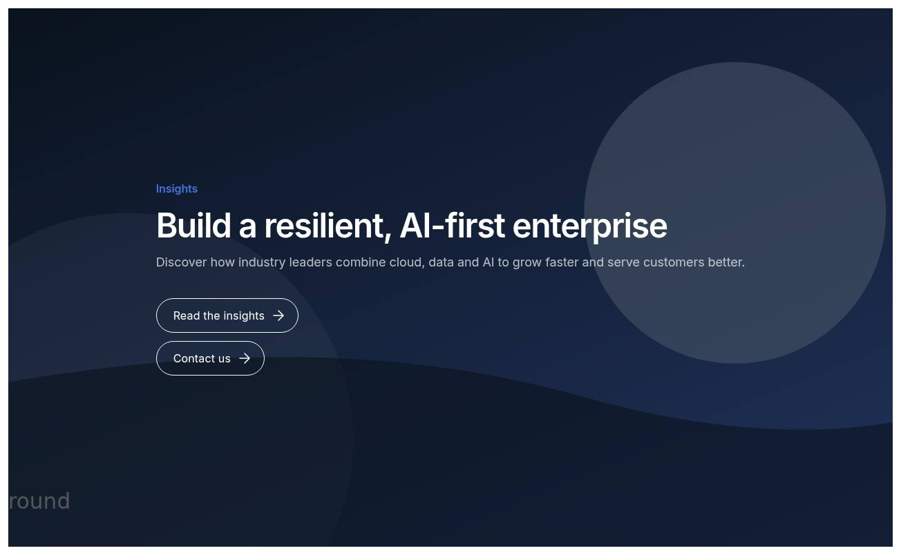

**Centred text** — An Image & Text teaser at 1440 px with Text alignment Center: the rounded image photo-3 on the left; in the right column the eyebrow Cybersecurity, the title Centred next to the image, the description and the buttons Talk to an expert and Explore cloud services, all centred.

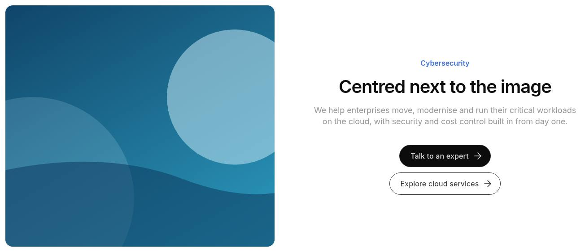

**Right-aligned text** — A Card teaser at 1440 px with Text alignment Right: photo-4 under a dark overlay; the eyebrow Media kit, the title Brand assets and company facts and the description aligned right; the List rows Download the media kit and Contact the press office stay full width with their labels on the left and arrows on the right.

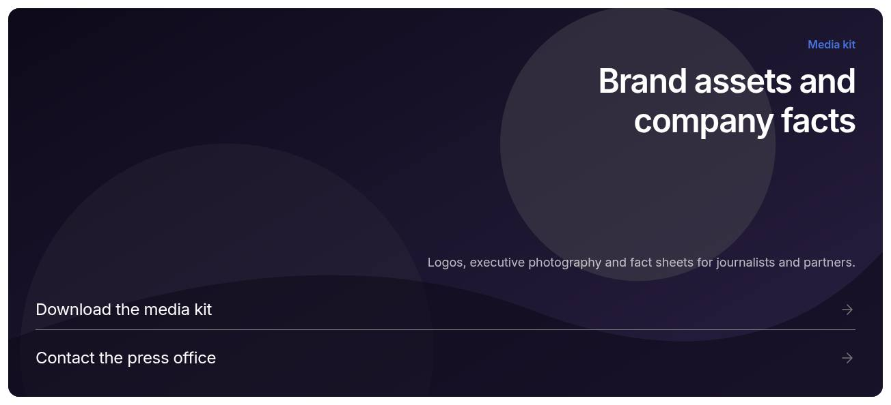

**Layout default vertical alignment** — An Image & Text teaser at 1440 px: the tall image tall.svg at 8:9 on the left; the brand-blue eyebrow Cloud services, the semibold title Modernise your core on any cloud, the description and the two buttons vertically centred against the image on the right.

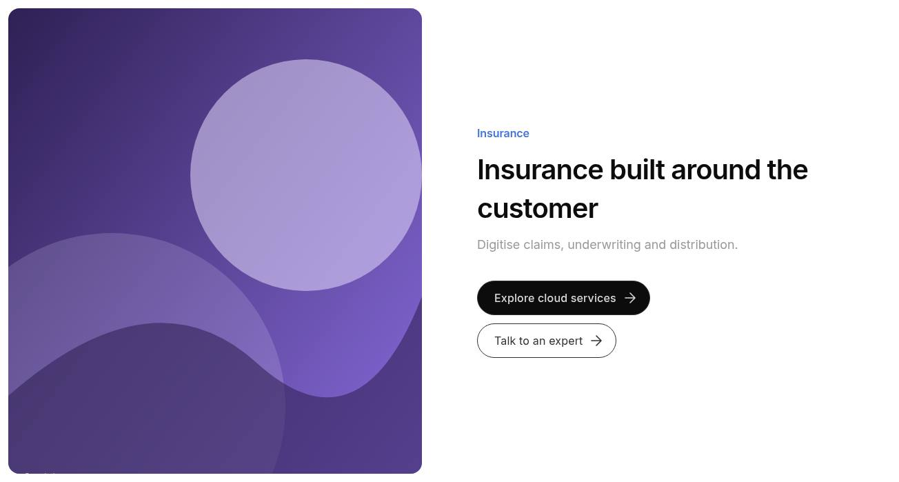

**Top alignment** — An Image & Text teaser at 1440 px: the tall image tall.svg at 8:9 on the left; the brand-blue eyebrow Cloud services, the semibold title Text aligned to the top of the image, the description and the two buttons on the right, with the eyebrow level with the top edge of the image.

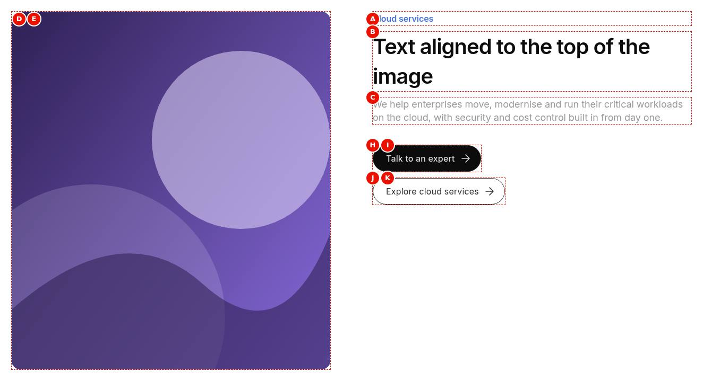

**Centre alignment** — A Text split teaser at 1440 px with Vertical alignment Center: the eyebrow Insights above; the short title AI at scale on the left, vertically centred against the right column with the long description and the List rows Cloud migration, Business and technology consulting and Industries we serve.

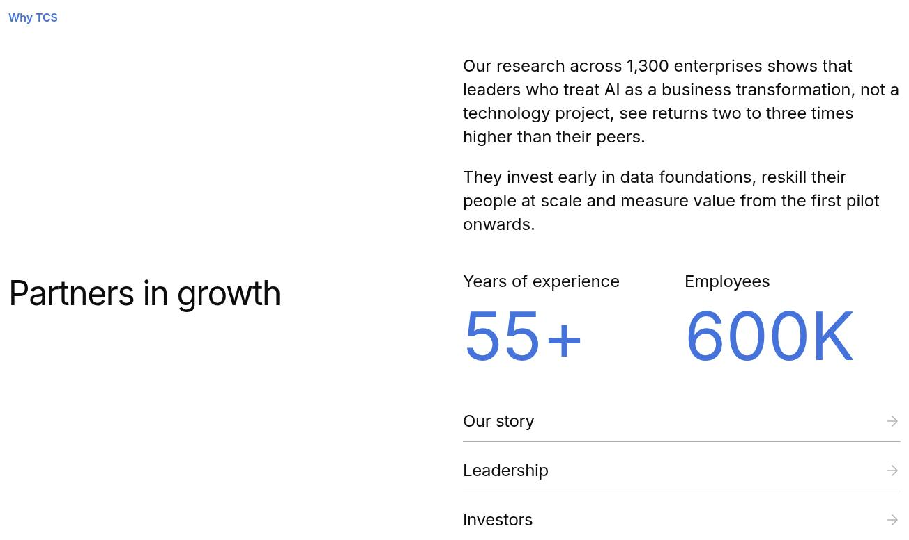

**Bottom alignment** — A Background image teaser at 1440 px with Vertical alignment Bottom: wide.svg under the dark overlay, with the centred eyebrow Sustainability, the white title Text resting at the bottom, the description and the white outline buttons Read the report and Our approach in the lower part of the banner.

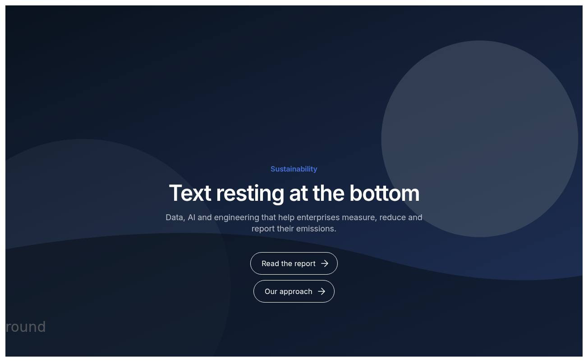

**Default title size** — Two teasers at 1440 px stacked one above the other: an Image & Text teaser with photo-2 and the semibold 2.5rem title Image & Text title with the button Talk to an expert; below it a Text split teaser with the regular-weight 3rem title Text split title on the left and the description on the right.

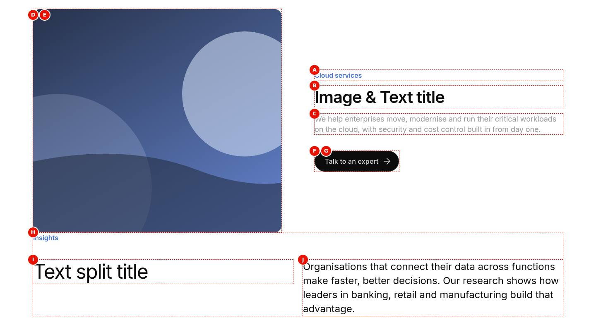

**Medium title** — A Background image teaser at 1440 px with Title size Medium: wide.svg under the dark overlay with the centred eyebrow Sustainability, the 2.5rem white title Technology for a net-zero future, the description and the white outline buttons Read the report and Our approach.

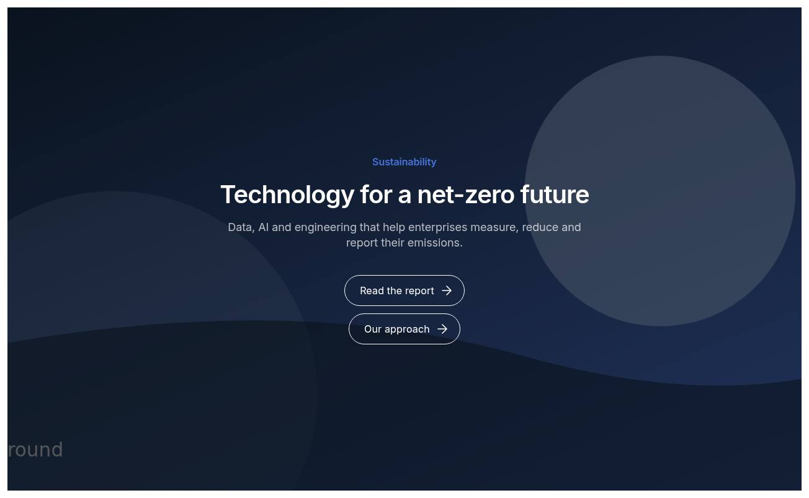

**Large title** — An Image & Text teaser at 1440 px: the rounded image photo-2 on the left; the brand-blue eyebrow Cloud services, the semibold title A large title beside the image at 3rem (Title size Large) over two lines, the description and the button Talk to an expert on the right.

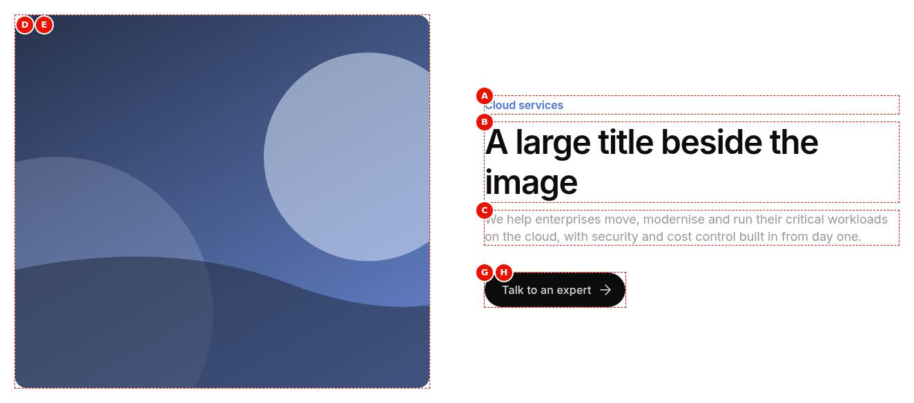

**Extra large title** — A Text split teaser at 1440 px with Title Type H1 and Title size Extra large: the eyebrow Services above, the 4rem regular-weight title Cloud on the left and the description Move, modernise and run workloads on any cloud… on the right.

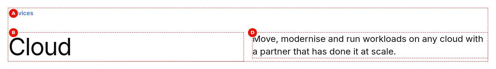

**Display title** — A teaser at 1440 px with only a title and Title size Display: the semibold 6rem title Built on belief centred on the white page over two lines, without eyebrow, description or links.


**Default title weight** — Two teasers at 1440 px stacked one above the other: an Image & Text teaser with photo-2 and the semibold title A semibold Image & Text title with the button Talk to an expert; below it a Text split teaser with the regular-weight title A regular Text split title on the left and the description on the right.

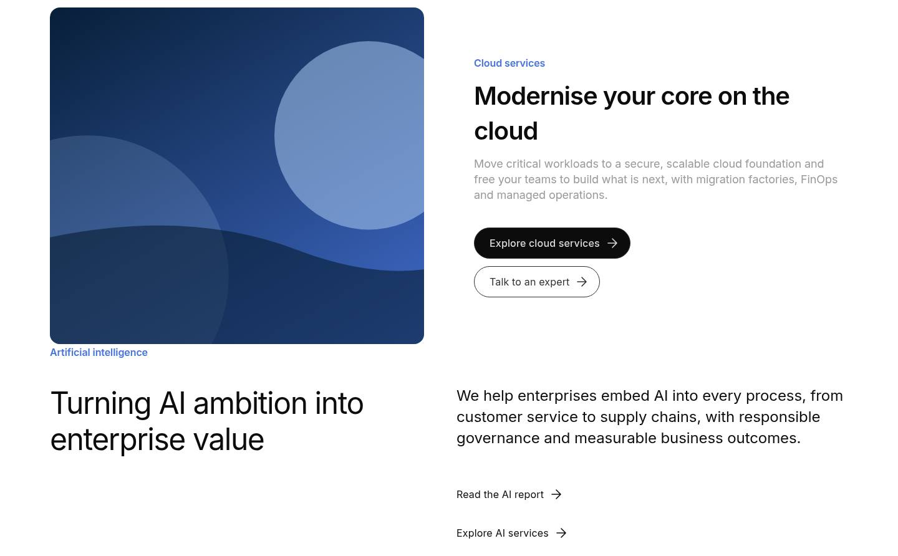

**Regular title** — An Image & Text teaser at 1440 px: the rounded image photo-2 on the left; the brand-blue eyebrow Cloud services, the title A regular-weight title in regular weight (Title weight Regular), the description and the button Talk to an expert on the right.

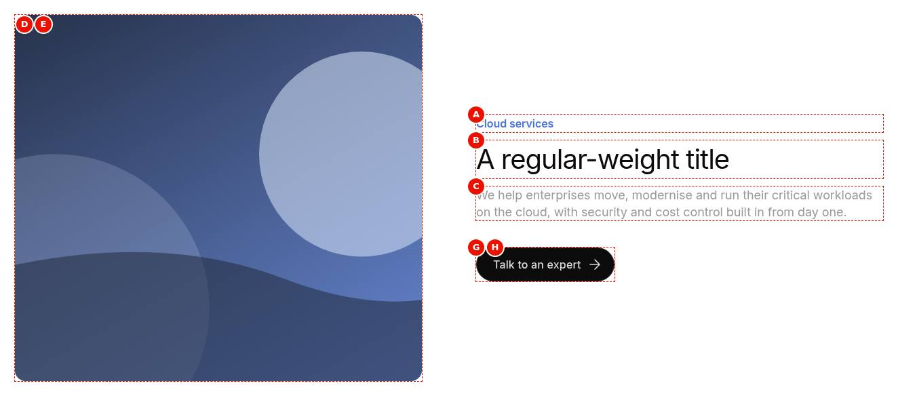

**Semibold title** — A Text split teaser at 1440 px with Title weight Semibold: the eyebrow Insights above, the 3rem semibold title A semibold Text split title on the left and the description on the right.

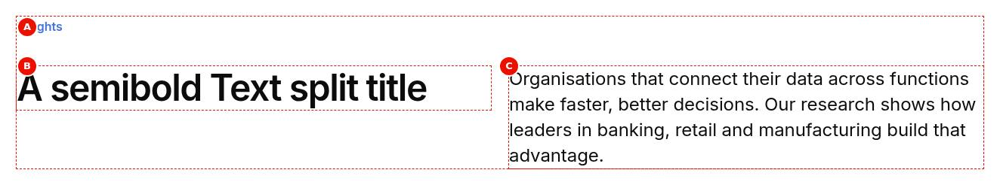

**Default description size** — Two teasers at 1440 px stacked one above the other: an Image & Text teaser with photo-2, the title Description at 1.125rem, grey 1.125rem body text and a button; below it a Text split teaser with the title Description at 1.5rem on the left and the larger black description on the right.

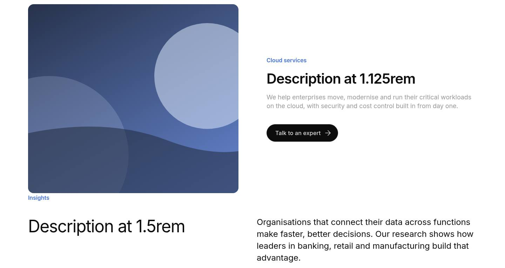

**Regular description** — A Text split teaser at 1440 px with Description size Regular: the eyebrow Insights above, the regular-weight title Regular body text on the left and on the right the description at 1.125rem, smaller than the Text split default.

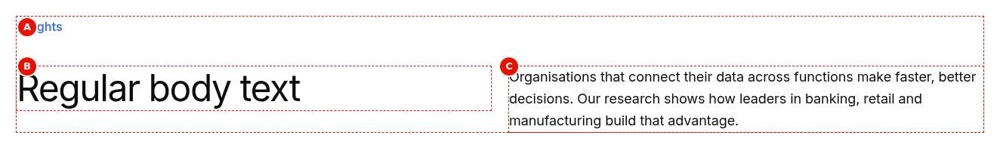

**Large description** — An Image & Text teaser at 1440 px: the rounded image photo-2 on the left; the brand-blue eyebrow Cloud services, the semibold title A large description, the description at 1.5rem (Description size Large) over four lines and the button Talk to an expert on the right.

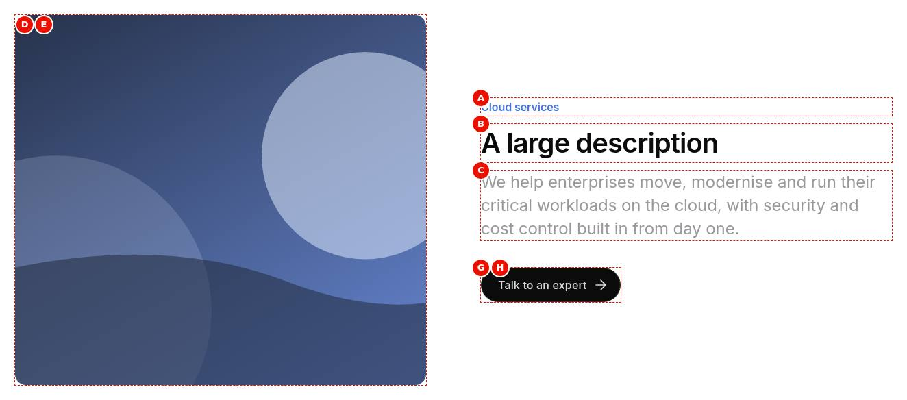

**Brand eyebrow** — An Image & Text teaser at 1440 px: the rounded image photo-2 on the left; the brand-blue eyebrow Artificial intelligence, the semibold title The brand eyebrow, the description and the button Talk to an expert on the right.

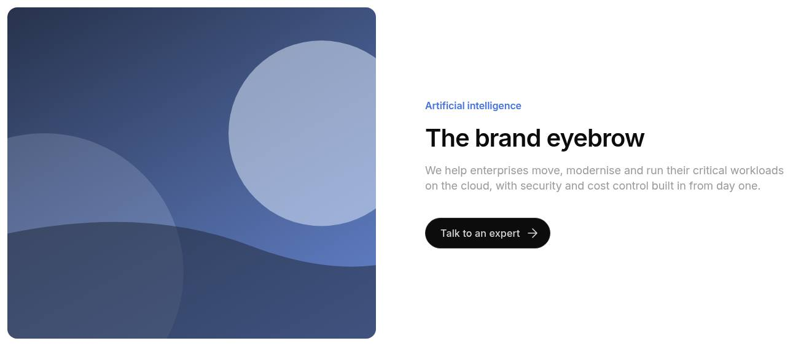

**Label eyebrow** — A Text split teaser at 1440 px with Eyebrow style Label: the small grey uppercase label PRESS RELEASE above, the regular-weight title TCS opens a new AI innovation centre in Europe on the left and the description on the right.

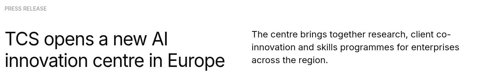

**Default top spacing** — A section at 1440 px: the H2 How we work and the intro text, then an Image & Text teaser with photo-2, the eyebrow Cloud services, the title A teaser between other content and the button Talk to an expert, then the text Explore our services, industries and latest research below, with normal spacing.

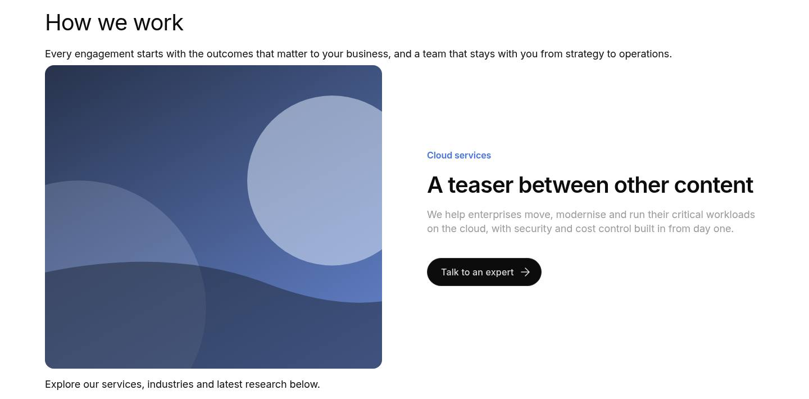

**Page header spacing** — A Text split teaser at 1440 px with Top spacing Page header: a large empty space above, then the eyebrow Industries, the regular-weight title Banking and financial services on the left and the description on the right.

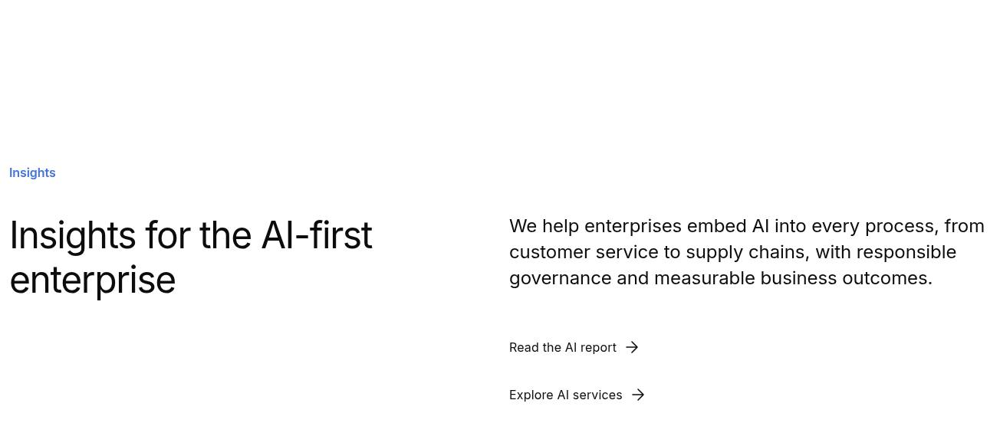

**Two CTAs** — A Text split teaser at 1440 px: the eyebrow Insights above, the title Two calls to action on the left; on the right the description, the black button Talk to an expert and below it the outline button Explore our services.

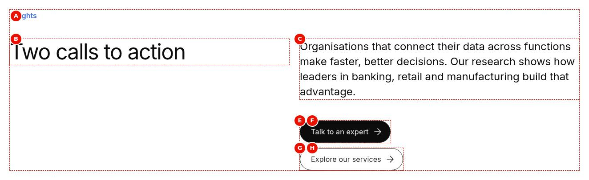

**Multiple links** — A Text split teaser at 1440 px: the eyebrow Insights above, the title Related services on the left; on the right the description and four List rows Cloud migration, Business and technology consulting, Industries we serve and About us with grey dividers and right arrows.

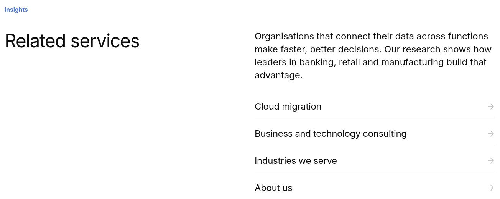

**Text link** — An Image & Text teaser at 1440 px: the rounded image photo-2 on the left; the brand-blue eyebrow Cloud services, the semibold title A text link, the description and the text link Learn more with a right arrow on the right.


**List links** — A Text split teaser at 1440 px: the eyebrow Insights above, the title Explore more on the left; on the right the description and three List rows Cloud migration, Business and technology consulting and Industries we serve with grey dividers and right arrows.

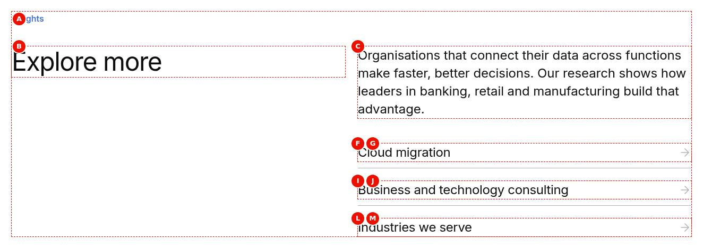

**Primary button** — An Image & Text teaser at 1440 px: the rounded image photo-2 on the left; the brand-blue eyebrow Cloud services, the semibold title One primary button, the description and the black pill button Talk to an expert on the right.

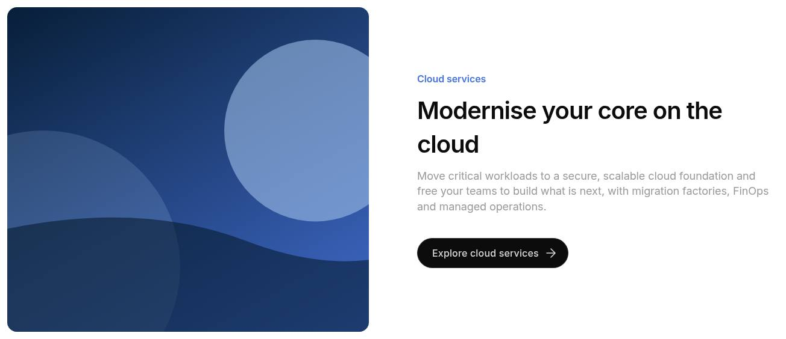

**Secondary button** — Two centred teasers at 1440 px stacked one above the other: on white, the eyebrow Careers, the title A secondary button, the description and the outline button Life at TCS; below it on a near-black panel, the title On a dark panel with the same button as a white outline.

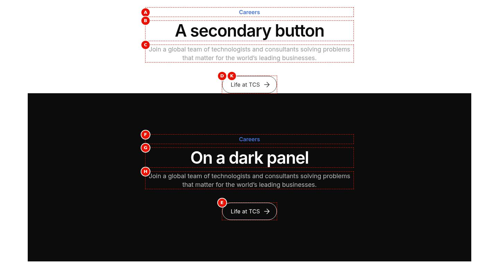

**Mixed links** — A Text split teaser at 1440 px: the eyebrow Insights above, the title Mixed link styles on the left; on the right the description, the List rows Cloud migration and Business and technology consulting with a divider and arrows, then the black button Talk to an expert.


**Right arrow** — A Text split teaser at 1440 px: the title List rows with right arrows on the left; on the right the description and three divided List rows Cloud migration, Business and technology consulting and Industries we serve, each ending in a grey right arrow.


**Down-right arrow** — A Text split teaser at 1440 px with List arrow Down right: the title List rows with down-right arrows on the left; on the right the description and three divided List rows, each ending in a grey diagonal arrow pointing down and right.


**Stats** — A Text split teaser at 1440 px: the eyebrow Results above, the title Cloud modernisation in numbers on the left; on the right the description and the stats Lower operating cost 40%, Faster releases 3x and Applications migrated 1,200, each label above a large brand-blue value.


**Date** — A Text split teaser at 1440 px: the eyebrow Report, and below it on the left (not at the right of the kicker, as there are no tags) the small text Published 13-10-2026; then the regular-weight title The state of AI in banking 2026 on the left and the description How 300 banks are moving AI from pilots into everyday operations… on the right.


**Reading time** — A Text split teaser at 1440 px: the eyebrow Report, and below it on the left the small text Published 13-10-2026 followed by 14 min read; then the regular-weight title The state of AI in banking 2026 on the left and the description How 300 banks are moving AI from pilots into everyday operations… on the right.


**Page actions** — A Text split teaser at 1440 px after selecting Share: under the eyebrow Report, on the left, the headphones, download and share icon buttons with Link copied to clipboard below them, its first letter cut off at the left edge; then the regular-weight title The state of AI in banking 2026 on the left and the description How 300 banks are moving AI from pilots into everyday operations… on the right.


**Author** — A Text split teaser at 1440 px: the eyebrow Report above; on the left the title The state of AI in banking 2026 and below it a round portrait with Anita Rao and Head of AI Research; on the right the description.


**Tags** — A Text split teaser at 1440 px: the eyebrow Report, below it the grey uppercase tags ARTIFICIAL INTELLIGENCE, BANKING and REPORT separated by bars; then the regular-weight title The state of AI in banking 2026 on the left and the description How 300 banks are moving AI from pilots into everyday operations… on the right.


**View All** — A teaser without an image at 1440 px with Text alignment Left: the eyebrow Insights, the title Latest research on the left with the black View all button at the right of the same row, and the description Reports, articles and case studies from our experts below.


**Hidden title** — A centred teaser without an image at 1440 px with Hide Title on: no visible title; the description Join a global team of technologists… and the buttons Search jobs and Life at TCS, centred.


**Short description** — A centred teaser without an image at 1440 px: the eyebrow Careers, the title Build the future with us, the description, the buttons Search jobs and Life at TCS and below them the short note Applications are reviewed on a rolling basis. Equal opportunity employer.


**Hidden eyebrow** — A centred teaser without an image at 1440 px with Show Eyebrow off: no eyebrow; the title Build the future with us, the description and the buttons Search jobs and Life at TCS.


**Hidden description** — A centred teaser without an image at 1440 px with Show Description off: the eyebrow Careers, the title Build the future with us and the buttons Search jobs and Life at TCS, without a description.


**Heading level** — Two identical-looking centred teasers at 1440 px stacked one above the other, each with the eyebrow Careers, the title Build the future with us, the description and the buttons Search jobs and Life at TCS; the first title is an H2, the second an H3.


**Universal Editor canvas** — The fully populated Text split teaser at 1440 px in editor mode with markers A to N (A shares the top-left corner with C): eyebrow Report, tags, Published 13-10-2026, 14 min read and action icons above; title, View all and Anita Rao on the left; description, chart, stats 40%, 3x, 1,200, two buttons and the short description on the right. (Annotated preview in editor mode with sample content; letters as in the annotations list, not a Universal Editor screenshot; file screenshots/teaser-authoring-view.jpg)


**Properties panel** — The Teaser properties panel with its six tabs (Content, Image, Style, Links, Stats, Additional), the Content tab open with Show Date on so that Date, Date Format and Date label are visible. (Dialog reference generated from the component model, not a Universal Editor screenshot; file screenshots/teaser-properties-panel.jpg)


Universal Editor dialogs (no screenshot exists yet; to be captured on AEM author):

```text
[Screenshot Placeholder]

File name:
teaser-dialog-content-desktop.png

Purpose:
The Content tab of the Teaser properties in Universal Editor, with the fields of the table "Content tab — Teaser" in Authorable Fields below.

Annotations:
A = Eyebrow
B = Show Eyebrow
C = Title
D = Title Type
E = Hide Title
F = Description
G = Show Description
H = Short Description
I = View All Text
J = View All Link
```

```text
[Screenshot Placeholder]

File name:
teaser-dialog-style-desktop.png

Purpose:
The Style tab of the Teaser properties in Universal Editor, with the fields of the table "Style tab — Teaser" in Authorable Fields below.

Annotations:
A = Layout
B = BG Color
C = Text alignment
D = Vertical alignment
E = Title weight
F = Title color
G = Description size
H = Eyebrow Style
I = Top spacing
```

```text
[Screenshot Placeholder]

File name:
teaser-dialog-additional-desktop.png

Purpose:
The Additional tab of the Teaser properties in Universal Editor, with the fields of the table "Additional tab — Teaser" in Authorable Fields below.

Annotations:
A = Anchor ID
B = Hide block
C = Animation Type
D = Motion Speed
E = Animation Trigger
F = Background animation
G = Padding left
H = Padding right
I = Padding top
J = Padding bottom
```

```text
[Screenshot Placeholder]

File name:
teaser-link-dialog-fields-desktop.png

Purpose:
The dialog of the Link properties in Universal Editor, with the fields of the table "Fields — Link" in Authorable Fields below.

Annotations:
A = CTA Link
B = CTA Title
C = CTA Link Type
D = CTA Link Style
E = Button background
F = Button shape
```

```text
[Screenshot Placeholder]

File name:
teaser-stat-dialog-stat-desktop.png

Purpose:
The Stat tab of the Stat properties in Universal Editor, with the fields of the table "Stat tab — Stat" in Authorable Fields below.

Annotations:
A = Stats Title
B = Stats Value
```

<!-- END GENERATED: screenshots -->

The handover screenshots were taken with the code of handover 2.31. Since 2.32: Title Type sets the title size (the "Title size" screenshots show a field that no longer exists); BG Color no longer adds padding; Image position has Top and Bottom, and Left / Right apply from 600px; Buttons side by side and List arrow None exist. Since 2.41, CTA Link Style also offers Primary Button (no arrow), retaining the primary button dimensions with a navy background. The properties panel screenshot shows the six tabs used before handover 2.8; the dialog now has Content, Style and Additional. The states below have no screenshot yet.

```text
[Screenshot Placeholder]

File name:
teaser-image-top-desktop.png

Purpose:
Image & Text with Image position Top at 1440px: the 16:9 image above the text.

Annotations:
A = Image (16:9)
B = Eyebrow and title
C = Links
```

```text
[Screenshot Placeholder]

File name:
teaser-image-bottom-mobile.png

Purpose:
Image & Text with Image position Bottom at 375px: the text first, the 16:9 image below it.

Annotations:
A = Text
B = Image (16:9)
```

```text
[Screenshot Placeholder]

File name:
teaser-buttons-side-by-side-desktop.png

Purpose:
Buttons side by side on: the Primary and Secondary CTA in one row, wrapping when there is no room.

Annotations:
A = Primary button
B = Secondary button
```

```text
[Screenshot Placeholder]

File name:
teaser-list-arrow-none-desktop.png

Purpose:
List arrow None: List links without arrows; buttons and Text links keep theirs.

Annotations:
A = List rows without arrows
B = Button with its arrow
```

```text
[Screenshot Placeholder]

File name:
teaser-text-split-tablet.png

Purpose:
Text split at 768px: the kicker, title, author and body stacked in one column (the two columns start at 900px).

Annotations:
A = Kicker (eyebrow, tags, date, actions)
B = Title and author
C = Body
```

```text
[Screenshot Placeholder]

File name:
teaser-card-mobile.png

Purpose:
Card at 375px: 25rem minimum height, 1.5rem padding, image under a 70% overlay.

Annotations:
A = Header at the top
B = Links at the bottom
```

```text
[Screenshot Placeholder]

File name:
teaser-focus-desktop.png

Purpose:
Keyboard focus on a List link and on the Share icon button.

Annotations:
A = Focused List link (brand colour)
B = Focused icon button
```

```text
[Screenshot Placeholder]

File name:
teaser-share-copied-desktop.png

Purpose:
After Share without the Web Share API: the "Link copied to clipboard" status below the actions.

Annotations:
A = Share icon button
B = Status message (role="status")
```

```text
[Screenshot Placeholder]

File name:
teaser-item-placeholder-editor-desktop.png

Purpose:
A Link item just added in Universal Editor, before it has a link: a dashed placeholder with the itemEditorHint text.

Annotations:
A = Placeholder
B = Link node in the content tree
```

```text
[Screenshot Placeholder]

File name:
teaser-lottie-failed-desktop.png

Purpose:
Image type Lotto with a JSON file that doesn't load (for example not published): the animation and its pause button are hidden.

Annotations:
A = Empty media area
B = Text
```

## For Content Authors

1. **Add the block.** In Universal Editor, select a Section, a Columns Container column, a Gen Carousel section or a Tabs Container. Choose Add (+) and pick **Teaser**.
2. **Open its properties.** Select the block. The dialog has three tabs: Content, Style and Additional.
3. **Choose the layout first** (Style tab › Layout): Image & Text, Text split, Background image or Card. Some fields only appear for some layouts (for example Image position only for Image & Text).
4. **Enter content** (Content tab): Eyebrow, Title (and Title Type, which also sets the size), Description, optionally the Short Description, View All, Date, Reading time, Tags (Display Tags on), Listen link / Download / Share, and the author.
5. **Add the image** (Content tab): Image type (Default or Lotto for a Lottie `.json`), Image, Image alt text, then Image position, Image position (mobile), Image ratio and Image corners where offered.
6. **Add links:** either the Primary and Secondary CTA (Multiple links off), or Link items. To add Link items, select the Teaser in the content tree, choose Add (+), pick **Link**, and set CTA Link, CTA Title, CTA Link Type and CTA Link Style. Link items always render after the CTAs. Set List arrow and Buttons side by side as needed.
7. **Add stats:** Add (+) › **Stat**, with Stats Title and Stats Value. Reorder Link and Stat items by dragging them in the content tree.
8. **Style it** (Style tab): BG Color, Text alignment, Vertical alignment, Title weight, Description size, Eyebrow style, Top spacing. BG Color only sets the colour: add space around the content with the Additional tab's Padding fields.
9. **Preview** at desktop and mobile widths (Image & Text changes at 600px, Text split at 900px).
10. **Publish** the page with its images, Lottie files and author image. Lottie JSON files are only served once published.
11. **Validate** the published page: layout, links (new-window links), alt texts, heading level and tags.

Minimum content: a Title, or any other content part. Recommended: Eyebrow, Title, Description, one or two links, and an Image with alt text (Image & Text, Background image, Card). Optional: everything else.

## Authorable Fields

<!-- BEGIN GENERATED: fields (npm run build:docs) -->

### Teaser (`teaser`)

Model `teaser`; template name "Teaser" (the block class AEM renders); key-value block (one row per property); children: `teaser-link`, `teaser-stat`.

Stored on a new component (definition template): `titleType` = `"h2"`, `imagePosition` = `"left"`, `showEyebrow` = `true`, `showDescription` = `true`, `dateFormat` = `"dd-mm-yyyy"`, `primaryCtaStyle` = `"primary"`, `secondaryCtaStyle` = `"secondary"`.

#### Content tab — Teaser

| Field label | Property | Type | Required | Default | Allowed values | Author guidance | Example |
| ----------- | -------- | ---- | -------- | ------- | -------------- | --------------- | ------- |
| Eyebrow | `eyebrow` | text | No | — | — | — | Industry focus |
| Show Eyebrow | `showEyebrow` | boolean | No | `true` | on / off | — | false |
| Title | `title` | text | No | — | — | — | Banking in Europe |
| Title Type | `titleType` | select | No | `h2` | H1 (64px) (`h1`), H2 (48px) (`h2`), H3 (40px) (`h3`), H4 (28px) (`h4`), H5 (24px) (`h5`), H6 (20px) (`h6`) | The heading level of the title, which also sets its size (desktop sizes; smaller on mobile). Use one H1 per page. Delivered with `title` (field collapse). | h1 |
| Hide Title | `titleHidden` | boolean | No | `false` | on / off | The title stays available to screen readers. | true |
| Description | `description` | richtext | No | "" | — | — | — |
| Show Description | `showDescription` | boolean | No | `true` | on / off | — | false |
| Short Description | `shortDescription` | richtext | No | "" | — | Shown after the links. | — |
| View All Text | `viewAllText` | text | No | — | — | Delivered with `viewAll` (field collapse). | View all |
| View All Link | `viewAll` | aem-content | No | — | — | — | /language-master/en/curated-design-pages/insights |
| Show Date | `showDate` | boolean | No | `false` | on / off | — | true |
| Date | `date` | date-time | No | — | — | Shown when `showDate` is `true`. | 2026-10-13 |
| Date Format | `dateFormat` | select | No | `dd-mm-yyyy` | DD-MM-YYYY (`dd-mm-yyyy`), MM-DD-YYYY (`mm-dd-yyyy`), MMM d, yyyy (`mmm-d-yyyy`), DD/MM/YY (`dd/mm/yy`) | Shown when `showDate` is `true`. | — |
| Date label | `dateLabel` | text | No | — | — | Shown before the date, e.g. Published. Shown when `showDate` is `true`. | Published |
| Reading time | `readingTime` | text | No | — | — | Minutes (e.g. 14, shown as "14 min read") or any text. | 14 |
| Display Tags | `displayTags` | boolean | No | `false` | on / off | — | true |
| Tags | `tags` | aem-tag (multiple) | No | — | — | Shown when `displayTags` is `true`. | — |
| Listen link | `listenLink` | aem-content | No | — | — | An audio version of the page: shows the listen icon. | — |
| Download | `download` | boolean | No | `false` | on / off | Shows the download icon (prints the page or saves it as PDF). | true |
| Share | `socialShare` | boolean | No | `false` | on / off | Shows the share icon (share dialog, or the link copied). | true |
| Author name | `authorName` | text | No | — | — | — | Anita Rao |
| Author designation | `authorDesignation` | text | No | — | — | e.g. TCS Role. | Head of AI Research |
| Author image | `authorImage` | reference | No | — | — | — | /content/dam/tcs-corp/block-library/images/avatar-sample-1.svg |
| Author image alt text | `authorImageAlt` | text | No | — | — | Leave empty if the image is decorative. Delivered with `authorImage` (field collapse). | Anita Rao |
| Image type | `imageFormat` | select | No | "" | Default (""), Lottie (`lottie`) | Default: the Image is a picture. Lottie: the Image is a Lottie animation file (.json). | lottie |
| Image | `image` | reference | No | — | — | Image & Text: beside the text. Text split: in the text column (e.g. a chart). Background image and Card: behind the text. | /content/dam/tcs-corp/dummy-pages/images/banking.jpg |
| Image alt text | `imageAlt` | text | No | — | — | Leave empty if the image is decorative. Delivered with `image` (field collapse). | Consultants planning a transformation roadmap |
| Hide Image | `hideImage` | boolean | No | `false` | on / off | — | true |
| Image position | `imagePosition` | select | No | `left` | Left (`left`), Right (`right`), Top (`top`), Bottom (`bottom`) | Image & Text: the image left or right of the text (from 600px wide; above it on smaller screens), or above or below the text on every screen. Shown when `classes` is off or empty or `classes` is empty. | right |
| Image position (mobile) | `imagePositionMobile` | select | No | "" | Default (""), Top (`mobile-image-top`), Bottom (`mobile-image-bottom`) | Image above or below the text on mobile (narrower than 600px for Image & Text, 900px for Text split). Default: as the Image position (Left and Right: above), or in the text order for Text split. Shown when `classes` is off or empty or `classes` is empty or `classes` is `no-image`. | mobile-image-top |
| Image ratio | `imageRatio` | select | No | "" | Default (10:9; 16:9 above or below the text; original in Text split) (""), Portrait (8:9) (`ratio-8-9`), Square (1:1) (`ratio-1-1`), Original (`ratio-original`) | Shown when `classes` is off or empty or `classes` is empty or `classes` is `no-image`. | ratio-8-9 |
| Image corners | `imageCorners` | select | No | "" | Rounded (""), Square (`square`) | Shown when `classes` is off or empty or `classes` is empty. | square |
| Multiple links | `multiLinks` | boolean | No | `false` | on / off | On: the Links list (authored before Link items). Off: the Primary and Secondary CTA. Link items are shown after them either way. | true |
| Links (authored before Link items) | `links` | container (multiple) | No | — | — | Kept for teasers authored before; add items with Add instead. Shown when `multiLinks` is `true`. | — |
| Links (authored before Link items) › CTA Title | `ctaText` | text | No | — | — | — | — |
| Links (authored before Link items) › CTA Link | `cta` | aem-content | No | — | — | — | — |
| Links (authored before Link items) › CTA Link Type | `ctaTarget` | select | No | "" | Default (""), Open in New Window (`new-window`) | — | — |
| Links (authored before Link items) › CTA Link Style | `ctaStyle` | select | No | "" | Text link (""), List (`list`), Primary Button (`primary`), Primary Button (no arrow) (`primary-no-arrow`), Secondary Button (`secondary`), Secondary Button (no arrow) (`secondary-no-arrow`) | — | — |
| Links (authored before Link items) › CTA Background | `ctaBackground` | select | No | "" | Style default (""), White (`button-bg-white`), Blue (`button-bg-blue`) | Sets the background of this CTA button. Blue uses rgb(33 106 195). | — |
| Links (authored before Link items) › CTA Shape | `ctaShape` | select | No | "" | Style default (""), Rectangle (`button-rectangle`) | Sets this CTA button's shape. Rectangle uses the grey-200 border. | — |
| List arrow | `linkArrow` | select | No | "" | Right (""), Down right (`arrow-down-right`), None (`arrow-none`) | Right: the default arrows. Down right: the arrow of every link (List links, buttons, Text links) points down and right. None: List links without an arrow (buttons and Text links keep theirs). Links opening a new tab keep their own arrow. | arrow-down-right |
| Primary CTA Title | `primaryCtaText` | text | No | — | — | Shown when `multiLinks` is off or empty. Delivered with `primaryCta` (field collapse). | Read the outlook |
| Primary CTA Link | `primaryCta` | aem-content | No | — | — | Shown when `multiLinks` is off or empty. | /language-master/en/dummy-pages/contact |
| Primary CTA Link Type | `primaryCtaTarget` | select | No | "" | Default (""), Open in New Window (`new-window`) | Shown when `multiLinks` is off or empty. | — |
| Primary CTA Link Style | `primaryCtaStyle` | select | No | `primary` | Text link (`tertiary`), List (`list`), Primary Button (`primary`), Primary Button (no arrow) (`primary-no-arrow`), Secondary Button (`secondary`), Secondary Button (no arrow) (`secondary-no-arrow`) | Shown when `multiLinks` is off or empty. | secondary |
| Primary CTA Background | `primaryCtaBackground` | select | No | "" | Style default (""), White (`button-bg-white`), Blue (`button-bg-blue`) | Sets the Primary CTA button background. Blue uses rgb(33 106 195). Shown when `multiLinks` is off or empty. | — |
| Primary CTA Shape | `primaryCtaShape` | select | No | "" | Style default (""), Rectangle (`button-rectangle`) | Sets the Primary CTA shape. Rectangle uses the grey-200 border. Shown when `multiLinks` is off or empty. | — |
| Secondary CTA Title | `secondaryCtaText` | text | No | — | — | Shown when `multiLinks` is off or empty. Delivered with `secondaryCta` (field collapse). | Explore cloud services |
| Secondary CTA Link | `secondaryCta` | aem-content | No | — | — | Shown when `multiLinks` is off or empty. | /language-master/en/dummy-pages/services/cloud |
| Secondary CTA Link Type | `secondaryCtaTarget` | select | No | "" | Default (""), Open in New Window (`new-window`) | Shown when `multiLinks` is off or empty. | — |
| Secondary CTA Link Style | `secondaryCtaStyle` | select | No | `secondary` | Text link (`tertiary`), List (`list`), Primary Button (`primary`), Primary Button (no arrow) (`primary-no-arrow`), Secondary Button (`secondary`), Secondary Button (no arrow) (`secondary-no-arrow`) | Shown when `multiLinks` is off or empty. | list |
| Secondary CTA Background | `secondaryCtaBackground` | select | No | "" | Style default (""), White (`button-bg-white`), Blue (`button-bg-blue`) | Sets the Secondary CTA button background. Blue uses rgb(33 106 195). Shown when `multiLinks` is off or empty. | — |
| Secondary CTA Shape | `secondaryCtaShape` | select | No | "" | Style default (""), Rectangle (`button-rectangle`) | Sets the Secondary CTA shape. Rectangle uses the grey-200 border. Shown when `multiLinks` is off or empty. | — |
| Buttons side by side | `buttonsSideBySide` | boolean | No | `false` | on / off | On: the CTAs and links in a row (wrapping when there is no room). Off: one below the other. List links always fill the width. | true |
| Stats (authored before Stat items) | `stats` | container (multiple) | No | — | — | Kept for teasers authored before; add items with Add instead. | — |
| Stats (authored before Stat items) › Stats Title | `statLabel` | richtext | No | "" | — | — | — |
| Stats (authored before Stat items) › Stats Value | `statValue` | richtext | No | "" | — | A single line, e.g. 40%. | — |

#### Style tab — Teaser

| Field label | Property | Type | Required | Default | Allowed values | Author guidance | Example |
| ----------- | -------- | ---- | -------- | ------- | -------------- | --------------- | ------- |
| Layout | `classes` | select | No | "" | Image & Text (""), Text split (title left, text right) (`no-image`), Background image (`background`), Card (`card`) | Image & Text: image and text side by side. Text split: title left, text, links and stats right. Background image: the image behind centered text. Card: a rounded card with the image behind its text. | no-image |
| BG Color | `bgColor` | select | No | "" | Default (""), Grey (`grey`), Dark (`dark`), Dark green (`dark-green`), Navy (`navy`) | Only the background colour; set the space around the content with the Padding fields of the Additional tab. | grey |
| Text alignment | `textAlignment` | select | No | "" | Layout default (""), Left (`text-left`), Center (`text-center`), Right (`text-right`), Justify (`text-justify`) | Controls content alignment. Left, Center, Right and Justify use the same content width. Justify applies to paragraph content while headings and buttons remain normally spaced. | text-left |
| Vertical alignment | `verticalAlignment` | select | No | "" | Layout default (""), Top (`valign-top`), Center (`valign-middle`), Bottom (`valign-bottom`) | How the text and the image (or the two text columns) line up. Layout default: center, top for Text split. | valign-top |
| Title weight | `titleWeight` | select | No | "" | Layout default (""), Regular (`title-regular`), Semibold (`title-semibold`) | — | title-regular |
| Title color | `titleColor` | select | No | "" | Style default (""), Dark (`title-dark`), White (`title-white`) | Overrides the layout's default title colour. Dark uses rgb(48 48 48). | — |
| Description size | `descriptionSize` | select | No | "" | Layout default (""), Regular (18px) (`text-regular`), Large (24px) (`text-large`) | — | text-regular |
| Eyebrow Style | `eyebrowStyle` | select | No | "" | Brand (""), Label (uppercase, grey) (`eyebrow-label`), Grey (`eyebrow-grey`), White (`eyebrow-white`) | Controls the eyebrow appearance and colour. Grey uses rgb(90 90 90). White is intended for dark or image backgrounds. | eyebrow-label |
| Top spacing | `topSpacing` | select | No | "" | Default (""), Page header (extra space above) (`spacing-header`) | Page header: the larger space above a teaser that opens a page. | spacing-header |

#### Additional tab — Teaser

| Field label | Property | Type | Required | Default | Allowed values | Author guidance | Example |
| ----------- | -------- | ---- | -------- | ------- | -------------- | --------------- | ------- |
| Anchor ID | `classes_anchor` | text | No | — | regExp: ^anchor-[a-z0-9][a-z0-9-]*$; customErrorMsg: Start with anchor-, then lower-case letters, digits and hyphens. | A unique ID of the block on the page, starting with anchor-, e.g. anchor-our-services; link to it with #anchor-our-services. Delivered as a block class. | — |
| Hide block | `classes_hideblock` | boolean | No | `false` | on / off | Hides the whole block on the page until it is turned off (shown faded in the editor). Delivered as a block class. | — |
| Animation Type | `classes_animation` | select | No | "" | None (""), Fade in (`motion-fade-in`), Fade up (`motion-fade-up`), Fade down (`motion-fade-down`), Fade left (`motion-fade-left`), Fade right (`motion-fade-right`), Slide up (`motion-slide-up`), Slide down (`motion-slide-down`), Slide left (`motion-slide-left`), Slide right (`motion-slide-right`), Scale in (`motion-scale-in`) | How the block's content appears; repeated items (cards, list items, accordion items, columns) appear one after another. None: shown as is. Not played in the editor or when the visitor prefers reduced motion. Delivered as a block class. | motion-fade-in |
| Motion Speed | `classes_animationspeed` | select | No | "" | Medium (""), Fast (`motion-fast`), Slow (`motion-slow`) | How fast the block's animations run (Animation Type 0.3 / 0.6 / 0.9 s; the Background animation takes 1.5 times as long). Shown when (`classes_animation` is set and `classes_animation` is not empty) or (`classes_bganimation` is set and `classes_bganimation` is not empty). Delivered as a block class. | motion-fast |
| Animation Trigger | `classes_animationtrigger` | select | No | "" | On Scroll / Viewport Entry (""), On Page Load (`motion-on-load`) | When the block's animations run. On Scroll: when the block comes into view (at once if it is in view when the page opens). On Page Load: as soon as the block is ready, wherever it is on the page. Shown when (`classes_animation` is set and `classes_animation` is not empty) or (`classes_bganimation` is set and `classes_bganimation` is not empty). Delivered as a block class. | motion-on-load |
| Background animation | `classes_bganimation` | select | No | "" | None (""), Fade in (`bg-motion-fade-in`), Reveal from the centre (`bg-motion-reveal`), Wipe left to right (`bg-motion-wipe-right`), Wipe right to left (`bg-motion-wipe-left`), Wipe bottom to top (`bg-motion-wipe-up`), Scale reveal (`bg-motion-scale`) | How the block's background (its colour, image or overlay as set in the block) appears. It doesn't animate the content: see Animation Type. Motion Speed and Animation Trigger apply to it too. Not played in the editor or when the visitor prefers reduced motion. Shown when `bgColor` is set or `classes` is `background` or `classes` is `card`. Delivered as a block class. | bg-motion-scale |
| Padding left | `classes_paddingleft` | select | No | "" | Default (""), 0 (none) (`pl-0`), 0.25rem (space-100) (`pl-100`), 0.5rem (space-200) (`pl-200`), 0.75rem (space-300) (`pl-300`), 1rem (space-400) (`pl-400`), 1.25rem (space-500) (`pl-500`), 1.5rem (space-600) (`pl-600`), 2rem (space-800) (`pl-800`), 2.5rem (space-1000) (`pl-1000`), 3rem (space-1200) (`pl-1200`), 4rem (space-1600) (`pl-1600`), 5rem (space-2000) (`pl-2000`), 6rem (space-2400) (`pl-2400`), 7.5rem (space-3000) (`pl-3000`) | Delivered as a block class. | pl-1000 |
| Padding right | `classes_paddingright` | select | No | "" | Default (""), 0 (none) (`pr-0`), 0.25rem (space-100) (`pr-100`), 0.5rem (space-200) (`pr-200`), 0.75rem (space-300) (`pr-300`), 1rem (space-400) (`pr-400`), 1.25rem (space-500) (`pr-500`), 1.5rem (space-600) (`pr-600`), 2rem (space-800) (`pr-800`), 2.5rem (space-1000) (`pr-1000`), 3rem (space-1200) (`pr-1200`), 4rem (space-1600) (`pr-1600`), 5rem (space-2000) (`pr-2000`), 6rem (space-2400) (`pr-2400`), 7.5rem (space-3000) (`pr-3000`) | Delivered as a block class. | pr-1000 |
| Padding top | `classes_paddingtop` | select | No | "" | Default (""), 0 (none) (`pt-0`), 0.25rem (space-100) (`pt-100`), 0.5rem (space-200) (`pt-200`), 0.75rem (space-300) (`pt-300`), 1rem (space-400) (`pt-400`), 1.25rem (space-500) (`pt-500`), 1.5rem (space-600) (`pt-600`), 2rem (space-800) (`pt-800`), 2.5rem (space-1000) (`pt-1000`), 3rem (space-1200) (`pt-1200`), 4rem (space-1600) (`pt-1600`), 5rem (space-2000) (`pt-2000`), 6rem (space-2400) (`pt-2400`), 7.5rem (space-3000) (`pt-3000`) | Delivered as a block class. | pt-1600 |
| Padding bottom | `classes_paddingbottom` | select | No | "" | Default (""), 0 (none) (`pb-0`), 0.25rem (space-100) (`pb-100`), 0.5rem (space-200) (`pb-200`), 0.75rem (space-300) (`pb-300`), 1rem (space-400) (`pb-400`), 1.25rem (space-500) (`pb-500`), 1.5rem (space-600) (`pb-600`), 2rem (space-800) (`pb-800`), 2.5rem (space-1000) (`pb-1000`), 3rem (space-1200) (`pb-1200`), 4rem (space-1600) (`pb-1600`), 5rem (space-2000) (`pb-2000`), 6rem (space-2400) (`pb-2400`), 7.5rem (space-3000) (`pb-3000`) | Delivered as a block class. | pb-1600 |
| Margin left | `classes_marginleft` | select | No | "" | Default (""), 0 (none) (`ml-0`), 0.25rem (space-100) (`ml-100`), 0.5rem (space-200) (`ml-200`), 0.75rem (space-300) (`ml-300`), 1rem (space-400) (`ml-400`), 1.25rem (space-500) (`ml-500`), 1.5rem (space-600) (`ml-600`), 2rem (space-800) (`ml-800`), 2.5rem (space-1000) (`ml-1000`), 3rem (space-1200) (`ml-1200`), 4rem (space-1600) (`ml-1600`), 5rem (space-2000) (`ml-2000`), 6rem (space-2400) (`ml-2400`), 7.5rem (space-3000) (`ml-3000`) | Delivered as a block class. | — |
| Margin right | `classes_marginright` | select | No | "" | Default (""), 0 (none) (`mr-0`), 0.25rem (space-100) (`mr-100`), 0.5rem (space-200) (`mr-200`), 0.75rem (space-300) (`mr-300`), 1rem (space-400) (`mr-400`), 1.25rem (space-500) (`mr-500`), 1.5rem (space-600) (`mr-600`), 2rem (space-800) (`mr-800`), 2.5rem (space-1000) (`mr-1000`), 3rem (space-1200) (`mr-1200`), 4rem (space-1600) (`mr-1600`), 5rem (space-2000) (`mr-2000`), 6rem (space-2400) (`mr-2400`), 7.5rem (space-3000) (`mr-3000`) | Delivered as a block class. | — |
| Margin top | `classes_margintop` | select | No | "" | Default (""), 0 (none) (`mt-0`), 0.25rem (space-100) (`mt-100`), 0.5rem (space-200) (`mt-200`), 0.75rem (space-300) (`mt-300`), 1rem (space-400) (`mt-400`), 1.25rem (space-500) (`mt-500`), 1.5rem (space-600) (`mt-600`), 2rem (space-800) (`mt-800`), 2.5rem (space-1000) (`mt-1000`), 3rem (space-1200) (`mt-1200`), 4rem (space-1600) (`mt-1600`), 5rem (space-2000) (`mt-2000`), 6rem (space-2400) (`mt-2400`), 7.5rem (space-3000) (`mt-3000`) | Delivered as a block class. | — |
| Margin bottom | `classes_marginbottom` | select | No | "" | Default (""), 0 (none) (`mb-0`), 0.25rem (space-100) (`mb-100`), 0.5rem (space-200) (`mb-200`), 0.75rem (space-300) (`mb-300`), 1rem (space-400) (`mb-400`), 1.25rem (space-500) (`mb-500`), 1.5rem (space-600) (`mb-600`), 2rem (space-800) (`mb-800`), 2.5rem (space-1000) (`mb-1000`), 3rem (space-1200) (`mb-1200`), 4rem (space-1600) (`mb-1600`), 5rem (space-2000) (`mb-2000`), 6rem (space-2400) (`mb-2400`), 7.5rem (space-3000) (`mb-3000`) | Delivered as a block class. | — |

### Link (`teaser-link`)

Model `teaser-link`; template name "Link" (the block class AEM renders).

#### Fields — Link

| Field label | Property | Type | Required | Default | Allowed values | Author guidance | Example |
| ----------- | -------- | ---- | -------- | ------- | -------------- | --------------- | ------- |
| CTA Link | `link` | aem-content | Yes | — | — | — | — |
| CTA Title | `linkText` | text | No | — | — | Delivered with `link` (field collapse). | — |
| CTA Link Type | `linkTarget` | select | No | "" | Default (""), Open in New Window (`new-window`) | — | — |
| CTA Link Style | `linkStyle` | select | No | "" | Text link (""), List (`list`), Primary Button (`primary`), Primary Button (no arrow) (`primary-no-arrow`), Secondary Button (`secondary`), Secondary Button (no arrow) (`secondary-no-arrow`) | — | — |
| Button background | `buttonBackground` | select | No | "" | Style default (""), White (`button-bg-white`), Blue (`button-bg-blue`) | Sets the background colour of Primary and Secondary CTA buttons in this Teaser. Text links and List links are not affected. | — |
| Button shape | `buttonShape` | select | No | "" | Style default (""), Rectangle (`button-rectangle`) | Style default uses the button system's existing shape. Rectangle removes the pill shape and uses the grey-200 border. | — |

### Stat (`teaser-stat`)

Model `teaser-stat`; template name "Stat" (the block class AEM renders).

#### Stat tab — Stat

| Field label | Property | Type | Required | Default | Allowed values | Author guidance | Example |
| ----------- | -------- | ---- | -------- | ------- | -------------- | --------------- | ------- |
| Stats Title | `statLabel` | richtext | No | "" | — | — | — |
| Stats Value | `statValue` | richtext | No | "" | — | A single line, e.g. 40%. | — |

<!-- END GENERATED: fields -->

What the tables don't show:

- **Title Type:** the heading level (H1–H6) and the size together: 64 / 48 / 40 / 28 / 24 / 20px from 900px, and 40 / 32 / 28 / 24 / 18 / 16px below (the global tokens in `styles/styles.css`). Without a Title Type, the title uses a heading level found in the authored title, else H2. **Hide Title** keeps the heading for screen readers (`hideVisually`); it is still the data layer's `dc:title`.
- **Show Eyebrow / Show Description:** on unless explicitly off (`isOnByDefault`). The other toggles (Show Date, Display Tags, Download, Share, Hide Image, Multiple links, Buttons side by side) are off unless set to on.
- **Layout (`classes`):** `no-image` (Text split), `background`, `card`, or empty (Image & Text). The value is read from the row, else from a block class.
- **Image:** with Hide Image on or no image, there is no media. With Image type Lotto and a `.json` link, the block plays a Lottie animation with a pause / play button. Its accessible name is Image alt text, else the delivered link text (`animationLabel`); without either it is decorative. Behind the text (Background image, Card), the animation fills its box like a cover image. With Lotto but a picture, the picture is shown.
- **Image position:** Left (default), Right, Top or Bottom, for Image & Text with media. It sets `image-right`, `image-top` or `image-bottom` and `teaser-has-media`. A legacy `image-*` block class is read too.
- **Image position (mobile):** below 600px (Image & Text) or 900px (Text split). Default keeps the image above (Left / Right) or in the text order (Text split).
- **Image ratio:** Default 10:9 (16:9 above / below the text; Text split shows the image whole), 8:9, 1:1, Original (pictures only). **Image corners:** Rounded (1rem radius token `--radius-l`) or Square.
- **Links:** Primary CTA and Secondary CTA (Multiple links off) fall back to Primary and Secondary Button when their style row is missing; Text link is stored as `tertiary`. A Link item without a style is a Text link. Primary Button (no arrow) keeps the Primary Button dimensions and uses `rgba(1, 22, 39, 1)` as its background, with no visible arrow. A Link item can select this style too. List links render as divided full-width rows; consecutive List links share one list. Links set to Open in New Window get `target="_blank"`, `rel="noopener noreferrer"` and the hidden text from the placeholder `opensInNewTab`; List rows that open a new window show an up-right arrow. View All is always a Primary button in the title row, opening in the same window.
- **List arrow:** Down right turns the arrows of List links, buttons and Text links (not of new-window links). None removes the arrows of List links only. Primary Button (no arrow) hides its arrow independently of List arrow.
- **CTA alignment:** Left, Center and Right alignment use the same full content-width CTA container; the no-arrow style preserves the regular Primary Button's width and height.
- **Date:** shown with Show Date on and a Date, in its Date Format (default DD-MM-YYYY) as a `<time>` element, after the Date label. **Reading time:** a number becomes "{n} min read" (placeholder `minRead`); other text is shown as typed.
- **Listen link / Download / Share:** icon buttons with names from placeholders (`listenToThisPage`, `downloadThisPage`, `shareThisPage`). Download prints the page (`window.print()`). Share opens the Web Share dialog, else copies the URL and shows `linkCopied` for 3 seconds.
- **Tags:** labels from `/{locale}/taxonomy.json`, else derived from the tag ID. They are display only.
- **Author:** the author lockup needs a name or a designation; the round 2.5rem image is optional.
- **Data layer:** links and buttons are tracked centrally (see Data Layer and Analytics).
- **Legacy mapping:** with Multiple links on, the Links multifield (links authored before Link items) renders in its CTA Link Style, falling back to the former Multi Link Style row (`multiLinkStyle`). The Stats multifield (stats authored before Stat items) renders before the Stat items. Title size values authored before handover 2.32 are no longer delivered: the title follows its Title Type. The Personalization field was removed in handover 2.27, and the code adds no personalization marker.
- **Additional tab:** see AGENTS.md "Additional tab". Background animation is offered when a BG Color is set or the Layout is Background image or Card; it animates the background colour, and for Background image / Card also the image (`.teaser-media`) and the overlay.

## Screenshot-Based Authoring Steps

### Authoring Step 1: Add the Teaser and choose the layout

```text
[Screenshot Placeholder]

File name:
teaser-authoring-step-1.png

Purpose:
A Teaser added to a section, with the Style tab open at Layout.

Annotations:
A = Teaser in the content tree
B = Style tab
C = Layout
```

### Values to Enter

| Callout | Field | Value | Reason | Expected result |
| ------- | ----- | ----- | ------ | --------------- |
| A | Add (+) | Teaser | Adds the block | A Teaser node |
| C | Layout | Image & Text | Image beside the text | No layout class (the default) |

Author action: add the Teaser and set the Layout before anything else. Expected preview: an empty teaser. Expected published result: nothing until content is added. Business rule: the Layout decides which image fields appear. Validation: the Image position field is offered (Image & Text only). Common mistake: filling image fields for Text split and expecting the image beside the text; in Text split, the image goes in the text column.

### Authoring Step 2: Text content

```text
[Screenshot Placeholder]

File name:
teaser-authoring-step-2.png

Purpose:
The Content tab with Eyebrow, Title, Title Type and Description filled in.

Annotations:
A = Eyebrow
B = Title
C = Title Type
D = Description
```

### Values to Enter

| Callout | Field | Value | Reason | Expected result |
| ------- | ----- | ----- | ------ | --------------- |
| A | Eyebrow | Industry focus | Kicker | Brand-blue eyebrow |
| B | Title | Banking in Europe | The heading | Semibold title |
| C | Title Type | H2 | Level and size (48px desktop) | An `<h2>` |
| D | Description | How European banks modernise their core with TCS. | Main text | Grey body text |

Author action: fill in the text fields. Expected preview: the eyebrow, title and description. Expected published result: the same. Business rule: one H1 per page; Title Type also sets the size. Validation: inspect the heading level. Common mistake: choosing H1 for a large look; it also changes the page outline.

### Authoring Step 3: Image

```text
[Screenshot Placeholder]

File name:
teaser-authoring-step-3.png

Purpose:
Image type, Image, Image alt text, Image position and Image ratio set.

Annotations:
A = Image type
B = Image
C = Image alt text
D = Image position
E = Image ratio
```

### Values to Enter

| Callout | Field | Value | Reason | Expected result |
| ------- | ----- | ----- | ------ | --------------- |
| A | Image type | Default | A picture | A `<picture>` |
| B | Image | /content/dam/tcs-corp/dummy-pages/images/banking.jpg | The teaser image | Image beside the text from 600px |
| C | Image alt text | Consultants planning a transformation roadmap | Describes the image | The image's alt |
| D | Image position | Right | Alternate with the teaser above | `image-right` |
| E | Image ratio | Default | 10:9 | 10:9 crop |

Author action: select the image and set the options. Expected preview: the image on the right from 600px, above the text below 600px. Expected published result: the same; the image must be published. Business rule: Lotto needs a Lottie `.json` file, published before it can play. Validation: check at 375px and 1440px. Common mistake: leaving the alt text empty for an informative image.

### Authoring Step 4: Links

```text
[Screenshot Placeholder]

File name:
teaser-authoring-step-4.png

Purpose:
Primary and Secondary CTA fields filled in, and a Link item added with Add (+).

Annotations:
A = Primary CTA Title and Link
B = Primary CTA Link Style
C = Secondary CTA Title and Link
D = Link item in the content tree
E = Buttons side by side
```

### Values to Enter

| Callout | Field | Value | Reason | Expected result |
| ------- | ----- | ----- | ------ | --------------- |
| A | Primary CTA Title / Link | Read the outlook / /language-master/en/dummy-pages/contact | Main action | Primary button |
| B | Primary CTA Link Style | Primary Button | Default style | Black primary button |
| C | Secondary CTA Title / Link | Explore cloud services / /language-master/en/dummy-pages/services/cloud | Second action | Secondary button |
| D | Link item (CTA Link, CTA Title, CTA Link Style) | A related page, List | More links | A List row after the CTAs |
| E | Buttons side by side | On | Two short CTAs in a row | Buttons in one row, wrapping |

Author action: fill in the CTAs, add a Link item if needed, and set Buttons side by side. Expected preview: the buttons, then the List row. Expected published result: the same; new-window links announce "(opens in a new tab)" to screen readers. Business rule: a CTA without a link isn't shown; Link items always come after the CTAs (or after the Links list). Validation: click each link on the preview. Common mistake: turning Multiple links on for new content; it only shows the Links list authored before Link items, and hides the CTA fields.

### Authoring Step 5: Stats and article meta

```text
[Screenshot Placeholder]

File name:
teaser-authoring-step-5.png

Purpose:
A Text split teaser with Show Date, Date, Date label, Reading time, Share and two Stat items.

Annotations:
A = Show Date / Date / Date label
B = Reading time
C = Share
D = Stat items
```

### Values to Enter

| Callout | Field | Value | Reason | Expected result |
| ------- | ----- | ----- | ------ | --------------- |
| A | Show Date / Date / Date label | On / 2026-10-13 / Published | Dated content | "Published 13-10-2026" |
| B | Reading time | 14 | Minutes | "14 min read" |
| C | Share | On | Shareable content | Share icon button |
| D | Stat (Stats Title / Stats Value) | Lower operating cost / 40% | A result | A stat with a large value |

Author action: set Layout Text split, fill in the meta fields, and add Stats with Add (+) › Stat. Expected preview: the kicker across the top (from 900px), and the stats in the right column. Expected published result: the same. Business rule: Stats Value is a single line; a Stat without a value isn't shown. Validation: check the date format and the stats. Common mistake: typing "14 min" in Reading time, which is shown as typed instead of "14 min read".

### Authoring Step 6: Style and publish

```text
[Screenshot Placeholder]

File name:
teaser-authoring-step-6.png

Purpose:
The Style tab with BG Color Grey, and the Additional tab's Padding fields set.

Annotations:
A = BG Color
B = Text alignment
C = Padding top / bottom (Additional tab)
```

### Values to Enter

| Callout | Field | Value | Reason | Expected result |
| ------- | ----- | ----- | ------ | --------------- |
| A | BG Color | Grey | A light panel | Grey background, no padding |
| B | Text alignment | Layout default | Left for Image & Text | Left-aligned text |
| C | Padding top / bottom | 4rem (space-1600) | Space inside the colour | `pt-1600`, `pb-1600` |

Author action: choose the colour, add padding, preview and publish with the assets. Expected result: a grey panel with the chosen padding. Business rule: BG Color only sets the colour. Validation: the published page matches the preview. Common mistake: expecting BG Color to add space (it did before handover 2.32).

## Variations

### Image & Text (default layout)

- **Purpose:** an image beside (or above / below) the text. **When to use:** promoting a service, an industry or a capability. **When not to use:** two text columns (Text split).
- **Required / optional:** a Title and an Image are recommended; everything else is optional. **Dialog:** Layout Image & Text; Image position Left / Right / Top / Bottom; Image position (mobile); Image ratio; Image corners.
- **Rendering:** the block is a grid with `teaser-has-media`. Left / Right: two equal columns from 600px; the image is first below 600px, unless Image position (mobile) is Bottom. Top / Bottom: one column at every width, with a 16:9 image by default.
- **Accessibility:** the image alt text, or a decorative `alt=""`. **Data layer:** link clicks. **Personalization and fallback:** none.

```text
[Screenshot Placeholder]

File name:
teaser-image-text-tablet.png

Purpose:
Image & Text, image left, at 768px: two columns (from 600px).

Annotations:
A = Image (10:9)
B = Text column
```

### Image & Text without image (centred)

- **Purpose:** a text-only message, for example a careers call. **Configuration:** Image & Text with no image (or Hide Image on).
- **Rendering:** without `teaser-has-media` the content is centred in up to 37.5rem, unless Text alignment is Left or Right. Buttons side by side rows are centred too.
- **Accessibility, data layer, personalization:** as above.

```text
[Screenshot Placeholder]

File name:
teaser-image-text-no-image-mobile.png

Purpose:
A centred teaser without an image at 375px.

Annotations:
A = Centred title
B = Centred buttons
```

### Text split

- **Purpose:** a two-column text section or an article-style header. **Configuration:** Layout Text split (`no-image`).
- **Rendering:** below 900px, one column. From 900px, a grid: the kicker (eyebrow, tags, date, reading time, actions) spans both columns; the title row and the author are on the left; the body (description, image, stats, links, short description) on the right. The title is regular weight and the text larger. An image goes in the body after the description, always without rounded corners, and shown whole unless Image ratio is 8:9 or 1:1. Image position (mobile) Top / Bottom moves it within the body below 900px.
- **Accessibility:** the DOM order is header, then body. **Data layer:** links, listen, download and share clicks.

```text
[Screenshot Placeholder]

File name:
teaser-text-split-mobile.png

Purpose:
Text split at 375px in one column.

Annotations:
A = Kicker
B = Title
C = Body
```

### Background image

- **Purpose:** a full-width banner. **Configuration:** Layout Background image (`background`), Image.
- **Rendering:** the image covers the block under an overlay (60% near-black; 80% with BG Color Dark, dark green with Dark green). Text is light and centred. Minimum height 35rem, padding 5rem / 1.5rem; from 900px 48.75rem, padding 7.5rem / 5rem. Vertical alignment Top / Bottom moves the content.
- **Accessibility:** light text on the overlay; secondary and text-link buttons turn light (primary buttons keep their style).

```text
[Screenshot Placeholder]

File name:
teaser-background-image-mobile.png

Purpose:
Background image at 375px.

Annotations:
A = Overlay
B = Centred text
```

### Card

- **Purpose:** a media kit or coverage card. **Configuration:** Layout Card (`card`), Image.
- **Rendering:** a rounded card with the image under a 70% black overlay; the header at the top and the body at the bottom (space-between). Minimum height 25rem, padding 1.5rem; from 900px 35.625rem, padding 2.5rem. Left-aligned by default.
- **Accessibility:** as Background image.

```text
[Screenshot Placeholder]

File name:
teaser-card-tablet.png

Purpose:
Card at 768px.

Annotations:
A = Header
B = Links at the bottom
```

### Image type Lotto (Lottie animation)

- **Purpose:** an animated illustration. **Configuration:** Image type Lotto and a Lottie `.json` from AEM Assets (published).
- **Rendering:** `div.teaser-animation` in the media box, with a pause / play button (`.animation-toggle`) in its corner. The player loads when the animation nears the viewport, in idle time; it pauses off screen and stays on its first frame for reduced motion. If the file fails to load, the animation and its button are hidden.
- **Accessibility:** `role="img"` with the label, or `aria-hidden`; the button names come from the placeholders `pauseAnimation` / `playAnimation` (WCAG 2.2.2). **Data layer:** the toggle is a `cmp:click` with `interaction` `animation`.

```text
[Screenshot Placeholder]

File name:
teaser-lotto-mobile.png

Purpose:
A Lotto teaser at 375px with the pause button.

Annotations:
A = Animation
B = Pause / play button
```

### BG Color (Default, Grey, Dark, Dark green)

- **Purpose:** a coloured panel. **Configuration:** BG Color (`bg-grey`, `bg-dark`, `bg-dark-green`). It sets only the colour; use the Additional tab's Padding for space.
- **Rendering:** Grey uses `--color-bg-secondary`. Dark (`--color-bg-neutral`) and Dark green (`--color-bg-dark-green`) switch the text to light, the eyebrow and stat values to brand 300, and secondary and text-link buttons to light. In a dark Section or Columns Container, a Grey Teaser sets the text tokens back to dark (`styles/styles.css` theme contract).
- **Accessibility:** primary buttons aren't adapted on the Teaser's own Dark / Dark green (see Known Limitations).

```text
[Screenshot Placeholder]

File name:
teaser-bg-dark-mobile.png

Purpose:
BG Color Dark at 375px with padding from the Additional tab.

Annotations:
A = Dark panel
B = Light text
C = Buttons
```

### Link styles and arrows

- **Purpose:** buttons, text links or a list of links. **Configuration:** CTA Link Style (Text link, List, Primary Button, Primary Button (no arrow), Secondary Button); List arrow (Right, Down right, None); Buttons side by side.
- **Rendering:** Text link is a tertiary button with an arrow. List is a full-width row with a divider (except the last) and an arrow (an up-right arrow when it opens a new window). Primary / Secondary are buttons. Primary Button (no arrow) uses the primary fill `rgba(1, 22, 39, 1)` and hides its arrow without changing button dimensions. Buttons side by side puts them in a wrapping row that follows the text alignment; left, center and right share the same full content-width CTA container; List rows keep the full width.
- **Accessibility:** List links are in a `<ul>`. A new-window link carries a hidden "(opens in a new tab)" (placeholder `opensInNewTab`). **Data layer:** each click is `cmp:click`, `interaction` `link`.

```text
[Screenshot Placeholder]

File name:
teaser-links-mixed-mobile.png

Purpose:
List rows, a primary button and a text link in one teaser at 375px.

Annotations:
A = List rows
B = Primary button
C = Text link
```

### Article meta (date, reading time, actions, author, tags) and View All

- **Purpose:** an article-style header (Figma "L3 Header"), or a section title with a View All button. **Configuration:** Show Date, Date, Date Format, Date label, Reading time, Listen link, Download, Share, Display Tags, Tags, the author fields, View All Text / Link.
- **Rendering:** the kicker holds the eyebrow, the tags (uppercase, separated by bars) and the info (date, reading time, actions), wrapped and spaced between. The heading row holds the title and View All. The author lockup sits below the title.
- **Accessibility:** icon buttons with names; `role="status"` for "Link copied". **Data layer:** `interaction` `listen`, `download`, `share`, and `link` for View All.

```text
[Screenshot Placeholder]

File name:
teaser-article-meta-mobile.png

Purpose:
A Text split teaser with date, reading time, actions, tags and author at 375px.

Annotations:
A = Tags
B = Date and reading time
C = Action icons
D = Author
```

### Stats

- **Purpose:** headline numbers. **Configuration:** Stat items (or the Stats multifield authored before them).
- **Rendering:** a `<dl>` with wrapping items of at least 11.25rem; the value is in the brand colour at 2.75rem, and 6rem from 900px.
- **Accessibility:** a description list (`<dt>` title, `<dd>` value).

```text
[Screenshot Placeholder]

File name:
teaser-stats-mobile.png

Purpose:
Stats at 375px.

Annotations:
A = Stat title
B = Stat value
```

### Style options

- **Text alignment** (`text-left`, `text-center`, `text-right`). Center has no effect in Text split.
- **Vertical alignment** (`valign-top`, `valign-middle`, `valign-bottom`): how the text and image (or the two Text split columns) line up; for Background image it moves the content.
- **Title weight** (`title-regular`, `title-semibold`); **Description size** (`text-regular` 18px, `text-large` 24px on desktop); **Eyebrow style** Label (`eyebrow-label`, small uppercase grey).
- **Top spacing** Page header (`spacing-header`): 4rem above, 12.5rem from 900px. It has no effect on Background image and Card, whose padding wins.

## Complete Authoring Example

Scenario: an insights page opens a report section with an article-style Text split teaser.

| Field | Example value | Guidance |
| ----- | ------------- | -------- |
| Layout | Text split | Style tab |
| Eyebrow | Report | Content type |
| Display Tags / Tags | On / three topic tags | Labels from the taxonomy |
| Show Date / Date / Date label | On / 2026-10-13 / Published | DD-MM-YYYY |
| Reading time | 14 | Becomes "14 min read" |
| Download / Share | On / On | Icon buttons |
| Title / Title Type | The state of AI in banking 2026 / H2 | H1 only if it opens the page |
| Author name / designation / image | Anita Rao / Head of AI Research / avatar-sample-1.svg | Name or designation needed |
| Description | A short summary of the report. | |
| Image / Image alt text | A chart / "Bar chart of AI adoption by region" | Shown whole in the text column |
| Stat items | Lower operating cost / 40% | One per result |
| Primary CTA | Read the outlook, Primary Button | |
| Short Description | Source: TCS research 2026. | After the links |

Steps: add the Teaser, set Layout Text split, fill in the Content tab, add the Stat items, preview at 1440px and 375px, then publish with the assets.

- **Expected output:** the kicker across the top; the title and author on the left; the description, chart, stats, button and short description on the right (from 900px).
- **Responsive:** one column below 900px.
- **Accessibility:** an `<h2>`, `<time>`, named icon buttons, a `<dl>` for the stats, and alt text on the chart.
- **Analytics:** a `tcs-corp/components/teaser` entry; `cmp:click` for the CTA (`link`), Download (`download`) and Share (`share`).
- **Personalization fallback:** none; the authored content renders.

Pre-publish checklist: the Layout is set; the heading level fits the page; the alt texts are set; the links work and new-window links are intended; the tags show localized labels; the images and Lottie files are published; checked at 375, 768 and 1440px.

## Content and Asset Guidelines

- **Titles:** short; Title Type is both the level and the size. **Descriptions:** the main text; Short Description for footnotes and sources after the links.
- **Eyebrows:** a few words; Eyebrow style Label for content types. **Labels:** Date label (for example Published) and Reading time (minutes as a number).
- **CTAs and links:** descriptive link text; new window only when needed. A CTA or Link item without a link isn't shown.
- **Images and alt text:** Default 10:9 (16:9 above / below the text), 8:9, 1:1 or Original, cropped with `object-fit: cover` except Original and the Text split default. Behind the text, the image covers the block. Write alt text for informative images; leave it empty for decorative ones.
- **Lottie:** a `.json` from AEM Assets, published (non-image DAM files are only served once published).
- **Icons:** arrows, listen, download, share and pause / play come from `icons/`; authors don't choose them.
- **Tags and metadata:** tags from the AEM tag picker (display only). The block reads no page metadata; the share title is the teaser title, else `document.title`.
- **Limits:** no verified technical limit on links, stats or tags was identified.
- **Loading:** the delivered pictures are lazy, except the first image of the first section (`waitForFirstImage`); Lottie loads near the viewport.
- **Missing asset:** no media part; an Image & Text teaser then centres its text. A failed Lottie hides itself.

## Accessibility

- **Semantic HTML:** a real heading (Title Type); `<time datetime>`; tags in a `<ul>`; stats in a `<dl>`; List links in a `<ul>`; buttons are `<a>` or `<button>` elements.
- **Headings:** Hide Title keeps the heading visually hidden, not removed.
- **Keyboard and focus:** all links and buttons are native and reachable with Tab; List links and icon buttons change colour on `:focus-visible`.
- **Accessible names:** icon buttons from placeholders; the Lottie animation from Image alt text or the delivered link text.
- **Link purpose:** new-window links announce "(opens in a new tab)" (placeholder `opensInNewTab`, `announceNewTab`).
- **Announcements:** "Link copied to clipboard" in a `role="status"` element.
- **Reduced motion:** Lottie stays on its first frame (pause / play available); the Additional tab's animations don't run.
- **Contrast:** dark panels and overlays switch text to light tokens, with the eyebrow and stat values in brand 300. Primary buttons aren't adapted on the Teaser's own dark colours.
- **Empty states:** empty parts aren't rendered; unrendered items are editor placeholders only.
- **Reflow:** the layouts stack below 600px (Image & Text) or 900px (Text split); kicker, tags, heading row and buttons wrap.

Author responsibilities: one H1 per page; alt texts; descriptive link text; Image alt text for informative animations; check dark colours with primary buttons.

Developer responsibilities: keep buttons through `decorateButton` with `newTabHint`; keep the animation toggle reachable; UI text from placeholders with English fallbacks.

| Key | Expected behavior |
| --- | ----------------- |
| Tab / Shift+Tab | Moves through View All, the CTAs, the List links, the icon buttons and the animation toggle in DOM order |
| Enter | Follows a link; activates a button (download, share, pause / play) |
| Space | Activates a `<button>` (download, share, pause / play) |

## Data Layer and Analytics

- **Component:** `trackBlocks` adds `component.{id}` once the sections have loaded: `@type` `tcs-corp/components/teaser`, id = Anchor ID else `teaser-{n}`, `parentId` (the page, or the enclosing block such as a Columns Container), `dc:title` = the first heading (also when hidden).
- **Variation:** not recorded (the layout and options aren't in the data layer).
- **Item positions:** the Teaser sets no `data-cmp-position`, so clicks carry no position.
- **Interactions:** captured centrally from `data-cmp-interaction`: `listen`, `download`, `share` (`decorators/article-meta-decorator.js`) and `animation` (`decorators/animation-decorator.js`); other links and buttons are `link`. The block calls no `pushComponentEvent` itself. The share outcome (shared, copied, cancelled) isn't tracked.

| Trigger | Data-layer event | Required properties | Analytics behavior |
| ------- | ---------------- | ------------------- | ------------------ |
| Block decorated and sections loaded | component state (`component.{id}`) | `@type`, `parentId`, `dc:title` | Component inventory |
| Click on a CTA, Link item, List row or View All | `cmp:click` | `interaction` `link`, `dc:title`, `xdm:linkURL`, `xdm:linkType` (`other`, `exit`, `download`), `breakpoint` | Link click attributed to the Teaser |
| Click on Listen | `cmp:click` | `interaction` `listen`, `xdm:linkURL` | Audio link click |
| Click on Download / Share | `cmp:click` | `interaction` `download` / `share`, `dc:title` | Button click |
| Click on the Lottie pause / play | `cmp:click` | `interaction` `animation`, `dc:title` (Pause / Play animation) | Toggle click |

The intended path is Adobe Client Data Layer, then Adobe Data Collection (Tags), the AEP Web SDK, the Edge Network, and finally Analytics / CJA. Tags and the Web SDK aren't configured yet (blocked: measurement plan). No consent mechanism is implemented.

## Personalization

This block does not currently expose verified personalization behavior. The repository has no Adobe Target or AJO integration, and the authored content is what renders for every visitor. The former Personalization marker field was removed in handover 2.27.

## Responsive Behavior

| Viewport | Layout | Image behavior | Interaction behavior |
| -------- | ------ | -------------- | -------------------- |
| Below 600px | Image & Text in one column (image first; last with Image position Bottom or Image position (mobile) Bottom); Text split, Background image and Card stacked; gap 2.5rem; Background image min 35rem, Card min 25rem | 10:9 (16:9 for Top / Bottom); covers the block for Background image / Card | Buttons stacked unless Buttons side by side |
| 600px to 899px | Image & Text Left / Right in two equal columns (Right: image second); Top / Bottom stay one column; Text split still one column | As above; Image position (mobile) no longer applies to Image & Text | As above |
| 900px and wider | Gap 5rem; Text split grid (kicker across, heading left, body right); Top spacing Page header 12.5rem; Background image min 48.75rem, padding 7.5rem / 5rem; Card min 35.625rem, padding 2.5rem; title sizes 64–20px; stat values 6rem | Image position (mobile) no longer applies to Text split | As above |

## For Developers

<!-- BEGIN GENERATED: files (npm run build:docs) -->

```text
blocks/teaser/
├── README.md
├── _teaser.json
├── teaser.css
└── teaser.js
```

| Decorator/Utility | Purpose | Execution or dependency point |
| ----------------- | ------- | ----------------------------- |
| [`scripts/aem.js`](../../scripts/aem.js) | Edge Delivery core library (block loading, CSS, metadata, optimized pictures) | `teaser.js`: { toClassName } |
| [`scripts/scripts.js`](../../scripts/scripts.js) | Page decoration (moveInstrumentation and shared page helpers) | `teaser.js`: { moveInstrumentation } |
| [`decorators/a11y-decorator.js`](../../decorators/a11y-decorator.js) | `hideVisually`, `createHiddenText` (with `.visually-hidden` in `styles/styles.css`) | `teaser.js`: { hideVisually } |
| [`decorators/animation-decorator.js`](../../decorators/animation-decorator.js) | `createAnimation`, `playAnimation` (Lottie animations of the Lotto image type, loaded when near the viewport; a pause / play button as `element.animationToggle`, WCAG 2.2.2; paused for reduced motion) | `teaser.js`: { createAnimation } |
| [`decorators/article-meta-decorator.js`](../../decorators/article-meta-decorator.js) | `buildPublished`, `buildReadingTime`, `buildPageActions` (listen / download / share), `buildAuthorLockup` | `teaser.js`: { buildAuthorLockup, buildPageActions, buildPublished, buildReadingTime, } |
| [`decorators/button-decorator.js`](../../decorators/button-decorator.js) | `decorateButton` (option `newTabHint`: a link opening a new tab says so), `createButton`, `setButtonDisabled`, `setButtonAlignment`, `removeButtonDecoration` | `teaser.js`: { decorateButton } |
| [`decorators/content-decorator.js`](../../decorators/content-decorator.js) | `fromCell` (property content into an element, keeping editor instrumentation) | `teaser.js`: { fromCell } |
| [`decorators/editor-item-decorator.js`](../../decorators/editor-item-decorator.js) | `buildEditorItems`, `editorItemHint` (in Universal Editor, an item the block doesn't render yet, e.g. a CTA just added, as a dashed placeholder the author can select; styles in `styles/lazy-styles.css`; the hint loaded o | `teaser.js`: { buildEditorItems, editorItemHint } |
| [`decorators/heading-decorator.js`](../../decorators/heading-decorator.js) | `buildHeading` (Title + Title Type), `HEADINGS` | `teaser.js`: { buildHeading } |
| [`decorators/image-decorator.js`](../../decorators/image-decorator.js) | `pictureOf` (image with its alt text field) | `teaser.js`: { pictureOf } |
| [`decorators/link-decorator.js`](../../decorators/link-decorator.js) | `setLinkTarget` (open in a new window), `announceNewTab` (tells screen reader users a link opens in a new tab: hidden text, or added to its aria-label) | `teaser.js`: { announceNewTab, setLinkTarget } |
| [`decorators/stats-decorator.js`](../../decorators/stats-decorator.js) | `buildStats` (Stat items, and the Stats composite multifield authored before them, as a description list) | `teaser.js`: { buildStats } |
| [`decorators/tag-decorator.js`](../../decorators/tag-decorator.js) | `buildTagList` | `teaser.js`: { buildTagList } |
| [`utils/cells.js`](../../utils/cells.js) | `itemRows`, `KEY_VALUE_ITEM`, `FIELD_ROW_ITEM` (the item rows of a block: by model in the editor, by their cells on the page), `withoutTabCells` (drops the empty cell AEM renders for each dialog tab of an item model), `m | `teaser.js`: { KEY_VALUE_ITEM, itemRows } |
| [`utils/links.js`](../../utils/links.js) | `NEW_WINDOW`, `linkOf`, `linkPathsOf` (the paths of a page property, one or many), `readLinkItems` (CTA lists with Link Type and the items' other select values), `readLinkRows` (the same from link item rows, e.g. Hero CT | `teaser.js`: { NEW_WINDOW, linkOf, readLinkItems, readLinkRows, } |
| [`utils/media.js`](../../utils/media.js) | `isYoutube`, `isVimeo`, `isAnimation`, `youtubeEmbedUrl`, `vimeoEmbedUrl`, `videoType` | `teaser.js`: { animationLabel, isAnimation } |
| [`utils/placeholders.js`](../../utils/placeholders.js) | `getPlaceholders`, `loadPlaceholders`, `fillPlaceholder` (UI text from the locale's placeholders, with English fallbacks) | `teaser.js`: { getPlaceholders } |
| [`utils/properties.js`](../../utils/properties.js) | `readProperties`, `textOf`, `isOn`, `isOnByDefault` (a toggle that defaults to on), `optionOf`, `normalizeKey`, `textSource` (key-value block properties) | `teaser.js`: { isOn, isOnByDefault, optionOf as option, readProperties, textOf, } |
| [`utils/tags.js`](../../utils/tags.js) | `readTagValues`, `parseTag`, `readTags` (tag IDs; ID-derived labels as the taxonomy fallback) | `teaser.js`: { readTagValues } |
| [`utils/taxonomy.js`](../../utils/taxonomy.js) | `loadTaxonomy`, `resolveTags` (tag labels from the locale's taxonomy) | `teaser.js`: { resolveTags } |

<!-- END GENERATED: files -->

- **JavaScript (`teaser.js`):** an async `decorate(block)`.
  1. Read the properties (`readProperties`) and the item rows. Link rows are `teaser-link`, or rows with other than two cells and a link in the first cell; Stat rows are `teaser-stat`, or such rows without a link there (`itemRows`, `KEY_VALUE_ITEM`).
  2. Await the placeholders and the editor item hint.
  3. Resolve the layout, BG Color, image position and style options (`optionOf`: row value, else a block class).
  4. Build the header, intro, body and media.
  5. Set the classes, then `replaceChildren`.
- **CSS (`teaser.css`):** custom properties per block (`--teaser-*` colours, gaps, overlay), the layouts, the options as classes, the dark themes, and the 600px / 900px media queries.
- **Input DOM:** key-value rows (`name | value`) for the block fields. Link item rows have three cells (CTA Link with its title collapsed, CTA Link Type, CTA Link Style). Stat item rows have three cells (empty tab cell, Stats Title, Stats Value), as `test/items/item-rows.test.mjs` asserts. Legacy multifield cells (`links`, `stats`) hold items separated by `<hr>` or list items.
- **Rendered DOM:**

```html
<div class="teaser block no-image bg-grey text-left buttons-inline">
  <div class="teaser-media">…</div> <!-- first child for Image & Text, Background image, Card -->
  <div class="teaser-content">
    <div class="teaser-header">
      <div class="teaser-kicker">
        <p class="teaser-eyebrow">…</p>
        <div class="teaser-meta"><ul class="teaser-tags"><li data-tag="…">…</li></ul></div>
        <div class="teaser-info">
          <p class="teaser-date">… <time datetime="…">…</time></p>
          <p class="teaser-reading-time">…</p>
          <div class="teaser-actions">… <p class="teaser-status" role="status"></p></div>
        </div>
      </div>
      <div class="teaser-intro">
        <div class="teaser-heading-row"><h2 class="teaser-title">…</h2><a class="button primary teaser-view-all">…</a></div>
        <div class="teaser-author"><div class="teaser-author-image">…</div><div class="teaser-author-details">…</div></div>
      </div>
    </div>
    <div class="teaser-body">
      <div class="teaser-description">…</div>
      <div class="teaser-media">…</div> <!-- Text split only -->
      <dl class="teaser-stats"><div class="teaser-stat"><dt class="teaser-stat-label">…</dt><dd class="teaser-stat-value">…</dd></div></dl>
      <div class="teaser-links"><a class="button primary">…</a><ul class="teaser-link-list"><li><a class="teaser-link-list-item">…</a></li></ul></div>
      <div class="teaser-short-description">…</div>
    </div>
  </div>
</div>
```

- **Block classes:** the layout (`no-image`, `background`, `card`; removed first), `bg-{grey|dark|dark-green}` (removed first), the option classes (`text-*`, `valign-*`, `mobile-image-*`, `title-*`, `text-regular` / `text-large`, `eyebrow-label`, `spacing-header`, `ratio-*`, `square`, `arrow-down-right` / `arrow-none`), `buttons-inline`, `image-right` / `image-top` / `image-bottom` and `teaser-has-media` (Image & Text with media only).
- **Links (`buildLinks`):** CTAs (Multiple links off) or the Links multifield (`readLinkItems`), then Link items (`readLinkRows`), then editor placeholders for Link items without a link (`buildEditorItems`). `renderLinks` groups consecutive List links in one `ul.teaser-link-list`; the others go through `decorateButton` (type = style or `tertiary`, `newWindow`, `newTabHint`).
- **Events and async behavior:** `getPlaceholders()` is awaited on every page (one cached request per locale). `resolveTags` loads the taxonomy only when Display Tags is on and tags are set. `editorItemHint` loads placeholders only in the editor. Share uses `navigator.share`, else `navigator.clipboard.writeText`; errors are ignored. The Lottie player loads on visibility; a load failure dispatches `animation:failed`, which hides the animation and its toggle.
- **Error handling:** no try / catch in the block; the placeholders and taxonomy helpers fall back to English labels and ID-derived tag labels.
- **Exports:** the default `decorate` only. The module keeps the new-tab hint in a module variable set on each decoration.
- **Parent / child contract:** the `teaser` filter allows `teaser-link` and `teaser-stat`. The models must keep three cells each so they are told apart from the two-cell property rows (a Link item has its link in the first cell).
- **Editor:** `moveInstrumentation` moves the Universal Editor attributes to the rendered title, texts, pictures, CTAs, Link items, stats and the multifield containers.
- **Data-layer hooks:** `data-cmp-interaction` on the listen / download / share buttons and the animation toggle (set by the decorators).
- **Motion:** content targets `:scope > *`. Background layers are `.teaser-media` for `.background, .card`, with the overlay (`BACKGROUNDS.teaser`).

## Extending the Block

1. **Add a field or option value** in `blocks/teaser/_teaser.json` (Content, Style or Additional tab; no new tabs). Run `npm run build:json`, then `npm run lint`.
2. **Delivery rules:** names ending in Text, Title, Type, Alt or MimeType collapse into their base field (that is why the CTA style is `primaryCtaStyle` and the CTA text collapses into the link); no grouped fields in this key-value block; no sample content or default text in templates; an empty select value isn't delivered, so give a style that must differ from the missing-row fallback a real value (Text link is stored as `tertiary`).
3. **A new style option:** add its normalized property name and class values to `OPTIONS` in `teaser.js` (the value becomes a block class), then style the class in `teaser.css`, scoped to `.teaser`, mobile first, at the 600px / 900px breakpoints, in rem.
4. **A new layout:** add it to `LAYOUTS`, add its CSS, and review the dialog conditions in `_teaser.json` (`classes`), the motion `BACKGROUNDS.teaser.when`, and the dark theme selectors.
5. **Accessibility:** buttons through `decorateButton` (with `newTabHint`); UI text through `getPlaceholders` with an English fallback.
6. **Data layer:** `data-cmp-interaction` / `data-cmp-value` for new interactive elements; push state only when the central decorator can't see it (`pushComponentEvent`).
7. **Tests:** `test/items/item-rows.test.mjs` (item cells), `test/motion/motion.test.mjs` (Additional tab), `test/modules/module-graph.test.mjs` (the Teaser's preloaded modules). Run `npm test`.
8. **Backward compatibility:** keep reading the Links / Stats multifields, `multiLinkStyle`, the class fallbacks and the existing property names.
9. **Library and docs:** update the `block-library/teaser/*` pages, then run `npm run build:docs`. Run `npm run build:modules` after changing imports.

## For Site Administrators

- **Availability:** the `section`, `columns-container`, `gen-carousel` and `tabs` filters offer the Teaser; the `teaser` filter offers Link and Stat.
- **Governance:** `blocks/teaser/_teaser.json`, aggregated into `component-models.json`, `component-definition.json` and `component-filters.json` by `npm run build:json`.
- **Allowed children:** Link (`teaser-link`) and Stat (`teaser-stat`).
- **Publishing dependencies:** images, Lottie JSON files and author images in AEM Assets (JSON only once published); `/{locale}/placeholders.json`; `/{locale}/taxonomy.json` for tag labels.
- **Localization:** text is authored per locale. Placeholders and taxonomy are per locale; date formats are chosen per teaser.

| Dependency | Purpose | Location | Impact if unavailable |
| ---------- | ------- | -------- | --------------------- |
| Placeholders `opensInNewTab`, `minRead`, `listenToThisPage`, `downloadThisPage`, `shareThisPage`, `linkCopied`, `pauseAnimation`, `playAnimation`, `itemEditorHint` | UI text and accessible names | `/{locale}/placeholders.json` | English fallbacks are used |
| Taxonomy | Tag labels | `/{locale}/taxonomy.json` | Labels derived from the tag IDs |
| Images and author images | Media | AEM Assets | No media part; no author image |
| Lottie `.json` | Lotto animation | AEM Assets (published) | The animation and its toggle are hidden |
| Lottie player | Plays animations | `utils/lottie.js` (vendored) | No animation |
| Model and filters | Dialog, placement, children | `blocks/teaser/_teaser.json`, `component-*.json` | The block or its items can't be added |

Migration: the Links and Stats multifields are still read; new content uses Link and Stat items (handover 2.10, F-87). Title size (removed in 2.32) and Personalization (removed in 2.27) are no longer read.

## For Architects

- **Role:** the generic single-message block of the design system, covering several Figma frames with options rather than separate blocks.
- **Content model:** key-value properties plus `teaser-link` and `teaser-stat` items; the legacy composite multifields are still read.
- **Rendering and data source:** client-side decoration of the delivered rows; the locale's placeholders and taxonomy sheets; no query index.
- **Dependencies:** the decorators and utils listed in the files table above (button, link, heading, image, content, stats, tag, article meta, animation, a11y, editor item; properties, cells, links, media, tags, taxonomy, placeholders).
- **Data layer / Web SDK / Target:** a component entry and central click capture; Tags, the Web SDK and Target aren't integrated. **Consent and identity:** none.
- **Caching:** the page HTML and the sheets are cached by the CDN; placeholders and taxonomy load once per page.
- **Performance:** the placeholders are awaited before rendering, and the taxonomy too when tags are shown; Lottie loads lazily.
- **Security:** delivered nodes are moved; no HTML parsing from strings; external links get `rel="noopener noreferrer"` when opening a new window.
- **Scalability:** instances are independent; shared requests are cached.


## For QA and Support Teams

| Test ID | Scenario | Configuration | Expected result |
| ------- | -------- | ------------- | --------------- |
| TEASER-QA-01 | Image & Text default | Title, Description, Image, two CTAs | Image left from 600px; above below 600px; primary then secondary button |
| TEASER-QA-02 | Image position | Right / Top / Bottom | `image-right` (second column from 600px) / `image-top` / `image-bottom` (16:9, one column) |
| TEASER-QA-03 | Image position (mobile) | Bottom on Image & Text | Image below the text below 600px only |
| TEASER-QA-04 | No image | Image & Text, no Image | Centred text up to 37.5rem |
| TEASER-QA-05 | Text split | Layout Text split, image | One column below 900px; grid from 900px; image whole in the body |
| TEASER-QA-06 | Background image | Layout Background image | Image under the overlay, centred light text, min height 35rem / 48.75rem |
| TEASER-QA-07 | Card | Layout Card | Rounded card, 70% overlay, links at the bottom |
| TEASER-QA-08 | Lotto | Image type Lotto with a published `.json` | Animation with a pause / play button; first frame only for reduced motion |
| TEASER-QA-09 | Lotto failure | Unpublished or missing `.json` | Animation and toggle hidden; no broken box |
| TEASER-QA-10 | BG Colors | Grey / Dark / Dark green | Colour only, no padding; light text on Dark / Dark green |
| TEASER-QA-11 | Title Type | H1–H6 | Heading level and size change together (64–20px desktop) |
| TEASER-QA-12 | Hide Title | On | Heading visually hidden, in the HTML and `dc:title` |
| TEASER-QA-13 | Link styles | Text link, List, Primary, Secondary items | Tertiary button, list rows, buttons; consecutive List links share one list |
| TEASER-QA-14 | New window | CTA Link Type Open in New Window | `target="_blank"`, `rel="noopener noreferrer"`, hidden "(opens in a new tab)" |
| TEASER-QA-15 | List arrow | Down right / None | Arrows rotated on all links / removed on List links |
| TEASER-QA-16 | Buttons side by side | On | Buttons in a wrapping row following the text alignment |
| TEASER-QA-17 | Article meta | Date, Reading time 14, Listen, Download, Share | "14 min read"; icon buttons with names; Share copies the link and announces it |
| TEASER-QA-18 | Tags | Display Tags on, tags set | Localized labels from the taxonomy; ID-derived without an entry |
| TEASER-QA-19 | Stats | Stat items; a Stat without a value | Rendered in a `<dl>`; the empty one hidden (placeholder in the editor) |
| TEASER-QA-20 | Legacy links | Multiple links on with the Links multifield | Links in their CTA Link Style; Link items after them |
| TEASER-QA-21 | Empty items in the editor | A Link item just added | Dashed placeholder with `itemEditorHint` |
| TEASER-QA-22 | Multiple instances | Several Teasers, one in a Gen Carousel | Independent; ids `teaser-{n}` or Anchor IDs; `parentId` the enclosing block |
| TEASER-QA-23 | Keyboard | Tab through a fully populated teaser | Every link and button reachable with visible focus; Enter / Space activate |
| TEASER-QA-24 | Data layer | Click CTA, Download, Share, animation toggle | `cmp:click` with `link`, `download`, `share`, `animation` |
| TEASER-QA-25 | Dark Section | Grey Teaser inside a Section with Style Dark | Dark text on grey (theme contract reset) |
| TEASER-QA-26 | Existing content | Teasers authored before 2.32 (Title size, `image-right` class) | Title follows its Title Type; the image on the right |
| TEASER-QA-27 | CTA without arrow | Primary Button (no arrow), Left / Center / Right alignment | Navy primary button, no visible arrow, unchanged button dimensions and shared content width |

## Troubleshooting

| Symptom | Likely cause | Diagnostic steps | Resolution | Verification |
| ------- | ------------ | ---------------- | ---------- | ------------ |
| A field is missing from the dialog | Its visibility condition (Layout, Show Date, Display Tags, Multiple links) | Check the controlling field | Set the Layout or toggle first | The field appears |
| Links don't appear | Multiple links on (the CTA fields are hidden and ignored), or the CTA has no link | Inspect the rows; check Multiple links | Turn Multiple links off, or add Link items with a CTA Link | The links render |
| Tags show raw or English labels | No taxonomy entry for the locale | Open `/{locale}/taxonomy.json` | Add the tag and publish the taxonomy | Localized labels |
| Text unreadable on Background image / Card | No image (only the overlay colour shows) or a light image | Check `.teaser-media` | Select a darker image; publish it | Readable white text |
| Image cropped or chart cut off | Image ratio crop (`object-fit: cover`) | Check the ratio class | Use Original, or Text split's default (whole image) | The whole image shows |
| Wrong date format or no date | Show Date off, no Date, or Date Format | Inspect `.teaser-date` | Set Show Date and the format | The date shows as chosen |
| Share does nothing visible on desktop | No Web Share API: the link is copied and "Link copied to clipboard" shows for 3 seconds | Paste the clipboard | None needed | The URL is in the clipboard |
| Lottie box empty | The `.json` isn't published, or Image type isn't Lotto | Network tab: the JSON request | Publish the JSON; set Image type Lotto | The animation plays |
| Image position Right has no effect | Narrower than 600px, Layout isn't Image & Text, or no image | Check `image-right` and `teaser-has-media` | Widen the viewport; set an image | The image on the right |

Evidence to collect: the page URL, viewport width, browser, a screenshot, the block's outer HTML and the console messages (for Lottie, "failed to play the Lottie animation"). No credentials or session data.

## Performance Considerations

- **Initialization:** eager when the block is in the first section, else lazy with its section. The decoration waits for the placeholders (one cached JSON per locale) and, with tags, the taxonomy.
- **Images:** the delivered pictures, lazy except the first image of the first section (`waitForFirstImage`); fixed aspect ratios reserve their space, except Original.
- **Dynamic imports:** the Lottie player loads only when an animation nears the viewport (200px margin), in idle time.
- **Listeners and observers:** Share and Download click handlers; the Lottie visibility watchers; the motion decorator's shared observer for animated blocks.
- **Layout shift:** Background image and Card have minimum heights; the Original ratio and Text split images take their own height once loaded.
- **High-cost configurations:** Background animation on a teaser above the fold delays the paint of its image (handover F-94); several Lottie teasers on one page each run a player.

## Security and Privacy

- **Links:** authored links are used as delivered. New-window links get `rel="noopener noreferrer"` (`setLinkTarget`).
- **Sanitization:** the block moves delivered nodes and sets text with `textContent`; it doesn't parse HTML strings.
- **External content:** Lottie JSON from AEM Assets; the listen link as authored.
- **Query strings:** not read. Share uses `window.location.href` as is.
- **Data minimization:** the data layer records titles, link text and URLs, and the breakpoint; no form or personal data.

## Known Limitations

| Limitation | Impact | Workaround | Planned correction |
| ---------- | ------ | ---------- | ------------------ |
| Some options have no effect in some layouts: Text alignment Center in Text split, Top spacing in Background image and Card, Image ratio Original on animations (handover F-18) | Author confusion | Choose options that apply to the layout | Not recorded |
| A Primary Button keeps its dark fill on the Teaser's own BG Color Dark / Dark green; `teaser.css` adapts only secondary buttons and text links (handover F-49) | The main call to action is hard to see | Use a Secondary Button or a Text link on dark teasers | Not recorded |
| The "Link copied to clipboard" status is anchored to the right edge of the actions (`.teaser-status`, `right: 0`) (handover F-50) | With the actions on the left, the message can run off the left edge | None | Not recorded |
| Background animation clips or fades the image while it runs (handover F-94) | Delays the image paint above the fold | Use Background animation below the fold | Not planned |
| No video media type | Video can't be the teaser's media | Use the Video or Embed block | Not planned |
| View All has no Link Type | It always opens in the same window | Use a CTA or Link item for a new-window link | Not recorded |

## Related Documentation

- [Blocks documentation](../README.md)
- Related blocks: [Cards](../cards/README.md), [List](../list/README.md), [Columns Container](../columns-container/README.md), [Quote](../quote/README.md), [Testimonial](../testimonial/README.md)
- [Model: `_teaser.json`](_teaser.json)
- Decorators: [article meta](../../decorators/article-meta-decorator.js), [animation](../../decorators/animation-decorator.js), [stats](../../decorators/stats-decorator.js), [button](../../decorators/button-decorator.js)
- Tests: [item rows](../../test/items/item-rows.test.mjs), [motion](../../test/motion/motion.test.mjs), [module graph](../../test/modules/module-graph.test.mjs)
- [Animation and skeletons](../../docs/animation/README.md)
- [Handover 6.11 Teaser Block](../../docs/handover/TCS-CORP-HANDOVER.md)

<!-- BEGIN GENERATED: usage (npm run build:docs) -->

Pages of the block library package 1.0.14 (language master, `/content/tcs-corp/language-master/en`) that contain the block, 173 instance(s) in total:
- Block library: `block-library/animation/background-by-block`, `block-library/animation/content-animation`, `block-library/animation/speed-and-trigger`, `block-library/columns-container/columns-of-blocks`, `block-library/foundations/section-colours-with-blocks`, `block-library/foundations/section-variations`, `block-library/gen-carousel/teaser-slides`, `block-library/page-header/tags-and-content-type`, `block-library/teaser/alignment`, `block-library/teaser/article-meta`, `block-library/teaser/cta-styles`, `block-library/teaser/description-eyebrow-spacing`, `block-library/teaser/image-options-and-colours`, `block-library/teaser/image-positions`, `block-library/teaser/layouts`, `block-library/teaser/links-and-stats`, `block-library/teaser/mobile-image-position`, `block-library/teaser/title-sizes-and-weights`
- Curated design pages: `curated-design-pages/case-study`, `curated-design-pages/collection`, `curated-design-pages/forms/tcs-bancs-for-treasury-marks-its-entry-into-sri-lanka-with-indian-bank`, `curated-design-pages/home`, `curated-design-pages/industry-landing-page`, `curated-design-pages/insights`, `curated-design-pages/media-and-investor`, `curated-design-pages/product`, `curated-design-pages/services`, `curated-design-pages/story`, `curated-design-pages/what-we-do`, `curated-design-pages/who-we-are`

Project-wide standards: [knowledge base](../../docs/handover/knowledge-base/README.md) ([block governance](../../docs/handover/knowledge-base/blocks.md)).

<!-- END GENERATED: usage -->

## Change History

| Version | Change | Source | Date |
| ------- | ------ | ------ | ---- |
| Not recorded | README generated from verified implementation and approved handover documentation | Repository review | Not recorded |
| Handover 2.7 | List and Cards "Display as teaser" class renamed `display-teaser`, so the Teaser styles no longer apply to them (F-83) | docs/handover revision history | 17 October 2026 |
| Handover 2.8 | Dialog reduced to Content / Style / Additional tabs (F-84) | docs/handover revision history | 17 October 2026 |
| Handover 2.10 | Links and Stats authored as Link and Stat items; the multifields are still read (F-87) | docs/handover revision history | 17 October 2026 |
| Handover 2.18 | Content and Background animation on the Additional tab | docs/handover revision history | 18 October 2026 |
| Handover 2.27 | Block ecosystem audit: Teaser Personalization field removed | docs/handover revision history | 19 October 2026 |
| Handover 2.32 | Title Type sets level and size (Title size removed); Image position Top / Bottom, Left / Right from 600px; BG Color only the colour; Buttons side by side; List arrow Down right on every link (F-103) | docs/handover revision history | 20 October 2026 |
| Handover 2.34 | List arrow None; a Grey Teaser inside dark Sections and Columns Containers resets the text tokens (F-105) | docs/handover revision history | 20 October 2026 |
| Handover 2.35 | Packages 1.0.12 and 1.0.13 with the Teaser options verified on aem.live | docs/handover revision history | 20 October 2026 |
| Handover 2.41 | Primary Button (no arrow) CTA style with navy fill and shared alignment content width | Repository change | 22 October 2026 |
