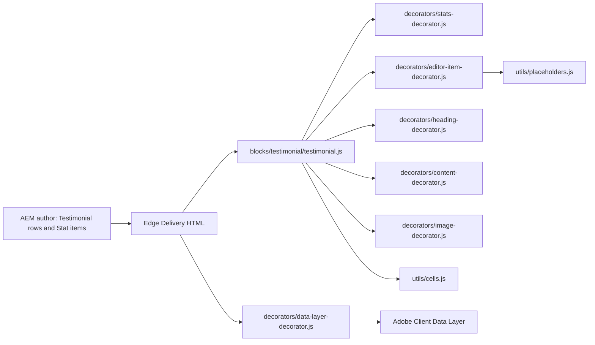

# Testimonial

The Testimonial block shows a section title, then a centred testimonial: an eyebrow, the quote (the Description) in large brand-blue type, and the author with an optional round photo, a name and a designation and location. An optional row of stats (a title above a large value) follows under a divider. The block implements the TCS.com Design System Figma "Testimonial Block" (3291-268576 and 404-29822). It is a key-value block: Stats are Stat items added to it with Add, and `blocks/testimonial/testimonial.js` renders it all as a `<figure>` and a description list.

| Attribute | Value |
| --------- | ----- |
| Technical name | `testimonial` (model `testimonial`, template name "Testimonial") |
| Display name | Testimonial |
| Block type | Key-value block (`key-value: true`) with item children |
| Status | Active |
| Parent / children | Parents: Section, Columns Container, Tabs Container (filters `section`, `columns-container`, `tabs`). Children: Stat (`testimonial-stat`, filter `testimonial`) |
| Owner / version / date | Not recorded / Not recorded / Not recorded |

## Overview

- **Business purpose:** builds trust by showing a client's own words together with measurable results.
- **User experience:** a left-aligned section title, then the eyebrow, quote and author centred in up to 59.375rem, then the stats in columns under a divider.
- **Templates / page types:** any page. No template adds the block.
- **Data source:** authored fields and Stat items only. The block reads no sheet, metadata, Authors sheet, taxonomy or query index.
- **Related blocks:** Quote (`blocks/quote`) for a large portrait overlapped by the quote. Teaser (`blocks/teaser`), which builds its stats with the same stats decorator. Cards / List for stat grids with links.
- **When to use:** one testimonial is the focus of a section, ideally with quantified results.
- **When not to use:** for a large portrait (use a Quote). For several testimonials side by side (use one Testimonial per Gen Carousel slide, or cards). For a call to action (the block has no CTA field).
- **Realistic use cases:** a client testimonial with the outcomes of an engagement on a case study page; a results band with the description and author hidden; a short endorsement with name and role only.

## Visual Reference

<!-- BEGIN GENERATED: screenshots (npm run build:docs) -->

Screenshots of the handover (6.13 Testimonial Block), taken on the preview with sample content; they show the rendering at the time of the handover revision that added them (later changes are in the sections below and the handover's revision history):

| Screenshot | Shows |
| ---------- | ----- |
| [Desktop rendering](../../docs/handover/screenshots/testimonial-desktop-view.jpg) | The Testimonial at 1440 px: the H2 What our clients say left aligned in the default text colour; centred below, the eyebrow Client testimonial, the 2.5rem brand-blue quote TCS became an extension of our own team… and the 3rem round photo person-1.svg beside Anita Rao / Chief Digital Officer, Example Bank, London; under a divider four stats in one row: 40%, 25%, 1,200+ and 4.8/5. |
| [Tablet rendering](../../docs/handover/screenshots/testimonial-tablet-view.jpg) | The Testimonial at 768 px with the smaller base sizes: the 2rem title What our clients say, the centred eyebrow, the 1.75rem blue quote and the author row with person-1.svg; under the divider three stats (40%, 25%, 1,200+) in the first row and 4.8/5 Customer satisfaction alone in the second. |
| [Mobile rendering](../../docs/handover/screenshots/testimonial-mobile-view.jpg) | The Testimonial at 375 px: the title What our clients say, the centred eyebrow and blue quote, the round photo with Anita Rao / Chief Digital Officer, Example Bank, London centred, then the four stats stacked one per row under the divider. |
| [Default variation](../../docs/handover/screenshots/testimonial-default.jpg) | The Testimonial at 1440 px on white: the H2 Partners in transformation left aligned; centred below, Customer story, the large blue quote about the real-time view of stock and demand, and Marcus Khan / Chief Operating Officer, Example Retail Group, Toronto; no photo, no stats. |
| [Grey background variation](../../docs/handover/screenshots/testimonial-grey-background.jpg) | The Testimonial at 1440 px with BG Color Grey: the title What our clients say, the centred eyebrow, the blue quote, the author row with person-1.svg and the four stats under the divider, all on a light grey panel with 7.5rem / 5rem padding. |
| [Author with photo](../../docs/handover/screenshots/testimonial-author-photo.jpg) | A detail of the Testimonial at 1440 px showing the author row below the quote: the centred author row with the 3rem round photo person-1.svg on the left of Anita Rao and Chief Digital Officer, Example Bank, London. |
| [Author text only](../../docs/handover/screenshots/testimonial-author-text-only.jpg) | A detail of the Testimonial at 1440 px showing the author row below the quote: Sara Lee and VP Operations, Example Manufacturing, Munich centred on two lines, without a photo. |
| [Stats variation](../../docs/handover/screenshots/testimonial-with-stats.jpg) | The Testimonial at 1440 px: the H2 Measurable outcomes left aligned, the centred Case study results, the cloud-native quote and Sara Lee / Chief Information Officer, Example Insurance, Amsterdam; under a 1px divider four stats in one row, grey titles above 3rem blue values: Faster time to market 40%, Lower operating cost 25%, Applications migrated 1,200+, Customer satisfaction 4.8/5. |
| [Hide Eyebrow variation](../../docs/handover/screenshots/testimonial-hide-eyebrow.jpg) | The Testimonial at 1440 px with Hide Eyebrow on: the H2 What our clients say, then directly the centred blue quote and the author row with person-1.svg and Anita Rao / Chief Digital Officer, Example Bank, London; no Client testimonial label and no stats. |
| [Hide Title variation](../../docs/handover/screenshots/testimonial-hide-title.jpg) | The Testimonial at 1440 px with Hide Title on: no visible title; the block starts with the centred eyebrow Client testimonial, then the blue quote and the author row with person-1.svg and Anita Rao. The H2 stays in the HTML for screen readers. |
| [Show Description off](../../docs/handover/screenshots/testimonial-description-hidden.jpg) | The Testimonial at 1440 px with Show Description off: the H2 What our clients say, the centred eyebrow Client testimonial and directly the author row with person-1.svg and Anita Rao; under the divider the four stats 40%, 25%, 1,200+ and 4.8/5; no quote. |
| [Hide Author Details variation](../../docs/handover/screenshots/testimonial-hide-author.jpg) | The Testimonial at 1440 px with Hide Author Details on: the H2 What our clients say, the centred eyebrow and the blue quote, then directly the divider and the four stats 40%, 25%, 1,200+ and 4.8/5; no photo, name or designation. |
| [Universal Editor canvas](../../docs/handover/screenshots/testimonial-authoring-view.jpg) | The Testimonial in Universal Editor edit mode at 1440 px, selected, with letters A on the title, B on the eyebrow, C on the quote, D on person-1.svg, E on Anita Rao, F on the designation, G on the stat titles and H on the stat values. An annotated preview, not a Universal Editor screenshot. (Annotated preview in editor mode with sample content; letters as in the annotations list, not a Universal Editor screenshot; file screenshots/testimonial-authoring-view.jpg) |
| [Properties panel](../../docs/handover/screenshots/testimonial-properties-panel.jpg) | The Testimonial properties panel showing the six tabs (Content, Author, Style, Show / Hide, Stats, Additional) with the Stats tab open and two items. (Dialog reference generated from the component model, not a Universal Editor screenshot; file screenshots/testimonial-properties-panel.jpg) |

Universal Editor dialogs (no screenshot exists yet; to be captured on AEM author):

```text
[Screenshot Placeholder]

File name:
testimonial-dialog-content-desktop.png

Purpose:
The Content tab of the Testimonial properties in Universal Editor, with the fields of the table "Content tab — Testimonial" in Authorable Fields below.

Annotations:
A = Eyebrow
B = Title
C = Title Type
D = Description
E = Author
F = Author Image
G = Author Image Alt Text
H = Designation & Location
I = Stats
J = Stats › Stats Title
```

```text
[Screenshot Placeholder]

File name:
testimonial-dialog-style-desktop.png

Purpose:
The Style tab of the Testimonial properties in Universal Editor, with the fields of the table "Style tab — Testimonial" in Authorable Fields below.

Annotations:
A = BG Color
B = Hide Eyebrow
C = Hide Title
D = Show Description
E = Hide Author Details
```

```text
[Screenshot Placeholder]

File name:
testimonial-dialog-additional-desktop.png

Purpose:
The Additional tab of the Testimonial properties in Universal Editor, with the fields of the table "Additional tab — Testimonial" in Authorable Fields below.

Annotations:
A = Anchor ID
B = Hide block
C = Animation Type
D = Motion Speed
E = Animation Trigger
F = Background animation
G = Padding left
H = Padding right
I = Padding top
J = Padding bottom
```

```text
[Screenshot Placeholder]

File name:
testimonial-stat-dialog-stat-desktop.png

Purpose:
The Stat tab of the Stat properties in Universal Editor, with the fields of the table "Stat tab — Stat" in Authorable Fields below.

Annotations:
A = Stats Title
B = Stats Value
```

<!-- END GENERATED: screenshots -->

The states below have no screenshot yet. The handover's properties panel screenshot shows the six tabs used before handover 2.8; the dialog now has three (Content, Style, Additional).

```text
[Screenshot Placeholder]

File name:
testimonial-grey-background-mobile.png

Purpose:
BG Color Grey at 375px: the grey panel with 2.5rem / 1.5rem padding and the stats stacked.

Annotations:
A = Grey panel
B = Quote
C = Author row
D = Stats
```

```text
[Screenshot Placeholder]

File name:
testimonial-stat-placeholder-editor-desktop.png

Purpose:
A Stat item just added in Universal Editor, without a value: a dashed placeholder with the itemEditorHint text.

Annotations:
A = Stats rendered
B = Placeholder of the new Stat item
C = Stat node in the content tree
```

```text
[Screenshot Placeholder]

File name:
testimonial-stats-only-desktop.png

Purpose:
A results band: Show Description off and Hide Author Details on, with the eyebrow and four stats.

Annotations:
A = Title
B = Eyebrow
C = Stats under the divider
```

## For Content Authors

1. **Add the block.** In Universal Editor, select a Section, a Columns Container column or a Tabs Container. Choose Add (+) and pick **Testimonial**.
2. **Open its properties.** Select the block. The properties panel has three tabs: Content, Style and Additional.
3. **Enter content.** On the Content tab, fill in Eyebrow, Title (and Title Type), Description (the quote), Author, Author Image (with alt text) and Designation & Location.
4. **Select options.** On the Style tab, choose BG Color (Default or Grey), and use Hide Eyebrow, Hide Title, Show Description and Hide Author Details to hide parts without deleting them.
5. **Add stats.** Select the Testimonial in the content tree, choose Add (+) and pick **Stat**. Fill in Stats Title and Stats Value. Add one Stat per result, and drag the Stat nodes in the content tree to reorder them.
6. **Preview.** Switch to Preview and check desktop and mobile widths.
7. **Publish.** Publish the page with the author image.
8. **Validate.** On the published page, check the quote, the author row, the stats, and the heading level (inspector).

Minimum content: a Description, or an Eyebrow, Author or Stat (otherwise only the title renders). Recommended: Title, Description, Author, Designation & Location, and two to four Stats. Optional: Eyebrow, Author Image, BG Color.

## Authorable Fields

<!-- BEGIN GENERATED: fields (npm run build:docs) -->

### Testimonial (`testimonial`)

Model `testimonial`; template name "Testimonial" (the block class AEM renders); key-value block (one row per property); children: `testimonial-stat`.

Stored on a new component (definition template): `titleType` = `"h2"`, `showDescription` = `true`.

#### Content tab — Testimonial

| Field label | Property | Type | Required | Default | Allowed values | Author guidance | Example |
| ----------- | -------- | ---- | -------- | ------- | -------------- | --------------- | ------- |
| Eyebrow | `eyebrow` | text | No | — | — | — | Client testimonial |
| Title | `title` | text | No | — | — | — | What our clients say |
| Title Type | `titleType` | select | No | `h2` | H1 (`h1`), H2 (`h2`), H3 (`h3`), H4 (`h4`), H5 (`h5`), H6 (`h6`) | Delivered with `title` (field collapse). | h2 |
| Description | `description` | richtext | No | "" | — | The testimonial quote. | — |
| Author | `authorName` | text | No | — | — | The person’s name, e.g. Ranil Boteju. | Anita Rao |
| Author Image | `authorImage` | reference | No | — | — | — | /content/dam/tcs-corp/block-library/images/avatar-sample-1.svg |
| Author Image Alt Text | `authorImageAlt` | text | No | — | — | Leave empty if the name is next to the image. Delivered with `authorImage` (field collapse). | — |
| Designation & Location | `designationLocation` | richtext | No | "" | — | e.g. Chief Data & Analytics Officer, Lloyds Banking Group, London. | — |
| Stats | `stats` | container (multiple) | No | — | — | Stats authored before Stat items. Add stats to the testimonial with Add (Stat) instead. | — |
| Stats › Stats Title | `statLabel` | richtext | No | "" | — | — | — |
| Stats › Stats Value | `statValue` | richtext | No | "" | — | A single line, e.g. 40%. | — |

#### Style tab — Testimonial

| Field label | Property | Type | Required | Default | Allowed values | Author guidance | Example |
| ----------- | -------- | ---- | -------- | ------- | -------------- | --------------- | ------- |
| BG Color | `bgColor` | select | No | "" | Default (""), Grey (`grey`) | — | grey |
| Hide Eyebrow | `hideEyebrow` | boolean | No | `false` | on / off | — | true |
| Hide Title | `titleHidden` | boolean | No | `false` | on / off | The title stays available to screen readers. | true |
| Show Description | `showDescription` | boolean | No | `true` | on / off | — | true |
| Hide Author Details | `hideAuthor` | boolean | No | `false` | on / off | Hides the author, author image and designation & location | true |

#### Additional tab — Testimonial

| Field label | Property | Type | Required | Default | Allowed values | Author guidance | Example |
| ----------- | -------- | ---- | -------- | ------- | -------------- | --------------- | ------- |
| Anchor ID | `classes_anchor` | text | No | — | regExp: ^anchor-[a-z0-9][a-z0-9-]*$; customErrorMsg: Start with anchor-, then lower-case letters, digits and hyphens. | A unique ID of the block on the page, starting with anchor-, e.g. anchor-our-services; link to it with #anchor-our-services. Delivered as a block class. | — |
| Hide block | `classes_hideblock` | boolean | No | `false` | on / off | Hides the whole block on the page until it is turned off (shown faded in the editor). Delivered as a block class. | — |
| Animation Type | `classes_animation` | select | No | "" | None (""), Fade in (`motion-fade-in`), Fade up (`motion-fade-up`), Fade down (`motion-fade-down`), Fade left (`motion-fade-left`), Fade right (`motion-fade-right`), Slide up (`motion-slide-up`), Slide down (`motion-slide-down`), Slide left (`motion-slide-left`), Slide right (`motion-slide-right`), Scale in (`motion-scale-in`) | How the block's content appears; repeated items (cards, list items, accordion items, columns) appear one after another. None: shown as is. Not played in the editor or when the visitor prefers reduced motion. Delivered as a block class. | motion-fade-up |
| Motion Speed | `classes_animationspeed` | select | No | "" | Medium (""), Fast (`motion-fast`), Slow (`motion-slow`) | How fast the block's animations run (Animation Type 0.3 / 0.6 / 0.9 s; the Background animation takes 1.5 times as long). Shown when (`classes_animation` is set and `classes_animation` is not empty) or (`classes_bganimation` is set and `classes_bganimation` is not empty). Delivered as a block class. | — |
| Animation Trigger | `classes_animationtrigger` | select | No | "" | On Scroll / Viewport Entry (""), On Page Load (`motion-on-load`) | When the block's animations run. On Scroll: when the block comes into view (at once if it is in view when the page opens). On Page Load: as soon as the block is ready, wherever it is on the page. Shown when (`classes_animation` is set and `classes_animation` is not empty) or (`classes_bganimation` is set and `classes_bganimation` is not empty). Delivered as a block class. | — |
| Background animation | `classes_bganimation` | select | No | "" | None (""), Fade in (`bg-motion-fade-in`), Reveal from the centre (`bg-motion-reveal`), Wipe left to right (`bg-motion-wipe-right`), Wipe right to left (`bg-motion-wipe-left`), Wipe bottom to top (`bg-motion-wipe-up`), Scale reveal (`bg-motion-scale`) | How the block's background (its colour, image or overlay as set in the block) appears. It doesn't animate the content: see Animation Type. Motion Speed and Animation Trigger apply to it too. Not played in the editor or when the visitor prefers reduced motion. Shown when `bgColor` is `grey`. Delivered as a block class. | bg-motion-wipe-up |
| Padding left | `classes_paddingleft` | select | No | "" | Default (""), 0 (none) (`pl-0`), 0.25rem (space-100) (`pl-100`), 0.5rem (space-200) (`pl-200`), 0.75rem (space-300) (`pl-300`), 1rem (space-400) (`pl-400`), 1.25rem (space-500) (`pl-500`), 1.5rem (space-600) (`pl-600`), 2rem (space-800) (`pl-800`), 2.5rem (space-1000) (`pl-1000`), 3rem (space-1200) (`pl-1200`), 4rem (space-1600) (`pl-1600`), 5rem (space-2000) (`pl-2000`), 6rem (space-2400) (`pl-2400`), 7.5rem (space-3000) (`pl-3000`) | Delivered as a block class. | — |
| Padding right | `classes_paddingright` | select | No | "" | Default (""), 0 (none) (`pr-0`), 0.25rem (space-100) (`pr-100`), 0.5rem (space-200) (`pr-200`), 0.75rem (space-300) (`pr-300`), 1rem (space-400) (`pr-400`), 1.25rem (space-500) (`pr-500`), 1.5rem (space-600) (`pr-600`), 2rem (space-800) (`pr-800`), 2.5rem (space-1000) (`pr-1000`), 3rem (space-1200) (`pr-1200`), 4rem (space-1600) (`pr-1600`), 5rem (space-2000) (`pr-2000`), 6rem (space-2400) (`pr-2400`), 7.5rem (space-3000) (`pr-3000`) | Delivered as a block class. | — |
| Padding top | `classes_paddingtop` | select | No | "" | Default (""), 0 (none) (`pt-0`), 0.25rem (space-100) (`pt-100`), 0.5rem (space-200) (`pt-200`), 0.75rem (space-300) (`pt-300`), 1rem (space-400) (`pt-400`), 1.25rem (space-500) (`pt-500`), 1.5rem (space-600) (`pt-600`), 2rem (space-800) (`pt-800`), 2.5rem (space-1000) (`pt-1000`), 3rem (space-1200) (`pt-1200`), 4rem (space-1600) (`pt-1600`), 5rem (space-2000) (`pt-2000`), 6rem (space-2400) (`pt-2400`), 7.5rem (space-3000) (`pt-3000`) | Delivered as a block class. | — |
| Padding bottom | `classes_paddingbottom` | select | No | "" | Default (""), 0 (none) (`pb-0`), 0.25rem (space-100) (`pb-100`), 0.5rem (space-200) (`pb-200`), 0.75rem (space-300) (`pb-300`), 1rem (space-400) (`pb-400`), 1.25rem (space-500) (`pb-500`), 1.5rem (space-600) (`pb-600`), 2rem (space-800) (`pb-800`), 2.5rem (space-1000) (`pb-1000`), 3rem (space-1200) (`pb-1200`), 4rem (space-1600) (`pb-1600`), 5rem (space-2000) (`pb-2000`), 6rem (space-2400) (`pb-2400`), 7.5rem (space-3000) (`pb-3000`) | Delivered as a block class. | — |
| Margin left | `classes_marginleft` | select | No | "" | Default (""), 0 (none) (`ml-0`), 0.25rem (space-100) (`ml-100`), 0.5rem (space-200) (`ml-200`), 0.75rem (space-300) (`ml-300`), 1rem (space-400) (`ml-400`), 1.25rem (space-500) (`ml-500`), 1.5rem (space-600) (`ml-600`), 2rem (space-800) (`ml-800`), 2.5rem (space-1000) (`ml-1000`), 3rem (space-1200) (`ml-1200`), 4rem (space-1600) (`ml-1600`), 5rem (space-2000) (`ml-2000`), 6rem (space-2400) (`ml-2400`), 7.5rem (space-3000) (`ml-3000`) | Delivered as a block class. | — |
| Margin right | `classes_marginright` | select | No | "" | Default (""), 0 (none) (`mr-0`), 0.25rem (space-100) (`mr-100`), 0.5rem (space-200) (`mr-200`), 0.75rem (space-300) (`mr-300`), 1rem (space-400) (`mr-400`), 1.25rem (space-500) (`mr-500`), 1.5rem (space-600) (`mr-600`), 2rem (space-800) (`mr-800`), 2.5rem (space-1000) (`mr-1000`), 3rem (space-1200) (`mr-1200`), 4rem (space-1600) (`mr-1600`), 5rem (space-2000) (`mr-2000`), 6rem (space-2400) (`mr-2400`), 7.5rem (space-3000) (`mr-3000`) | Delivered as a block class. | — |
| Margin top | `classes_margintop` | select | No | "" | Default (""), 0 (none) (`mt-0`), 0.25rem (space-100) (`mt-100`), 0.5rem (space-200) (`mt-200`), 0.75rem (space-300) (`mt-300`), 1rem (space-400) (`mt-400`), 1.25rem (space-500) (`mt-500`), 1.5rem (space-600) (`mt-600`), 2rem (space-800) (`mt-800`), 2.5rem (space-1000) (`mt-1000`), 3rem (space-1200) (`mt-1200`), 4rem (space-1600) (`mt-1600`), 5rem (space-2000) (`mt-2000`), 6rem (space-2400) (`mt-2400`), 7.5rem (space-3000) (`mt-3000`) | Delivered as a block class. | — |
| Margin bottom | `classes_marginbottom` | select | No | "" | Default (""), 0 (none) (`mb-0`), 0.25rem (space-100) (`mb-100`), 0.5rem (space-200) (`mb-200`), 0.75rem (space-300) (`mb-300`), 1rem (space-400) (`mb-400`), 1.25rem (space-500) (`mb-500`), 1.5rem (space-600) (`mb-600`), 2rem (space-800) (`mb-800`), 2.5rem (space-1000) (`mb-1000`), 3rem (space-1200) (`mb-1200`), 4rem (space-1600) (`mb-1600`), 5rem (space-2000) (`mb-2000`), 6rem (space-2400) (`mb-2400`), 7.5rem (space-3000) (`mb-3000`) | Delivered as a block class. | — |

### Stat (`testimonial-stat`)

Model `testimonial-stat`; template name "Stat" (the block class AEM renders).

#### Stat tab — Stat

| Field label | Property | Type | Required | Default | Allowed values | Author guidance | Example |
| ----------- | -------- | ---- | -------- | ------- | -------------- | --------------- | ------- |
| Stats Title | `statLabel` | richtext | No | "" | — | — | — |
| Stats Value | `statValue` | richtext | No | "" | — | A single line, e.g. 40%. | — |

<!-- END GENERATED: fields -->

Notes on the significant fields:

- **Title / Title Type:** a heading at the Title Type level (else a heading level found in the title, else H2). **Hide Title** keeps it in the HTML, visually hidden (`hideVisually`), so screen readers and the data layer's `dc:title` still get it.
- **Description:** the quote, rendered as a `<blockquote>` in a `<figure>`. **Show Description** is on unless it is explicitly off: a missing value shows the description (`isOnByDefault`).
- **Author, Author Image, Designation & Location:** rendered in the `<figcaption>`. The image is a 3rem round photo; Author Image Alt Text replaces its alt, else `alt=""`. Leave the alt text empty when the name is next to the photo. **Hide Author Details** leaves out the whole caption.
- **Hide Eyebrow:** leaves out the eyebrow.
- **BG Color:** Grey adds `bg-grey`: a grey panel with its own padding (see Responsive Behavior).
- **Stat items:** in each Stat, Stats Value is the large value and Stats Title the label above it. A Stat without a value isn't rendered (in the editor it is a placeholder).
- **Legacy mapping:** the **Stats** multifield (stats authored before Stat items) is still read: each item is a run of elements between `<hr>`s, or a list item. The last element is the value, the ones before it the title. These stats render before the Stat items. The BG Color value is also read from a `grey` block class (`optionOf`). The Style field was removed in handover 2.27.
- **Additional tab:** see AGENTS.md "Additional tab". Background animation is shown only when BG Color is Grey (the default block has no background of its own).

## Screenshot-Based Authoring Steps

### Authoring Step 1: Add the Testimonial and the title

```text
[Screenshot Placeholder]

File name:
testimonial-authoring-step-1.png

Purpose:
The Testimonial added to a section, with Title and Title Type filled in.

Annotations:
A = Testimonial in the content tree
B = Title
C = Title Type
```

### Values to Enter

| Callout | Field | Value | Reason | Expected result |
| ------- | ----- | ----- | ------ | --------------- |
| A | Add (+) | Testimonial | Adds the block | A Testimonial node |
| B | Title | What our clients say | Section title | Left-aligned heading |
| C | Title Type | H2 | Fits under the page's H1 | An `<h2>` |

Author action: add the block and type the title. Expected preview: the heading. Expected published result: the same. Business rule: one H1 per page. Validation: inspect the heading level. Common mistake: using H1 in the middle of a page.

### Authoring Step 2: The quote

```text
[Screenshot Placeholder]

File name:
testimonial-authoring-step-2.png

Purpose:
Eyebrow and Description filled in.

Annotations:
A = Eyebrow
B = Description
```

### Values to Enter

| Callout | Field | Value | Reason | Expected result |
| ------- | ----- | ----- | ------ | --------------- |
| A | Eyebrow | Client testimonial | Context | Centred label |
| B | Description | TCS became an extension of our own team. | The testimonial quote | Large brand-blue text |

Author action: type the eyebrow and the quote. Expected preview: both centred. Expected published result: a `<blockquote>`. Business rule: keep the approved wording. Validation: the quote shows; if not, check Show Description on the Style tab. Common mistake: turning Show Description off and expecting the quote to show.

### Authoring Step 3: The author

```text
[Screenshot Placeholder]

File name:
testimonial-authoring-step-3.png

Purpose:
Author, Author Image, Author Image Alt Text and Designation & Location filled in.

Annotations:
A = Author
B = Author Image
C = Designation & Location
```

### Values to Enter

| Callout | Field | Value | Reason | Expected result |
| ------- | ----- | ----- | ------ | --------------- |
| A | Author | Anita Rao | The person's name only | Name in the author row |
| B | Author Image | /content/dam/tcs-corp/block-library/images/avatar-sample-1.svg | Round photo | A 3rem round image |
| C | Designation & Location | Chief Digital Officer, Example Bank, London | Role, organisation, city | Line below the name |

Author action: fill in the author fields; leave Author Image Alt Text empty because the name is next to the photo. Expected preview: the centred author row. Expected published result: the same, in a `<figcaption>`. Business rule: don't repeat the name in Designation & Location. Validation: the name appears once. Common mistake: a landscape photo, which is cropped to a circle.

### Authoring Step 4: Stats

```text
[Screenshot Placeholder]

File name:
testimonial-authoring-step-4.png

Purpose:
Two Stat items added with Add (+) under the Testimonial, one open in the properties panel.

Annotations:
A = Add (+) on the Testimonial
B = Stat nodes
C = Stats Title
D = Stats Value
```

### Values to Enter

| Callout | Field | Value | Reason | Expected result |
| ------- | ----- | ----- | ------ | --------------- |
| A | Add (+) | Stat | One item per result | A Stat node |
| C | Stats Title | Faster time to market | What the number measures | Grey label |
| D | Stats Value | 40% | The number, one line | Large brand-blue value |

Author action: add a Stat, fill in both fields, and repeat for each result. Expected preview: the stats in columns under a divider. Expected published result: a `<dl>` with a `<dt>` and `<dd>` per stat. Business rule: Stats Value is a single line. Validation: each value sits below its title. Common mistake: leaving Stats Value empty: the Stat isn't shown (a placeholder in the editor).

### Authoring Step 5: Style options and publishing

```text
[Screenshot Placeholder]

File name:
testimonial-authoring-step-5.png

Purpose:
The Style tab with BG Color Grey, and the Publish dialog.

Annotations:
A = BG Color
B = Show / hide toggles
C = Publish dialog
```

### Values to Enter

| Callout | Field | Value | Reason | Expected result |
| ------- | ----- | ----- | ------ | --------------- |
| A | BG Color | Grey | Set the block apart | Grey panel with padding |
| B | Hide Eyebrow / Hide Title / Show Description / Hide Author Details | Off / Off / On / Off | Show every part | Every part renders |
| C | Publish | Page and referenced assets | The author image must be live | Published with the photo |

Author action: set the options, preview, publish. Expected result: as configured. Business rule: hidden parts keep their content. Validation: check the published page. Common mistake: publishing without the image.

## Variations

### Default

- **Purpose:** a client testimonial. **Fields:** Description (recommended), Author, Designation & Location; Title, Eyebrow and Author Image are optional. **Dialog:** defaults.
- **Rendering:** title, then the centred figure; no stats without Stat items. Desktop and mobile share the layout; the type and gaps are larger from 900px.
- **Accessibility:** `<figure>` / `<blockquote>` / `<figcaption>`. **Data layer:** the block entry only. **Personalization and fallback:** none.

```text
[Screenshot Placeholder]

File name:
testimonial-default-mobile.png

Purpose:
The default Testimonial at 375px.

Annotations:
A = Title
B = Quote
C = Author
```

### Grey background

- **Purpose:** set the testimonial apart. **Configuration:** BG Color Grey (`bg-grey`).
- **Rendering:** a grey panel (`--color-bg-secondary`), with padding 2.5rem / 1.5rem, and 7.5rem / 5rem from 900px. Background animation becomes available.
- **Accessibility, data layer, personalization:** as Default.

```text
[Screenshot Placeholder]

File name:
testimonial-grey-background-tablet.png

Purpose:
BG Color Grey at 768px.

Annotations:
A = Grey padding
B = Stats
```

### Author with photo / author text only

- **Purpose:** with or without a photo. **Configuration:** Author Image set or empty.
- **Rendering:** the 3rem round photo beside the name and details, wrapping and centred; without a photo, only the text lines.
- **Accessibility:** the photo is decorative unless Author Image Alt Text is set.

```text
[Screenshot Placeholder]

File name:
testimonial-author-photo-mobile.png

Purpose:
The author row with a photo at 375px.

Annotations:
A = Round photo
B = Name and designation
```

### With stats

- **Purpose:** quantified results. **Configuration:** Stat items (or the Stats multifield authored before them).
- **Rendering:** a grid of columns at least 10rem wide (wrapping automatically), up to 70rem wide, under a 1px divider; each stat has its title above its value.
- **Accessibility:** a description list (`<dl>`, `<dt>`, `<dd>`).

```text
[Screenshot Placeholder]

File name:
testimonial-with-stats-mobile.png

Purpose:
Four stats at 375px, one per row.

Annotations:
A = Divider
B = Stat title
C = Stat value
```

### Hide Eyebrow, Hide Title, Show Description off, Hide Author Details

- **Purpose:** hide parts without deleting them (for example a stats-only band, or while an approval is pending). **Configuration:** the Style tab toggles.
- **Rendering:** Hide Eyebrow, Show Description off and Hide Author Details leave their part out. Hide Title keeps the heading visually hidden. Without an eyebrow, description and author, the figure is left out.
- **Accessibility:** a hidden title still names the section for screen readers.

```text
[Screenshot Placeholder]

File name:
testimonial-hide-title-mobile.png

Purpose:
Hide Title on at 375px: no visible title, the heading still in the HTML.

Annotations:
A = Eyebrow (first visible element)
```

## Complete Authoring Example

Scenario: a case study page shows the client's statement and its results.

| Field | Example value | Guidance |
| ----- | ------------- | -------- |
| Eyebrow | Case study results | Context |
| Title | Measurable outcomes | Section title, H2 |
| Description | Moving to a cloud-native platform with TCS changed how fast we deliver. | Approved wording |
| Author | Sara Lee | Name only |
| Designation & Location | Chief Information Officer, Example Insurance, Amsterdam | Role, organisation, city |
| Author Image | /content/dam/tcs-corp/block-library/images/avatar-sample-1.svg | Square headshot |
| BG Color | Default | |
| Stat 1 | Faster time to market / 40% | Stats Title / Stats Value |
| Stat 2 | Lower operating cost / 25% | |
| Stat 3 | Applications migrated / 1,200+ | |

Steps: add the Testimonial, fill in the Content tab, add three Stat items, preview, publish with the image.

- **Expected output:** the title, the centred quote and author, and three stats under the divider.
- **Responsive:** the stats wrap to fewer columns on narrow screens.
- **Accessibility:** a heading, a figure with a blockquote and figcaption, and a description list.
- **Analytics:** a `tcs-corp/components/testimonial` entry with `dc:title` "Measurable outcomes".
- **Personalization fallback:** none; the authored content renders.

Pre-publish checklist: the quote is approved; the name appears once; the stats have values; the image is published; checked at mobile and desktop widths.

## Content and Asset Guidelines

- **Title:** short. **Eyebrow:** a few words. **Description:** the approved quote (the block adds no quotation marks of its own).
- **Author:** the name only. **Designation & Location:** role, organisation and city on one or two lines.
- **Stats:** Stats Value a single line (for example 40%); Stats Title a short label. No verified technical limit on the number of stats was identified; the columns wrap automatically.
- **CTAs / links:** no CTA field. A standalone link in the rich text becomes a button (`decorators/content-buttons-decorator.js`).
- **Images and alt text:** a square headshot, cropped to a 3rem circle (`object-fit: cover`). Leave the alt text empty when the name is next to the photo.
- **Tags and metadata:** none.
- **Asset source:** AEM Assets. **Loading:** the delivered picture, lazy by default; eager only as the first image of the first section (`waitForFirstImage`).
- **Missing asset:** the author row renders without the photo.

## Accessibility

- **Semantic HTML:** the title heading, then a `<figure>` with the eyebrow `<p>`, the `<blockquote>` and a `<figcaption>`; the stats are a `<dl>`.
- **Headings:** Title Type sets the level. Hide Title uses the visually hidden pattern, so the heading stays in the outline.
- **Keyboard and focus:** no interactive elements of its own; links in rich text keep the site's focus styles.
- **Alt text:** Author Image Alt Text, else `alt=""`.
- **Reduced motion:** the Additional tab's animations don't run for reduced motion or in the editor.
- **Contrast:** text uses the default, secondary and brand text tokens.
- **Empty states:** parts without content are left out. Stat items without a value are left out on the page and shown as placeholders in the editor.
- **Reflow:** the stats grid wraps; the author row wraps.

Author responsibilities: a fitting heading level, a name that isn't duplicated, alt text when the photo adds information, and stats with values.

Developer responsibilities: keep the figure / blockquote / figcaption and `<dl>` structure, and keep Hide Title visually hidden rather than removed.

The block handles no keys itself.

## Data Layer and Analytics

- **Component:** `trackBlocks` (`decorators/data-layer-decorator.js`) adds `component.{id}` once the sections have loaded: `@type` `tcs-corp/components/testimonial`, id = Anchor ID else `testimonial-{n}`, `parentId`, and `dc:title` = the first heading (also when visually hidden).
- **Variation and item positions:** not recorded; Stat items carry no `data-cmp-*` attributes.
- **Interactions:** the block pushes no events itself. Clicks on links in the rich text are captured centrally.

| Trigger | Data-layer event | Required properties | Analytics behavior |
| ------- | ---------------- | ------------------- | ------------------ |
| Block decorated and sections loaded | component state (`component.{id}`) | `@type`, `parentId`, `dc:title` | Component inventory |
| Click on a link in the Description or Designation & Location | `cmp:click` | `interaction` (`link`), `dc:title`, `xdm:linkURL`, `xdm:linkType`, `breakpoint` | Link click attributed to the Testimonial |

The intended path is Adobe Client Data Layer, then Adobe Data Collection (Tags), the AEP Web SDK, the Edge Network, and finally Analytics / CJA. Tags and the Web SDK aren't configured yet (blocked: measurement plan). No consent mechanism is implemented.

## Personalization

This block does not currently expose verified personalization behavior. The repository has no Adobe Target or AJO integration, and the authored content is what renders for every visitor.

## Responsive Behavior

| Viewport | Layout | Image behavior | Interaction behavior |
| -------- | ------ | -------------- | -------------------- |
| Below 900px | Column with 2.5rem gaps; Grey padding 2.5rem / 1.5rem; smaller type tokens (title 2rem, quote 1.75rem); stats in as many 10rem columns as fit | 3rem round author photo | None |
| 900px and wider | 5rem gaps; Grey padding 7.5rem / 5rem; title 3rem, quote 2.5rem; stats up to 70rem wide | 3rem round author photo | None |

The type sizes come from the global tokens in `styles/styles.css`, which change at 900px.

## For Developers

<!-- BEGIN GENERATED: files (npm run build:docs) -->

```text
blocks/testimonial/
├── README.md
├── _testimonial.json
├── testimonial.css
└── testimonial.js
```

| Decorator/Utility | Purpose | Execution or dependency point |
| ----------------- | ------- | ----------------------------- |
| [`decorators/a11y-decorator.js`](../../decorators/a11y-decorator.js) | `hideVisually`, `createHiddenText` (with `.visually-hidden` in `styles/styles.css`) | `testimonial.js`: { hideVisually } |
| [`decorators/content-decorator.js`](../../decorators/content-decorator.js) | `fromCell` (property content into an element, keeping editor instrumentation) | `testimonial.js`: { fromCell } |
| [`decorators/editor-item-decorator.js`](../../decorators/editor-item-decorator.js) | `buildEditorItems`, `editorItemHint` (in Universal Editor, an item the block doesn't render yet, e.g. a CTA just added, as a dashed placeholder the author can select; styles in `styles/lazy-styles.css`; the hint loaded o | `testimonial.js`: { editorItemHint } |
| [`decorators/heading-decorator.js`](../../decorators/heading-decorator.js) | `buildHeading` (Title + Title Type), `HEADINGS` | `testimonial.js`: { buildHeading } |
| [`decorators/image-decorator.js`](../../decorators/image-decorator.js) | `pictureOf` (image with its alt text field) | `testimonial.js`: { pictureOf } |
| [`decorators/stats-decorator.js`](../../decorators/stats-decorator.js) | `buildStats` (Stat items, and the Stats composite multifield authored before them, as a description list) | `testimonial.js`: { buildStats } |
| [`utils/cells.js`](../../utils/cells.js) | `itemRows`, `KEY_VALUE_ITEM`, `FIELD_ROW_ITEM` (the item rows of a block: by model in the editor, by their cells on the page), `withoutTabCells` (drops the empty cell AEM renders for each dialog tab of an item model), `m | `testimonial.js`: { KEY_VALUE_ITEM, itemRows } |
| [`utils/properties.js`](../../utils/properties.js) | `readProperties`, `textOf`, `isOn`, `isOnByDefault` (a toggle that defaults to on), `optionOf`, `normalizeKey`, `textSource` (key-value block properties) | `testimonial.js`: { isOn, isOnByDefault, optionOf, readProperties, textOf, } |

<!-- END GENERATED: files -->

- **JavaScript (`testimonial.js`):** an async `decorate(block)`. It reads the properties (`readProperties`) and the Stat item rows (`itemRows(block, ['testimonial-stat'], KEY_VALUE_ITEM)`: by `data-aue-model` in the editor, else rows with other than two cells). It builds the title, the figure and the stats, then replaces the children.
- **CSS (`testimonial.css`):** the column layout, the centred figure, the author row, the stats grid with its divider, the Grey panel, and the 900px changes.
- **Input DOM:** key-value rows (`eyebrow`, `title`, `titleType`, `description`, `authorName`, `authorImage`, `authorImageAlt`, `designationLocation`, `stats`, `bgColor`, `hideEyebrow`, `titleHidden`, `showDescription`, `hideAuthor`), then Stat item rows of three cells: an empty cell for the item's Stat tab, Stats Title, Stats Value (`test/items/item-rows.test.mjs`).
- **Rendered DOM:**

```html
<div class="testimonial block bg-grey">
  <h2 class="testimonial-title">…</h2>
  <figure class="testimonial-quote">
    <p class="testimonial-eyebrow">…</p>
    <blockquote class="testimonial-description">…</blockquote>
    <figcaption>
      <div class="testimonial-author">
        <div class="testimonial-author-image"><picture>…</picture></div>
        <div class="testimonial-author-text">
          <p class="testimonial-author-name">…</p>
          <div class="testimonial-author-details">…</div>
        </div>
      </div>
    </figcaption>
  </figure>
  <dl class="testimonial-stats">
    <div class="testimonial-stat">
      <dt class="testimonial-stat-label">…</dt>
      <dd class="testimonial-stat-value">…</dd>
    </div>
  </dl>
</div>
```

- **Decoration flow:** properties and item rows; `buildHeading` (+ `hideVisually`); `fromCell` for the eyebrow, description, name and details; `pictureOf` for the photo; `buildStats(props.stats, 'testimonial', statRows, hint)` from `decorators/stats-decorator.js` (multifield stats, then Stat items, then editor placeholders); `bg-grey` reset and set; `replaceChildren`.
- **Async behavior:** `editorItemHint` loads the placeholders (key `itemEditorHint`) only in Universal Editor (rows with `data-aue-resource`). On the page it resolves at once without a request.
- **Error handling:** no try / catch. Missing parts are left out.
- **Exports:** the default `decorate` only.
- **Parent / child contract:** the `testimonial` filter allows only `testimonial-stat`. Its model must render three cells (tab, label, value) so `KEY_VALUE_ITEM` tells it from the two-cell property rows.
- **Editor:** instrumentation moves to the rendered elements and Stat items (`moveInstrumentation`); unrendered Stat items become `.editor-item` placeholders.
- **Motion:** content targets `:scope > *`; the background colour is animated (`BACKGROUNDS.testimonial`).

## Extending the Block

1. **Add a field** in `blocks/testimonial/_testimonial.json` (at most three short tabs, Additional last). Then run `npm run build:json` and `npm run lint`.
2. **Delivery rules:** avoid names ending in Text, Title, Type, Alt or MimeType for values that must be read; no grouped fields; options that should become classes go in `classes_*`; no sample content in templates. Changing the Stat model changes its cells: update `test/items/item-rows.test.mjs` and `decorators/stats-decorator.js` (`readStatRows`) together.
3. **Rendering:** read the field in `testimonial.js` and style it in `testimonial.css`, scoped to `.testimonial`, mobile first, in rem.
4. **Accessibility:** keep the semantic structure; new UI text comes from placeholders with an English fallback.
5. **Data layer:** describe interactive elements with `data-cmp-*` attributes.
6. **Tests:** `npm test` (`test/items/item-rows.test.mjs`, `test/motion/motion.test.mjs`).
7. **Backward compatibility:** keep reading the Stats multifield and the `grey` class fallback.
8. **Library and docs:** update `block-library/testimonial/testimonial-variations`, then `npm run build:docs`. Run `npm run build:modules` after changing imports.

## For Site Administrators

- **Availability:** offered in the `section`, `columns-container` and `tabs` filters; its Stat child via the `testimonial` filter.
- **Governance:** `blocks/testimonial/_testimonial.json`, aggregated by `npm run build:json`.
- **Allowed children:** Stat (`testimonial-stat`) only.
- **Publishing dependencies:** the author image (AEM Assets); in the editor, the placeholder key `itemEditorHint` of `/{locale}/placeholders.json`. No sheet, taxonomy or query index otherwise.
- **Localization:** authored per locale.

| Dependency | Purpose | Location | Impact if unavailable |
| ---------- | ------- | -------- | --------------------- |
| Author image | Round photo | AEM Assets | The author row has no photo |
| `itemEditorHint` placeholder | Text of an unrendered Stat item in the editor | `/{locale}/placeholders.json` | The English fallback is shown |
| Model and filters | Dialog, placement, Stat children | `blocks/testimonial/_testimonial.json`, `component-*.json` | The block or its Stats can't be added |

Migration: Stats authored in the Stats multifield are still read. Use Stat items for new content (handover 2.10, F-87).

## For Architects

- **Role:** a presentational block with authored content and item children.
- **Content model:** key-value properties plus `testimonial-stat` items; a legacy composite multifield is still read.
- **Rendering:** client-side decoration of the delivered rows; the text is in the HTML.
- **Dependencies:** `decorators/a11y-decorator.js`, `content-decorator.js`, `editor-item-decorator.js`, `heading-decorator.js`, `image-decorator.js`, `stats-decorator.js`; `utils/cells.js`, `utils/properties.js`.
- **Data layer / Web SDK / Target:** a component entry and central click capture; Tags, the Web SDK and Target aren't integrated. **Consent and identity:** none.
- **Caching:** the page HTML on the CDN. **Performance:** no page requests. **Security:** moves delivered nodes only. **Scalability:** instances are independent.



## For QA and Support Teams

| Test ID | Scenario | Configuration | Expected result |
| ------- | -------- | ------------- | --------------- |
| TESTIMONIAL-QA-01 | Default | Title, Eyebrow, Description, Author, Designation & Location | Title, then the centred figure; no stats |
| TESTIMONIAL-QA-02 | Grey | BG Color Grey | Grey panel with 2.5rem / 1.5rem padding, 7.5rem / 5rem from 900px; Background animation offered |
| TESTIMONIAL-QA-03 | Author photo | Author Image, no alt | 3rem round photo with `alt=""` |
| TESTIMONIAL-QA-04 | Stat items | Three Stat items | `dl.testimonial-stats` with three stats in order |
| TESTIMONIAL-QA-05 | Stat without value | A Stat with only Stats Title | Not shown on the page; placeholder in the editor |
| TESTIMONIAL-QA-06 | Legacy stats | Stats multifield authored before | Rendered before the Stat items |
| TESTIMONIAL-QA-07 | Hide Eyebrow | On | No eyebrow |
| TESTIMONIAL-QA-08 | Hide Title | On | Heading visually hidden, present in the HTML and in `dc:title` |
| TESTIMONIAL-QA-09 | Show Description | Off; and a block without the row | Off: no quote; missing row: quote shown |
| TESTIMONIAL-QA-10 | Hide Author Details | On | No figcaption |
| TESTIMONIAL-QA-11 | Empty figure | No eyebrow, description or author | No figure; title and stats only |
| TESTIMONIAL-QA-12 | Viewports | 375 / 768 / 1440px | Stats wrap; gaps and type larger from 900px |
| TESTIMONIAL-QA-13 | Data layer | Load the page | `component.{id}` with `@type` `tcs-corp/components/testimonial` |
| TESTIMONIAL-QA-14 | Multiple instances | Two Testimonials | Independent; ids `testimonial-1`, `testimonial-2` or Anchor IDs |
| TESTIMONIAL-QA-15 | Dark Section | Testimonial with BG Color Grey in a Section with Style Dark | Check the text contrast on the grey panel |

## Troubleshooting

| Symptom | Likely cause | Diagnostic steps | Resolution | Verification |
| ------- | ------------ | ---------------- | ---------- | ------------ |
| The quote doesn't appear | Show Description off, or the Description is empty | Check the Style tab and the Description | Turn Show Description on; fill in the Description | The `<blockquote>` renders |
| A stat is missing | Its Stats Value is empty | Look for the placeholder in the editor | Fill in Stats Value | The stat renders |
| Value and title swapped (legacy stats) | In the multifield, the last element of an item is always the value | Read the item's paragraphs | Re-enter the stat as a Stat item | Title above value |
| The author row is missing | Hide Author Details on, or no author fields | Check the Style tab | Turn it off; fill in the fields | The figcaption renders |
| The title isn't visible | Hide Title on | Inspect: `visually-hidden` on the heading | Turn Hide Title off | The heading shows |
| The name appears twice | The name was typed in Designation & Location too | Read both fields | Keep the name in Author only | One name |

Evidence to collect: the page URL, viewport, browser, a screenshot, and the block's outer HTML. No credentials or session data.

## Performance Considerations

- **Initialization:** decorated when its section loads (eager in the first section). On the page there is no network request; in the editor, the placeholders are loaded once for the item hint.
- **Images:** one small author photo (3rem), lazy unless it is the first image of the first section.
- **DOM:** small; no listeners or observers in the block. **Layout shift:** the photo has a fixed 3rem box.
- **Dynamic imports:** none. Modules are preloaded from `scripts/module-graph.js`.

## Security and Privacy

- **Links:** authored links in the rich text, used as delivered.
- **Sanitization:** delivered nodes are moved, and no HTML is parsed from strings.
- **External content and query strings:** none.
- **Data minimization:** the block collects nothing; the names and photos it shows are authored content. The data layer records the title and clicked link text and URL only.

## Known Limitations

| Limitation | Impact | Workaround | Planned correction |
| ---------- | ------ | ---------- | ------------------ |
| In legacy Stats multifield items, the last element is always the value (handover F-25) | A one-element or multi-paragraph item renders unexpectedly | Use Stat items | Not recorded |
| No CTA field | No styled call to action in the block | Add a Teaser or Button below, or a standalone link in the rich text | Not planned |
| Background animation needs BG Color Grey | No background animation on the default white block | Use Animation Type for the content | Not planned |

## Related Documentation

- [Blocks documentation](../README.md)
- [Quote](../quote/README.md) and [Teaser](../teaser/README.md)
- [Model: `_testimonial.json`](_testimonial.json)
- [Stats decorator](../../decorators/stats-decorator.js)
- [Item rows tests](../../test/items/item-rows.test.mjs) and [motion tests](../../test/motion/motion.test.mjs)
- [Handover 6.13 Testimonial Block](../../docs/handover/TCS-CORP-HANDOVER.md)

<!-- BEGIN GENERATED: usage (npm run build:docs) -->

Pages of the block library package 1.0.13 (language master, `/content/tcs-corp/language-master/en`) that contain the block, 17 instance(s) in total:
- Block library: `block-library/animation/background-by-block`, `block-library/columns-container/columns-of-blocks`, `block-library/testimonial/testimonial-variations`
- Curated design pages: `curated-design-pages/case-study`, `curated-design-pages/product`, `curated-design-pages/services`, `curated-design-pages/story`

Project-wide standards: [knowledge base](../../docs/handover/knowledge-base/README.md) ([block governance](../../docs/handover/knowledge-base/blocks.md)).

<!-- END GENERATED: usage -->

## Change History

| Version | Change | Source | Date |
| ------- | ------ | ------ | ---- |
| Not recorded | README generated from verified implementation and approved handover documentation | Repository review | Not recorded |
| Handover 2.8 | Dialog reduced to Content / Style / Additional tabs (F-84) | docs/handover revision history | 17 October 2026 |
| Handover 2.10 | Stats authored as Stat items (`testimonial-stat`); the multifield is still read (F-87) | docs/handover revision history | 17 October 2026 |
| Handover 2.18 | Content and Background animation on the Additional tab | docs/handover revision history | 18 October 2026 |
| Handover 2.27 | Block ecosystem audit: the Quote / Testimonial Style field removed | docs/handover revision history | 19 October 2026 |
