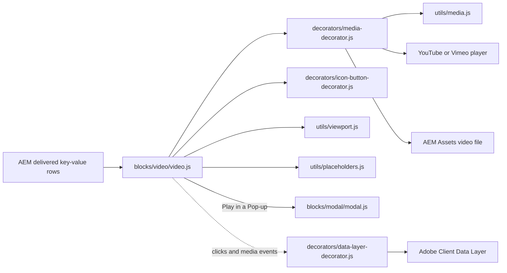

# Video

The Video block plays a video file from AEM Assets (MP4, WebM) in the browser's native `video`
player, or a YouTube or Vimeo video in the provider's player. Authors choose how it starts (a Play
button on a poster image, autoplay when in view, or a muted background video), sound, loop,
controls, start and end times, a pop-up player, pausing when out of view, WebVTT captions, a
caption text, a transcript link, the aspect ratio, size, alignment, rounded corners and a
privacy-enhanced mode. It is based on the Block Collection video block and is a key-value block.

| Attribute | Value |
| --------- | ----- |
| Technical name | `video` (template name "Video", block class `video`) |
| Display name | Video |
| Block type | Independent block, key-value (one row per property) |
| Status | Active |
| Parent / children | Added to a Section, a Columns Container column or a Tabs Container tab (filters `section`, `columns-container`, `tabs`); no child items |
| Owner / version / date | Not recorded |

## Overview

**Business purpose.** Present brand, product and thought-leadership videos with control over
playback, accessibility (captions, transcript, accessible names, a pause control), privacy and
performance (poster first, the player loads on demand).

**User experience.** By default visitors see a poster image with a round Play button; the player
loads only when they press Play (in place, or in a dialog over the page with Play in a Pop-up).
Autoplay and background videos start muted when they come into view; when they play without
controls a pause / stop button sits in the bottom-right corner. Visitors who prefer reduced motion
always get the Play button instead of autoplay. A caption and a transcript link can follow the
video.

**Templates / page types.** Any page type; the block has no template-specific behaviour.

**Data source.** Only the block's own properties; video, poster and captions files come from AEM
Assets, YouTube or Vimeo. UI labels come from the locale's placeholders sheet.

**Related blocks.** [Embed](../embed/embed.js) (simple third-party embeds and X posts),
[Modal](../modal/modal.js) (the pop-up player), Hero and Teaser (media inside larger
compositions).

**When to use.** Any video that needs a poster, captions, a transcript, a pop-up, autoplay or a
background mode, start / end times, a privacy-enhanced player or a fixed size and aspect ratio.

**When not to use.** For X (Twitter) posts or arbitrary iframes (use the Embed block); for Lottie
animations (the Lotto image type of Hero / Teaser); for essential information that only autoplay
conveys (autoplay is switched off for reduced motion).

**Realistic use cases.**

- A brand film from AEM Assets with a poster, caption, captions file and transcript link.
- A keynote on YouTube that opens in a pop-up from a poster.
- A silent, looping background clip (for example an office ambience) at full width.
- A vertical 9:16 client story at Size Small.

## Visual Reference

<!-- BEGIN GENERATED: screenshots (npm run build:docs) -->

Screenshots of the handover (6.28 Video Block), taken on the preview with sample content; they show the rendering at the time of the handover revision that added them (later changes are in the sections below and the handover's revision history):

| Screenshot | Shows |
| ---------- | ----- |
| [Desktop rendering](../../docs/handover/screenshots/video-desktop-view.jpg) | The Video block at 1440 px: a Large (900 px) 16:9 media area, centred, with 1rem rounded corners, showing the poster photo-1.svg and the round brand-blue Play button in the centre; below it the grey caption How our people and partners use technology to help enterprises grow and transform. and the link Read the transcript. |
| [Tablet rendering](../../docs/handover/screenshots/video-tablet-view.jpg) | Two Video blocks at 768 px: the brand film poster photo-1.svg with the Play button filling the content width, its caption below; then the full-width background video Innovation hub ambience showing its poster photo-4.svg with the round pause button in the bottom-right corner. |
| [Mobile rendering](../../docs/handover/screenshots/video-mobile-view.jpg) | Two Video blocks at 390 px: a 9:16 vertical video Client story in 60 seconds (poster tall.svg, Size Small) filling the content width with the Play button, partly under the sticky header; below it the 16:9 brand film poster with the Play button and the grey caption. |
| [Variation example](../../docs/handover/screenshots/video-play-button-poster.jpg) | The Video block at 1440 px: a Large 16:9 rounded media area with the poster photo-2.svg (data centre corridor) and the round brand-blue Play button in the centre; no caption or transcript. The second state, the film playing in place after Play, is not captured. |
| [Variation example](../../docs/handover/screenshots/video-popup.jpg) | The page at 1440 px after pressing Play on a Video with Play in a Pop-up on: the page dimmed behind a white dialog with the Close (x) button at the top right and the native player showing the poster photo-3.svg and its controls; the player is clipped at the dialog's right edge. |
| [Variation example](../../docs/handover/screenshots/video-autoplay-no-controls.jpg) | The Video block at 1440 px: a Large 16:9 rounded media area showing the poster photo-5.svg (wind turbines) without a Play button, and the round pause button in the bottom-right corner; in the capture the poster is still shown, not the playing video. |
| [Variation example](../../docs/handover/screenshots/video-background.jpg) | The Video block at 1440 px in Size Full width: a rounded 16:9 area across the section's full content width (1280 px) showing the poster photo-6.svg (Sample image 6) with only the round pause button in the bottom-right corner. |
| [Variation example](../../docs/handover/screenshots/video-caption-transcript.jpg) | The Video block at 1440 px in Size Medium (640 px): the rounded 16:9 poster photo-3.svg with the Play button, then the grey caption How our people and partners use technology to help enterprises grow and transform. and the blue link Read the transcript. |
| [Variation example](../../docs/handover/screenshots/video-ratio-16-9.jpg) | The Video block at 1440 px: the default 16:9 widescreen media area, 900 px wide (Size Large), rounded, with the poster photo-1.svg and the centred Play button. |
| [Variation example](../../docs/handover/screenshots/video-ratio-4-3.jpg) | The Video block at 1440 px: a 4:3 media area, 900 px wide (Size Large), rounded, with the poster photo-2.svg cropped to fill it and the centred Play button. |
| [Variation example](../../docs/handover/screenshots/video-ratio-1-1.jpg) | The Video block at 1440 px: a square 1:1 media area, Size Medium (640 px), centred in the section, rounded, with the poster square-1.svg and the centred Play button. |
| [Variation example](../../docs/handover/screenshots/video-ratio-21-9.jpg) | The Video block at 1440 px: a shallow 21:9 cinema-format background video at Full width across the section's content width, rounded, showing the poster wide.svg with only the pause button in the bottom-right corner. |
| [Variation example](../../docs/handover/screenshots/video-ratio-9-16.jpg) | The Video block at 1440 px: a vertical 9:16 media area, Size Small (420 px), centred in the section, rounded, with the poster tall.svg and the centred Play button. |
| [Variation example](../../docs/handover/screenshots/video-size-full.jpg) | The Video block at 1440 px in Size Full width: a rounded 16:9 media area across the section's full content width (1280 px), showing the poster wide.svg with the centred Play button. |
| [Variation example](../../docs/handover/screenshots/video-size-large.jpg) | The Video block at 1440 px with the default Size Large (900 px): a rounded 16:9 poster photo-7.svg with the centred Play button, centred in the section with white space on both sides. |
| [Variation example](../../docs/handover/screenshots/video-size-medium.jpg) | The Video block at 1440 px in Size Medium (640 px): a rounded 16:9 poster photo-8.svg (red tones) with the centred Play button, centred in the section. |
| [Variation example](../../docs/handover/screenshots/video-size-small.jpg) | The Video block at 1440 px in Size Small (420 px), Aspect Ratio 9:16 and Alignment Left: a tall rounded vertical poster tall.svg with the Play button at the left edge of the section's content. |
| [Variation example](../../docs/handover/screenshots/video-align-center.jpg) | A section at 1440 px: the H2 Inside our innovation labs and a line of body text, left-aligned, and below them a Size Medium (640 px) 16:9 Video with the poster photo-2.svg and Play button, centred in the section. |
| [Variation example](../../docs/handover/screenshots/video-align-left.jpg) | A section at 1440 px: the H2 Inside our innovation labs and body text, then a Size Small (420 px) 16:9 Video with the poster photo-3.svg and Play button aligned with the left edge of the text. |
| [Variation example](../../docs/handover/screenshots/video-align-right.jpg) | A section at 1440 px: the H2 Inside our innovation labs and body text, then a Size Small (420 px) 16:9 Video with the poster photo-5.svg (green) and Play button aligned to the right edge of the section's content. |
| [Variation example](../../docs/handover/screenshots/video-rounded.jpg) | The Video block at 1440 px: a Large 16:9 poster photo-4.svg (purple) with the centred Play button and the default 1rem rounded corners. |
| [Variation example](../../docs/handover/screenshots/video-square-corners.jpg) | The Video block at 1440 px: a full-width 16:9 background video with square corners across the section's content width, showing the poster photo-6.svg and the pause button in the bottom-right corner. |
| [Variation example](../../docs/handover/screenshots/video-reduced-motion.jpg) | The Video block at 1440 px, set to Background video, as seen with the operating system's Reduce motion on: a Large 16:9 rounded poster photo-7.svg with the centred Play button instead of a playing video. |
| [Variation example](../../docs/handover/screenshots/video-legacy.jpg) | A Video block authored with the earlier model at 1440 px: a Large 16:9 rounded poster photo-8.svg (red tones) with the centred Play button, rendered like the current Play button playback. |
| [Universal Editor canvas](../../docs/handover/screenshots/video-authoring-view.jpg) | The Video block in Universal Editor edit mode at 1440 px with sample content: the poster photo-1.svg, the Play button (C), the media area (D), the caption (E) and the Read the transcript link (F), outlined with red dashed boxes; markers A, B and G are not drawn. (Annotated preview in editor mode with sample content; letters as in the annotations list, not a Universal Editor screenshot; file screenshots/video-authoring-view.jpg) |
| [Properties panel](../../docs/handover/screenshots/video-properties-panel.jpg) | The Video properties panel with its tabs Video, Playback, Captions, Display, Privacy and Additional. (Dialog reference generated from the component model, not a Universal Editor screenshot; file screenshots/video-properties-panel.jpg) |

Universal Editor dialogs (no screenshot exists yet; to be captured on AEM author):

```text
[Screenshot Placeholder]

File name:
video-dialog-video-desktop.png

Purpose:
The Video tab of the Video properties in Universal Editor, with the fields of the table "Video tab — Video" in Authorable Fields below.

Annotations:
A = Video
B = Title
C = Caption
D = Transcript
E = Poster Image
F = Poster Image Alt Text
G = Captions File (WebVTT)
H = Captions Language
I = Captions Name
J = Privacy-enhanced Mode
```

```text
[Screenshot Placeholder]

File name:
video-dialog-playback-desktop.png

Purpose:
The Playback tab of the Video properties in Universal Editor, with the fields of the table "Playback tab — Video" in Authorable Fields below.

Annotations:
A = Playback
B = Muted
C = Loop
D = Show Player Controls
E = Start At (seconds)
F = End At (seconds)
G = Play in a Pop-up
H = Pause When Out of View
I = Aspect Ratio
J = Size
```

```text
[Screenshot Placeholder]

File name:
video-dialog-additional-desktop.png

Purpose:
The Additional tab of the Video properties in Universal Editor, with the fields of the table "Additional tab — Video" in Authorable Fields below.

Annotations:
A = Anchor ID
B = Hide block
C = Animation Type
D = Motion Speed
E = Animation Trigger
F = Padding left
G = Padding right
H = Padding top
I = Padding bottom
J = Margin left
```

<!-- END GENERATED: screenshots -->

States without a screenshot:

```text
[Screenshot Placeholder]

File name:
video-authoring-universal-editor-desktop.png

Purpose:
The Video block selected in Universal Editor edit mode, with its properties panel open on the Video tab.

Annotations:
A = The Video block on the canvas (poster and Play button)
B = The Video field with an AEM Assets file selected
C = The Poster Image and Poster Image Alt Text fields
D = The Video, Playback and Additional tabs
```

```text
[Screenshot Placeholder]

File name:
video-play-button-playing-desktop.png

Purpose:
The inline player after the visitor pressed Play on the poster: the native player with its controls, keyboard focus in the player.

Annotations:
A = The playing video in the media area
B = The native player controls
C = The caption below the video
```

```text
[Screenshot Placeholder]

File name:
video-youtube-tablet.png

Purpose:
A YouTube video at 768 px after Play, loaded from the privacy-enhanced youtube-nocookie.com player.

Annotations:
A = The YouTube player frame
B = The media area keeping the 16:9 ratio
```

```text
[Screenshot Placeholder]

File name:
video-popup-mobile.png

Purpose:
Play in a Pop-up at 390 px: the dialog over the dimmed page, sized to the screen, with the Close button.

Annotations:
A = The dialog with the player
B = The Close button
C = The dimmed page behind the dialog
```

```text
[Screenshot Placeholder]

File name:
video-toggle-focus-desktop.png

Purpose:
An autoplaying video without controls with keyboard focus on the pause / stop button (visible focus outline), then the same button after it was pressed (Play video).

Annotations:
A = The pause / stop button in the bottom-right corner with its focus outline
B = The playing video
```

```text
[Screenshot Placeholder]

File name:
video-captions-desktop.png

Purpose:
A video file with a WebVTT captions file: the captions shown on the video and the captions entry (Captions Name) in the native player's menu.

Annotations:
A = Captions on the video
B = The captions menu entry
```

```text
[Screenshot Placeholder]

File name:
video-loading-desktop.png

Purpose:
An autoplay video with a poster while the file loads: the poster shows until the video can play; the media area keeps its aspect ratio.

Annotations:
A = The poster shown during loading
B = The reserved media area
```

```text
[Screenshot Placeholder]

File name:
video-empty-editor-desktop.png

Purpose:
A Video block without a Video in Universal Editor: the block renders nothing; it is selectable only in the content tree.

Annotations:
A = The empty block position on the canvas
B = The block in the content tree
```

## For Content Authors

1. **Add the block.** In Universal Editor select a Section, a Columns Container column or a Tabs
   Container tab in the content tree, choose Add (+) and pick **Video**.
2. **Open its properties.** Select the block on the canvas or in the content tree; the properties
   panel shows the tabs **Video**, **Playback** and **Additional**.
3. **Enter the content (Video tab).** Select the video file in **Video** (an MP4 or WebM from AEM
   Assets) or paste a YouTube or Vimeo URL. Enter a **Title** (it names the player and the Play
   button for screen readers; it isn't shown). Add a **Poster Image** with its **Poster Image Alt
   Text**, optionally a **Caption** and a **Transcript** page or document, and for video files a
   **Captions File (WebVTT)** with its language and name.
4. **Choose the playback (Playback tab).** Keep **Playback** on Play button, or choose Autoplay
   when in view (muted) or Background video. Set Muted, Loop, Show Player Controls, Start At / End
   At, Play in a Pop-up (Play button only) and Pause When Out of View as needed.
5. **Choose the display (Playback tab).** Set the **Aspect Ratio** of the file, the **Size**, the
   **Alignment** (for sizes other than Full width) and **Rounded Corners**.
6. **Optional: Additional tab.** Anchor ID, Hide block, animation and spacing (see
   [Authorable Fields](#authorable-fields)).
7. **Preview.** Switch Universal Editor to Preview, or open the page on the preview host, and play
   the video at desktop, tablet and mobile widths.
8. **Publish.** Publish the page **with its references**: video files and WebVTT captions are
   served only once they are published (images travel with the page, other assets don't).
9. **Validate the published output.** On the live host the poster and Play button load, the video
   plays, the file and captions requests return 200 and a YouTube video loads from
   `www.youtube-nocookie.com` when Privacy-enhanced Mode is on.

**Minimum required:** Video. **Recommended:** Title, Poster Image with alt text, captions (WebVTT
for files, platform captions for YouTube / Vimeo), Transcript for informative videos. **Optional:**
Caption and every Playback and Additional setting.

## Authorable Fields

<!-- BEGIN GENERATED: fields (npm run build:docs) -->

### Video (`video`)

Model `video`; template name "Video" (the block class AEM renders); key-value block (one row per property).

Stored on a new component (definition template): `playback` = `"click"`, `controls` = `true`, `pauseOffscreen` = `true`, `aspectRatio` = `"16-9"`, `size` = `"large"`, `alignment` = `"center"`, `rounded` = `true`, `privacyMode` = `true`.

#### Video tab — Video

| Field label | Property | Type | Required | Default | Allowed values | Author guidance | Example |
| ----------- | -------- | ---- | -------- | ------- | -------------- | --------------- | ------- |
| Video | `uri` | aem-content | Yes | — | — | A video file from AEM Assets (MP4, WebM), or a YouTube or Vimeo link | /content/dam/tcs-corp/block-library/videos/sample-video.mp4 |
| Title | `label` | text | No | — | — | Names the video for screen readers (e.g. "TCS AI lab tour"); not shown on the page | Building on belief: the TCS brand film |
| Caption | `caption` | richtext | No | — | — | Shown below the video | — |
| Transcript | `transcript` | aem-content | No | — | — | A page or document with the transcript; shown as a link below the video | /language-master/en/dummy-pages/our-story |
| Poster Image | `poster` | reference | No | — | — | Shown before the video plays, with a play button (Click playback). | /content/dam/tcs-corp/dummy-pages/images/banking.jpg |
| Poster Image Alt Text | `posterAlt` | text | No | "" | — | Delivered with `poster` (field collapse). | Engineers collaborating in a modern office |
| Captions File (WebVTT) | `captions` | aem-content | No | — | — | Subtitles for video files (.vtt); YouTube and Vimeo use the captions added there | — |
| Captions Language | `captionsLanguage` | text | No | — | — | Language code, e.g. en, de, ja (default: the page language) | — |
| Captions Name | `captionsLabel` | text | No | — | — | Shown in the player's captions menu, e.g. English | — |
| Privacy-enhanced Mode | `privacyMode` | boolean | No | `true` | on / off | YouTube: no cookies until the video plays (youtube-nocookie.com); Vimeo: do not track | — |

#### Playback tab — Video

| Field label | Property | Type | Required | Default | Allowed values | Author guidance | Example |
| ----------- | -------- | ---- | -------- | ------- | -------------- | --------------- | ------- |
| Playback | `playback` | select | No | `click` | Play button (on the poster image) (`click`), Autoplay when in view (muted) (`autoplay`), Background video (autoplay, muted, loop, no controls) (`background`) | — | background |
| Muted | `muted` | boolean | No | `false` | on / off | Start without sound (always on for autoplay and background videos) | — |
| Loop | `loop` | boolean | No | `false` | on / off | — | — |
| Show Player Controls | `controls` | boolean | No | `true` | on / off | Background videos never show controls | false |
| Start At (seconds) | `startTime` | number | No | — | — | Optional, e.g. 30 | — |
| End At (seconds) | `endTime` | number | No | — | — | Optional | — |
| Play in a Pop-up | `openInModal` | boolean | No | `false` | on / off | The play button opens the video in a dialog over the page Shown when `playback` is `click`. | true |
| Pause When Out of View | `pauseOffscreen` | boolean | No | `true` | on / off | Autoplay and background video files pause when scrolled away and resume when back | — |
| Aspect Ratio | `aspectRatio` | select | No | `16-9` | 16:9 (widescreen) (`16-9`), 4:3 (`4-3`), 1:1 (square) (`1-1`), 21:9 (cinema) (`21-9`), 9:16 (vertical) (`9-16`) | — | 9-16 |
| Size | `size` | select | No | `large` | Full width (`full`), Large (900px) (`large`), Medium (640px) (`medium`), Small (420px) (`small`) | — | full |
| Alignment | `alignment` | select | No | `center` | Center (`center`), Left (`left`), Right (`right`) | For sizes other than full width | left |
| Rounded Corners | `rounded` | boolean | No | `true` | on / off | — | false |

#### Additional tab — Video

| Field label | Property | Type | Required | Default | Allowed values | Author guidance | Example |
| ----------- | -------- | ---- | -------- | ------- | -------------- | --------------- | ------- |
| Anchor ID | `classes_anchor` | text | No | — | regExp: ^anchor-[a-z0-9][a-z0-9-]*$; customErrorMsg: Start with anchor-, then lower-case letters, digits and hyphens. | A unique ID of the block on the page, starting with anchor-, e.g. anchor-our-services; link to it with #anchor-our-services. Delivered as a block class. | — |
| Hide block | `classes_hideblock` | boolean | No | `false` | on / off | Hides the whole block on the page until it is turned off (shown faded in the editor). Delivered as a block class. | — |
| Animation Type | `classes_animation` | select | No | "" | None (""), Fade in (`motion-fade-in`), Fade up (`motion-fade-up`), Fade down (`motion-fade-down`), Fade left (`motion-fade-left`), Fade right (`motion-fade-right`), Slide up (`motion-slide-up`), Slide down (`motion-slide-down`), Slide left (`motion-slide-left`), Slide right (`motion-slide-right`), Scale in (`motion-scale-in`) | How the block's content appears; repeated items (cards, list items, accordion items, columns) appear one after another. None: shown as is. Not played in the editor or when the visitor prefers reduced motion. Delivered as a block class. | — |
| Motion Speed | `classes_animationspeed` | select | No | "" | Medium (""), Fast (`motion-fast`), Slow (`motion-slow`) | How fast the animation runs: 0.3, 0.6 or 0.9 seconds. Shown when `classes_animation` is set and `classes_animation` is not empty. Delivered as a block class. | — |
| Animation Trigger | `classes_animationtrigger` | select | No | "" | On Scroll / Viewport Entry (""), On Page Load (`motion-on-load`) | When the block's animations run. On Scroll: when the block comes into view (at once if it is in view when the page opens). On Page Load: as soon as the block is ready, wherever it is on the page. Shown when `classes_animation` is set and `classes_animation` is not empty. Delivered as a block class. | — |
| Padding left | `classes_paddingleft` | select | No | "" | Default (""), 0 (none) (`pl-0`), 0.25rem (space-100) (`pl-100`), 0.5rem (space-200) (`pl-200`), 0.75rem (space-300) (`pl-300`), 1rem (space-400) (`pl-400`), 1.25rem (space-500) (`pl-500`), 1.5rem (space-600) (`pl-600`), 2rem (space-800) (`pl-800`), 2.5rem (space-1000) (`pl-1000`), 3rem (space-1200) (`pl-1200`), 4rem (space-1600) (`pl-1600`), 5rem (space-2000) (`pl-2000`), 6rem (space-2400) (`pl-2400`), 7.5rem (space-3000) (`pl-3000`) | Delivered as a block class. | — |
| Padding right | `classes_paddingright` | select | No | "" | Default (""), 0 (none) (`pr-0`), 0.25rem (space-100) (`pr-100`), 0.5rem (space-200) (`pr-200`), 0.75rem (space-300) (`pr-300`), 1rem (space-400) (`pr-400`), 1.25rem (space-500) (`pr-500`), 1.5rem (space-600) (`pr-600`), 2rem (space-800) (`pr-800`), 2.5rem (space-1000) (`pr-1000`), 3rem (space-1200) (`pr-1200`), 4rem (space-1600) (`pr-1600`), 5rem (space-2000) (`pr-2000`), 6rem (space-2400) (`pr-2400`), 7.5rem (space-3000) (`pr-3000`) | Delivered as a block class. | — |
| Padding top | `classes_paddingtop` | select | No | "" | Default (""), 0 (none) (`pt-0`), 0.25rem (space-100) (`pt-100`), 0.5rem (space-200) (`pt-200`), 0.75rem (space-300) (`pt-300`), 1rem (space-400) (`pt-400`), 1.25rem (space-500) (`pt-500`), 1.5rem (space-600) (`pt-600`), 2rem (space-800) (`pt-800`), 2.5rem (space-1000) (`pt-1000`), 3rem (space-1200) (`pt-1200`), 4rem (space-1600) (`pt-1600`), 5rem (space-2000) (`pt-2000`), 6rem (space-2400) (`pt-2400`), 7.5rem (space-3000) (`pt-3000`) | Delivered as a block class. | — |
| Padding bottom | `classes_paddingbottom` | select | No | "" | Default (""), 0 (none) (`pb-0`), 0.25rem (space-100) (`pb-100`), 0.5rem (space-200) (`pb-200`), 0.75rem (space-300) (`pb-300`), 1rem (space-400) (`pb-400`), 1.25rem (space-500) (`pb-500`), 1.5rem (space-600) (`pb-600`), 2rem (space-800) (`pb-800`), 2.5rem (space-1000) (`pb-1000`), 3rem (space-1200) (`pb-1200`), 4rem (space-1600) (`pb-1600`), 5rem (space-2000) (`pb-2000`), 6rem (space-2400) (`pb-2400`), 7.5rem (space-3000) (`pb-3000`) | Delivered as a block class. | — |
| Margin left | `classes_marginleft` | select | No | "" | Default (""), 0 (none) (`ml-0`), 0.25rem (space-100) (`ml-100`), 0.5rem (space-200) (`ml-200`), 0.75rem (space-300) (`ml-300`), 1rem (space-400) (`ml-400`), 1.25rem (space-500) (`ml-500`), 1.5rem (space-600) (`ml-600`), 2rem (space-800) (`ml-800`), 2.5rem (space-1000) (`ml-1000`), 3rem (space-1200) (`ml-1200`), 4rem (space-1600) (`ml-1600`), 5rem (space-2000) (`ml-2000`), 6rem (space-2400) (`ml-2400`), 7.5rem (space-3000) (`ml-3000`) | Delivered as a block class. | — |
| Margin right | `classes_marginright` | select | No | "" | Default (""), 0 (none) (`mr-0`), 0.25rem (space-100) (`mr-100`), 0.5rem (space-200) (`mr-200`), 0.75rem (space-300) (`mr-300`), 1rem (space-400) (`mr-400`), 1.25rem (space-500) (`mr-500`), 1.5rem (space-600) (`mr-600`), 2rem (space-800) (`mr-800`), 2.5rem (space-1000) (`mr-1000`), 3rem (space-1200) (`mr-1200`), 4rem (space-1600) (`mr-1600`), 5rem (space-2000) (`mr-2000`), 6rem (space-2400) (`mr-2400`), 7.5rem (space-3000) (`mr-3000`) | Delivered as a block class. | — |
| Margin top | `classes_margintop` | select | No | "" | Default (""), 0 (none) (`mt-0`), 0.25rem (space-100) (`mt-100`), 0.5rem (space-200) (`mt-200`), 0.75rem (space-300) (`mt-300`), 1rem (space-400) (`mt-400`), 1.25rem (space-500) (`mt-500`), 1.5rem (space-600) (`mt-600`), 2rem (space-800) (`mt-800`), 2.5rem (space-1000) (`mt-1000`), 3rem (space-1200) (`mt-1200`), 4rem (space-1600) (`mt-1600`), 5rem (space-2000) (`mt-2000`), 6rem (space-2400) (`mt-2400`), 7.5rem (space-3000) (`mt-3000`) | Delivered as a block class. | — |
| Margin bottom | `classes_marginbottom` | select | No | "" | Default (""), 0 (none) (`mb-0`), 0.25rem (space-100) (`mb-100`), 0.5rem (space-200) (`mb-200`), 0.75rem (space-300) (`mb-300`), 1rem (space-400) (`mb-400`), 1.25rem (space-500) (`mb-500`), 1.5rem (space-600) (`mb-600`), 2rem (space-800) (`mb-800`), 2.5rem (space-1000) (`mb-1000`), 3rem (space-1200) (`mb-1200`), 4rem (space-1600) (`mb-1600`), 5rem (space-2000) (`mb-2000`), 6rem (space-2400) (`mb-2400`), 7.5rem (space-3000) (`mb-3000`) | Delivered as a block class. | — |

<!-- END GENERATED: fields -->

What the tables don't show:

- **Video (`uri`)** decides the player: a URL containing `youtube.com` / `youtu.be` builds a
  YouTube frame, `vimeo.com` a Vimeo frame, anything else a native `video` element with one
  `source` (MIME type from the file extension). Without it the block renders nothing.
- **Title (`label`)** becomes the iframe `title` (YouTube, Vimeo) or the `aria-label` of the
  `video` element, the hidden heading that names the pop-up dialog and the Play button's name
  "Play video: {title}". Empty: the placeholder `video` ("Video") and the button "Play video".
- **Caption** is rich text shown below the video (`div.video-caption`). **Transcript** becomes a
  link below it; its text is the authored link text, or "Read the transcript" (placeholder
  `readTheTranscript`) when the link shows its own URL. It opens in the same tab.
- **Poster Image / Poster Image Alt Text** (`poster`, `posterAlt`; the alt collapses into the
  image) is the poster with the Play button (Play button playback) and the image shown while an
  autoplay or background video loads. Without alt text the image gets `alt=""`. For video files
  the poster image is also the native player's `poster`.
- **Captions File / Captions Language / Captions Name** add one `track kind="captions"` (default
  on) to video files only; Language defaults to the page language, Name to the language code.
  YouTube and Vimeo ignore them (add captions on the platform).
- **Privacy-enhanced Mode** (default on): YouTube from `www.youtube-nocookie.com`, Vimeo with
  `dnt=1`. Off: `www.youtube.com` and no `dnt`.
- **Playback** values: Play button (`click`, default), Autoplay when in view (`autoplay`), Background
  video (`background`: muted, looping, no controls, hidden from screen readers and the keyboard).
  With reduced motion the code always uses Play button.
- **Muted** applies to Play button playback; autoplay and background videos are always muted
  (browsers only autoplay muted videos). **Show Player Controls** off with autoplay adds the pause /
  stop button; Play button playback without a poster keeps the controls even when off (they are
  the only way to start the video).
- **Start At / End At** (seconds): files use a media fragment (`#t=start,end`), YouTube `start` /
  `end` (whole seconds), Vimeo only the start time (`#t=Ns`); End At is ignored for Vimeo.
- **Play in a Pop-up** is shown only for Play button playback; the Play button opens a dialog
  (`blocks/modal/modal.js`, loaded on demand).
- **Pause When Out of View** (default on) applies to autoplay and background video **files** only.
- **Aspect Ratio** sets the media area (`--video-aspect-ratio`); files and posters are cropped to
  it (`object-fit: cover`). **Size**: Full width (no maximum), Large 56.25rem (900px), Medium 40rem
  (640px), Small 26.25rem (420px). **Alignment** places sizes other than Full width; the
  Additional tab's Margin left / right override it. **Rounded Corners** uses `--radius-l` (1rem).
- **Accessibility impact:** Title, poster alt text, captions and transcript are the author's part
  (see [Accessibility](#accessibility)).
- **Data-layer impact:** none of the fields adds tracking attributes; the Play and pause / stop
  buttons and the native player events are tracked centrally (see
  [Data Layer and Analytics](#data-layer-and-analytics)).
- **Legacy mapping:** blocks added before the key-value model deliver one row per field in dialog
  order (recognised by a valid Playback value in the Playback row); blocks of the first model
  deliver a link and a picture, and their `autoplay` block option plays a background video. The
  code also reads `placeholder` / `placeholderimage` / `placeholderimagealt` rows of the former
  poster group, but AEM never delivered that grouped field in a key-value block, so those posters
  are missing until the content is migrated to Poster Image.
- **Additional tab:** as on every block (AGENTS.md "Additional tab" and "Animation and
  skeletons"); the Video has no background animation, its content animation moves the block.

## Screenshot-Based Authoring Steps

### Authoring Step 1: Add the Video and select the file

```text
[Screenshot Placeholder]

File name:
video-authoring-step-1.png

Purpose:
The Add (+) menu of a section with Video highlighted, then the Video tab with the Video field filled.

Annotations:
A = Add (+) in the content tree
B = Video in the component list
C = The Video field
```

### Values to Enter

| Callout | Field | Value | Reason | Expected result |
| ------- | ----- | ----- | ------ | --------------- |
| A | Component | Video | Adds the block to the section | An empty Video block in the content tree |
| C | Video | /content/dam/tcs-corp/block-library/videos/sample-video.mp4 | The film to play | The block shows the media area |

**Author action:** select the section, choose Add (+), pick Video, open its properties and select
the file in Video. **Expected preview:** a 16:9 dark media area with the native player.
**Expected published result:** the same, once the MP4 is published. **Business rules:** Video is
required; YouTube / Vimeo URLs are pasted as watch, share or `vimeo.com/{id}` links.
**Validation:** the file plays in preview. **Common mistakes:** the MP4 isn't published (404 on
the live host): publish the page with its references.

### Authoring Step 2: Name the video and add the poster

```text
[Screenshot Placeholder]

File name:
video-authoring-step-2.png

Purpose:
The Video tab with Title, Poster Image and Poster Image Alt Text filled, and the poster with the Play button on the canvas.

Annotations:
A = Title
B = Poster Image
C = Poster Image Alt Text
D = The Play button on the poster
```

### Values to Enter

| Callout | Field | Value | Reason | Expected result |
| ------- | ----- | ----- | ------ | --------------- |
| A | Title | Building on belief: the TCS brand film | Names the player and the Play button | The Play button is announced "Play video: Building on belief: the TCS brand film" |
| B | Poster Image | /content/dam/tcs-corp/dummy-pages/images/banking.jpg | First impression before Play | The poster fills the media area |
| C | Poster Image Alt Text | Engineers collaborating in a modern office | Describes the poster | The poster image has this alt text |

**Author action:** fill the three fields. **Expected preview:** the poster with the round Play
button; the player loads only after Play. **Expected published result:** the same.
**Business rules:** the poster is cropped to the Aspect Ratio. **Validation:** press Play with the
mouse and with the keyboard (Tab, Enter); focus moves into the player. **Common mistakes:** a
poster in another ratio than the video is cropped: use one in the same ratio.

### Authoring Step 3: Add the caption and the transcript

```text
[Screenshot Placeholder]

File name:
video-authoring-step-3.png

Purpose:
The Caption and Transcript fields filled, and the caption and the Read the transcript link below the video.

Annotations:
A = Caption
B = Transcript
C = The caption below the video
D = The transcript link
```

### Values to Enter

| Callout | Field | Value | Reason | Expected result |
| ------- | ----- | ----- | ------ | --------------- |
| A | Caption | How our people and partners use technology to help enterprises grow and transform. | Context for every visitor | Grey text below the video |
| B | Transcript | /language-master/en/dummy-pages/our-story | Text alternative of the film | The link "Read the transcript" below the caption |

**Author action:** enter the caption and pick the transcript page. **Expected preview:** caption,
then the link. **Expected published result:** the link opens the published transcript page.
**Business rules:** a link showing its own URL is renamed "Read the transcript". **Validation:**
follow the link on the preview host. **Common mistakes:** the transcript page isn't published.

### Authoring Step 4: Choose the playback and the display

```text
[Screenshot Placeholder]

File name:
video-authoring-step-4.png

Purpose:
The Playback tab with Playback, Play in a Pop-up, Aspect Ratio, Size and Alignment set.

Annotations:
A = Playback
B = Play in a Pop-up
C = Aspect Ratio
D = Size
E = Alignment
```

### Values to Enter

| Callout | Field | Value | Reason | Expected result |
| ------- | ----- | ----- | ------ | --------------- |
| A | Playback | Play button (on the poster image) | The visitor decides to start the film | Poster with Play button |
| B | Play in a Pop-up | Off | Plays in place | The player replaces the poster after Play |
| C | Aspect Ratio | 16:9 (widescreen) | The file's ratio | No cropping |
| D | Size | Large (900px) | Default reading width | At most 56.25rem wide |
| E | Alignment | Center | Centred in the section | Equal space on both sides at desktop |

**Author action:** set the values; Play in a Pop-up is visible only with Playback = Play button.
**Expected preview:** a centred, rounded 16:9 poster. **Expected published result:** the same.
**Business rules:** Alignment has no effect at Size Full width; autoplay and background are always
muted. **Validation:** check at 1440, 768 and 390 px. **Common mistakes:** a 9:16 video at Size
Large is taller than the screen: use Size Small.

## Variations

### Play button on the poster (default)

- **Purpose / when to use:** most videos; nothing loads from the provider or the file until Play.
- **Fields:** Video; recommended Title, Poster Image and alt text. Playback = Play button.
- **Rendering:** `div.video-placeholder` with the poster and the Play button (`button.video-placeholder-play`);
  after Play the player is built with autoplay (sound on unless Muted) and focus moves into it once
  it has loaded. Without a poster (and no pop-up) the player itself loads when the block comes into
  view, with its controls, and isn't autoplayed.
- **Responsive:** the media area scales with the content width at every viewport; the Size caps it.
- **Accessibility:** a native `button` named "Play video: {title}"; focus continues in the player.
- **Data layer:** the Play click is a `cmp:click` (interaction `button`); file playback pushes
  `cmp:media`.
- **Personalization / fallback:** none; without a poster the native player's first frame shows.

```text
[Screenshot Placeholder]

File name:
video-play-button-mobile.png

Purpose:
The poster with the Play button at 390 px, filling the content width.

Annotations:
A = Poster
B = Play button
```

### Play in a Pop-up

- **Purpose / when to use:** a keynote or film watched in focus, over the page. Not with autoplay
  or background playback (the field is hidden there).
- **Fields:** Video, Play in a Pop-up on; recommended Title and Poster Image.
- **Rendering:** the poster (or, without one, the dark media area) with the Play button; Play opens
  a native `dialog` (Modal block's `createModal`) holding a hidden `h2` with the Title and the
  player, which starts at once. The dialog width is `min(90vw, 75rem, 80vh × ratio)`. Closing
  removes the dialog and the video; focus returns to the Play button. A double click opens one
  dialog.
- **Accessibility:** the dialog is named by the Title; Escape and the Close button close it.
- **Data layer:** `cmp:click` on the Play button, `cmp:show` / `cmp:hide` (interaction `dialog`) for
  the dialog, `cmp:media` of a file in it (on the dialog's `modal-N` component).

```text
[Screenshot Placeholder]

File name:
video-popup-closed-focus-desktop.png

Purpose:
After closing the pop-up with Escape: the poster again, keyboard focus back on the Play button.

Annotations:
A = Play button with the focus outline
```

### Autoplay when in view

- **Purpose / when to use:** a short, muted teaser that starts as it scrolls into view. Not for
  essential information or speech without captions.
- **Fields:** Video, Playback = Autoplay when in view; recommended Poster Image (shown while it
  loads and to reduced-motion visitors), Show Player Controls.
- **Rendering:** the player is built when the block comes into view, muted and autoplaying; a poster
  shows until it can play. With Show Player Controls off a pause / stop button (`button.video-toggle`)
  is added: pause / play for files, stop / play for YouTube and Vimeo (the frame is removed and
  rebuilt, so it restarts). Files pause off screen and resume when back (Pause When Out of View).
- **Accessibility:** the toggle meets WCAG 2.2.2; reduced motion turns this into Play button playback.
- **Data layer:** toggle clicks are `cmp:click` with interaction `playback`; file play / pause are
  `cmp:media`, except the pauses and resumes of Pause When Out of View.

```text
[Screenshot Placeholder]

File name:
video-autoplay-with-controls-desktop.png

Purpose:
An autoplay video file with Show Player Controls on: the native controls visible, no separate toggle.

Annotations:
A = Native controls
```

### Background video

- **Purpose / when to use:** a decorative, silent loop (ambience). Not for content visitors must see.
- **Fields:** Video, Playback = Background video; recommended Poster Image.
- **Rendering:** muted, looping, no controls (YouTube `disablekb`, Vimeo `background=1`); the player
  is `aria-hidden` and its iframe out of the tab order; the pause / stop button is always added.
- **Accessibility:** decorative for screen readers; the toggle is the only control.
- **Data layer:** native media events of a background file aren't pushed (muted, looping, no
  controls); the toggle click is a `cmp:click` (`playback`).

```text
[Screenshot Placeholder]

File name:
video-background-mobile.png

Purpose:
A Full width background video at 390 px with the pause button in the bottom-right corner.

Annotations:
A = Background video
B = Pause button
```

### Sources: AEM Assets file, YouTube, Vimeo

- **File:** native `video` with `controlslist="nodownload"`, no context menu, `playsinline`,
  `preload` `auto` when autoplaying else `metadata`, WebVTT captions, start / end media fragment.
- **YouTube:** watch, `youtu.be`, `/embed/`, `/shorts/` and `/live/` URLs; `rel=0`, `enablejsapi=1`
  (Tabs can pause it), `playsinline`; loop through `playlist`.
- **Vimeo:** `vimeo.com/{id}`, `player.vimeo.com/video/{id}`, channel URLs and unlisted hashes
  (`h`), unit tested in [vimeo-url.test.mjs](../../test/media/vimeo-url.test.mjs).
- **Privacy:** see Privacy-enhanced Mode above.

```text
[Screenshot Placeholder]

File name:
video-vimeo-desktop.png

Purpose:
A Vimeo video playing in place after Play at 1440 px.

Annotations:
A = Vimeo player frame
```

### Display: aspect ratio, size, alignment, corners

| Option | Values | Rendering |
| ------ | ------ | --------- |
| Aspect Ratio | 16:9 (default), 4:3, 1:1, 21:9, 9:16 | `aspect-ratio` of `.video-media`; files and posters cropped (`object-fit: cover`) |
| Size | Full width, Large (default), Medium, Small | `max-width` none, 56.25rem, 40rem, 26.25rem |
| Alignment | Center (default), Left, Right | `margin-inline` auto on one or both sides |
| Rounded Corners | On (default), Off | `border-radius: var(--radius-l)` (1rem) or 0 |

Screenshots of every value exist (see the generated table above).

### Reduced motion (automatic)

Visitors whose system asks for reduced motion get Play button playback for every Autoplay and
Background video: the poster with the Play button, or the player with controls when there is no
poster. No author setting.

### Blocks authored with an earlier model (compatibility)

One-row-per-field blocks and first-model blocks (a link and a picture, `autoplay` option) still
render (see the legacy mapping above). Screenshot: `video-legacy.jpg` in the generated table.

## Complete Authoring Example

Scenario: the brand film on an About page, played in place from a poster, with a caption and a
transcript.

| Field | Example value | Guidance |
| ----- | ------------- | -------- |
| Video | /content/dam/tcs-corp/block-library/videos/sample-video.mp4 | Web-optimised MP4 or WebM |
| Title | Building on belief: the TCS brand film | Always set it |
| Caption | How our people and partners use technology to help enterprises grow and transform. | One or two sentences |
| Transcript | /language-master/en/dummy-pages/our-story | A published page or document |
| Poster Image | /content/dam/tcs-corp/dummy-pages/images/banking.jpg | Same ratio as the video |
| Poster Image Alt Text | Engineers collaborating in a modern office | Describe the image |
| Playback | Play button (on the poster image) | Default |
| Aspect Ratio / Size / Alignment | 16:9 / Large (900px) / Center | Defaults |
| Privacy-enhanced Mode | On | Default |

**Steps:** add the Video to the section, fill the fields above (Video tab, then Playback tab),
preview, publish with references.

**Expected output:** a centred, rounded 16:9 poster up to 56.25rem wide with the Play button, the
grey caption and the "Read the transcript" link below; Play loads the native player in place with
sound.

**Responsive:** the media area shrinks with the content width on tablet and mobile; the caption
text follows `--body-font-size-s`.

**Accessibility:** the Play button is announced with the Title; the player is named by the Title;
the transcript is the text alternative.

**Analytics / data layer:** the block is `tcs-corp/components/video` (`video-1` unless it has an
Anchor ID); Play pushes `cmp:click`; play / pause / ended of the file push `cmp:media`.

**Personalization fallback:** none; every visitor sees this content.

**Pre-publish checklist:**

1. Title and poster alt text are filled.
2. The poster and the video have the same aspect ratio.
3. Play works with mouse and keyboard; focus moves into the player.
4. The transcript page is published.
5. The MP4 (and any VTT) is published with the page.
6. The locale's placeholders sheet has `video`, `playVideo`, `playVideoTitle`, `pauseVideo`,
   `stopVideo` and `readTheTranscript`.

## Content and Asset Guidelines

- **Title:** short and specific (it is read before every Play: "Play video: {title}").
- **Caption:** short rich text; key information also belongs in the page text.
- **Transcript link:** a page or document; give the link a readable text or let the block name it.
- **Poster image and alt text:** in the Aspect Ratio of the video (it is cropped with
  `object-fit: cover`); alt text describes the image; the poster of a background video is
  decorative content shown to reduced-motion visitors.
- **Icons:** generated (`icons/play.svg`, `icons/pause.svg`); not authorable.
- **Tags and metadata:** none; the block reads no tags or page metadata.
- **Min / max items:** one video per block; one captions track. No verified technical limit on
  file size was identified.
- **Asset source:** AEM Assets (`/content/dam/tcs-corp/…`), YouTube or Vimeo. Video and VTT files
  must be published to be served.
- **Loading:** the player loads on Play or when the block comes into view; a poster in the first
  section can be the page's LCP image and is then loaded eagerly (`waitForFirstImage` in
  `scripts/aem.js`).
- **Missing asset fallback:** no Video: nothing renders. No poster: the player (or its first frame)
  shows. A file that fails to load leaves the dark media area; the block logs nothing.

## Accessibility

- **Semantics:** a native `video` (named by `aria-label`) or an iframe named by its `title`; the
  Play and pause / stop controls are `button`s from the icon button decorator with accessible
  names and tooltips; the caption is text; the transcript is a link.
- **Headings:** the block adds none on the page; the pop-up has a visually hidden `h2` that names
  the dialog.
- **Keyboard and focus:** Play, the toggle and the player controls are reachable with Tab; after
  Play focus moves into the player (on `canplay` for files, on the iframe's `load`); the pop-up
  returns focus to the Play button on close.
- **Moving content:** autoplay and background videos without controls always get a pause / stop
  button (WCAG 2.2.2); background players are `aria-hidden` and their iframe has `tabindex="-1"`.
- **Reduced motion:** no autoplay at all (`prefersReducedMotion`); the Additional tab animation
  doesn't play either.
- **Captions and transcript:** one WebVTT track for files; platform captions for YouTube / Vimeo.
- **Contrast:** the caption uses `--color-text-secondary` (slate-700, 6.9:1 on white per
  `styles/styles.css`).
- **Reflow:** the media area scales with the content width; no horizontal scrolling.
- **Empty / loading / error states:** no Video: nothing rendered; loading: the poster or the dark
  media area; errors are the provider's or browser's own messages.

**Author responsibilities:** a Title, poster alt text, captions for speech, a transcript for
informative videos, no essential information in background videos.

**Developer responsibilities:** keep the accessible names from placeholders, the toggle for
self-playing media, the focus moves and the reduced-motion rule.

| Key | Expected behavior |
| --- | ----------------- |
| Tab | Moves to the Play button, the pause / stop button, the transcript link and the player controls |
| Enter / Space | Activates Play or the pause / stop button |
| Escape | Closes the pop-up dialog; focus returns to the Play button |

## Data Layer and Analytics

The block is added to the Adobe Client Data Layer by `decorators/data-layer-decorator.js` as
`tcs-corp/components/video`, id = the block's id (Anchor ID) else `video-{n}` in page order,
`parentId` the page (or a containing block). The block adds `data-cmp-interaction="playback"` to
the pause / stop button and `data-cmp-auto` to the pauses and resumes of Pause When Out of View
(so they aren't measured as the visitor's).

| Trigger | Data-layer event | Required properties | Analytics behavior |
| ------- | ---------------- | ------------------- | ------------------ |
| Block decorated | component state | `@type`, `parentId` | One entry per block |
| Play button click | `cmp:click` | `interaction` `button`, `dc:title` (the button's name), `breakpoint` | A play request |
| Pause / stop button click | `cmp:click` | `interaction` `playback`, `dc:title` (Pause / Stop / Play video) | Visitor stopped or restarted the video |
| Transcript link click | `cmp:click` | `interaction` `link`, `xdm:linkURL`, `xdm:linkType` | Link tracking |
| File play / pause / ended | `cmp:media` | `interaction` (event type), `xdm:mediaURL`, `position` (seconds) | Media engagement; not for background files or Pause When Out of View |
| Pop-up opened / closed | `cmp:show` / `cmp:hide` | `interaction` `dialog` (on the `modal-{n}` component) | Dialog views |

Interactions inside YouTube and Vimeo players aren't visible to the page and aren't tracked. The
automatic start of an autoplay file is pushed as a `cmp:media` play unless it plays like a
background video (muted, looping, no controls); programmatic play / pause in the data layer is a
deferred audit item (D-D-13). The intended path is Adobe
Client Data Layer, then Adobe Data Collection (Tags), the AEP Web SDK, the Edge Network and
Analytics / CJA, but Tags and the Web SDK aren't configured yet (blocked: measurement plan); no
consent mechanism is implemented.

## Personalization

This block does not currently expose verified personalization behavior. There is no Adobe Target
or Journey Optimizer integration in the repository; every visitor sees the authored content.

## Responsive Behavior

`video.css` has no media queries: the block is fluid at every viewport, capped by its Size.

| Viewport | Layout | Image behavior | Interaction behavior |
| -------- | ------ | -------------- | -------------------- |
| All viewports | Width up to the Size's `max-width` (Full width: none), aligned by Alignment; the media area keeps the Aspect Ratio | Poster and file cover the area (`object-fit: cover`) | Same controls everywhere; the pop-up is `min(90vw, 75rem, 80vh × ratio)` wide |
| Below 900px | As above | As above | Caption and transcript text use `--body-font-size-s` (0.75rem below 900px, 1rem from 900px, `styles/styles.css`) |

## For Developers

<!-- BEGIN GENERATED: files (npm run build:docs) -->

```text
blocks/video/
├── README.md
├── _video.json
├── video.css
└── video.js
```

| Decorator/Utility | Purpose | Execution or dependency point |
| ----------------- | ------- | ----------------------------- |
| [`scripts/aem.js`](../../scripts/aem.js) | Edge Delivery core library (block loading, CSS, metadata, optimized pictures) | `video.js`: { toClassName } |
| [`decorators/button-decorator.js`](../../decorators/button-decorator.js) | `decorateButton` (option `newTabHint`: a link opening a new tab says so), `createButton`, `setButtonDisabled`, `setButtonAlignment`, `removeButtonDecoration` | `video.js`: { decorateButton } |
| [`decorators/icon-button-decorator.js`](../../decorators/icon-button-decorator.js) | `createIconButton` | `video.js`: { createIconButton } |
| [`decorators/content-decorator.js`](../../decorators/content-decorator.js) | `fromCell` (property content into an element, keeping editor instrumentation) | `video.js`: { fromCell } |
| [`decorators/image-decorator.js`](../../decorators/image-decorator.js) | `pictureOf` (image with its alt text field) | `video.js`: { pictureOf } |
| [`decorators/media-decorator.js`](../../decorators/media-decorator.js) | `createFrame`, `createYoutubeFrame`, `createVimeoFrame`, `createVideoElement` | `video.js`: { createVideoElement, createVimeoFrame, createYoutubeFrame, } |
| [`utils/environment.js`](../../utils/environment.js) | `prefersReducedMotion`, `scrollBehavior`, `isEditing`, `isInEditor`, `isAuthor` (the page is rendered by AEM author, which has no query index) | `video.js`: { prefersReducedMotion } |
| [`utils/links.js`](../../utils/links.js) | `NEW_WINDOW`, `linkOf`, `linkPathsOf` (the paths of a page property, one or many), `readLinkItems` (CTA lists with Link Type and the items' other select values), `readLinkRows` (the same from link item rows, e.g. Hero CT | `video.js`: { linkOf } |
| [`utils/media.js`](../../utils/media.js) | `isYoutube`, `isVimeo`, `isAnimation`, `youtubeEmbedUrl`, `vimeoEmbedUrl`, `videoType` | `video.js`: { isVimeo, isYoutube, youtubeId } |
| [`utils/placeholders.js`](../../utils/placeholders.js) | `getPlaceholders`, `loadPlaceholders`, `fillPlaceholder` (UI text from the locale's placeholders, with English fallbacks) | `video.js`: { getPlaceholders } |
| [`utils/properties.js`](../../utils/properties.js) | `readProperties`, `textOf`, `isOn`, `isOnByDefault` (a toggle that defaults to on), `optionOf`, `normalizeKey`, `textSource` (key-value block properties) | `video.js`: { isOn, normalizeKey, optionOf, readProperties, textOf, } |
| [`utils/site.js`](../../utils/site.js) | `LOCALES`, `DEFAULT_LOCALE`, `getLocale`, `indexRoot`, `REVIEW_ROOTS` and `REVIEW_SHEETS` (temporary: the language master under review, /language-master/en, lists its own pages and reads its own placeholders, redirects,  | `video.js`: { getLocale } |
| [`utils/viewport.js`](../../utils/viewport.js) | `onVisible` (once), `watchVisibility` (on / off screen), `currentBreakpoint` (mobile / tablet / desktop) | `video.js`: { onVisible, watchVisibility } |
| [`blocks/modal/modal.js`](../../blocks/modal/modal.js) | — | `video.js`: (dynamic import) |

<!-- END GENERATED: files -->

**JavaScript (`video.js`).** `readFields` reads the key-value rows (`readProperties`), else the
one-row-per-field layout (`FIELDS` in dialog order, recognised by a valid Playback row), else
nothing (first model). `readConfig` normalises them with the defaults (playback `click`, controls
on, pause off screen on, 16:9, large, center, rounded, privacy on) and the legacy fallbacks.
`decorate` empties the block, sets `data-embed-loaded="false"`, the classes `video-size-{size}`,
`video-align-{alignment}`, `video-rounded` and `--video-aspect-ratio`, appends `div.video-media`,
the caption and the transcript paragraph, then wires the playback:

- `click`: with a poster or the pop-up, `buildPoster` with the Play button (`playInModal` or an
  inline `buildPlayer` + `focusWhenLoaded`); else `onVisible` builds a player with controls.
- `autoplay` / `background`: the poster (no button) until `onVisible` builds the autoplaying player;
  background players get `aria-hidden` (iframe `tabindex="-1"`); `pauseOffscreen` (files) uses
  `watchVisibility`; `addPlaybackToggle` when background or controls off.

`buildPlayer` maps the configuration to `createYoutubeFrame`, `createVimeoFrame` or
`createVideoElement` (`decorators/media-decorator.js`, URLs from `utils/media.js`). `whenLoaded`
sets `data-embed-loaded="true"` on `canplay` / iframe `load`. The module exports only `decorate`.

**CSS (`video.css`).** Sizes and radius through `--video-max-width`, `--video-radius`,
`--video-aspect-ratio`; the poster stays until `data-embed-loaded="true"`, the player is hidden
until then; the modal player styles (`.modal .video-modal-player`) live here too.

**Input DOM.** Key-value rows `name | value` (names normalised: `uri`, `label`, `caption`,
`transcript`, `poster`, `playback`, `muted`, `loop`, `controls`, `starttime`, `endtime`,
`openinmodal`, `pauseoffscreen`, `captions`, `captionslanguage`, `captionslabel`, `aspectratio`,
`size`, `alignment`, `rounded`, `privacymode`); `posterAlt` arrives collapsed into the poster image;
the Additional tab arrives as block classes.

**Rendered DOM contract.** `.video.video-size-*.video-align-*[.video-rounded][.placeholder]`
`[data-embed-loaded]` > `.video-media` (> `.video-placeholder` (picture, `.video-placeholder-play`),
`video` or `.video-frame` > `iframe`, `.video-toggle`), `.video-caption`, `p > a.video-transcript`.

**Events and async behavior.** `getPlaceholders` is awaited before rendering; IntersectionObserver
via `onVisible` / `watchVisibility`; `import('../modal/modal.js')` on Play in a Pop-up;
`data-opening` on the Play button prevents double dialogs. Autoplay `play()` rejections are
swallowed.

**Error handling.** No Video: empty block. Unknown select values fall back to the defaults. The
block logs nothing.

**Parent / child contracts.** Tabs (`blocks/tabs/tabs.js`) pauses `video` elements and sends
YouTube / Vimeo pause commands when a tab is hidden (relies on `enablejsapi=1`).

## Extending the Block

1. **Add a dialog field or value** in `_video.json` (a field name not ending in Text, Title, Type,
   Alt or MimeType unless it should collapse; no grouped `prefix_name` fields in this key-value
   block), add its normalised name to `FIELDS` in dialog order (one-row-per-field blocks depend on
   it), then `npm run build:json` and `npm run lint`.
2. **Map it to rendering** in `readConfig` / `buildPlayer` with a default for blocks that don't
   have it; select values come through `optionOf`.
3. **Responsive and accessibility:** keep the aspect-ratio reservation, the toggle for
   self-playing media, the reduced-motion rule and placeholder-based labels (add keys with English
   fallbacks).
4. **Data layer:** mark new controls with `data-cmp-interaction`; flag programmatic media calls with
   `data-cmp-auto`.
5. **Tests:** provider URL parsing belongs in `test/media/` (pure functions in `utils/media.js`).
6. **Backward compatibility:** keep the legacy readers (one-row-per-field, first model, the former
   poster rows) until the content is migrated.
7. **Library and docs:** add a block library example, update this README and run
   `npm run build:docs`; run `npm run build:modules` after changing imports.

## For Site Administrators

- **Availability:** offered in the `section`, `columns-container` and `tabs` filters.
- **Governance:** the model and definition live in `_video.json`; the aggregates
  (`component-models.json`, `component-definition.json`, `component-filters.json`) are generated.
- **Allowed children:** none.
- **Localization:** Title, Caption, transcript and captions per locale; UI labels per locale in the
  placeholders sheet.

| Dependency | Purpose | Location | Impact if unavailable |
| ---------- | ------- | -------- | --------------------- |
| AEM Assets video and VTT files | The video and its captions | `/content/dam/tcs-corp/…`, published | 404: dark media area, no captions |
| Poster image | Poster and loading image | AEM Assets (travels with the page) | No poster: player's first frame |
| Placeholders `video`, `playVideo`, `playVideoTitle`, `pauseVideo`, `stopVideo`, `readTheTranscript`; Modal `dialog`, `close` | UI labels | `/{locale}/placeholders.json` | English fallbacks are used |
| YouTube / Vimeo | Provider players | `www.youtube-nocookie.com` / `www.youtube.com`, `player.vimeo.com` | Provider error in the frame |
| Modal block | Pop-up player | `blocks/modal/modal.js` | The pop-up doesn't open |

**Migration:** posters authored with the former Placeholder Image group were never delivered;
re-select them in Poster Image (re-audit R-D-7).

## For Architects

- **Role:** a self-contained media block; no data fetching beyond placeholders.
- **Content model:** key-value block with three dialog tabs (Video, Playback, Additional).
- **Rendering and data source:** client-side decoration of the delivered properties; players built
  with DOM APIs (no authored URL in HTML strings).
- **Dependencies:** media decorator and utils, button / icon button decorators, content and image
  decorators, properties, links, placeholders, site, viewport and environment utils, Modal block.
- **Data layer / Web SDK / Target:** generic component state and events; no Web SDK or Target code.
- **Consent and identity:** none implemented; Privacy-enhanced Mode reduces provider cookies /
  tracking but isn't consent.
- **Caching:** page HTML and images through the Edge Delivery CDN; video files from the published
  DAM; provider players from the providers.
- **Performance:** load on visibility or Play; reserved aspect ratio (no layout shift).
- **Security:** see [Security and Privacy](#security-and-privacy).
- **Scalability:** each block observes itself; many autoplay videos on a page multiply downloads.



## For QA and Support Teams

| Test ID | Scenario | Configuration | Expected result |
| ------- | -------- | ------------- | --------------- |
| VIDEO-QA-01 | Default | MP4, Title, poster, defaults | Poster with Play; Play plays in place with sound; focus in the player |
| VIDEO-QA-02 | No poster | MP4, Play button, no poster | Player with controls loads when in view, not autoplaying (controls even with Show Player Controls off) |
| VIDEO-QA-03 | Pop-up | Play in a Pop-up on | Dialog opens and plays; Escape closes; focus returns to Play; double click opens one dialog |
| VIDEO-QA-04 | Autoplay | Autoplay, controls off, poster | Muted autoplay when in view; pause button pauses / plays |
| VIDEO-QA-05 | Background | Background video | Muted loop, no controls, `aria-hidden`; pause button present |
| VIDEO-QA-06 | Pause off screen | Autoplay file, Pause When Out of View on | Pauses when scrolled away, resumes when back; no `cmp:media` for these |
| VIDEO-QA-07 | YouTube privacy | YouTube URL, privacy on / off | `www.youtube-nocookie.com` / `www.youtube.com` iframe |
| VIDEO-QA-08 | Vimeo URL forms | `vimeo.com/{id}`, channel, unlisted hash | Valid `player.vimeo.com/video/{id}` (with `h`) |
| VIDEO-QA-09 | Start / End | 10 / 20 seconds on file, YouTube, Vimeo | File and YouTube excerpt; Vimeo starts at 10 s, plays on |
| VIDEO-QA-10 | Captions | MP4 with VTT, language and name | One default captions track; YouTube / Vimeo ignore it |
| VIDEO-QA-11 | Display | Each Aspect Ratio, Size, Alignment, corners | Matches the Display table; Margin left / right override Alignment |
| VIDEO-QA-12 | Reduced motion | OS reduce motion on, Autoplay / Background | Play button instead of autoplay |
| VIDEO-QA-13 | Missing Video | Video empty | Nothing rendered |
| VIDEO-QA-14 | Multiple instances | Two Videos on a page | Ids `video-1`, `video-2`; each plays independently |
| VIDEO-QA-15 | Viewports | 1440 / 768 / 390 px | Fluid, capped by Size; no horizontal scrolling |
| VIDEO-QA-16 | Keyboard | Tab / Enter / Escape | As in the key table |
| VIDEO-QA-17 | Data layer | Click Play, pause, open pop-up | `cmp:click`, `cmp:media`, `cmp:show` / `cmp:hide` as documented |
| VIDEO-QA-18 | Existing content | One-row-per-field and first-model blocks | Render; first-model `autoplay` plays as background |
| VIDEO-QA-19 | Hidden tab | Video in a Tabs Container tab, switch tab | The video pauses |

## Troubleshooting

| Symptom | Likely cause | Diagnostic steps | Resolution | Verification |
| ------- | ------------ | ---------------- | ---------- | ------------ |
| Nothing renders | Video empty or not delivered | Open `{page}.plain.html`, look for the `uri` row | Select the asset or URL; republish | Poster or player renders |
| Dark area on the live site, 404 for the MP4 | Asset not published (non-image DAM files) | Network panel; asset publication status | Publish with references | File returns 200 |
| Autoplay doesn't start | Reduced motion, not in view yet, or browser policy | OS setting; scroll into view; console | Expected for reduced motion; set a poster | Plays with reduced motion off |
| Picture cropped | Aspect Ratio doesn't match the file | Compare file dimensions | Set the matching ratio | Full frame visible |
| No captions | YouTube / Vimeo source, VTT unpublished or invalid | Source type; open the `.vtt` URL | Platform captions, publish / fix the VTT | Captions in the player menu |
| Vimeo plays past End At | End At isn't applied to Vimeo | Check the source | Edit on Vimeo or host the excerpt as a file | Stops as intended |
| Pop-up doesn't open | Playback isn't Play button, or the Modal code failed | Playback value; console / Network for `blocks/modal/modal.js` | Set Play button; escalate load errors | Dialog opens |
| Poster missing on an older block | Former Placeholder Image group never delivered | `.plain.html` has no poster | Re-select the poster in Poster Image | Poster shows |

Evidence to collect (no secrets): the page URL, `.plain.html` of the block, browser and OS
(including the reduced-motion setting), console errors, the Network entries of the video, VTT and
player requests, and the block's `window.adobeDataLayer` entries.

## Performance Considerations

- Decorated when its section loads (eager in the first section, else lazy); only placeholders are
  fetched (cached per page).
- No player, file or provider request until Play or until the block is in view (`onVisible`); iframes
  are `loading="lazy"`; files use `preload="metadata"` unless autoplaying (`auto`).
- `blocks/modal/modal.js` is imported only for Play in a Pop-up.
- The media area's `aspect-ratio` reserves the space: no layout shift when the player arrives.
- A poster in the first section may be the LCP image (loaded eagerly by `waitForFirstImage`).
- One IntersectionObserver per block (disconnected after first sight), plus one per autoplay file for
  Pause When Out of View.
- High-cost configurations: several autoplay or background files on one page, large unoptimised
  files, 21:9 / Full width posters at large sizes.

## Security and Privacy

- Players are built with DOM APIs and `URL` objects (`decorators/media-decorator.js`); the YouTube id
  and Vimeo id are URL-encoded; no authored value is written as HTML.
- Any file URL is accepted as a `video` source; there is no host allow-list.
- Privacy-enhanced Mode (default on) uses `www.youtube-nocookie.com` and Vimeo `dnt=1`; no consent
  mechanism is implemented.
- The data layer gets the media URL and playback position only; no personal data.
- `controlslist="nodownload"` and the suppressed context menu discourage casual downloads; they don't
  protect the file.

## Known Limitations

| Limitation | Impact | Workaround | Planned correction |
| ---------- | ------ | ---------- | ------------------ |
| One captions track; no audio description track | Single captions language per block | One block per locale | Not recorded |
| Captions file ignored for YouTube / Vimeo | No CC from the VTT | Add captions on the platform | Not planned |
| End At not applied to Vimeo | Video plays on | Edit on Vimeo or use a file | Not recorded |
| Stop / play restarts YouTube and Vimeo | Visitors lose their position | Keep controls on | Not recorded |
| Files cropped to the Aspect Ratio | Edges cut off | Match the ratio | Not planned |
| Interactions inside YouTube / Vimeo not tracked | No provider play data | None | Not recorded |
| Autoplay start of a file (not muted + looping + without controls) pushed as `cmp:media` | Inflated play counts | Filter in reporting | Deferred (D-D-13, needs the measurement plan) |
| Posters of the former Placeholder Image group not delivered | Older blocks show no poster | Re-select in Poster Image | Content migration (R-D-7) |
| Non-image DAM files served only once published | 404 on preview / live | Publish with references | Operations (R-D-6) |
| No consent management for provider players | Provider cookies once loaded | Privacy-enhanced Mode | Not recorded (owner: privacy / legal) |
| No VideoObject structured data, chapters or playlists | No rich results | Describe the video in page text | Not recorded |

## Related Documentation

- [Blocks documentation](../README.md)
- [Embed block](../embed/embed.js), [Modal block](../modal/modal.js), [Tabs block](../tabs/tabs.js)
- [Model and definition](_video.json)
- [Media decorator](../../decorators/media-decorator.js), [media utils](../../utils/media.js)
- [Vimeo URL tests](../../test/media/vimeo-url.test.mjs)
- [Handover 6.28 Video Block](../../docs/handover/TCS-CORP-HANDOVER.md)

<!-- BEGIN GENERATED: usage (npm run build:docs) -->

Pages of the block library package 1.0.13 (language master, `/content/tcs-corp/language-master/en`) that contain the block, 27 instance(s) in total:
- Block library: `block-library/video/video`, `block-library/video/video-pop-up`

Project-wide standards: [knowledge base](../../docs/handover/knowledge-base/README.md) ([block governance](../../docs/handover/knowledge-base/blocks.md)).

<!-- END GENERATED: usage -->

## Change History

| Version | Change | Source | Date |
| ------- | ------ | ------ | ---- |
| Not recorded | README generated from verified implementation and approved handover documentation | Repository review | Not recorded |
| Handover 1.4 | The Video poster read from its grouped cell (findings F-43 to F-48) | docs/handover revision history | 14 October 2026 |
| Handover 2.8 | Dialog reduced to three tabs: Video / Playback / Additional (fields and stored values unchanged) | docs/handover revision history | 17 October 2026 |
| Handover 2.18 | Additional tab content animation (Animation Type, Motion Speed, Animation Trigger) | docs/handover revision history | 18 October 2026 |
| Handover 2.27 | Block audit: the poster field renamed `poster` (the grouped field wasn't delivered in a key-value block) | docs/handover revision history | 19 October 2026 |
| Handover 2.29 | Re-audit: Vimeo URLs, the Video pop-up (name, focus, double click), sample content removed from templates; non-image DAM assets to be published | docs/handover revision history | 20 October 2026 |
