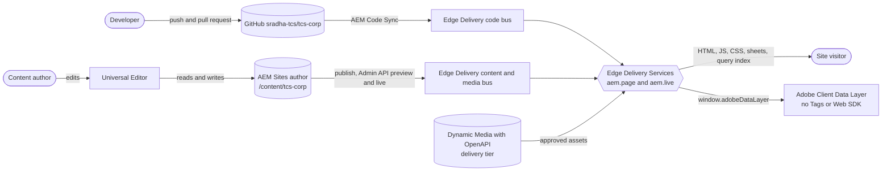
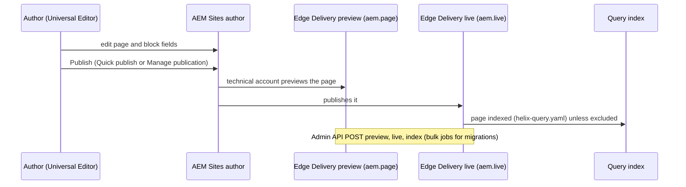
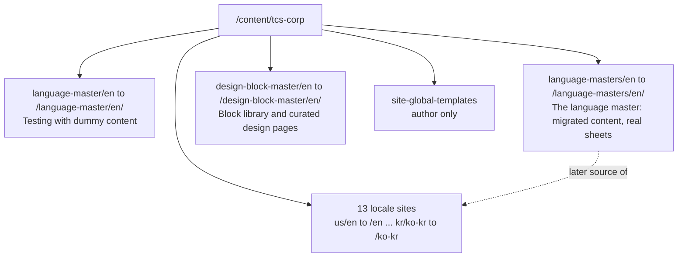
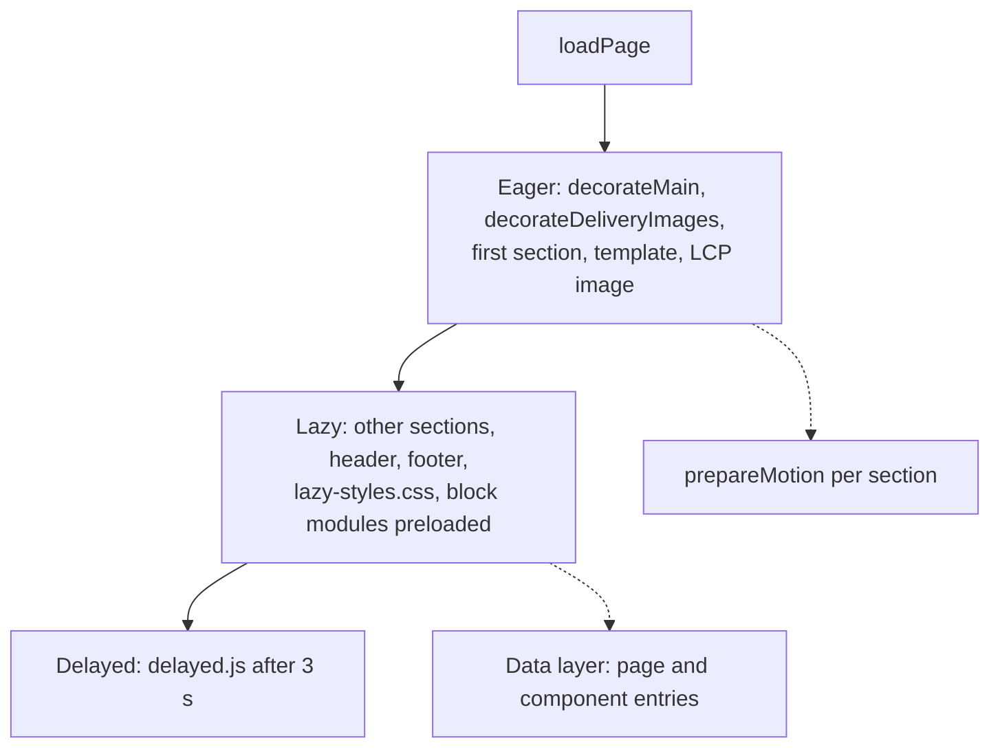

# Architecture Guide

| Attribute | Value |
| --- | --- |
| Document ID | ARC-000 |
| Audience | Solution architects, technical leads, developers, AI agents |
| Purpose | Entry point of the architecture package: the system, its delivery streams, the implementation status of every capability and where each architecture view is described |
| Scope | The TCS Corporate Website on AEM Sites as a Cloud Service with Universal Editor (xwalk) and Edge Delivery Services; the repository sradha-tcs/tcs-corp (main) |
| Prerequisites | None |
| Owner | Solution Architect (proposed) |
| Approver | Product Owner (to be confirmed) |
| Version | 1.0 |
| Status | Draft for review |
| Last updated | 8 November 2026 |
| Last validated | 8 November 2026 |
| Source files | AGENTS.md, scripts/scripts.js, utils/site.js, paths.json, helix-query.yaml, component-models.json |
| Related documents | [Solution architecture](./SOLUTION-ARCHITECTURE.md), [Content architecture](./CONTENT-ARCHITECTURE.md), [Technical architecture](./TECHNICAL-ARCHITECTURE.md), [Integration architecture](./INTEGRATION-ARCHITECTURE.md), [Security architecture](./SECURITY-ARCHITECTURE.md), [Deployment architecture](./DEPLOYMENT-ARCHITECTURE.md), [Performance architecture](./PERFORMANCE-ARCHITECTURE.md), [Localization architecture](./LOCALIZATION-ARCHITECTURE.md), [Architecture decisions](./ARCHITECTURE-DECISIONS.md), [Risks and open items](./ARCHITECTURE-RISKS-AND-OPEN-ITEMS.md) |
| Related AEM paths | /content/tcs-corp/language-masters/en, /content/tcs-corp/language-master/en, /content/tcs-corp/design-block-master/en, /content/tcs-corp/us/en … /content/tcs-corp/kr/ko-kr |

## Contents

- [System context](#system-context)
- [Delivery streams](#delivery-streams)
- [Site roots](#site-roots)
- [Implementation status](#implementation-status)
- [Architecture views](#architecture-views)
- [Page rendering lifecycle](#page-rendering-lifecycle)
- [Screenshots](#screenshots)
- [Known limitations](#known-limitations)
- [Open items](#open-items)
- [Change history](#change-history)

## System context

*Diagram: system context (source: [diagrams/system-context.mmd](../diagrams/system-context.mmd)).*

## Delivery streams

| Stream | Source | Delivered by | Environments |
| --- | --- | --- | --- |
| Code | GitHub sradha-tcs/tcs-corp (feature branches, main) | AEM Code Sync | &lt;branch&gt;--tcs-corp--sradha-tcs.aem.page / .aem.live |
| Content | AEM Sites author /content/tcs-corp (Universal Editor) | Publish from AEM (technical account) or the Admin API | main--tcs-corp--sradha-tcs.aem.page (preview), .aem.live (live) |
| Configuration | Site configuration (Config Service: public.json paths, metadata source), fstab.yaml at onboarding only | Admin API /config | all branches |
| Assets | AEM Assets of the Sites environment (/content/dam/tcs-corp) | Media bus (images published with pages) or Dynamic Media with OpenAPI (approved assets, KB-D-067) | delivery tier of the environment |

*Diagram: authoring to delivery flow (source: [diagrams/delivery-flow.mmd](../diagrams/delivery-flow.mmd)).*

## Site roots

*Diagram: site roots under /content/tcs-corp (source: [diagrams/site-roots.mmd](../diagrams/site-roots.mmd)).*

## Implementation status

Status vocabulary: Implemented, Partially implemented, Configured but not validated, Planned, Not implemented, Blocked, To be confirmed.

| Capability | Status | Evidence |
| --- | --- | --- |
| Universal Editor authoring (xwalk) of 32 blocks and 5 default-content components | Implemented | component-models.json, component-definition.json, component-filters.json |
| Edge Delivery Services rendering, three-phase loading, module preloading | Implemented | scripts/scripts.js, scripts/module-graph.js, head.html |
| 13 locale sites by path | Implemented (code and path mapping); content Partially implemented | utils/site.js LOCALES, paths.json |
| Three review roots /language-master/en, /language-masters/en, /design-block-master/en (KB-D-068) | Implemented | utils/site.js REVIEW_ROOTS, paths.json, site configuration |
| Query index and listing (List, Filter List, Cards from metadata) | Implemented | helix-query.yaml, utils/query-index.js, blocks/list, blocks/filter-list |
| Placeholders, taxonomy, data sheets, redirects sheets per locale | Implemented (reading); redirects Not applied by the platform | utils/placeholders.js, utils/taxonomy.js, utils/data.js; redirects need a CDN rule (KB-D-055, on hold) |
| Adobe Client Data Layer (page, components, interactions) | Implemented | decorators/data-layer-decorator.js, utils/analytics.js |
| Adobe Tags, Web SDK, Analytics, CJA, Target, consent platform | Not implemented | decision log; AGENTS.md |
| Dynamic Media with OpenAPI delivery of all assets (KB-D-067) | Partially implemented: rendering Implemented, page rewrite Configured but not validated, asset picker Planned (PR #200 open) | decorators/responsive-image-decorator.js, utils/media.js, aem-sites.sh on the delivery branch |
| Separate AEM Assets environment (KB-D-064) | Not implemented (not adopted) | decision log KB-D-064 |
| Forms (Form Variations) submission back end | Not implemented (no back end connected) | blocks/form-variations; finding F-01 |
| Personalization | Not implemented | docs: personalization (knowledge base) |
| CDN redirects / root redirect / to /en/ | Planned (on hold) | KB-D-055 |
| Production custom domain and Adobe Managed CDN | To be confirmed | not recorded in the repository |
| Monitoring and alerting beyond Edge Delivery RUM | To be confirmed | not recorded in the repository |

## Architecture views

- [Solution architecture](./SOLUTION-ARCHITECTURE.md)
- [Content architecture](./CONTENT-ARCHITECTURE.md)
- [Technical architecture](./TECHNICAL-ARCHITECTURE.md)
- [Integration architecture](./INTEGRATION-ARCHITECTURE.md)
- [Security architecture](./SECURITY-ARCHITECTURE.md)
- [Deployment architecture](./DEPLOYMENT-ARCHITECTURE.md)
- [Performance architecture](./PERFORMANCE-ARCHITECTURE.md)
- [Localization architecture](./LOCALIZATION-ARCHITECTURE.md)
- [Architecture decisions](./ARCHITECTURE-DECISIONS.md)
- [Risks and open items](./ARCHITECTURE-RISKS-AND-OPEN-ITEMS.md)

## Page rendering lifecycle

*Diagram: three-phase page loading (source: [diagrams/page-loading.mmd](../diagrams/page-loading.mmd)).*

## Screenshots

No screenshot belongs to this document (it describes code, configuration or process). Evidence screenshots are listed in the [screenshot register](../../SCREENSHOT-REGISTER.md).

## Known limitations

- Production domain, CDN and monitoring are not recorded in the repository (To be confirmed).

## Open items

- Confirm the production domain and CDN (owner: Solution Architect, to be confirmed).
- Approve or reject the asset picker PR #200 after the Extension Manager set-up.

## Change history

| Version | Date | Author | Change |
| --- | --- | --- | --- |
| 1.0 | 8 November 2026 | Delivery team (documentation program) | First version of the role-specific documentation (master documentation prompt), generated from the repository and the published reference pages |
