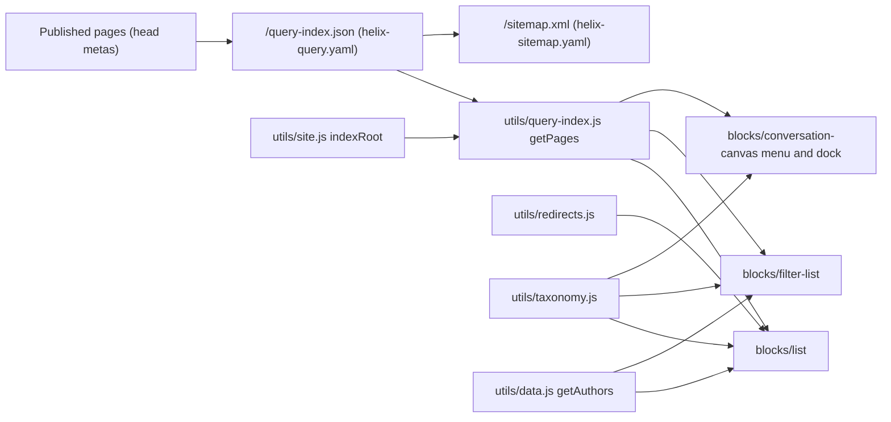

# Integration Architecture

| Attribute | Value |
| --- | --- |
| Document ID | ARC-004 |
| Audience | Solution architects, technical leads, developers, AI agents |
| Purpose | Integration points: query index and search, Adobe Client Data Layer, Dynamic Media, forms, personalization, external embeds |
| Scope | — |
| Prerequisites | — |
| Owner | Solution Architect (proposed) |
| Approver | Product Owner (to be confirmed) |
| Version | 1.0 |
| Status | Draft for review |
| Last updated | 8 November 2026 |
| Last validated | 8 November 2026 |
| Source files | docs/handover/knowledge-base/indexing-and-search.md, docs/handover/knowledge-base/personalization.md, docs/handover/knowledge-base/data-layer-and-analytics.md, helix-query.yaml |
| Related documents | — |
| Related AEM paths | — |

## Contents

- [Integration status](#integration-status)
- [Query index and search (section)](#query-index-and-search-section)
- [Query index definition](#query-index-definition)
- [Query index use in code](#query-index-use-in-code)
- [Consumers](#consumers)
- [Empty, editor and error states](#empty-editor-and-error-states)
- [Performance](#performance)
- [Sitemap](#sitemap)
- [Reindex dependencies](#reindex-dependencies)
- [Post-reindex validation](#post-reindex-validation)
- [Related](#related)
- [Personalization (section)](#personalization-section)
- [Verified state](#verified-state)
- [Decisions found](#decisions-found)
- [Block support](#block-support)
- [What a future implementation can build on](#what-a-future-implementation-can-build-on)
- [Data that could feed personalization](#data-that-could-feed-personalization)
- [Requirements for any future personalization](#requirements-for-any-future-personalization)
- [Validation status](#validation-status)
- [Related](#related-1)
- [Screenshots](#screenshots)
- [Known limitations](#known-limitations)
- [Open items](#open-items)
- [Change history](#change-history)

## Integration status

| Integration | Status |
| --- | --- |
| Query index and listing (List, Filter List, Cards from metadata) | Implemented |
| Adobe Client Data Layer (page, components, interactions) | Implemented |
| Adobe Tags, Web SDK, Analytics, CJA, Target, consent platform | Not implemented |
| Dynamic Media with OpenAPI delivery of all assets (KB-D-067) | Partially implemented: rendering Implemented, page rewrite Configured but not validated, asset picker Planned (PR #200 open) |
| Forms (Form Variations) submission back end | Not implemented (no back end connected) |
| Personalization | Not implemented |
| CDN redirects / root redirect / to /en/ | Planned (on hold) |
| Production custom domain and Adobe Managed CDN | To be confirmed |

## Query index and search (section)

## Query index definition

`helix-query.yaml` defines **one index**, `pages`, published as `/query-index.json`, for all 13 locales (and, temporarily, the language master under review).

**Included:** `/**`.

**Excluded:**

| Pattern | Why (from the file's comments) |
| --- | --- |
| `/**.json` | Sheets and other JSON resources |
| `/*/references/**` | Fragments, nav and footer pages, modals of each locale |
| `/*/error-pages/**` | Error pages |
| `/*/data/**` | Data sheets |
| `/*/nav`, `/*/footer` | Nav and footer pages at the locale root |
| `/*/block-library`, `/*/block-library/**` | Block libraries (also excluded from publishing in `paths.json`; safeguard) |
| `/site-global-templates/**` | Template pages (not published; safeguard) |
| `/language-masters/*/references/**`, `/language-masters/*/error-pages/**`, `/language-masters/*/data/**`, `/language-masters/*/nav`, `/language-masters/*/footer`, `/language-masters/*/block-library`, `/language-masters/*/block-library/**` | The same for the language master under review, a folder level deeper (#131, F-108; to remove with the REVIEW settings after the rollout) |
| `/**/fragments/**`, `/**/modals/**` | Fragment and modal folders anywhere |

The `/*/…` patterns name one path segment before the folder (e.g. `/en/block-library`); the language master (`/language-masters/en/…`) is a level deeper and has its own patterns. Until 21 October 2026 it had none: 166 block library pages, 6 reference pages and the 404 page of the language master were in the live index (F-108). After the fix (#131) a reindex reports "requested path does not match index configuration" for these pages but doesn't remove their rows: they were removed with the Admin API index DELETE (173 / 173; the pages stay published). The index went from 354 to 181 rows (137 language-master content pages, 44 `/en` pages), and the Lists and Filter Lists of the library and the curated Insights page still filled.

**Columns** (37 properties, all read from the server-delivered `<head>`):

| Group | Index columns (meta source) |
| --- | --- |
| Platform / standard | `lastModified` (`last-modified` header, parsed timestamp), `robots`, `title` (`og:title`), `description`, `image` (`og:image`, path only), `tags` (all `article:tag`, multi-value), `cqTags` (`cq-tags`, AEM page Tags as one comma-separated meta) |
| SEO | `metaTitle`, `metaDescription` |
| Classification | `pageType`, `contentType`, `category`, `eyebrow` |
| Author and dates | `author`, `authorId`, `publishDate`, `modifiedDate`, `readingTime` |
| Images | `thumbnailImage`, `featuredImage`, `imageAlt` |
| Audience | `region`, `country`, `language`, `persona`, `campaignId` |
| Featuring | `featured`, `priority`, `featureCard` and `featuredPriority` (earlier names, read as fallbacks) |
| List cards | `cardTitle`, `cardDescription`, `cardImage`, `cardImageAlt`, `cardStyle`, `cardTheme`, `hideInNav` |

Rules:

- Values set by JavaScript (e.g. the SEO decorator) aren't indexed: only the delivered head counts (handover Part 8.1.3).
- `/query-index.json` is public: don't put internal-only values in metadata (handover Part 2.10.7).
- A new metadata column used by a block needs a property here, then a reindex (List README "Extending the Block", Filter List README step 3).

## Query index use in code

[`utils/query-index.js`](https://github.com/sradha-tcs/tcs-corp/blob/main/utils/query-index.js) is the only reader of `/query-index.json`.

| Export | Behaviour |
| --- | --- |
| `getPages()` | Fetches `/query-index.json?offset={n}&limit=500` until `total` is reached (or a request fails or returns no rows); keeps one promise per page view (module variable); filters rows to `indexRoot()`; maps each row to a typed page (`path`, `title`, `description`, `image`, `tags`, `pageType`, `contentType`, `publishDate`, `readingTime`, `thumbnailImage`, `featuredImage`, `author`, `authorId`, `featured`, `priority`, `lastModified`, `row`). A failed load gives `[]` |
| `tagsOf(row)` | Merges `tags` (JSON list or comma list) and `cqTags`, without duplicates (`test/list/query-index-tags.test.mjs`) |
| `columnOf(page, name)` | A column by its metadata name (`featured-image` → `featuredImage`) |
| `listOf(value)` | A multi-value column: JSON array or comma-separated |
| `getPagesAt(paths)` | Pages the index doesn't have (AEM author, or not indexed yet), read from their own HTML in parallel, once per path per page view (`rowOfDocument`); failures are left out |

Typed values: `featured` is true for `yes`, `true`, `1`, `on`, `y` in `featured` or `featureCard`; `priority` is the number in `priority`, else `featuredPriority`, else `null`.

**Locale scoping.** `indexRoot()` ([`utils/site.js`](https://github.com/sradha-tcs/tcs-corp/blob/main/utils/site.js)) returns the review root (`/language-master/en`, `/language-masters/en` or `/design-block-master/en`, `REVIEW_ROOTS`, KB-D-068) for pages below it, else the page's locale root (`/de-de`). `getPages()` keeps rows whose path is that root or below it (`test/site/index-root.test.mjs`). Every page view still downloads the rows of all locales.

**AEM author.** AEM author has no query index (`isAuthor()` in `utils/environment.js`: the path starts with `/content/`); `getPages()` then returns `[]` and blocks show editor hints (below). Fixed-list pages are read with `getPagesAt`.

## Consumers

| Consumer | Uses the index for | Source |
| --- | --- | --- |
| List | Child pages, Tagged pages, card metadata of Fixed list pages | [blocks/list/README.md](https://github.com/sradha-tcs/tcs-corp/blob/main/blocks/list/README.md) |
| Filter List | All candidate pages (Query Index source) or the Manual List pages' metadata | [blocks/filter-list/README.md](https://github.com/sradha-tcs/tcs-corp/blob/main/blocks/filter-list/README.md) |
| Conversation Canvas | The pop-up site menu and the Primary dock navigation (`path`, `title`) | [blocks/conversation-canvas/README.md](https://github.com/sradha-tcs/tcs-corp/blob/main/blocks/conversation-canvas/README.md) |
| Sitemap | `/sitemap.xml` source | `helix-sitemap.yaml` |
| Cards | **Not** a consumer: authored fields only (tag labels from the taxonomy, UI text from placeholders) | [blocks/cards/README.md](https://github.com/sradha-tcs/tcs-corp/blob/main/blocks/cards/README.md) |

#### List

- **Sources:** Child pages (below the Parent page or the current page, direct children or down to Child depth), Tagged pages (below the Search root, Any / All of the Tags, never the current page; a tag matches its child tags, `hasTag`), Fixed list (List Items; pages, paths or external URLs).
- **Data rules:** pages with `hide-in-nav = yes` are not listed (`isListable`); card links point to redirect targets (`utils/redirects.js`, at most 5 hops); card values follow the page metadata contract (`card-title` → `og:title`, `card-description` → description, `card-image` → `og:image` / `thumbnail-image` / `featured-image`, …) and a List Item's authored fields win field by field.
- **Sorting:** Order by Manual (authored order for Fixed lists, path order for pages), Title (`Intl.Collator`, numeric, page language) or Last modified (`modified-date`, else last published); Sort order ascending / descending; ties by path. Deduplication by destination path; Maximum items applies last.

#### Filter List

- **Sources:** Query Index (pages below Root path, of the selected Page types and Content types, never the current page) or Manual List (Filter Page items in authored order; Sort by ignored).
- **Sorting:** `latest` (`publishDate`, then `lastModified`), `featured`, `priority` (lower first, then latest), `alphabetical` (`Intl.Collator` with the page language).
- **Filtering:** filter pills from Filter Tag items (single or multi select), an advanced filter panel of categories below taxonomy roots (AND / OR), Clear all and Reset filters; filters run in memory and aren't in the URL.
- **Spotlights:** hero (Latest, Featured, Manual) and featured cards (Marked as featured, Priority 1 to 3, Manual).
- **Pagination:** Cards per page (default 9), Load more adds Load more count (default 6) and moves focus to the first new card; "Showing {n} of {total}".
- **Known differences from List:** `hide-in-nav` and redirects aren't applied; the Authors lookup is exact (handover F-30; audit D-A-29 deferred).

#### Conversation Canvas

- **Menu:** pages below the Menu root path (default: the locale root) up to Menu depth levels, sorted by level then path (alphabetical), titled by `title`, else the last path segment (`loadMenuTree`). `hide-in-nav` isn't applied (F-33); the menu order follows the path, not a navigation order column (F-78).
- **Search:** submitting dispatches the bubbling, cancelable `conversation-canvas:search` event with `detail.query`; an integration that handles it calls `preventDefault()`; else the authored Search page opens with `?q={query}`; else a polite status "Search isn't available yet." (`searchUnavailable`). Voice input uses the browser's `SpeechRecognition` where available. The data layer records `cmp:search` with the term passed through `redactSearchTerm` (`utils/privacy.js`).
- **No search index or results page exists in the repository:** No verified search service was identified.

## Empty, editor and error states

| Block | Situation | Shown |
| --- | --- | --- |
| List | No cards on the site | Empty behaviour: `message` (default; the authored message, else `listEmpty` "There are no items to show."), `hide` (block hidden; not in the editor or on AEM author), `fallback` (the List Items as a Fixed list) |
| List | AEM author / Universal Editor, Child or Tagged pages | `listEditorPages` "The pages show on the published page (from the query index)." |
| List | Configuration incomplete | Editor hint (warnings `tags-missing`, `parent-missing`, `root-missing`, `items-missing`) |
| Filter List | No matching pages or failed index | `noResources` "No resources found.", hint and Reset filters |
| Filter List | AEM author / Universal Editor | `filterListEditor` "The results show on the published page, from the pages' metadata."; items as chips |
| Conversation Canvas | No pages (including the editor) | `noPagesFound` "No pages found" in the menu |
| All | Index request fails | `getPages()` resolves to `[]`; the block renders its empty state; a failing deferred render is logged and the skeleton removed |

## Performance

- **Prefetch:** `prefetchData(main)` (`scripts/scripts.js`) starts `getPages()` and `loadTaxonomy()` when the lazy phase begins on pages with a List, Filter List or Conversation Canvas, and `loadRedirects()` with a List; not in the eager phase, so it doesn't compete with the LCP image. The blocks reuse the same cached promises.
- **Skeletons:** List and Filter List render through `renderWhenLoaded` (`decorators/skeleton-decorator.js`): data within 150ms renders directly; later data shows a block-shaped skeleton (at least 250ms) so the section and those below aren't held back. The Canvas menus use `skeletonWhile`.
- **Transfer:** every page view with one of these blocks downloads the whole index (all locales) in pages of 500 rows and filters it in the browser; cost grows with the number of published pages (handover Part 2.10.7 and F-30; per-locale indexes are a recommendation, not implemented).
- **Placement:** avoid index-based blocks in the first section (LCP, handover Part 13.16).

## Sitemap

`helix-sitemap.yaml` defines one sitemap, `default`: source `/query-index.json`, destination `/sitemap.xml`, `lastmod: YYYY-MM-DD`, origin `https://main--tcs-corp--sradha-tcs.aem.live` (to be replaced by the production domain once `cdn.prod.host` is configured, per the file's comment).

- It covers every indexed page of all locales; there are no per-locale sitemaps and no `hreflang` alternates (handover Part 4.9.6).
- Handover Part 2.10.7 states that pages with `robots` `noindex` are left out of the sitemap while they stay in the index and in List / Filter List (no code checks `robots`); the sitemap behaviour is platform behaviour (Requires validation).
- The sitemap is regenerated when the index changes; the Admin API `sitemap` operation regenerates it on demand (handover Part 12.1.9).

## Reindex dependencies

| Event | Index effect | Source |
| --- | --- | --- |
| Page published | Row added or updated | handover Part 12.1.7 (platform) |
| Page unpublished | Row removed | handover Part 12.1.7 (platform) |
| `helix-query.yaml` changed (new column, changed exclude) | Existing rows unchanged until the pages are republished or reindexed | handover Part 12.1.7 |
| Page metadata changed (card title, tags, featured, priority, content type) | Lists change after the page is republished (and reindexed) | List and Filter List READMEs |
| Bulk metadata | Indexed only if the sheet applies (`metadata.source`) and the page is republished | handover Part 8 |

**Verified reindex operation.** The Admin API index operation `POST https://admin.hlx.page/index/{org}/{site}/{ref}/{path}` (org `sradha-tcs`, site `tcs-corp`, ref `main`) re-indexes a published path (handover Part 12.1.9). It was used per page, after `preview` and `live`, for the language master packages (handover revisions 2.31: 312 / 312 pages; 2.35: 313 / 313 and 315 / 315 pages). Calls need an authorised user or API key; no credentials are recorded. Bulk (`/*`) operations act on all locales and must be agreed with the site owner (handover Part 2.10.13).

**Excluded by design.** Block library pages stay out of the query index (handover revision 2.35; `helix-query.yaml` and `paths.json` excludes for the locale block libraries).

**Open finding.** F-10 (handover Part 16): the live index didn't match `helix-query.yaml` (card, eyebrow, category, hide-in-nav, author and feature columns missing) until the site is reindexed. The register still lists it as open; the language master pages were reindexed in revisions 2.31 and 2.35. Whether the 13 locale trees were reindexed is Not recorded.

## Post-reindex validation

A checklist derived from the configuration and code (results of a full run are Not recorded; revision 2.31 recorded 307 language-master pages in the index, 306 with an image):

1. `GET /query-index.json?offset=0&limit=500` on the live host: `total` matches the expected number of published, non-excluded pages; page through until `total`.
2. A row of each locale has the 37 columns of `helix-query.yaml` (e.g. `cardTitle`, `hideInNav`, `cardStyle`, `cardTheme` present, even if empty).
3. No row below `references/`, `error-pages/`, `data/`, `block-library`, `fragments/`, `modals/`, `site-global-templates`, and no `.json` path.
4. Tagged pages have `tags` or `cqTags` values (F-07: AEM may publish page Tags only as `cq-tags`; code merges both).
5. On preview / live (not AEM author): a List (Child pages and Tagged pages), a Filter List and a Conversation Canvas menu of each changed locale show the expected pages; a page with `hide-in-nav = yes` is absent from the List.
6. `/sitemap.xml` lists the pages with the configured origin.

## Related

- [architecture.md](./TECHNICAL-ARCHITECTURE.md) — runtime phases, caching, integrations
- [content-architecture.md](./CONTENT-ARCHITECTURE.md) — metadata model, taxonomy, locales, references
- [blocks.md](../../02-development/markdown/BLOCK-DEVELOPMENT-GUIDE.md), [data-layer-and-analytics.md](../../02-development/markdown/ANALYTICS-DATA-LAYER-GUIDE.md) — related knowledge base files
- [blocks/list/README.md](https://github.com/sradha-tcs/tcs-corp/blob/main/blocks/list/README.md), [blocks/filter-list/README.md](https://github.com/sradha-tcs/tcs-corp/blob/main/blocks/filter-list/README.md), [blocks/conversation-canvas/README.md](https://github.com/sradha-tcs/tcs-corp/blob/main/blocks/conversation-canvas/README.md), [blocks/cards/README.md](https://github.com/sradha-tcs/tcs-corp/blob/main/blocks/cards/README.md)
- [utils/README.md](https://github.com/sradha-tcs/tcs-corp/blob/main/utils/README.md), [decorators/README.md](https://github.com/sradha-tcs/tcs-corp/blob/main/decorators/README.md), [docs/animation/README.md](https://github.com/sradha-tcs/tcs-corp/blob/archive/docs-before-role-docs-2026-11-08/docs/animation/README.md) (skeletons)
- [AGENTS.md](https://github.com/sradha-tcs/tcs-corp/blob/main/AGENTS.md) — "Site structure and site data" notes on the query index
- Handover ([TCS-CORP-HANDOVER.md](https://github.com/sradha-tcs/tcs-corp/blob/archive/docs-before-role-docs-2026-11-08/docs/handover/TCS-CORP-HANDOVER.md)): Part 2 — Solution Architecture (2.10.7, 2.11.4), Part 12 — Publishing, Deployment & Release (12.1.7, 12.1.9), Part 13 — Global Troubleshooting Guide (13.9–13.11, 13.25), Part 16 — Handover Findings and Open Items Register

## Personalization (section)

## Verified state

| Item | State | Evidence |
| --- | --- | --- |
| Adobe Target (at.js, Web SDK decisions, mboxes) | Not implemented | No Target, `alloy` or decision code in `blocks/`, `decorators/`, `utils/`, `scripts/`, `templates/` |
| Adobe Journey Optimizer (web channel, offers) | Not implemented | No AJO code |
| AEP Web SDK / Edge Network | Not configured (blocked: measurement plan) | `scripts/delayed.js` holds only a comment; see [Data layer and analytics](../../02-development/markdown/ANALYTICS-DATA-LAYER-GUIDE.md) |
| Audiences, segments, visitor profiles | None | No audience source, no identity, no consent ([Security, privacy and consent](./SECURITY-ARCHITECTURE.md)) |
| Decision scopes, activities, offers | None | — |
| Edge or server-side personalization | None | Edge Delivery serves the same cached HTML to every visitor |
| Experimentation (A/B tests) | None | No experimentation plugin or code |
| Personalized impressions in the data layer | None | No personalization events or fields in `decorators/data-layer-decorator.js` |
| Personalization fields in block dialogs | None | No `personalization` field in `models/` or `blocks/*/_*.json` |

## Decisions found

| Decision | Source |
| --- | --- |
| The Teaser's Personalization option (a class `personalization` and `data-personalization="true"` that nothing read) was removed from the dialog and the code; library content was migrated; Teasers authored with it still render | Handover revision 2.27 (19 October 2026), audit defect D-B-3 ([`docs/audit/BLOCK-ECOSYSTEM-AUDIT.md`](https://github.com/sradha-tcs/tcs-corp/blob/archive/docs-before-role-docs-2026-11-08/docs/audit/BLOCK-ECOSYSTEM-AUDIT.md)), re-audit section 1 ([`docs/audit/REAUDIT-2026-10-20.md`](https://github.com/sradha-tcs/tcs-corp/blob/archive/docs-before-role-docs-2026-11-08/docs/audit/REAUDIT-2026-10-20.md)), [`blocks/teaser/README.md`](https://github.com/sradha-tcs/tcs-corp/blob/main/blocks/teaser/README.md) |
| Every block is classified "Not personalizable"; personalized rendering, fallback, flicker, cache-key and analytics tests are blocked until an approved personalization design exists | Audit section 8 |
| Area-specific navigation and footers are content choices (inherited Navigation / Footer pages), not audience personalization | [`blocks/header/README.md`](https://github.com/sradha-tcs/tcs-corp/blob/main/blocks/header/README.md), [`blocks/footer/README.md`](https://github.com/sradha-tcs/tcs-corp/blob/main/blocks/footer/README.md) |

Several handover chapters written before 2.27 (for example 1.6.2, 2.9.8, the Teaser chapter 6.11 Variation 66 and 16.4) still describe the Teaser marker; the code and revision 2.27 are authoritative.

## Block support

No block supports personalization: every block (see the inventory in [`blocks/README.md`](https://github.com/sradha-tcs/tcs-corp/blob/main/blocks/README.md)) renders its authored default content, and each block README states "This block does not currently expose verified personalization behavior".

Script hooks that exist but have no caller in the repository:

| Hook | Block | Default without a caller |
| --- | --- | --- |
| `setConversationCanvasSuggestions(block, suggestions)` | Conversation Canvas (Primary, sticky) | The page's tag labels as suggestion pills ([`blocks/conversation-canvas/README.md`](https://github.com/sradha-tcs/tcs-corp/blob/main/blocks/conversation-canvas/README.md)) |
| `setConversationCanvasFilters(block, tags)` | Conversation Canvas (Secondary) | No filter tags (the list stays hidden) |
| `conversation-canvas:search` DOM event (cancelable) | Conversation Canvas | The Search page with `?q=`, else a "not available" status |
| `form-variations:submit` DOM event with `detail.respondWith(promise)` | Form Variations | POST to the Submit action, else "not connected" |

These are integration points (code comments name a personalisation service as one possible caller), not personalization features.

## What a future implementation can build on

| Foundation | What it offers | Source |
| --- | --- | --- |
| Adobe Client Data Layer | Page entry (language, Page Type, tags, path), one component entry per block with a stable id (Anchor ID / Component ID, else `{block}-{n}`), `cmp:*` events | [Data layer and analytics](../../02-development/markdown/ANALYTICS-DATA-LAYER-GUIDE.md) |
| Default content of every block | The authored content renders for everyone and is the natural fallback | Block READMEs; Edge Delivery cached HTML |
| Additional tab | Anchor ID (a stable block id and component id for targeting), Hide block, spacing and animation classes on every block model except header and footer | [`AGENTS.md`](https://github.com/sradha-tcs/tcs-corp/blob/main/AGENTS.md) (Additional tab), [`decorators/block-options-decorator.js`](https://github.com/sradha-tcs/tcs-corp/blob/main/decorators/block-options-decorator.js) |
| Page metadata | Page properties and the bulk metadata columns, read by `getPageMetadata()` | [`utils/metadata.js`](https://github.com/sradha-tcs/tcs-corp/blob/main/utils/metadata.js) |
| Query index | Metadata columns indexed per page (below) | [`helix-query.yaml`](https://github.com/sradha-tcs/tcs-corp/blob/main/helix-query.yaml), [`utils/query-index.js`](https://github.com/sradha-tcs/tcs-corp/blob/main/utils/query-index.js) |
| Delayed phase | `scripts/delayed.js`, imported 3 seconds after load, where the planned Tags / Web SDK embed goes | [`scripts/scripts.js`](https://github.com/sradha-tcs/tcs-corp/blob/main/scripts/scripts.js) `loadDelayed` |
| Shared DOM events | `tabs:change`, `tabs:reveal`, `header:menu`, `conversation-canvas:search`, `form-variations:submit` | [`AGENTS.md`](https://github.com/sradha-tcs/tcs-corp/blob/main/AGENTS.md) (Shared events and helpers) |

## Data that could feed personalization

| Data | Where it is available today | Current use |
| --- | --- | --- |
| `persona` | Bulk metadata column, `getPageMetadata().persona`, query index `persona` | None in blocks (handover 14.9, item 17) |
| `region`, `country`, `language` | Metadata columns, query index; `xdm:language` in the data layer page entry | `region` selects the contacts of the Media Contacts block (`blocks/media-contacts/media-contacts.js`, `inRegion`): page metadata, not the visitor |
| `campaign-id` | Metadata column, `getPageMetadata().campaignId`, query index `campaignId` | None |
| `page-type`, `content-type`, `category`, tags | Metadata, query index, data layer (`xdm:template`, `xdm:tags`) | Templates, Page Header, List, Filter List |
| `featured`, `priority` | Metadata, query index | Filter List spotlight and featured cards |
| Data sheets (`authors`, `locations`, `partners`, `social-links`, `media-contacts`; `region` columns) | `utils/data.js` | Page Header, footer, Press Release |

All of these describe the page, not the visitor. No visitor attribute (segment, behaviour, geolocation, login) is collected.

## Requirements for any future personalization

Requirements recorded for a future design; none is implemented, and the design itself is a blocked dependency (audit section 9: activities, audiences, the personalization design).

| Area | Requirement | Source |
| --- | --- | --- |
| Default content and fallback | The authored content stays the default and renders when no decision arrives, the service fails or consent is denied | Handover 2.9.8 (failure handling), audit section 7 (Personalization: denied → default content) |
| Consent | No decision request before consent; the consent model and categories must be approved first | Handover 11.7.6, audit section 7 |
| Identity | An identity strategy (Web SDK ECID or other) must be decided; none exists | Not recorded (blocked) |
| Caching | Edge Delivery serves the same cached default content to every visitor; the design must define where variants are applied (browser or edge) and how they interact with the cache (cache keys) | Audit section 8 (cache-key tests blocked) |
| Flicker and performance | Personalizing above-the-fold content conflicts with the eager LCP phase; any pre-hiding needs a performance review; keep the Core Web Vitals targets | Handover 2.9.8 and 11.7.7 |
| Security | Offer content must respect the CSP (`strict-dynamic`) and be inserted with DOM APIs | Handover 2.9.8 |
| Accessibility | Personalized content must meet the same WCAG 2.1 AA rules as the block it replaces (headings, names, focus, placeholders for UI text) | [`AGENTS.md`](https://github.com/sradha-tcs/tcs-corp/blob/main/AGENTS.md) (Accessibility) |
| Analytics | Personalized impressions and decisions must be measurable through the existing data layer (no parallel tracking) | [Data layer and analytics](../../02-development/markdown/ANALYTICS-DATA-LAYER-GUIDE.md) |
| Authoring and QA modes | Nothing personalized in Universal Editor edit mode; preview, live and a forced-variant QA mode need defining | Blocked (personalization design) |

## Validation status

| Test | Status |
| --- | --- |
| Default content of every block renders (no personalization) | Passed (audit runtime runs: 940 page loads, no block not loaded) |
| Personalized rendering, fallback, flicker, cache key, personalized analytics | Blocked: approved personalization design, Adobe Target / AJO access |

## Related

- [Architecture](./TECHNICAL-ARCHITECTURE.md), [Blocks](../../02-development/markdown/BLOCK-DEVELOPMENT-GUIDE.md), [Indexing and search](./INTEGRATION-ARCHITECTURE.md), [Decision log](./ARCHITECTURE-DECISIONS.md)
- [Data layer and analytics](../../02-development/markdown/ANALYTICS-DATA-LAYER-GUIDE.md)
- [Security, privacy and consent](./SECURITY-ARCHITECTURE.md)
- [`blocks/README.md`](https://github.com/sradha-tcs/tcs-corp/blob/main/blocks/README.md) and the block READMEs (Personalization sections)
- [`AGENTS.md`](https://github.com/sradha-tcs/tcs-corp/blob/main/AGENTS.md) (Site structure and site data: metadata columns)
- [`docs/audit/BLOCK-ECOSYSTEM-AUDIT.md`](https://github.com/sradha-tcs/tcs-corp/blob/archive/docs-before-role-docs-2026-11-08/docs/audit/BLOCK-ECOSYSTEM-AUDIT.md) (sections 7, 8, 9)
- Handover Part 2 — Solution Architecture (2.9.8), Part 11 — Analytics & Data Layer (11.7.7), Part 16 — Handover Findings and Open Items Register ([`TCS-CORP-HANDOVER.md`](https://github.com/sradha-tcs/tcs-corp/blob/archive/docs-before-role-docs-2026-11-08/docs/handover/TCS-CORP-HANDOVER.md))

## Screenshots

No screenshot belongs to this document (it describes code, configuration or process). Evidence screenshots are listed in the [screenshot register](../../SCREENSHOT-REGISTER.md).

## Known limitations

- Adobe Tags, Web SDK, Analytics, Target and a consent platform are not configured; nothing in this document implies they are.

## Open items

- None.

## Change history

| Version | Date | Author | Change |
| --- | --- | --- | --- |
| 1.0 | 8 November 2026 | Delivery team (documentation program) | First version of the role-specific documentation (master documentation prompt), generated from the repository and the published reference pages |
