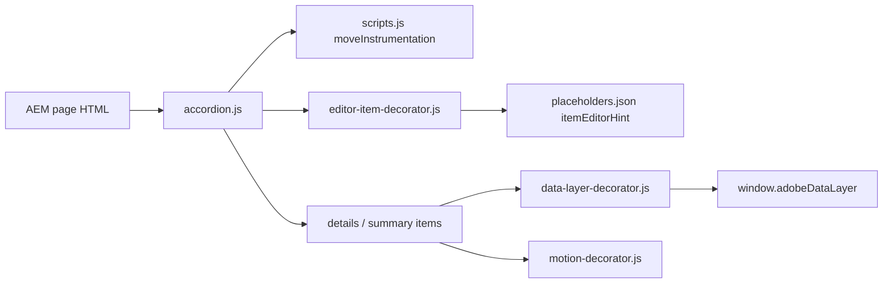
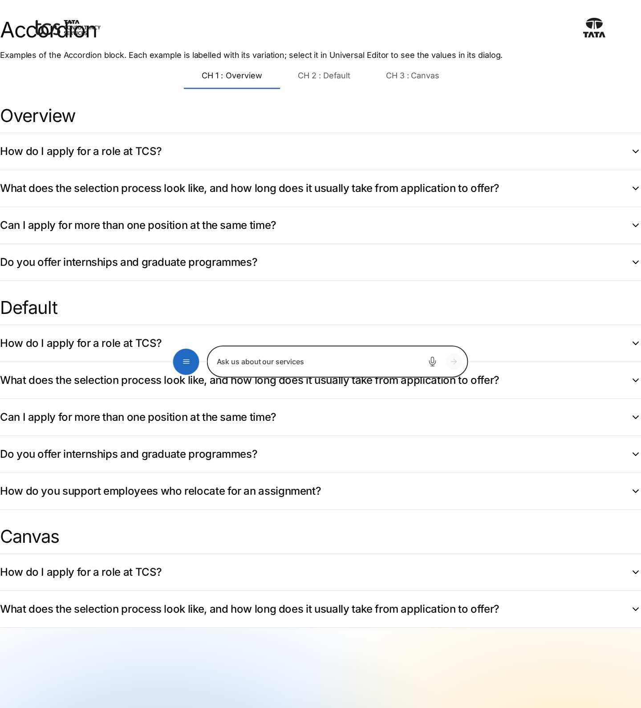
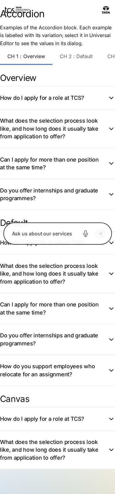

# Accordion Block — Developer Guide

| Attribute | Value |
| --- | --- |
| Document ID | DEV-B-accordion |
| Audience | Developers, technical leads, block owners, AI coding agents |
| Purpose | How the Accordion block is built: files, model, structure, behaviour, variations, tests and limitations |
| Scope | blocks/accordion/ and its components accordion, accordion-item |
| Prerequisites | — |
| Owner | Technical Lead / Block Owner (proposed) |
| Approver | Product Owner (to be confirmed) |
| Version | 1.0 |
| Status | Draft for review |
| Last updated | 8 November 2026 |
| Last validated | 2026-11-08 (model, files, imports from the code; reference pages from the live site) |
| Source files | blocks/accordion/README.md, blocks/accordion/_accordion.json, blocks/accordion/accordion.css, blocks/accordion/accordion.js |
| Related documents | [Variations](./ACCORDION-VARIATIONS.md), [Test coverage](./ACCORDION-TEST-COVERAGE.md), [Authoring guide](../../../03-authoring/components/accordion/ACCORDION-AUTHORING-GUIDE.md) |
| Related AEM paths | /content/tcs-corp/design-block-master/en/block-library/accordion, /content/tcs-corp/design-block-master/en/block-library/accordion/accordion |

## Contents

- [Summary](#summary)
- [Overview](#overview)
- [Source files](#source-files)
- [Components, models and filters](#components-models-and-filters)
- [Fields](#fields)
- [Dependencies](#dependencies)
- [For Developers](#for-developers)
- [Extending the Block](#extending-the-block)
- [Responsive Behavior](#responsive-behavior)
- [Accessibility](#accessibility)
- [Data Layer and Analytics](#data-layer-and-analytics)
- [Performance Considerations](#performance-considerations)
- [Security and Privacy](#security-and-privacy)
- [For Architects](#for-architects)
- [Troubleshooting](#troubleshooting)
- [Known limitations of the block](#known-limitations-of-the-block)
- [Change history of the block](#change-history-of-the-block)
- [Reference pages](#reference-pages)
- [Coverage of the required topics](#coverage-of-the-required-topics)
- [Screenshots](#screenshots)
- [Known limitations](#known-limitations)
- [Open items](#open-items)
- [Change history](#change-history)

## Summary

| Attribute | Value |
| --- | --- |
| Block | Accordion |
| Folder | `blocks/accordion` |
| Type | Container |
| Category | interactive |
| Status | Active |
| Purpose | Expandable question / answer or detail panels (native details / summary) |
| Variations (summary) | Accordion Items; Additional tab options |
| Children | accordion-item (Accordion Item) |
| Code size | 121 lines of JS and CSS |

## Overview

- **Business purpose:** present secondary or reference information (answers, process details, terms) compactly, so visitors scan the summaries and open only what they need while the full text stays in the page HTML.
- **User experience:** a stack of rows between thin dividers; each summary has a chevron on the right that turns when the item opens. Several items can be open at the same time; nothing is open when the page loads.
- **Templates / page types:** any page; the block is offered in every Section, in Columns Container columns and in Tabs Container tabs.
- **Data source:** authored content only (Summary and Text of each item). No sheet, query index, taxonomy or placeholder is read for rendering.
- **Related blocks:** Tabs Container (content compared or switched in place), Text (content that must always be visible), Fragment (to reuse one Accordion on several pages).
- **When to use:** FAQs, eligibility criteria, programme or process details, policy clarifications, long lists of capabilities with explanations.
- **When not to use:** key messages, prices, calls to action or legal notices every visitor must see (collapsed content is easily overlooked); a single item (use a Title and Text); items that need images, videos or nested blocks (the body is a rich text field).
- **Realistic use cases:** a careers FAQ ("How do I apply for a role at TCS?", "Can I apply for more than one position at the same time?"); graduate programme details on a careers page; mobility support explained on an employee page.

## Source files

| File | Link |
| --- | --- |
| `README.md` | [GitHub](https://github.com/sradha-tcs/tcs-corp/blob/main/blocks/accordion/README.md) |
| `_accordion.json` | [GitHub](https://github.com/sradha-tcs/tcs-corp/blob/main/blocks/accordion/_accordion.json) |
| `accordion.css` | [GitHub](https://github.com/sradha-tcs/tcs-corp/blob/main/blocks/accordion/accordion.css) |
| `accordion.js` | [GitHub](https://github.com/sradha-tcs/tcs-corp/blob/main/blocks/accordion/accordion.js) |

## Components, models and filters

| Component | Title | Resource type | Template name | Model | Children allowed |
| --- | --- | --- | --- | --- | --- |
| `accordion` | Accordion | `core/franklin/components/block/v1/block` | Accordion | `accordion` | accordion-item |
| `accordion-item` | Accordion Item | `core/franklin/components/block/v1/block/item` | Accordion Item | `accordion-item` | — |

## Fields

The Additional tab fields (anchor, hide, padding, margin, animation) are common to the blocks and described in the [content modeling guide](../../markdown/CONTENT-MODELING-GUIDE.md).

### Accordion (`accordion`)

| Tab | Label | Property | Type | Required in model | Default | Options | Visibility |
| --- | --- | --- | --- | --- | --- | --- | --- |

### Accordion Item (`accordion-item`)

| Tab | Label | Property | Type | Required in model | Default | Options | Visibility |
| --- | --- | --- | --- | --- | --- | --- | --- |
| — | Summary | `summary` | text | No | `""` | — | — |
| — | Text | `text` | richtext | No | `""` | — | — |

"Required in model" is the model's `required` flag; whether a field is required in practice is stated in the authoring guide where it is known.

## Dependencies

| Import |
| --- |
| `../../scripts/scripts.js` |
| `../../decorators/editor-item-decorator.js` |

## For Developers

<!-- BEGIN GENERATED: files (npm run build:docs) -->

```text
blocks/accordion/
├── README.md
├── _accordion.json
├── accordion.css
└── accordion.js
```

| Decorator/Utility | Purpose | Execution or dependency point |
| ----------------- | ------- | ----------------------------- |
| [`scripts/scripts.js`](https://github.com/sradha-tcs/tcs-corp/blob/main/scripts/scripts.js) | Page decoration (moveInstrumentation and shared page helpers) | `accordion.js`: { moveInstrumentation } |
| [`decorators/editor-item-decorator.js`](https://github.com/sradha-tcs/tcs-corp/blob/main/decorators/editor-item-decorator.js) | `buildEditorItems`, `editorItemHint` (in Universal Editor, an item the block doesn't render yet, e.g. a CTA just added, as a dashed placeholder the author can select; styles in `styles/lazy-styles.css`; the hint loaded o | `accordion.js`: { buildEditorItems, editorItemHint } |

<!-- END GENERATED: files -->

- **JavaScript (`accordion.js`):** `decorate(block)` turns each item row into `details.accordion-item` > `summary.accordion-item-label` + `div.accordion-item-body`, moving the cells' child nodes and the editor instrumentation (`moveInstrumentation` on the row and on the summary cell).
- **CSS (`accordion.css`):** dividers, chevron (`mask: url('../../icons/chevron-down.svg')`), typography tokens, hover / focus states, reduced-motion rules. All selectors are scoped to `.accordion`.
- **Input DOM (what AEM delivers):** the block isn't key-value, so it starts with an **empty row for its Additional dialog tab**, then one row per Accordion Item with two cells (Summary, Text). In Universal Editor item rows carry `data-aue-resource` / `data-aue-model="accordion-item"`.

```html
<div class="accordion anchor-careers-faq">
  <div><div></div></div>
  <div><div>How do I apply for a role at TCS?</div><div><p>Search the open roles …</p></div></div>
</div>
```

- **Rendered DOM:**

```html
<div class="accordion anchor-careers-faq block" id="anchor-careers-faq">
  <details class="accordion-item">
    <summary class="accordion-item-label">How do I apply for a role at TCS?</summary>
    <div class="accordion-item-body"><p>Search the open roles …</p></div>
  </details>
</div>
```

- **Decoration flow:** rows whose first cell is empty (no text and no `img`, `picture` or `a`) are "unnamed": the tab row and items without a Summary. In Universal Editor (rows with `data-aue-resource`) they are replaced by `buildEditorItems` placeholders with the `itemEditorHint` text (loaded only then, `editorItemHint`); otherwise they are removed. The remaining rows become `details`; a row without a second cell gets an empty body.
- **Events and async behavior:** no listeners of its own; toggling is native. `decorate` awaits `editorItemHint`, which only fetches placeholders in the editor.
- **Error handling:** none needed; if the script fails, the rows stay as plain text (aem.js logs the failure).
- **Exported functions:** the default `decorate` only.
- **Parent / child contracts:** filter `accordion` allows only `accordion-item`; `decorators/motion-decorator.js` animates `:scope > .accordion-item` (staggered), so keep that class on the item elements.
- **Data-layer hooks:** none in the block; `decorators/data-layer-decorator.js` captures the `toggle` of any `details` inside a block.

## Extending the Block

1. **Add a field or option:** edit `blocks/accordion/_accordion.json` (keep the Additional tab last, at most three short tabs), then run `npm run build:json` and `npm run lint`.
2. **Map it to rendering:** a block option should be a `classes_*` field (delivered as a block class, never shifts rows). A new item field adds a cell to every item row: read cells by position from the start and keep the Summary as the first cell, because the decoration treats an empty first cell as "no item".
3. **Delivery rules:** a new dialog tab on the block model adds another empty row (already skipped as unnamed); a tab on the item model adds an empty cell to each item row (use `withoutTabCells` from `utils/cells.js`); field names ending in Text, Title, Type, Alt or MimeType collapse into their base field; don't put sample content in the definition template.
4. **Responsive and accessibility:** keep `details` / `summary`; any "open by default" or "one open at a time" option needs the `open` attribute managed in JS and must keep keyboard behaviour.
5. **Data layer:** opening / closing is already tracked; add `data-cmp-*` attributes only if a new control needs its own interaction name.
6. **Tests and library:** add unit tests for any pure logic under `test/`; add the variation to the block library page `block-library/accordion/accordion`; update this README (`npm run build:docs` regenerates the generated sections); run `npm run build:modules` after changing imports.
7. **Backward compatibility:** existing items have two cells (Summary, Text); keep reading them in that order.

## Responsive Behavior

The block CSS has no media queries; the sizes come from tokens in `styles/styles.css` that change at 900px.

| Viewport | Layout | Image behavior | Interaction behavior |
| -------- | ------ | -------------- | -------------------- |
| Below 900px (mobile, tablet portrait) | Full-width rows; summary 1.125rem (`--heading-font-size-m`), body 1rem (`--body-font-size-m`); long summaries wrap | No images | Tap or keyboard toggles an item |
| 900px and wider | Same rows; summary 1.5rem, body 1.125rem | No images | Hover and focus colour the summary brand blue |

## Accessibility

- **Semantic HTML:** each item is a native `details` element with a `summary`; screen readers announce it as expandable / collapsed without extra ARIA.
- **Headings:** summaries are not headings and don't appear in the heading outline; introduce the Accordion with a heading above it.
- **Keyboard and focus:** Tab reaches each summary; Enter or Space toggles it (native behaviour). Focus shows a 2px brand outline offset by 0.125rem; hover and focus turn the summary brand-coloured.
- **Accessible names:** the summary text. Items without a summary are removed on the page, so no nameless control is rendered (audit D-C-20, corrected).
- **Decorative elements:** the chevron is a CSS mask on a pseudo-element and is not announced.
- **Reduced motion:** the colour and chevron transitions are disabled with `prefers-reduced-motion: reduce`; the content animation doesn't play for reduced motion (AGENTS.md "Animation and skeletons").
- **Contrast:** colours come from tokens (`--color-text-default`, `--color-text-brand`, `--color-text-neutral-secondary`, `--color-border-default`); see Known Limitations for dark sections.
- **Error / loading / empty states:** none; the content is in the page HTML.
- **Reflow:** single column at every width; long summaries wrap.

Author responsibilities:

- Write summaries that make sense out of context; add a heading above the Accordion.
- Use descriptive link text in the answers; don't hide essential information in a closed item.

Developer responsibilities:

- Keep the native `details` / `summary` structure (it provides the semantics and keyboard support).
- Keep the focus style and the reduced-motion rules; use tokens for colours.

| Key | Expected behavior |
| --- | ----------------- |
| Tab / Shift+Tab | Moves to the next / previous summary (and to links inside open bodies) |
| Enter | Opens or closes the focused item |
| Space | Opens or closes the focused item |

## Data Layer and Analytics

- **Component:** registered by `decorators/data-layer-decorator.js` (`trackBlocks`) after the sections load: id = the block's id (Anchor ID), else `accordion-{n}` in page order; `@type` `tcs-corp/components/accordion`; `parentId` the page (or the containing block); `dc:title` only if the block contains a heading (normally none).
- **Variation:** none.
- **Item positions:** not recorded (the items have no `data-cmp-position`; the summary text identifies the item).
- **Impressions:** no impression event; only the component state above.
- **Interactions:** the `toggle` event of each `details` is captured centrally; summary clicks are excluded from `cmp:click`, so a toggle is counted once.

| Trigger | Data-layer event | Required properties | Analytics behavior |
| ------- | ---------------- | ------------------- | ------------------ |
| Block decorated (page load) | component state | `component.{id}`: `@type`, `parentId` | Inventory of the blocks on the page |
| Item opened | `cmp:show` | `eventInfo.path` `component.{id}`, `dc:title` = summary text | Which questions visitors open |
| Item closed | `cmp:hide` | `eventInfo.path` `component.{id}`, `dc:title` = summary text | Closing interactions |
| Link in an answer clicked | `cmp:click` | `interaction` `link`, `dc:title`, `xdm:linkURL`, `xdm:linkType` (`other`, `exit` or `download`), `breakpoint` | Link tracking within the answers |

No event is pushed when the block is inside an element with `data-analytics="off"`. The intended flow is Adobe Client Data Layer → Adobe Data Collection (Tags) → AEP Web SDK → Edge Network → Analytics / CJA, but Tags and the Web SDK aren't configured yet (blocked: measurement plan), so the events are only in `window.adobeDataLayer`. No consent mechanism is implemented.

## Performance Considerations

- Loaded with its section (eager in the first section, else lazy), like any block; no dynamic imports.
- No network requests on the page; in Universal Editor the placeholders are fetched only when an empty item exists.
- No images; no listeners or observers of its own (the toggle is native; the data layer listens once on the document).
- DOM size grows with the number of items; closed bodies stay in the DOM.
- Layout shift: none from the block; opening an item pushes the content below down by design.

## Security and Privacy

- Content is authored HTML moved from the delivered cells (no `innerHTML` from strings).
- Links in answers are authored links; the block doesn't validate or rewrite them.
- No external content, no query strings read, no data stored; data-layer events contain only the summary text.

## For Architects

- **Role:** a presentational disclosure block with authored content; no data source.
- **Content model:** a container block (`core/franklin/components/block/v1/block`) with item children (`.../block/item`, model `accordion-item`: Summary text, Text rich text); block model with the Additional tab only.
- **Rendering:** client-side decoration of server-delivered HTML; content is in the page HTML (indexable even when closed).
- **Dependencies:** `scripts/scripts.js` (`moveInstrumentation`), `decorators/editor-item-decorator.js`; centrally `decorators/data-layer-decorator.js`, `decorators/motion-decorator.js`, `decorators/block-options-decorator.js`.
- **Data layer / Web SDK / Target:** events in the Adobe Client Data Layer; Tags / Web SDK not configured; no Target.
- **Consent and identity:** none implemented; the events carry no personal data (summary text only).
- **Caching / performance:** delivered with the page through the Edge Delivery CDN; no requests of its own (outside the editor).
- **Security:** no external content; authored nodes are moved, not parsed from strings.
- **Scalability:** DOM size grows linearly with items; no limit in code.



## Troubleshooting

| Symptom | Likely cause | Diagnostic steps | Resolution | Verification |
| ------- | ------------ | ---------------- | ---------- | ------------ |
| Items show as plain text, no chevrons | Block script failed or wrong block | Developer tools: items should be `details.accordion-item`; console for `failed to load` messages; Network for `accordion.js` | Reload; escalate to development if the files fail | Items open and close |
| An item is missing on the page | Its Summary is empty | Check the item in the content tree; in the editor it is a dashed placeholder | Fill the Summary | The item renders |
| An item opens to nothing | Text empty | Select the item, check Text | Enter the answer or delete the item | The body shows |
| Block missing on the live page | Hide block on, or page / fragment not published | Additional tab; publication status | Turn Hide block off; publish page and fragment | Block visible on aem.live |
| `#anchor-…` link does not reach the block | Anchor ID differs or was suffixed `-2` | Inspect the block's `id` | Correct or de-duplicate the Anchor ID | The link scrolls to the block |
| No `cmp:show` events | Inside `data-analytics="off"`, or Tags not reading them | Open an item, run `window.adobeDataLayer.slice(-3)` in the console | If present, configure Tags (not yet set up); else escalate | `cmp:show` appears |

Evidence to collect (no secrets): page URL, browser and viewport, a screenshot, the block's rendered HTML from the developer tools, console errors, and the last data-layer entries.

## Known limitations of the block

| Limitation | Impact | Workaround | Planned correction |
| ---------- | ------ | ---------- | ------------------ |
| No "open by default", "one open at a time" or expand / collapse all option | All items start closed and open independently | Put essential content outside the Accordion | Not recorded |
| No FAQ structured data (JSON-LD) | No FAQ rich results | None | Not recorded |
| Summaries are not headings; no heading level option | Not in the heading outline | Add a Title above the block | Not recorded |
| Bodies are rich text only; no nested blocks or image styling | No media in items | Use other blocks outside the Accordion | Not recorded |
| The body text token (`--color-text-neutral-secondary`) and the divider token are not redefined by the dark-background theme contract in `styles/styles.css` | Body text contrast on Dark / Dark green sections may be insufficient | Check on `block-library/foundations/section-colours-with-blocks` before using it on dark sections | Not recorded |

## Change history of the block

| Version | Change | Source | Date |
| ------- | ------ | ------ | ---- |
| Not recorded | README generated from verified implementation and approved handover documentation | Repository review | Not recorded |
| Handover 2.18 | Additional tab Content animation (19 blocks, repeated items staggered), including the Accordion | docs/handover revision history | 18 October 2026 |
| Handover 2.27 | Block ecosystem audit: the Accordion no longer renders an empty item from the dialog tab row | docs/handover revision history | 19 October 2026 |
| Handover 2.31 | Re-audit fixes checked on the live pages, including the Accordion items | docs/handover revision history | 20 October 2026 |

## Reference pages

| Kind | Page | Live URL |
| --- | --- | --- |
| Block library | /design-block-master/en/block-library/accordion | https://main--tcs-corp--sradha-tcs.aem.live/design-block-master/en/block-library/accordion |
| Block library | /design-block-master/en/block-library/accordion/accordion | https://main--tcs-corp--sradha-tcs.aem.live/design-block-master/en/block-library/accordion/accordion |

## Coverage of the required topics

| Topic | Where |
| --- | --- |
| Purpose | Overview |
| Source files | generated: Files |
| Model, definition, filters, children | generated: Components |
| Dependencies | generated: Dependencies |
| Authored input / rendered output / DOM transformation | For Developers |
| Configuration fields, defaults, required fields | generated: Fields |
| Variations | ACCORDION-VARIATIONS.md |
| Responsive behaviour | Responsive Behavior |
| Accessibility and keyboard | Accessibility |
| Analytics / data layer | Data Layer and Analytics |
| Performance | Performance Considerations |
| Security | Security and Privacy |
| Extending | Extending the Block |
| Known limitations | Known Limitations |
| Troubleshooting | Troubleshooting |
| Tests | ACCORDION-TEST-COVERAGE.md |
| SEO behaviour | Not recorded |
| Caching considerations | Not recorded (Edge Delivery default caching; no block-specific rule) |
| Ownership | Technical Lead / Block Owner (proposed) |

## Screenshots



*Figure: Accordion block library page — desktop 1440 × 900 (/design-block-master/en/block-library/accordion/accordion, captured 2026-11-08).*



*Figure: Accordion block library page — mobile 375 × 812 (/design-block-master/en/block-library/accordion/accordion, captured 2026-11-08).*

![Desktop rendering — The Accordion at 1440 px: four items 'How do I apply for a role at TCS?', the selection-process question, 'Can I apply for more than one position at the same time?' and 'Do you offer internships and graduate programmes?' between 1px dividers, chevrons on the right; the second item open with its chevron turned up and its answer about the online assessment and interviews below. (Sample content on the preview; callout letters as in the Field Entry Table; file screenshots/accordion-desktop-view.jpg)](./screenshots/handover/accordion-desktop-view.jpg)

*Figure: Desktop rendering — The Accordion at 1440 px: four items 'How do I apply for a role at TCS?', the selection-process question, 'Can I apply for more than one position at the same time?' and 'Do you offer internships and graduate programmes?' between 1px dividers, chevrons on the right; the second item open with its chevron turned up and its answer about the online assessment and interviews below. (Sample content on the preview; callout letters as in the Field Entry Table; file screenshots/accordion-desktop-view.jpg) (handover screenshot; rendering at the time it was taken).*

![Tablet rendering — The Accordion at 768 px with the same layout as on desktop but smaller type (summary 1.125rem, body 1rem): the four items 'How do I apply for a role at TCS?', the selection-process question, 'Can I apply for more than one position at the same time?' and 'Do you offer internships and graduate programmes?'; the second, two-line question open with its answer below. (Sample content on the preview; callout letters as in the Field Entry Table; file screenshots/accordion-tablet-view.jpg)](./screenshots/handover/accordion-tablet-view.jpg)

*Figure: Tablet rendering — The Accordion at 768 px with the same layout as on desktop but smaller type (summary 1.125rem, body 1rem): the four items 'How do I apply for a role at TCS?', the selection-process question, 'Can I apply for more than one position at the same time?' and 'Do you offer internships and graduate programmes?'; the second, two-line question open with its answer below. (Sample content on the preview; callout letters as in the Field Entry Table; file screenshots/accordion-tablet-view.jpg) (handover screenshot; rendering at the time it was taken).*


*Figure: Mobile rendering — The Accordion at 375 px: the first item 'How do I apply for a role at TCS?' open with its 1rem paragraph and three bullets (create a candidate profile, upload your CV, track the status of your application); the three closed summaries below wrap at 1.125rem with chevrons on the right. (Sample content on the preview; callout letters as in the Field Entry Table; file screenshots/accordion-mobile-view.jpg) (handover screenshot; rendering at the time it was taken).*


*Figure: Default Accordion variation — The Accordion at 1440 px with five closed items between 1px dividers, each with a downward chevron: the four careers questions and 'How do you support employees who relocate for an assignment?'; the third summary, under the pointer, in brand blue. (Sample content on the preview; callout letters as in the Field Entry Table; file screenshots/accordion-default.jpg) (handover screenshot; rendering at the time it was taken).*


*Figure: Universal Editor canvas — The Accordion at 1440 px in Universal Editor Edit mode (annotated preview, not a Universal Editor screenshot) with two items: A on the block, B on the second item, C on the first summary 'How do I apply for a role at TCS?' and D on its open text with the bulleted list. (Annotated preview in editor mode with sample content; letters as in the annotations list, not a Universal Editor screenshot; file screenshots/accordion-authoring-view.jpg) (handover screenshot; rendering at the time it was taken).*


*Figure: Properties panel — The Universal Editor properties panel for the Accordion block (Additional tab with Anchor ID, Hide block and the eight spacing selects) and, side by side, for an Accordion Item (Summary and Text). (Dialog reference generated from the component model, not a Universal Editor screenshot; file screenshots/accordion-properties-panel.jpg) (handover screenshot; rendering at the time it was taken).*

## Known limitations

- Universal Editor dialogs were not captured: no author access in this program (see the access blockers).

## Open items

- None.

## Change history

| Version | Date | Author | Change |
| --- | --- | --- | --- |
| 1.0 | 8 November 2026 | Delivery team (documentation program) | First version of the role-specific documentation (master documentation prompt), generated from the repository and the published reference pages |
