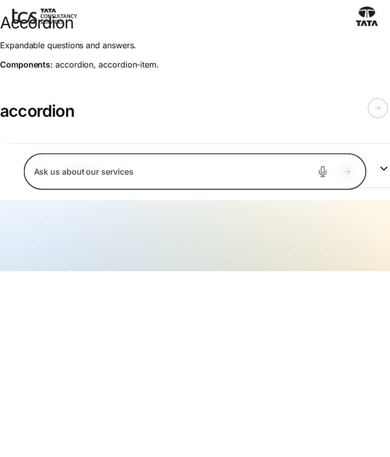
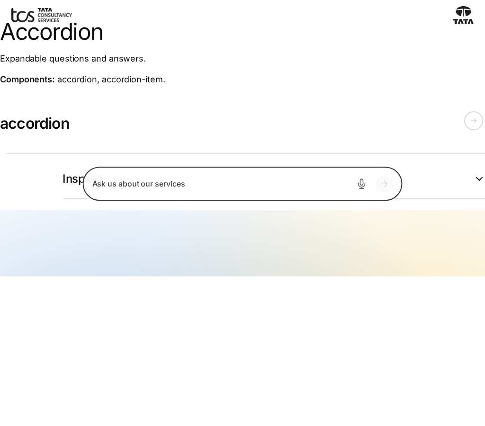
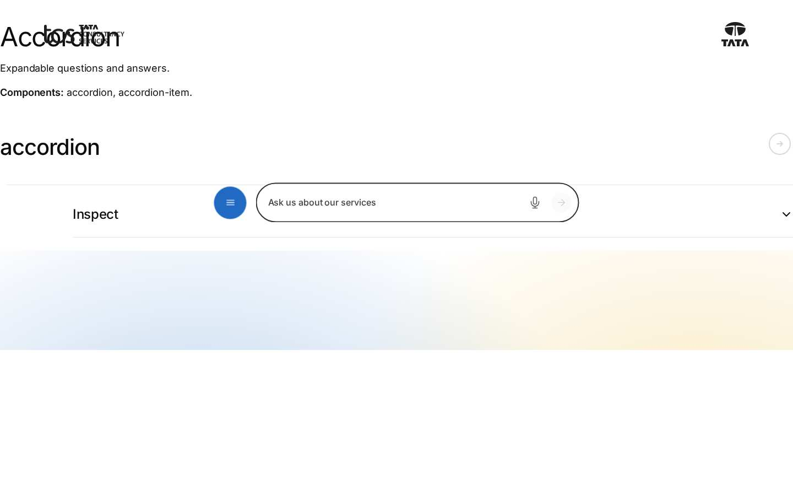
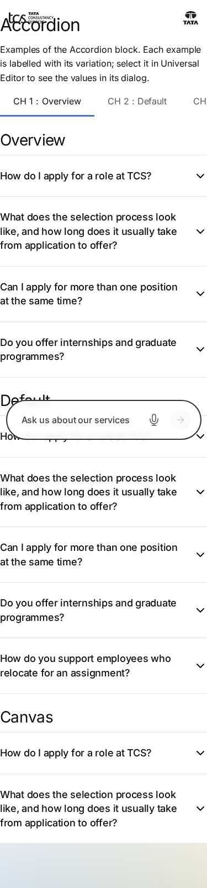
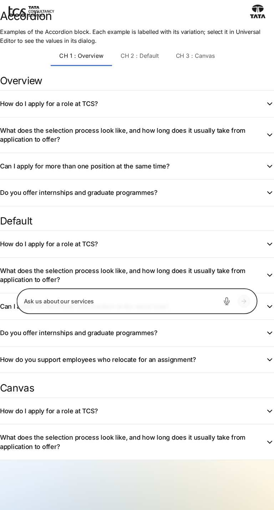
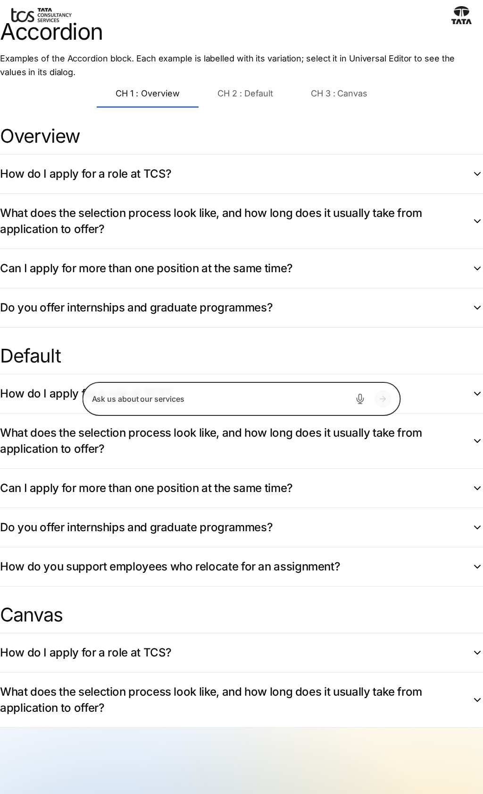
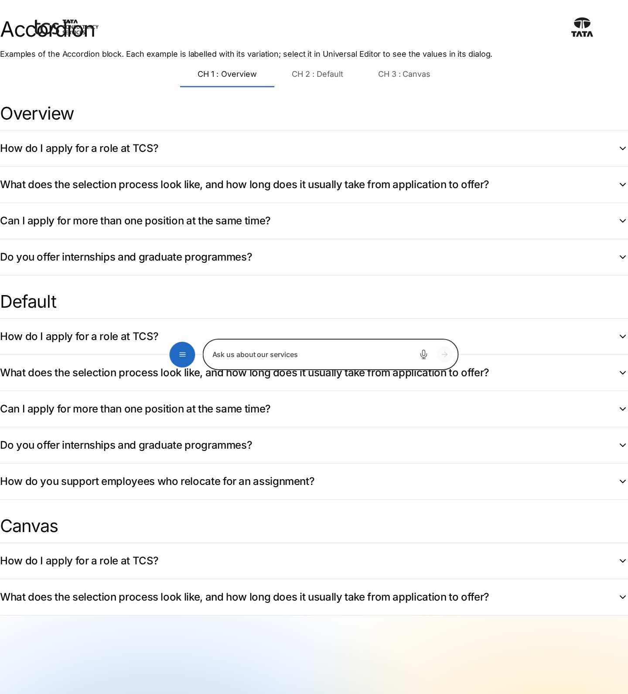

# Accordion Block — Test Coverage

| Attribute | Value |
| --- | --- |
| Document ID | DEV-T-accordion |
| Audience | Developers, technical leads, block owners, AI coding agents |
| Purpose | Unit tests, automated reference-page checks and manual test guidance for the block |
| Scope | — |
| Prerequisites | — |
| Owner | Technical Lead / Block Owner (proposed) |
| Approver | Product Owner (to be confirmed) |
| Version | 1.0 |
| Status | Draft for review |
| Last updated | 13 November 2026 |
| Last validated | 13 November 2026 |
| Source files | — |
| Related documents | — |
| Related AEM paths | — |

## Contents

- [Unit tests](#unit-tests)
- [Automated checks of the block library pages (executed 13 November 2026)](#automated-checks-of-the-block-library-pages-executed-13-november-2026)
- [Manual test guidance (block README)](#manual-test-guidance-block-readme)
- [Screenshots](#screenshots)
- [Known limitations](#known-limitations)
- [Open items](#open-items)
- [Change history](#change-history)

## Unit tests

No unit test is specific to this block (shared tests: test/models, test/items, test/docs, test/motion).

## Automated checks of the block library pages (executed 13 November 2026)

Per page: HTTP status and horizontal overflow at 375 / 768 / 1024 / 1440 px, console errors, failed requests and DOM accessibility checks at 1440 px (evidence: [screenshot register](../../../SCREENSHOT-REGISTER.md)).

| Page | 375 / 768 / 1024 / 1440 | Console errors | Failed requests | Accessibility (DOM) |
| --- | --- | --- | --- | --- |
| /design-block-master/en/block-library/accordion | ok / ok / ok / ok | 8 | 8 | 0 img no alt, 0 unnamed buttons, 1 heading skips |
| /design-block-master/en/block-library/accordion/accordion | ok / ok / ok / ok | 4 | 4 | 0 img no alt, 0 unnamed buttons, 0 heading skips |

## Manual test guidance (block README)

| Test ID | Scenario | Configuration | Expected result |
| ------- | -------- | ------------- | --------------- |
| ACCORDION-QA-01 | Default rendering | Four items with Summary and Text | Four closed rows with chevrons between dividers; no row for the dialog tab |
| ACCORDION-QA-02 | Open / close | Click a summary twice | Opens (chevron up), then closes; other items unchanged |
| ACCORDION-QA-03 | Several open | Open items 1 and 3 | Both stay open |
| ACCORDION-QA-04 | Missing Summary | One item without Summary | Item absent on the page; dashed placeholder in Universal Editor |
| ACCORDION-QA-05 | Missing Text | One item without Text | Item renders; opens to an empty body |
| ACCORDION-QA-06 | Anchor ID | `anchor-careers-faq` | Block has `id="anchor-careers-faq"`; `#anchor-careers-faq` scrolls to it |
| ACCORDION-QA-07 | Hide block | Hide block on | Hidden on the page; faded and outlined in edit mode |
| ACCORDION-QA-08 | Animation | Animation Type Fade left | Items appear one after another on scroll; nothing plays in edit mode or with reduced motion |
| ACCORDION-QA-09 | Multiple instances | Two Accordions on one page | Independent; data-layer ids `accordion-1`, `accordion-2` (without Anchor IDs) |
| ACCORDION-QA-10 | Viewports | 375px, 768px, 1440px | Same layout; summary 1.125rem below 900px, 1.5rem from 900px |
| ACCORDION-QA-11 | Keyboard | Tab, Enter, Space | Focus outline visible; Enter and Space toggle |
| ACCORDION-QA-12 | Data layer | Open, then close item 1 | `cmp:show` then `cmp:hide` with `dc:title` = summary; no `cmp:click` for the summary |
| ACCORDION-QA-13 | Link in an answer | Click a link in an open body | `cmp:click` with `xdm:linkURL` |
| ACCORDION-QA-14 | Regression | Existing library page `block-library/accordion/accordion` | All items render; no empty item from the tab row |
| ACCORDION-QA-15 | Reduced motion | OS reduced motion on | No colour or chevron transition |

Test cases: [05-quality-assurance/test-cases/blocks/accordion](../../../05-quality-assurance/test-cases/blocks/accordion/ACCORDION-TEST-CASES.md).

## Screenshots

*Figure: Accordion: accordion — mobile 375 × 812 (/design-block-master/en/block-library/accordion, captured 2026-11-08).*

*Figure: Accordion: accordion — tablet 768 × 900 (/design-block-master/en/block-library/accordion, captured 2026-11-08).*

*Figure: Accordion: accordion — small desktop 1024 × 900 (/design-block-master/en/block-library/accordion, captured 2026-11-08).*

*Figure: Accordion: accordion — desktop 1440 × 900 (/design-block-master/en/block-library/accordion, captured 2026-11-08).*

*Figure: Accordion: accordion/accordion — mobile 375 × 812 (/design-block-master/en/block-library/accordion/accordion, captured 2026-11-08).*

*Figure: Accordion: accordion/accordion — tablet 768 × 900 (/design-block-master/en/block-library/accordion/accordion, captured 2026-11-08).*

*Figure: Accordion: accordion/accordion — small desktop 1024 × 900 (/design-block-master/en/block-library/accordion/accordion, captured 2026-11-08).*

*Figure: Accordion: accordion/accordion — desktop 1440 × 900 (/design-block-master/en/block-library/accordion/accordion, captured 2026-11-08).*

## Known limitations

- None recorded for this document.

## Open items

- None.

## Change history

| Version | Date | Author | Change |
| --- | --- | --- | --- |
| 1.0 | 13 November 2026 | Delivery team (documentation program) | First version of the role-specific documentation (master documentation prompt), generated from the repository and the published reference pages |
