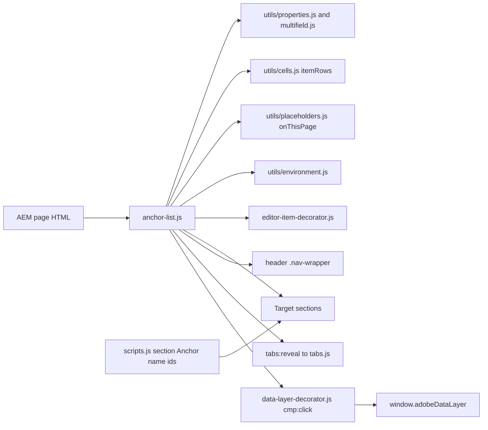
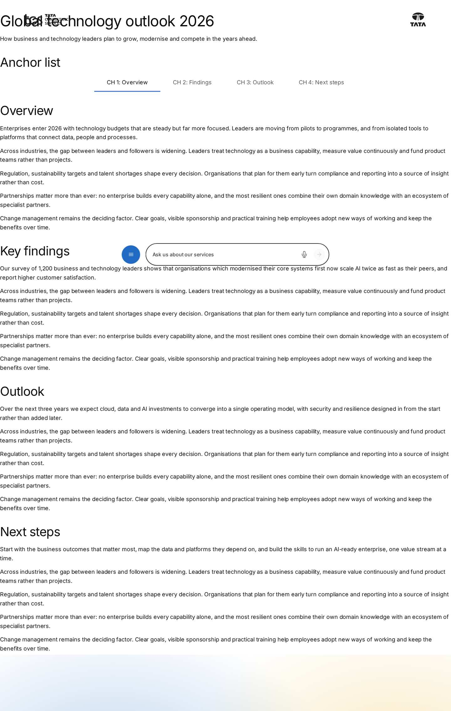
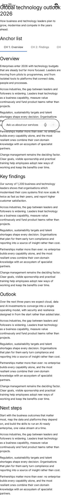

# Anchor List Block — Developer Guide

| Attribute | Value |
| --- | --- |
| Document ID | DEV-B-anchor-list |
| Audience | Developers, technical leads, block owners, AI coding agents |
| Purpose | How the Anchor List block is built: files, model, structure, behaviour, variations, tests and limitations |
| Scope | blocks/anchor-list/ and its components anchor-list, anchor-list-item |
| Prerequisites | — |
| Owner | Technical Lead / Block Owner (proposed) |
| Approver | Product Owner (to be confirmed) |
| Version | 1.0 |
| Status | Draft for review |
| Last updated | 8 November 2026 |
| Last validated | 2026-11-08 (model, files, imports from the code; reference pages from the live site) |
| Source files | blocks/anchor-list/README.md, blocks/anchor-list/_anchor-list.json, blocks/anchor-list/anchor-list.css, blocks/anchor-list/anchor-list.js |
| Related documents | [Variations](./ANCHOR-LIST-VARIATIONS.md), [Test coverage](./ANCHOR-LIST-TEST-COVERAGE.md), [Authoring guide](../../../03-authoring/components/anchor-list/ANCHOR-LIST-AUTHORING-GUIDE.md) |
| Related AEM paths | /content/tcs-corp/design-block-master/en/block-library/anchor-list, /content/tcs-corp/design-block-master/en/block-library/anchor-list/anchor-list, /content/tcs-corp/design-block-master/en/block-library/anchor-list/anchor-list-sticky |

## Contents

- [Summary](#summary)
- [Overview](#overview)
- [Source files](#source-files)
- [Components, models and filters](#components-models-and-filters)
- [Fields](#fields)
- [Dependencies](#dependencies)
- [For Developers](#for-developers)
- [Extending the Block](#extending-the-block)
- [Responsive Behavior](#responsive-behavior)
- [Accessibility](#accessibility)
- [Data Layer and Analytics](#data-layer-and-analytics)
- [Performance Considerations](#performance-considerations)
- [Security and Privacy](#security-and-privacy)
- [For Architects](#for-architects)
- [Troubleshooting](#troubleshooting)
- [Known limitations of the block](#known-limitations-of-the-block)
- [Change history of the block](#change-history-of-the-block)
- [Reference pages](#reference-pages)
- [Coverage of the required topics](#coverage-of-the-required-topics)
- [Screenshots](#screenshots)
- [Known limitations](#known-limitations)
- [Open items](#open-items)
- [Change history](#change-history)

## Summary

| Attribute | Value |
| --- | --- |
| Block | Anchor List |
| Folder | `blocks/anchor-list` |
| Type | Container |
| Category | navigation |
| Status | Active |
| Purpose | In-page navigation to section anchors, optionally sticky |
| Variations (summary) | Sticky or static; Anchor Link items |
| Children | anchor-list-item (Anchor Link) |
| Code size | 294 lines of JS and CSS |

## Overview

- **Business purpose:** help visitors navigate long pages (reports, solution pages, case studies): show the chapters, jump to one, and always show where they are.
- **User experience:** a centred row of grey links; the current chapter is dark, semibold and underlined in brand blue. A click scrolls smoothly to the chapter (instantly with reduced motion) and moves keyboard focus there. On narrow screens the row scrolls sideways and keeps the current link in view.
- **Templates / page types:** any page; most useful on long article, report and landing pages (used on the curated case study and story pages).
- **Data source:** authored links only; targets are ids on the same page (section Anchor names, block Anchor IDs, heading ids). The navigation's accessible name comes from the placeholder `onThisPage`.
- **Related blocks:** Sections (their Anchor name), every block's Anchor ID (Additional tab), Tabs Container (a target inside a tab opens its tab), Page Header (usually directly above).
- **When to use:** pages with three or more substantial sections; when readers benefit from seeing their position.
- **When not to use:** navigation between pages (every link is `#anchor`); switching content in place (Tabs Container); short pages with one or two sections; many links (they don't wrap and scroll sideways without a visible scrollbar).
- **Realistic use cases:** the "Global technology outlook 2026" report with "CH 1: Overview" to "CH 4: Next steps", pinned while reading; a service page with Overview, Capabilities, Case studies, Contact.

## Source files

| File | Link |
| --- | --- |
| `README.md` | [GitHub](https://github.com/sradha-tcs/tcs-corp/blob/main/blocks/anchor-list/README.md) |
| `_anchor-list.json` | [GitHub](https://github.com/sradha-tcs/tcs-corp/blob/main/blocks/anchor-list/_anchor-list.json) |
| `anchor-list.css` | [GitHub](https://github.com/sradha-tcs/tcs-corp/blob/main/blocks/anchor-list/anchor-list.css) |
| `anchor-list.js` | [GitHub](https://github.com/sradha-tcs/tcs-corp/blob/main/blocks/anchor-list/anchor-list.js) |

## Components, models and filters

| Component | Title | Resource type | Template name | Model | Children allowed |
| --- | --- | --- | --- | --- | --- |
| `anchor-list` | Anchor List | `core/franklin/components/block/v1/block` | Anchor List | `anchor-list` | anchor-list-item |
| `anchor-list-item` | Anchor Link | `core/franklin/components/block/v1/block/item` | Anchor Link | `anchor-list-item` | — |

## Fields

The Additional tab fields (anchor, hide, padding, margin, animation) are common to the blocks and described in the [content modeling guide](../../markdown/CONTENT-MODELING-GUIDE.md).

### Anchor List (`anchor-list`)

| Tab | Label | Property | Type | Required in model | Default | Options | Visibility |
| --- | --- | --- | --- | --- | --- | --- | --- |
| Content | Links | `anchors` | container | No | — | — | — |
| Content | Links › Link Title | `label` | text | No | — | — | — |
| Content | Links › Anchor Name | `anchorName` | text | No | — | — | — |
| Content | Sticky | `sticky` | boolean | No | `false` | — | — |

### Anchor Link (`anchor-list-item`)

| Tab | Label | Property | Type | Required in model | Default | Options | Visibility |
| --- | --- | --- | --- | --- | --- | --- | --- |
| Link | Link Title | `label` | text | Yes | — | — | — |
| Link | Anchor Name | `anchorName` | text | No | — | — | — |

"Required in model" is the model's `required` flag; whether a field is required in practice is stated in the authoring guide where it is known.

## Dependencies

| Import |
| --- |
| `../../scripts/aem.js` |
| `../../scripts/scripts.js` |
| `../../decorators/editor-item-decorator.js` |
| `../../utils/cells.js` |
| `../../utils/environment.js` |
| `../../utils/multifield.js` |
| `../../utils/properties.js` |
| `../../utils/placeholders.js` |

## For Developers

<!-- BEGIN GENERATED: files (npm run build:docs) -->

```text
blocks/anchor-list/
├── README.md
├── _anchor-list.json
├── anchor-list.css
└── anchor-list.js
```

| Decorator/Utility | Purpose | Execution or dependency point |
| ----------------- | ------- | ----------------------------- |
| [`scripts/aem.js`](https://github.com/sradha-tcs/tcs-corp/blob/main/scripts/aem.js) | Edge Delivery core library (block loading, CSS, metadata, optimized pictures) | `anchor-list.js`: { toClassName } |
| [`scripts/scripts.js`](https://github.com/sradha-tcs/tcs-corp/blob/main/scripts/scripts.js) | Page decoration (moveInstrumentation and shared page helpers) | `anchor-list.js`: { moveInstrumentation } |
| [`decorators/editor-item-decorator.js`](https://github.com/sradha-tcs/tcs-corp/blob/main/decorators/editor-item-decorator.js) | `buildEditorItems`, `editorItemHint` (in Universal Editor, an item the block doesn't render yet, e.g. a CTA just added, as a dashed placeholder the author can select; styles in `styles/lazy-styles.css`; the hint loaded o | `anchor-list.js`: { buildEditorItems, editorItemHint } |
| [`utils/cells.js`](https://github.com/sradha-tcs/tcs-corp/blob/main/utils/cells.js) | `itemRows`, `KEY_VALUE_ITEM`, `FIELD_ROW_ITEM` (the item rows of a block: by model in the editor, by their cells on the page), `withoutTabCells` (drops the empty cell AEM renders for each dialog tab of an item model), `m | `anchor-list.js`: { KEY_VALUE_ITEM, itemRows, withoutTabCells } |
| [`utils/environment.js`](https://github.com/sradha-tcs/tcs-corp/blob/main/utils/environment.js) | `prefersReducedMotion`, `scrollBehavior`, `isEditing`, `isInEditor`, `isAuthor` (the page is rendered by AEM author, which has no query index) | `anchor-list.js`: { isEditing, scrollBehavior } |
| [`utils/multifield.js`](https://github.com/sradha-tcs/tcs-corp/blob/main/utils/multifield.js) | `readMultifieldItems` (composite multifield items, authored before item children) | `anchor-list.js`: { readMultifieldItems } |
| [`utils/properties.js`](https://github.com/sradha-tcs/tcs-corp/blob/main/utils/properties.js) | `readProperties`, `textOf`, `isOn`, `isOnByDefault` (a toggle that defaults to on), `optionOf`, `normalizeKey`, `textSource` (key-value block properties) | `anchor-list.js`: { isOn, readProperties } |
| [`utils/placeholders.js`](https://github.com/sradha-tcs/tcs-corp/blob/main/utils/placeholders.js) | `getPlaceholders`, `loadPlaceholders`, `fillPlaceholder` (UI text from the locale's placeholders, with English fallbacks) | `anchor-list.js`: { getPlaceholders } |

<!-- END GENERATED: files -->

- **JavaScript (`anchor-list.js`):** reads the properties (`readProperties`), the Links multifield (`readAnchors`) and the Anchor Link items (`itemRows(block, ['anchor-list-item'], KEY_VALUE_ITEM)`, `readAnchorRows` with `ITEM_LAYOUT = [null, 'label', 'anchorName']`), builds the navigation, handles clicks, the current link and Sticky pinning (`pinWhenScrolled`).
- **CSS (`anchor-list.css`):** the row (`overflow-x: auto`, hidden scrollbar), link states, the `sticky` background and `anchor-list-pinned`; one breakpoint (900px).
- **Input DOM (what AEM delivers):** key-value rows (`sticky | true`, `anchors | …`) and, after them, one row per Anchor Link with three cells: the empty cell of its Link dialog tab, Link Title, Anchor Name.

```html
<div class="anchor-list">
  <div><div>sticky</div><div>true</div></div>
  <div><div></div><div>CH 1: Overview</div><div>overview</div></div>
  <div><div></div><div>CH 2: Findings</div><div>findings</div></div>
</div>
```

- **Rendered DOM:**

```html
<div class="anchor-list sticky block">
  <nav class="anchor-list-nav" aria-label="On this page">
    <ul class="anchor-list-items">
      <li><a class="anchor-list-link" href="#overview" aria-current="location">CH 1: Overview</a></li>
      <li><a class="anchor-list-link" href="#findings">CH 2: Findings</a></li>
    </ul>
  </nav>
</div>
```

While pinned the block also has `anchor-list-pinned` and an inline `top`, and its wrapper an inline `min-height`. Instrumentation: the multifield's on the `ul`, each Anchor Link row's on its `li`; incomplete Anchor Links become `li.editor-item` placeholders in the editor.

- **Click flow:** `preventDefault`, mark current, lock the scroll-driven highlight until `scrollend` (or 3 seconds); if the target exists, dispatch `tabs:reveal` (bubbling) on it so a Tabs Container opens the tab holding it, set its `scroll-margin-top` (fixed header height + list height when sticky + 16px), `scrollIntoView`, `history.replaceState` with the hash, focus the target.
- **Current link:** on scroll (requestAnimationFrame-throttled), resize, `load`, body size changes (`ResizeObserver`) and `hashchange`: the last visible target whose top has passed the offset; the last link at the end of the page; the first link before any target; hidden targets (sections still loading) are skipped. A hash matching a link marks it current even without a target on the page.
- **Sticky pinning:** pinned when the wrapper is shown, not in edit mode (`isEditing`), and its top is at or above the header bottom; re-evaluated on scroll, resize, body size changes and the editor's edit / preview switch (a `MutationObserver` on the `html` class).
- **Error handling:** missing targets are tolerated (the link only becomes current); with no links the block returns after rendering the empty `nav` and adds no listeners.
- **Exported functions:** the default `decorate` only.
- **Parent / child contracts:** depends on `header .nav-wrapper` (position and height) and on section ids from `scripts/scripts.js` (Anchor name → `id`, de-duplicated with `availableId`); listens to nothing from other blocks; emits `tabs:reveal` (handled in `blocks/tabs/tabs.js`).
- **Data-layer hooks:** none in the block.

## Extending the Block

1. **Add a field:** edit `blocks/anchor-list/_anchor-list.json` (Content / Additional tabs; at most three short tabs), run `npm run build:json` and `npm run lint`. Block properties are key-value rows read by name, so new block fields don't shift anything.
2. **Item fields:** a new Anchor Link field adds a cell to every item row: update `ITEM_LAYOUT` and the cell reading in `readAnchorRows`, and the `anchor-list-item` entry in `test/items/item-rows.test.mjs`. Item rows must keep 1 or 3+ cells to be told from the block's two-cell property rows (`KEY_VALUE_ITEM`).
3. **Delivery rules:** names ending in Text, Title, Type, Alt or MimeType collapse into their base field; grouped fields (`prefix_name`) aren't delivered in key-value blocks; no sample content in definition templates.
4. **Animation:** the block has no animation fields; adding them means adding the block to `CONTENT_TARGETS` (or animating the block as a whole) and removing it from `NO_ANIMATION` in `test/motion/motion.test.mjs`.
5. **Responsive / accessibility:** keep the scroll offset (`scrollOffset`) in step with new fixed elements; keep `aria-current` and the focus move.
6. **Data layer:** links are tracked centrally; scroll-driven changes would need `pushComponentEvent` (`utils/analytics.js`).
7. **Backward compatibility and docs:** keep reading the `anchors` multifield; update the block library pages `block-library/anchor-list/anchor-list` and `anchor-list-sticky`, this README (`npm run build:docs`), and run `npm run build:modules` after changing imports.

## Responsive Behavior

| Viewport | Layout | Image behavior | Interaction behavior |
| -------- | ------ | -------------- | -------------------- |
| Below 900px | Links with 0.75rem × 1.5rem padding (`--space-300` / `--space-600`); the row overflows sideways when needed (hidden scrollbar) | No images | The row scrolls to centre the current link; a sticky row pins below the fixed site header |
| 900px to 1199px | Link padding 0.75rem × 2.5rem (`--space-1000`) | No images | A sticky row pins below the fixed site header |
| 1200px and wider | As from 900px; centred row as wide as its links | No images | The site header isn't fixed (`blocks/header/header.css`), so a sticky row pins at the top of the screen |

## Accessibility

- **Semantic HTML:** a `nav` landmark (`aria-label` from placeholder `onThisPage`, fallback "On this page") with a list of real `#anchor` links.
- **Current location:** `aria-current="location"` on the current link, set from the scroll position, a click or the URL hash.
- **Keyboard and focus:** Tab moves through the links; Enter scrolls to the chapter and moves focus to it (`tabindex="-1"` is added to the target if it has none, focus without a second scroll). Focus shows a 2px brand outline inset by 3px.
- **Announcements:** none besides the native link and `aria-current` semantics.
- **Reduced motion:** smooth scrolling (the target and the row's sideways scroll) becomes instant (`scrollBehavior` in `utils/environment.js`); colour transitions are removed.
- **Contrast:** links use `--color-text-secondary`, the current link `--color-text-default` with a `--color-border-brand` underline (see Known Limitations for a sticky list on dark sections).
- **Empty state:** with no complete link the block renders an empty, labelled navigation.
- **Reflow:** the row scrolls sideways when it doesn't fit; the scrollbar is hidden.

Author responsibilities:

- Give each target section a visible heading matching its link; keep the links few and short.
- Don't use the Anchor List as the only way to reach important content.

Developer responsibilities:

- Keep the `nav` label, `aria-current` and the focus move; keep the scroll offset in step with fixed page chrome.
- Keep the placeholder key `onThisPage` in every locale.

| Key | Expected behavior |
| --- | ----------------- |
| Tab / Shift+Tab | Moves to the next / previous chapter link |
| Enter | Marks the link current, scrolls to the chapter, updates the URL hash and moves focus to the chapter |

## Data Layer and Analytics

- **Component:** `@type` `tcs-corp/components/anchor-list`, id = the block's id (Anchor ID), else `anchor-list-{n}`; no `dc:title` (the block has no heading).
- **Variation / item positions:** not recorded (no `data-cmp-position`).
- **Impressions:** no impression event; scroll-driven changes of the current link are not tracked.
- **Link tracking:** link clicks are captured centrally by `decorators/data-layer-decorator.js`; the block pushes nothing itself.

| Trigger | Data-layer event | Required properties | Analytics behavior |
| ------- | ---------------- | ------------------- | ------------------ |
| Block decorated (page load) | component state | `component.{id}`: `@type`, `parentId` | Inventory of the blocks on the page |
| Chapter link clicked | `cmp:click` | `eventInfo.path` `component.{id}`, `interaction` `link`, `dc:title` = Link Title, `xdm:linkURL` (page URL with `#anchor`), `xdm:linkType` `other`, `breakpoint` | Which chapters readers jump to |

The intended flow is Adobe Client Data Layer → Adobe Data Collection (Tags) → AEP Web SDK → Edge Network → Analytics / CJA, but Tags and the Web SDK aren't configured yet (blocked: measurement plan). No consent mechanism is implemented.

## Performance Considerations

- Decorated with its section; awaits the placeholders (one cached request per page) and, in the editor only, the hint.
- No images or dynamic imports.
- Listeners: passive `scroll`, `resize`, `load`, `scrollend`, `hashchange` on `window` and a `ResizeObserver` on `document.body`, all throttled with `requestAnimationFrame`; Sticky adds its own scroll / resize handlers, a `ResizeObserver` and a `MutationObserver` on `html`. No listeners when there are no links.
- Layout shift: the wrapper keeps the block's height while pinned, and pinning waits until the section is shown (handover 2.13: layout shift reduced from 0.35 to 0.006 on article pages with a chapter list).

## Security and Privacy

- Link targets are normalized with `toClassName`, so `href` is always `#` plus letters, digits and hyphens; link text is set with `textContent`.
- The URL hash is read (decoded and normalized) only to choose the current link; nothing is stored.
- No external content; data-layer events carry the link text and URL only.

## For Architects

- **Role:** client-side in-page navigation over authored links; no data source.
- **Content model:** key-value block (`sticky`, legacy `anchors` multifield) with item children (`anchor-list-item`: Link Title, Anchor Name).
- **Rendering and data:** decoration of delivered HTML; targets resolved by id at runtime.
- **Dependencies:** `scripts/aem.js` (`toClassName`), `scripts/scripts.js` (`moveInstrumentation`), `decorators/editor-item-decorator.js`, `utils/cells.js`, `utils/environment.js`, `utils/multifield.js`, `utils/properties.js`, `utils/placeholders.js`.
- **Data layer / Web SDK / Target:** link clicks in the Adobe Client Data Layer; Tags / Web SDK not configured; no Target.
- **Consent and identity:** none implemented; no personal data.
- **Caching / performance:** content in the page HTML (CDN cached); the placeholders sheet is loaded once per page.
- **Security:** link targets are normalized to class-name form (`#` + letters, digits, hyphens).
- **Scalability:** one scroll / resize handler set per instance (two with Sticky).



## Troubleshooting

| Symptom | Likely cause | Diagnostic steps | Resolution | Verification |
| ------- | ------------ | ---------------- | ---------- | ------------ |
| A link only underlines itself | No element with the link's anchor (Anchor name missing, different or suffixed `-2`) | `document.getElementById('<anchor>')` in the console; compare the section's id | Match the names; keep them unique | The link scrolls |
| Heading hidden after a click | Another fixed element besides the header and the list | Look for fixed banners; compare 375px and 1440px | Remove it or escalate to development | Heading visible below the row |
| Sticky doesn't pin in the editor | Pinning is off in edit mode by design | Switch to Preview | Test in Preview or on the preview URL | Row pins |
| Wrong link highlighted | Links not in page order; a short last chapter; click lock until the scroll ends | Compare link and section order | Reorder the links | Highlight follows the scroll |
| Links off screen on mobile | Too many or long titles; hidden scrollbar | Check at 375px | Shorten titles or reduce links | All links reachable, current one in view |
| A link is missing | Anchor Link without Link Title | Content tree; editor placeholder | Fill the Link Title | The link renders |
| Page jumps when the row pins | Margins set in the Additional tab | Check the block's classes | Use padding or Default spacing | No visible jump |
| English "On this page" on a localized page | `onThisPage` missing in the locale sheet | `/{locale}/placeholders.json` | Add and publish the key | Localized label in the `nav` |

Evidence to collect (no secrets): page URL with the hash, viewport, a screenshot, the block's rendered HTML, the target element's id, console errors.

## Known limitations of the block

| Limitation | Impact | Workaround | Planned correction |
| ---------- | ------ | ---------- | ------------------ |
| Same-page links only | Can't link to other pages | Use other link blocks | Not planned |
| No visible scrollbar or scroll buttons when links overflow | Off-screen links may be missed | Few, short Link Titles | Not recorded |
| The scroll offset counts only the site header and the list | Other fixed elements can cover the target | Avoid extra fixed elements | Not recorded |
| At the end of the page the highlight jumps to the last link | Short final chapters are highlighted only at the end | Accept, or lengthen the last chapter | Not recorded |
| Scroll-driven highlight changes aren't in the data layer | No reading-progress analytics | None | Not recorded |
| An empty Anchor List renders an empty, labelled `nav` | Empty landmark | Add links or remove the block | Not recorded |
| Listeners aren't removed when Universal Editor re-renders the block (audit D-C-19) | Editor only, no published impact | Reload the editor | Deferred |
| A sticky list keeps `--color-bg-default` while a dark section's theme contract turns the link tokens light (`styles/styles.css`) | Links may lack contrast on a sticky list in a Dark / Dark green section | Check on the page; avoid Sticky in dark sections | Not recorded |
| Several Anchor Lists on a page share the label "On this page" | Landmarks not told apart | One Anchor List per page | Not recorded |

## Change history of the block

| Version | Change | Source | Date |
| ------- | ------ | ------ | ---- |
| Not recorded | README generated from verified implementation and approved handover documentation | Repository review | Not recorded |
| Handover 2.10 | Anchor List links are Anchor Link items added with Add, instead of the composite multifield | docs/handover revision history | 17 October 2026 |
| Handover 2.13 | The sticky Anchor List no longer pins while its section is hidden (layout shift 0.35 → 0.006 on article pages with a chapter list) | docs/handover revision history | 17 October 2026 |
| Handover 2.17 | Item children in the Anchor List field specification | docs/handover revision history | 18 October 2026 |

## Reference pages

| Kind | Page | Live URL |
| --- | --- | --- |
| Block library | /design-block-master/en/block-library/anchor-list | https://main--tcs-corp--sradha-tcs.aem.live/design-block-master/en/block-library/anchor-list |
| Block library | /design-block-master/en/block-library/anchor-list/anchor-list | https://main--tcs-corp--sradha-tcs.aem.live/design-block-master/en/block-library/anchor-list/anchor-list |
| Block library | /design-block-master/en/block-library/anchor-list/anchor-list-sticky | https://main--tcs-corp--sradha-tcs.aem.live/design-block-master/en/block-library/anchor-list/anchor-list-sticky |
| Curated design page | /design-block-master/en/curated-design-pages/case-study | https://main--tcs-corp--sradha-tcs.aem.live/design-block-master/en/curated-design-pages/case-study |
| Curated design page | /design-block-master/en/curated-design-pages/story | https://main--tcs-corp--sradha-tcs.aem.live/design-block-master/en/curated-design-pages/story |

## Coverage of the required topics

| Topic | Where |
| --- | --- |
| Purpose | Overview |
| Source files | generated: Files |
| Model, definition, filters, children | generated: Components |
| Dependencies | generated: Dependencies |
| Authored input / rendered output / DOM transformation | For Developers |
| Configuration fields, defaults, required fields | generated: Fields |
| Variations | ANCHOR-LIST-VARIATIONS.md |
| Responsive behaviour | Responsive Behavior |
| Accessibility and keyboard | Accessibility |
| Analytics / data layer | Data Layer and Analytics |
| Performance | Performance Considerations |
| Security | Security and Privacy |
| Extending | Extending the Block |
| Known limitations | Known Limitations |
| Troubleshooting | Troubleshooting |
| Tests | ANCHOR-LIST-TEST-COVERAGE.md |
| SEO behaviour | Not recorded |
| Caching considerations | Not recorded (Edge Delivery default caching; no block-specific rule) |
| Ownership | Technical Lead / Block Owner (proposed) |

## Screenshots



*Figure: Anchor List block library page — desktop 1440 × 900 (/design-block-master/en/block-library/anchor-list/anchor-list, captured 2026-11-08).*



*Figure: Anchor List block library page — mobile 375 × 812 (/design-block-master/en/block-library/anchor-list/anchor-list, captured 2026-11-08).*


*Figure: Desktop rendering — The Anchor List at 1440 px below the page title 'Global technology outlook 2026' and its intro: a centred row of four grey links 'CH 1: Overview', 'CH 2: Findings', 'CH 3: Outlook', 'CH 4: Next steps'; 'CH 2: Findings' (page at #findings) dark, semibold, with a 3px brand-blue underline. (Sample content on the preview; callout letters as in the Field Entry Table; file screenshots/anchor-list-desktop-view.jpg) (handover screenshot; rendering at the time it was taken).*


*Figure: Tablet rendering — The viewport at 768 px scrolled into chapter 2 (Key findings): the sticky Anchor List pinned directly below the fixed site header, the four links with 'CH 2: Findings' underlined, the Key findings text below it. (Sample content on the preview; callout letters as in the Field Entry Table; file screenshots/anchor-list-tablet-view.jpg) (handover screenshot; rendering at the time it was taken).*


*Figure: Mobile rendering — The Anchor List at 375 px with the page at #outlook: the four chapter links in one line wider than the screen, scrolled sideways without a visible scrollbar so that 'CH 3: Outlook', underlined in brand blue, is in view. (Sample content on the preview; callout letters as in the Field Entry Table; file screenshots/anchor-list-mobile-view.jpg) (handover screenshot; rendering at the time it was taken).*


*Figure: Default Anchor List — The first section at 1440 px: the H1 'Global technology outlook 2026', the intro 'How business and technology leaders plan to grow, modernise and compete in the years ahead.' and below them the in-flow row of four chapter links, 'CH 1: Overview' underlined as current (Sticky off). (Sample content on the preview; callout letters as in the Field Entry Table; file screenshots/anchor-list-default.jpg) (handover screenshot; rendering at the time it was taken).*


*Figure: Sticky Anchor List — The viewport at 1440 px scrolled into chapter 3 (Outlook): the sticky Anchor List pinned at the top of the screen across the full width on a white background, 'CH 3: Outlook' underlined, the Outlook text below it. (Sample content on the preview; callout letters as in the Field Entry Table; file screenshots/anchor-list-sticky.jpg) (handover screenshot; rendering at the time it was taken).*


*Figure: Universal Editor canvas — The page at 1440 px in Universal Editor Edit mode (annotated preview, not a Universal Editor screenshot): the H1, the intro and the four-link Anchor List, with A on 'CH 4: Next steps', B on the current link, C on 'CH 2: Findings', D on the block and E on the Overview section below. (Annotated preview in editor mode with sample content; letters as in the annotations list, not a Universal Editor screenshot; file screenshots/anchor-list-authoring-view.jpg) (handover screenshot; rendering at the time it was taken).*


*Figure: Properties panel — The Anchor List properties panel: the Content tab with the Links multifield (two items with Link Title and Anchor Name) and the Sticky toggle, and the Additional tab. (Dialog reference generated from the component model, not a Universal Editor screenshot; file screenshots/anchor-list-properties-panel.jpg) (handover screenshot; rendering at the time it was taken).*

## Known limitations

- Universal Editor dialogs were not captured: no author access in this program (see the access blockers).

## Open items

- None.

## Change history

| Version | Date | Author | Change |
| --- | --- | --- | --- |
| 1.0 | 8 November 2026 | Delivery team (documentation program) | First version of the role-specific documentation (master documentation prompt), generated from the repository and the published reference pages |
