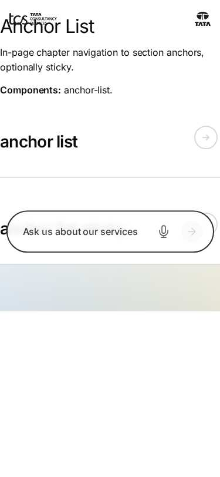
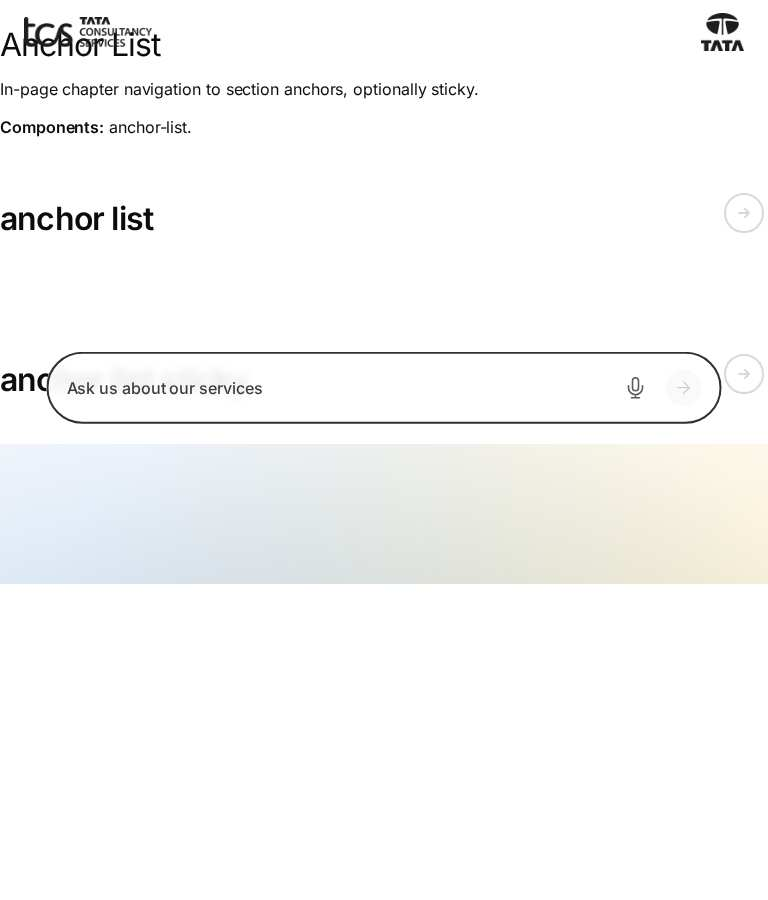
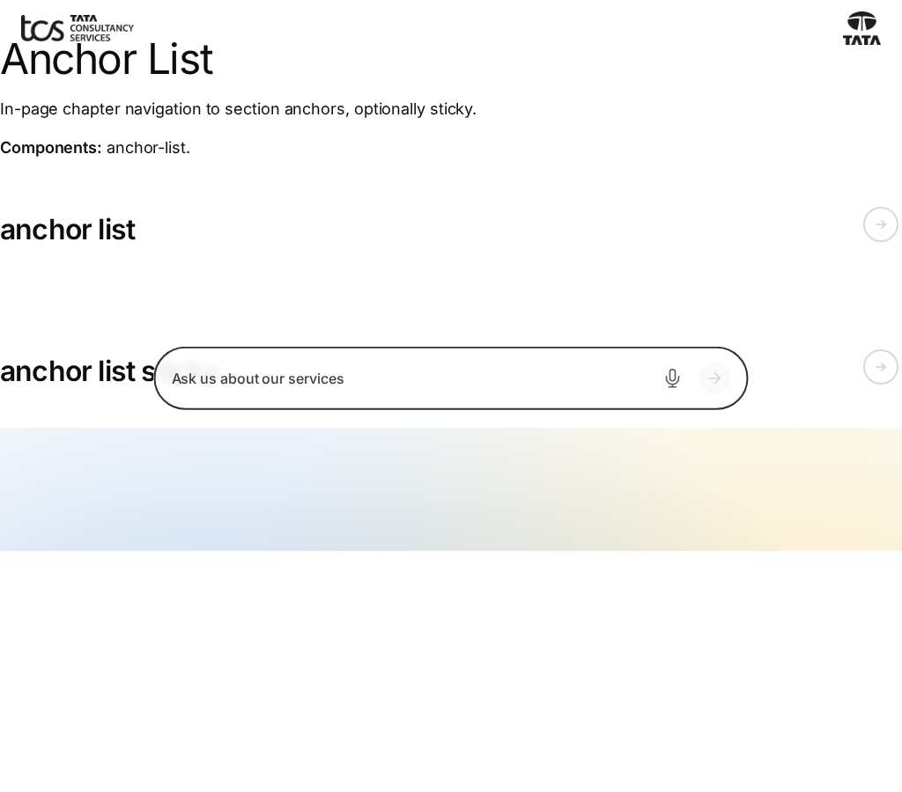
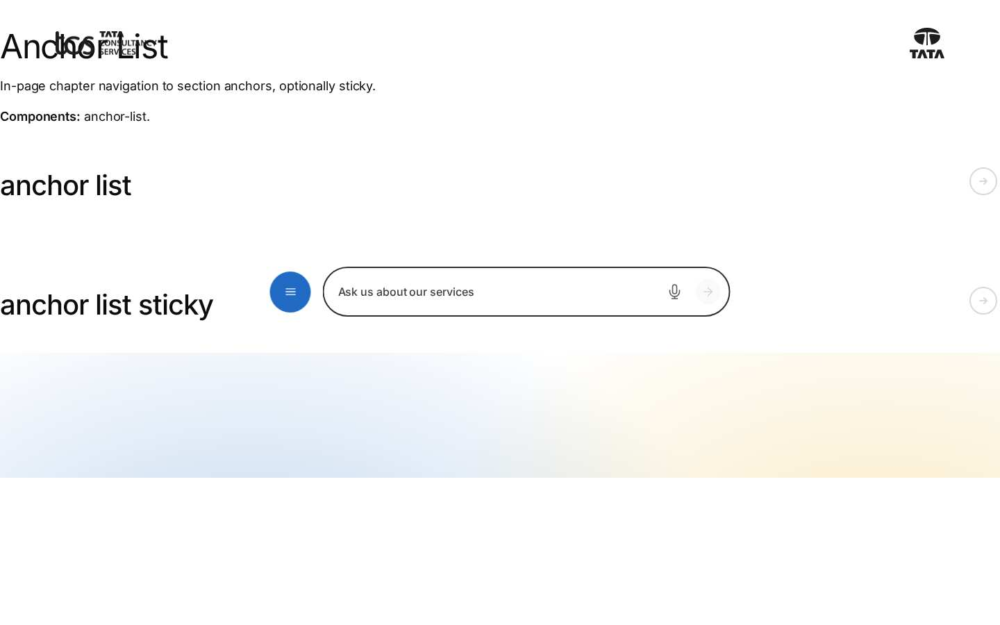
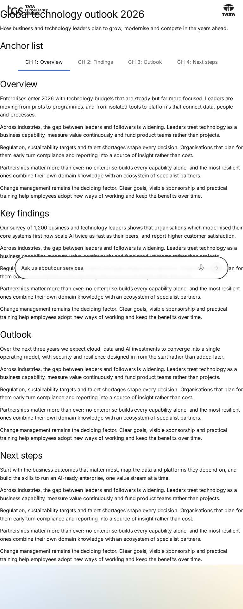
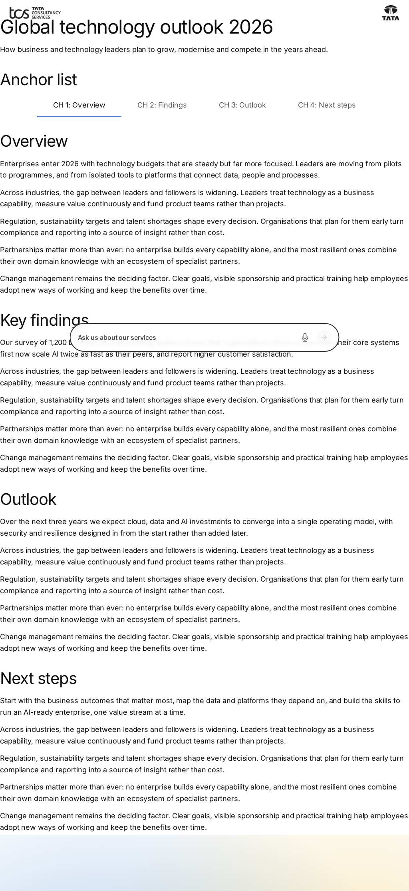
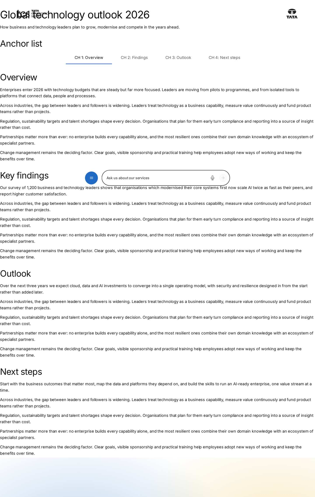
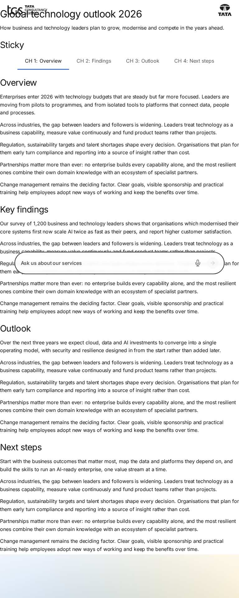
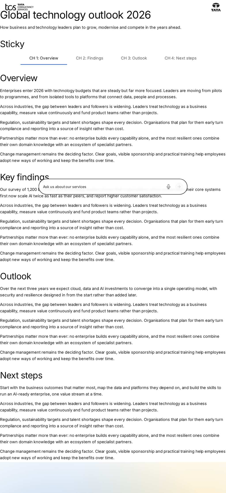
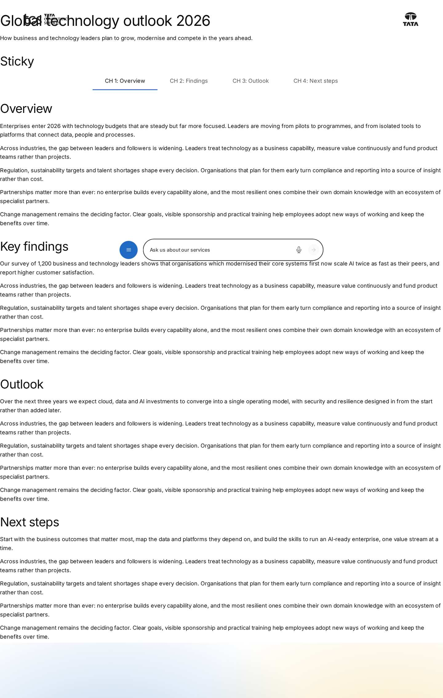

# Anchor List Block — Test Coverage

| Attribute | Value |
| --- | --- |
| Document ID | DEV-T-anchor-list |
| Audience | Developers, technical leads, block owners, AI coding agents |
| Purpose | Unit tests, automated reference-page checks and manual test guidance for the block |
| Scope | — |
| Prerequisites | — |
| Owner | Technical Lead / Block Owner (proposed) |
| Approver | Product Owner (to be confirmed) |
| Version | 1.0 |
| Status | Draft for review |
| Last updated | 8 November 2026 |
| Last validated | 8 November 2026 |
| Source files | — |
| Related documents | — |
| Related AEM paths | — |

## Contents

- [Unit tests](#unit-tests)
- [Automated checks of the block library pages (executed 8 November 2026)](#automated-checks-of-the-block-library-pages-executed-8-november-2026)
- [Manual test guidance (block README)](#manual-test-guidance-block-readme)
- [Screenshots](#screenshots)
- [Known limitations](#known-limitations)
- [Open items](#open-items)
- [Change history](#change-history)

## Unit tests

No unit test is specific to this block (shared tests: test/models, test/items, test/docs, test/motion).

## Automated checks of the block library pages (executed 8 November 2026)

Per page: HTTP status and horizontal overflow at 375 / 768 / 1024 / 1440 px, console errors, failed requests and DOM accessibility checks at 1440 px (evidence: [screenshot register](../../../SCREENSHOT-REGISTER.md)).

| Page | 375 / 768 / 1024 / 1440 | Console errors | Failed requests | Accessibility (DOM) |
| --- | --- | --- | --- | --- |
| /design-block-master/en/block-library/anchor-list | ok / ok / ok / ok | 12 | 12 | 0 img no alt, 0 unnamed buttons, 1 heading skips |
| /design-block-master/en/block-library/anchor-list/anchor-list | ok / ok / ok / ok | 4 | 4 | 0 img no alt, 0 unnamed buttons, 0 heading skips |
| /design-block-master/en/block-library/anchor-list/anchor-list-sticky | ok / ok / ok / ok | 4 | 4 | 0 img no alt, 0 unnamed buttons, 0 heading skips |

## Manual test guidance (block README)

| Test ID | Scenario | Configuration | Expected result |
| ------- | -------- | ------------- | --------------- |
| ANCHOR-LIST-QA-01 | Default rendering | Four Anchor Links, Sticky off | Centred row of four links; first current at the top |
| ANCHOR-LIST-QA-02 | Click | Click CH 2: Findings | Scrolls to `#findings` with the heading visible; hash updated without a new history entry; focus on the section |
| ANCHOR-LIST-QA-03 | Scroll highlight | Scroll through the chapters | Current link follows; last link current at the page end |
| ANCHOR-LIST-QA-04 | Hash on load | Open the page at `#outlook` | CH 3: Outlook current |
| ANCHOR-LIST-QA-05 | Sticky | Sticky on, Preview mode | Pins at the top from 1200px, below the header below 1200px; no jump; released above its place |
| ANCHOR-LIST-QA-06 | Sticky in edit mode | Sticky on, edit mode | Not pinned |
| ANCHOR-LIST-QA-07 | Missing target | Anchor Name without a matching id | The link only becomes current |
| ANCHOR-LIST-QA-08 | Empty Anchor Name | Link Title "CH 1: Overview", no Anchor Name | `href="#ch-1-overview"` |
| ANCHOR-LIST-QA-09 | Missing Link Title | Anchor Link without title | Not on the page; dashed placeholder in the editor |
| ANCHOR-LIST-QA-10 | Legacy multifield | Content authored with the Links multifield | Its links render before the Anchor Links |
| ANCHOR-LIST-QA-11 | Target in a tab | Anchor Name of an element inside a hidden tab | The tab opens and the page scrolls to the element |
| ANCHOR-LIST-QA-12 | Overflow | 375px, four links | Row scrolls sideways; current link centred |
| ANCHOR-LIST-QA-13 | Keyboard | Tab, Enter | Focus outline visible; focus moves to the chapter |
| ANCHOR-LIST-QA-14 | Reduced motion | OS reduced motion on | Instant scrolling, no transitions |
| ANCHOR-LIST-QA-15 | Data layer | Click a link | `cmp:click` with `interaction` `link`, `dc:title` = Link Title |
| ANCHOR-LIST-QA-16 | Multiple instances | Two Anchor Lists | Ids `anchor-list-1` / `anchor-list-2`; each highlights independently |
| ANCHOR-LIST-QA-17 | Regression | `block-library/anchor-list/anchor-list`, `anchor-list-sticky`, curated case study and story pages | Links and pinning as before; no layout shift when pinning |

Test cases: [05-quality-assurance/test-cases/blocks/anchor-list](../../../05-quality-assurance/test-cases/blocks/anchor-list/ANCHOR-LIST-TEST-CASES.md).

## Screenshots

*Figure: Anchor List: anchor-list — mobile 375 × 812 (/design-block-master/en/block-library/anchor-list, captured 2026-11-08).*

*Figure: Anchor List: anchor-list — tablet 768 × 900 (/design-block-master/en/block-library/anchor-list, captured 2026-11-08).*

*Figure: Anchor List: anchor-list — small desktop 1024 × 900 (/design-block-master/en/block-library/anchor-list, captured 2026-11-08).*

*Figure: Anchor List: anchor-list — desktop 1440 × 900 (/design-block-master/en/block-library/anchor-list, captured 2026-11-08).*

*Figure: Anchor List: anchor-list/anchor-list — mobile 375 × 812 (/design-block-master/en/block-library/anchor-list/anchor-list, captured 2026-11-08).*

*Figure: Anchor List: anchor-list/anchor-list — tablet 768 × 900 (/design-block-master/en/block-library/anchor-list/anchor-list, captured 2026-11-08).*

*Figure: Anchor List: anchor-list/anchor-list — small desktop 1024 × 900 (/design-block-master/en/block-library/anchor-list/anchor-list, captured 2026-11-08).*

*Figure: Anchor List: anchor-list/anchor-list — desktop 1440 × 900 (/design-block-master/en/block-library/anchor-list/anchor-list, captured 2026-11-08).*

*Figure: Anchor List: anchor-list/anchor-list-sticky — mobile 375 × 812 (/design-block-master/en/block-library/anchor-list/anchor-list-sticky, captured 2026-11-08).*

*Figure: Anchor List: anchor-list/anchor-list-sticky — tablet 768 × 900 (/design-block-master/en/block-library/anchor-list/anchor-list-sticky, captured 2026-11-08).*

*Figure: Anchor List: anchor-list/anchor-list-sticky — small desktop 1024 × 900 (/design-block-master/en/block-library/anchor-list/anchor-list-sticky, captured 2026-11-08).*

*Figure: Anchor List: anchor-list/anchor-list-sticky — desktop 1440 × 900 (/design-block-master/en/block-library/anchor-list/anchor-list-sticky, captured 2026-11-08).*

## Known limitations

- None recorded for this document.

## Open items

- None.

## Change history

| Version | Date | Author | Change |
| --- | --- | --- | --- |
| 1.0 | 8 November 2026 | Delivery team (documentation program) | First version of the role-specific documentation (master documentation prompt), generated from the repository and the published reference pages |
