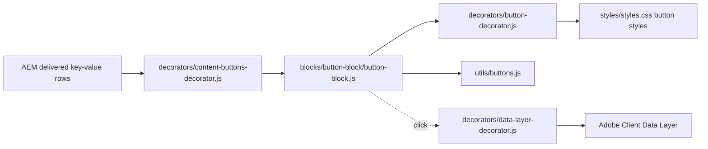
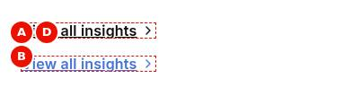

# Button Block — Developer Guide

| Attribute | Value |
| --- | --- |
| Document ID | DEV-B-button-block |
| Audience | Developers, technical leads, block owners, AI coding agents |
| Purpose | How the Button block is built: files, model, structure, behaviour, variations, tests and limitations |
| Scope | blocks/button-block/ and its components button-block |
| Prerequisites | — |
| Owner | Technical Lead / Block Owner (proposed) |
| Approver | Product Owner (to be confirmed) |
| Version | 1.0 |
| Status | Draft for review |
| Last updated | 8 November 2026 |
| Last validated | 2026-11-08 (model, files, imports from the code; reference pages from the live site) |
| Source files | blocks/button-block/README.md, blocks/button-block/_button-block.json, blocks/button-block/button-block.css, blocks/button-block/button-block.js |
| Related documents | [Variations](./BUTTON-BLOCK-VARIATIONS.md), [Test coverage](./BUTTON-BLOCK-TEST-COVERAGE.md), [Authoring guide](../../../03-authoring/components/button-block/BUTTON-BLOCK-AUTHORING-GUIDE.md) |
| Related AEM paths | — |

## Contents

- [Summary](#summary)
- [Overview](#overview)
- [Source files](#source-files)
- [Components, models and filters](#components-models-and-filters)
- [Fields](#fields)
- [Dependencies](#dependencies)
- [For Developers](#for-developers)
- [Extending the Block](#extending-the-block)
- [Responsive Behavior](#responsive-behavior)
- [Accessibility](#accessibility)
- [Data Layer and Analytics](#data-layer-and-analytics)
- [Performance Considerations](#performance-considerations)
- [Security and Privacy](#security-and-privacy)
- [For Architects](#for-architects)
- [Troubleshooting](#troubleshooting)
- [Known limitations of the block](#known-limitations-of-the-block)
- [Change history of the block](#change-history-of-the-block)
- [Reference pages](#reference-pages)
- [Coverage of the required topics](#coverage-of-the-required-topics)
- [Screenshots](#screenshots)
- [Known limitations](#known-limitations)
- [Open items](#open-items)
- [Change history](#change-history)

## Summary

| Attribute | Value |
| --- | --- |
| Block | Button |
| Folder | `blocks/button-block` |
| Type | Independent |
| Category | content |
| Status | Active |
| Purpose | A link styled as a button, icon button or link button |
| Variations (summary) | View (button, icon, link), Type (primary, secondary, tertiary), icon, alignment |
| Children | — |
| Code size | 99 lines of JS and CSS |

## Overview

**Business purpose.** A consistent, accessible call to action in page content, with the view, type,
icon and alignment chosen in a dialog instead of bold / italic formatting.

**Why a block.** AEM's built-in Button component (`core/franklin/components/button/v1/button`, now
"Button (basic)") delivers only its link, Text, Title and Primary / Secondary (as bold / italic):
View, Icon, Alignment and Tertiary never reach the page, so changing them in its dialog changed
nothing (finding F-100). A block delivers every field, so all options work and update as they are
changed in the dialog.

**User experience.** A pill button with a trailing arrow (Button view), a round icon-only button
(Icon view) or an underlined text link with a chevron (Link view), placed left, centred or right in
its section or column.

**Templates / page types.** Any page type.

**Data source.** The block's own properties; the icons are files in `/icons`.

**Related blocks.** Text (an inline link in a sentence); Hero, Teaser, Page Header, List and Cards
(their own CTA fields, decorated by the same button decorator); Conversation Canvas (its own Button
items, model `conversation-canvas-button`); [Columns Container](https://github.com/sradha-tcs/tcs-corp/blob/main/blocks/columns-container/README.md).

**When to use.** A standalone call to action in a section, column or tab.

**When not to use.** A link inside a sentence (use Text); CTAs that belong to a block with its own
CTA fields; navigation menus (the navigation page).

**Realistic use cases.**

- "Contact us" as the primary action of a section.
- "Explore services" (secondary) next to a primary button.
- A search icon button.
- "View all insights" as a text link.

## Source files

| File | Link |
| --- | --- |
| `README.md` | [GitHub](https://github.com/sradha-tcs/tcs-corp/blob/main/blocks/button-block/README.md) |
| `_button-block.json` | [GitHub](https://github.com/sradha-tcs/tcs-corp/blob/main/blocks/button-block/_button-block.json) |
| `button-block.css` | [GitHub](https://github.com/sradha-tcs/tcs-corp/blob/main/blocks/button-block/button-block.css) |
| `button-block.js` | [GitHub](https://github.com/sradha-tcs/tcs-corp/blob/main/blocks/button-block/button-block.js) |

## Components, models and filters

| Component | Title | Resource type | Template name | Model | Children allowed |
| --- | --- | --- | --- | --- | --- |
| `button-block` | Button | `core/franklin/components/block/v1/block` | Button Block | `button-block` | — |

## Fields

The Additional tab fields (anchor, hide, padding, margin, animation) are common to the blocks and described in the [content modeling guide](../../markdown/CONTENT-MODELING-GUIDE.md).

### Button (`button-block`)

| Tab | Label | Property | Type | Required in model | Default | Options | Visibility |
| --- | --- | --- | --- | --- | --- | --- | --- |
| Content | Link | `link` | aem-content | No | — | — | — |
| Content | Text | `linkText` | text | No | — | — | — |
| Content | Title | `linkTitle` | text | No | — | — | — |
| Style | View | `buttonView` | select | No | `button` | 3 options | — |
| Style | Type | `buttonVariant` | select | No | `primary` | 3 options | Conditional |
| Style | Icon | `buttonIcon` | select | No | `arrow-right` | 4 options | Conditional |
| Style | Alignment | `buttonAlignment` | select | No | `left` | 3 options | — |
| Style | Text Decoration | `textDecoration` | select | No | `none` | 5 options | — |

"Required in model" is the model's `required` flag; whether a field is required in practice is stated in the authoring guide where it is known.

## Dependencies

| Import |
| --- |
| `../../decorators/button-decorator.js` |
| `../../utils/buttons.js` |
| `../../utils/environment.js` |
| `../../utils/links.js` |
| `../../utils/placeholders.js` |
| `../../utils/properties.js` |

## For Developers

<!-- BEGIN GENERATED: files (npm run build:docs) -->

```text
blocks/button-block/
├── README.md
├── _button-block.json
├── button-block.css
└── button-block.js
```

| Decorator/Utility | Purpose | Execution or dependency point |
| ----------------- | ------- | ----------------------------- |
| [`decorators/button-decorator.js`](https://github.com/sradha-tcs/tcs-corp/blob/main/decorators/button-decorator.js) | `decorateButton` (option `newTabHint`: a link opening a new tab says so), `createButton`, `setButtonDisabled`, `setButtonAlignment`, `removeButtonDecoration` | `button-block.js`: { decorateButton, setButtonAlignment } |
| [`utils/buttons.js`](https://github.com/sradha-tcs/tcs-corp/blob/main/utils/buttons.js) | `BUTTON_VIEWS`, `BUTTON_TYPES`, `BUTTON_ALIGNMENTS`, `pick`, `readButtonOptions` | `button-block.js`: { BUTTON_ALIGNMENTS, BUTTON_TYPES, BUTTON_VIEWS, pick, } |
| [`utils/environment.js`](https://github.com/sradha-tcs/tcs-corp/blob/main/utils/environment.js) | `prefersReducedMotion`, `scrollBehavior`, `isEditing`, `isInEditor`, `isAuthor` (the page is rendered by AEM author, which has no query index) | `button-block.js`: { isEditing } |
| [`utils/links.js`](https://github.com/sradha-tcs/tcs-corp/blob/main/utils/links.js) | `NEW_WINDOW`, `linkOf`, `linkPathsOf` (the paths of a page property, one or many), `readLinkItems` (CTA lists with Link Type and the items' other select values), `readLinkRows` (the same from link item rows, e.g. Hero CT | `button-block.js`: { linkOf } |
| [`utils/placeholders.js`](https://github.com/sradha-tcs/tcs-corp/blob/main/utils/placeholders.js) | `getPlaceholders`, `loadPlaceholders`, `fillPlaceholder` (UI text from the locale's placeholders, with English fallbacks) | `button-block.js`: { getPlaceholders } |
| [`utils/properties.js`](https://github.com/sradha-tcs/tcs-corp/blob/main/utils/properties.js) | `readProperties`, `textOf`, `isOn`, `isOnByDefault` (a toggle that defaults to on), `optionOf`, `normalizeKey`, `textSource` (key-value block properties) | `button-block.js`: { readProperties, textOf } |

<!-- END GENERATED: files -->

**JavaScript (`button-block.js`).** `readButtonBlock(block)` (exported) reads the key-value rows
(`readProperties`): `link` (`linkOf`; Text and Title collapsed into it), `buttonview`,
`buttonvariant`, `buttonicon`, `buttonalignment`, normalised with `pick` and the lists of
`utils/buttons.js` (defaults button, primary, `arrow-right` for the Icon view, left). `decorate`
renders one `p.button-wrapper` with `setButtonAlignment`, removes the link's classes (the content
buttons decorator already decorated it in `decorateMain`) and calls
`decorateButton(link, { view, type, icon })`. Without a link the block is emptied; in Universal
Editor edit mode (`isEditing`) it shows `p.button-block-empty` with the placeholder
`buttonBlockEmpty`.

**CSS (`button-block.css`).** Only the paragraph margin of a lone button and the editor hint; the
button styles are global (`styles/styles.css`: `a.button`, `.primary`, `.secondary`, `.tertiary`,
`.icon-button`, `a.link-button`, `p.button-wrapper`, `.button-align-*`).

**Input DOM.** Key-value rows `link | <a href title>Text</a>`, `buttonView | …`, `buttonVariant | …`,
`buttonIcon | …`, `buttonAlignment | …`; the Additional tab as block classes.

**Rendered DOM contract.** `.button-block > p.button-wrapper.button-align-{alignment} > a.button.{type}`
(`.icon-button` with `aria-label`, `title`, `--icon-url` and a hidden `span`) or `a.link-button`.

**Template name.** "Button Block" (class `button-block`): a `button` block class would match the
`.button` link selectors. AEM renders a block with the class of its template name, so the template
name must name the block folder ([block-names.test.mjs](https://github.com/sradha-tcs/tcs-corp/blob/main/test/models/block-names.test.mjs)
checks this for every block).

**Events and async behavior.** `getPlaceholders` only for the editor hint; no listeners of its own.
Universal Editor re-renders the block on every change (`scripts/editor-support.js`).

**Error handling.** No link: empty block (hint in the editor); unknown values: defaults.

## Extending the Block

1. **A new icon:** add the SVG to `/icons` and an option to `buttonIcon` in `_button-block.json`.
2. **A new view or type:** extend `BUTTON_VIEWS` / `BUTTON_TYPES` in `utils/buttons.js`, style it in
   `styles/styles.css` and add the option; it applies to every button of the site.
3. **A new field:** add it to `_button-block.json` with a name that doesn't end in Text, Title,
   Type, Alt or MimeType (or it collapses into the link), read it in `readButtonBlock` with a
   default; `npm run build:json`, `npm run lint`.
4. **Accessibility / data layer:** keep the Text as the accessible name; describe new controls with
   `data-cmp-interaction`.
5. **Tests:** `readButtonBlock` and `pick` are pure enough for a Node test in `test/`.
6. **Library and docs:** update the block library, this README, `npm run build:docs`;
   `npm run build:modules` after changing imports.

## Responsive Behavior

Neither `button-block.css` nor the global button styles use media queries.

| Viewport | Layout | Image behavior | Interaction behavior |
| -------- | ------ | -------------- | -------------------- |
| All viewports | One paragraph aligned left, center or right; buttons 3.125rem high, icon buttons 2.75rem | Icons as CSS masks | Same hover and focus states; long labels clipped at the container width |

## Accessibility

- **Semantics:** a real `a href` in a paragraph.
- **Keyboard and focus:** Tab reaches it, Enter follows it; the global `a:focus-visible` outline
  (2px `--color-border-brand`).
- **Accessible names:** the Text; for the Icon view `aria-label` = the Text (else the Title, else
  the icon name with spaces).
- **Link purpose:** the label should describe the destination.
- **Contrast:** the button types and the dark-section theme contract (`styles/styles.css`: on Dark
  and Dark green sections buttons are inverted, Primary white).
- **Reduced motion:** the Additional tab animation doesn't play.
- **Reflow:** labels don't wrap; long labels are clipped at narrow widths (see Known Limitations).
- **Empty state:** editor-only hint; nothing on the page.

**Author responsibilities:** descriptive Text, always a Text for icon buttons, one primary per
section.

**Developer responsibilities:** keep every button going through `decorateButton`, names from the
Text, focus styles global.

| Key | Expected behavior |
| --- | ----------------- |
| Tab | Moves focus to the button |
| Enter | Follows the link |

## Data Layer and Analytics

`decorators/data-layer-decorator.js` adds the block as `tcs-corp/components/button-block`, id =
Anchor ID else `button-block-{n}`. The block adds no `data-cmp-*` attributes.

| Trigger | Data-layer event | Required properties | Analytics behavior |
| ------- | ---------------- | ------------------- | ------------------ |
| Block decorated | component state | `@type`, `parentId` | One entry per Button |
| Click | `cmp:click` | `interaction` `link`, `dc:title` (label or `aria-label`), `xdm:linkURL`, `xdm:linkType` (`other`, `exit`, `download`), `breakpoint` | CTA tracking, attributed to the block |

The intended path is Adobe Client Data Layer, then Adobe Data Collection (Tags), the AEP Web SDK,
the Edge Network and Analytics / CJA, but Tags and the Web SDK aren't configured yet (blocked:
measurement plan); no consent mechanism is implemented.

## Performance Considerations

- Decorated with its section; no network requests except the placeholders in the editor.
- No images; icons are small SVG masks (one request per icon, cached).
- No listeners or observers of its own.

## Security and Privacy

- The link is the authored one (AEM maps internal paths); no HTML strings are built; no query
  strings or personal data are added.

## For Architects

- **Role:** the authorable CTA of default-content areas, built on the shared button decorator.
- **Content model:** key-value block (Content / Style / Additional).
- **Dependencies:** `decorators/button-decorator.js`, `utils/buttons.js`, `utils/links.js`,
  `utils/properties.js`, `utils/environment.js`, `utils/placeholders.js`.
- **Data layer / Web SDK / Target:** generic click tracking; no Web SDK or Target code.
- **Consent / identity / security:** no personal data; the link is the authored one.
- **Caching / performance:** part of the page HTML; icons cached by the CDN.



## Troubleshooting

| Symptom | Likely cause | Diagnostic steps | Resolution | Verification |
| ------- | ------------ | ---------------- | ---------- | ------------ |
| Nothing on the page | No Link | Editor shows the hint | Set the Link | Button renders |
| Options have no effect | It's a built-in Button ("Button (basic)") authored before | Content tree component name | Replace it with a Button block | Options apply |
| Icon view shows no icon | Icon value unknown | Inspect `--icon-url` | Choose an Icon | Icon visible |
| Label clipped on mobile | Labels never wrap | 390 px preview | Shorten the label | Fits |
| External link opens in the same tab | No new-tab option | Inspect `target` | Accept, or use a block with a new-tab option | — |
| No click in the data layer | Tested in edit mode, or `data-analytics="off"` ancestor | `adobeDataLayer` on preview | Test on preview / live | `cmp:click` appears |

Evidence to collect (no secrets): page URL, `.plain.html` of the block, the rendered link's classes
and attributes, the data-layer entry.

## Known limitations of the block

| Limitation | Impact | Workaround | Planned correction |
| ---------- | ------ | ---------- | ------------------ |
| No open-in-new-tab option | External links open in the same tab | Accept, or another block's CTA | Not recorded (external link policy: owner product owner) |
| No disabled state for authors | — | — | Not recorded |
| Four icons | Limited icon set | Request an icon | Not recorded |
| Labels never wrap | Long labels clipped on mobile | Short labels | Not recorded |
| Alignment not per breakpoint | Same alignment everywhere | — | Not recorded |
| Built-in Buttons authored before keep only Primary / Secondary | Other options need a Button block | Content migration | Content action |

## Change history of the block

| Version | Change | Source | Date |
| ------- | ------ | ------ | ---- |
| Not recorded | README generated from verified implementation and approved handover documentation | Repository review | Not recorded |
| Handover 2.26 | Button block introduced: the built-in Button delivered only its link and Primary / Secondary (F-100); the Button authors add is now a block whose every option is delivered | docs/handover revision history | 19 October 2026 |
| Handover 2.28 | The built-in Button no longer offered; library buttons migrated to Button blocks (package 1.0.8, F-101) | docs/handover revision history | 20 October 2026 |
| Handover 2.29 | Re-audit: outdated dialog guidance corrected (R-D-16) | docs/handover revision history; docs/audit/REAUDIT-2026-10-20.md | 20 October 2026 |

## Reference pages

| Kind | Page | Live URL |
| --- | --- | --- |
| Curated design page | /design-block-master/en/curated-design-pages/forms/media-form | https://main--tcs-corp--sradha-tcs.aem.live/design-block-master/en/curated-design-pages/forms/media-form |
| Curated design page | /design-block-master/en/curated-design-pages/what-we-do | https://main--tcs-corp--sradha-tcs.aem.live/design-block-master/en/curated-design-pages/what-we-do |

## Coverage of the required topics

| Topic | Where |
| --- | --- |
| Purpose | Overview |
| Source files | generated: Files |
| Model, definition, filters, children | generated: Components |
| Dependencies | generated: Dependencies |
| Authored input / rendered output / DOM transformation | For Developers |
| Configuration fields, defaults, required fields | generated: Fields |
| Variations | BUTTON-BLOCK-VARIATIONS.md |
| Responsive behaviour | Responsive Behavior |
| Accessibility and keyboard | Accessibility |
| Analytics / data layer | Data Layer and Analytics |
| Performance | Performance Considerations |
| Security | Security and Privacy |
| Extending | Extending the Block |
| Known limitations | Known Limitations |
| Troubleshooting | Troubleshooting |
| Tests | BUTTON-BLOCK-TEST-COVERAGE.md |
| SEO behaviour | Not recorded |
| Caching considerations | Not recorded (Edge Delivery default caching; no block-specific rule) |
| Ownership | Technical Lead / Block Owner (proposed) |

## Screenshots

> **Screenshot required**
>
> - Required screen: Button on its block library page
> - Required role/access: none (published page)
> - Required navigation steps: Open https://main--tcs-corp--sradha-tcs.aem.live/design-block-master/en/block-library/button-block
> - Reason unavailable: No block library page of this block was found under /design-block-master/en/block-library
> - Owner: Content Lead / AEM Authoring Lead (proposed)
> - Target completion date: To be confirmed


*Figure: Desktop rendering — Six buttons at 1440 px, stacked left aligned in their own paragraphs (not a row): primary 'Contact us', secondary 'Explore services', tertiary 'See all case studies', a blue circular search icon button, the link view 'View all insights' with a chevron and a primary pill with the long download label. (Sample content on the preview; callout letters as in the Field Entry Table; file screenshots/button-desktop-view.jpg) (handover screenshot; rendering at the time it was taken).*


*Figure: Tablet rendering — The same six stacked buttons at 768 px at identical sizes; the long label 'Download the complete annual sustainability and responsibility report 2026' still fits on one line. (Sample content on the preview; callout letters as in the Field Entry Table; file screenshots/button-tablet-view.jpg) (handover screenshot; rendering at the time it was taken).*


*Figure: Mobile rendering — The same six stacked buttons at 375 px at identical sizes; the primary pill with the long download label is clipped at the content edge. (Sample content on the preview; callout letters as in the Field Entry Table; file screenshots/button-mobile-view.jpg) (handover screenshot; rendering at the time it was taken).*


*Figure: Primary button — At 402 px, two black primary pills 'Contact us' with arrows, stacked; the lower one, under the pointer, has its label and arrow in slate-400. (Sample content on the preview; callout letters as in the Field Entry Table; file screenshots/button-primary.jpg) (handover screenshot; rendering at the time it was taken).*


*Figure: Secondary button — At 402 px, two outlined secondary pills 'Explore services', stacked; the lower one, under the pointer, has a white fill with brand blue border and label. (Sample content on the preview; callout letters as in the Field Entry Table; file screenshots/button-secondary.jpg) (handover screenshot; rendering at the time it was taken).*


*Figure: Tertiary button — At 402 px, two tertiary calls to action 'See all case studies' with arrows and no container, stacked; the lower one, under the pointer, is brand blue with the arrow closer. (Sample content on the preview; callout letters as in the Field Entry Table; file screenshots/button-tertiary.jpg) (handover screenshot; rendering at the time it was taken).*


*Figure: Icon button — At 402 px, three 2.75rem circular search icon buttons stacked: primary filled blue with a white icon, secondary with a blue outline and icon, tertiary a blue icon only. (Sample content on the preview; callout letters as in the Field Entry Table; file screenshots/button-icon.jpg) (handover screenshot; rendering at the time it was taken).*



*Figure: Link view — At 402 px, two underlined semibold 'View all insights' links with chevrons, stacked; the lower one, under the pointer, is brand blue. (Sample content on the preview; callout letters as in the Field Entry Table; file screenshots/button-link.jpg) (handover screenshot; rendering at the time it was taken).*


*Figure: Centre-aligned button — At 1440 px, the black primary pill 'Contact us' with its arrow, centred horizontally in the section content area. (Sample content on the preview; callout letters as in the Field Entry Table; file screenshots/button-align-center.jpg) (handover screenshot; rendering at the time it was taken).*


*Figure: Right-aligned button — At 1440 px, the outlined secondary pill 'Explore services' with its arrow, aligned to the right edge of the content area. (Sample content on the preview; callout letters as in the Field Entry Table; file screenshots/button-align-right.jpg) (handover screenshot; rendering at the time it was taken).*


*Figure: Button on the Universal Editor canvas — The centred primary pill 'Contact us' in editor mode at 1440 px (an annotated preview, not a Universal Editor screenshot); A marks the button label and C its paragraph (Alignment). B (Views, Type) is not marked. (Annotated preview in editor mode with sample content; letters as in the annotations list, not a Universal Editor screenshot; file screenshots/button-authoring-view.jpg) (handover screenshot; rendering at the time it was taken).*


*Figure: Button properties panel — The Properties panel with Link, Text, Title, Views, Type, Icon (visible because Views is Icon) and Alignment. (Dialog reference generated from the component model, not a Universal Editor screenshot; file screenshots/button-properties-panel.jpg) (handover screenshot; rendering at the time it was taken).*

## Known limitations

- Universal Editor dialogs were not captured: no author access in this program (see the access blockers).

## Open items

- None.

## Change history

| Version | Date | Author | Change |
| --- | --- | --- | --- |
| 1.0 | 8 November 2026 | Delivery team (documentation program) | First version of the role-specific documentation (master documentation prompt), generated from the repository and the published reference pages |
