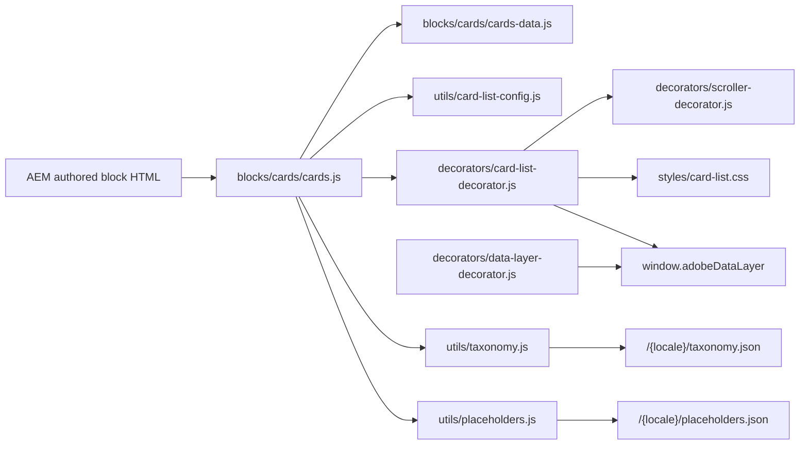
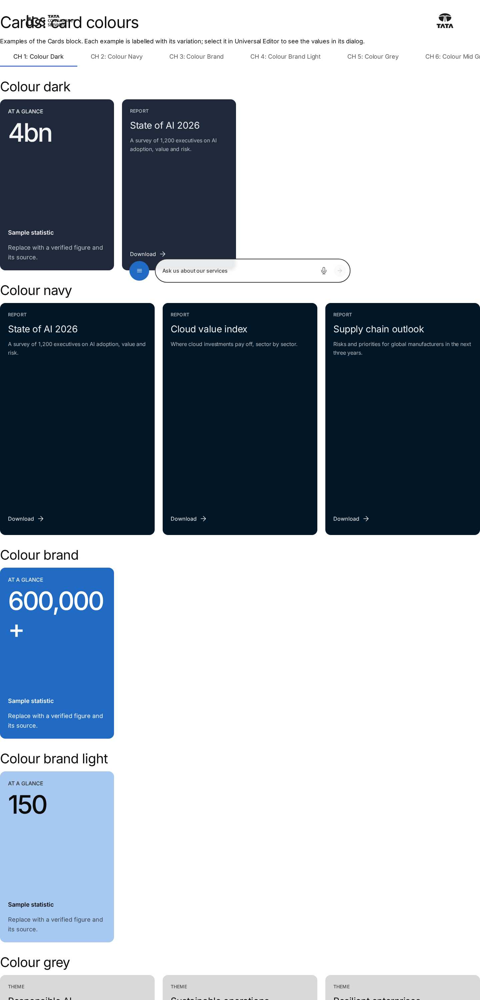
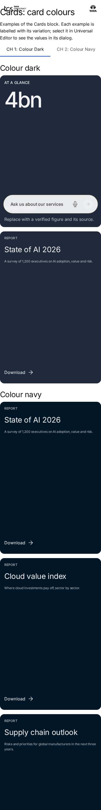

# Cards Block — Developer Guide

| Attribute | Value |
| --- | --- |
| Document ID | DEV-B-cards |
| Audience | Developers, technical leads, block owners, AI coding agents |
| Purpose | How the Cards block is built: files, model, structure, behaviour, variations, tests and limitations |
| Scope | blocks/cards/ and its components cards, card |
| Prerequisites | — |
| Owner | Technical Lead / Block Owner (proposed) |
| Approver | Product Owner (to be confirmed) |
| Version | 1.0 |
| Status | Draft for review |
| Last updated | 8 November 2026 |
| Last validated | 2026-11-08 (model, files, imports from the code; reference pages from the live site) |
| Source files | blocks/cards/README.md, blocks/cards/_cards.json, blocks/cards/cards-data.js, blocks/cards/cards.css, blocks/cards/cards.js |
| Related documents | [Variations](./CARDS-VARIATIONS.md), [Test coverage](./CARDS-TEST-COVERAGE.md), [Authoring guide](../../../03-authoring/components/cards/CARDS-AUTHORING-GUIDE.md) |
| Related AEM paths | /content/tcs-corp/design-block-master/en/block-library/cards, /content/tcs-corp/design-block-master/en/block-library/cards/card-colours, /content/tcs-corp/design-block-master/en/block-library/cards/card-styles |

## Contents

- [Summary](#summary)
- [Overview](#overview)
- [Source files](#source-files)
- [Components, models and filters](#components-models-and-filters)
- [Fields](#fields)
- [Dependencies](#dependencies)
- [For Developers](#for-developers)
- [Extending the Block](#extending-the-block)
- [Responsive Behavior](#responsive-behavior)
- [Accessibility](#accessibility)
- [Data Layer and Analytics](#data-layer-and-analytics)
- [Performance Considerations](#performance-considerations)
- [Security and Privacy](#security-and-privacy)
- [For Architects](#for-architects)
- [Troubleshooting](#troubleshooting)
- [Known limitations of the block](#known-limitations-of-the-block)
- [Change history of the block](#change-history-of-the-block)
- [Reference pages](#reference-pages)
- [Coverage of the required topics](#coverage-of-the-required-topics)
- [Screenshots](#screenshots)
- [Known limitations](#known-limitations)
- [Open items](#open-items)
- [Change history](#change-history)

## Summary

| Attribute | Value |
| --- | --- |
| Block | Cards |
| Folder | `blocks/cards` |
| Type | Container |
| Category | listing |
| Status | Active |
| Purpose | Manually authored cards with the List's presentation (grid or horizontal scroll) |
| Variations (summary) | Card style (image, panel, report, statistic, mixed), Card colour, layout per breakpoint |
| Children | card (Card) |
| Code size | 282 lines of JS and CSS |

## Overview

- **Business purpose:** presents curated, hand-written content as consistent, brand-compliant cards without creating a page for every card: statistics ("4bn revenue"), capabilities, services described in campaign wording, partner logos with a text, report downloads, or promotions pointing to pages or external sites. Because Cards uses the List's design and settings, a page can mix curated cards and page lists without visual differences.
- **User experience:** an optional header (title, description and a call to action on the right), then the cards in the authored order: image cards, coloured panels, report cards with a Download action, statistic cards with a large number, an optional full-width feature card above the others, or full-width rows of links with an arrow. Each breakpoint is a grid or a horizontal scroller with optional previous / next buttons and a scroll indicator.
- **Templates / page types:** any page; no page template adds or removes it. Typical placements: home and landing pages (statistics, capabilities), article and blog pages (related content curated by hand), press-release pages (downloads).
- **Data source:** authored fields only. Tag labels come from the locale's taxonomy (`/{locale}/taxonomy.json`) and UI text from its placeholders. Cards reads no page metadata, query index, redirects sheet or Authors sheet.
- **Related blocks:** [List](https://github.com/sradha-tcs/tcs-corp/blob/main/blocks/list/README.md) (the same presentation for pages: child pages, fixed list, tagged pages); [Filter List](https://github.com/sradha-tcs/tcs-corp/blob/main/blocks/filter-list/README.md) (page discovery with filter pills and sorting); [Teaser](https://github.com/sradha-tcs/tcs-corp/blob/main/blocks/teaser/README.md) and [Hero](https://github.com/sradha-tcs/tcs-corp/blob/main/blocks/hero/README.md) (single promotions); [Table List](https://github.com/sradha-tcs/tcs-corp/blob/main/blocks/table-list/README.md) (text-led lists without images); [Columns Container](https://github.com/sradha-tcs/tcs-corp/blob/main/blocks/columns-container/README.md) (free side-by-side layouts).

| | Cards | List |
|---|---|---|
| Content | Typed in each card | The pages' metadata (card title, description, image, ...), with overrides per item (Fixed list) |
| Destinations | Any page or URL, or none (a card without a link) | Pages of the site or URLs |
| Updates | Edited in the block | Follow the pages (a new child page or tagged page shows up) |
| Rich text | Description is rich text (paragraphs, bold, lists, inline links) | Plain text |
| Statistics, themes | Typed numbers and labels | The same, per item |

- **When to use:** curated content that isn't a page of its own or whose wording is written for this placement (statistics, capabilities, services with their own wording, logos with text, external promotions).
- **When not to use:** cards that represent pages that already have card metadata (use the List, so the cards stay in sync with the pages); filterable or sortable listings (use Filter List); tabular data (Table or Table List); a single promotion (Teaser).
- **Realistic use cases:** an "At a glance" statistic row on an about page; a services rail with images, descriptions and "Learn more" calls to action; dark themed panels linking to topic hubs; a featured spotlight card followed by three smaller cards; report download teasers; a news-style list of links that isn't driven by the query index; Block Collection cards authored before the redesign, which keep rendering in the new design.

## Source files

| File | Link |
| --- | --- |
| `README.md` | [GitHub](https://github.com/sradha-tcs/tcs-corp/blob/main/blocks/cards/README.md) |
| `_cards.json` | [GitHub](https://github.com/sradha-tcs/tcs-corp/blob/main/blocks/cards/_cards.json) |
| `cards-data.js` | [GitHub](https://github.com/sradha-tcs/tcs-corp/blob/main/blocks/cards/cards-data.js) |
| `cards.css` | [GitHub](https://github.com/sradha-tcs/tcs-corp/blob/main/blocks/cards/cards.css) |
| `cards.js` | [GitHub](https://github.com/sradha-tcs/tcs-corp/blob/main/blocks/cards/cards.js) |

## Components, models and filters

| Component | Title | Resource type | Template name | Model | Children allowed |
| --- | --- | --- | --- | --- | --- |
| `cards` | Cards | `core/franklin/components/block/v1/block` | Cards | `cards` | card |
| `card` | Card | `core/franklin/components/block/v1/block/item` | Card | `card` | — |

## Fields

The Additional tab fields (anchor, hide, padding, margin, animation) are common to the blocks and described in the [content modeling guide](../../markdown/CONTENT-MODELING-GUIDE.md).

### Cards (`cards`)

| Tab | Label | Property | Type | Required in model | Default | Options | Visibility |
| --- | --- | --- | --- | --- | --- | --- | --- |
| Content | Title | `title` | text | No | — | — | — |
| Content | Heading type | `titleType` | select | No | `h2` | 5 options | — |
| Content | Description | `description` | richtext | No | — | — | — |
| Content | CTA link | `link` | aem-content | No | — | — | — |
| Content | CTA text | `linkText` | text | No | — | — | — |
| Content | CTA style | `linkType` | select | No | `""` | 3 options | — |
| Content | Accessible list label | `listLabel` | text | No | — | — | — |
| Display | Display as teaser | `displayAsTeaser` | boolean | No | `true` | — | — |
| Display | Card style | `cardStyle` | select | No | `image` | 5 options | Conditional |
| Display | Card colour | `cardTheme` | select | No | `""` | 9 options | Conditional |
| Display | Image ratio | `imageRatio` | select | No | `16-9` | 4 options | Conditional |
| Display | Panel height | `panelHeight` | select | No | `portrait` | 3 options | Conditional |
| Display | First card as feature | `featureFirst` | boolean | No | `false` | — | Conditional |
| Display | Link items | `linkItems` | boolean | No | `true` | — | — |
| Display | Open links in a new tab | `openInNewTab` | boolean | No | `false` | — | — |
| Display | Show image | `showImage` | boolean | No | `true` | — | — |
| Display | Show eyebrow | `showEyebrow` | boolean | No | `true` | — | — |
| Display | Show tags | `showTags` | boolean | No | `true` | — | — |
| Display | Show description | `showDescription` | boolean | No | `true` | — | — |
| Display | Show date | `showDate` | boolean | No | `true` | — | — |
| Display | Date format | `dateFormat` | select | No | `dd-mmm-yy` | 6 options | Conditional |
| Display | Show call to action | `showCta` | boolean | No | `true` | — | — |
| Display | Image loading | `imageLoading` | select | No | `lazy` | 2 options | — |
| Display | Desktop display | `desktopMode` | select | No | `grid` | 2 options | — |
| Display | Desktop columns | `desktopColumns` | number | No | `4` | — | Conditional |
| Display | Desktop gap (px) | `desktopGap` | number | No | `24` | — | — |
| Display | Desktop items visible | `desktopVisible` | number | No | `4.2` | — | Conditional |
| Display | Desktop card width (px) | `desktopCardWidth` | number | No | `0` | — | Conditional |
| Display | Previous / next buttons on desktop | `desktopControls` | boolean | No | `false` | — | Conditional |
| Display | Scroll indicator on desktop | `desktopIndicator` | boolean | No | `false` | — | Conditional |
| Display | Tablet display | `tabletMode` | select | No | `grid` | 2 options | — |
| Display | Tablet columns | `tabletColumns` | number | No | `4` | — | Conditional |
| Display | Tablet gap (px) | `tabletGap` | number | No | `24` | — | — |
| Display | Tablet items visible | `tabletVisible` | number | No | `3.3` | — | Conditional |
| Display | Tablet card width (px) | `tabletCardWidth` | number | No | `0` | — | Conditional |
| Display | Previous / next buttons on tablet | `tabletControls` | boolean | No | `false` | — | Conditional |
| Display | Scroll indicator on tablet | `tabletIndicator` | boolean | No | `false` | — | Conditional |
| Display | Mobile display | `mobileMode` | select | No | `grid` | 2 options | — |
| Display | Mobile columns | `mobileColumns` | number | No | `1` | — | Conditional |
| Display | Mobile gap (px) | `mobileGap` | number | No | `16` | — | — |
| Display | Mobile items visible | `mobileVisible` | number | No | `1.2` | — | Conditional |
| Display | Mobile card width (px) | `mobileCardWidth` | number | No | `0` | — | Conditional |
| Display | Previous / next buttons on mobile | `mobileControls` | boolean | No | `false` | — | Conditional |
| Display | Scroll indicator on mobile | `mobileIndicator` | boolean | No | `true` | — | Conditional |
| Display | Equal card height | `equalHeight` | boolean | No | `false` | — | — |
| Display | Stretch cards to row height | `stretchCards` | boolean | No | `true` | — | — |
| Display | Scroll snap | `scrollSnap` | boolean | No | `true` | — | Conditional |
| Display | Snap alignment | `snapAlign` | select | No | `start` | 2 options | Conditional |
| Display | Hide native scrollbar | `hideScrollbar` | boolean | No | `true` | — | Conditional |
| Display | Allow mouse drag | `mouseDrag` | boolean | No | `true` | — | Conditional |
| Display | Keyboard scrolling | `keyboardScrolling` | boolean | No | `true` | — | Conditional |
| Display | Scroll step | `scrollStep` | select | No | `one-card` | 2 options | Conditional |
| Display | Loop | `loop` | boolean | No | `false` | — | Conditional |
| Display | Initial item index | `initialIndex` | number | No | `0` | — | Conditional |
| Display | Edge | `edgePadding` | select | No | `bleed` | 2 options | Conditional |
| Display | When there are no cards | `emptyBehavior` | select | No | `hide` | 2 options | — |
| Display | Empty message | `emptyMessage` | text | No | — | — | Conditional |
| Display | Analytics | `analyticsEnabled` | boolean | No | `true` | — | — |
| Display | Style options | `classes` | multiselect | No | — | 3 options | — |

### Card (`card`)

| Tab | Label | Property | Type | Required in model | Default | Options | Visibility |
| --- | --- | --- | --- | --- | --- | --- | --- |
| Content | Image | `image` | reference | No | — | — | — |
| Content | Image alt text | `imageAlt` | text | No | — | — | — |
| Content | Eyebrow | `eyebrow` | text | No | — | — | — |
| Content | Title | `title` | text | No | — | — | — |
| Content | Description | `text` | richtext | No | `""` | — | — |
| Content | Label | `subtitle` | text | No | — | — | — |
| Content | Tags | `tags` | aem-tag | No | — | — | — |
| Content | Date | `date` | date-time | No | — | — | — |
| Content | Content type | `contentLabel` | text | No | — | — | — |
| Content | Reading time | `readingTime` | text | No | — | — | — |
| Link | Link | `link` | aem-content | No | — | — | — |
| Link | Link text | `linkText` | text | No | — | — | — |
| Link | Call to action label | `ctaLabel` | text | No | — | — | — |
| Link | Open in a new tab | `newTab` | select | No | `""` | 3 options | — |
| Display | Card style | `kind` | select | No | `""` | 5 options | — |
| Display | Card colour | `theme` | select | No | `""` | 9 options | — |
| Display | Analytics label | `analyticsLabel` | text | No | — | — | — |
| Display | Accessibility label | `ariaLabel` | text | No | — | — | — |

"Required in model" is the model's `required` flag; whether a field is required in practice is stated in the authoring guide where it is known.

## Dependencies

| Import |
| --- |
| `../../utils/card-list-config.js` |
| `../../utils/dates.js` |
| `../../decorators/card-list-decorator.js` |
| `../../utils/cells.js` |
| `../../utils/environment.js` |
| `../../utils/placeholders.js` |
| `../../utils/properties.js` |
| `../../utils/tags.js` |
| `../../utils/taxonomy.js` |
| `./cards-data.js` |

## For Developers

<!-- BEGIN GENERATED: files (npm run build:docs) -->

```text
blocks/cards/
├── README.md
├── _cards.json
├── cards-data.js
├── cards.css
└── cards.js
```

| Decorator/Utility | Purpose | Execution or dependency point |
| ----------------- | ------- | ----------------------------- |
| [`utils/card-list-config.js`](https://github.com/sradha-tcs/tcs-corp/blob/main/utils/card-list-config.js) | `normalizePresentation` (the card list settings of List and Cards, with defaults and validation), `PRESENTATION_PROPERTIES`, `kindOf` and `themeOf` (the card's Card style and Card colour: item, list, page metadata, autom | `cards-data.js`: { CARD_KINDS, CARD_THEMES, isExternal, isSafeUrl, isYes, text, toISODate, } |
| [`utils/dates.js`](https://github.com/sradha-tcs/tcs-corp/blob/main/utils/dates.js) | `formatDate` (DD-MM-YYYY, MM-DD-YYYY, MMM d, yyyy, DD/MM/YY, DD MMM YY, 4th September 2026; no time zone shift) | `cards-data.js`: { formatDate } |
| [`decorators/card-list-decorator.js`](https://github.com/sradha-tcs/tcs-corp/blob/main/decorators/card-list-decorator.js) | `buildCardListHeader`, `renderCardList`, `renderCard`, `renderRow`, `renderFeature`, `applyCardListLayout`, `buildCardListSkeleton` (the List's skeleton in its own layout), `renderCardListEmpty`, `cardListId`, `cardHeadi | `cards.js`: { applyCardListLayout, buildCardListHeader, cardListId, renderCardList, renderCardListEmpty, renderEditorItems, trackCardList, } |
| [`utils/card-list-config.js`](https://github.com/sradha-tcs/tcs-corp/blob/main/utils/card-list-config.js) | `normalizePresentation` (the card list settings of List and Cards, with defaults and validation), `PRESENTATION_PROPERTIES`, `kindOf` and `themeOf` (the card's Card style and Card colour: item, list, page metadata, autom | `cards.js`: { HEADINGS, PRESENTATION_PROPERTIES, normalizePresentation, pickValue, } |
| [`utils/cells.js`](https://github.com/sradha-tcs/tcs-corp/blob/main/utils/cells.js) | `itemRows`, `KEY_VALUE_ITEM`, `FIELD_ROW_ITEM` (the item rows of a block: by model in the editor, by their cells on the page), `withoutTabCells` (drops the empty cell AEM renders for each dialog tab of an item model), `m | `cards.js`: { matchCells, withoutTabCells } |
| [`utils/environment.js`](https://github.com/sradha-tcs/tcs-corp/blob/main/utils/environment.js) | `prefersReducedMotion`, `scrollBehavior`, `isEditing`, `isInEditor`, `isAuthor` (the page is rendered by AEM author, which has no query index) | `cards.js`: { isEditing } |
| [`utils/placeholders.js`](https://github.com/sradha-tcs/tcs-corp/blob/main/utils/placeholders.js) | `getPlaceholders`, `loadPlaceholders`, `fillPlaceholder` (UI text from the locale's placeholders, with English fallbacks) | `cards.js`: { getPlaceholders } |
| [`utils/properties.js`](https://github.com/sradha-tcs/tcs-corp/blob/main/utils/properties.js) | `readProperties`, `textOf`, `isOn`, `isOnByDefault` (a toggle that defaults to on), `optionOf`, `normalizeKey`, `textSource` (key-value block properties) | `cards.js`: { normalizeKey, textOf } |
| [`utils/tags.js`](https://github.com/sradha-tcs/tcs-corp/blob/main/utils/tags.js) | `readTagValues`, `parseTag`, `readTags` (tag IDs; ID-derived labels as the taxonomy fallback) | `cards.js`: { readTagValues } |
| [`utils/taxonomy.js`](https://github.com/sradha-tcs/tcs-corp/blob/main/utils/taxonomy.js) | `loadTaxonomy`, `resolveTags` (tag labels from the locale's taxonomy) | `cards.js`: { resolveTags } |

<!-- END GENERATED: files -->

- **JavaScript (`cards.js`):** reads the block (`readBlock`), normalizes the settings (`normalizePresentation` with `idPrefix: 'cards'`, plus `emptyBehavior`), builds the header (`buildCardListHeader`), the cards (`buildManualCards`), resolves tag labels (`resolveTags`), applies the layout classes (`applyCardListLayout`, plus `source-manual`), renders (`renderCardList` or `renderCardListEmpty`), adds editor placeholders (`renderEditorItems`) and the data layer state (`trackCardList`).
- **Data (`cards-data.js`, no DOM):** `CARD_LAYOUT` (the Card cells in model order with `null` for the three dialog tab cells), `itemToCard` (one card; `null` for no content or an unsafe link), `buildManualCards` (authored order, ids renumbered after dropped cards).
- **CSS (`cards.css`):** only imports `styles/card-list.css` (the List's presentation).
- **Input DOM:** key-value rows (`key | value`, keys compared by `normalizeKey` against `PRESENTATION_PROPERTIES`); Card rows (in the editor `data-aue-model="card"`; on the page any row that isn't a setting row). A Card row with more than two cells is matched to the 16 fields with `withoutTabCells` and `matchCells` (by order and content: an image, a `YYYY-MM-DD` date, a link, `true` / `false`, a known style or colour, single-line text), so fields AEM leaves out don't shift the others; a row with two cells or fewer is a legacy card (image + rich text, `readLegacyText`).
- **Rendered DOM:** block classes `card-list`, `{bp}-{grid,scroll}`, `{bp}-controls`, `{bp}-indicator`, `snap`, `snap-{start,center}`, `hide-scrollbar`, `no-swipe`, `edge-bleed`, `equal-height`, `stretch`, `feature-first`, `display-teaser` or `links`, `style-{cardStyle}`, `ratio-{ratio}`, `panel-{height}`, style options, `source-manual`; custom properties `--list-{columns,gap,visible,card-width}-{bp}`; children `div.list-header`, optional `article.list-feature`, `div.list-scroller[role=region]` > `ul.list-items` > `li.list-item[data-card-id][data-cmp-id][data-cmp-position]` > `article.list-card.list-card-{kind}` (or `article.list-row`), `div.list-nav` (indicator, previous / next). Data attributes: `data-cards-decorated`, `data-analytics` (`custom` / `off`), `data-overflow` on the scroller.
- **Decoration flow:** guarded by `data-cards-decorated` (a second call does nothing); awaits the placeholders and, when cards have tags, the taxonomy.
- **Events and async:** the scroller (`createScroller`) listens to scroll, resize, keydown and pointer events; no custom events are dispatched.
- **Error handling:** invalid settings fall back to defaults; cards without content or with unsafe links are dropped; no cards: hidden (empty and `hidden` on the block and its wrapper) or the empty message; in the editor always the hint.
- **Exports:** `cards.js` default `decorate`; `cards-data.js` `CARD_LAYOUT`, `itemToCard`, `buildManualCards`.
- **Parent / child contracts:** Card rows keep their instrumentation on the rendered `li` (`moveInstrumentation`) and the rich text on its body; rows not rendered as cards become editor placeholders.
- **Data-layer hooks:** `data-cmp-id`, `data-cmp-position`, `data-cmp-interaction`, `data-analytics-label` on card links and articles.

## Extending the Block

1. **A dialog field or value:** shared presentation fields go in `models/_card-list.json` (they apply to List and Cards); Card fields in `blocks/cards/_cards.json`. Run `npm run build:json` and `npm run lint`.
2. **Map it to rendering:** settings in `utils/card-list-config.js` `normalizePresentation` (add the normalized key to `PRESENTATION_PROPERTIES`, or the row is read as a Card); Card values in `cards.js` `readCard` and `cards-data.js` `itemToCard`; markup in `decorators/card-list-decorator.js`; styles in `styles/card-list.css` (scoped to `.card-list`, mobile first, `min-width` 600 / 900 / 1200px, rem).
3. **Card cells:** a new Card field changes the row's cells: update `CARD_LAYOUT` (fields in model order, `null` per dialog tab), `CARD_MATCHERS` and `test/cards/cards-data.test.mjs`.
4. **Delivery rules:** don't end a field name with Text, Title, Type, Alt or MimeType unless it should collapse; tab cells arrive empty; Additional tab values arrive as `classes_*` block classes.
5. **Responsive, accessibility, data layer:** keep one link per card, region naming and focus rings; describe new clicks with `data-cmp-interaction` instead of pushing events.
6. **Tests:** `npm test` (`test/cards/cards-data.test.mjs`, and the List tests for shared code).
7. **Backward compatibility:** keep reading removed fields (Component ID, Touch swipe) and legacy two-cell cards; changes to the shared files affect the List.
8. **Docs:** update the block library pages (`block-library/cards/…`), this README (`npm run build:docs` regenerates its generated sections) and the List README; run `npm run build:modules` after changing imports.

## Responsive Behavior

| Viewport | Layout | Image behavior | Interaction behavior |
| -------- | ------ | -------------- | -------------------- |
| Mobile (below 600px) | Mobile display: grid with Mobile columns (default 1, gap 16) or a rail with Mobile items visible (default 1.2) / card width; header stacked; smallest type scale | Image ratio kept; authored picture cloned | Mobile scroll indicator on by default, buttons off; touch scroll native |
| Tablet (600–1199px) | Tablet display: grid (default 4 columns, gap 24) or rail (default 3.3 visible); larger type; row dividers with Dividers between rows | Feature min-height 27.1875rem | Tablet buttons / indicator off by default |
| 900px and wider | Card padding increases (`--space-600`) | — | — |
| Desktop (1200px and wider) | Desktop display: grid (default 4 columns, gap 24) or rail (default 4.2 visible); largest type scale | Feature min-height 35.625rem | Desktop buttons / indicator off by default; mouse drag on rails |

Buttons and indicator are hidden whenever the cards fit (no overflow). Edge "Cards run to the edge" only differs from "Inside the content width" in sections with a side gutter.

## Accessibility

- **Semantic HTML:** the cards are a `<ul>` / `<li>` list inside a `div.list-scroller` with `role="region"`, named by the title (`aria-labelledby`), else the Accessible list label, else "Cards" (placeholder `cards`); each card is an `<article>`; dates are `<time datetime>`.
- **Headings:** the block heading at the chosen level; card titles one level below (at most `h6`); a card without a title has no heading.
- **Keyboard and focus:** one link per card (the call to action when shown, else the title) whose overlay covers the card; inline links of the description stay operable above it; visible focus rings (inside the edge of panel, report and statistic cards). The scroller is focusable only while it overflows; the previous / next buttons use `aria-disabled` (not `disabled`) at the ends so the focus stays.
- **Accessible names:** call to action "{label}: {title}" unless an Accessibility label is set; previous / next buttons "Previous items" / "Next items" with `aria-controls`; new-tab links get the hidden text "(opens in a new tab)".
- **Alt text:** the Image alt text; empty means decorative.
- **Announcements:** none (no live regions).
- **Reduced motion:** scrolling is instant for `prefers-reduced-motion` (always honoured); the row arrow transition is off; the content animation doesn't play.
- **Contrast:** the theme contract turns image card text light on dark Section / Columns Container backgrounds; panel, report and statistic cards keep their Card colour. The handover notes check points for Brand blue and Image background cards.
- **Empty / loading states:** no skeleton (authored content renders at once); an empty block is hidden or shows a message as text.
- **Reflow:** single column below 600px by default; long numbers scale down in narrow statistic cards.

**Author responsibilities:** a title for every card and the block (or an Accessible list label); meaningful alt text; heading type that fits the outline; an Accessibility label mentioning the new tab for new-tab calls to action; not relying on colour alone.

**Developer responsibilities:** keep the one-link-per-card pattern and the region naming in `decorators/card-list-decorator.js`; keep focus rings visible in `styles/card-list.css`; keep the scroller's `aria-disabled` behaviour (`decorators/scroller-decorator.js`); UI text only from placeholders.

| Key | Expected behavior |
| --- | ----------------- |
| Tab / Shift+Tab | Moves through the header link, the card links, inline description links, the scroller (while it overflows) and the previous / next buttons |
| Enter | Follows the focused link; activates a focused previous / next button |
| Space | Activates a focused previous / next button |
| Arrow Right / Arrow Left | On the focused scroller (Keyboard scrolling on): next / previous step |
| Home / End | On the focused scroller: first card / end of the row |

## Data Layer and Analytics

- **Component:** with Analytics on (default), `trackCardList` marks the block `data-analytics="custom"` and pushes the block (`@type: tcs-corp/components/cards`, `parentId` the page, `dc:title` the heading or Accessible list label, `xdm:variant` the Card style or `links`) and each shown card (`@type: tcs-corp/components/cards/item`, `parentId` the block, `dc:title`, `xdm:linkURL`, `xdm:position`, `repo:modifyDate` the card date).
- **Ids:** the stored Component ID, else the Anchor ID (block id), else `cards-1`, `cards-2`, …; cards `{id}-item-{n}` in the shown order (they change when cards are reordered).
- **Interactions:** clicks are captured centrally by `decorators/data-layer-decorator.js` from `data-cmp-id`, `data-cmp-position` (on each `li` and the feature card) and `data-cmp-interaction` (`card`, `cta`, `previous`, `next`). A click ending a mouse drag and clicks on `aria-disabled` buttons aren't pushed. Cards makes no `pushComponentEvent` call of its own.
- **Analytics off:** `data-analytics="off"`: no state and no events for the block.
- **Path:** Adobe Client Data Layer → Adobe Data Collection (Tags) → AEP Web SDK → Edge Network → Analytics / CJA is the intended path, but Tags and the Web SDK aren't configured yet (blocked: measurement plan). No consent mechanism is implemented.

| Trigger | Data-layer event | Required properties | Analytics behavior |
| ------- | ---------------- | ------------------- | ------------------ |
| Block decorated (Analytics on) | `component` state | block `@type`, `parentId`, `dc:title`, `xdm:variant`; per card `@type`, `parentId`, `dc:title`, `xdm:linkURL`, `xdm:position` | Impression state for the block and its cards |
| Card link or call to action | `cmp:click` | `path: component.{card id}`, `interaction: card`, `dc:title`, `xdm:linkURL`, `xdm:linkType` (`other`, `exit`, `download`), `position`, `breakpoint` | Card click with its position |
| Link inside a card description | `cmp:click` | `path: component.{card id}`, `interaction: link`, `position` | Inline link click |
| Header CTA | `cmp:click` | `path: component.{block id}`, `interaction: cta`, `dc:title`, `xdm:linkURL` | CTA click |
| Previous / Next | `cmp:click` | `path: component.{block id}`, `interaction: previous` / `next`, `dc:title` (button name), `breakpoint` | Scroller navigation |

## Performance Considerations

- **Initialization:** decorated with its section (eager only in the first section); waits for the placeholders and, when cards have tags, the taxonomy (both cached per page).
- **Images:** the authored `<picture>` is cloned; `loading` from Image loading (lazy by default); with Eager only the first image gets `fetchpriority="high"`; aspect ratios reserve space (no layout shift).
- **Dynamic imports / requests:** none beyond the block's own modules; no query index.
- **DOM size:** one `li` and `article` per card; no virtualization.
- **Listeners / observers:** the scroller adds scroll, resize (ResizeObserver), keydown and pointer listeners on the block; the motion decorator observes the block when an animation is set.
- **Layout shift risks:** the block rebuilds its children on decoration; hiding an empty block removes its wrapper from the layout.
- **High-cost configurations:** many cards with Eager loading; large rails with fixed card widths.

## Security and Privacy

- Card links are validated with `isSafeUrl` (http, https, mailto, tel, paths, anchors and queries; any other scheme such as `javascript:` or `data:` drops the card).
- The header CTA is the link AEM delivers; it isn't validated by the block.
- Text values are set with `textContent`; the rich text description is the AEM-delivered markup moved as is.
- New-tab links get `rel="noopener noreferrer"`; links to other origins are marked `data-external="true"`.
- No external content, query string handling or personal data; the data layer holds titles, URLs and positions only.

## For Architects

- **Role:** the manual counterpart of the List: same presentation, authored content.
- **Content model:** key-value container (`cards`) with item children (`card`); the settings are shared with the List.
- **Rendering and data source:** client-side decoration of server-delivered authored HTML; only the placeholders and (with tags) the taxonomy are fetched.
- **Dependencies:** `decorators/card-list-decorator.js` (with the scroller, button, icon button, link, heading, responsive image, skeleton and data layer decorators), `utils/card-list-config.js`, `utils/cells.js`, `utils/taxonomy.js`, `utils/placeholders.js`, `utils/analytics.js`.
- **Data layer / Web SDK / Target:** Adobe Client Data Layer state and clicks; Tags, Web SDK and Target aren't configured.
- **Consent and identity:** none implemented; no personal data in the data layer.
- **Caching:** the page HTML (with the cards) is cached by the Edge Delivery CDN and refreshed on publish; placeholders and taxonomy are fetched once per page and cached in memory.
- **Performance:** no data requests beyond placeholders and taxonomy; CSS-driven layout; lazy images by default.
- **Security:** unsafe card links are dropped; text set with `textContent`.
- **Scalability:** no maximum number of cards; DOM size grows with the cards.



## Troubleshooting

| Symptom | Likely cause | Diagnostic steps | Resolution | Verification |
| ------- | ------------ | ---------------- | ---------- | ------------ |
| A Card is missing | No title, description or image, or an unsafe link | Check the Card's fields and Link scheme | Add content; use the page picker or an `https://` URL | The card shows after reload |
| The whole block is missing | No card content with Hide the block; Hide block on; script load error | Edit mode hint; Additional tab; console `failed to load block cards` | Add content or Show a message; turn Hide block off; escalate load errors | Block visible on preview and live |
| Tags show ID-like labels | Tag missing in the locale taxonomy or taxonomy not published | Search the tag ID in `/{locale}/taxonomy.json` | Add / translate the tag, publish the taxonomy | Correct label in a new session |
| Text clipped in coloured cards | Portrait / Compact panel height | Check Panel height and text length at narrow widths | Shorter text or Panel height Content | All text visible at all widths |
| No previous / next or indicator | Breakpoint in grid mode, setting off, or no overflow | Check the breakpoint's fields; inspect `.list-scroller[data-overflow]` | Turn the controls on for the scrolling breakpoint; fewer items visible | Controls show and work |
| Settings have no effect | Block authored before the redesign (no block model) | Check `.plain.html` for key-value rows | Replace with a new Cards block | Block follows the settings |
| Date or reading time missing | Show date / Show tags off; card kind without date (panel, statistic) | Check the switches and card kind | Turn on; use image cards for dates | Date shows in the Date format |
| Call to action missing | No Link, Link items off or Show call to action off | Check the Card Link and switches | Add the Link; turn the switches on | Button shows |
| No clicks in the data layer | Analytics off; the click ended a drag | Check `data-analytics`; inspect `window.adobeDataLayer` | Turn Analytics on | `cmp:click` entries appear |
| Card goes through a redirect | Authored link not updated after a page move | Check `/{locale}/redirects.json` | Update the Link and republish | Card opens the target directly |

Evidence to collect: page URL (preview / live), viewport width, the block's `.plain.html` rows, the block's classes and `data-analytics`, console messages, the relevant `window.adobeDataLayer` entries. No credentials or tokens.

## Known limitations of the block

| Limitation | Impact | Workaround | Planned correction |
| ---------- | ------ | ---------- | ------------------ |
| Cards blocks created before the redesign have no block model | Their settings can't be edited | Replace with a new Cards block | Migration (Phase 0, `docs/proposals/cards-card-refactoring.md`) |
| Those blocks render in the new design, not the original bordered grid | Visual change on existing pages | Replace or accept | Classic presentation (Phase 0) |
| In legacy cards the title stays inside Description in the Card dialog | Authors edit the title in the rich text | Format the title as a heading | Move titles into Title when editing (proposal) |
| No author lockup on the feature card | Feature without author | Use the List for page-based features | Not recorded |
| Internal links aren't resolved through the redirects sheets | Moved pages go through a redirect | Update links after page moves | Not recorded |
| Card text fields are edited in the properties panel; only the description in place | Slower editing | — | Not recorded |
| The new-tab hint isn't announced on calls to action without an Accessibility label (the generated `aria-label` replaces it) | Screen reader users aren't told | Mention the new tab in the Accessibility label | Not recorded |
| Month abbreviations are English in every locale | Non-English dates in English | Use a numeric Date format | Not recorded |
| Card ids follow the shown order | Reordering changes the data-layer ids (D-A-23) | — | Deferred (audit) |
| Edge "Cards run to the edge" looks like "Inside the content width" in full-width sections (D-A-9) | No visible difference | — | Deferred (audit) |
| A stored Touch swipe off with no controls blocks touch scrolling (D-A-10) | Cards unreachable on touch | Turn on previous / next buttons | Deferred (audit) |
| No carousel autoplay or dots, masonry, filtering, sorting or search | — | Filter List for filterable listings | Planned (proposal phases 1–6) |
| Card date may show the previous day for some stored date-times (D-A-26, suspected) | Wrong date | Check the published date | Blocked (to be verified) |

## Change history of the block

| Version | Change | Source | Date |
| ------- | ------ | ------ | ---- |
| Not recorded | README generated from verified implementation and approved handover documentation | Repository review | Not recorded |
| Handover 1.1 | Cards and Card analysis: blocks made before the redesign have no block model and changed appearance (refactoring proposal) | docs/handover revision history | 14 October 2026 |
| Handover 2.7 | The Display as teaser block class is `display-teaser` (was `teaser`, also selected by the Teaser styles), F-83 | docs/handover revision history | 17 October 2026 |
| Handover 2.8 | Dialog tabs Content / Display / Additional; an item without a card is a placeholder in the editor (`cardEditorHint`), F-84, F-85 | docs/handover revision history | 17 October 2026 |
| Handover 2.18 | Additional tab Content animation (repeated items staggered) | docs/handover revision history | 18 October 2026 |
| Handover 2.27 | Block ecosystem audit: header CTA style applied, focus ring inside panel / report / statistic cards, Card colour only on those cards, previous / next keep the focus, Component ID and Reduced motion support removed from the dialog | docs/handover revision history | 19 October 2026 |
| Handover 2.34 | Theme contract: List / Cards image cards light on dark backgrounds | docs/handover revision history | 20 October 2026 |

## Reference pages

| Kind | Page | Live URL |
| --- | --- | --- |
| Block library | /design-block-master/en/block-library/cards | https://main--tcs-corp--sradha-tcs.aem.live/design-block-master/en/block-library/cards |
| Block library | /design-block-master/en/block-library/cards/card-colours | https://main--tcs-corp--sradha-tcs.aem.live/design-block-master/en/block-library/cards/card-colours |
| Block library | /design-block-master/en/block-library/cards/card-styles | https://main--tcs-corp--sradha-tcs.aem.live/design-block-master/en/block-library/cards/card-styles |
| Block library | /design-block-master/en/block-library/cards/grid-and-horizontal-scroll | https://main--tcs-corp--sradha-tcs.aem.live/design-block-master/en/block-library/cards/grid-and-horizontal-scroll |
| Block library | /design-block-master/en/block-library/cards/heights-links-legacy | https://main--tcs-corp--sradha-tcs.aem.live/design-block-master/en/block-library/cards/heights-links-legacy |
| Block library | /design-block-master/en/block-library/cards/images-panels-style-options | https://main--tcs-corp--sradha-tcs.aem.live/design-block-master/en/block-library/cards/images-panels-style-options |
| Block library | /design-block-master/en/block-library/cards/per-card-styles-and-colours | https://main--tcs-corp--sradha-tcs.aem.live/design-block-master/en/block-library/cards/per-card-styles-and-colours |
| Curated design page | /design-block-master/en/curated-design-pages/industry-landing-page | https://main--tcs-corp--sradha-tcs.aem.live/design-block-master/en/curated-design-pages/industry-landing-page |
| Curated design page | /design-block-master/en/curated-design-pages/product | https://main--tcs-corp--sradha-tcs.aem.live/design-block-master/en/curated-design-pages/product |
| Curated design page | /design-block-master/en/curated-design-pages/services | https://main--tcs-corp--sradha-tcs.aem.live/design-block-master/en/curated-design-pages/services |
| Curated design page | /design-block-master/en/curated-design-pages/who-we-are | https://main--tcs-corp--sradha-tcs.aem.live/design-block-master/en/curated-design-pages/who-we-are |

## Coverage of the required topics

| Topic | Where |
| --- | --- |
| Purpose | Overview |
| Source files | generated: Files |
| Model, definition, filters, children | generated: Components |
| Dependencies | generated: Dependencies |
| Authored input / rendered output / DOM transformation | For Developers |
| Configuration fields, defaults, required fields | generated: Fields |
| Variations | CARDS-VARIATIONS.md |
| Responsive behaviour | Responsive Behavior |
| Accessibility and keyboard | Accessibility |
| Analytics / data layer | Data Layer and Analytics |
| Performance | Performance Considerations |
| Security | Security and Privacy |
| Extending | Extending the Block |
| Known limitations | Known Limitations |
| Troubleshooting | Troubleshooting |
| Tests | CARDS-TEST-COVERAGE.md |
| SEO behaviour | Not recorded |
| Caching considerations | Not recorded (Edge Delivery default caching; no block-specific rule) |
| Ownership | Technical Lead / Block Owner (proposed) |

## Screenshots



*Figure: Cards block library page — desktop 1440 × 900 (/design-block-master/en/block-library/cards/card-colours, captured 2026-11-08).*



*Figure: Cards block library page — mobile 375 × 812 (/design-block-master/en/block-library/cards/card-colours, captured 2026-11-08).*

![Desktop rendering — The Cards block at 1440 px with default settings: the header with the H2 "Latest insights" and its description on the left and the "View all insights" text link on the right, above four image cards in one row (photo-1.svg to photo-4.svg in 16:9 frames, kickers such as "Insight", the tag label and "6m", titles from "The agentic bank" to "Personalisation in retail", descriptions and meta rows "Article" with dates from "04 Sep 26"). (Sample content on the preview; callout letters as in the Field Entry Table; file screenshots/cards-desktop-view.jpg)](./screenshots/handover/cards-desktop-view.jpg)

*Figure: Desktop rendering — The Cards block at 1440 px with default settings: the header with the H2 "Latest insights" and its description on the left and the "View all insights" text link on the right, above four image cards in one row (photo-1.svg to photo-4.svg in 16:9 frames, kickers such as "Insight", the tag label and "6m", titles from "The agentic bank" to "Personalisation in retail", descriptions and meta rows "Article" with dates from "04 Sep 26"). (Sample content on the preview; callout letters as in the Field Entry Table; file screenshots/cards-desktop-view.jpg) (handover screenshot; rendering at the time it was taken).*


*Figure: Tablet rendering — The same Latest insights block at 1024 px: the 2rem title with "View all insights" still on the right, and the four image cards in one row (Tablet columns 4 by default) with 1.25rem card titles and 0.875rem kickers and meta rows. (Sample content on the preview; callout letters as in the Field Entry Table; file screenshots/cards-tablet-view.jpg) (handover screenshot; rendering at the time it was taken).*


*Figure: Mobile rendering — The Latest insights block at 402 px: the header stacked (title, description, then "View all insights" below), and the four image cards one per row in a single column with a 16 px gap, 1.125rem titles and 0.75rem kickers and meta rows. (Sample content on the preview; callout letters as in the Field Entry Table; file screenshots/cards-mobile-view.jpg) (handover screenshot; rendering at the time it was taken).*


*Figure: Image card style — Four image cards in a row at 1440 px (default Card style Image card, 4 columns): 16:9 rounded images, uppercase grey kickers (e.g. "Insight", the tag label, "6m"), the titles "The agentic bank", "Cloud at scale", "Supply chain resilience" and "Personalisation in retail", two-line descriptions and the meta row "Article" with the date (e.g. "04 Sep 26"). (Sample content on the preview; callout letters as in the Field Entry Table; file screenshots/cards-image-card.jpg) (handover screenshot; rendering at the time it was taken).*


*Figure: Panel card style — Three tall 2:3 dark navy-grey (#20293c) panels in a 3-column row at 1440 px, each with the light kicker "Theme", a large light title ("Responsible AI", "Sustainable operations", "Resilient enterprises"), a muted description and the "Explore" text link at the bottom. (Sample content on the preview; callout letters as in the Field Entry Table; file screenshots/cards-panel-card.jpg) (handover screenshot; rendering at the time it was taken).*


*Figure: Report card style — Three tall 2:3 report cards in a 3-column row at 1440 px on the light blue-grey to warm grey gradient: kickers "Report" with the dates "04 Sep 26", "15 Jul 26" and "28 May 26", the dark titles "State of AI 2026", "Cloud value index" and "Supply chain outlook", descriptions and an outlined "Download" button at the bottom. (Sample content on the preview; callout letters as in the Field Entry Table; file screenshots/cards-report-card.jpg) (handover screenshot; rendering at the time it was taken).*


*Figure: Statistic card style — Four light grey (#d9d9d9) 2:3 statistic cards in a row at 1440 px, each with "At a glance" at the top, a very large number ("4bn", "600,000+", "150", "98%") and at the bottom a bold label ("Revenue", "Colleagues", "Delivery centres", "Client retention") with a short description; no links or buttons. (Sample content on the preview; callout letters as in the Field Entry Table; file screenshots/cards-statistic-card.jpg) (handover screenshot; rendering at the time it was taken).*


*Figure: Mixed card style — A 3-column row at 1440 px with Card style Mixed: the image card "The agentic bank" (photo-1.svg), the dark #20293c panel "Responsible AI" (no image) with "Explore", and the gradient report card "State of AI 2026" (Content type Report) with the kicker "Report", "04 Sep 26" and a Download button. (Sample content on the preview; callout letters as in the Field Entry Table; file screenshots/cards-mixed.jpg) (handover screenshot; rendering at the time it was taken).*


*Figure: Feature card — At 1440 px a full-width feature card (about 35.6rem high) with wide.svg filling it under a white gradient from the left, the two tag labels and "12m" and the large title "Building the agentic enterprise" (no description); below it three image cards ("Cloud at scale", "Supply chain resilience", "Personalisation in retail") in a 3-column row. (Sample content on the preview; callout letters as in the Field Entry Table; file screenshots/cards-feature-card.jpg) (handover screenshot; rendering at the time it was taken).*


*Figure: Rows of links — Four full-width rows of links at 1440 px, each with the uppercase eyebrow and first tag, a large title ("The agentic bank", "Cloud at scale", ...), a description, the date and a grey arrow on the right, separated by thin grey lines (Dividers between rows); the pointer is on the second row, whose arrow is blue and moved. (Sample content on the preview; callout letters as in the Field Entry Table; file screenshots/cards-rows-of-links.jpg) (handover screenshot; rendering at the time it was taken).*


*Figure: Dark card colour — At 1024 px two cards side by side (Tablet columns 2) on dark #20293c with light text: the statistic "4bn" with "At a glance", "Revenue" and its description, and the report card "State of AI 2026" with the kicker "Report", "04 Sep 26", the description and a light outlined Download button. (Sample content on the preview; callout letters as in the Field Entry Table; file screenshots/cards-colour-dark.jpg) (handover screenshot; rendering at the time it was taken).*


*Figure: Navy card colour — Three 2:3 report cards in a 3-column row at 1440 px on near-black navy (#011627) with light text: the kicker "Report" with the date, the titles "State of AI 2026", "Cloud value index" and "Supply chain outlook", muted descriptions and a light outlined Download button at the bottom. (Sample content on the preview; callout letters as in the Field Entry Table; file screenshots/cards-colour-navy.jpg) (handover screenshot; rendering at the time it was taken).*


*Figure: Brand blue card colour — At 402 px a single brand blue (#4673db) statistic card filling the column: "At a glance" at the top, the white number "600,000+", and at the bottom the label "Colleagues" with the description in 60 % white. (Sample content on the preview; callout letters as in the Field Entry Table; file screenshots/cards-colour-brand.jpg) (handover screenshot; rendering at the time it was taken).*


*Figure: Light blue card colour — At 402 px a single light blue statistic card filling the column: "At a glance" at the top, the black number "150", and at the bottom the label "Delivery centres" with a dark description. (Sample content on the preview; callout letters as in the Field Entry Table; file screenshots/cards-colour-brand-light.jpg) (handover screenshot; rendering at the time it was taken).*


*Figure: Light grey card colour — Three 2:3 panels in a 3-column row at 1440 px on light grey (#d9d9d9) with black text instead of the dark panel default: the kicker "Theme", the titles "Responsible AI", "Sustainable operations" and "Resilient enterprises", the descriptions and a black "Explore" link. (Sample content on the preview; callout letters as in the Field Entry Table; file screenshots/cards-colour-grey.jpg) (handover screenshot; rendering at the time it was taken).*


*Figure: Mid grey card colour — At 402 px a single mid grey (#999) statistic card filling the column: "At a glance" at the top, the black number "98%", and at the bottom the label "Client retention" with a dark grey description. (Sample content on the preview; callout letters as in the Field Entry Table; file screenshots/cards-colour-mid-grey.jpg) (handover screenshot; rendering at the time it was taken).*


*Figure: Grey gradient card colour — At 402 px a single statistic card on the diagonal light blue-grey to warm grey gradient: "At a glance" at the top, the dark number "4bn", and at the bottom the label "Revenue" with its description. (Sample content on the preview; callout letters as in the Field Entry Table; file screenshots/cards-colour-gradient.jpg) (handover screenshot; rendering at the time it was taken).*


*Figure: Image background card colour — At 402 px a single tall 2:3 panel whose image light.svg covers the whole card, with the kicker "Theme", the title "Future-ready cities", the description and the "Explore" link in dark text on top of the image (no overlay). (Sample content on the preview; callout letters as in the Field Entry Table; file screenshots/cards-colour-image.jpg) (handover screenshot; rendering at the time it was taken).*


*Figure: Square image ratio — Three image cards in a 3-column row at 1440 px with square images (square-1.svg to square-3.svg), the kickers "Consulting", "Cloud" and "Security", the titles "Business and technology consulting", "Cloud migration and operations" and "Cyber defence and resilience" and their descriptions; no meta row (no content type or date). (Sample content on the preview; callout letters as in the Field Entry Table; file screenshots/cards-ratio-1-1.jpg) (handover screenshot; rendering at the time it was taken).*


*Figure: 4:3 image ratio — Three image cards in a 3-column row at 1440 px with 4:3 images (photo-4.svg to photo-6.svg), kickers with eyebrow, tag label and reading time, the titles "Personalisation in retail", "The energy transition" and "Quantum readiness", descriptions and the meta rows "Article" with "30 Jul 26", "16 Jul 26" and "02 Jul 26". (Sample content on the preview; callout letters as in the Field Entry Table; file screenshots/cards-ratio-4-3.jpg) (handover screenshot; rendering at the time it was taken).*


*Figure: 3:2 image ratio — Three image cards in a 3-column row at 1440 px with 3:2 images (photo-6.svg to photo-8.svg), the titles "Quantum readiness", "The future of work" and "Touchless insurance claims", descriptions and the meta rows "Article" with "02 Jul 26", "Article" with "18 Jun 26" and "Case study" with "04 Jun 26". (Sample content on the preview; callout letters as in the Field Entry Table; file screenshots/cards-ratio-3-2.jpg) (handover screenshot; rendering at the time it was taken).*


*Figure: Compact panel height — Four nearly square (9:10) light grey statistic cards in a row at 1440 px instead of tall 2:3 ones, each with "At a glance", the number ("4bn", "600,000+", "150", "98%"), the label and the description. (Sample content on the preview; callout letters as in the Field Entry Table; file screenshots/cards-panel-compact.jpg) (handover screenshot; rendering at the time it was taken).*


*Figure: Content panel height — Three dark #20293c panels in a 3-column row at 1440 px whose height fits their text instead of the 2:3 shape; with Stretch cards to row height on they share the tallest height, each with the kicker "Theme", the title, the description and "Explore" at the bottom. (Sample content on the preview; callout letters as in the Field Entry Table; file screenshots/cards-panel-content.jpg) (handover screenshot; rendering at the time it was taken).*


*Figure: Compact statistic title — Three light grey statistic cards in a 3-column row at 1440 px with medium-size titles ("Net zero by 2030", "1 million learners", "50% women leaders") instead of huge numbers, the kicker "Our commitment", the labels "Climate", "Skills" and "Inclusion", descriptions and an outlined "Read more" button each. (Sample content on the preview; callout letters as in the Field Entry Table; file screenshots/cards-stat-compact.jpg) (handover screenshot; rendering at the time it was taken).*


*Figure: Dividers between rows — Three rows of links at 1440 px separated by thin grey (#b2b2b2) lines, each with the eyebrow ("Perspective", "Research", "Insight"), the large title ("The energy transition", "Quantum readiness", "The future of work"), the description, the date and a grey arrow on the right. (Sample content on the preview; callout letters as in the Field Entry Table; file screenshots/cards-dividers.jpg) (handover screenshot; rendering at the time it was taken).*


*Figure: Centred header — At 1440 px the title "Our company at a glance", its description and the "About us" text link centred above a row of four compact (9:10) light grey statistic cards ("4bn", "600,000+", "150", "98%"). (Sample content on the preview; callout letters as in the Field Entry Table; file screenshots/cards-header-centred.jpg) (handover screenshot; rendering at the time it was taken).*


*Figure: Header call to action — One section at 1440 px with two Cards blocks in a single capture: "Latest insights" with a "View all" text link on the right above four insight image cards, then "Our services" with a filled primary "Explore services" button above four service image cards. (Sample content on the preview; callout letters as in the Field Entry Table; file screenshots/cards-header-cta.jpg) (handover screenshot; rendering at the time it was taken).*


*Figure: Grid on every breakpoint — At 1440 px eight image cards in two rows of four (default Grid, 4 columns), from "The agentic bank" to "Touchless insurance claims"; only the desktop layout is captured (below 600 px the cards would stack in one column). (Sample content on the preview; callout letters as in the Field Entry Table; file screenshots/cards-grid-all.jpg) (handover screenshot; rendering at the time it was taken).*


*Figure: Horizontal scroll on every breakpoint — At 1440 px a scrolling row with 4.2 image cards visible, the fifth cut off at the right screen edge (bleed), with the scroll indicator and the round previous / next buttons below (Previous disabled at the start); only the desktop layout is captured. (Sample content on the preview; callout letters as in the Field Entry Table; file screenshots/cards-scroll-all.jpg) (handover screenshot; rendering at the time it was taken).*


*Figure: Desktop-only scroll — At 1440 px a scrolling row of the six image cards with 4.2 visible, the fifth cut off at the screen edge, and the previous / next buttons at the bottom right; only the desktop layout is captured (tablet would be a 2-column grid, mobile one column). (Sample content on the preview; callout letters as in the Field Entry Table; file screenshots/cards-scroll-desktop-only.jpg) (handover screenshot; rendering at the time it was taken).*


*Figure: Tablet-only scroll — At 1024 px a scrolling row with 2.5 image cards visible ("The agentic bank", "Cloud at scale" and half of "Supply chain resilience"), cut off at the right edge, without buttons or indicator (tablet defaults off). (Sample content on the preview; callout letters as in the Field Entry Table; file screenshots/cards-scroll-tablet-only.jpg) (handover screenshot; rendering at the time it was taken).*


*Figure: Mobile-only scroll — At 402 px a rail of light grey statistic cards with 1.2 visible: "4bn" and part of "600,000+" peeking at the right edge, with the grey scroll indicator below. (Sample content on the preview; callout letters as in the Field Entry Table; file screenshots/cards-scroll-mobile-only.jpg) (handover screenshot; rendering at the time it was taken).*


*Figure: Desktop and tablet scroll — At 1024 px a scrolling row with 3.3 image cards visible, the fourth cut off at the right edge, and the previous / next buttons at the bottom right (Previous disabled at the start). (Sample content on the preview; callout letters as in the Field Entry Table; file screenshots/cards-scroll-desktop-tablet.jpg) (handover screenshot; rendering at the time it was taken).*


*Figure: Desktop and mobile scroll — At 402 px a rail of image cards with 1.2 visible, "The agentic bank" and part of "Cloud at scale" at the right edge, with the grey scroll indicator below (mobile buttons off by default). (Sample content on the preview; callout letters as in the Field Entry Table; file screenshots/cards-scroll-desktop-mobile.jpg) (handover screenshot; rendering at the time it was taken).*


*Figure: Tablet and mobile scroll — At 1024 px a scrolling row with 3.3 image cards visible, the fourth cut off at the right edge, and a thin grey scroll indicator below; no previous / next buttons. (Sample content on the preview; callout letters as in the Field Entry Table; file screenshots/cards-scroll-tablet-mobile.jpg) (handover screenshot; rendering at the time it was taken).*


*Figure: Previous and next buttons — At 1440 px a scrolling row of six image cards with 4.2 visible and two round chevron icon buttons at the bottom right under the row; the Previous button is disabled at the start and Next is enabled. (Sample content on the preview; callout letters as in the Field Entry Table; file screenshots/cards-previous-next.jpg) (handover screenshot; rendering at the time it was taken).*


*Figure: Scroll indicator — At 1440 px a scrolling row of six image cards with 4.2 visible and below it a 4-pixel light grey track with a darker grey thumb at the start whose width shows the visible share; no buttons. (Sample content on the preview; callout letters as in the Field Entry Table; file screenshots/cards-scroll-indicator.jpg) (handover screenshot; rendering at the time it was taken).*


*Figure: Fixed card width — At 1440 px a scrolling row of fixed 320 px (20rem) image cards, about four visible with the last cut off at the screen edge, and the previous / next buttons below. (Sample content on the preview; callout letters as in the Field Entry Table; file screenshots/cards-fixed-card-width.jpg) (handover screenshot; rendering at the time it was taken).*


*Figure: Scroller inside the content width — One section at 1440 px with two desktop rails of five image cards in a single capture: in the first (bleed) the last visible card is cut by the screen edge; in the second (Inside the content width) it is cut at the section's right padding. Both have previous / next buttons. (Sample content on the preview; callout letters as in the Field Entry Table; file screenshots/cards-edge-none.jpg) (handover screenshot; rendering at the time it was taken).*


*Figure: Centre snap alignment — At 402 px a rail of service image cards opened at the second card (Initial item index 1): "Cloud migration and operations" centred, with parts of the first and third cards visible on both sides, and the scroll indicator below. (Sample content on the preview; callout letters as in the Field Entry Table; file screenshots/cards-snap-center.jpg) (handover screenshot; rendering at the time it was taken).*


*Figure: Viewport scroll step — At 1440 px the rail of eight image cards after one click on Next (a single capture, not before and after): the next set of cards fills the view and the Previous button is enabled. (Sample content on the preview; callout letters as in the Field Entry Table; file screenshots/cards-step-viewport.jpg) (handover screenshot; rendering at the time it was taken).*


*Figure: Loop — At 1440 px the rail of six image cards scrolled to its end ("Quantum readiness" visible at the right) with the Next button still enabled because Loop is on; the capture shows the end state, not the return to the first card. (Sample content on the preview; callout letters as in the Field Entry Table; file screenshots/cards-loop.jpg) (handover screenshot; rendering at the time it was taken).*


*Figure: Initial item — At 1440 px a rail of six image cards that opens scrolled to its third card, "Supply chain resilience", at the left edge (Initial item index 2), with the Previous button enabled. (Sample content on the preview; callout letters as in the Field Entry Table; file screenshots/cards-initial-item.jpg) (handover screenshot; rendering at the time it was taken).*


*Figure: Equal card height — At 1440 px six dark #20293c panels (Panel height Content) in two rows of three with the same height, although the second row ("Banking", "Retail", "Manufacturing", with one-line descriptions) has much shorter texts than the first. (Sample content on the preview; callout letters as in the Field Entry Table; file screenshots/cards-equal-height.jpg) (handover screenshot; rendering at the time it was taken).*


*Figure: Cards not stretched — At 1440 px three image cards in a 3-column row ("Business and technology consulting", "Cloud migration and operations", "Cyber defence and resilience") of different heights, aligned to the top of the row. (Sample content on the preview; callout letters as in the Field Entry Table; file screenshots/cards-no-stretch.jpg) (handover screenshot; rendering at the time it was taken).*


*Figure: Unlinked cards — At 1440 px four compact (9:10) light grey statistic cards ("4bn", "600,000+", "150", "98%") without any link or button; the pointer rests on the second card and shows no hand cursor or link styling. (Sample content on the preview; callout letters as in the Field Entry Table; file screenshots/cards-unlinked.jpg) (handover screenshot; rendering at the time it was taken).*


*Figure: New-tab links — At 1440 px three image cards in a 3-column row; the pointer is on the third card's title "Partner summit 2026" (Event, "20 Oct 26"), which links to https://www.example.com/partner-summit in a new tab; the browser status bar isn't part of the page capture. (Sample content on the preview; callout letters as in the Field Entry Table; file screenshots/cards-new-tab.jpg) (handover screenshot; rendering at the time it was taken).*


*Figure: Legacy cards in the new design — At 1440 px an older Cards block (image and rich text cells, no block settings) rendered in the new design as four image cards in a row: each heading ("Business and technology consulting", ...) as the title, the sentence as description and "Learn more" as the call to action text link. (Sample content on the preview; callout letters as in the Field Entry Table; file screenshots/cards-legacy.jpg) (handover screenshot; rendering at the time it was taken).*


*Figure: Empty state — In Universal Editor edit mode at 1440 px: the header "Our services" with its description, and below it a grey box with "Add a Card to the block and give it a title, a description or an image." (Sample content on the preview; callout letters as in the Field Entry Table; file screenshots/cards-empty-state.jpg) (handover screenshot; rendering at the time it was taken).*

![Universal Editor canvas — An annotated preview in editor mode at 1440 px (not a Universal Editor screenshot): the header "Our services" with description and "View all services" (A to C) and a rail of four service image cards with 3.2 visible (D to J), with buttons and indicator (K). The content tree with its four Card items (L) isn't part of the capture. (Annotated preview in editor mode with sample content; letters as in the annotations list, not a Universal Editor screenshot; file screenshots/cards-authoring-view.jpg)](./screenshots/handover/cards-authoring-view.jpg)

*Figure: Universal Editor canvas — An annotated preview in editor mode at 1440 px (not a Universal Editor screenshot): the header "Our services" with description and "View all services" (A to C) and a rail of four service image cards with 3.2 visible (D to J), with buttons and indicator (K). The content tree with its four Card items (L) isn't part of the capture. (Annotated preview in editor mode with sample content; letters as in the annotations list, not a Universal Editor screenshot; file screenshots/cards-authoring-view.jpg) (handover screenshot; rendering at the time it was taken).*


*Figure: Properties panel — The Universal Editor properties panel of a selected Cards block showing the tabs Content, Cards, Layout, Scroll, Advanced and Additional, with the Cards tab open (Display as teaser, Card style, Card colour, Image ratio, Panel height, First card as feature, the Show switches, Date format, Image loading). (Dialog reference generated from the component model, not a Universal Editor screenshot; file screenshots/cards-properties-panel.jpg) (handover screenshot; rendering at the time it was taken).*

## Known limitations

- Universal Editor dialogs were not captured: no author access in this program (see the access blockers).

## Open items

- None.

## Change history

| Version | Date | Author | Change |
| --- | --- | --- | --- |
| 1.0 | 8 November 2026 | Delivery team (documentation program) | First version of the role-specific documentation (master documentation prompt), generated from the repository and the published reference pages |
