# Cards Block — Test Coverage

| Attribute | Value |
| --- | --- |
| Document ID | DEV-T-cards |
| Audience | Developers, technical leads, block owners, AI coding agents |
| Purpose | Unit tests, automated reference-page checks and manual test guidance for the block |
| Scope | — |
| Prerequisites | — |
| Owner | Technical Lead / Block Owner (proposed) |
| Approver | Product Owner (to be confirmed) |
| Version | 1.0 |
| Status | Draft for review |
| Last updated | 13 November 2026 |
| Last validated | 13 November 2026 |
| Source files | test/cards/cards-data.test.mjs |
| Related documents | — |
| Related AEM paths | — |

## Contents

- [Unit tests](#unit-tests)
- [Automated checks of the block library pages (executed 13 November 2026)](#automated-checks-of-the-block-library-pages-executed-13-november-2026)
- [Manual test guidance (block README)](#manual-test-guidance-block-readme)
- [Screenshots](#screenshots)
- [Known limitations](#known-limitations)
- [Open items](#open-items)
- [Change history](#change-history)

## Unit tests

| File | Suites | Tests |
| --- | --- | --- |
| `test/cards/cards-data.test.mjs` | card items; shared card list settings; content type labels and long dates; cards call to action | 16 |

## Automated checks of the block library pages (executed 13 November 2026)

Per page: HTTP status and horizontal overflow at 375 / 768 / 1024 / 1440 px, console errors, failed requests and DOM accessibility checks at 1440 px (evidence: [screenshot register](../../../SCREENSHOT-REGISTER.md)).

| Page | 375 / 768 / 1024 / 1440 | Console errors | Failed requests | Accessibility (DOM) |
| --- | --- | --- | --- | --- |
| /design-block-master/en/block-library/cards | ok / ok / ok / ok | 20 | 20 | 0 img no alt, 0 unnamed buttons, 1 heading skips |
| /design-block-master/en/block-library/cards/card-colours | ok / ok / ok / ok | 4 | 4 | 0 img no alt, 0 unnamed buttons, 0 heading skips |
| /design-block-master/en/block-library/cards/card-styles | ok / ok / ok / ok | 4 | 4 | 0 img no alt, 0 unnamed buttons, 0 heading skips |
| /design-block-master/en/block-library/cards/grid-and-horizontal-scroll | ok / ok / ok / ok | 4 | 4 | 0 img no alt, 0 unnamed buttons, 0 heading skips |
| /design-block-master/en/block-library/cards/heights-links-legacy | ok / ok / ok / ok | 4 | 4 | 0 img no alt, 0 unnamed buttons, 0 heading skips |
| /design-block-master/en/block-library/cards/images-panels-style-options | ok / ok / ok / ok | 8 | 8 | 0 img no alt, 0 unnamed buttons, 0 heading skips |
| /design-block-master/en/block-library/cards/per-card-styles-and-colours | ok / ok / ok / ok | 4 | 4 | 0 img no alt, 0 unnamed buttons, 0 heading skips |

## Manual test guidance (block README)

| Test ID | Scenario | Configuration | Expected result |
| ------- | -------- | ------------- | --------------- |
| CARDS-QA-01 | Default | New block, 4 Cards with image, title, description, link | Four image cards in a 4-column grid on desktop and tablet, one column on mobile; titles H3 under the H2 |
| CARDS-QA-02 | Panel | Card style Panel | Dark 2:3 panels with "Explore" |
| CARDS-QA-03 | Report | Card style Report | Gradient report cards with a "Download" text link |
| CARDS-QA-04 | Statistic | Card style Statistic, Title 4bn, Label, Description | Grey statistic cards; no link without a Link |
| CARDS-QA-05 | Mixed | Card style Mixed; one card with Content type Report, one without image | Report card, panel, image card |
| CARDS-QA-06 | Feature | First card as feature on | First card full width above the others |
| CARDS-QA-07 | Rows of links | Display as teaser off, Dividers between rows | Rows with arrows, lines from 600px |
| CARDS-QA-08 | Card colours | Each Card colour on panels | `theme-{value}`; image cards unchanged |
| CARDS-QA-09 | Scroll per breakpoint | Desktop horizontal scroll with buttons and indicator | Rail from 1200px; buttons disabled at the ends (Loop off); hidden when the cards fit |
| CARDS-QA-10 | Keyboard | Focus the overflowing scroller | Arrow keys, Home, End scroll; focus visible |
| CARDS-QA-11 | Empty card | A Card with no title, description, image | Not shown on the page; dashed placeholder in edit mode |
| CARDS-QA-12 | Unsafe link | Card Link `javascript:alert(1)` | Card not shown |
| CARDS-QA-13 | No cards | No Card content; then Show a message with an Empty message | Block hidden; then header and message |
| CARDS-QA-14 | New tab | Card Open in a new tab Yes | `target="_blank"`, `rel="noopener noreferrer"`, hidden "(opens in a new tab)" |
| CARDS-QA-15 | Multiple instances | Two Cards blocks on one page | Ids `cards-1`, `cards-2`; separate regions |
| CARDS-QA-16 | Data layer | Analytics on; click a card, the CTA, Next | `cards-1` and items in `window.adobeDataLayer`; `cmp:click` with `card` (with position), `cta`, `next` |
| CARDS-QA-17 | Analytics off | Analytics off | `data-analytics="off"`, no state or events |
| CARDS-QA-18 | Dark section | Cards in a Section with Style Dark | Image card text light |
| CARDS-QA-19 | Legacy regression | A Cards block authored before the redesign (image + rich text) | Renders in the new design with heading as title and last-paragraph link as call to action |
| CARDS-QA-20 | Viewports | 1440, 1024, 768, 600, 390px | Layout per breakpoint as configured; no clipped text |

Test cases: [05-quality-assurance/test-cases/blocks/cards](../../../05-quality-assurance/test-cases/blocks/cards/CARDS-TEST-CASES.md).

## Screenshots

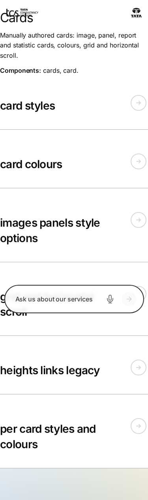

*Figure: Cards: cards — mobile 375 × 812 (/design-block-master/en/block-library/cards, captured 2026-11-08).*

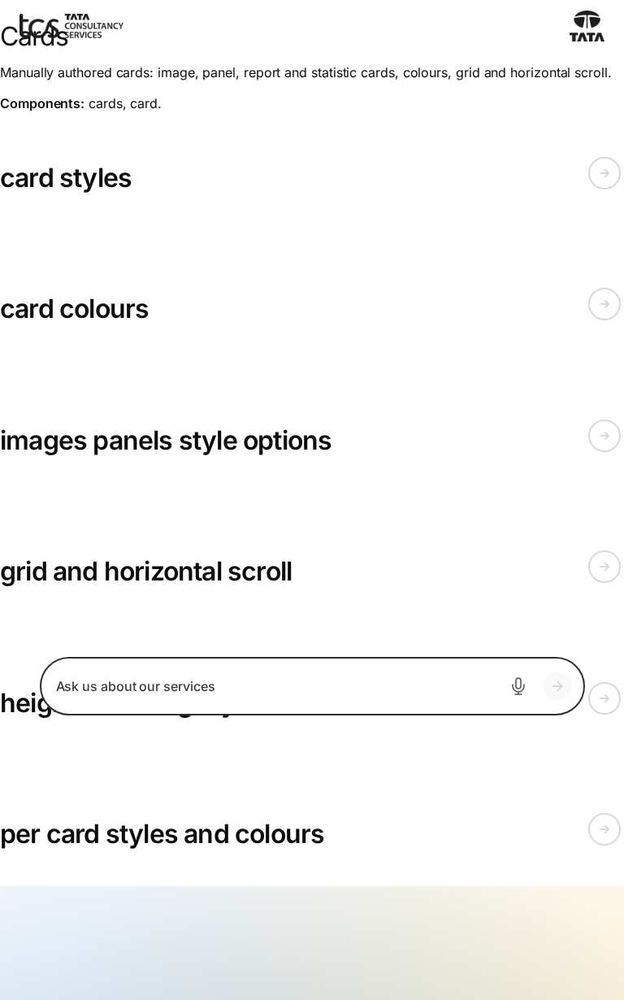

*Figure: Cards: cards — tablet 768 × 900 (/design-block-master/en/block-library/cards, captured 2026-11-08).*

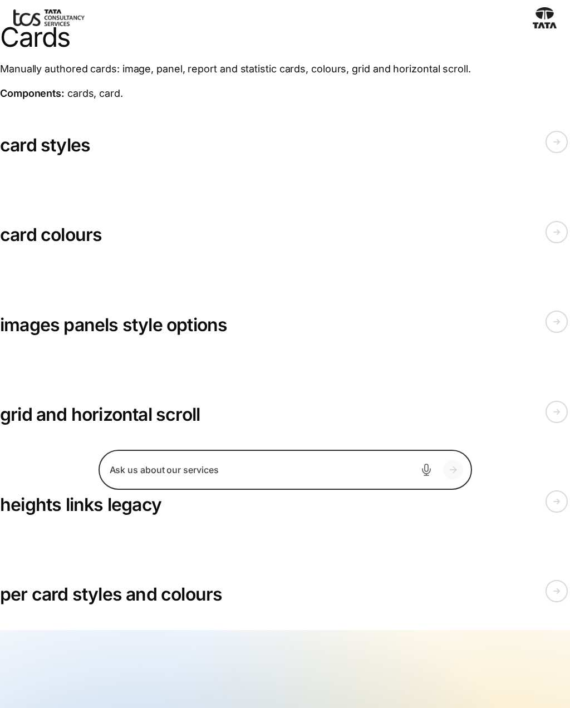

*Figure: Cards: cards — small desktop 1024 × 900 (/design-block-master/en/block-library/cards, captured 2026-11-08).*

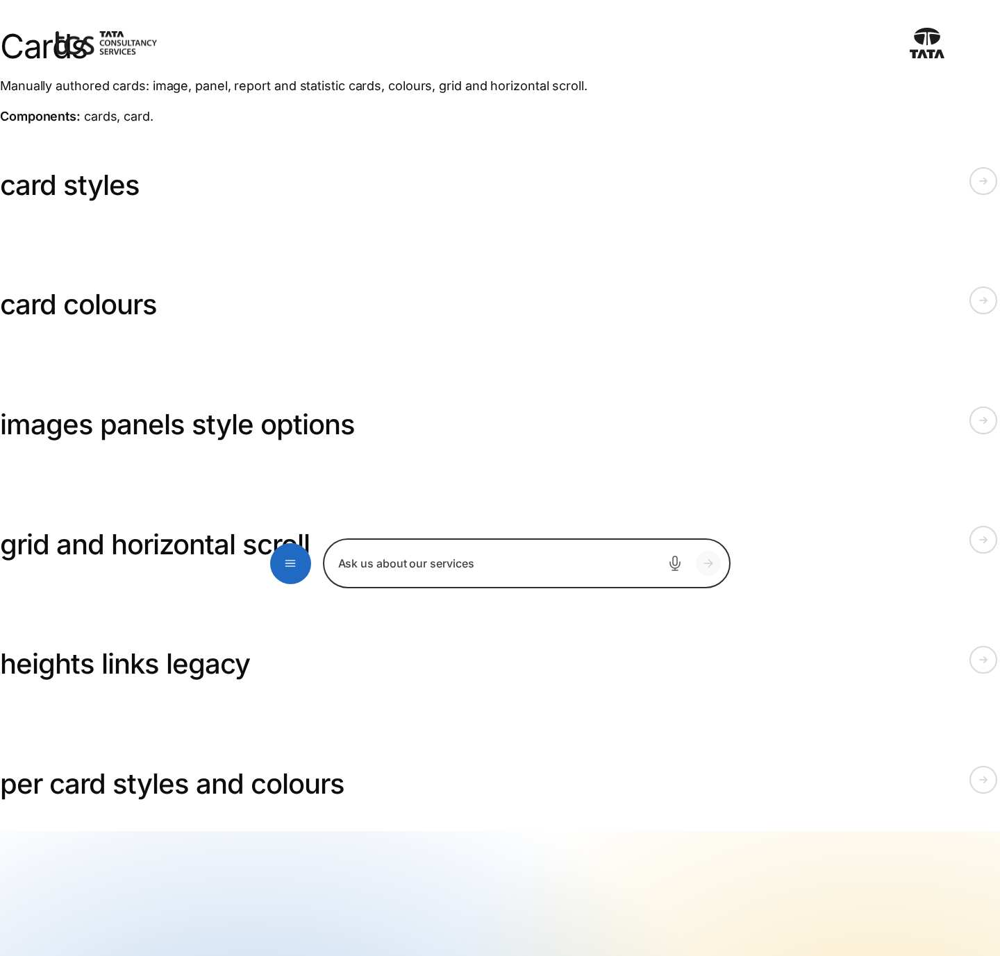

*Figure: Cards: cards — desktop 1440 × 900 (/design-block-master/en/block-library/cards, captured 2026-11-08).*

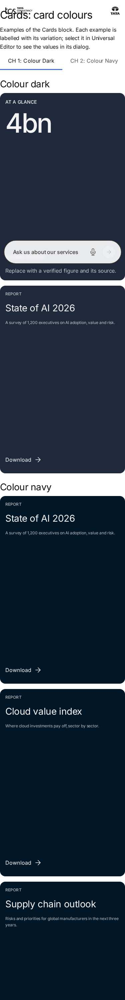

*Figure: Cards: cards/card-colours — mobile 375 × 812 (/design-block-master/en/block-library/cards/card-colours, captured 2026-11-08).*

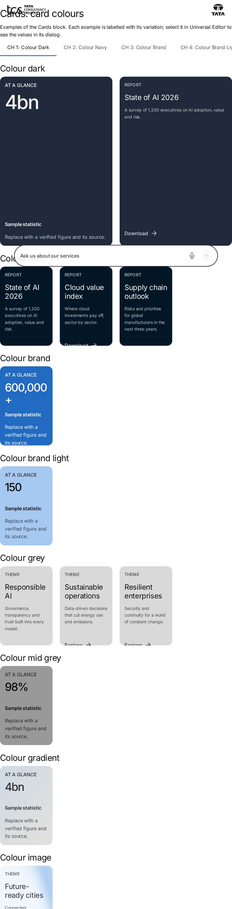

*Figure: Cards: cards/card-colours — tablet 768 × 900 (/design-block-master/en/block-library/cards/card-colours, captured 2026-11-08).*

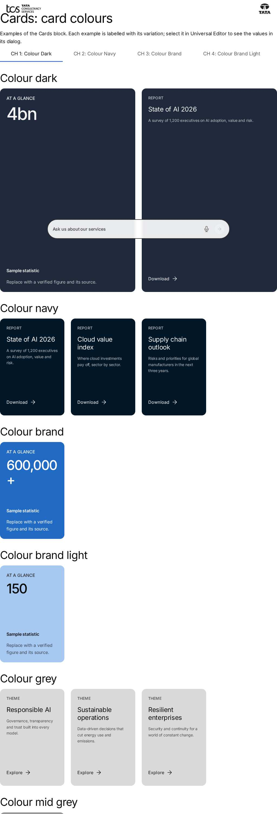

*Figure: Cards: cards/card-colours — small desktop 1024 × 900 (/design-block-master/en/block-library/cards/card-colours, captured 2026-11-08).*

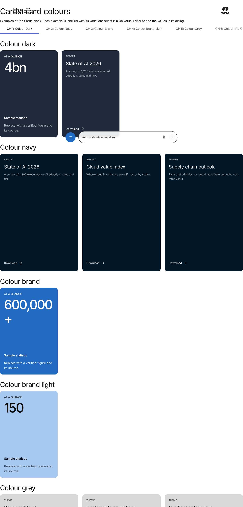

*Figure: Cards: cards/card-colours — desktop 1440 × 900 (/design-block-master/en/block-library/cards/card-colours, captured 2026-11-08).*

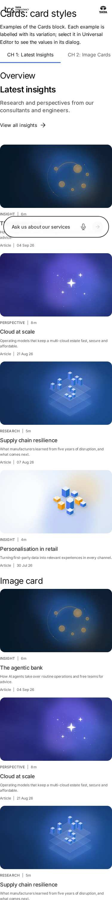

*Figure: Cards: cards/card-styles — mobile 375 × 812 (/design-block-master/en/block-library/cards/card-styles, captured 2026-11-08).*

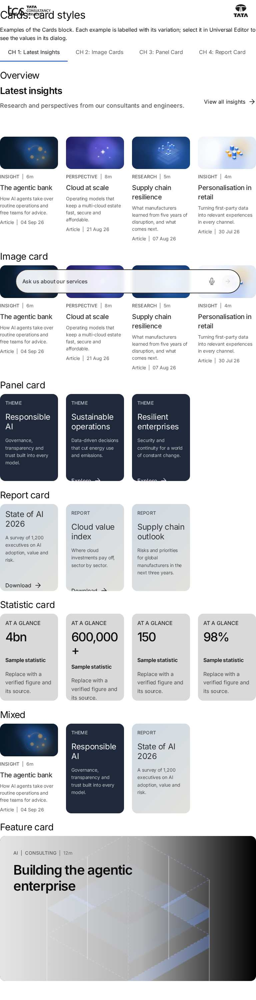

*Figure: Cards: cards/card-styles — tablet 768 × 900 (/design-block-master/en/block-library/cards/card-styles, captured 2026-11-08).*

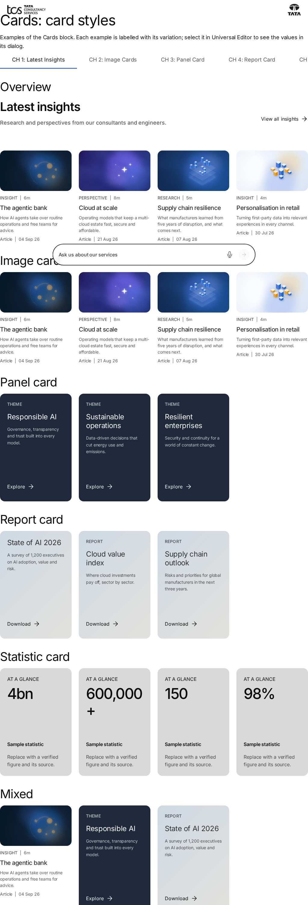

*Figure: Cards: cards/card-styles — small desktop 1024 × 900 (/design-block-master/en/block-library/cards/card-styles, captured 2026-11-08).*

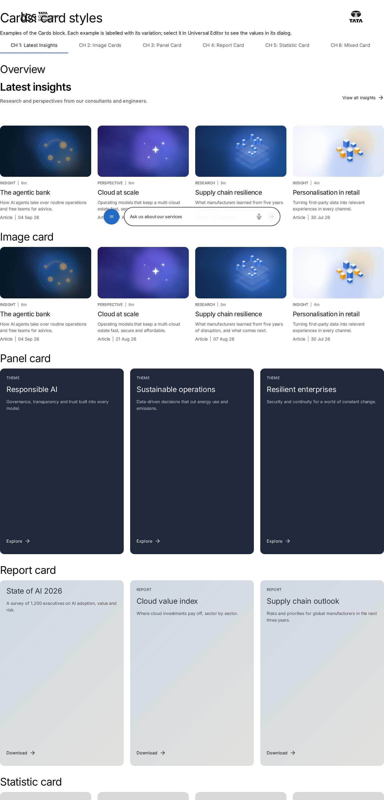

*Figure: Cards: cards/card-styles — desktop 1440 × 900 (/design-block-master/en/block-library/cards/card-styles, captured 2026-11-08).*

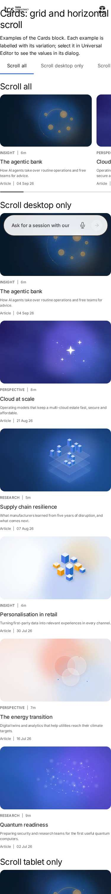

*Figure: Cards: cards/grid-and-horizontal-scroll — mobile 375 × 812 (/design-block-master/en/block-library/cards/grid-and-horizontal-scroll, captured 2026-11-08).*

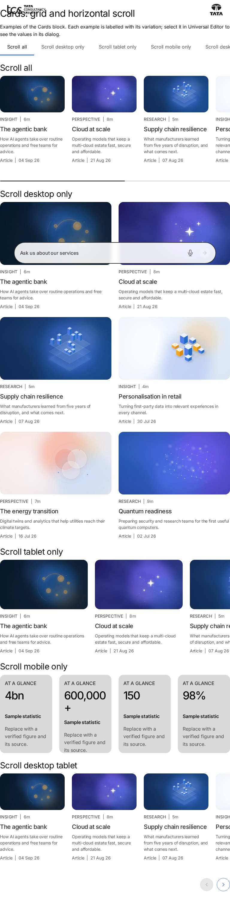

*Figure: Cards: cards/grid-and-horizontal-scroll — tablet 768 × 900 (/design-block-master/en/block-library/cards/grid-and-horizontal-scroll, captured 2026-11-08).*

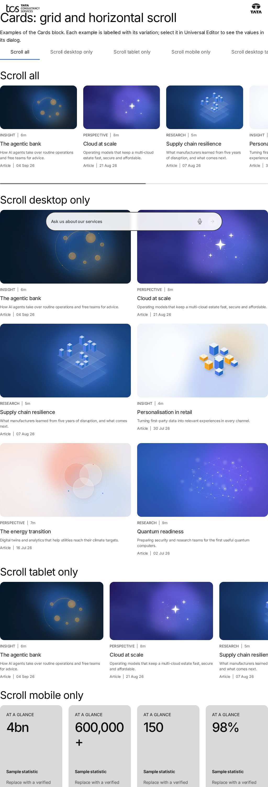

*Figure: Cards: cards/grid-and-horizontal-scroll — small desktop 1024 × 900 (/design-block-master/en/block-library/cards/grid-and-horizontal-scroll, captured 2026-11-08).*

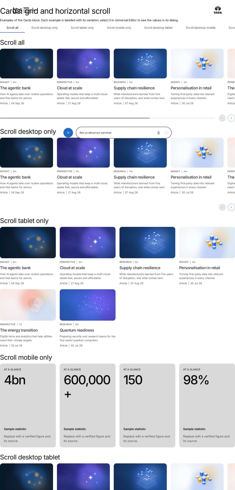

*Figure: Cards: cards/grid-and-horizontal-scroll — desktop 1440 × 900 (/design-block-master/en/block-library/cards/grid-and-horizontal-scroll, captured 2026-11-08).*

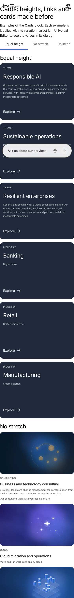

*Figure: Cards: cards/heights-links-legacy — mobile 375 × 812 (/design-block-master/en/block-library/cards/heights-links-legacy, captured 2026-11-08).*

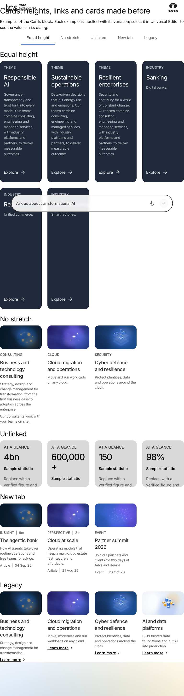

*Figure: Cards: cards/heights-links-legacy — tablet 768 × 900 (/design-block-master/en/block-library/cards/heights-links-legacy, captured 2026-11-08).*

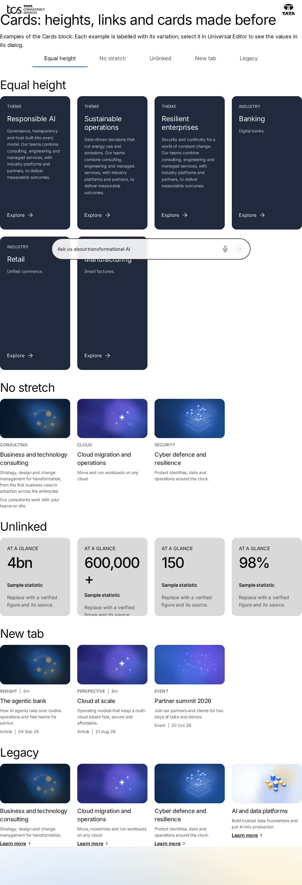

*Figure: Cards: cards/heights-links-legacy — small desktop 1024 × 900 (/design-block-master/en/block-library/cards/heights-links-legacy, captured 2026-11-08).*

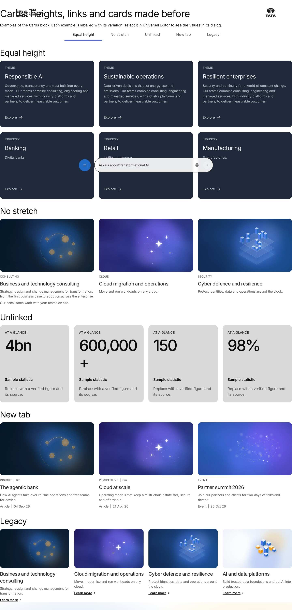

*Figure: Cards: cards/heights-links-legacy — desktop 1440 × 900 (/design-block-master/en/block-library/cards/heights-links-legacy, captured 2026-11-08).*

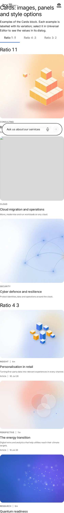

*Figure: Cards: cards/images-panels-style-options — mobile 375 × 812 (/design-block-master/en/block-library/cards/images-panels-style-options, captured 2026-11-08).*

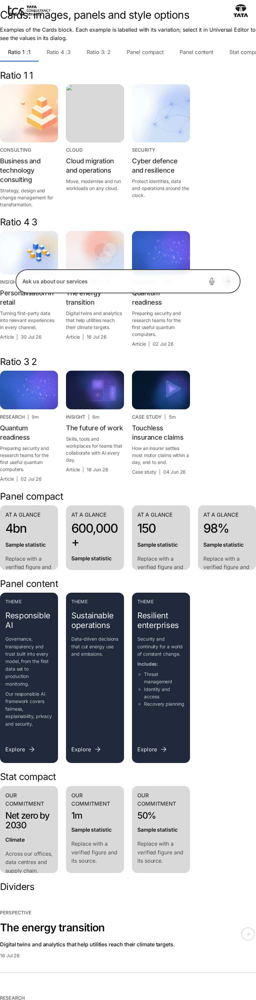

*Figure: Cards: cards/images-panels-style-options — tablet 768 × 900 (/design-block-master/en/block-library/cards/images-panels-style-options, captured 2026-11-08).*

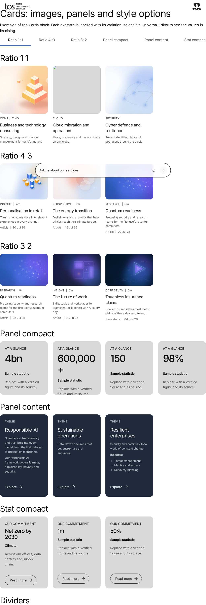

*Figure: Cards: cards/images-panels-style-options — small desktop 1024 × 900 (/design-block-master/en/block-library/cards/images-panels-style-options, captured 2026-11-08).*

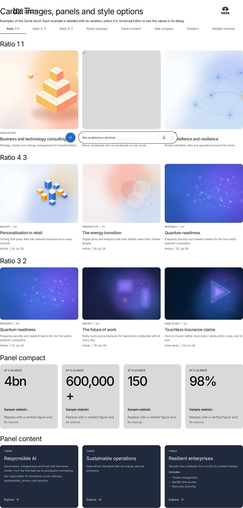

*Figure: Cards: cards/images-panels-style-options — desktop 1440 × 900 (/design-block-master/en/block-library/cards/images-panels-style-options, captured 2026-11-08).*

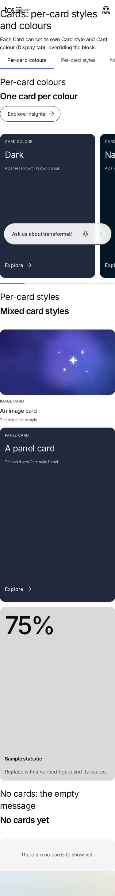

*Figure: Cards: cards/per-card-styles-and-colours — mobile 375 × 812 (/design-block-master/en/block-library/cards/per-card-styles-and-colours, captured 2026-11-08).*

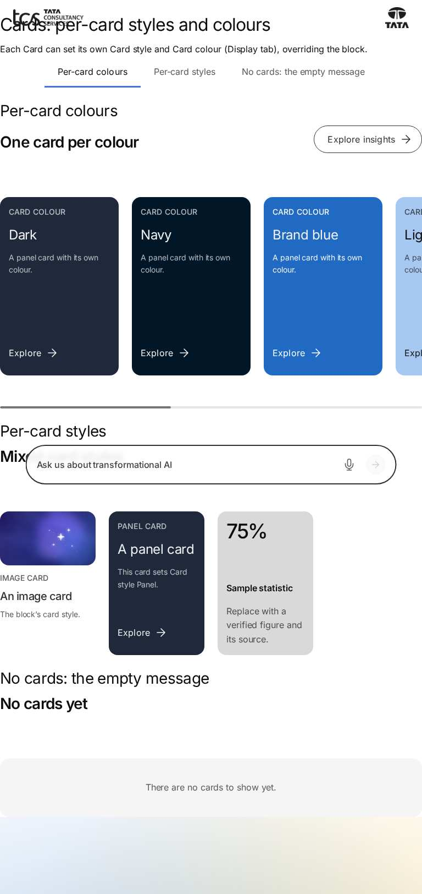

*Figure: Cards: cards/per-card-styles-and-colours — tablet 768 × 900 (/design-block-master/en/block-library/cards/per-card-styles-and-colours, captured 2026-11-08).*

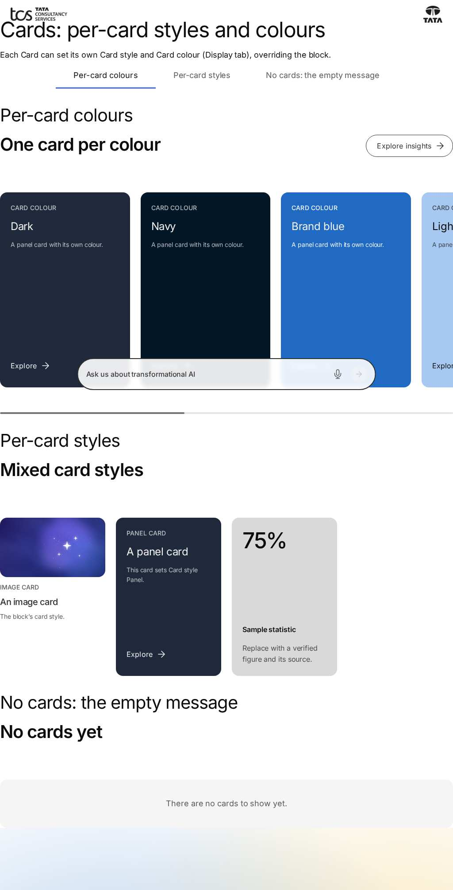

*Figure: Cards: cards/per-card-styles-and-colours — small desktop 1024 × 900 (/design-block-master/en/block-library/cards/per-card-styles-and-colours, captured 2026-11-08).*

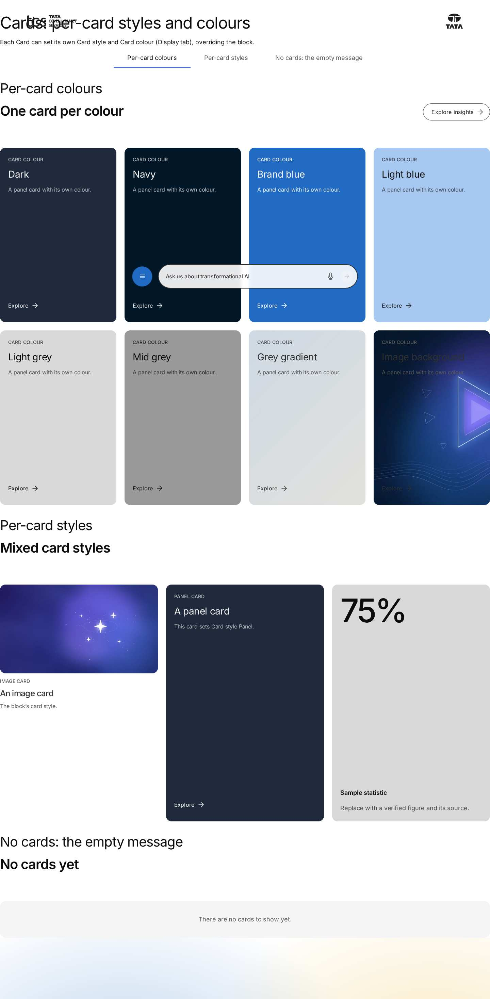

*Figure: Cards: cards/per-card-styles-and-colours — desktop 1440 × 900 (/design-block-master/en/block-library/cards/per-card-styles-and-colours, captured 2026-11-08).*

## Known limitations

- None recorded for this document.

## Open items

- None.

## Change history

| Version | Date | Author | Change |
| --- | --- | --- | --- |
| 1.0 | 13 November 2026 | Delivery team (documentation program) | First version of the role-specific documentation (master documentation prompt), generated from the repository and the published reference pages |
