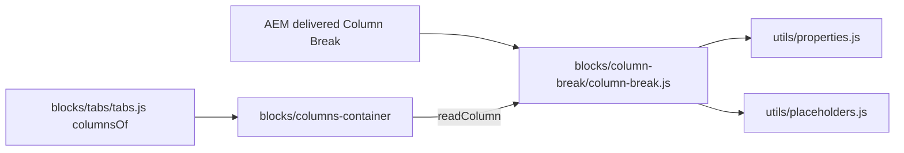

# Column Break Block — Developer Guide

| Attribute | Value |
| --- | --- |
| Document ID | DEV-B-column-break |
| Audience | Developers, technical leads, block owners, AI coding agents |
| Purpose | How the Column Break block is built: files, model, structure, behaviour, variations, tests and limitations |
| Scope | blocks/column-break/ and its components column-break |
| Prerequisites | — |
| Owner | Technical Lead / Block Owner (proposed) |
| Approver | Product Owner (to be confirmed) |
| Version | 1.0 |
| Status | Draft for review |
| Last updated | 8 November 2026 |
| Last validated | 2026-11-08 (model, files, imports from the code; reference pages from the live site) |
| Source files | blocks/column-break/README.md, blocks/column-break/_column-break.json, blocks/column-break/column-break.css, blocks/column-break/column-break.js |
| Related documents | [Variations](./COLUMN-BREAK-VARIATIONS.md), [Test coverage](./COLUMN-BREAK-TEST-COVERAGE.md), [Authoring guide](../../../03-authoring/components/column-break/COLUMN-BREAK-AUTHORING-GUIDE.md) |
| Related AEM paths | — |

## Contents

- [Summary](#summary)
- [Overview](#overview)
- [Source files](#source-files)
- [Components, models and filters](#components-models-and-filters)
- [Fields](#fields)
- [Dependencies](#dependencies)
- [For Developers](#for-developers)
- [Extending the Block](#extending-the-block)
- [Responsive Behavior](#responsive-behavior)
- [Accessibility](#accessibility)
- [Data Layer and Analytics](#data-layer-and-analytics)
- [Performance Considerations](#performance-considerations)
- [Security and Privacy](#security-and-privacy)
- [For Architects](#for-architects)
- [Troubleshooting](#troubleshooting)
- [Known limitations of the block](#known-limitations-of-the-block)
- [Change history of the block](#change-history-of-the-block)
- [Reference pages](#reference-pages)
- [Coverage of the required topics](#coverage-of-the-required-topics)
- [Screenshots](#screenshots)
- [Known limitations](#known-limitations)
- [Open items](#open-items)
- [Change history](#change-history)

## Summary

| Attribute | Value |
| --- | --- |
| Block | Column Break |
| Folder | `blocks/column-break` |
| Type | Child item |
| Category | child-item |
| Status | Active |
| Purpose | Starts a column in a Columns Container or a Tab |
| Variations (summary) | Additional tab options of its column |
| Children | — |
| Code size | 62 lines of JS and CSS |

## Overview

**Business purpose.** Lets authors say "a new column starts here" with the standard components, because Edge Delivery doesn't nest blocks in blocks: a column is a run of sibling components in a section.

**User experience.** Visitors don't see the Column Break; they see its column. Authors see a small label ("Contact details", or "Column 2") at the top of an outlined column in edit mode.

**Templates / page types.** Any page with a Columns Container or a Tabs Container. **Data source:** its own fields.

**Related blocks.** [Columns Container](https://github.com/sradha-tcs/tcs-corp/blob/main/blocks/columns-container/README.md) (builds the columns), [Tabs](https://github.com/sradha-tcs/tcs-corp/blob/main/blocks/tabs/README.md) and [Tab](https://github.com/sradha-tcs/tcs-corp/blob/main/blocks/tab/README.md) (Column Breaks in a tab; the Tab's Columns per row), [Columns](https://github.com/sradha-tcs/tcs-corp/blob/main/blocks/columns/README.md) (the built-in block the Columns Container replaces).

**When to use.** At the start of every column of a Columns Container, and of every column in a tab.

**When not to use.** In a normal Section (it isn't offered there and would build no columns); to add space (use the Additional tab's spacing on the components).

**Realistic use cases.** "Contact details" and "Office map" columns of an offices band; "Image" and "Text" columns in a Cloud tab; hiding one column of a three-column row temporarily.

## Source files

| File | Link |
| --- | --- |
| `README.md` | [GitHub](https://github.com/sradha-tcs/tcs-corp/blob/main/blocks/column-break/README.md) |
| `_column-break.json` | [GitHub](https://github.com/sradha-tcs/tcs-corp/blob/main/blocks/column-break/_column-break.json) |
| `column-break.css` | [GitHub](https://github.com/sradha-tcs/tcs-corp/blob/main/blocks/column-break/column-break.css) |
| `column-break.js` | [GitHub](https://github.com/sradha-tcs/tcs-corp/blob/main/blocks/column-break/column-break.js) |

## Components, models and filters

| Component | Title | Resource type | Template name | Model | Children allowed |
| --- | --- | --- | --- | --- | --- |
| `column-break` | Column Break | `core/franklin/components/block/v1/block` | Column Break | `column-break` | — |

## Fields

The Additional tab fields (anchor, hide, padding, margin, animation) are common to the blocks and described in the [content modeling guide](../../markdown/CONTENT-MODELING-GUIDE.md).

### Column Break (`column-break`)

| Tab | Label | Property | Type | Required in model | Default | Options | Visibility |
| --- | --- | --- | --- | --- | --- | --- | --- |
| Content | Column name | `title` | text | No | — | — | — |

"Required in model" is the model's `required` flag; whether a field is required in practice is stated in the authoring guide where it is known.

## Dependencies

| Import |
| --- |
| `../../utils/placeholders.js` |
| `../../utils/properties.js` |

## For Developers

<!-- BEGIN GENERATED: files (npm run build:docs) -->

```text
blocks/column-break/
├── README.md
├── _column-break.json
├── column-break.css
└── column-break.js
```

| Decorator/Utility | Purpose | Execution or dependency point |
| ----------------- | ------- | ----------------------------- |
| [`utils/placeholders.js`](https://github.com/sradha-tcs/tcs-corp/blob/main/utils/placeholders.js) | `getPlaceholders`, `loadPlaceholders`, `fillPlaceholder` (UI text from the locale's placeholders, with English fallbacks) | `column-break.js`: { getPlaceholders } |
| [`utils/properties.js`](https://github.com/sradha-tcs/tcs-corp/blob/main/utils/properties.js) | `readProperties`, `textOf`, `isOn`, `isOnByDefault` (a toggle that defaults to on), `optionOf`, `normalizeKey`, `textSource` (key-value block properties) | `column-break.js`: { readProperties, textOf } |

<!-- END GENERATED: files -->

**Responsibilities.** `column-break.js` reads the name (`readColumn`, exported for `blocks/columns-container/columns-container.js`) and decorates the marker (label, `data-analytics="off"`). `column-break.css` hides `.column-break` and `.column-break-wrapper` and shows them with the label style under `html.adobe-ue-edit`.

**Input DOM.** A key-value block `div.column-break` with a `title` row; classes from the Additional tab (`anchor-…`, `hideblock`, `p*-N`, `m*-N`); the id from the Anchor ID (`decorators/block-options-decorator.js`).

**Rendered DOM.**

```html
<div class="columns-container-column pt-400" id="anchor-contact">
  <div class="column-break-wrapper">
    <div class="column-break block anchor-contact pt-400" data-column-title="Contact details" data-analytics="off">
      <p class="column-break-label">Contact details</p>
    </div>
  </div>
  <!-- the column's components -->
</div>
```

**Decoration flow.** The Columns Container is loaded before the Column Breaks of its section: it calls `readColumn` (the name is cached on `data-column-title`, so it can be read after the rows are gone), copies `hideblock` and spacing classes to the column and moves the id. Then the Column Break's own `decorate` replaces its rows with `p.column-break-label`: the name, else `columnLabel` with the column's index among the columns.

**Exports.** `readColumn(block)` → `{ title }`; `default decorate(block)`.

**Parent contracts.** Columns Container: a wrapper holding `:scope > .column-break` starts a column. Tabs: `columnsOf` checks for `:scope > .column-break` in a tab's wrappers and builds a `columns-container` block from the first one on.

**Error handling.** No name: the numbered label; no parent column: "Column 1".

## Extending the Block

1. Add a field to `_column-break.json`, run `npm run build:json` and `npm run lint`.
2. A column option: use a `classes_*` field (delivered as a block class) and add its class to `COLUMN_OPTIONS` in `columns-container.js` so it is copied to the column; add its CSS scoped to `.columns-container-column`.
3. A value to read: add it to `readColumn` and cache it on a `data-column-*` attribute. Don't end field names in Text, Title, Type, Alt or MimeType; no sample values in the definition template.
4. Keep the template name "Column Break" (it is the block class; `test/models/block-names.test.mjs` checks template names against block folders).
5. Update this README and run `npm run build:docs`; `npm run build:modules` after changing imports.

## Responsive Behavior

The Column Break's CSS has no media query: it is hidden on the page and shown as a label in edit mode at every width. Its column follows the [Columns Container's responsive behavior](https://github.com/sradha-tcs/tcs-corp/blob/main/blocks/columns-container/README.md#responsive-behavior).

| Viewport | Layout | Image behavior | Interaction behavior |
|---|---|---|---|
| All widths | Hidden on the page; label at the top of its column in edit mode | None | Selectable in the editor |

## Accessibility

- On the page the Column Break and its wrapper are `display: none` (not announced); the label is shown only under `html.adobe-ue-edit`.
- The column keeps the content order at every width.
- A hidden column (Hide block) is removed from the page (`display: none`), not only visually hidden.
- The label text comes from the Column name or the placeholder `columnLabel`.

**Author responsibilities:** a logical order of the columns (also the order on mobile and for screen readers).

**Developer responsibilities:** keep the marker hidden outside edit mode and `data-analytics="off"`; keep the options on the column, not on the marker.

The Column Break handles no keys.

## Data Layer and Analytics

- The Column Break is `data-analytics="off"`: not a component, no events.
- Its column isn't a component either; the blocks in it are components of the Columns Container (`parentId`).
- The path Adobe Client Data Layer → Adobe Data Collection (Tags) → AEP Web SDK → Edge Network → Analytics / CJA is the intended one, but Tags and the Web SDK aren't configured yet (blocked: measurement plan). No consent mechanism is implemented.

| Trigger | Data-layer event | Required properties | Analytics behavior |
|---|---|---|---|
| Page load | None (excluded with `data-analytics="off"`) | — | Not measured |

## Performance Considerations

One placeholders lookup (cached), one small DOM replacement; no network, listeners or observers.

## Security and Privacy

The label is set with `textContent`. No external content or personal data.

## For Architects

- **Role:** a marker block that delimits columns among sibling components (no nested blocks in Edge Delivery).
- **Content model:** key-value block; its `classes_*` fields are delivered (it is a block, not a section).
- **Rendering:** read by the container before its own decoration; values cached in data attributes; the column is a plain element so editor updates of the components in it find their own block.
- **Data layer / Target / consent:** none. **Performance / security:** negligible.



## Troubleshooting

| Symptom | Likely cause | Diagnostic steps | Resolution | Verification |
|---|---|---|---|---|
| No columns | The Column Break is in a normal Section | Check the section class | Use a Columns Container | Columns appear |
| Label visible on the page | Edit mode (`html.adobe-ue-edit`) or CSS not loaded | Check the published page | — | Hidden on the page |
| Option changes not shown in the editor | Applied when the section is rendered again (R-C-7) | Reload | Reload | Applied |
| Content in the wrong column | Its position in the tree | Check the tree order | Move it after its Column Break | Correct column |
| Anchor link doesn't jump | Anchor ID taken (suffix `-2`) or mistyped | Inspect the column id | Use a unique ID | Link jumps |

Evidence to collect: page URL, the column's classes and id, the Column Break's `data-column-title`.

## Known limitations of the block

| Limitation | Impact | Workaround | Planned correction |
|---|---|---|---|
| Option changes (Anchor ID, Hide block, spacing) apply after the section is rendered again (re-audit R-C-7, deferred) | No immediate feedback in the editor | Reload the editor | Not recorded |
| Columns have no own width | All columns of a row are equal | Use the container's Columns per row | Not planned |
| The `column` legacy rename is done only in Columns Container sections | Items named "Column" in tabs aren't Column Breaks | Replace them with Column Breaks | Not recorded |

## Change history of the block

| Version | Change | Source | Date |
|---|---|---|---|
| Not recorded | README generated from verified implementation and approved handover documentation | Repository review | Not recorded |
| Handover 2.24 | The Column item became Column Break (its template name is its block class); columns are plain wrappers with the Column Break as label; "Column" content still works (F-99) | docs/handover revision history | 19 October 2026 |
| Handover 2.28 | Column Breaks in a Tabs Container tab lay its content out in columns | docs/handover revision history | 20 October 2026 |

## Reference pages

| Kind | Page | Live URL |
| --- | --- | --- |
| Curated design page | /design-block-master/en/curated-design-pages/industry-landing-page | https://main--tcs-corp--sradha-tcs.aem.live/design-block-master/en/curated-design-pages/industry-landing-page |
| Curated design page | /design-block-master/en/curated-design-pages/services | https://main--tcs-corp--sradha-tcs.aem.live/design-block-master/en/curated-design-pages/services |
| Curated design page | /design-block-master/en/curated-design-pages/story | https://main--tcs-corp--sradha-tcs.aem.live/design-block-master/en/curated-design-pages/story |
| Curated design page | /design-block-master/en/curated-design-pages/what-we-do | https://main--tcs-corp--sradha-tcs.aem.live/design-block-master/en/curated-design-pages/what-we-do |

## Coverage of the required topics

| Topic | Where |
| --- | --- |
| Purpose | Overview |
| Source files | generated: Files |
| Model, definition, filters, children | generated: Components |
| Dependencies | generated: Dependencies |
| Authored input / rendered output / DOM transformation | For Developers |
| Configuration fields, defaults, required fields | generated: Fields |
| Variations | COLUMN-BREAK-VARIATIONS.md |
| Responsive behaviour | Responsive Behavior |
| Accessibility and keyboard | Accessibility |
| Analytics / data layer | Data Layer and Analytics |
| Performance | Performance Considerations |
| Security | Security and Privacy |
| Extending | Extending the Block |
| Known limitations | Known Limitations |
| Troubleshooting | Troubleshooting |
| Tests | COLUMN-BREAK-TEST-COVERAGE.md |
| SEO behaviour | Not recorded |
| Caching considerations | Not recorded (Edge Delivery default caching; no block-specific rule) |
| Ownership | Technical Lead / Block Owner (proposed) |

## Screenshots

> **Screenshot required**
>
> - Required screen: Column Break on its block library page
> - Required role/access: none (published page)
> - Required navigation steps: Open https://main--tcs-corp--sradha-tcs.aem.live/design-block-master/en/block-library/column-break
> - Reason unavailable: No block library page of this block was found under /design-block-master/en/block-library
> - Owner: Content Lead / AEM Authoring Lead (proposed)
> - Target completion date: To be confirmed

## Known limitations

- Universal Editor dialogs were not captured: no author access in this program (see the access blockers).

## Open items

- None.

## Change history

| Version | Date | Author | Change |
| --- | --- | --- | --- |
| 1.0 | 8 November 2026 | Delivery team (documentation program) | First version of the role-specific documentation (master documentation prompt), generated from the repository and the published reference pages |
