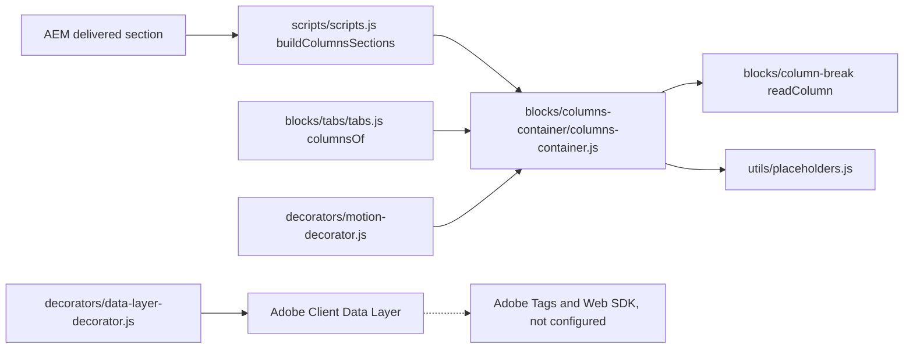
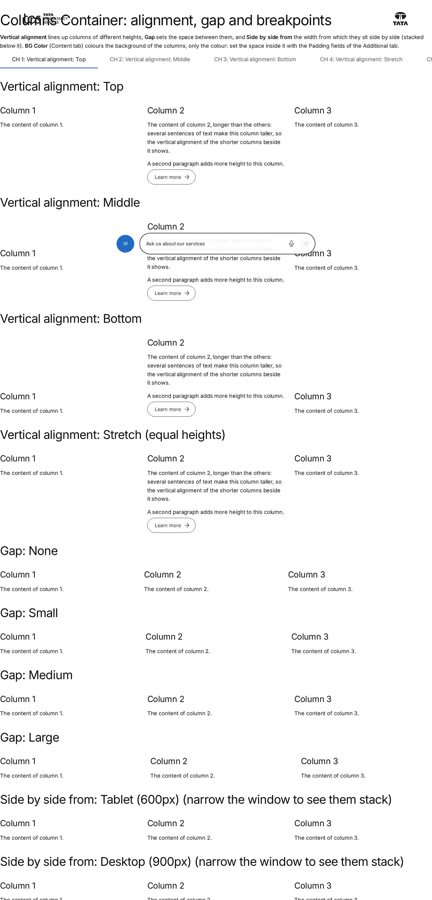
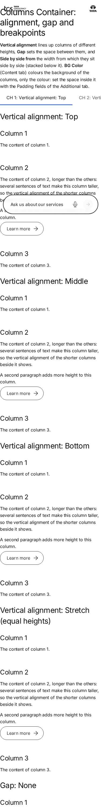

# Columns Container Block — Developer Guide

| Attribute | Value |
| --- | --- |
| Document ID | DEV-B-columns-container |
| Audience | Developers, technical leads, block owners, AI coding agents |
| Purpose | How the Columns Container block is built: files, model, structure, behaviour, variations, tests and limitations |
| Scope | blocks/columns-container/ and its components columns-container |
| Prerequisites | — |
| Owner | Technical Lead / Block Owner (proposed) |
| Approver | Product Owner (to be confirmed) |
| Version | 1.0 |
| Status | Draft for review |
| Last updated | 8 November 2026 |
| Last validated | 2026-11-08 (model, files, imports from the code; reference pages from the live site) |
| Source files | blocks/columns-container/README.md, blocks/columns-container/_columns-container.json, blocks/columns-container/columns-container.css, blocks/columns-container/columns-container.js |
| Related documents | [Variations](./COLUMNS-CONTAINER-VARIATIONS.md), [Test coverage](./COLUMNS-CONTAINER-TEST-COVERAGE.md), [Authoring guide](../../../03-authoring/components/columns-container/COLUMNS-CONTAINER-AUTHORING-GUIDE.md) |
| Related AEM paths | /content/tcs-corp/design-block-master/en/block-library/columns-container, /content/tcs-corp/design-block-master/en/block-library/columns-container/alignment-gap-and-breakpoints, /content/tcs-corp/design-block-master/en/block-library/columns-container/columns-of-blocks |

## Contents

- [Summary](#summary)
- [Overview](#overview)
- [Source files](#source-files)
- [Components, models and filters](#components-models-and-filters)
- [Fields](#fields)
- [Dependencies](#dependencies)
- [For Developers](#for-developers)
- [Extending the Block](#extending-the-block)
- [Responsive Behavior](#responsive-behavior)
- [Accessibility](#accessibility)
- [Data Layer and Analytics](#data-layer-and-analytics)
- [Performance Considerations](#performance-considerations)
- [Security and Privacy](#security-and-privacy)
- [For Architects](#for-architects)
- [Troubleshooting](#troubleshooting)
- [Known limitations of the block](#known-limitations-of-the-block)
- [Change history of the block](#change-history-of-the-block)
- [Reference pages](#reference-pages)
- [Coverage of the required topics](#coverage-of-the-required-topics)
- [Screenshots](#screenshots)
- [Known limitations](#known-limitations)
- [Open items](#open-items)
- [Change history](#change-history)

## Summary

| Attribute | Value |
| --- | --- |
| Block | Columns Container |
| Folder | `blocks/columns-container` |
| Type | Container (section) |
| Category | container |
| Status | Active |
| Purpose | A section laid out in columns of default content and blocks |
| Variations (summary) | Columns per row, gap, vertical alignment, side by side from, BG Color |
| Children | column-break (Column Break), the components of its filter |
| Code size | 194 lines of JS and CSS |

## Overview

**Business purpose.** Put content, including blocks such as Cards, Teasers, Lists or forms, side by side, with a responsive layout chosen by the author, without a purpose-built block.

**User experience.** Columns of equal width, stacked one under the other below the chosen breakpoint and side by side above it, in rows of Columns per row; optionally on a grey, dark or dark green background.

**Templates / page types.** Any page; no template adds it. **Data source:** authored content; placeholders for editor hints.

**Related blocks.** [Column Break](https://github.com/sradha-tcs/tcs-corp/blob/main/blocks/column-break/README.md) (starts each column), [Tabs](https://github.com/sradha-tcs/tcs-corp/blob/main/blocks/tabs/README.md) and [Tab](https://github.com/sradha-tcs/tcs-corp/blob/main/blocks/tab/README.md) (inside a tab, Column Breaks build this block in the panel), [Columns](https://github.com/sradha-tcs/tcs-corp/blob/main/blocks/columns/README.md) (the built-in block it replaces), Teaser (shares the BG Color values).

**When to use.** Two to four pieces of content side by side, especially when a column holds a block; contact details next to a form; a teaser next to a list; three cards of different kinds in a row.

**When not to use.** A grid of similar cards (use Cards or List, which have per-breakpoint column settings); an image with text and calls to action in the design-system style (use Teaser or Hero); tabular data (use Table); columns of unequal widths (the columns are always of equal width).

**Realistic use cases.** An "Our offices" section with an address Text in one column and an embedded map in the other; a dark green band with a heading and text in one column and a Teaser in the other; six highlights in two rows of three.

## Source files

| File | Link |
| --- | --- |
| `README.md` | [GitHub](https://github.com/sradha-tcs/tcs-corp/blob/main/blocks/columns-container/README.md) |
| `_columns-container.json` | [GitHub](https://github.com/sradha-tcs/tcs-corp/blob/main/blocks/columns-container/_columns-container.json) |
| `columns-container.css` | [GitHub](https://github.com/sradha-tcs/tcs-corp/blob/main/blocks/columns-container/columns-container.css) |
| `columns-container.js` | [GitHub](https://github.com/sradha-tcs/tcs-corp/blob/main/blocks/columns-container/columns-container.js) |

## Components, models and filters

| Component | Title | Resource type | Template name | Model | Children allowed |
| --- | --- | --- | --- | --- | --- |
| `columns-container` | Columns Container | `core/franklin/components/section/v1/section` | Columns Container | `columns-container` | column-break, text, image, button-block, title, hero, teaser, image-collage, quote, media-contacts, testimonial, anchor-list, accordion, tabs-block, table, table-list, list, separator, embed, video, modal, form-variations, filter-list, conversation-canvas, cards, fragment |

## Fields

The Additional tab fields (anchor, hide, padding, margin, animation) are common to the blocks and described in the [content modeling guide](../../markdown/CONTENT-MODELING-GUIDE.md).

### Columns Container (`columns-container`)

| Tab | Label | Property | Type | Required in model | Default | Options | Visibility |
| --- | --- | --- | --- | --- | --- | --- | --- |
| Content | Style | `style` | multiselect | No | `columns-container-section` | 2 options | — |
| Content | BG Color | `containerBgColor` | select | No | `""` | 5 options | — |
| Content | Width Type | `sectionWidth` | select | No | `full-width` | 2 options | — |
| Content | Background Image | `backgroundImage` | reference | No | — | — | — |
| Content | Image alt text | `backgroundImageAlt` | text | No | — | — | — |
| Content | Anchor name | `anchorName` | text | No | — | — | — |
| Layout | Columns per row | `columnsPerRow` | select | No | `auto` | 5 options | — |
| Layout | Gap | `columnsGap` | select | No | `medium` | 4 options | — |
| Layout | Vertical alignment | `columnsAlign` | select | No | `top` | 4 options | — |
| Layout | Side by side from | `columnsFrom` | select | No | `desktop` | 3 options | — |
| Additional | Anchor ID | `containerAnchor` | text | No | — | — | — |
| Additional | Hide block | `containerHide` | boolean | No | `false` | — | — |
| Additional | Animation Type | `containerAnimation` | select | No | `""` | 11 options | — |
| Additional | Motion Speed | `containerAnimationSpeed` | select | No | `""` | 3 options | Conditional |
| Additional | Animation Trigger | `containerAnimationTrigger` | select | No | `""` | 2 options | Conditional |
| Additional | Padding left | `containerPaddingLeft` | select | No | `""` | 15 options | — |
| Additional | Padding right | `containerPaddingRight` | select | No | `""` | 15 options | — |
| Additional | Padding top | `containerPaddingTop` | select | No | `""` | 15 options | — |
| Additional | Padding bottom | `containerPaddingBottom` | select | No | `""` | 15 options | — |
| Additional | Margin left | `containerMarginLeft` | select | No | `""` | 15 options | — |
| Additional | Margin right | `containerMarginRight` | select | No | `""` | 15 options | — |
| Additional | Margin top | `containerMarginTop` | select | No | `""` | 15 options | — |
| Additional | Margin bottom | `containerMarginBottom` | select | No | `""` | 15 options | — |

"Required in model" is the model's `required` flag; whether a field is required in practice is stated in the authoring guide where it is known.

## Dependencies

| Import |
| --- |
| `../../utils/placeholders.js` |
| `../column-break/column-break.js` |

## For Developers

<!-- BEGIN GENERATED: files (npm run build:docs) -->

```text
blocks/columns-container/
├── README.md
├── _columns-container.json
├── columns-container.css
└── columns-container.js
```

| Decorator/Utility | Purpose | Execution or dependency point |
| ----------------- | ------- | ----------------------------- |
| [`utils/placeholders.js`](https://github.com/sradha-tcs/tcs-corp/blob/main/utils/placeholders.js) | `getPlaceholders`, `loadPlaceholders`, `fillPlaceholder` (UI text from the locale's placeholders, with English fallbacks) | `columns-container.js`: { getPlaceholders } |
| [`blocks/column-break/column-break.js`](https://github.com/sradha-tcs/tcs-corp/blob/main/blocks/column-break/column-break.js) | — | `columns-container.js`: { readColumn } |

<!-- END GENERATED: files -->

**Responsibilities.**

- `scripts/scripts.js` `buildColumnsSections`: a section with the class `columns-container-section` (added to any section with the container's Layout data attributes) gets a synthetic `div.columns-container`; `.column` blocks are renamed `column-break`; the Layout values become classes (`per-row-{v}`, `gap-{v}`, `align-{v}`, `from-{v}`); `applySectionBlockOptions` adds the `container*` classes (BG Color, anchor, `hideblock`, motion, spacing); `wrapSectionContent` decorates the block while empty and moves the section's wrappers into it (blocks among them are decorated).
- `columns-container.js`: each wrapper holding a `:scope > .column-break` starts a column (`div.columns-container-column`; plain, not a block, so Universal Editor updates of the components in it find their own block); the Column Break's wrapper stays first in its column (the label). `readColumn` caches the Column Break's name; its `hideblock` and spacing classes are copied to the column; its Anchor ID (the id the block options gave it, else the `anchor-` class) moves to the column. An empty column gets `p.columns-container-hint` (`columnEmpty`); no column at all: the hint `columnsContainerEmpty`. The block gets `columns-container-{n}` (`perRow`: `per-row-1`…`4`, else the number of columns, at most `MAX_COLUMNS` 4).
- `columns-container.css`: scoped to `.block.columns-container` (AEM also marks the section of every Columns block `columns-container`, which turned those sections into grids before the block audit of 19 October 2026); a one-column grid, the column template from the breakpoint class; BG Color, gap and alignment classes; blocks fill their column; editor outlines and hints under `html.adobe-ue-edit`; hidden columns.

**Rendered DOM.**

```html
<div class="columns-container block per-row-2 gap-large align-middle from-tablet bg-dark-green pt-1000 columns-container-2">
  <div class="columns-container-column">
    <div class="column-break-wrapper"><div class="column-break block" data-analytics="off">…</div></div>
    <div class="teaser-wrapper">…</div>
  </div>
  <div class="columns-container-column hideblock">…</div>
</div>
```

**Decoration flow.** The section's blocks load in order: the container first (it groups the wrappers), then the Column Breaks (their label uses the column index) and the blocks in the columns. In a tab, `blocks/tabs/tabs.js` creates the block with only `per-row-N` and loads it with `loadBlock`.

**Exports.** `default decorate(block)` only; it imports `readColumn` from `blocks/column-break/column-break.js`.

**Error handling.** No network; missing names or options fall back to defaults.

## Extending the Block

1. **A Layout option:** add the field and options to `_columns-container.json`, run `npm run build:json` and `npm run lint`; read the data attribute in `buildColumnsSections` (add it to the selector that marks container sections) and add the class rule to `columns-container.css` with the `.block.columns-container` scope and the project breakpoints (600 / 900 / 1200px).
2. **Additional tab fields:** sections don't get `classes_*` delivered: use `container*` names; `applySectionBlockOptions` turns their values into classes (`containerhide` → `hideblock`).
3. **Delivery rules:** no field names ending in Text, Title, Type, Alt or MimeType for values to read; no sample values in definition templates; template values are stored on new containers (`columnsGap` medium, `columnsAlign` top, `columnsFrom` desktop, `columnsPerRow` auto).
4. **Motion:** the columns are the motion targets (`CONTENT_TARGETS['columns-container']` in `decorators/motion-decorator.js`); keep `.columns-container-column` or update the decorator.
5. **Theme:** new blocks inside should use the text tokens so they follow the dark backgrounds.
6. **Tests:** `test/motion/motion.test.mjs` checks the container fields (no `classes_*` on the section model); `test/models/block-names.test.mjs` checks that template names render as existing block folders (the "Column" → `column` defect). Check the block library pages listed below.
7. **Backward compatibility:** keep reading `.column` items and ignoring `columnsLayout`.
8. Update this README and run `npm run build:docs`; `npm run build:modules` after changing imports.

## Responsive Behavior

| Viewport | Layout | Image behavior | Interaction behavior |
|---|---|---|---|
| Below 600px | One column: the columns stacked in order, separated by the gap | Images and blocks at the column (full) width | As the components |
| 600px to 899px | Side by side with Side by side from Tablet; stacked otherwise | Fill their column | As the components |
| 900px to 1199px | Side by side with Tablet or Desktop (default); stacked with Large desktop | Fill their column | As the components |
| 1200px and wider | Side by side with every setting, `Columns per row` per row | Fill their column | As the components |

## Accessibility

- **Semantics:** the columns are plain `div`s; the reading and focus order is the authored order at every width. Headings come from the components.
- **Keyboard and focus:** the block handles no keys; focus moves through the components in order.
- **Contrast:** BG Color Dark and Dark green apply the theme contract (light text, link and focus tokens; underlined links in running text; inverted buttons).
- **Background image:** alt text from Image alt text, empty for decorative images.
- **Reduced motion:** the Animation Type doesn't play for visitors who prefer reduced motion, or in the editor.
- **Hidden columns:** Hide block on a Column Break removes the column from the page (`display: none`).
- **Reflow:** columns stack below the breakpoint; `minmax(0, 1fr)` and `min-width: 0` keep wide content inside its column.
- **Editor hints:** shown only in edit mode (placeholders `columnEmpty`, `columnsContainerEmpty`, `columnLabel`).

**Author responsibilities:** a logical order of the columns (it is also the mobile order); headings in sequence; alt text for meaningful images; enough padding on coloured backgrounds.

**Developer responsibilities:** keep the content order; keep the theme tokens for text in new blocks; keep the hints in placeholders and hidden outside edit mode.

## Data Layer and Analytics

- **Component:** the synthetic block is added by `decorators/data-layer-decorator.js` as `tcs-corp/components/columns-container` (id: its Anchor ID, else `columns-container-{n}`; `dc:title`: its first heading). Inside a tab the id is `{panel id}-columns`.
- **Children:** the blocks in the columns are components whose `parentId` is the container. The columns are not components; Column Breaks are `data-analytics="off"`.
- **Events:** the block pushes no events itself; clicks, media, submits in its columns are measured centrally and attributed to the block they're in (default content: to the container).
- **Path:** Adobe Client Data Layer → Adobe Data Collection (Tags) → AEP Web SDK → Edge Network → Analytics / CJA is the intended path, but Tags and the Web SDK aren't configured yet (blocked: measurement plan). No consent mechanism is implemented.

| Trigger | Data-layer event | Required properties | Analytics behavior |
|---|---|---|---|
| Page load | component state | `@type` `tcs-corp/components/columns-container`, `parentId` (page), `dc:title` | Inventory |
| Click on a link or button in a column | `cmp:click` | component (the block in the column, else the container), `xdm:linkURL`, `xdm:linkType`, `breakpoint` | Link / button clicks |

## Performance Considerations

- Synchronous regrouping of existing DOM; one placeholders lookup (cached per locale); no network requests of its own, no listeners or observers.
- Loaded with its section (eager if it is the first section, else lazy); the block's CSS and JS are loaded once per page.
- The section stays hidden until its blocks are loaded, so the regrouping causes no visible layout shift; the column layout is pure CSS.
- The blocks in the columns load as in a section (sequentially in content order); many heavy blocks in one container load one after another.

## Security and Privacy

No external content, query strings or user data; the editor hints are set with `textContent`. The components in the columns have their own handling.

## For Architects

- **Role:** the supported way to put blocks side by side: Edge Delivery allows one level of nesting (blocks and default content in sections), so columns of blocks are a section container whose content is wrapped in a synthetic block, like the Tabs Container and Gen Carousel.
- **Content model:** section model `columns-container` (Layout and `container*` fields delivered as data attributes; Content fields as the Section's); item marker `column-break` (key-value block).
- **Rendering:** client-side regrouping of the delivered section; no data source.
- **Dependencies:** `blocks/column-break` (`readColumn`), `utils/placeholders.js`, `scripts/scripts.js`, `decorators/motion-decorator.js`, `decorators/data-layer-decorator.js`, `styles/styles.css`.
- **Data layer / Web SDK / Target:** ACDL component only; Tags / Web SDK not configured; no Target. **Consent / identity:** none.
- **Caching / security:** no requests of its own. **Scalability:** grid layout; no limit beyond the content.



## Troubleshooting

| Symptom | Likely cause | Diagnostic steps | Resolution | Verification |
|---|---|---|---|---|
| Content shown as a plain section | Not a Columns Container (Style removed and no Layout values) | Inspect the section for `columns-container-section` | Re-select Style Columns Container | Columns appear |
| Everything in one column | No Column Breaks | Check the content tree | Add a Column Break per column | Columns appear |
| An unexpected first column | Content before the first Column Break | Check the tree order | Move it after a Column Break | Expected columns |
| Columns stacked on tablet | Side by side from Desktop (default) | Check the Layout tab; inspect for `from-*` | Choose Tablet (600px) | Side by side at 600px |
| No space inside the colour | BG Color adds no padding | Check the Additional tab | Set Padding | Space inside |
| Padding / Hide / Animation without effect | Fields not delivered (content authored before the `container*` fields) | Inspect the section's `data-container*` attributes | Re-enter the values in the Additional tab | Classes on the block |
| Column Break option change not visible in the editor | Applied when the section is rendered again (R-C-7) | Reload | Reload | Applied |

Evidence to collect (no secrets): page URL, viewport width, the section's classes and `data-*` attributes, the block's classes, console errors.

## Known limitations of the block

| Limitation | Impact | Workaround | Planned correction |
|---|---|---|---|
| Columns are always of equal width (Column widths removed in handover 2.26) | No 1/3 + 2/3 layouts | Use blocks with their own layouts (Teaser image position) | Not planned |
| Column Break option changes apply after the section is rendered again (re-audit R-C-7, deferred) | No immediate feedback in the editor | Reload the editor | Not recorded |
| At most 4 columns per row | Wider rows not possible | More rows | Not planned |
| Inside a tab only Columns per row is authorable | Gap, alignment and breakpoint fixed (Medium, Top, Desktop) | Use a Columns Container section | Not planned |
| A section can't be placed in a column | No Tabs Container, Gen Carousel or Columns Container in a column | Use the Tabs block in a column | Not planned |

## Change history of the block

| Version | Change | Source | Date |
|---|---|---|---|
| Not recorded | README generated from verified implementation and approved handover documentation | Repository review | Not recorded |
| Handover 2.22 | Columns Container introduced: columns of default content and blocks, each started by a Column item; Layout and Additional tab | docs/handover revision history | 19 October 2026 |
| Handover 2.23 | Columns per row (Automatic, 1–4); rows follow from the number of Column items | docs/handover revision history | 19 October 2026 |
| Handover 2.24 | The Column item is Column Break; columns are plain wrappers; content authored with "Column" still works (F-99) | docs/handover revision history | 19 October 2026 |
| Handover 2.25 | The Section's Style, Background Image, Image alt text and Anchor name in the Content tab; a section with the Layout values stays a container | docs/handover revision history | 19 October 2026 |
| Handover 2.26 | Column widths removed; columns are of equal width | docs/handover revision history | 19 October 2026 |
| Handover 2.27 | Block audit: the CSS no longer turns sections with a Columns block into grids | docs/handover revision history | 19 October 2026 |
| Handover 2.28 | Built-in Columns no longer offered; Column Breaks in tabs build a Columns Container | docs/handover revision history | 20 October 2026 |
| Handover 2.30 | Additional tab fields are `container*` (AEM doesn't deliver a section's `classes_*`) | docs/handover revision history | 20 October 2026 |
| Handover 2.32 | BG Color (`containerBgColor`) and Gap None | docs/handover revision history | 20 October 2026 |

## Reference pages

| Kind | Page | Live URL |
| --- | --- | --- |
| Block library | /design-block-master/en/block-library/columns-container | https://main--tcs-corp--sradha-tcs.aem.live/design-block-master/en/block-library/columns-container |
| Block library | /design-block-master/en/block-library/columns-container/alignment-gap-and-breakpoints | https://main--tcs-corp--sradha-tcs.aem.live/design-block-master/en/block-library/columns-container/alignment-gap-and-breakpoints |
| Block library | /design-block-master/en/block-library/columns-container/columns-of-blocks | https://main--tcs-corp--sradha-tcs.aem.live/design-block-master/en/block-library/columns-container/columns-of-blocks |
| Block library | /design-block-master/en/block-library/columns-container/columns-per-row | https://main--tcs-corp--sradha-tcs.aem.live/design-block-master/en/block-library/columns-container/columns-per-row |
| Curated design page | /design-block-master/en/curated-design-pages/industry-landing-page | https://main--tcs-corp--sradha-tcs.aem.live/design-block-master/en/curated-design-pages/industry-landing-page |
| Curated design page | /design-block-master/en/curated-design-pages/services | https://main--tcs-corp--sradha-tcs.aem.live/design-block-master/en/curated-design-pages/services |
| Curated design page | /design-block-master/en/curated-design-pages/story | https://main--tcs-corp--sradha-tcs.aem.live/design-block-master/en/curated-design-pages/story |
| Curated design page | /design-block-master/en/curated-design-pages/what-we-do | https://main--tcs-corp--sradha-tcs.aem.live/design-block-master/en/curated-design-pages/what-we-do |

## Coverage of the required topics

| Topic | Where |
| --- | --- |
| Purpose | Overview |
| Source files | generated: Files |
| Model, definition, filters, children | generated: Components |
| Dependencies | generated: Dependencies |
| Authored input / rendered output / DOM transformation | For Developers |
| Configuration fields, defaults, required fields | generated: Fields |
| Variations | COLUMNS-CONTAINER-VARIATIONS.md |
| Responsive behaviour | Responsive Behavior |
| Accessibility and keyboard | Accessibility |
| Analytics / data layer | Data Layer and Analytics |
| Performance | Performance Considerations |
| Security | Security and Privacy |
| Extending | Extending the Block |
| Known limitations | Known Limitations |
| Troubleshooting | Troubleshooting |
| Tests | COLUMNS-CONTAINER-TEST-COVERAGE.md |
| SEO behaviour | Not recorded |
| Caching considerations | Not recorded (Edge Delivery default caching; no block-specific rule) |
| Ownership | Technical Lead / Block Owner (proposed) |

## Screenshots



*Figure: Columns Container block library page — desktop 1440 × 900 (/design-block-master/en/block-library/columns-container/alignment-gap-and-breakpoints, captured 2026-11-08).*



*Figure: Columns Container block library page — mobile 375 × 812 (/design-block-master/en/block-library/columns-container/alignment-gap-and-breakpoints, captured 2026-11-08).*

## Known limitations

- Universal Editor dialogs were not captured: no author access in this program (see the access blockers).

## Open items

- None.

## Change history

| Version | Date | Author | Change |
| --- | --- | --- | --- |
| 1.0 | 8 November 2026 | Delivery team (documentation program) | First version of the role-specific documentation (master documentation prompt), generated from the repository and the published reference pages |
