# Columns Container Block — Test Coverage

| Attribute | Value |
| --- | --- |
| Document ID | DEV-T-columns-container |
| Audience | Developers, technical leads, block owners, AI coding agents |
| Purpose | Unit tests, automated reference-page checks and manual test guidance for the block |
| Scope | — |
| Prerequisites | — |
| Owner | Technical Lead / Block Owner (proposed) |
| Approver | Product Owner (to be confirmed) |
| Version | 1.0 |
| Status | Draft for review |
| Last updated | 13 November 2026 |
| Last validated | 13 November 2026 |
| Source files | — |
| Related documents | — |
| Related AEM paths | — |

## Contents

- [Unit tests](#unit-tests)
- [Automated checks of the block library pages (executed 13 November 2026)](#automated-checks-of-the-block-library-pages-executed-13-november-2026)
- [Manual test guidance (block README)](#manual-test-guidance-block-readme)
- [Screenshots](#screenshots)
- [Known limitations](#known-limitations)
- [Open items](#open-items)
- [Change history](#change-history)

## Unit tests

No unit test is specific to this block (shared tests: test/models, test/items, test/docs, test/motion).

## Automated checks of the block library pages (executed 13 November 2026)

Per page: HTTP status and horizontal overflow at 375 / 768 / 1024 / 1440 px, console errors, failed requests and DOM accessibility checks at 1440 px (evidence: [screenshot register](../../../SCREENSHOT-REGISTER.md)).

| Page | 375 / 768 / 1024 / 1440 | Console errors | Failed requests | Accessibility (DOM) |
| --- | --- | --- | --- | --- |
| /design-block-master/en/block-library/columns-container | ok / ok / ok / ok | 16 | 16 | 0 img no alt, 0 unnamed buttons, 1 heading skips |
| /design-block-master/en/block-library/columns-container/alignment-gap-and-breakpoints | ok / ok / ok / ok | 4 | 4 | 0 img no alt, 0 unnamed buttons, 0 heading skips |
| /design-block-master/en/block-library/columns-container/columns-of-blocks | ok / ok / overflow / ok | 4 | 4 | 0 img no alt, 0 unnamed buttons, 0 heading skips |
| /design-block-master/en/block-library/columns-container/columns-per-row | ok / ok / ok / ok | 4 | 4 | 0 img no alt, 0 unnamed buttons, 0 heading skips |

## Manual test guidance (block README)

| Test ID | Scenario | Configuration | Expected result |
|---|---|---|---|
| COLUMNS-CONTAINER-QA-01 | Default | 2 Column Breaks with content | Two equal columns from 900px, stacked below, medium gap, top |
| COLUMNS-CONTAINER-QA-02 | Automatic | 5 Column Breaks, Automatic | 4 per row, the fifth in a new row |
| COLUMNS-CONTAINER-QA-03 | Per row | 6 Column Breaks, 3 per row | 2 rows of 3 |
| COLUMNS-CONTAINER-QA-04 | Gap | None, Small, Large | 0, `--space-400`, `--space-1600` |
| COLUMNS-CONTAINER-QA-05 | Alignment | Middle, Bottom, Stretch with columns of different heights | Aligned as chosen side by side |
| COLUMNS-CONTAINER-QA-06 | Breakpoints | Tablet / Desktop / Large at 700px, 1000px, 1300px | Side by side from 600 / 900 / 1200px |
| COLUMNS-CONTAINER-QA-07 | BG Color | Grey, Dark, Dark green | Colour only; light text and buttons on the dark ones |
| COLUMNS-CONTAINER-QA-08 | Grey inside dark | Grey Teaser in a Dark green container | Dark text in the Teaser |
| COLUMNS-CONTAINER-QA-09 | Content before the first Column Break | A Text first | A first column of its own |
| COLUMNS-CONTAINER-QA-10 | Hidden column | Hide block on a Column Break | Column absent on the page, dimmed in edit mode |
| COLUMNS-CONTAINER-QA-11 | Column anchor | Anchor ID `anchor-contact` on a Column Break | The column has id `anchor-contact` |
| COLUMNS-CONTAINER-QA-12 | Container Additional tab | Anchor ID, Padding, Hide block, Animation | Classes on the block; Hide hides the section; columns animate in sequence |
| COLUMNS-CONTAINER-QA-13 | Style removed | Remove Columns Container from Style, keep Layout values | Still a Columns Container |
| COLUMNS-CONTAINER-QA-14 | Empty | No content | Nothing on the page; hint in edit mode |
| COLUMNS-CONTAINER-QA-15 | Editor | Edit a component in a column | Updated in place |
| COLUMNS-CONTAINER-QA-16 | In a tab | Column Breaks in a Tabs Container tab | Columns in the panel; id `{panel}-columns` |
| COLUMNS-CONTAINER-QA-17 | Legacy | Items rendered as `column` | Read as Column Breaks |
| COLUMNS-CONTAINER-QA-18 | Multiple instances | Two containers on a page | Independent layouts; data-layer ids `columns-container-1`, `columns-container-2` (without Anchor IDs) |
| COLUMNS-CONTAINER-QA-19 | Keyboard | Tab through the columns | Order follows the content |

Test cases: [05-quality-assurance/test-cases/blocks/columns-container](../../../05-quality-assurance/test-cases/blocks/columns-container/COLUMNS-CONTAINER-TEST-CASES.md).

## Screenshots

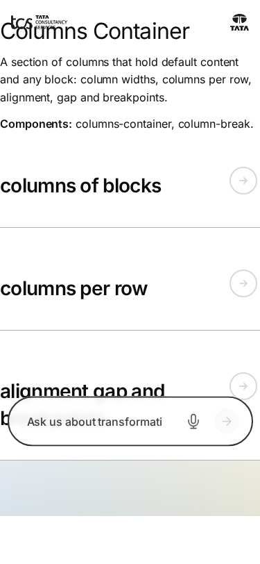

*Figure: Columns Container: columns-container — mobile 375 × 812 (/design-block-master/en/block-library/columns-container, captured 2026-11-08).*

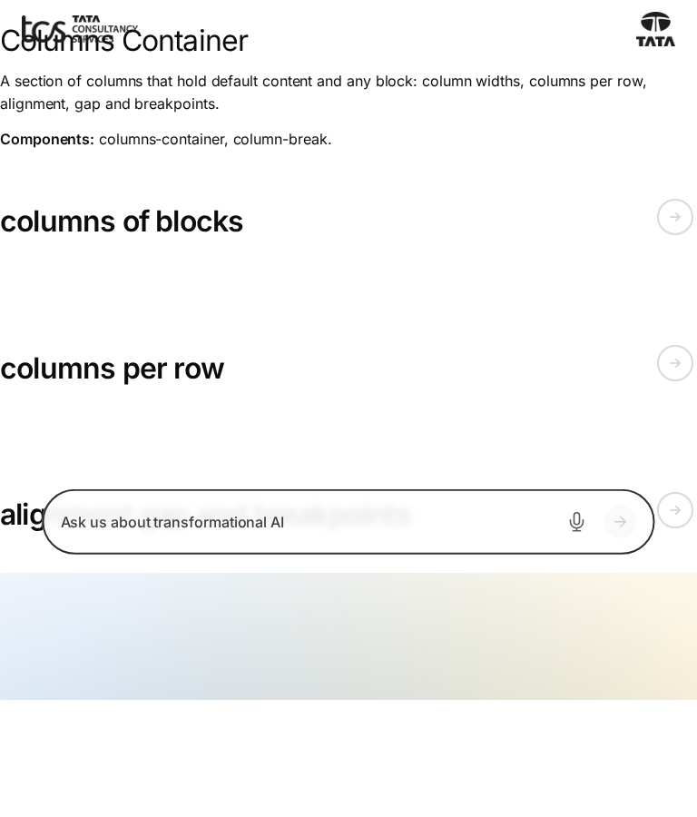

*Figure: Columns Container: columns-container — tablet 768 × 900 (/design-block-master/en/block-library/columns-container, captured 2026-11-08).*

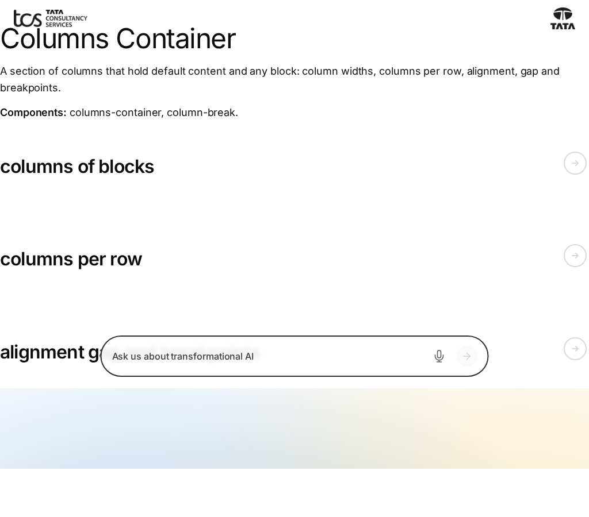

*Figure: Columns Container: columns-container — small desktop 1024 × 900 (/design-block-master/en/block-library/columns-container, captured 2026-11-08).*

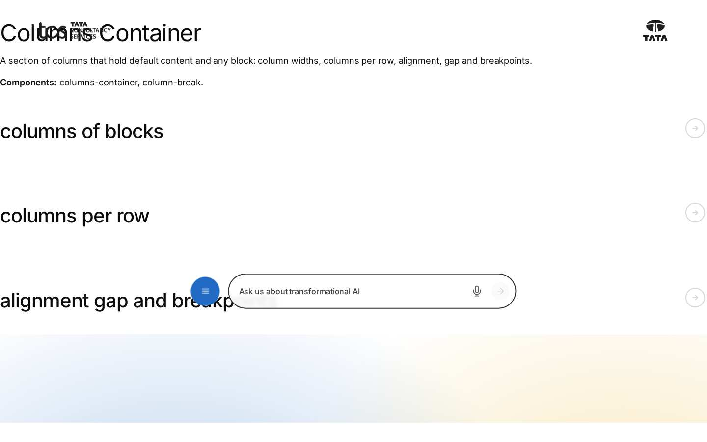

*Figure: Columns Container: columns-container — desktop 1440 × 900 (/design-block-master/en/block-library/columns-container, captured 2026-11-08).*

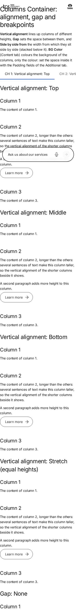

*Figure: Columns Container: columns-container/alignment-gap-and-breakpoints — mobile 375 × 812 (/design-block-master/en/block-library/columns-container/alignment-gap-and-breakpoints, captured 2026-11-08).*

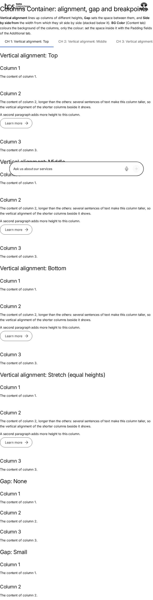

*Figure: Columns Container: columns-container/alignment-gap-and-breakpoints — tablet 768 × 900 (/design-block-master/en/block-library/columns-container/alignment-gap-and-breakpoints, captured 2026-11-08).*

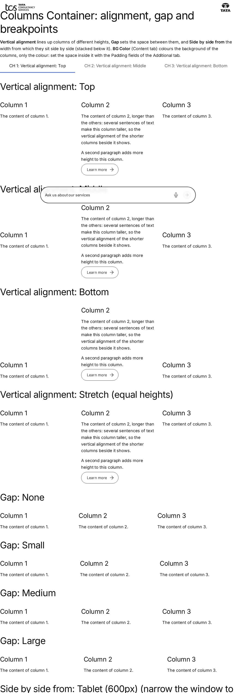

*Figure: Columns Container: columns-container/alignment-gap-and-breakpoints — small desktop 1024 × 900 (/design-block-master/en/block-library/columns-container/alignment-gap-and-breakpoints, captured 2026-11-08).*

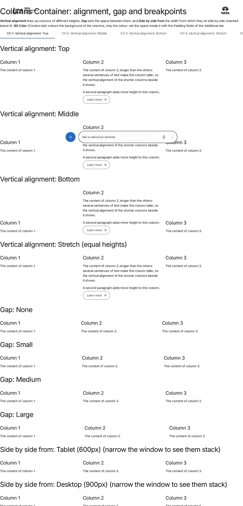

*Figure: Columns Container: columns-container/alignment-gap-and-breakpoints — desktop 1440 × 900 (/design-block-master/en/block-library/columns-container/alignment-gap-and-breakpoints, captured 2026-11-08).*

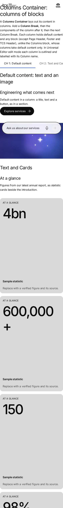

*Figure: Columns Container: columns-container/columns-of-blocks — mobile 375 × 812 (/design-block-master/en/block-library/columns-container/columns-of-blocks, captured 2026-11-08).*

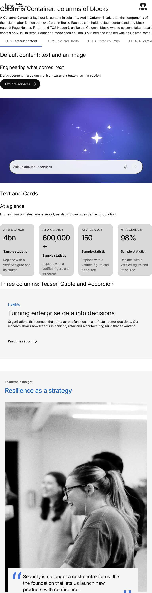

*Figure: Columns Container: columns-container/columns-of-blocks — tablet 768 × 900 (/design-block-master/en/block-library/columns-container/columns-of-blocks, captured 2026-11-08).*

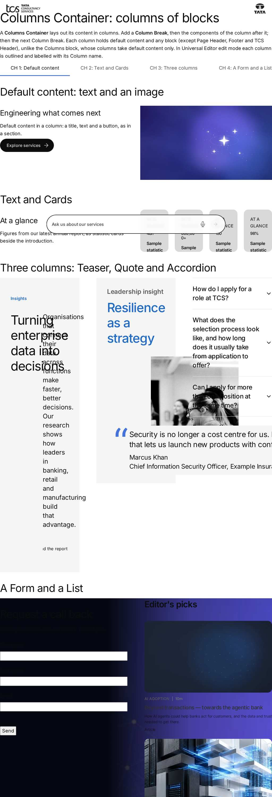

*Figure: Columns Container: columns-container/columns-of-blocks — small desktop 1024 × 900 (/design-block-master/en/block-library/columns-container/columns-of-blocks, captured 2026-11-08).*

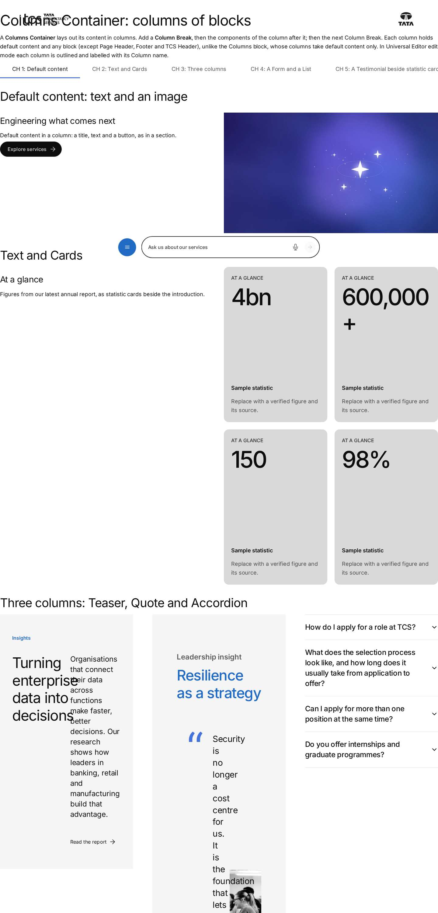

*Figure: Columns Container: columns-container/columns-of-blocks — desktop 1440 × 900 (/design-block-master/en/block-library/columns-container/columns-of-blocks, captured 2026-11-08).*

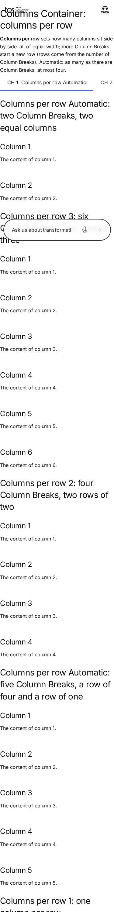

*Figure: Columns Container: columns-container/columns-per-row — mobile 375 × 812 (/design-block-master/en/block-library/columns-container/columns-per-row, captured 2026-11-08).*

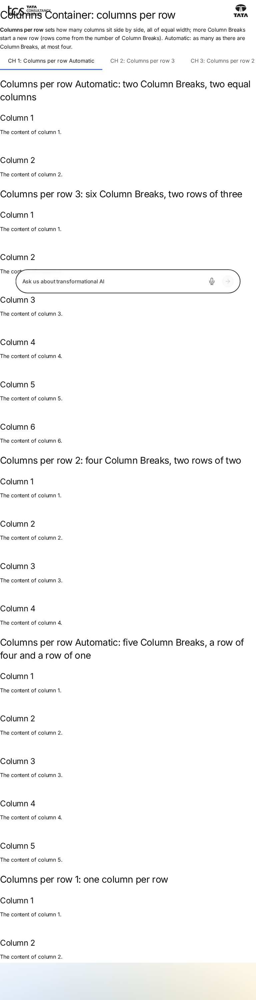

*Figure: Columns Container: columns-container/columns-per-row — tablet 768 × 900 (/design-block-master/en/block-library/columns-container/columns-per-row, captured 2026-11-08).*

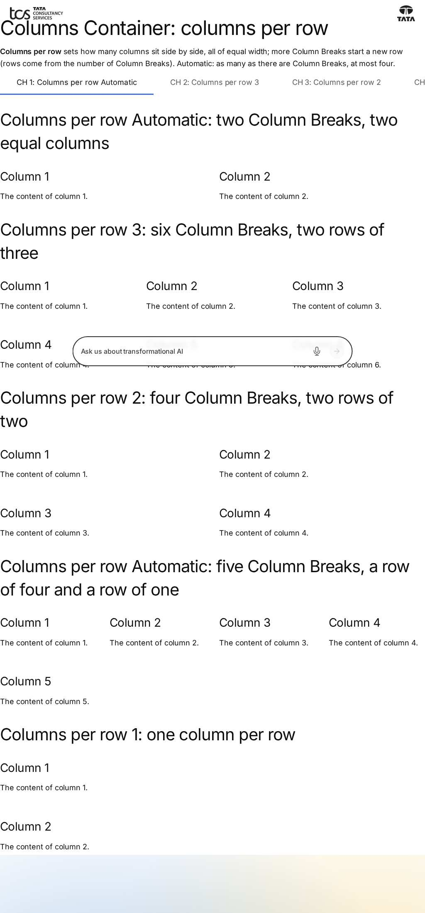

*Figure: Columns Container: columns-container/columns-per-row — small desktop 1024 × 900 (/design-block-master/en/block-library/columns-container/columns-per-row, captured 2026-11-08).*

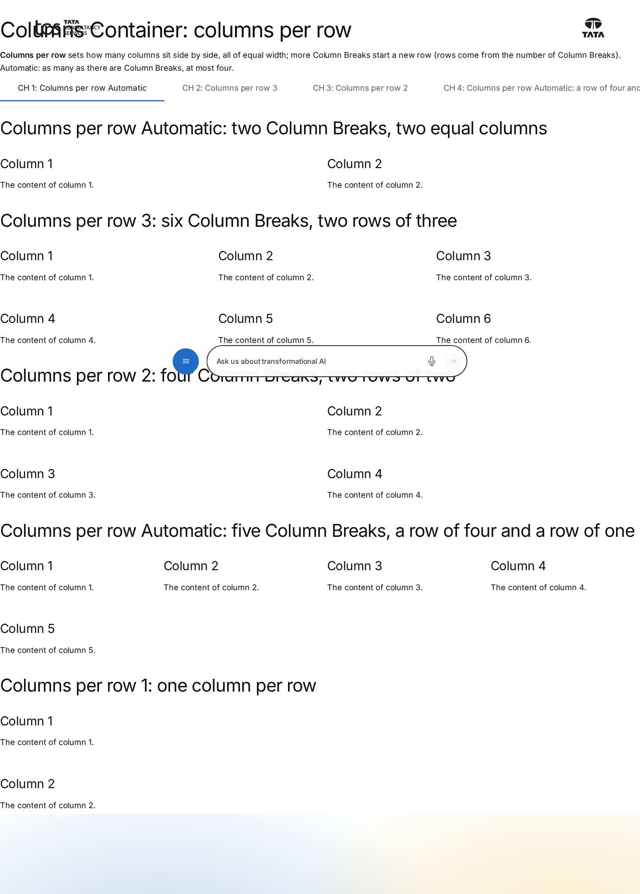

*Figure: Columns Container: columns-container/columns-per-row — desktop 1440 × 900 (/design-block-master/en/block-library/columns-container/columns-per-row, captured 2026-11-08).*

## Known limitations

- None recorded for this document.

## Open items

- None.

## Change history

| Version | Date | Author | Change |
| --- | --- | --- | --- |
| 1.0 | 13 November 2026 | Delivery team (documentation program) | First version of the role-specific documentation (master documentation prompt), generated from the repository and the published reference pages |
