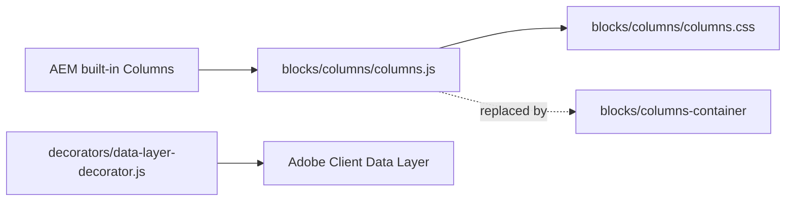
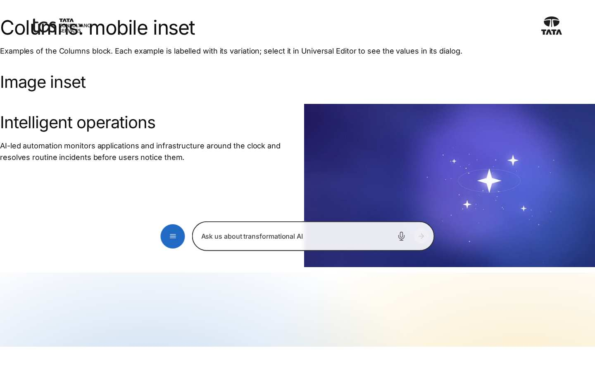
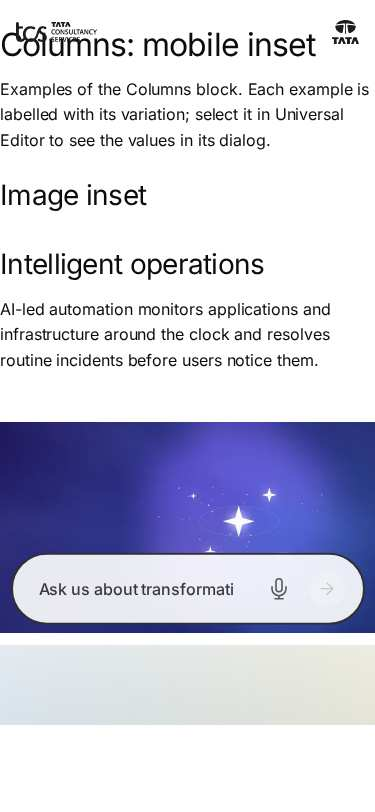
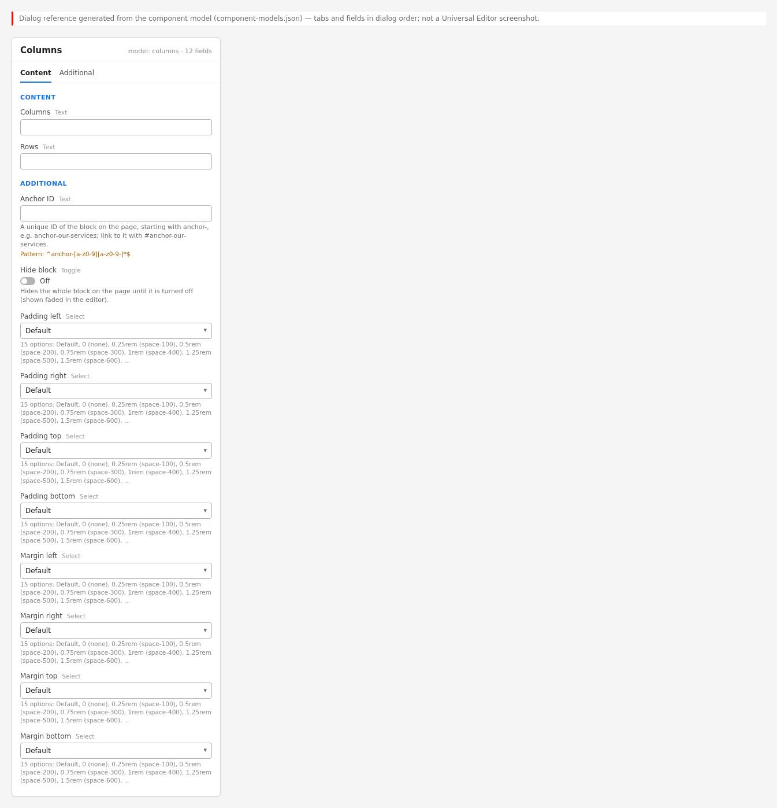

# Columns Block — Developer Guide

| Attribute | Value |
| --- | --- |
| Document ID | DEV-B-columns |
| Audience | Developers, technical leads, block owners, AI coding agents |
| Purpose | How the Columns block is built: files, model, structure, behaviour, variations, tests and limitations |
| Scope | blocks/columns/ and its components columns |
| Prerequisites | — |
| Owner | Technical Lead / Block Owner (proposed) |
| Approver | Product Owner (to be confirmed) |
| Version | 1.0 |
| Status | Draft for review |
| Last updated | 8 November 2026 |
| Last validated | 2026-11-08 (model, files, imports from the code; reference pages from the live site) |
| Source files | blocks/columns/README.md, blocks/columns/_columns.json, blocks/columns/columns.css, blocks/columns/columns.js |
| Related documents | [Variations](./COLUMNS-VARIATIONS.md), [Test coverage](./COLUMNS-TEST-COVERAGE.md), [Authoring guide](../../../03-authoring/components/columns/COLUMNS-AUTHORING-GUIDE.md) |
| Related AEM paths | /content/tcs-corp/design-block-master/en/block-library/columns, /content/tcs-corp/design-block-master/en/block-library/columns/columns-mobile-inset, /content/tcs-corp/design-block-master/en/block-library/columns/columns-variations |

## Contents

- [Summary](#summary)
- [Overview](#overview)
- [Source files](#source-files)
- [Components, models and filters](#components-models-and-filters)
- [Fields](#fields)
- [Dependencies](#dependencies)
- [For Developers](#for-developers)
- [Extending the Block](#extending-the-block)
- [Responsive Behavior](#responsive-behavior)
- [Accessibility](#accessibility)
- [Data Layer and Analytics](#data-layer-and-analytics)
- [Performance Considerations](#performance-considerations)
- [Security and Privacy](#security-and-privacy)
- [For Architects](#for-architects)
- [Troubleshooting](#troubleshooting)
- [Known limitations of the block](#known-limitations-of-the-block)
- [Change history of the block](#change-history-of-the-block)
- [Reference pages](#reference-pages)
- [Coverage of the required topics](#coverage-of-the-required-topics)
- [Screenshots](#screenshots)
- [Known limitations](#known-limitations)
- [Open items](#open-items)
- [Change history](#change-history)

## Summary

| Attribute | Value |
| --- | --- |
| Block | Columns |
| Folder | `blocks/columns` |
| Type | Independent |
| Category | deprecated |
| Status | Compatibility-only |
| Purpose | The built-in Columns block: columns of default content |
| Variations (summary) | Columns and rows of the built-in component |
| Children | — |
| Code size | 54 lines of JS and CSS |

## Overview

**Business purpose (historical).** Simple side-by-side default content (image and text, two or three text columns, rows of image and text pairs) without a purpose-built block.

**Why it is deprecated.** Its columns take default content only (Edge Delivery has no blocks inside blocks) and AEM doesn't deliver an Additional tab (`classes_*`) for the built-in Columns component, so anchors, spacing, hiding and animation can't be set on it. The Columns Container holds any block in its columns and has the full layout and Additional tab options.

**Current behavior.** Existing Columns render as before: columns stacked on mobile and tablet, side by side with equal widths from 900px; an image-only column is shown first when stacked. Existing Columns remain editable (their cells still accept Text, Image and Title).

**Templates / page types.** Any page with Columns authored before. **Data source:** authored content.

**Related blocks.** [Columns Container](https://github.com/sradha-tcs/tcs-corp/blob/main/blocks/columns-container/README.md) (replacement), [Column Break](https://github.com/sradha-tcs/tcs-corp/blob/main/blocks/column-break/README.md), [Tabs](https://github.com/sradha-tcs/tcs-corp/blob/main/blocks/tabs/README.md) (Tabs Containers authored before may hold Columns; new tab columns use Column Breaks).

**When to use.** Only to maintain existing content until it is migrated.

**When not to use.** For any new layout: use the Columns Container (or Cards, List, Teaser where they fit).

## Source files

| File | Link |
| --- | --- |
| `README.md` | [GitHub](https://github.com/sradha-tcs/tcs-corp/blob/main/blocks/columns/README.md) |
| `_columns.json` | [GitHub](https://github.com/sradha-tcs/tcs-corp/blob/main/blocks/columns/_columns.json) |
| `columns.css` | [GitHub](https://github.com/sradha-tcs/tcs-corp/blob/main/blocks/columns/columns.css) |
| `columns.js` | [GitHub](https://github.com/sradha-tcs/tcs-corp/blob/main/blocks/columns/columns.js) |

## Components, models and filters

| Component | Title | Resource type | Template name | Model | Children allowed |
| --- | --- | --- | --- | --- | --- |
| `columns` | Columns | `core/franklin/components/columns/v1/columns` | — | `columns` | column |

## Fields

The Additional tab fields (anchor, hide, padding, margin, animation) are common to the blocks and described in the [content modeling guide](../../markdown/CONTENT-MODELING-GUIDE.md).

### Columns (`columns`)

| Tab | Label | Property | Type | Required in model | Default | Options | Visibility |
| --- | --- | --- | --- | --- | --- | --- | --- |
| Content | Columns | `columns` | text | No | `""` | — | — |
| Content | Rows | `rows` | text | No | `""` | — | — |

"Required in model" is the model's `required` flag; whether a field is required in practice is stated in the authoring guide where it is known.

## Dependencies

| Import |
| --- |

## For Developers

<!-- BEGIN GENERATED: files (npm run build:docs) -->

```text
blocks/columns/
├── README.md
├── _columns.json
├── columns.css
└── columns.js
```

The block imports no shared decorator or utility.

<!-- END GENERATED: files -->

**Responsibilities.** `columns.js` adds `columns-{n}-cols` (cells of the first row) and marks cells whose only child wrapper holds a picture with `columns-img-col`; `columns.css` stacks rows below 900px (image columns first) and lays them out side by side from 900px.

**Input DOM.** The built-in component's block: `div.columns` > a `div` per row > a `div` per cell with default content. No key-value rows, no tab rows, no `classes_*`.

**Rendered DOM.** The same structure with `columns-{n}-cols` on the block and `columns-img-col` on image cells. AEM also marks the block's section `columns-container` (the boilerplate's `{block}-container` section class), which is why `blocks/columns-container/columns-container.css` is scoped to `.block.columns-container`.

**Exports.** `default decorate(block)`; no imports.

## Extending the Block

Don't extend it: the block is deprecated. Add new layout options to the [Columns Container](https://github.com/sradha-tcs/tcs-corp/blob/main/blocks/columns-container/README.md#extending-the-block). Keep `columns.js` and `columns.css` as they are so existing content renders unchanged; the definition, model and `columns` / `column` filters must stay so existing Columns remain editable. Don't add the component back to the `section`, `tabs` or `columns-container` filters. If the files change, run `npm run lint`, `npm run build:docs` and, after changing imports, `npm run build:modules`.

## Responsive Behavior

| Viewport | Layout | Image behavior | Interaction behavior |
|---|---|---|---|
| Below 900px | Each row stacked (one column under the other); image-only columns first | Images full width | None |
| 900px and wider | Columns side by side, equal widths (`flex: 1`), vertically centred, `gap: 1.5rem` | Images fill their column | None |

## Accessibility

- Plain `div` rows and cells; the order is the content order, except that image-only cells are shown first when stacked (visual order only: screen readers and keyboard follow the content order).
- No keyboard handling of its own; headings and alt text come from the content.

**Author responsibilities:** alt text, heading order, a sensible order of the cells.

**Developer responsibilities:** don't change the rendering of existing content; send new needs to the Columns Container.

## Data Layer and Analytics

- Component `tcs-corp/components/columns` (added by `decorators/data-layer-decorator.js`; id `columns-{n}`, `dc:title` its first heading); clicks on links in it are measured centrally as `cmp:click` of the block.
- The path Adobe Client Data Layer → Adobe Data Collection (Tags) → AEP Web SDK → Edge Network → Analytics / CJA is the intended one, but Tags and the Web SDK aren't configured yet (blocked: measurement plan). No consent mechanism is implemented.

| Trigger | Data-layer event | Required properties | Analytics behavior |
|---|---|---|---|
| Page load | component state | `@type` `tcs-corp/components/columns`, `parentId`, `dc:title` | Inventory |
| Click on a link | `cmp:click` | component (the Columns), `xdm:linkURL`, `xdm:linkType` | Link clicks |

## Performance Considerations

Runs once on decoration, a few class changes; no network, observers or listeners. Images follow the default image handling.

## Security and Privacy

No external content, input or personal data.

## For Architects

- **Role:** legacy component kept for backward compatibility; replaced by the Columns Container section container.
- **Content model:** AEM's built-in columns resource type (rows and cells); no Additional tab delivered.
- **Rendering:** CSS flex layout; no data source, no network, no listeners.
- **Data layer / Target / consent:** ACDL component only; no Target, no consent.



## Troubleshooting

| Symptom | Likely cause | Diagnostic steps | Resolution | Verification |
|---|---|---|---|---|
| Columns not in the Add (+) list | Deprecated, removed from the filters | — | Use a Columns Container | — |
| A block can't be added to a column | The `column` filter allows Text, Image, Title only | — | Migrate to a Columns Container | Block in a column |
| No spacing / anchor / hide options | No Additional tab for the built-in component | — | Migrate to a Columns Container | Options available |
| Image not first on mobile | The cell holds more than the picture | Inspect for `columns-img-col` | Keep the image alone in its cell, or migrate | Image first |
| Columns too narrow | Many cells per row (no wrapping) | Count the cells | Migrate with Columns per row | Columns wrap into rows |

## Known limitations of the block

| Limitation | Impact | Workaround | Planned correction |
|---|---|---|---|
| Columns hold default content only | No blocks in columns | Columns Container | Not planned (deprecated) |
| No Additional tab (AEM doesn't deliver `classes_*` for the built-in Columns) | No anchor, spacing, hide or animation | Columns Container | Not planned (deprecated) |
| Equal widths only, no wrapping into rows | Narrow columns with many cells | Columns Container with Columns per row | Not planned (deprecated) |
| Production content authored before isn't migrated | Two column implementations coexist | Migrate page by page | Not recorded |

## Change history of the block

| Version | Change | Source | Date |
|---|---|---|---|
| Not recorded | README generated from verified implementation and approved handover documentation | Repository review | Not recorded |
| Handover 2.22 | Columns of blocks moved to the new Columns Container; the Columns block keeps default content only | docs/handover revision history | 19 October 2026 |
| Handover 2.27 | Block audit: the Columns Additional tab removed (AEM doesn't deliver it) | docs/handover revision history | 19 October 2026 |
| Handover 2.28 | The built-in Columns is no longer offered; its definition stays for content authored before; library content migrated | docs/handover revision history | 20 October 2026 |

## Reference pages

| Kind | Page | Live URL |
| --- | --- | --- |
| Block library | /design-block-master/en/block-library/columns | https://main--tcs-corp--sradha-tcs.aem.live/design-block-master/en/block-library/columns |
| Block library | /design-block-master/en/block-library/columns/columns-mobile-inset | https://main--tcs-corp--sradha-tcs.aem.live/design-block-master/en/block-library/columns/columns-mobile-inset |
| Block library | /design-block-master/en/block-library/columns/columns-variations | https://main--tcs-corp--sradha-tcs.aem.live/design-block-master/en/block-library/columns/columns-variations |

## Coverage of the required topics

| Topic | Where |
| --- | --- |
| Purpose | Overview |
| Source files | generated: Files |
| Model, definition, filters, children | generated: Components |
| Dependencies | generated: Dependencies |
| Authored input / rendered output / DOM transformation | For Developers |
| Configuration fields, defaults, required fields | generated: Fields |
| Variations | COLUMNS-VARIATIONS.md |
| Responsive behaviour | Responsive Behavior |
| Accessibility and keyboard | Accessibility |
| Analytics / data layer | Data Layer and Analytics |
| Performance | Performance Considerations |
| Security | Security and Privacy |
| Extending | Extending the Block |
| Known limitations | Known Limitations |
| Troubleshooting | Troubleshooting |
| Tests | COLUMNS-TEST-COVERAGE.md |
| SEO behaviour | Not recorded |
| Caching considerations | Not recorded (Edge Delivery default caching; no block-specific rule) |
| Ownership | Technical Lead / Block Owner (proposed) |

## Screenshots



*Figure: Columns block library page — desktop 1440 × 900 (/design-block-master/en/block-library/columns/columns-mobile-inset, captured 2026-11-08).*



*Figure: Columns block library page — mobile 375 × 812 (/design-block-master/en/block-library/columns/columns-mobile-inset, captured 2026-11-08).*


*Figure: Desktop rendering — The Columns block at 1440 px with two equal columns 1.5rem apart: photo-1.svg on the left; on the right, vertically centred, the H2 Cloud transformation, end to end, the paragraph From assessment to migration and managed operations… and the button Explore cloud services. (Sample content on the preview; callout letters as in the Field Entry Table; file screenshots/columns-desktop-view.jpg) (handover screenshot; rendering at the time it was taken).*


*Figure: Tablet rendering — The Columns block at 768 px, stacked: photo-1.svg at full width on top, then the H2 Cloud transformation, end to end, the paragraph and the button Explore cloud services below it. (Sample content on the preview; callout letters as in the Field Entry Table; file screenshots/columns-tablet-view.jpg) (handover screenshot; rendering at the time it was taken).*


*Figure: Mobile rendering — The Columns block at 375 px, stacked within 1.5rem side padding: photo-1.svg first, then the H2 Cloud transformation, end to end, the paragraph and the button Explore cloud services. (Sample content on the preview; callout letters as in the Field Entry Table; file screenshots/columns-mobile-view.jpg) (handover screenshot; rendering at the time it was taken).*


*Figure: Two-column variation — The Columns block at 1440 px with two equal columns: the H3 The challenge and the paragraph about ageing store systems on the left, the H3 The solution and the cloud-native inventory platform paragraph on the right. (Sample content on the preview; callout letters as in the Field Entry Table; file screenshots/columns-two-columns.jpg) (handover screenshot; rendering at the time it was taken).*


*Figure: Three-column variation — The Columns block at 1440 px with three equal columns: the H3s Our mission, Our vision and Our values, each with its one-sentence text. (Sample content on the preview; callout letters as in the Field Entry Table; file screenshots/columns-three-columns.jpg) (handover screenshot; rendering at the time it was taken).*


*Figure: Image column variation — The Columns block at 1440 px: the H2 Intelligent operations and the AI-led automation paragraph on the left, photo-2.svg on the right; an inset shows the same block at 375 px with the image moved above the text. (Sample content on the preview; callout letters as in the Field Entry Table; file screenshots/columns-image-column.jpg) (handover screenshot; rendering at the time it was taken).*


*Figure: Multiple rows variation — The Columns block at 1440 px with three rows of two equal columns: photo-3.svg beside the H3 Discover, the H3 Design beside photo-4.svg, and photo-5.svg beside the H3 Deliver, each heading with its short paragraph, so the image alternates left, right, left. (Sample content on the preview; callout letters as in the Field Entry Table; file screenshots/columns-multiple-rows.jpg) (handover screenshot; rendering at the time it was taken).*

![Universal Editor canvas — The Columns block in Universal Editor edit mode at 1440 px with three columns: the H2 Banking reimagined and its text, square-1.svg, and a text with the button Banking and financial services; letters A on the block, B on a column, C on the title, D on the text and E on the image. An annotated preview, not a Universal Editor screenshot. (Annotated preview in editor mode with sample content; letters as in the annotations list, not a Universal Editor screenshot; file screenshots/columns-authoring-view.jpg)](./screenshots/handover/columns-authoring-view.jpg)

*Figure: Universal Editor canvas — The Columns block in Universal Editor edit mode at 1440 px with three columns: the H2 Banking reimagined and its text, square-1.svg, and a text with the button Banking and financial services; letters A on the block, B on a column, C on the title, D on the text and E on the image. An annotated preview, not a Universal Editor screenshot. (Annotated preview in editor mode with sample content; letters as in the annotations list, not a Universal Editor screenshot; file screenshots/columns-authoring-view.jpg) (handover screenshot; rendering at the time it was taken).*



*Figure: Properties panel — The Columns properties panel with the Content tab (Columns, Rows) and the Additional tab header. (Dialog reference generated from the component model, not a Universal Editor screenshot; file screenshots/columns-properties-panel.jpg) (handover screenshot; rendering at the time it was taken).*

## Known limitations

- Universal Editor dialogs were not captured: no author access in this program (see the access blockers).

## Open items

- None.

## Change history

| Version | Date | Author | Change |
| --- | --- | --- | --- |
| 1.0 | 8 November 2026 | Delivery team (documentation program) | First version of the role-specific documentation (master documentation prompt), generated from the repository and the published reference pages |
