# Columns Block — Test Coverage

| Attribute | Value |
| --- | --- |
| Document ID | DEV-T-columns |
| Audience | Developers, technical leads, block owners, AI coding agents |
| Purpose | Unit tests, automated reference-page checks and manual test guidance for the block |
| Scope | — |
| Prerequisites | — |
| Owner | Technical Lead / Block Owner (proposed) |
| Approver | Product Owner (to be confirmed) |
| Version | 1.0 |
| Status | Draft for review |
| Last updated | 8 November 2026 |
| Last validated | 8 November 2026 |
| Source files | — |
| Related documents | — |
| Related AEM paths | — |

## Contents

- [Unit tests](#unit-tests)
- [Automated checks of the block library pages (executed 8 November 2026)](#automated-checks-of-the-block-library-pages-executed-8-november-2026)
- [Manual test guidance (block README)](#manual-test-guidance-block-readme)
- [Screenshots](#screenshots)
- [Known limitations](#known-limitations)
- [Open items](#open-items)
- [Change history](#change-history)

## Unit tests

No unit test is specific to this block (shared tests: test/models, test/items, test/docs, test/motion).

## Automated checks of the block library pages (executed 8 November 2026)

Per page: HTTP status and horizontal overflow at 375 / 768 / 1024 / 1440 px, console errors, failed requests and DOM accessibility checks at 1440 px (evidence: [screenshot register](../../../SCREENSHOT-REGISTER.md)).

| Page | 375 / 768 / 1024 / 1440 | Console errors | Failed requests | Accessibility (DOM) |
| --- | --- | --- | --- | --- |
| /design-block-master/en/block-library/columns | ok / ok / ok / ok | 12 | 12 | 0 img no alt, 0 unnamed buttons, 1 heading skips |
| /design-block-master/en/block-library/columns/columns-mobile-inset | ok / ok / ok / ok | 4 | 4 | 0 img no alt, 0 unnamed buttons, 0 heading skips |
| /design-block-master/en/block-library/columns/columns-variations | ok / ok / ok / ok | 4 | 4 | 0 img no alt, 0 unnamed buttons, 0 heading skips |

## Manual test guidance (block README)

| Test ID | Scenario | Configuration | Expected result |
|---|---|---|---|
| COLUMNS-QA-01 | Not offered | Add (+) in a Section, Tabs Container, Columns Container | Columns isn't listed |
| COLUMNS-QA-02 | Existing two columns | Columns authored before | Side by side from 900px, stacked below |
| COLUMNS-QA-03 | Image column | Image-only cell on the right | Image first below 900px |
| COLUMNS-QA-04 | Multiple rows | 3 rows of 2 | Three rows, equal columns |
| COLUMNS-QA-05 | In a Tabs Container | Columns authored before in a tab | Renders in the panel |
| COLUMNS-QA-06 | Section not a grid | A section with a Columns block | The section isn't laid out as a Columns Container grid |
| COLUMNS-QA-07 | Editable | Edit a Text in a column | Saved and rendered |
| COLUMNS-QA-08 | Data layer | Inspect `adobeDataLayer` | `tcs-corp/components/columns` component |

Test cases: [05-quality-assurance/test-cases/blocks/columns](../../../05-quality-assurance/test-cases/blocks/columns/COLUMNS-TEST-CASES.md).

## Screenshots

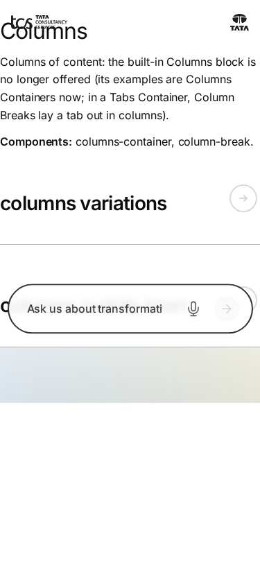

*Figure: Columns: columns — mobile 375 × 812 (/design-block-master/en/block-library/columns, captured 2026-11-08).*

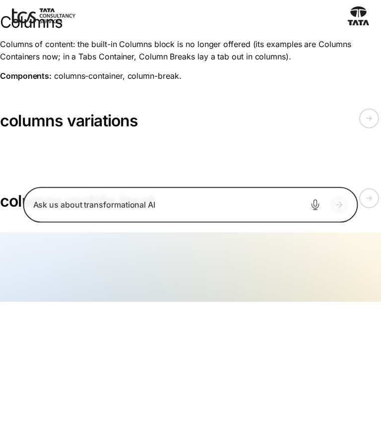

*Figure: Columns: columns — tablet 768 × 900 (/design-block-master/en/block-library/columns, captured 2026-11-08).*

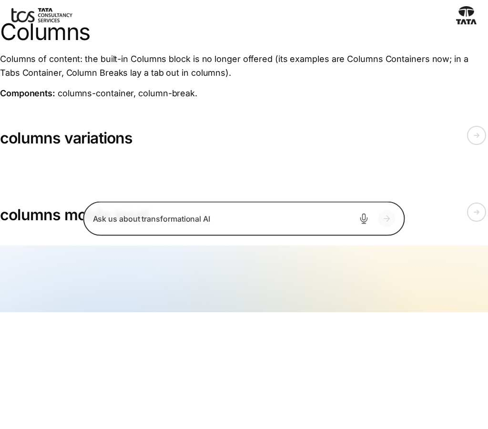

*Figure: Columns: columns — small desktop 1024 × 900 (/design-block-master/en/block-library/columns, captured 2026-11-08).*

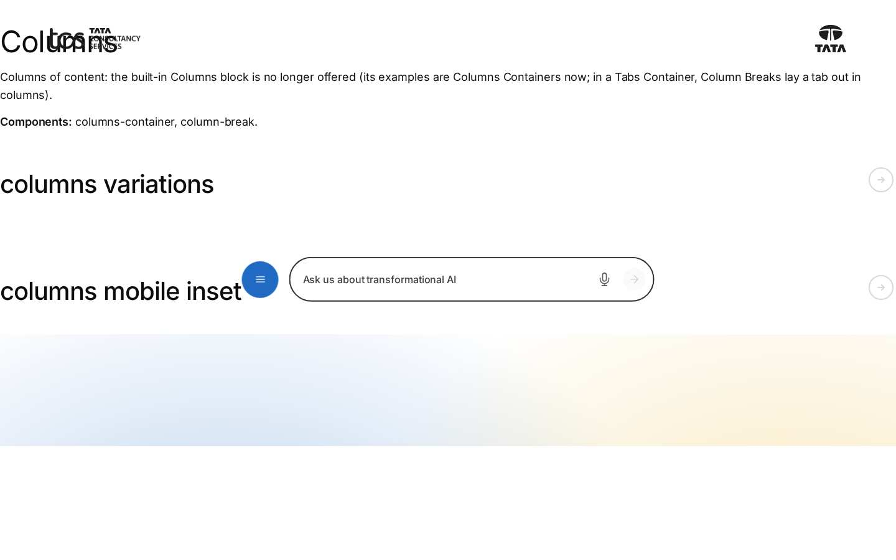

*Figure: Columns: columns — desktop 1440 × 900 (/design-block-master/en/block-library/columns, captured 2026-11-08).*

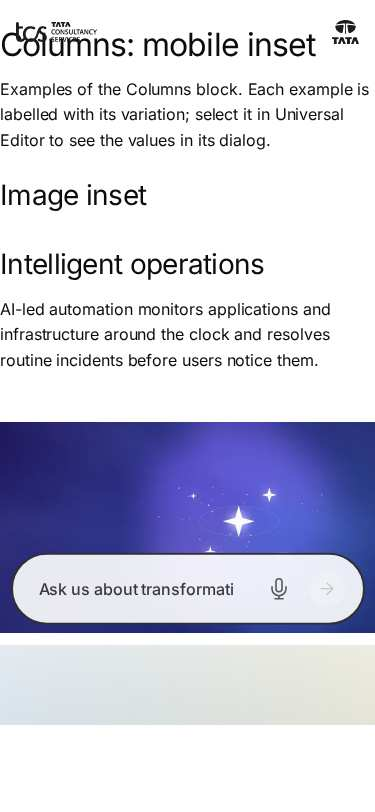

*Figure: Columns: columns/columns-mobile-inset — mobile 375 × 812 (/design-block-master/en/block-library/columns/columns-mobile-inset, captured 2026-11-08).*

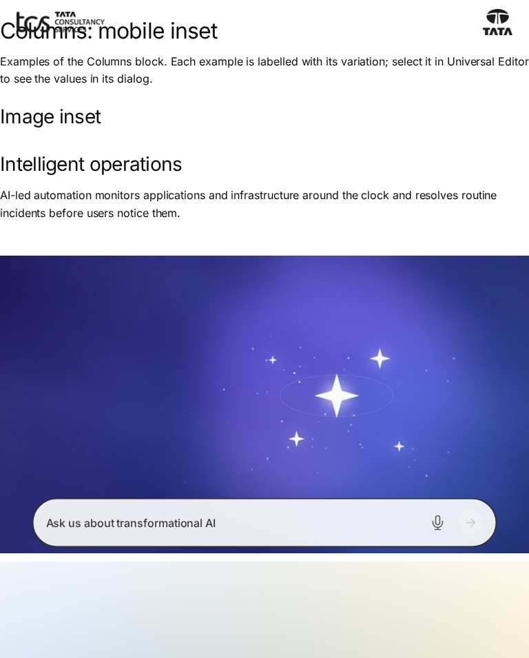

*Figure: Columns: columns/columns-mobile-inset — tablet 768 × 900 (/design-block-master/en/block-library/columns/columns-mobile-inset, captured 2026-11-08).*

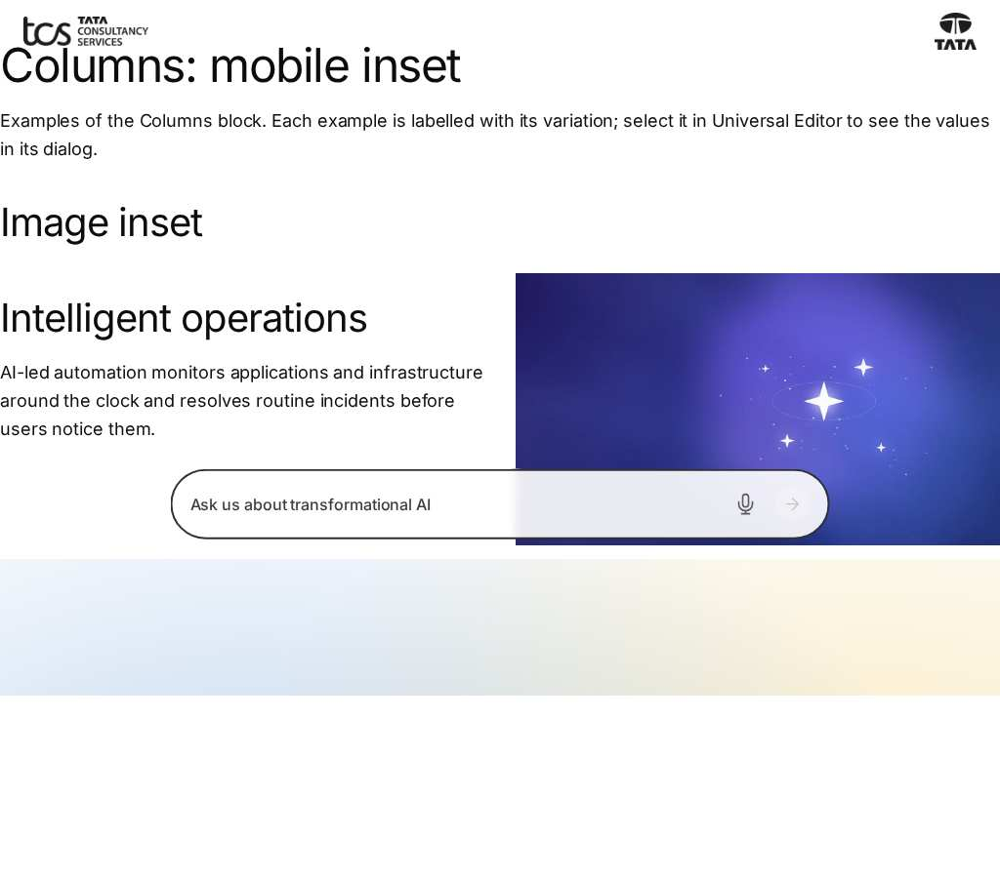

*Figure: Columns: columns/columns-mobile-inset — small desktop 1024 × 900 (/design-block-master/en/block-library/columns/columns-mobile-inset, captured 2026-11-08).*

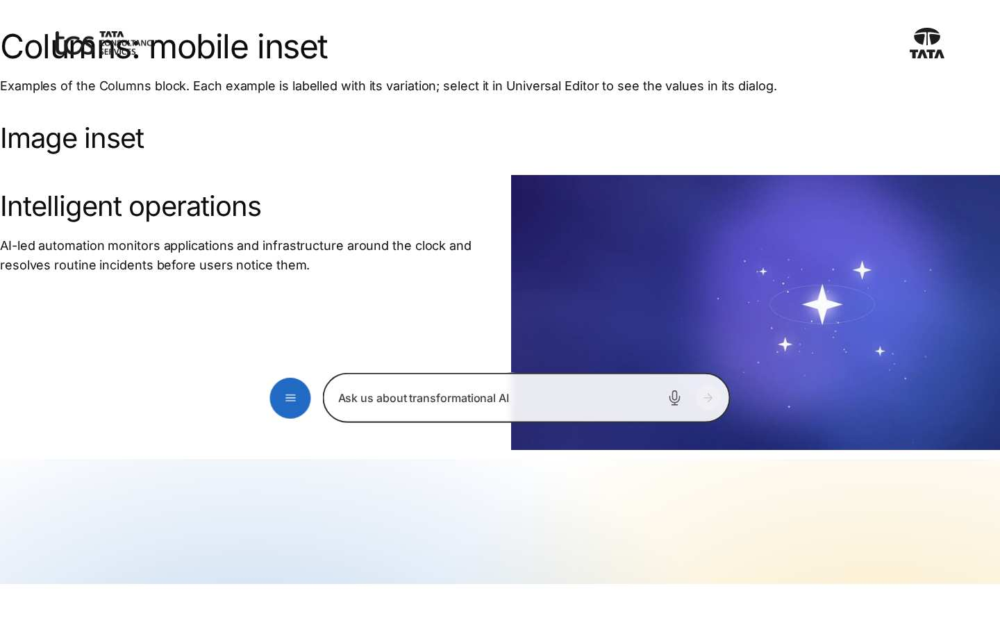

*Figure: Columns: columns/columns-mobile-inset — desktop 1440 × 900 (/design-block-master/en/block-library/columns/columns-mobile-inset, captured 2026-11-08).*

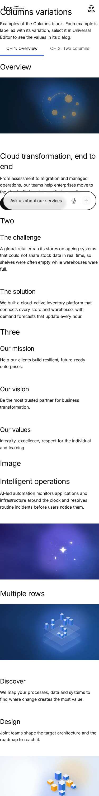

*Figure: Columns: columns/columns-variations — mobile 375 × 812 (/design-block-master/en/block-library/columns/columns-variations, captured 2026-11-08).*

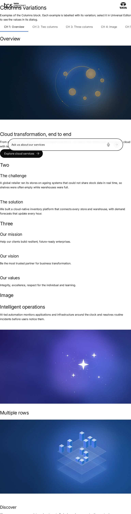

*Figure: Columns: columns/columns-variations — tablet 768 × 900 (/design-block-master/en/block-library/columns/columns-variations, captured 2026-11-08).*

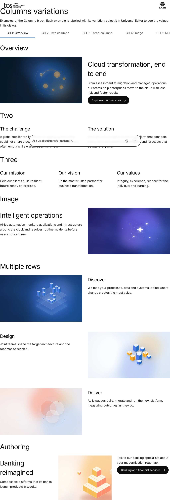

*Figure: Columns: columns/columns-variations — small desktop 1024 × 900 (/design-block-master/en/block-library/columns/columns-variations, captured 2026-11-08).*

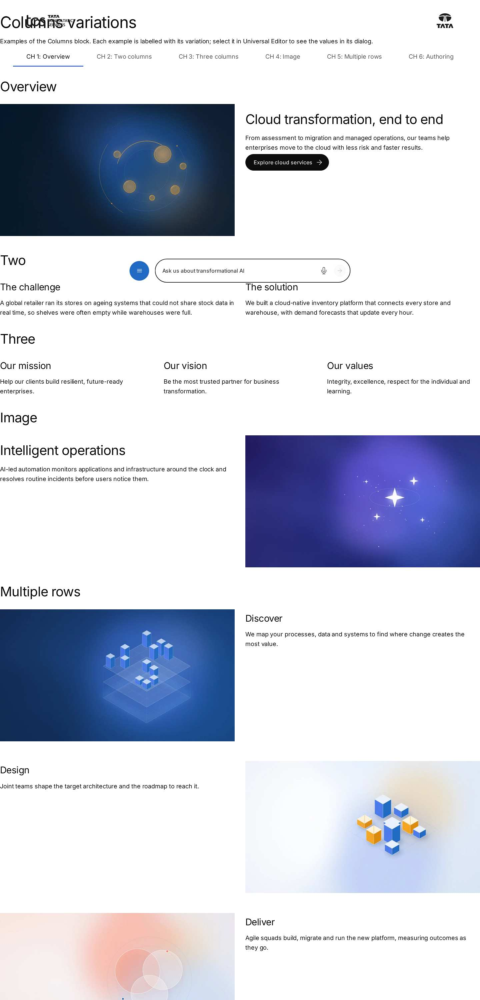

*Figure: Columns: columns/columns-variations — desktop 1440 × 900 (/design-block-master/en/block-library/columns/columns-variations, captured 2026-11-08).*

## Known limitations

- None recorded for this document.

## Open items

- None.

## Change history

| Version | Date | Author | Change |
| --- | --- | --- | --- |
| 1.0 | 8 November 2026 | Delivery team (documentation program) | First version of the role-specific documentation (master documentation prompt), generated from the repository and the published reference pages |
