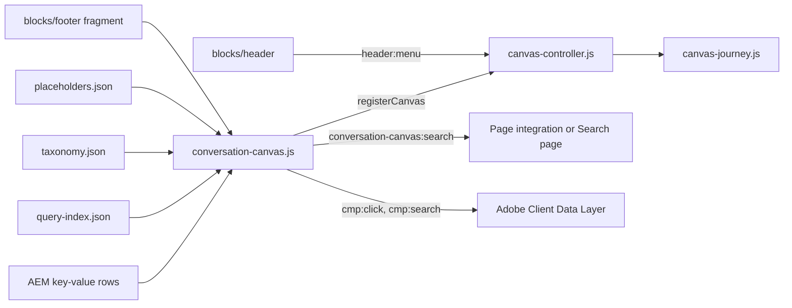
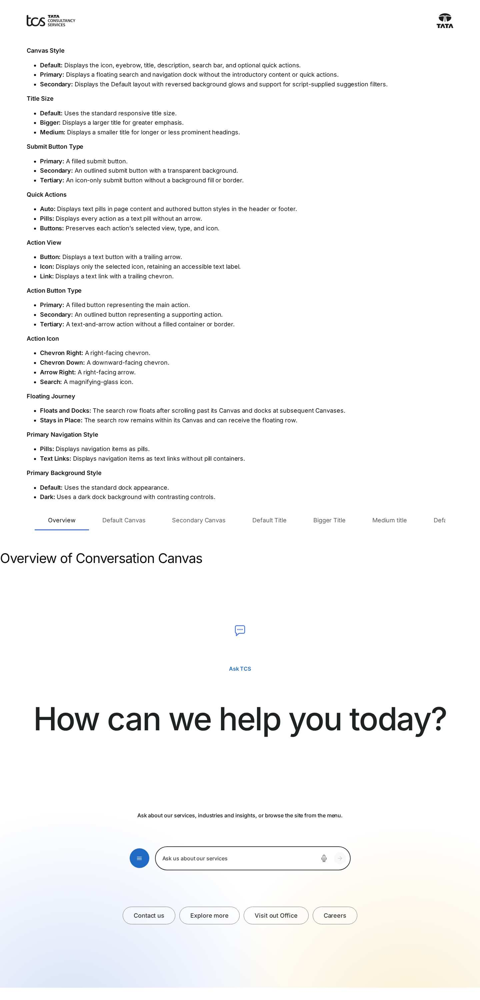
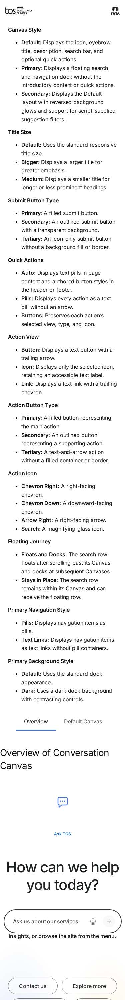
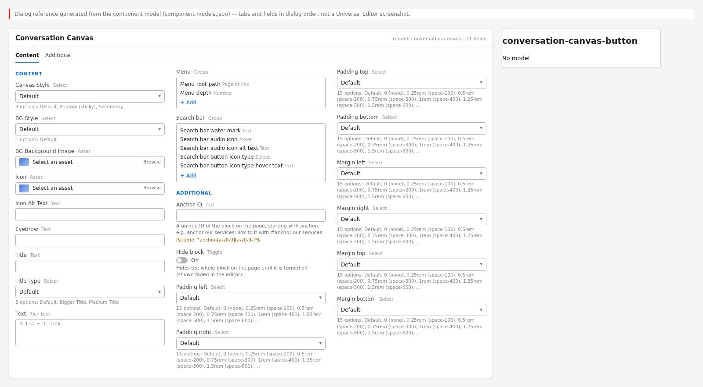

# Conversation Canvas Block — Developer Guide

| Attribute | Value |
| --- | --- |
| Document ID | DEV-B-conversation-canvas |
| Audience | Developers, technical leads, block owners, AI coding agents |
| Purpose | How the Conversation Canvas block is built: files, model, structure, behaviour, variations, tests and limitations |
| Scope | blocks/conversation-canvas/ and its components conversation-canvas, conversation-canvas-button |
| Prerequisites | — |
| Owner | Technical Lead / Block Owner (proposed) |
| Approver | Product Owner (to be confirmed) |
| Version | 1.0 |
| Status | Draft for review |
| Last updated | 8 November 2026 |
| Last validated | 2026-11-08 (model, files, imports from the code; reference pages from the live site) |
| Source files | blocks/conversation-canvas/README.md, blocks/conversation-canvas/_conversation-canvas.json, blocks/conversation-canvas/canvas-controller.js, blocks/conversation-canvas/canvas-journey.js, blocks/conversation-canvas/conversation-canvas.css, blocks/conversation-canvas/conversation-canvas.js |
| Related documents | [Variations](./CONVERSATION-CANVAS-VARIATIONS.md), [Test coverage](./CONVERSATION-CANVAS-TEST-COVERAGE.md), [Authoring guide](../../../03-authoring/components/conversation-canvas/CONVERSATION-CANVAS-AUTHORING-GUIDE.md) |
| Related AEM paths | /content/tcs-corp/design-block-master/en/block-library/conversation-canvas, /content/tcs-corp/design-block-master/en/block-library/conversation-canvas/conversation-canvas, /content/tcs-corp/design-block-master/en/block-library/conversation-canvas/docked |

## Contents

- [Summary](#summary)
- [Overview](#overview)
- [Source files](#source-files)
- [Components, models and filters](#components-models-and-filters)
- [Fields](#fields)
- [Dependencies](#dependencies)
- [For Developers](#for-developers)
- [Extending the Block](#extending-the-block)
- [Responsive Behavior](#responsive-behavior)
- [Accessibility](#accessibility)
- [Data Layer and Analytics](#data-layer-and-analytics)
- [Performance Considerations](#performance-considerations)
- [Security and Privacy](#security-and-privacy)
- [For Architects](#for-architects)
- [Troubleshooting](#troubleshooting)
- [Known limitations of the block](#known-limitations-of-the-block)
- [Change history of the block](#change-history-of-the-block)
- [Reference pages](#reference-pages)
- [Coverage of the required topics](#coverage-of-the-required-topics)
- [Screenshots](#screenshots)
- [Known limitations](#known-limitations)
- [Open items](#open-items)
- [Change history](#change-history)

## Summary

| Attribute | Value |
| --- | --- |
| Block | Conversation Canvas |
| Folder | `blocks/conversation-canvas` |
| Type | Container |
| Category | interactive |
| Status | Active |
| Purpose | Search prompt with quick actions; one floating journey across header, page and footer |
| Variations (summary) | Primary (sticky dock), Secondary, journey options, action styles |
| Children | conversation-canvas-button (Conversation Canvas Button) |
| Code size | 3316 lines of JS and CSS |

## Overview

**Business purpose.** One consistent, authorable place on every page that invites visitors to ask a question in their own words and offers quick routes into the site structure, ready for a search or conversational service through the `conversation-canvas:search` event and the Search page, without re-authoring.

**User experience.** Default and Secondary show a centred panel (white with blue and yellow brand glows, or a background image) with the intro, the search row and quick actions. Once the visitor scrolls past it, the search row floats at the bottom of the window until the next Canvas or the footer Canvas. Primary (sticky) shows only a dock floating at the bottom: the search pill and, from 900px, the site navigation of the current section.

**Templates and page types.** Any page (Section and Columns Container filters; not offered in the Tabs Container). Typical places: the Home hero, a full-width section of a landing page, the header Canvas (a nav page section) and the footer Canvas (`references/footer-conversation-canvas`). The curated design pages Home, Industry landing page and What we do use it.

**Data source.** Authored properties; the site menu and the Primary navigation come from the locale's query index (`path`, `title`); Primary suggestions from the page's tags labelled from the taxonomy; UI texts from placeholders.

**Related blocks.** TCS Header ([README](https://github.com/sradha-tcs/tcs-corp/blob/main/blocks/header/README.md), hosts the header Canvas and announces its menu), Footer (hosts the footer Canvas), Form Variations ([README](https://github.com/sradha-tcs/tcs-corp/blob/main/blocks/form-variations/README.md), for data capture), Columns Container ([README](https://github.com/sradha-tcs/tcs-corp/blob/main/blocks/columns-container/README.md)).

**When to use.** To invite free-text questions or searches; to give quick navigation through a section of the site; at most one Primary (sticky) Canvas per page.

**When not to use.** To collect personal data (use Form Variations); as the only route to content while no Search page or search integration is connected; as a replacement for the header navigation (on mobile the Primary dock shows only the search pill); several Canvases with the same question on one page.

**Realistic use cases.** "How can we help you today?" on Home; "What would you like to explore?" (Secondary, filter tags from a personalisation script); a floating "Ask us a question" dock with section pills on a services page; "Have a question? Ask us." at the top of the footer.

## Source files

| File | Link |
| --- | --- |
| `README.md` | [GitHub](https://github.com/sradha-tcs/tcs-corp/blob/main/blocks/conversation-canvas/README.md) |
| `_conversation-canvas.json` | [GitHub](https://github.com/sradha-tcs/tcs-corp/blob/main/blocks/conversation-canvas/_conversation-canvas.json) |
| `canvas-controller.js` | [GitHub](https://github.com/sradha-tcs/tcs-corp/blob/main/blocks/conversation-canvas/canvas-controller.js) |
| `canvas-journey.js` | [GitHub](https://github.com/sradha-tcs/tcs-corp/blob/main/blocks/conversation-canvas/canvas-journey.js) |
| `conversation-canvas.css` | [GitHub](https://github.com/sradha-tcs/tcs-corp/blob/main/blocks/conversation-canvas/conversation-canvas.css) |
| `conversation-canvas.js` | [GitHub](https://github.com/sradha-tcs/tcs-corp/blob/main/blocks/conversation-canvas/conversation-canvas.js) |

## Components, models and filters

| Component | Title | Resource type | Template name | Model | Children allowed |
| --- | --- | --- | --- | --- | --- |
| `conversation-canvas` | Conversation Canvas | `core/franklin/components/block/v1/block` | Conversation Canvas | `conversation-canvas` | conversation-canvas-button |
| `conversation-canvas-button` | Conversation Canvas Button | `core/franklin/components/block/v1/block/item` | Conversation Canvas Button | `conversation-canvas-button` | — |

## Fields

The Additional tab fields (anchor, hide, padding, margin, animation) are common to the blocks and described in the [content modeling guide](../../markdown/CONTENT-MODELING-GUIDE.md).

### Conversation Canvas (`conversation-canvas`)

| Tab | Label | Property | Type | Required in model | Default | Options | Visibility |
| --- | --- | --- | --- | --- | --- | --- | --- |
| Content | Canvas Style | `classes` | select | No | `""` | 3 options | — |
| Content | Floating journey | `classes_journey` | select | No | `""` | 2 options | Conditional |
| Content | Quick actions | `classes_actions` | select | No | `""` | 3 options | Conditional |
| Content | BG Style | `bgStyle` | select | No | `default` | 2 options | Conditional |
| Content | BG Background Image | `backgroundImage` | reference | No | — | — | — |
| Content | Icon | `icon` | reference | No | — | — | — |
| Content | Icon Alt Text | `iconAlt` | text | No | — | — | — |
| Content | Eyebrow | `eyebrow` | text | No | — | — | — |
| Content | Title | `title` | text | No | — | — | — |
| Content | Title Type | `titleSize` | select | No | `""` | 3 options | — |
| Content | Text | `text` | richtext | No | `""` | — | — |
| Content | Menu | `menu` | container | No | — | — | — |
| Content | Menu › Menu root path | `menuRootPath` | aem-content | No | — | — | — |
| Content | Menu › Menu depth | `menuDepth` | number | No | `1` | — | — |
| Content | Navigation style | `classes_navstyle` | select | No | `""` | 2 options | Conditional |
| Content | Search bar | `searchBar` | container | No | — | — | — |
| Content | Search bar › Search bar water mark | `searchPlaceholder` | text | No | — | — | — |
| Content | Search bar › Search bar audio icon | `searchAudioIcon` | reference | No | — | — | — |
| Content | Search bar › Search bar audio icon alt text | `searchAudioIconAlt` | text | No | — | — | — |
| Content | Search bar › Search bar button icon type | `searchButtonStyle` | select | No | `primary` | 3 options | — |
| Content | Search bar › Search bar button icon type hover text | `searchButtonLabel` | text | No | — | — | — |
| Content | Search bar › Search page | `searchPage` | aem-content | No | — | — | — |

### Conversation Canvas Button (`conversation-canvas-button`)

| Tab | Label | Property | Type | Required in model | Default | Options | Visibility |
| --- | --- | --- | --- | --- | --- | --- | --- |
| — | Link | `link` | aem-content | No | — | — | — |
| — | Text | `linkText` | text | No | — | — | — |
| — | Title | `linkTitle` | text | No | — | — | — |
| — | Views | `buttonView` | select | No | `button` | 3 options | — |
| — | Type | `buttonVariant` | select | No | `primary` | 3 options | Conditional |
| — | Icon | `buttonIcon` | select | No | — | 4 options | Conditional |

"Required in model" is the model's `required` flag; whether a field is required in practice is stated in the authoring guide where it is known.

## Dependencies

| Import |
| --- |
| `./canvas-journey.js` |
| `../../scripts/aem.js` |
| `../../scripts/scripts.js` |
| `../../decorators/responsive-image-decorator.js` |
| `../../utils/metadata.js` |
| `../../utils/query-index.js` |
| `../../utils/site.js` |
| `../../utils/taxonomy.js` |
| `../../decorators/a11y-decorator.js` |
| `../../decorators/button-decorator.js` |
| `../../decorators/icon-button-decorator.js` |
| `../../utils/buttons.js` |
| `../../utils/properties.js` |
| `../../utils/urls.js` |
| `../../utils/ids.js` |
| `../../utils/placeholders.js` |
| `./canvas-controller.js` |
| `../../decorators/skeleton-decorator.js` |
| `../../decorators/editor-item-decorator.js` |

## For Developers

<!-- BEGIN GENERATED: files (npm run build:docs) -->

```text
blocks/conversation-canvas/
├── README.md
├── _conversation-canvas.json
├── canvas-controller.js
├── canvas-journey.js
├── conversation-canvas.css
└── conversation-canvas.js
```

| Decorator/Utility | Purpose | Execution or dependency point |
| ----------------- | ------- | ----------------------------- |
| [`scripts/aem.js`](https://github.com/sradha-tcs/tcs-corp/blob/main/scripts/aem.js) | Edge Delivery core library (block loading, CSS, metadata, optimized pictures) | `conversation-canvas.js`: { toClassName } |
| [`scripts/scripts.js`](https://github.com/sradha-tcs/tcs-corp/blob/main/scripts/scripts.js) | Page decoration (moveInstrumentation and shared page helpers) | `conversation-canvas.js`: { moveInstrumentation } |
| [`decorators/responsive-image-decorator.js`](https://github.com/sradha-tcs/tcs-corp/blob/main/decorators/responsive-image-decorator.js) | `buildImage` (image from a URL; site media and EDAM delivery images optimized), `buildDeliveryPicture` (responsive picture of a Dynamic Media with OpenAPI delivery image), `decorateDeliveryImages` (standalone delivery im | `conversation-canvas.js`: { buildImage } |
| [`utils/metadata.js`](https://github.com/sradha-tcs/tcs-corp/blob/main/utils/metadata.js) | `getPageMetadata`, `getPageTags` (article:tag and the AEM page Tags published as `cq-tags`), `getPageLanguage` (page properties and bulk metadata columns: page-type, author-id, publish-date, reading-time, ...) | `conversation-canvas.js`: { getPageTags } |
| [`utils/query-index.js`](https://github.com/sradha-tcs/tcs-corp/blob/main/utils/query-index.js) | `getPages` (the current locale's pages from `/query-index.json`, or a review root's own pages from its own index, `{root}/query-index.json`, `indexUrlOf`; requests of 1,000 rows, in parallel after the first, `remainingOf | `conversation-canvas.js`: { getPages } |
| [`utils/site.js`](https://github.com/sradha-tcs/tcs-corp/blob/main/utils/site.js) | `LOCALES`, `DEFAULT_LOCALE`, `getLocale`, `indexRoot`, `REVIEW_ROOTS` and `REVIEW_SHEETS` (the three review roots, KB-D-068: /language-master/en for testing, /language-masters/en the language master, /design-block-master | `conversation-canvas.js`: { getLocale } |
| [`utils/taxonomy.js`](https://github.com/sradha-tcs/tcs-corp/blob/main/utils/taxonomy.js) | `loadTaxonomy`, `resolveTags` (tag labels from the locale's taxonomy) | `conversation-canvas.js`: { resolveTags } |
| [`decorators/a11y-decorator.js`](https://github.com/sradha-tcs/tcs-corp/blob/main/decorators/a11y-decorator.js) | `hideVisually`, `createHiddenText` (with `.visually-hidden` in `styles/styles.css`) | `conversation-canvas.js`: { hideVisually } |
| [`decorators/button-decorator.js`](https://github.com/sradha-tcs/tcs-corp/blob/main/decorators/button-decorator.js) | `decorateButton` (option `newTabHint`: a link opening a new tab says so), `createButton`, `setButtonDisabled`, `setButtonAlignment`, `removeButtonDecoration` | `conversation-canvas.js`: { createButton } |
| [`decorators/icon-button-decorator.js`](https://github.com/sradha-tcs/tcs-corp/blob/main/decorators/icon-button-decorator.js) | `createIconButton` | `conversation-canvas.js`: { createIconButton } |
| [`utils/buttons.js`](https://github.com/sradha-tcs/tcs-corp/blob/main/utils/buttons.js) | `BUTTON_VIEWS`, `BUTTON_TYPES`, `BUTTON_ALIGNMENTS`, `pick`, `readButtonOptions` | `conversation-canvas.js`: { BUTTON_ALIGNMENTS, BUTTON_TYPES, BUTTON_VIEWS, readButtonOptions, } |
| [`utils/properties.js`](https://github.com/sradha-tcs/tcs-corp/blob/main/utils/properties.js) | `readProperties`, `textOf`, `isOn`, `isOnByDefault` (a toggle that defaults to on), `optionOf`, `normalizeKey`, `textSource` (key-value block properties) | `conversation-canvas.js`: { normalizeKey as normalize, textOf } |
| [`utils/urls.js`](https://github.com/sradha-tcs/tcs-corp/blob/main/utils/urls.js) | `toSitePath` (AEM content paths to published paths, e.g. `/content/tcs-corp/de/de-de/x.html` → `/de-de/x`) | `conversation-canvas.js`: { toSitePath } |
| [`utils/ids.js`](https://github.com/sradha-tcs/tcs-corp/blob/main/utils/ids.js) | `nextInstance`, `uniqueId`, `createIdFactory` (unique ids per block instance), `availableId` (an authored id kept, suffixed -2, -3, ... only when taken) | `conversation-canvas.js`: { uniqueId } |
| [`utils/placeholders.js`](https://github.com/sradha-tcs/tcs-corp/blob/main/utils/placeholders.js) | `getPlaceholders`, `loadPlaceholders`, `fillPlaceholder` (UI text from the locale's placeholders, with English fallbacks) | `conversation-canvas.js`: { fillPlaceholder, getPlaceholders } |
| [`decorators/skeleton-decorator.js`](https://github.com/sradha-tcs/tcs-corp/blob/main/decorators/skeleton-decorator.js) | `renderWhenLoaded` (a block from data that may take time: directly within 150ms, else after a skeleton so its section is shown; removed on success and failure), `skeletonWhile` (a skeleton in a part that fills in by itse | `conversation-canvas.js`: { bone, skeletonElement, skeletonWhile } |
| [`decorators/editor-item-decorator.js`](https://github.com/sradha-tcs/tcs-corp/blob/main/decorators/editor-item-decorator.js) | `buildEditorItems`, `editorItemHint` (in Universal Editor, an item the block doesn't render yet, e.g. a CTA just added, as a dashed placeholder the author can select; styles in `styles/lazy-styles.css`; the hint loaded o | `conversation-canvas.js`: { buildEditorItems, editorItemHint } |

<!-- END GENERATED: files -->

| File | Responsibility |
| ---- | -------------- |
| `conversation-canvas.js` | Decoration: reads the key-value rows, builds the intro, search row, menu, filters, buttons or the Primary dock; registers the block with the controller |
| `canvas-journey.js` | The journey as a pure function (`STATES`, `ROLES`, `TRANSITIONS`, `isAllowedTransition`, `assignRoles`, `resolveJourney`): no DOM, unit tested in `test/conversation-canvas/` |
| `canvas-controller.js` | One controller per page (`registerCanvas`): measures the page, applies the journey (`data-canvas-journey-state`, classes, reserved space, footer lift, focus clearance), HIDDEN on `header:menu` |
| `conversation-canvas.css` | Styles, variations, floating / docked presentation |
| `_conversation-canvas.json` | Universal Editor definition, models and filter |

The header (`blocks/header`) and footer (`blocks/footer`) only *host* Canvases: a nav page section with a Canvas becomes `header .nav-canvas`; the footer loads its Conversation Canvas Page as a fragment. Neither contains Canvas logic. `conversation-canvas` is one of the `CHROME_BLOCKS` of `scripts.js`, so its modules are preloaded on every page.

#### Input DOM

A key-value block: one `key | value` row per set property (`readBlock` normalises the key and keeps the 17 known `FIELDS`); rows of the `conversation-canvas-button` model (Universal Editor, `data-aue-model`) and rows with a link and no known key are button items (each a row of cells: the link with its text and title, then the view, type and icon values); grouped fields (Menu, Search bar) arrive as plain keys. Canvas Style, Floating journey, Quick actions, Navigation style and the Additional tab arrive as block classes. Fallback without keys: single-cell rows in model order.

#### Rendered DOM contract

- Block classes: `primary` / `secondary`, `conversation-canvas-bg-{style}`, `conversation-canvas-title-{bigger|medium}`, `conversation-canvas-has-background`; journey: `conversation-canvas-owner`, `data-canvas-role` (`header`, `section`, `footer`, `dock`).
- Default / Secondary: `.conversation-canvas-background` (optional), `.conversation-canvas-content` > `.conversation-canvas-intro` (`.conversation-canvas-icon`, `p.conversation-canvas-eyebrow`, `h2.conversation-canvas-title`, `.conversation-canvas-text`), `.conversation-canvas-search-slot` > `.conversation-canvas-search` (menu toggle, `nav.conversation-canvas-menu`, `form.conversation-canvas-search-form`), `ul.conversation-canvas-filters` (Secondary), `ul.conversation-canvas-buttons`.
- Primary: `.conversation-canvas-dock` > `.conversation-canvas-search`, `nav.conversation-canvas-nav` (`data-view`: `root`, `section`, `suggestions`), `.conversation-canvas-nav-panel`.
- Ids per instance: `conversation-canvas-{n}-q`, `-menu`, `-nav`, `-panel`.
- Floating: `.conversation-canvas-floating` on the row (or dock), `.conversation-canvas-handoff` (no entry animation), `.conversation-canvas-approaching` on the next slot; `--conversation-canvas-lift` on the row; `--conversation-canvas-obscured` and `data-canvas-journey-state` on `<html>`; `--conversation-canvas-first-section-bottom` on the header (used by `blocks/header/header.css`).

#### Floating journey

```text
INITIAL → FLOATING → SECTION_DOCKED → FLOATING_AFTER_SECTION → … → FOOTER_DOCKED   (HIDDEN: suppressed)
```

- **Targets**: every Default / Secondary Canvas in the journey (it has a search row in place). Roles come from the semantic container, not DOM order (see Placement above).
- **Dock line**: the top of the floating row (viewport height − floating offset − row height).
- **Docked**: a target's search row is on screen at or above the dock line; nothing floats. With two rows in place, the one nearest to the dock line is the docked one; the state stays INITIAL while the header Canvas is still in place. The header Canvas is docked only while its row is at the dock line (2px tolerance); as soon as scrolling would carry it up it floats, at the same place.
- **Owner** (the one floating row): the Primary (sticky) Canvas if there is one that floats, else the last target (DOM order) that has crossed the dock line and may float. After each section Canvas the floating row is that Canvas's, so it shows the section's variation; scrolling up hands it back.
- **Approaching**: the next target coming up from below. Its own row is hidden (opacity, still focusable and read) until it reaches the dock line, where it replaces the floating row at the same position (no duplicate row, no jump).
- **Final stop**: once the footer Canvas reaches the dock line (or the page bottom on a short page) nothing floats any more.
- **No footer Canvas**: the floating row is lifted to stay above the footer's top edge; it never covers footer navigation or legal links.

| State (`<html data-canvas-journey-state>`) | Meaning |
| ------------------------------------------ | ------- |
| `initial` | The header Canvas (or the hero) is in place, or no Canvas floats yet |
| `floating` | The owner floats; no section Canvas crossed yet |
| `section-docked` | A section Canvas is in place |
| `floating-after-section` | Floating after at least one section Canvas |
| `footer-docked` | The footer Canvas is in place: the final stop |
| `hidden` | Suppressed: the header menu is open, or only Canvases that don't float were passed |

The state is computed from the scroll position, never from the previous state, so fast scrolling or a jump (anchor link, End key) can't leave a stale state. Continuous scrolling produces only the transitions of `TRANSITIONS` (tested): the journey in both directions; INITIAL / SECTION_DOCKED / FOOTER_DOCKED handing over directly when two Canvases are on screen; FOOTER_DOCKED → FLOATING when no section Canvas was crossed; any state ↔ HIDDEN.

#### Ownership

| Part | Owns |
| ---- | ---- |
| `blocks/header` (TCS Header) | Logos, navigation, the header Canvas host (`.nav-canvas`: nav page sections with a Canvas, below the nav); announces its menu with the `document` event `header:menu` (`detail.open`) |
| `blocks/conversation-canvas` | Canvas content, variations, interaction and authoring; registers itself with the controller when decorated (in the header, page or footer) |
| `canvas-journey.js` | The state model (pure) |
| `canvas-controller.js` | One controller per page: geometry, observers, the state attribute, the classes; listens to `header:menu` (HIDDEN) |

The header and the Canvas don't import each other: the event is the only contract. Each Canvas block registers itself during its own decoration (EDS block lifecycle), so header decoration never waits for page Canvases.

#### Mechanics

- The row floats with `position: fixed` **inside its own block**: no DOM moves, no clones, no re-initialisation; reading order, focus, listeners and editor instrumentation stay put. Its slot keeps `min-height` while it floats, so the page doesn't move (no CLS).
- Measurement (slot positions, footer top, page height, the floating offset from the slot's `scroll-margin-bottom`, the bottom of the first section) happens on registration, on `resize` and through a `ResizeObserver` on `<body>` (sections, images, fonts, header and footer loading) once a resize has settled for 100ms (`RESIZE_SETTLE`), never while scrolling.
- Scroll: one passive listener for all Canvases; one update per animation frame that reads only `scrollY`, resolves the journey and writes classes only when the result changes; `<html>` custom properties and the state are written only when their value changes.
- Stacking: the owner block gets `z-index: var(--conversation-canvas-z-floating)` (100, above page content; blocks use 10 at most); the block's `isolation: isolate` would otherwise keep the floating row below later positioned content. The site menu uses `z-index: 101`; while it is open the search row's `::before` fades the page (white 70%) below it.
- Lift (fallback) uses the `translate` property, so it never conflicts with the centring `transform` or the entry animation.
- Universal Editor: re-decorated blocks register as new entries; removed ones are released on the next measurement. Fragment Canvases (header, footer) are decorated before they are attached and join the journey once on the page. The shared listeners and the ResizeObserver are attached once per page (no MutationObserver).
- Failures are isolated: an error in the controller releases every row (nothing floats, state `hidden`); header, navigation, page and footer keep working.

#### Events and async behavior

- `decorate` awaits the placeholders, then builds synchronously and registers with the controller.
- Default / Secondary menu: built from `getPages()` on the first open (`skeletonWhile` shows four rows after 150ms); `scripts.js` `prefetchData` already starts the query index and taxonomy at the lazy phase on pages with a Canvas in `main`.
- Primary: loads the menu tree and the tag labels at decoration (`skeletonWhile` shows four pills); a failure is logged (`console.error('conversation canvas navigation', …)`) and leaves the navigation empty.
- Search submit: empty queries do nothing; otherwise a bubbling, cancelable `conversation-canvas:search` event (`detail: { query }`) is dispatched on the block. An integration that handles it calls `preventDefault()`; else the Search page opens with `?q=`; else the hidden status announces "Search isn’t available yet."

```js
document.addEventListener('conversation-canvas:search', (e) => {
  e.preventDefault(); // the integration shows the results / assistant
  openAssistant(e.detail.query);
});
```

- Voice input: only where `SpeechRecognition` / `webkitSpeechRecognition` exists (else the button is hidden); language `<html lang>` or `en`; the first result fills the field and focuses it (no auto-submit); a second click stops.

#### Exported functions

| Module | Export | Purpose |
| ------ | ------ | ------- |
| `conversation-canvas.js` | `default decorate(block)` | Block decoration |
| `conversation-canvas.js` | `setConversationCanvasSuggestions(block, suggestions)` | Primary: replaces the suggestion pills (strings) and re-renders |
| `conversation-canvas.js` | `setConversationCanvasFilters(block, tags)` | Secondary: renders `{ label, href?, active? }` as links or `aria-pressed` buttons (no behaviour of their own) |
| `canvas-controller.js` | `default registerCanvas({ block, row, slot, primary, floats })` | Adds a Canvas to the journey (once per block) |
| `canvas-journey.js` | `STATES`, `ROLES`, `TRANSITIONS`, `isAllowedTransition`, `assignRoles`, `resolveJourney` | The pure state model |

## Extending the Block

1. **A dialog field or value:** edit `_conversation-canvas.json`, run `npm run build:json` and `npm run lint`. Add a new property's normalised name to `FIELDS` (and to `COLLAPSED` if it collapses into another field); avoid names ending in Text, Title, Type, Alt or MimeType for values that must be read (field collapse); a block option is a `classes_*` select (arrives as a block class). No sample content in definition templates.
2. **A variation:** a Canvas Style value adds a class (`STYLES` in the JS), styled in `conversation-canvas.css` (selectors scoped to the block, rem sizes, 600 / 900 / 1200px breakpoints); decide whether it has a search slot (journey target) or not.
3. **Journey changes:** change `canvas-journey.js` only, keep it pure, extend `TRANSITIONS` deliberately and add cases to `test/conversation-canvas/canvas-journey.test.mjs` (`npm test`); the controller only measures and applies. Don't add Canvas logic to `header.js` or `footer.js`.
4. **Accessibility and data layer:** keep floating visual only; describe new clicks with `data-cmp-interaction` / `data-cmp-value` rather than pushing events.
5. **Animation:** the block is in `CONTENT_TARGETS` / `BACKGROUNDS` of `decorators/motion-decorator.js`; update them if the content or background elements change.
6. **Local checks:** `drafts/` pages (`aem up --html-folder drafts`): `canvas-journey` (all variations and the full journey), `canvas-journey-primary`, `-primary-text`, `-primary-dark`, `canvas-journey-fallback` (footer without a Canvas), `canvas-journey-header` (Canvas in the nav page).
7. **Block library and docs:** update `block-library/conversation-canvas` pages and this README; `npm run build:docs`; `npm run build:modules` after changing imports.

## Responsive Behavior

| Viewport | Layout | Image behavior | Interaction behavior |
| -------- | ------ | -------------- | -------------------- |
| Below 600px | Padding 4rem / 1.5rem; title 2.5rem (Bigger 2.75rem, Medium 1.75rem); Primary dock: the 17.5rem search pill only | Background `object-fit: cover`; icon 2.5rem | Floating row 1.25rem above the window bottom (plus safe area), at most the window width minus 1.5rem gutters |
| 600px and above | Padding 5rem / 2.5rem; a section Canvas (`main`) at least 50rem high, content centred, 1.5rem gutters; title 3.125rem (Bigger 4rem, Medium 2rem) | As below 600px | Floating row 3.875rem above the bottom, 28.9375rem wide |
| 900px and above | Primary dock: menu button, 33.125rem search pill, navigation and sub-page panel over a fade (black for Dark); an open panel replaces the search row | As above | Primary navigation, panels and Escape |
| 1200px and above | Padding 7.5rem / 5rem / 5rem; section Canvas 10rem / 5rem; title 4rem (Bigger 6rem, Medium 2.5rem) | As above | Floating row 3.25rem above the bottom, 37.9375rem wide; the header menu (which hides the journey) exists only below 1200px |

The Primary dock keeps a 1.5rem offset at every width. On tablet the row in place is 37.9375rem (607px) and the floating row 28.9375rem (463px), both from Figma, so it changes width as it floats and lands.

## Accessibility

- **Semantic HTML:** `h2` title; the search form has `role="search"`, an `input type="search"` with a visually hidden `label`; native `button`s for the menu, voice, submit, navigation toggles and back; `nav` elements labelled "Menu" (site menu) and "Site" (Primary navigation); lists for menus, actions and filters.
- **Disclosures:** the menu button has `aria-controls` and `aria-expanded`; navigation toggles `aria-expanded` / `aria-controls` to the panel; on pages where the full menu is the default the Primary menu button uses `aria-expanded`, elsewhere `aria-pressed`; the voice button `aria-pressed` while listening.
- **Current page:** `aria-current="page"` (or `true` for an ancestor) in the dock and panel.
- **Keyboard and focus:** Escape closes the menu or the panel and returns focus to its button; the menu closes when focus leaves the search row or on a click outside; the sub-page panel follows its toggles in the DOM (keyboard order) while CSS shows it above them; focused elements scroll clear of the floating row (`scroll-padding-bottom`, WCAG 2.4.11); while a row floats the other Canvas rows are `inert` (one search row in the tab order and the accessibility tree), so Tab goes from the floating row on to the page content.
- **Floating is visual only:** DOM and reading order never change, nothing is announced while scrolling; the hidden Primary dock is `inert`; the floating row is hidden while the header menu is open.
- **Announcements:** a visually hidden `role="status"` says "Search isn’t available yet." when a search can't run.
- **Touch targets:** the menu button is 3.6875rem (59px), navigation items and the back button 3rem (48px), the voice button 2rem (32px). The Primary input keeps 1rem text so iOS Safari doesn't zoom on focus. The floating offset includes `env(safe-area-inset-bottom)`.
- **Reduced motion:** the float-in animation and dock transitions are off with `prefers-reduced-motion: reduce`; a lift-off from a row in place has no entry animation; the Additional tab animations don't play.
- **Empty and loading states:** "No pages found" in the menu; skeleton rows / pills while the query index loads for longer than 150ms.

**Author responsibilities:** a meaningful hover text and water mark, alt text only for meaningful icons, readable text over background images, one Canvas question per page.

**Developer responsibilities:** keep the floating presentation visual only (no DOM moves), keep `inert` on the hidden dock, UI texts in placeholders, the `header:menu` contract.

| Key | Expected behavior |
| --- | ----------------- |
| Enter (in the search field) | Submits a non-empty query |
| Escape | Closes the open sub-page panel (Default / Secondary site menu, Primary), then the menu (Default / Secondary), focus back on its button |
| Tab / Shift+Tab | Moves through the row; leaving the search row closes its menu; focused elements scroll clear of the floating row |

## Data Layer and Analytics

- **Component:** `tcs-corp/components/conversation-canvas`, id = the block's id (Anchor ID) else `conversation-canvas-{n}`; `dc:title` from its heading (none for Primary).
- **Variation and journey state:** not pushed; the state is readable in `<html data-canvas-journey-state>`.
- **Clicks** (central `decorators/data-layer-decorator.js`; the block calls no `pushComponentEvent`): `cmp:click` for the menu button, menu, navigation and panel links (`interaction: link`), navigation toggles, back, voice and suggestion buttons (`interaction: button`), quick actions, and script-supplied filter tags (`interaction: filter`, `value` from `data-cmp-value`). The submit button of the search form isn't a click: the search is measured as one `cmp:search`.
- **Search:** `cmp:search` for a non-empty query, with `xdm:searchTerm` redacted by `utils/privacy.js` (`redactSearchTerm`: e-mail addresses become `[email]`, phone numbers `[number]`, trimmed, at most 100 characters).

| Trigger | Data-layer event | Required properties | Analytics behavior |
| ------- | ---------------- | ------------------- | ------------------ |
| Block decorated | component state | `@type`, `parentId`, `dc:title` | Inventory of Canvases (header, page, footer) |
| Click on a link, button or quick action | `cmp:click` | `interaction`, `dc:title`, `xdm:linkURL`, `xdm:linkType`, `breakpoint` | Navigation and action clicks |
| Click on a filter tag | `cmp:click` | `interaction: filter`, `value` | Filter use |
| Search submitted (Enter, arrow or suggestion) | `cmp:search` | `xdm:searchTerm` (redacted) | Search terms without personal data |

The intended path is Adobe Client Data Layer → Adobe Data Collection (Tags) → AEP Web SDK → Edge Network → Analytics / CJA, but Tags and the Web SDK aren't configured yet (blocked: measurement plan). No consent mechanism is implemented.

## Performance Considerations

- Decoration awaits the placeholders; everything else is built synchronously.
- The block's modules are preloaded on every page (`CHROME_BLOCKS` in `scripts.js`) because the header and footer may hold Canvases.
- Query index: fetched once per page view and cached; started at the lazy phase on pages with a Canvas in `main` (`prefetchData`), used on the first menu open (Default / Secondary) or at decoration (Primary, with the taxonomy).
- Skeletons only when the data takes longer than 150ms.
- One page-level controller: passive scroll listener with one animation frame per update and no layout reads while scrolling; geometry measured on registration, resize and a body `ResizeObserver` settled for 100ms; `<html>` writes only on change (handover 2.36: the controller had rewritten `<html>` custom properties on every resize while the page loaded).
- Layout shift: the floating row's slot keeps its height; the header keeps its reserved space (see the header README).
- Images: a background image built from a URL is lazy; per the handover a background image in the first section isn't loaded eagerly (possible LCP impact).
- High-cost configuration: a Primary dock with a deep tree (depth 3) renders more navigation items; no verified limit was identified.

## Security and Privacy

- The search query goes to the Search page through `URL.searchParams` (encoded), or to an integration as `detail.query`; the repository sends it to no service.
- Menu, navigation, suggestion and filter labels are set with `textContent`; link targets come from the query index or authored links.
- The search term in the data layer is redacted (`utils/privacy.js`): e-mail addresses and phone numbers replaced, at most 100 characters. Visitors may still type other personal data; a privacy review of search term tracking is recorded as open in the handover.
- Voice input uses the browser's Web Speech API; the repository sends no audio itself.

## For Architects

- **Role:** the site's question / search entry point and floating navigation aid; integration surface for a future search or conversational service.
- **Content model:** key-value properties plus button items; options as block classes.
- **Rendering and data source:** authored content, the locale's query index (menus), page tags and taxonomy (suggestions).
- **Container model:** the header and footer host Canvases from their pages; one page-level controller coordinates all Canvases through a pure journey function.
- **Dependencies:** `toClassName` (aem.js), `moveInstrumentation`, `buildImage`, `getPageTags`, `getPages`, `getLocale`, `resolveTags`, `hideVisually`, `createButton`, `createIconButton`, `readButtonOptions` and button constants, `linkOf`, `normalizeKey` / `textOf`, `toSitePath`, `uniqueId`, placeholders, skeleton decorator.
- **Data layer / Web SDK / Target:** central `cmp:click` / `cmp:search` (redacted); Tags and Web SDK not configured; no Target.
- **Consent and identity:** none implemented; search terms are redacted before they reach the data layer.
- **Caching:** page HTML on the CDN; the query index, taxonomy and placeholders loaded once per page view and cached in memory.
- **Performance:** no layout reads while scrolling; writes only on change (handover 2.36).
- **Security:** see Security and Privacy.
- **Figma gaps and decisions:** Figma doesn't prototype scrolling, docking or the footer stop, so the journey supplements it (Figma is used for the visuals and positions); the two `figma.com/site/…` files (www.tcs.com) are Figma Sites, which the Figma API can't read, so the prototype's threshold, offsets and motion aren't verifiable; hover states of the Text links and Dark navigation aren't in Figma and reuse the pill's blue outline; the header is the TCS Header (PR #81): the Figma logo bar on desktop, the menu below 1200px.



## Troubleshooting

| Symptom | Likely cause | Diagnostic steps | Resolution | Verification |
| ------- | ------------ | ---------------- | ---------- | ------------ |
| A search does nothing visible | No Search page and no integration | Check the Search page field; listen for `conversation-canvas:search` in the console | Set the Search page or connect an integration | A query opens results |
| The menu shows "No pages found" | Viewed in Universal Editor, root in another locale, pages not indexed, a parent page missing from the index | Open `/query-index.json` on aem.page and look for the root's child paths | Test on aem.page; fix the root; publish the missing pages | The menu lists the pages |
| The Primary dock never appears | Hide block on (a hidden Primary isn't active), or a Canvas in place on screen | Inspect the dock for `conversation-canvas-floating` and the journey state | Set Floats and docks; check other Canvases | The dock floats after scrolling |
| Nothing floats after the last section Canvas (state `hidden`) | That Canvas is Stays in place and no earlier Canvas may float | Check Floating journey of each Canvas | Set Floats and docks on one Canvas | State `floating-after-section` |
| The floating row stops above the footer | No footer Canvas (Conversation Canvas Page empty or unpublished) | Check the Footer block and the referenced page | Reference and publish the footer canvas page | State `footer-docked` at the bottom |
| The submit tooltip shows a test word | Hover text holds a test value | Open the Canvas (or the footer canvas page) | Enter "Submit" or clear it; publish | Tooltip and name read "Submit" |
| Dock pills on the wrong level | The page is deeper than Menu depth or outside the root | Compare the URL with root and depth | Increase the depth (max 3) or change the root | Expected view |
| No microphone button | Browser without the Web Speech API | Check `window.SpeechRecognition` and `window.webkitSpeechRecognition` in the console | None needed | Button appears in a supporting browser |

Evidence to collect (without secrets): the page URL on aem.page, `document.documentElement.dataset.canvasJourneyState` while reproducing, `data-canvas-role` of each Canvas, the Network entries for `/query-index.json` and the sheets (status only), console errors, the viewport size.

## Known limitations of the block

| Limitation | Impact | Workaround | Planned correction |
| ---------- | ------ | ---------- | ------------------ |
| No search or conversational service in the repository | A query only opens the Search page or reaches an integration | Set the Search page | Not recorded |
| Without Search page and integration the "Search isn’t available yet." status is visually hidden | Sighted visitors get no feedback | Set the Search page | Not recorded |
| Filters and suggestions need a script; filter buttons have no behaviour | Secondary shows no filters | Implement the supplying script | Not recorded |
| The menu ignores `hide-in-nav` and `robots` (F-33) and lists pages in path order, not the Figma order (F-78) | Unexpected or misordered entries | Exclude pages from the index | Not recorded |
| The query index isn't available in Universal Editor | "No pages found" while authoring | Check on aem.page | Not planned |
| BG Style Dark and Navigation style apply only to Primary (CSS) | No visible change on Default / Secondary | Use a background image or a Section style | Not recorded |
| Hide block and spacing apply only in `main` | No effect on header / footer Canvases | Edit the nav or footer canvas page | Not recorded |
| The site menu keeps the title suffix after a vertical bar (only the dock removes it) | Long menu labels | Shorter page titles | Not recorded |
| The dock panel has an `aria-label` without a landmark role | The label may not be announced | — | Not recorded |
| Unkeyed (single-cell) rows: a row with a link is read as a button item | Only hand-made markup affected | Use keyed rows | Not planned |
| Footer canvas sample with a test hover text (F-33) | Odd button name and tooltip | Correct the field | Not recorded |
| The prototype's threshold, offsets and motion (Figma Sites) can't be verified | Values come from the design file | — | Not planned |

## Change history of the block

| Version | Change | Source | Date |
| ------- | ------ | ------ | ---- |
| Not recorded | README generated from verified implementation and approved handover documentation | Repository review | Not recorded |
| Handover 2.3 | Floating Canvas journey (PR #71): states initial, floating, section-docked, floating-after-section, footer-docked, hidden; hidden while the header menu is open (`header:menu`); Floating journey field | docs/handover revision history | 16 October 2026 |
| Handover 2.5 | Primary dock aligned with Figma Full menu | docs/handover revision history | 16 October 2026 |
| Handover 2.6 | Section Canvas aligned with Figma 251:41883 / 2313:52736; Quick actions field | docs/handover revision history | 16 October 2026 |
| Handover 2.11 | Temporary: pages below `/language-master/en` list the language master's own pages in Canvas menus | docs/handover revision history | 17 October 2026 |
| Handover 2.13 | Query index and taxonomy start loading at the lazy phase on pages with Canvases | docs/handover revision history | 17 October 2026 |
| Handover 2.15 | Header keeps the space of the TCS Header with its Canvas until it has loaded (no layout shift) | docs/handover revision history | 18 October 2026 |
| Handover 2.18 | Content and Background animation (brand glows), skeletons for the Canvas navigation and menu | docs/handover revision history | 18 October 2026 |
| Handover 2.21 | Header and Canvas as two zones (PR #92): the header Canvas row on the bottom of the Home hero, fixed at the bottom of the window as soon as the page scrolls | docs/handover revision history | 19 October 2026 |
| Handover 2.27 | Block audit: Canvas search redacted in the data layer and given a Search page | docs/handover revision history | 19 October 2026 |
| Handover 2.29 | Re-audit: Canvas in tabs corrected | docs/handover revision history | 20 October 2026 |
| Handover 2.36 | Canvas controller writes `<html>` custom properties only on change; resizes measured once settled | docs/handover revision history | 20 October 2026 |
| Not recorded | Floating journey options Floats and docks / Stays in place (Decorative merged, not for Primary); one row in use while a row floats (the others inert); hidden Canvases (also header, footer, Primary) aren't active; editor placeholders for Buttons without a link | KB-D-053 (Proposed) | 22 October 2026 |
| Not recorded | Site menu pills as Figma 1124:27046, arrows only for pages with child pages, grey fade, blue menu icon; the menu closes on scroll (from 1f40578); typing in the search field restored (1f40578's Escape handler moved the focus on every key) | fix/block-issues | 22 October 2026 |
| Not recorded | Site menu: an arrow on every panel row again (Figma 1124:26250); closing resets it to the first level (a pinned third-level panel stayed open after a click outside and hid the search row) | fix/block-issues | 22 October 2026 |

## Reference pages

| Kind | Page | Live URL |
| --- | --- | --- |
| Block library | /design-block-master/en/block-library/conversation-canvas | https://main--tcs-corp--sradha-tcs.aem.live/design-block-master/en/block-library/conversation-canvas |
| Block library | /design-block-master/en/block-library/conversation-canvas/conversation-canvas | https://main--tcs-corp--sradha-tcs.aem.live/design-block-master/en/block-library/conversation-canvas/conversation-canvas |
| Block library | /design-block-master/en/block-library/conversation-canvas/docked | https://main--tcs-corp--sradha-tcs.aem.live/design-block-master/en/block-library/conversation-canvas/docked |
| Block library | /design-block-master/en/block-library/conversation-canvas/floating | https://main--tcs-corp--sradha-tcs.aem.live/design-block-master/en/block-library/conversation-canvas/floating |
| Block library | /design-block-master/en/block-library/conversation-canvas/footer-canvas | https://main--tcs-corp--sradha-tcs.aem.live/design-block-master/en/block-library/conversation-canvas/footer-canvas |
| Block library | /design-block-master/en/block-library/conversation-canvas/journey-and-actions | https://main--tcs-corp--sradha-tcs.aem.live/design-block-master/en/block-library/conversation-canvas/journey-and-actions |
| Curated design page | /design-block-master/en/curated-design-pages/home | https://main--tcs-corp--sradha-tcs.aem.live/design-block-master/en/curated-design-pages/home |
| Curated design page | /design-block-master/en/curated-design-pages/what-we-do | https://main--tcs-corp--sradha-tcs.aem.live/design-block-master/en/curated-design-pages/what-we-do |

## Coverage of the required topics

| Topic | Where |
| --- | --- |
| Purpose | Overview |
| Source files | generated: Files |
| Model, definition, filters, children | generated: Components |
| Dependencies | generated: Dependencies |
| Authored input / rendered output / DOM transformation | For Developers |
| Configuration fields, defaults, required fields | generated: Fields |
| Variations | CONVERSATION-CANVAS-VARIATIONS.md |
| Responsive behaviour | Responsive Behavior |
| Accessibility and keyboard | Accessibility |
| Analytics / data layer | Data Layer and Analytics |
| Performance | Performance Considerations |
| Security | Security and Privacy |
| Extending | Extending the Block |
| Known limitations | Known Limitations |
| Troubleshooting | Troubleshooting |
| Tests | CONVERSATION-CANVAS-TEST-COVERAGE.md |
| SEO behaviour | Not recorded |
| Caching considerations | Not recorded (Edge Delivery default caching; no block-specific rule) |
| Ownership | Technical Lead / Block Owner (proposed) |

## Screenshots



*Figure: Conversation Canvas block library page — desktop 1440 × 900 (/design-block-master/en/block-library/conversation-canvas/conversation-canvas, captured 2026-11-08).*



*Figure: Conversation Canvas block library page — mobile 375 × 812 (/design-block-master/en/block-library/conversation-canvas/conversation-canvas, captured 2026-11-08).*

![Desktop rendering — The Default canvas at 1440 px: a white rounded panel with blue and yellow glows at the bottom, the chat icon, the eyebrow Ask TCS, the h2 How can we help you today?, the intro text, the search row (round menu button, pill field Ask us a question with microphone and blue arrow) and the buttons Contact us (primary) and Explore services (secondary), all centred. (Sample content on the preview; callout letters as in the Field Entry Table; file screenshots/conversation-canvas-desktop-view.jpg)](./screenshots/handover/conversation-canvas-desktop-view.jpg)

*Figure: Desktop rendering — The Default canvas at 1440 px: a white rounded panel with blue and yellow glows at the bottom, the chat icon, the eyebrow Ask TCS, the h2 How can we help you today?, the intro text, the search row (round menu button, pill field Ask us a question with microphone and blue arrow) and the buttons Contact us (primary) and Explore services (secondary), all centred. (Sample content on the preview; callout letters as in the Field Entry Table; file screenshots/conversation-canvas-desktop-view.jpg) (handover screenshot; rendering at the time it was taken).*


*Figure: Tablet rendering — The same Default canvas at 768 px: chat icon, Ask TCS, the title How can we help you today? on two lines at 3.125rem, the intro text on two lines, the search row filling the width with menu button, microphone and arrow, and Contact us and Explore services side by side. (Sample content on the preview; callout letters as in the Field Entry Table; file screenshots/conversation-canvas-tablet-view.jpg) (handover screenshot; rendering at the time it was taken).*


*Figure: Mobile rendering — The same Default canvas at 375 px: chat icon, Ask TCS, the 2.5rem title How can we help you today? on three lines, the intro text, the round menu button beside a narrow search pill with microphone and arrow, and the buttons Contact us and Explore services stacked below each other. (Sample content on the preview; callout letters as in the Field Entry Table; file screenshots/conversation-canvas-mobile-view.jpg) (handover screenshot; rendering at the time it was taken).*


*Figure: Default style — The Default canvas at 1440 px without icon or eyebrow: the h2 How can we help you today?, the text Ask a question in your own words or explore our services and industries., the search row and the buttons Contact us (primary) and Explore services (secondary) on a white panel with blue (left) and yellow (right) glows. (Sample content on the preview; callout letters as in the Field Entry Table; file screenshots/conversation-canvas-default.jpg) (handover screenshot; rendering at the time it was taken).*


*Figure: Secondary style — The Secondary canvas at 1440 px: the eyebrow Explore topics, the h2 What would you like to explore?, the text, the search row and five script-supplied filter pills: Cloud (active, filled brand blue), AI and data, Cybersecurity, Consulting and Banking, on a panel with a yellow glow left and a blue glow right. (Sample content on the preview; callout letters as in the Field Entry Table; file screenshots/conversation-canvas-secondary.jpg) (handover screenshot; rendering at the time it was taken).*


*Figure: Primary (sticky) dock on desktop — The bottom of /en/services/consulting at 1440 px, scrolled down: the Primary dock floats over a white fade with the round menu button and the search pill Ask us a question (microphone, blue arrow) and, below it, the pills Back (arrow), AI and data, Cloud (with chevron), Consulting (current, blue outline) and Cybersecurity. (Sample content on the preview; callout letters as in the Field Entry Table; file screenshots/conversation-canvas-primary-dock.jpg) (handover screenshot; rendering at the time it was taken).*


*Figure: Default title size — A Default canvas at 1440 px with the eyebrow Ask TCS, the h2 How can we help you today? at 4rem and the search row (menu button, Ask us a question field with microphone and blue arrow); no text or buttons. (Sample content on the preview; callout letters as in the Field Entry Table; file screenshots/conversation-canvas-title-default.jpg) (handover screenshot; rendering at the time it was taken).*


*Figure: Bigger title — A Default canvas at 1440 px with the eyebrow Ask TCS and the h2 Building on belief at 5rem (Title Type Bigger Title) above the search row; no text or buttons. (Sample content on the preview; callout letters as in the Field Entry Table; file screenshots/conversation-canvas-title-bigger.jpg) (handover screenshot; rendering at the time it was taken).*


*Figure: Medium title — A Default canvas at 1440 px with the eyebrow Ask TCS and the h2 Questions about our services? Ask us directly. at 2.5rem with line height 1.4 (Title Type Medium Title) above the search row; no text or buttons. (Sample content on the preview; callout letters as in the Field Entry Table; file screenshots/conversation-canvas-title-medium.jpg) (handover screenshot; rendering at the time it was taken).*


*Figure: Default background glow — A Default canvas at 1440 px with the h2 Ask us a question, the text Ask a question in your own words or explore our services and industries. and the search row on a white panel with a blue glow rising from the bottom left and a yellow glow from the bottom right. (Sample content on the preview; callout letters as in the Field Entry Table; file screenshots/conversation-canvas-bg-default.jpg) (handover screenshot; rendering at the time it was taken).*


*Figure: Background image — A Default canvas at 1440 px with the light abstract image light.svg (pale blue panel with large white and blue circles) filling the rounded panel behind the h2 Ask us a question, the text and the search row; no glow. (Sample content on the preview; callout letters as in the Field Entry Table; file screenshots/conversation-canvas-background-image.jpg) (handover screenshot; rendering at the time it was taken).*


*Figure: Primary search button — The search row of a canvas at 1440 px, cropped: the round menu button and the pill field Ask us a question with the microphone and a filled brand-blue round arrow button (Search bar button icon type Primary). (Sample content on the preview; callout letters as in the Field Entry Table; file screenshots/conversation-canvas-search-primary.jpg) (handover screenshot; rendering at the time it was taken).*


*Figure: Secondary search button — The search row of a canvas at 1440 px, cropped: the round menu button and the pill field Ask us a question with the microphone and a round arrow button with a brand-blue outline and no fill (Search bar button icon type Secondary). (Sample content on the preview; callout letters as in the Field Entry Table; file screenshots/conversation-canvas-search-secondary.jpg) (handover screenshot; rendering at the time it was taken).*


*Figure: Tertiary search button — The search row of a canvas at 1440 px, cropped: the round menu button and the pill field Ask us a question with the microphone and a plain brand-blue arrow without fill or border (Search bar button icon type Tertiary). (Sample content on the preview; callout letters as in the Field Entry Table; file screenshots/conversation-canvas-search-tertiary.jpg) (handover screenshot; rendering at the time it was taken).*


*Figure: Voice input — The search row of a canvas at 1440 px, cropped: the menu button and the pill Ask us a question with the default microphone button in its listening state (brand blue with a round outline, aria-pressed="true") next to the filled blue arrow. (Sample content on the preview; callout letters as in the Field Entry Table; file screenshots/conversation-canvas-voice-default.jpg) (handover screenshot; rendering at the time it was taken).*


*Figure: Custom audio icon — The search row of a canvas at 1440 px, cropped: the menu button and the pill Ask us a question with the custom audio icon audio-icon.svg (five blue sound bars, 1.5rem) in place of the microphone, next to the filled blue arrow. (Sample content on the preview; callout letters as in the Field Entry Table; file screenshots/conversation-canvas-voice-custom-icon.jpg) (handover screenshot; rendering at the time it was taken).*


*Figure: Button items — A Default canvas at 1440 px with the h2 Ask us a question, the search row and two centred pill buttons below it: a black primary Contact us and an outlined secondary Explore services, each with a trailing arrow. (Sample content on the preview; callout letters as in the Field Entry Table; file screenshots/conversation-canvas-button-view.jpg) (handover screenshot; rendering at the time it was taken).*


*Figure: Icon button item — A Default canvas at 1440 px with the h2 Ask us a question, the search row and below it one round brand-blue icon button with a white chevron-right (Views Icon, Icon Chevron right); its text Explore our services is not visible. (Sample content on the preview; callout letters as in the Field Entry Table; file screenshots/conversation-canvas-icon-view.jpg) (handover screenshot; rendering at the time it was taken).*


*Figure: Link item — A Default canvas at 1440 px with the h2 Ask us a question, the search row and below it the centred text link View all FAQs with a trailing chevron (Views Link). (Sample content on the preview; callout letters as in the Field Entry Table; file screenshots/conversation-canvas-link-view.jpg) (handover screenshot; rendering at the time it was taken).*


*Figure: Floating search row — The floating-row page at 1440 px scrolled past its canvas: the sections Industries we serve, Research and insights and Consulting that delivers outcomes, with the canvas's menu button and Ask us a question pill (microphone, blue arrow) floating centred 1.5rem above the viewport bottom, translucent white with shadow and blur. (Sample content on the preview; callout letters as in the Field Entry Table; file screenshots/conversation-canvas-floating-row.jpg) (handover screenshot; rendering at the time it was taken).*

![Footer canvas — The site footer at 1440 px: the h2 Have a question? Ask us. at 6rem on two lines, the search row (menu button, Ask us a question, microphone, arrow; 38.0625rem wide), Contact us (primary) and About TCS (secondary) side by side, then © TATA Consultancy Services 2027 with Privacy policy, Cookie policy and Terms of use, and the LinkedIn, X, YouTube and Instagram icons. (Sample content on the preview; callout letters as in the Field Entry Table; file screenshots/conversation-canvas-footer.jpg)](./screenshots/handover/conversation-canvas-footer.jpg)

*Figure: Footer canvas — The site footer at 1440 px: the h2 Have a question? Ask us. at 6rem on two lines, the search row (menu button, Ask us a question, microphone, arrow; 38.0625rem wide), Contact us (primary) and About TCS (secondary) side by side, then © TATA Consultancy Services 2027 with Privacy policy, Cookie policy and Terms of use, and the LinkedIn, X, YouTube and Instagram icons. (Sample content on the preview; callout letters as in the Field Entry Table; file screenshots/conversation-canvas-footer.jpg) (handover screenshot; rendering at the time it was taken).*

![Universal Editor canvas — An annotated editor-mode preview at 1440 px (not a Universal Editor screenshot) of the Default canvas with chat icon, Ask TCS, How can we help you today?, text, search row, Contact us and Explore services, with markers A (block) to I (buttons) on icon, eyebrow, title, text, menu button, search field and submit button. (Annotated preview in editor mode with sample content; letters as in the annotations list, not a Universal Editor screenshot; file screenshots/conversation-canvas-authoring-view.jpg)](./screenshots/handover/conversation-canvas-authoring-view.jpg)

*Figure: Universal Editor canvas — An annotated editor-mode preview at 1440 px (not a Universal Editor screenshot) of the Default canvas with chat icon, Ask TCS, How can we help you today?, text, search row, Contact us and Explore services, with markers A (block) to I (buttons) on icon, eyebrow, title, text, menu button, search field and submit button. (Annotated preview in editor mode with sample content; letters as in the annotations list, not a Universal Editor screenshot; file screenshots/conversation-canvas-authoring-view.jpg) (handover screenshot; rendering at the time it was taken).*



*Figure: Properties panel — Properties panel with the Content tab (Canvas Style, BG Style, images, (Dialog reference generated from the component model, not a Universal Editor screenshot; file screenshots/conversation-canvas-properties-panel.jpg) (handover screenshot; rendering at the time it was taken).*

## Known limitations

- Universal Editor dialogs were not captured: no author access in this program (see the access blockers).

## Open items

- None.

## Change history

| Version | Date | Author | Change |
| --- | --- | --- | --- |
| 1.0 | 8 November 2026 | Delivery team (documentation program) | First version of the role-specific documentation (master documentation prompt), generated from the repository and the published reference pages |
