# Conversation Canvas Block — Test Coverage

| Attribute | Value |
| --- | --- |
| Document ID | DEV-T-conversation-canvas |
| Audience | Developers, technical leads, block owners, AI coding agents |
| Purpose | Unit tests, automated reference-page checks and manual test guidance for the block |
| Scope | — |
| Prerequisites | — |
| Owner | Technical Lead / Block Owner (proposed) |
| Approver | Product Owner (to be confirmed) |
| Version | 1.0 |
| Status | Draft for review |
| Last updated | 8 November 2026 |
| Last validated | 8 November 2026 |
| Source files | test/conversation-canvas/canvas-journey.test.mjs |
| Related documents | — |
| Related AEM paths | — |

## Contents

- [Unit tests](#unit-tests)
- [Automated checks of the block library pages (executed 8 November 2026)](#automated-checks-of-the-block-library-pages-executed-8-november-2026)
- [Manual test guidance (block README)](#manual-test-guidance-block-readme)
- [Screenshots](#screenshots)
- [Known limitations](#known-limitations)
- [Open items](#open-items)
- [Change history](#change-history)

## Unit tests

| File | Suites | Tests |
| --- | --- | --- |
| `test/conversation-canvas/canvas-journey.test.mjs` | roles from placement; the journey down the page; transitions; HIDDEN; page variations; the header Canvas at the bottom of the window; a row in place that holds focus (focused) | 36 |

## Automated checks of the block library pages (executed 8 November 2026)

Per page: HTTP status and horizontal overflow at 375 / 768 / 1024 / 1440 px, console errors, failed requests and DOM accessibility checks at 1440 px (evidence: [screenshot register](../../../SCREENSHOT-REGISTER.md)).

| Page | 375 / 768 / 1024 / 1440 | Console errors | Failed requests | Accessibility (DOM) |
| --- | --- | --- | --- | --- |
| /design-block-master/en/block-library/conversation-canvas | ok / ok / ok / ok | 20 | 20 | 0 img no alt, 0 unnamed buttons, 1 heading skips |
| /design-block-master/en/block-library/conversation-canvas/conversation-canvas | ok / ok / ok / ok | 4 | 4 | 0 img no alt, 0 unnamed buttons, 0 heading skips |
| /design-block-master/en/block-library/conversation-canvas/docked | ok / ok / ok / ok | 4 | 4 | 0 img no alt, 0 unnamed buttons, 0 heading skips |
| /design-block-master/en/block-library/conversation-canvas/floating | ok / ok / ok / ok | 4 | 4 | 0 img no alt, 0 unnamed buttons, 0 heading skips |
| /design-block-master/en/block-library/conversation-canvas/footer-canvas | ok / ok / ok / ok | 0 | 0 | 0 img no alt, 0 unnamed buttons, 0 heading skips |
| /design-block-master/en/block-library/conversation-canvas/journey-and-actions | ok / ok / ok / ok | 4 | 4 | 0 img no alt, 0 unnamed buttons, 0 heading skips |

## Manual test guidance (block README)

| Test ID | Scenario | Configuration | Expected result |
| ------- | -------- | ------------- | --------------- |
| CONVERSATION-CANVAS-QA-01 | Default rendering | Library Overview | Icon, eyebrow, H2, text, search row, two actions, glows |
| CONVERSATION-CANVAS-QA-02 | Secondary | Canvas Style Secondary | Reversed glows; no filter list until a script fills it |
| CONVERSATION-CANVAS-QA-03 | Primary Pills | Library `docked` page, 1440px | Dock floats with search pill and section pills; hidden while a Canvas is docked |
| CONVERSATION-CANVAS-QA-04 | Primary Text links / Dark | Navigation style Text links; BG Style Dark | Text items with filled current pill; black fade and dark pill |
| CONVERSATION-CANVAS-QA-05 | Primary mobile | < 900px | Only the 17.5rem search pill |
| CONVERSATION-CANVAS-QA-06 | Title Type | Default / Bigger / Medium at 375, 768, 1440px | Sizes as in Responsive Behavior |
| CONVERSATION-CANVAS-QA-07 | Background image | BG Background Image set | Image covers the panel, no glows |
| CONVERSATION-CANVAS-QA-08 | Menu | Menu root path, depth 2, on aem.page | Menu lists the pages; Escape closes it, focus back on the button |
| CONVERSATION-CANVAS-QA-09 | Empty menu | Universal Editor or a root without indexed pages | "No pages found" |
| CONVERSATION-CANVAS-QA-10 | Search page | Search page set | A query opens it with `?q=` |
| CONVERSATION-CANVAS-QA-11 | No search target | No Search page, no integration | Nothing navigates; screen readers hear "Search isn’t available yet." |
| CONVERSATION-CANVAS-QA-12 | Integration | Listener with `preventDefault()` | No navigation; the listener gets `detail.query` |
| CONVERSATION-CANVAS-QA-13 | Voice | Chrome / a browser without the Web Speech API | Button toggles `aria-pressed` and fills the field / button hidden |
| CONVERSATION-CANVAS-QA-14 | Journey down and up | Header Canvas, section Canvas, footer Canvas | States `initial` → `floating` → `section-docked` → `floating-after-section` → `footer-docked` and back; one floating row |
| CONVERSATION-CANVAS-QA-15 | Stays in place | Floating journey Stays in place on a section Canvas | Its row never floats; the floating row lands on it while it's on screen |
| CONVERSATION-CANVAS-QA-15b | One row in use | Scroll until a row floats; click or Tab where the next Canvas's row is; then scroll until a Canvas docks | While floating only the floating row works (the others are inert, Tab skips them); docked: every row works; typing in a docked row keeps it docked while on screen |
| CONVERSATION-CANVAS-QA-15c | Hidden Canvas | Hide block on a section, header, footer or Primary Canvas; scroll down and up | Not shown and never floats; the journey runs on the other Canvases (never two rows, never an invisible floating row) |
| CONVERSATION-CANVAS-QA-15e | Full cycle | Header, section and footer Canvas; scroll to the end and back to the top (desktop and mobile) | initial > floating > section-docked > floating-after-section > footer-docked and back in reverse order |
| CONVERSATION-CANVAS-QA-15d | Add a button | Universal Editor: select the Canvas > Add > Conversation Canvas Button | A placeholder ("Not shown yet…") appears in the buttons, selectable; with a link it becomes the button |
| CONVERSATION-CANVAS-QA-16 | No footer Canvas | Footer without canvas page | The floating row stays above the footer |
| CONVERSATION-CANVAS-QA-17 | Header menu | Open the menu below 1200px | State `hidden`; nothing floats; back after closing |
| CONVERSATION-CANVAS-QA-18 | Focus clearance | Tab to a link under the floating row | The link scrolls clear of the row |
| CONVERSATION-CANVAS-QA-19 | Data layer | Click an action, search "call +44 20 7946 0000" | `cmp:click`; `cmp:search` with `[number]` in the term |
| CONVERSATION-CANVAS-QA-20 | Layout shift | Scroll past a Canvas | No page movement when the row floats or lands |
| CONVERSATION-CANVAS-QA-21 | Existing content | Button items of the former shared `button` model | Rendered with their view and type |

Unit tests: `npm test` runs `test/conversation-canvas/canvas-journey.test.mjs` (roles from placement, the journey down and up, every transition of continuous scrolls against `TRANSITIONS`, single owner, HIDDEN, Stays in place (nofloat), Primary, a focused row in place, missing intermediate / footer Canvas, two Canvases on screen, header Canvas with a hero, short page).

Test cases: [05-quality-assurance/test-cases/blocks/conversation-canvas](../../../05-quality-assurance/test-cases/blocks/conversation-canvas/CONVERSATION-CANVAS-TEST-CASES.md).

## Screenshots

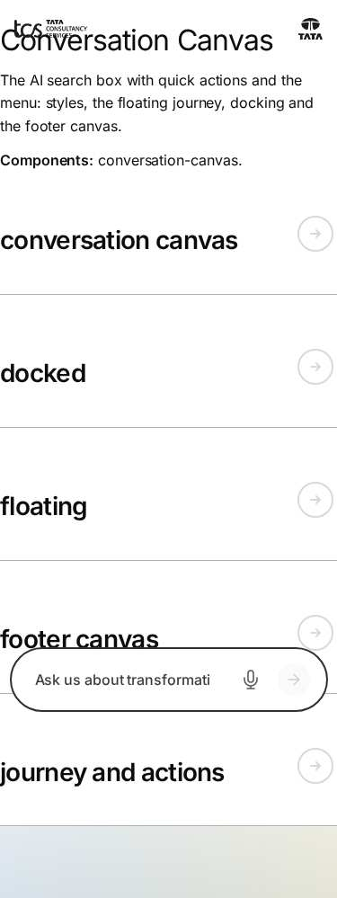

*Figure: Conversation Canvas: conversation-canvas — mobile 375 × 812 (/design-block-master/en/block-library/conversation-canvas, captured 2026-11-08).*

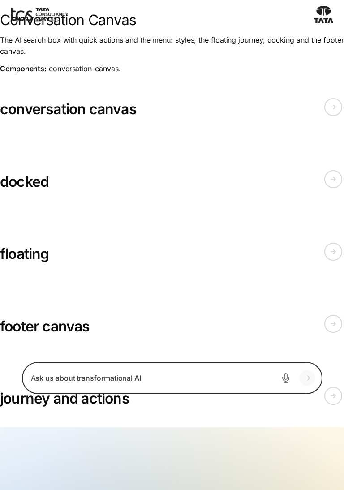

*Figure: Conversation Canvas: conversation-canvas — tablet 768 × 900 (/design-block-master/en/block-library/conversation-canvas, captured 2026-11-08).*

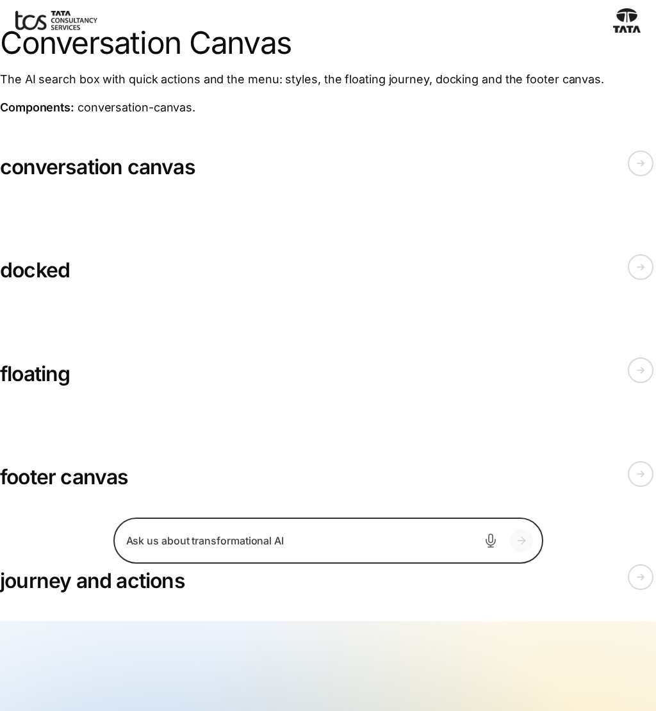

*Figure: Conversation Canvas: conversation-canvas — small desktop 1024 × 900 (/design-block-master/en/block-library/conversation-canvas, captured 2026-11-08).*

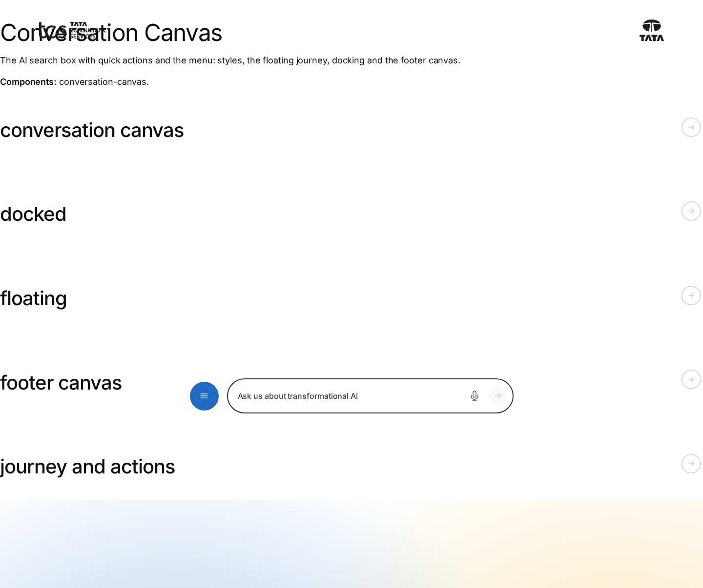

*Figure: Conversation Canvas: conversation-canvas — desktop 1440 × 900 (/design-block-master/en/block-library/conversation-canvas, captured 2026-11-08).*

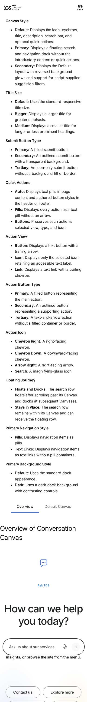

*Figure: Conversation Canvas: conversation-canvas/conversation-canvas — mobile 375 × 812 (/design-block-master/en/block-library/conversation-canvas/conversation-canvas, captured 2026-11-08).*

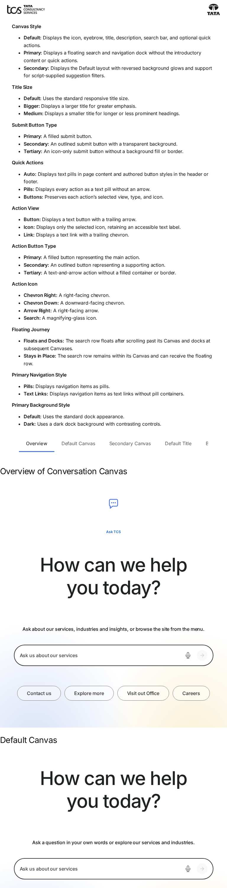

*Figure: Conversation Canvas: conversation-canvas/conversation-canvas — tablet 768 × 900 (/design-block-master/en/block-library/conversation-canvas/conversation-canvas, captured 2026-11-08).*

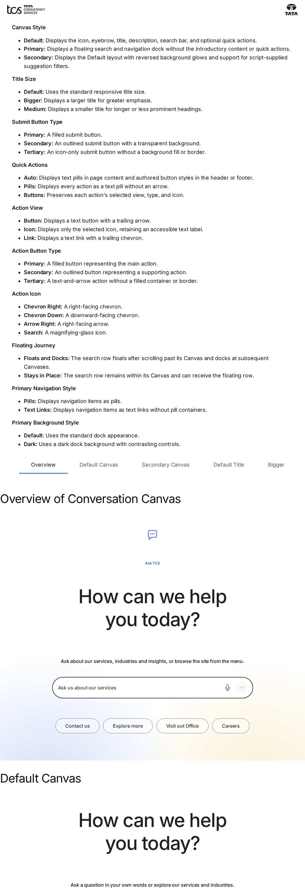

*Figure: Conversation Canvas: conversation-canvas/conversation-canvas — small desktop 1024 × 900 (/design-block-master/en/block-library/conversation-canvas/conversation-canvas, captured 2026-11-08).*

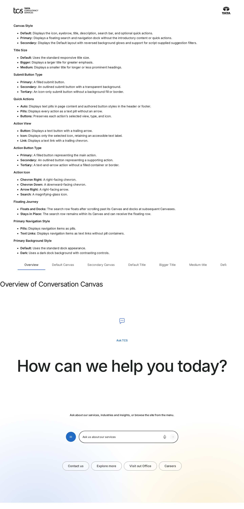

*Figure: Conversation Canvas: conversation-canvas/conversation-canvas — desktop 1440 × 900 (/design-block-master/en/block-library/conversation-canvas/conversation-canvas, captured 2026-11-08).*

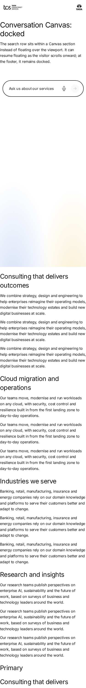

*Figure: Conversation Canvas: conversation-canvas/docked — mobile 375 × 812 (/design-block-master/en/block-library/conversation-canvas/docked, captured 2026-11-08).*

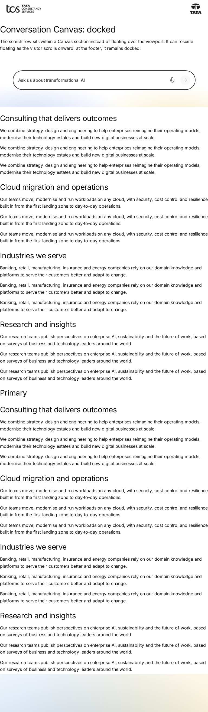

*Figure: Conversation Canvas: conversation-canvas/docked — tablet 768 × 900 (/design-block-master/en/block-library/conversation-canvas/docked, captured 2026-11-08).*

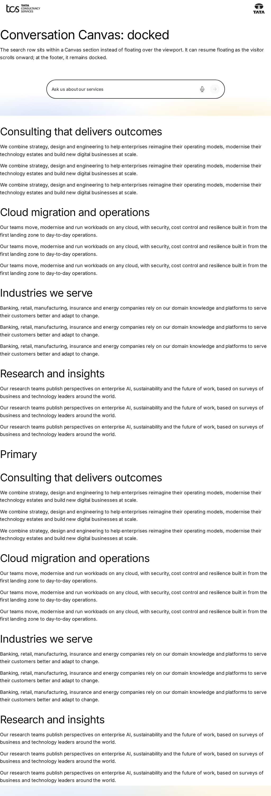

*Figure: Conversation Canvas: conversation-canvas/docked — small desktop 1024 × 900 (/design-block-master/en/block-library/conversation-canvas/docked, captured 2026-11-08).*

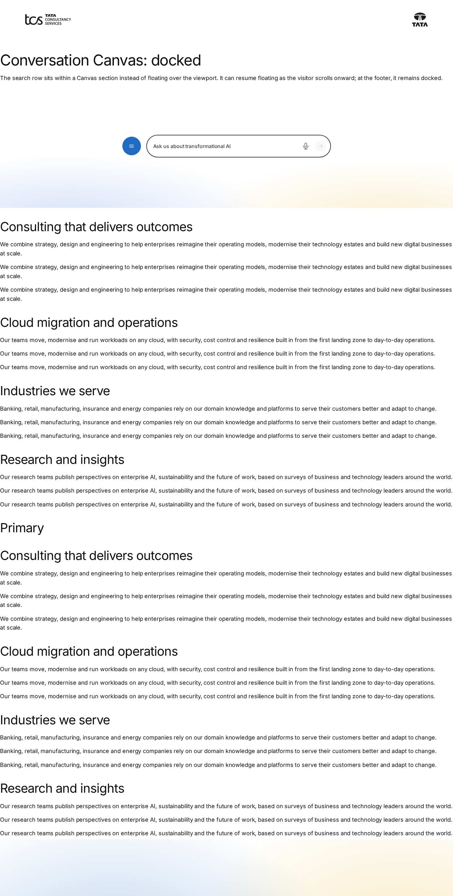

*Figure: Conversation Canvas: conversation-canvas/docked — desktop 1440 × 900 (/design-block-master/en/block-library/conversation-canvas/docked, captured 2026-11-08).*

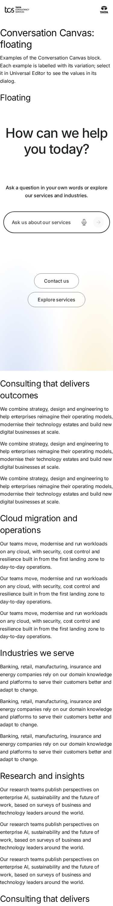

*Figure: Conversation Canvas: conversation-canvas/floating — mobile 375 × 812 (/design-block-master/en/block-library/conversation-canvas/floating, captured 2026-11-08).*

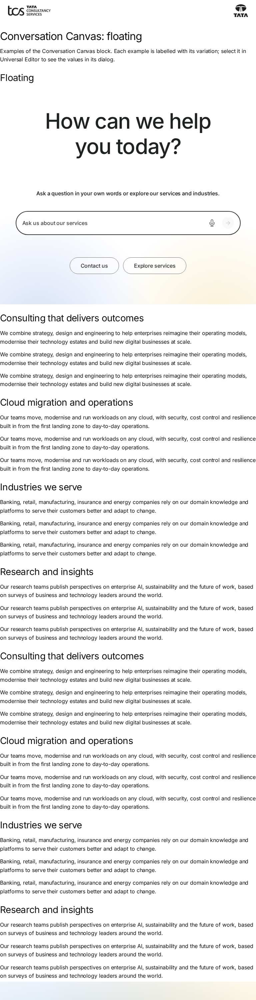

*Figure: Conversation Canvas: conversation-canvas/floating — tablet 768 × 900 (/design-block-master/en/block-library/conversation-canvas/floating, captured 2026-11-08).*

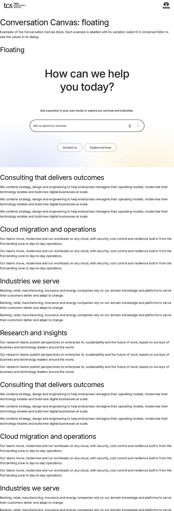

*Figure: Conversation Canvas: conversation-canvas/floating — small desktop 1024 × 900 (/design-block-master/en/block-library/conversation-canvas/floating, captured 2026-11-08).*

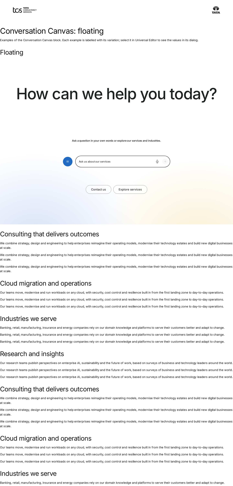

*Figure: Conversation Canvas: conversation-canvas/floating — desktop 1440 × 900 (/design-block-master/en/block-library/conversation-canvas/floating, captured 2026-11-08).*

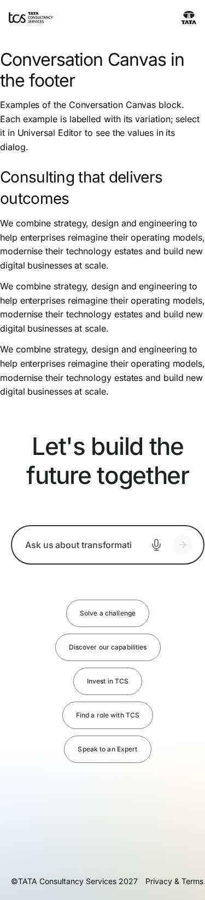

*Figure: Conversation Canvas: conversation-canvas/footer-canvas — mobile 375 × 812 (/design-block-master/en/block-library/conversation-canvas/footer-canvas, captured 2026-11-08).*

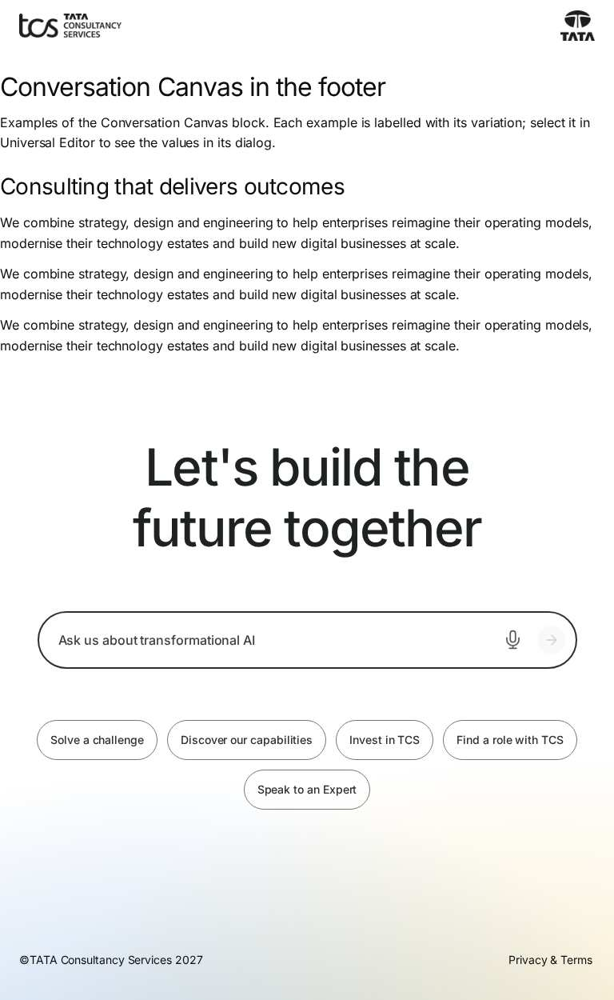

*Figure: Conversation Canvas: conversation-canvas/footer-canvas — tablet 768 × 900 (/design-block-master/en/block-library/conversation-canvas/footer-canvas, captured 2026-11-08).*

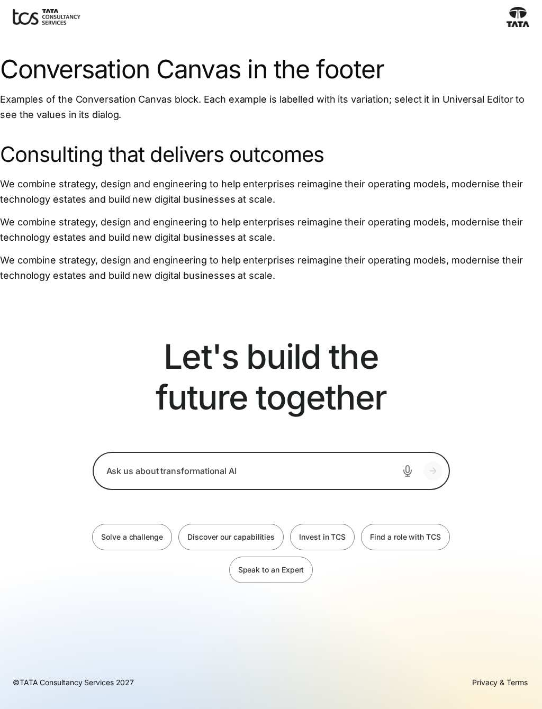

*Figure: Conversation Canvas: conversation-canvas/footer-canvas — small desktop 1024 × 900 (/design-block-master/en/block-library/conversation-canvas/footer-canvas, captured 2026-11-08).*

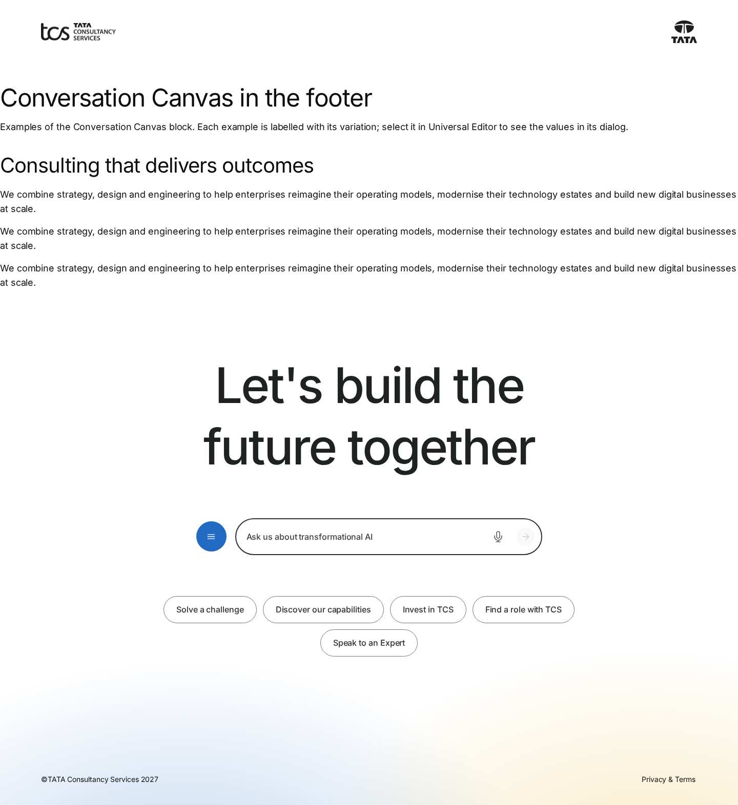

*Figure: Conversation Canvas: conversation-canvas/footer-canvas — desktop 1440 × 900 (/design-block-master/en/block-library/conversation-canvas/footer-canvas, captured 2026-11-08).*

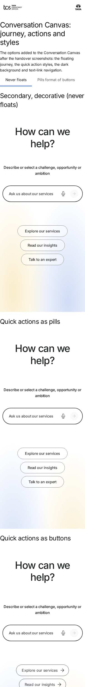

*Figure: Conversation Canvas: conversation-canvas/journey-and-actions — mobile 375 × 812 (/design-block-master/en/block-library/conversation-canvas/journey-and-actions, captured 2026-11-08).*

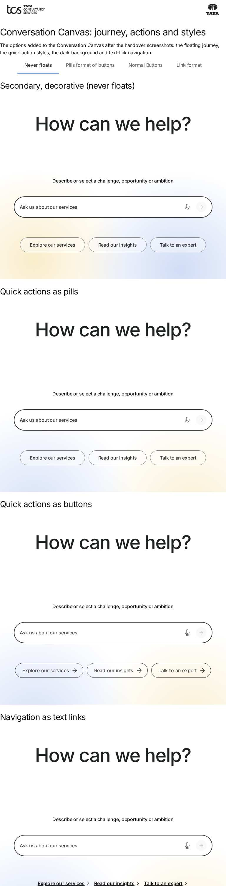

*Figure: Conversation Canvas: conversation-canvas/journey-and-actions — tablet 768 × 900 (/design-block-master/en/block-library/conversation-canvas/journey-and-actions, captured 2026-11-08).*

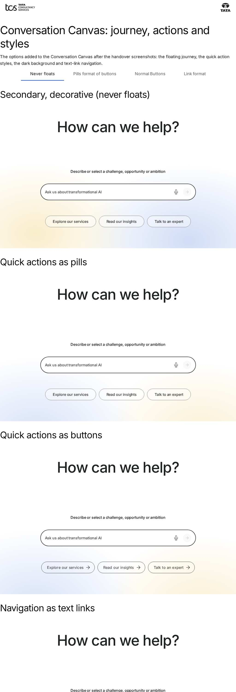

*Figure: Conversation Canvas: conversation-canvas/journey-and-actions — small desktop 1024 × 900 (/design-block-master/en/block-library/conversation-canvas/journey-and-actions, captured 2026-11-08).*

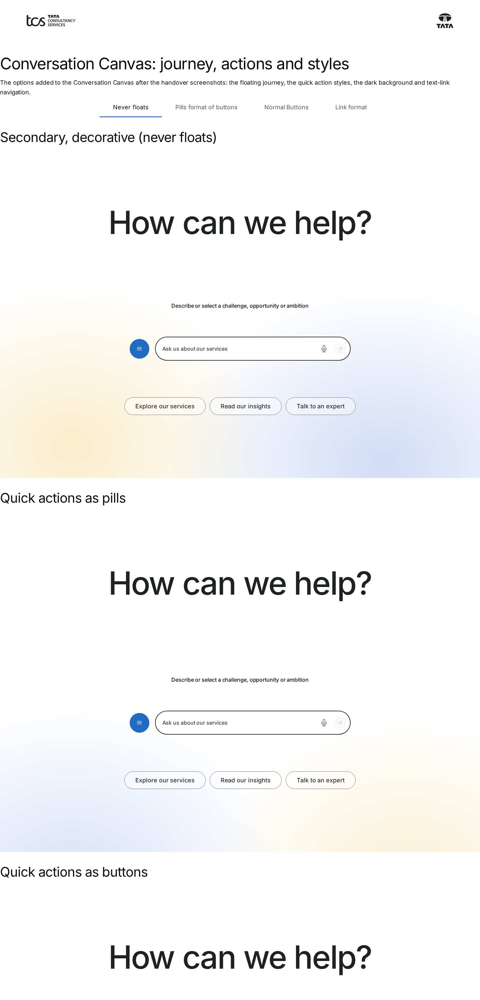

*Figure: Conversation Canvas: conversation-canvas/journey-and-actions — desktop 1440 × 900 (/design-block-master/en/block-library/conversation-canvas/journey-and-actions, captured 2026-11-08).*

## Known limitations

- None recorded for this document.

## Open items

- None.

## Change history

| Version | Date | Author | Change |
| --- | --- | --- | --- |
| 1.0 | 8 November 2026 | Delivery team (documentation program) | First version of the role-specific documentation (master documentation prompt), generated from the repository and the published reference pages |
