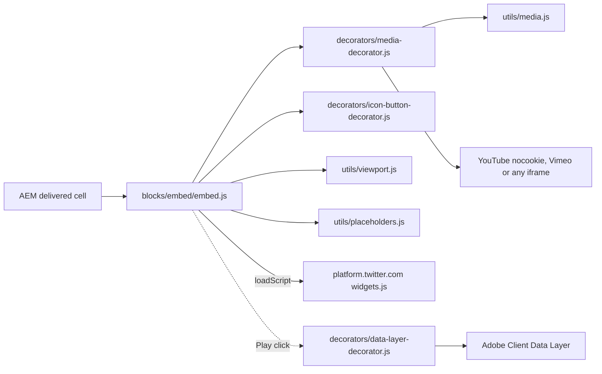
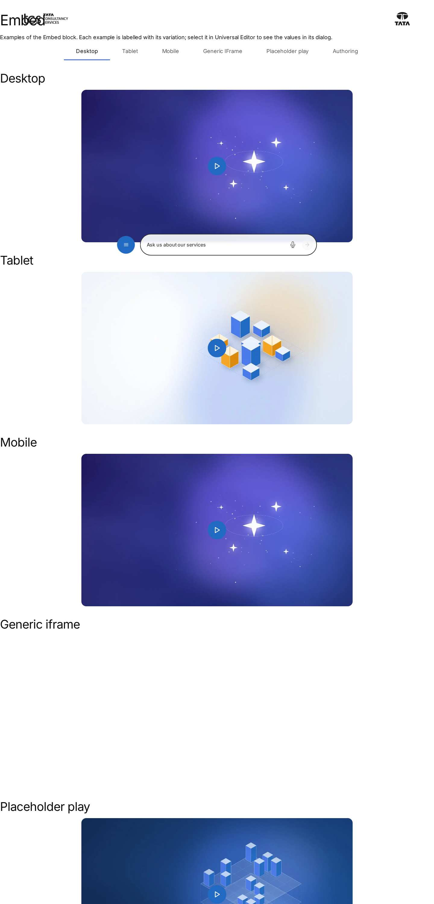
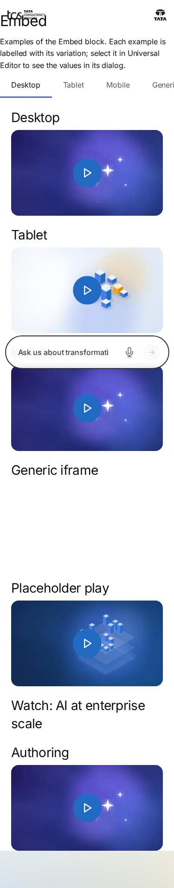

# Embed Block — Developer Guide

| Attribute | Value |
| --- | --- |
| Document ID | DEV-B-embed |
| Audience | Developers, technical leads, block owners, AI coding agents |
| Purpose | How the Embed block is built: files, model, structure, behaviour, variations, tests and limitations |
| Scope | blocks/embed/ and its components embed |
| Prerequisites | — |
| Owner | Technical Lead / Block Owner (proposed) |
| Approver | Product Owner (to be confirmed) |
| Version | 1.0 |
| Status | Draft for review |
| Last updated | 8 November 2026 |
| Last validated | 2026-11-08 (model, files, imports from the code; reference pages from the live site) |
| Source files | blocks/embed/README.md, blocks/embed/_embed.json, blocks/embed/embed.css, blocks/embed/embed.js |
| Related documents | [Variations](./EMBED-VARIATIONS.md), [Test coverage](./EMBED-TEST-COVERAGE.md), [Authoring guide](../../../03-authoring/components/embed/EMBED-AUTHORING-GUIDE.md) |
| Related AEM paths | /content/tcs-corp/design-block-master/en/block-library/embed, /content/tcs-corp/design-block-master/en/block-library/embed/embed |

## Contents

- [Summary](#summary)
- [Overview](#overview)
- [Source files](#source-files)
- [Components, models and filters](#components-models-and-filters)
- [Fields](#fields)
- [Dependencies](#dependencies)
- [For Developers](#for-developers)
- [Extending the Block](#extending-the-block)
- [Responsive Behavior](#responsive-behavior)
- [Accessibility](#accessibility)
- [Data Layer and Analytics](#data-layer-and-analytics)
- [Performance Considerations](#performance-considerations)
- [Security and Privacy](#security-and-privacy)
- [For Architects](#for-architects)
- [Troubleshooting](#troubleshooting)
- [Known limitations of the block](#known-limitations-of-the-block)
- [Change history of the block](#change-history-of-the-block)
- [Reference pages](#reference-pages)
- [Coverage of the required topics](#coverage-of-the-required-topics)
- [Screenshots](#screenshots)
- [Known limitations](#known-limitations)
- [Open items](#open-items)
- [Change history](#change-history)

## Summary

| Attribute | Value |
| --- | --- |
| Block | Embed |
| Folder | `blocks/embed` |
| Type | Independent |
| Category | media |
| Status | Active |
| Purpose | Third-party embeds (YouTube, Vimeo, X and other URLs) behind a privacy-friendly facade |
| Variations (summary) | Provider by URL |
| Children | — |
| Code size | 179 lines of JS and CSS |

## Overview

**Business purpose.** Include video and social content hosted on external platforms at a low
performance cost (lazy or click-to-load) and with accessible names.

**User experience.** With a placeholder image visitors see the image with a round Play button;
the provider's player loads and starts after Play. Without one, the player or post appears when
the block scrolls into view.

**Templates / page types.** Any page type.

**Data source.** The block's URI and optional placeholder image; the content itself comes from
YouTube, Vimeo, X or the embedded site.

**Related blocks.** [Video](https://github.com/sradha-tcs/tcs-corp/blob/main/blocks/video/README.md) (AEM Assets files, captions, transcript, autoplay,
background, pop-up and display options); Hero and Teaser (Lottie animations, not embeds).

**When to use.** A YouTube, Vimeo or X item, or an approved page that allows framing, needing no
playback options.

**When not to use.** AEM Assets videos, captions files, autoplay or background videos, a pop-up
player or sizes and aspect ratios (use Video); Instagram, LinkedIn, Facebook or TikTok posts (no
dedicated handler; providers usually refuse framing); content whose interactions must be tracked
(iframe interactions aren't visible to the page).

**Realistic use cases.**

- A keynote on YouTube behind a branded placeholder image on a campaign page.
- An official TCS post on X in a press release.
- An approved partner's interactive page in an iframe.

## Source files

| File | Link |
| --- | --- |
| `README.md` | [GitHub](https://github.com/sradha-tcs/tcs-corp/blob/main/blocks/embed/README.md) |
| `_embed.json` | [GitHub](https://github.com/sradha-tcs/tcs-corp/blob/main/blocks/embed/_embed.json) |
| `embed.css` | [GitHub](https://github.com/sradha-tcs/tcs-corp/blob/main/blocks/embed/embed.css) |
| `embed.js` | [GitHub](https://github.com/sradha-tcs/tcs-corp/blob/main/blocks/embed/embed.js) |

## Components, models and filters

| Component | Title | Resource type | Template name | Model | Children allowed |
| --- | --- | --- | --- | --- | --- |
| `embed` | Embed | `core/franklin/components/block/v1/block` | Embed | `embed` | — |

## Fields

The Additional tab fields (anchor, hide, padding, margin, animation) are common to the blocks and described in the [content modeling guide](../../markdown/CONTENT-MODELING-GUIDE.md).

### Embed (`embed`)

| Tab | Label | Property | Type | Required in model | Default | Options | Visibility |
| --- | --- | --- | --- | --- | --- | --- | --- |
| Content | Placeholder Image | `embed_placeholder` | reference | No | — | — | — |
| Content | Placeholder Image Alt Text | `embed_placeholderAlt` | text | No | `""` | — | — |
| Content | URI | `embed_uri` | text | No | — | — | — |

"Required in model" is the model's `required` flag; whether a field is required in practice is stated in the authoring guide where it is known.

## Dependencies

| Import |
| --- |
| `../../scripts/aem.js` |
| `../../decorators/icon-button-decorator.js` |
| `../../decorators/media-decorator.js` |
| `../../utils/media.js` |
| `../../utils/viewport.js` |
| `../../utils/placeholders.js` |

## For Developers

<!-- BEGIN GENERATED: files (npm run build:docs) -->

```text
blocks/embed/
├── README.md
├── _embed.json
├── embed.css
└── embed.js
```

| Decorator/Utility | Purpose | Execution or dependency point |
| ----------------- | ------- | ----------------------------- |
| [`scripts/aem.js`](https://github.com/sradha-tcs/tcs-corp/blob/main/scripts/aem.js) | Edge Delivery core library (block loading, CSS, metadata, optimized pictures) | `embed.js`: { loadScript } |
| [`decorators/icon-button-decorator.js`](https://github.com/sradha-tcs/tcs-corp/blob/main/decorators/icon-button-decorator.js) | `createIconButton` | `embed.js`: { createIconButton } |
| [`decorators/media-decorator.js`](https://github.com/sradha-tcs/tcs-corp/blob/main/decorators/media-decorator.js) | `createFrame`, `createYoutubeFrame`, `createVimeoFrame`, `createVideoElement` | `embed.js`: { createFrame, createVimeoFrame, createYoutubeFrame, } |
| [`utils/media.js`](https://github.com/sradha-tcs/tcs-corp/blob/main/utils/media.js) | `isYoutube`, `isVimeo`, `isAnimation`, `youtubeEmbedUrl`, `vimeoEmbedUrl`, `videoType`, `deliveryAsset` (reads a Dynamic Media with OpenAPI delivery URL of a separate AEM Assets environment), `deliveryImageUrl` (its URL  | `embed.js`: { isVimeo, isYoutube } |
| [`utils/viewport.js`](https://github.com/sradha-tcs/tcs-corp/blob/main/utils/viewport.js) | `onVisible` (once), `watchVisibility` (on / off screen), `currentBreakpoint` (mobile / tablet / desktop) | `embed.js`: { onVisible } |
| [`utils/placeholders.js`](https://github.com/sradha-tcs/tcs-corp/blob/main/utils/placeholders.js) | `getPlaceholders`, `loadPlaceholders`, `fillPlaceholder` (UI text from the locale's placeholders, with English fallbacks) | `embed.js`: { getPlaceholders } |

<!-- END GENERATED: files -->

**JavaScript (`embed.js`).** `decorate` takes the first `picture` (placeholder) and the first link's
`href` (else the first `http(s)://` URL in the block's text), empties the block and returns if
there is no URL. With a placeholder it builds `div.embed-placeholder` with the picture and a primary
icon button (`createIconButton`, `data-cmp-interaction="play"`) calling
`loadEmbed(block, link, { autoplay: true, focus: true, t })`; without, `onVisible(block, …)` calls
`loadEmbed` without autoplay. `loadEmbed` runs once (`embed-is-loaded` guard), picks the first
matching entry of `EMBEDS` (`youtube`, `vimeo`, `twitter`) or `createFrame`, replaces the block's
children and adds `embed-{name}` and `embed-is-loaded`. The module exports only `decorate`.

**CSS (`embed.css`).** `max-width: 56.25rem`, centred; the block reserves 16:9 while it has neither
a placeholder nor a loaded embed; `.embed-frame` and `.embed-placeholder` are 16:9 with
`--radius-l`.

**Input DOM.** Not key-value: AEM delivers an empty row per dialog tab (Content, Additional) and one
cell with the grouped fields (picture with the collapsed alt text, then the URI as a link or text).

**Rendered DOM contract.** Before loading: `.embed > .embed-placeholder > picture +
button.embed-placeholder-play`, or an empty `.embed`. After: `.embed.embed-is-loaded[.embed-youtube|
.embed-vimeo|.embed-twitter] > .embed-frame > iframe` or `> blockquote.twitter-tweet > a`.

**Events and async behavior.** `getPlaceholders` is awaited after the URL check; IntersectionObserver
(`onVisible`); `loadScript('https://platform.twitter.com/widgets.js')` for X posts.

**Error handling.** No URL: empty block. Provider failures are shown by the provider; the block logs
nothing.

**Parent / child contracts.** Tabs (`blocks/tabs/tabs.js`) posts pause commands to YouTube
(`enablejsapi=1`) and Vimeo frames of hidden tabs.

## Extending the Block

1. **A new provider:** add an entry `{ name, match, embed }` to `EMBEDS` in `embed.js`, building the
   DOM with the media decorator (`createFrame`) or DOM APIs, never HTML strings; add styles scoped
   as `.embed.embed-{name}`.
2. **A dialog field:** add it to `_embed.json` (it's a grouped `embed_*` cell: read it by element, not
   by position), then `npm run build:json` and `npm run lint`. Field names ending in Text, Title,
   Type, Alt or MimeType collapse into their base field.
3. **Responsive / accessibility:** keep frames titled from placeholders, focus after Play and the
   reserved aspect ratio.
4. **Data layer:** describe new controls with `data-cmp-interaction`.
5. **Tests:** URL parsing belongs in `utils/media.js` with tests in `test/media/`.
6. **Backward compatibility:** the block reads links and pictures anywhere in the block, so tab rows
   and the order of the grouped fields don't matter; keep it that way.
7. **Library and docs:** update the block library, this README, `npm run build:docs`;
   `npm run build:modules` after changing imports.

## Responsive Behavior

`embed.css` has no media queries.

| Viewport | Layout | Image behavior | Interaction behavior |
| -------- | ------ | -------------- | -------------------- |
| All viewports | Up to 56.25rem wide, centred; 16:9 frames and placeholder with `--radius-l` corners; X posts at the widget's size, centred | Placeholder image covers the 16:9 area (`object-fit: cover`) | Play (scaled 1.4×) centred on the image; same behaviour everywhere |

## Accessibility

- **Semantics:** iframes with a `title`; a native `button` for Play; X posts as a `blockquote` with
  a link.
- **Headings:** none in the block; add one before it.
- **Keyboard and focus:** Play is reachable with Tab and activated with Enter / Space; after Play
  focus moves into the iframe (or the X link).
- **Accessible names:** Play from the placeholder alt text; frames "Content from {host}".
- **Moving content:** videos start only after Play (click-to-load) or not at all; a video in a
  hidden tab of a Tabs Container is paused (YouTube / Vimeo pause commands).
- **Reduced motion:** the Additional tab animation doesn't play; embeds never autoplay without Play.
- **Contrast and reflow:** the block is fluid; the Play button uses the primary icon button styles.
- **Empty / loading / error states:** empty without a URL; the reserved area while loading; provider
  error pages inside the frame.

**Author responsibilities:** placeholder alt text, a heading before the block, videos with captions
on their platform, a transcript in the page for informative videos.

**Developer responsibilities:** keep the frame names and the Play label from placeholders, the focus
move and the DOM-built players.

| Key | Expected behavior |
| --- | ----------------- |
| Tab | Moves to the Play button, then into the player once loaded |
| Enter / Space | Activates Play: the embed loads and receives focus |

## Data Layer and Analytics

`decorators/data-layer-decorator.js` adds the block as `tcs-corp/components/embed`, id = Anchor ID
else `embed-{n}`. The block sets `data-cmp-interaction="play"` on the Play button.

| Trigger | Data-layer event | Required properties | Analytics behavior |
| ------- | ---------------- | ------------------- | ------------------ |
| Block decorated | component state | `@type`, `parentId` | One entry per block |
| Play button click | `cmp:click` | `interaction` `play`, `dc:title` (the button's name), `breakpoint` | A play request |
| X fallback link click | `cmp:click` | `interaction` `link`, `xdm:linkURL`, `xdm:linkType` `exit` | Exit link |

Interactions inside the provider frames and the X widget aren't visible to the page. The intended
path is Adobe Client Data Layer, then Adobe Data Collection (Tags), the AEP Web SDK, the Edge
Network and Analytics / CJA, but Tags and the Web SDK aren't configured yet (blocked: measurement
plan); no consent mechanism is implemented.

## Performance Considerations

- Decorated with its section; only placeholders are fetched before the URL is used.
- No provider request until the block is in view (no placeholder) or until Play; iframes
  `loading="lazy"`; `widgets.js` only when an X post loads.
- 16:9 space reserved before loading (no layout shift for videos and iframes); X posts change height
  when the widget renders.
- One IntersectionObserver per block, disconnected after loading.
- A placeholder image in the first section may be the LCP element.

## Security and Privacy

- Players are built with DOM APIs (`decorators/media-decorator.js`); no authored URL is written as
  HTML.
- Any URL becomes a generic iframe: there is no host allow-list and no `sandbox` attribute; only
  approved, framable URLs should be authored.
- YouTube always uses `www.youtube-nocookie.com`, Vimeo `dnt=1`; the X widget and generic iframes
  load third-party content and cookies as their providers do. No consent mechanism is implemented.
- `x.com` is rewritten to `twitter.com` for the widget; other query strings of YouTube URLs aren't
  passed on (only the id is used).

## For Architects

- **Role:** a thin client-side wrapper for provider embeds.
- **Content model:** one grouped cell (placeholder, alt, URI) plus the Additional tab.
- **Rendering:** DOM-built iframes via `decorators/media-decorator.js`; X via the provider widget.
- **Dependencies:** media decorator / utils, icon button decorator, viewport and placeholders utils,
  `loadScript` from `scripts/aem.js`.
- **Data layer / Web SDK / Target:** generic component state and the Play click; no Web SDK or Target.
- **Consent and identity:** none implemented; YouTube privacy-enhanced host and Vimeo `dnt=1` are
  always used; the X widget and generic iframes set whatever the provider sets once loaded.
- **Caching / performance:** page HTML and image via the CDN; provider content cached by providers;
  nothing loads before visibility or Play.
- **Security:** see below.



## Troubleshooting

| Symptom | Likely cause | Diagnostic steps | Resolution | Verification |
| ------- | ------------ | ---------------- | ---------- | ------------ |
| Nothing renders | No URI | `{page}.plain.html`: look for the link or URL | Paste the full https URL | Embed appears |
| YouTube "Video unavailable" | Wrong id, private video, embedding disabled | Inspect the iframe `src` | Public, embeddable video URL | Player loads |
| Vimeo "does not exist" | URL without a numeric id | Inspect the iframe `src` | Use `vimeo.com/{id}` | Player loads |
| X post shows only a link | Widget script blocked, post protected or deleted | Network: `widgets.js`; open the post | Public post; allow the script | Card renders |
| Iframe "refused to connect" | Site forbids framing, or http | Console (X-Frame-Options / CSP) | Embeddable https URL, or a link instead | Page shows |
| Video starts with sound after Play | `muted=1` is passed to YouTube as well; browsers' autoplay rules apply | Inspect the `src` parameters | Expected; use Video for playback control | — |
| Placeholder cropped badly | Image not 16:9 | Compare dimensions | 16:9 rendition, subject centred | Image framed well |

Evidence to collect (no secrets): page URL, `.plain.html` of the block, the iframe `src`, console
errors (CSP, framing), Network entries of the provider requests, the block's data-layer entries.

## Known limitations of the block

| Limitation | Impact | Workaround | Planned correction |
| ---------- | ------ | ---------- | ------------------ |
| No start time, playlist or other YouTube parameters | Plays from the start | Use the Video block (Start At) | Not recorded |
| Generic iframes always 16:9 | Tall pages are cut off | Link to the page instead | Not recorded |
| No host allow-list for generic iframes | Any framable URL can be embedded | Governance of who authors Embeds | Not recorded |
| No handlers for Instagram, LinkedIn, Facebook, TikTok | Usually refused as iframes | Link to the post | Not recorded |
| Iframe interactions not tracked | No provider play data | None | Not recorded |
| Frame name is generic ("Content from {host}") | Screen readers don't hear the video's name from the frame | Heading before the block; placeholder alt text | Not recorded |
| `muted=1` passed to YouTube after Play | The video may start with sound | Use the Video block | Not recorded |
| An Embed without a URL still reserves an empty 16:9 area | Blank space on the page | Delete the block or add a URI | Not recorded |
| No consent management | Provider cookies once loaded | Click-to-load placeholder | Not recorded (owner: privacy / legal) |

## Change history of the block

| Version | Change | Source | Date |
| ------- | ---- | ------ | ---- |
| Not recorded | README generated from verified implementation and approved handover documentation | Repository review | Not recorded |
| Handover 2.18 | Additional tab content animation (Animation Type, Motion Speed, Animation Trigger) | docs/handover revision history | 18 October 2026 |
| Handover 2.27 | Block audit: Play named after the placeholder alt text (D-D-8), bare URLs rendered (D-D-9), privacy-enhanced players (D-D-10) | docs/handover revision history; docs/audit/BLOCK-ECOSYSTEM-AUDIT.md | 19 October 2026 |
| Handover 2.29 | Re-audit: Vimeo player / channel / unlisted URLs (R-D-5); embeds paused in hidden tabs (R-C-8) | docs/handover revision history; docs/audit/REAUDIT-2026-10-20.md | 20 October 2026 |

## Reference pages

| Kind | Page | Live URL |
| --- | --- | --- |
| Block library | /design-block-master/en/block-library/embed | https://main--tcs-corp--sradha-tcs.aem.live/design-block-master/en/block-library/embed |
| Block library | /design-block-master/en/block-library/embed/embed | https://main--tcs-corp--sradha-tcs.aem.live/design-block-master/en/block-library/embed/embed |

## Coverage of the required topics

| Topic | Where |
| --- | --- |
| Purpose | Overview |
| Source files | generated: Files |
| Model, definition, filters, children | generated: Components |
| Dependencies | generated: Dependencies |
| Authored input / rendered output / DOM transformation | For Developers |
| Configuration fields, defaults, required fields | generated: Fields |
| Variations | EMBED-VARIATIONS.md |
| Responsive behaviour | Responsive Behavior |
| Accessibility and keyboard | Accessibility |
| Analytics / data layer | Data Layer and Analytics |
| Performance | Performance Considerations |
| Security | Security and Privacy |
| Extending | Extending the Block |
| Known limitations | Known Limitations |
| Troubleshooting | Troubleshooting |
| Tests | EMBED-TEST-COVERAGE.md |
| SEO behaviour | Not recorded |
| Caching considerations | Not recorded (Edge Delivery default caching; no block-specific rule) |
| Ownership | Technical Lead / Block Owner (proposed) |

## Screenshots



*Figure: Embed block library page — desktop 1440 × 900 (/design-block-master/en/block-library/embed/embed, captured 2026-11-08).*



*Figure: Embed block library page — mobile 375 × 812 (/design-block-master/en/block-library/embed/embed, captured 2026-11-08).*


*Figure: Desktop rendering — The Embed at 1440 px: the placeholder image photo-2.svg in a 16:9 frame 900 px wide (56.25rem), centred, with 1rem rounded corners, and the round primary Play button in its centre. The YouTube player is not loaded yet. (Sample content on the preview; callout letters as in the Field Entry Table; file screenshots/embed-desktop-view.jpg) (handover screenshot; rendering at the time it was taken).*


*Figure: Tablet rendering — The Embed at 768 px: the placeholder image photo-4.svg at the full content width (about 688 px) in a 16:9 frame with rounded corners and the Play button centred; the Vimeo player loads only after Play. (Sample content on the preview; callout letters as in the Field Entry Table; file screenshots/embed-tablet-view.jpg) (handover screenshot; rendering at the time it was taken).*


*Figure: Mobile rendering — The Embed at 390 px: the placeholder image photo-2.svg at the full content width (about 342 px) in a 16:9 frame with rounded corners and the Play button centred. No X post is part of this example. (Sample content on the preview; callout letters as in the Field Entry Table; file screenshots/embed-mobile-view.jpg) (handover screenshot; rendering at the time it was taken).*


*Figure: Variation example — The Embed at 1440 px: a 16:9 iframe 900 px wide with rounded corners showing a partner's Market explorer page with Region and Industry filters and the figures +6.4% digital spend growth, 38% cloud adoption and 2.1x AI investment since 2022. The capture uses a local stand-in page for the partner URL. (Sample content on the preview; callout letters as in the Field Entry Table; file screenshots/embed-generic-iframe.jpg) (handover screenshot; rendering at the time it was taken).*


*Figure: Variation example — The Embed at 1440 px: the placeholder image photo-3.svg in a centred 900 px 16:9 frame with rounded corners and the round primary Play button in the centre. Only the state before Play is shown; the YouTube player is not in the screenshot. (Sample content on the preview; callout letters as in the Field Entry Table; file screenshots/embed-placeholder-play.jpg) (handover screenshot; rendering at the time it was taken).*


*Figure: Universal Editor canvas — An annotated edit-mode view at 1440 px (not a Universal Editor screenshot): the H2 Watch: AI at enterprise scale above the Embed block (A) with the placeholder image photo-2.svg (B) and the generated Play button (C) centred on it. No properties panel is shown. (Annotated preview in editor mode with sample content; letters as in the annotations list, not a Universal Editor screenshot; file screenshots/embed-authoring-view.jpg) (handover screenshot; rendering at the time it was taken).*


*Figure: Properties panel — The Embed properties panel: Content tab with Placeholder Image, Placeholder Image Alt Text and URI; the Additional tab. (Dialog reference generated from the component model, not a Universal Editor screenshot; file screenshots/embed-properties-panel.jpg) (handover screenshot; rendering at the time it was taken).*

## Known limitations

- Universal Editor dialogs were not captured: no author access in this program (see the access blockers).

## Open items

- None.

## Change history

| Version | Date | Author | Change |
| --- | --- | --- | --- |
| 1.0 | 8 November 2026 | Delivery team (documentation program) | First version of the role-specific documentation (master documentation prompt), generated from the repository and the published reference pages |
