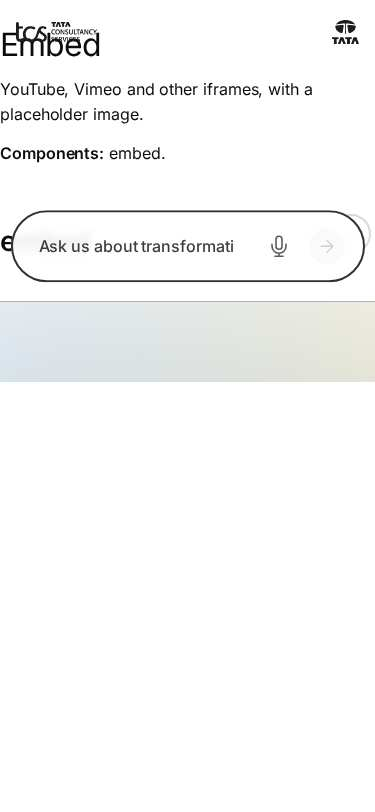
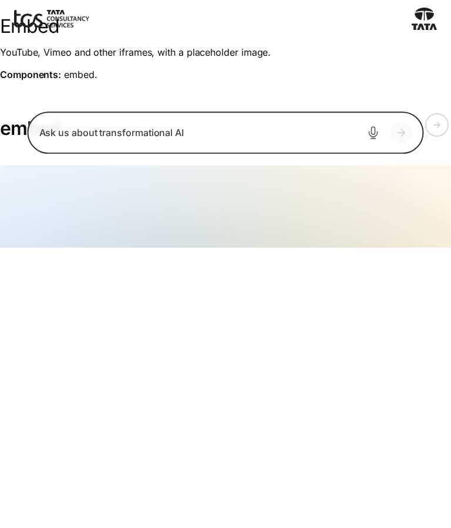
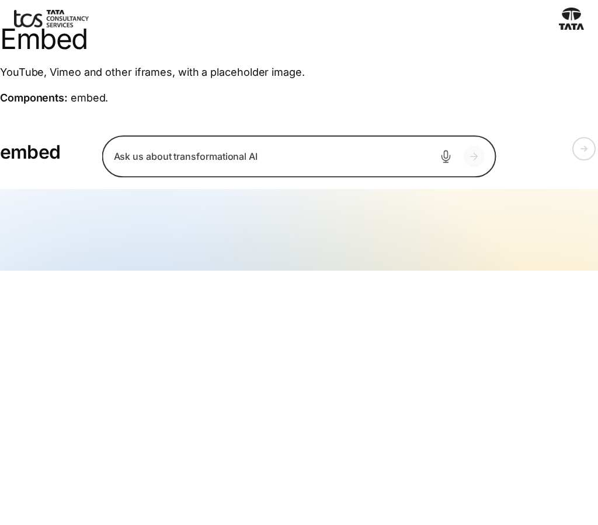
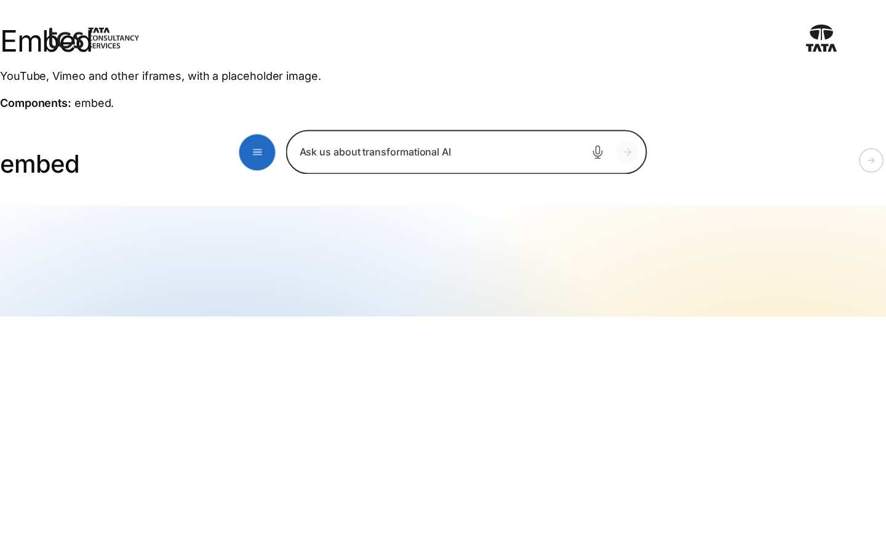
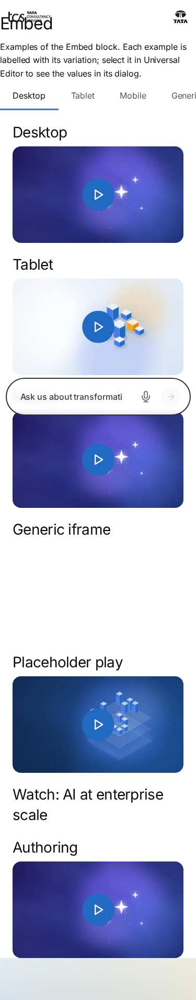
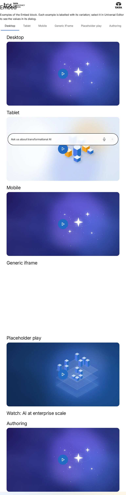
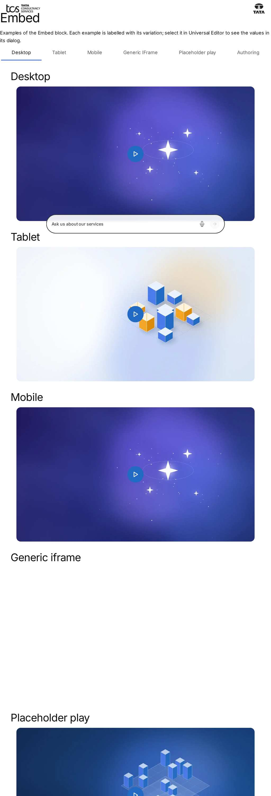
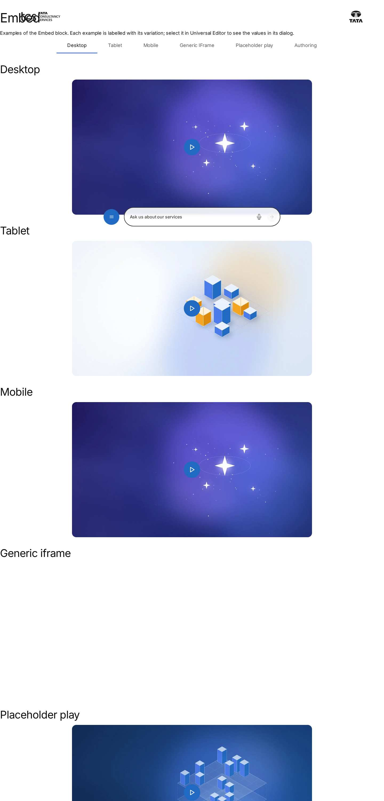

# Embed Block — Test Coverage

| Attribute | Value |
| --- | --- |
| Document ID | DEV-T-embed |
| Audience | Developers, technical leads, block owners, AI coding agents |
| Purpose | Unit tests, automated reference-page checks and manual test guidance for the block |
| Scope | — |
| Prerequisites | — |
| Owner | Technical Lead / Block Owner (proposed) |
| Approver | Product Owner (to be confirmed) |
| Version | 1.0 |
| Status | Draft for review |
| Last updated | 13 November 2026 |
| Last validated | 13 November 2026 |
| Source files | — |
| Related documents | — |
| Related AEM paths | — |

## Contents

- [Unit tests](#unit-tests)
- [Automated checks of the block library pages (executed 13 November 2026)](#automated-checks-of-the-block-library-pages-executed-13-november-2026)
- [Manual test guidance (block README)](#manual-test-guidance-block-readme)
- [Screenshots](#screenshots)
- [Known limitations](#known-limitations)
- [Open items](#open-items)
- [Change history](#change-history)

## Unit tests

No unit test is specific to this block (shared tests: test/models, test/items, test/docs, test/motion).

## Automated checks of the block library pages (executed 13 November 2026)

Per page: HTTP status and horizontal overflow at 375 / 768 / 1024 / 1440 px, console errors, failed requests and DOM accessibility checks at 1440 px (evidence: [screenshot register](../../../SCREENSHOT-REGISTER.md)).

| Page | 375 / 768 / 1024 / 1440 | Console errors | Failed requests | Accessibility (DOM) |
| --- | --- | --- | --- | --- |
| /design-block-master/en/block-library/embed | ok / ok / ok / ok | 8 | 8 | 0 img no alt, 0 unnamed buttons, 1 heading skips |
| /design-block-master/en/block-library/embed/embed | ok / ok / ok / ok | 4 | 8 | 0 img no alt, 0 unnamed buttons, 0 heading skips |

## Manual test guidance (block README)

| Test ID | Scenario | Configuration | Expected result |
| ------- | -------- | ------------- | --------------- |
| EMBED-QA-01 | YouTube, no placeholder | Watch URL | Player loads when in view from `www.youtube-nocookie.com`, no autoplay |
| EMBED-QA-02 | YouTube URL forms | `youtu.be`, `/shorts/`, `/live/`, `/embed/` | Valid embed of the id |
| EMBED-QA-03 | Vimeo | `vimeo.com/{id}`, channel, unlisted | `player.vimeo.com/video/{id}` with `dnt=1` (and `h`) |
| EMBED-QA-04 | X post | `x.com/...` | Post rendered by the widget; `twitter.com` link before |
| EMBED-QA-05 | Generic iframe | An embeddable https page | 16:9 iframe titled "Content from {host}" |
| EMBED-QA-06 | Click-to-load | Placeholder + alt + YouTube URL | No provider request before Play; Play loads, autoplays and focuses the frame |
| EMBED-QA-07 | Play name | Placeholder without alt | Button named "Play" |
| EMBED-QA-08 | Bare URL | URI delivered as text | Embed renders |
| EMBED-QA-09 | No URI | URI empty | Nothing rendered (16:9 area reserved) |
| EMBED-QA-10 | Multiple instances | Two Embeds | `embed-1`, `embed-2`; independent loading |
| EMBED-QA-11 | Viewports | 1440 / 768 / 390 px | Fluid, max 56.25rem, no horizontal scroll |
| EMBED-QA-12 | Keyboard | Tab, Enter | As in the key table |
| EMBED-QA-13 | Data layer | Press Play | `cmp:click` with `interaction` `play` |
| EMBED-QA-14 | Hidden tab | YouTube in a tab, switch tab | Video paused |
| EMBED-QA-15 | Margins | Margin left set | Centring replaced by the margin |

Test cases: [05-quality-assurance/test-cases/blocks/embed](../../../05-quality-assurance/test-cases/blocks/embed/EMBED-TEST-CASES.md).

## Screenshots

*Figure: Embed: embed — mobile 375 × 812 (/design-block-master/en/block-library/embed, captured 2026-11-08).*

*Figure: Embed: embed — tablet 768 × 900 (/design-block-master/en/block-library/embed, captured 2026-11-08).*

*Figure: Embed: embed — small desktop 1024 × 900 (/design-block-master/en/block-library/embed, captured 2026-11-08).*

*Figure: Embed: embed — desktop 1440 × 900 (/design-block-master/en/block-library/embed, captured 2026-11-08).*

*Figure: Embed: embed/embed — mobile 375 × 812 (/design-block-master/en/block-library/embed/embed, captured 2026-11-08).*

*Figure: Embed: embed/embed — tablet 768 × 900 (/design-block-master/en/block-library/embed/embed, captured 2026-11-08).*

*Figure: Embed: embed/embed — small desktop 1024 × 900 (/design-block-master/en/block-library/embed/embed, captured 2026-11-08).*

*Figure: Embed: embed/embed — desktop 1440 × 900 (/design-block-master/en/block-library/embed/embed, captured 2026-11-08).*

## Known limitations

- None recorded for this document.

## Open items

- None.

## Change history

| Version | Date | Author | Change |
| --- | --- | --- | --- |
| 1.0 | 13 November 2026 | Delivery team (documentation program) | First version of the role-specific documentation (master documentation prompt), generated from the repository and the published reference pages |
