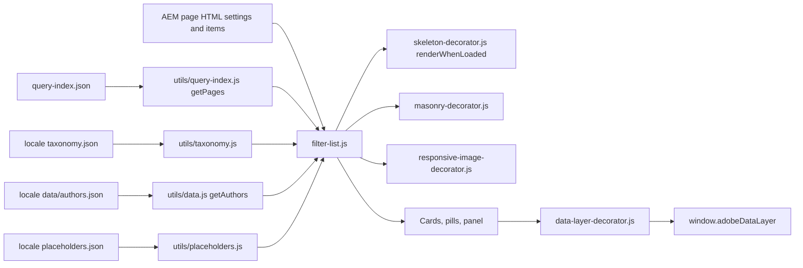
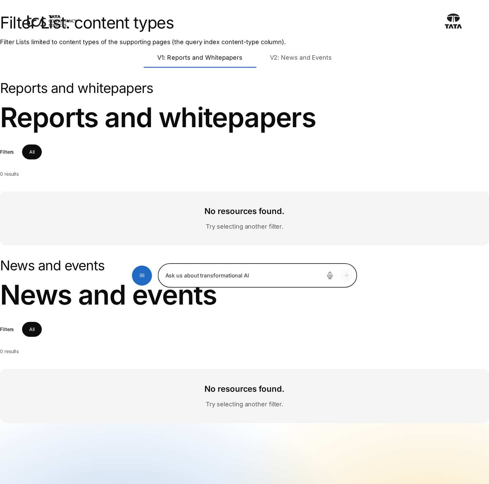
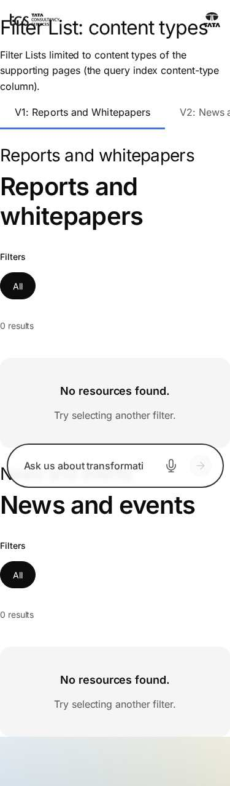

# Filter List Block — Developer Guide

| Attribute | Value |
| --- | --- |
| Document ID | DEV-B-filter-list |
| Audience | Developers, technical leads, block owners, AI coding agents |
| Purpose | How the Filter List block is built: files, model, structure, behaviour, variations, tests and limitations |
| Scope | blocks/filter-list/ and its components filter-list, filter-list-tag, filter-list-category, filter-list-page |
| Prerequisites | — |
| Owner | Technical Lead / Block Owner (proposed) |
| Approver | Product Owner (to be confirmed) |
| Version | 1.0 |
| Status | Draft for review |
| Last updated | 8 November 2026 |
| Last validated | 2026-11-08 (model, files, imports from the code; reference pages from the live site) |
| Source files | blocks/filter-list/README.md, blocks/filter-list/_filter-list.json, blocks/filter-list/filter-list.css, blocks/filter-list/filter-list.js |
| Related documents | [Variations](./FILTER-LIST-VARIATIONS.md), [Test coverage](./FILTER-LIST-TEST-COVERAGE.md), [Authoring guide](../../../03-authoring/components/filter-list/FILTER-LIST-AUTHORING-GUIDE.md) |
| Related AEM paths | /content/tcs-corp/design-block-master/en/block-library/filter-list, /content/tcs-corp/design-block-master/en/block-library/filter-list/content-types, /content/tcs-corp/design-block-master/en/block-library/filter-list/filter-list |

## Contents

- [Summary](#summary)
- [Overview](#overview)
- [Source files](#source-files)
- [Components, models and filters](#components-models-and-filters)
- [Fields](#fields)
- [Dependencies](#dependencies)
- [For Developers](#for-developers)
- [Extending the Block](#extending-the-block)
- [Responsive Behavior](#responsive-behavior)
- [Accessibility](#accessibility)
- [Data Layer and Analytics](#data-layer-and-analytics)
- [Performance Considerations](#performance-considerations)
- [Security and Privacy](#security-and-privacy)
- [For Architects](#for-architects)
- [Troubleshooting](#troubleshooting)
- [Known limitations of the block](#known-limitations-of-the-block)
- [Change history of the block](#change-history-of-the-block)
- [Reference pages](#reference-pages)
- [Coverage of the required topics](#coverage-of-the-required-topics)
- [Screenshots](#screenshots)
- [Known limitations](#known-limitations)
- [Open items](#open-items)
- [Change history](#change-history)

## Summary

| Attribute | Value |
| --- | --- |
| Block | Filter List |
| Folder | `blocks/filter-list` |
| Type | Container |
| Category | listing |
| Status | Active |
| Purpose | Filterable listing of the locale's pages from the query index |
| Variations (summary) | Layouts, card styles, filters, featured cards |
| Children | filter-list-tag (Filter Tag), filter-list-category (Filter Category), filter-list-page (Filter Page) |
| Code size | 1358 lines of JS and CSS |

## Overview

- **Business purpose:** one place to explore a collection of content (insights, articles, reports, case studies) and narrow it by taxonomy, without maintaining the list by hand: pages appear once they are published with the right metadata.
- **User experience:** a title and description, a row of filter pills (All plus tags) with a round filter button that opens an Advanced filters panel of checkboxes, an optional result count, an optional hero spotlight, cards in a masonry, grid or list layout, a featured spotlight after each page of cards, and a Load more button.
- **Templates / page types:** any page; typically listing and hub pages (curated Insights and Collection pages, `dummy-pages/explore-insights`).
- **Data source:** `/query-index.json` (rows of the current locale, or of the language master while it is under review), the locale's taxonomy, the Authors data sheet and the placeholders; authored settings and items.
- **Related blocks:** [List](https://github.com/sradha-tcs/tcs-corp/blob/main/blocks/list/README.md) (child pages, fixed list or tagged pages from the same index, without visitor filters; applies redirects and leaves out `hide-in-nav` pages, which the Filter List doesn't), [Cards](https://github.com/sradha-tcs/tcs-corp/blob/main/blocks/cards/README.md) (manual cards), Page Header (reads the same page metadata).
- **When to use:** the list should follow page metadata and stay current; visitors need to filter many pages by tags; hero and featured cards should follow rules (featured flag, priority, latest).
- **When not to use:** a short fixed set of authored cards (Cards); a list without visitor filters in the List presentations (List); content that isn't published to Edge Delivery (the block reads only the query index); results needed in Universal Editor itself (the editor shows a hint, there is no index on AEM author).
- **Realistic use cases:** "Explore insights & opinions" below `/en/insights`, newest first, with a hero; an industry page with pills for banking topics; a hand-picked Manual List of pages; a resource library with Industry and Topic categories combined with OR.

## Source files

| File | Link |
| --- | --- |
| `README.md` | [GitHub](https://github.com/sradha-tcs/tcs-corp/blob/main/blocks/filter-list/README.md) |
| `_filter-list.json` | [GitHub](https://github.com/sradha-tcs/tcs-corp/blob/main/blocks/filter-list/_filter-list.json) |
| `filter-list.css` | [GitHub](https://github.com/sradha-tcs/tcs-corp/blob/main/blocks/filter-list/filter-list.css) |
| `filter-list.js` | [GitHub](https://github.com/sradha-tcs/tcs-corp/blob/main/blocks/filter-list/filter-list.js) |

## Components, models and filters

| Component | Title | Resource type | Template name | Model | Children allowed |
| --- | --- | --- | --- | --- | --- |
| `filter-list` | Filter List | `core/franklin/components/block/v1/block` | Filter List | `filter-list` | filter-list-tag, filter-list-category, filter-list-page |
| `filter-list-tag` | Filter Tag | `core/franklin/components/block/v1/block/item` | Filter Tag | `filter-list-tag` | — |
| `filter-list-category` | Filter Category | `core/franklin/components/block/v1/block/item` | Filter Category | `filter-list-category` | — |
| `filter-list-page` | Filter Page | `core/franklin/components/block/v1/block/item` | Filter Page | `filter-list-page` | — |

## Fields

The Additional tab fields (anchor, hide, padding, margin, animation) are common to the blocks and described in the [content modeling guide](../../markdown/CONTENT-MODELING-GUIDE.md).

### Filter List (`filter-list`)

| Tab | Label | Property | Type | Required in model | Default | Options | Visibility |
| --- | --- | --- | --- | --- | --- | --- | --- |
| Content | Title | `title` | text | No | — | — | — |
| Content | Description | `description` | richtext | No | — | — | — |
| Content | Show result count | `showResultCount` | boolean | No | `false` | — | — |
| Content | Default layout | `layout` | select | No | `masonry` | 3 options | — |
| Content | Cards per page | `cardsPerPage` | number | No | `9` | — | — |
| Content | Load more count | `loadMoreCount` | number | No | `6` | — | — |
| Content | Datasource | `source` | select | No | `query-index` | 2 options | — |
| Content | Root path | `rootPath` | aem-content | No | — | — | Conditional |
| Content | Pages (authored before Page items) | `pageItems` | container | No | — | — | Conditional |
| Content | Pages (authored before Page items) › Page | `page` | aem-content | No | — | — | — |
| Content | Page types | `pageTypes` | multiselect | No | — | 3 options | — |
| Content | Content types | `contentTypes` | multiselect | No | — | 9 options | — |
| Content | Sort by | `sortBy` | select | No | `latest` | 4 options | — |
| Content | Primary filter category | `primaryCategory` | aem-tag | No | — | — | — |
| Content | Primary filter tags (authored before Tag items) | `primaryTags` | container | No | — | — | — |
| Content | Primary filter tags (authored before Tag items) › Tag Id | `tagId` | aem-tag | No | — | — | — |
| Content | Show All filter | `showAll` | boolean | No | `true` | — | — |
| Content | Allow multi select | `multiSelect` | boolean | No | `false` | — | — |
| Content | Enable advanced filter | `advancedFilter` | boolean | No | `true` | — | — |
| Content | Advanced filter categories (authored before Category items) | `advancedCategories` | container | No | — | — | — |
| Content | Advanced filter categories (authored before Category items) › Category label | `categoryLabel` | text | No | — | — | — |
| Content | Advanced filter categories (authored before Category items) › Taxonomy root | `taxonomyRoot` | aem-tag | No | — | — | — |
| Content | Filter logic | `filterLogic` | select | No | `and` | 2 options | — |
| Cards | Card style | `cardStyle` | select | No | `mixed` | 4 options | — |
| Cards | Enable featured cards | `enableFeatured` | boolean | No | `true` | — | — |
| Cards | Featured rule | `featuredRule` | select | No | `featured` | 3 options | Conditional |
| Cards | Featured pages (authored before Page items) | `featuredItems` | container | No | — | — | Conditional |
| Cards | Featured pages (authored before Page items) › Featured page | `featuredPage` | aem-content | No | — | — | — |
| Cards | Featured card count | `featuredCount` | number | No | `2` | — | Conditional |
| Cards | Enable hero card | `enableHero` | boolean | No | `false` | — | — |
| Cards | Hero rule | `heroRule` | select | No | `featured` | 3 options | Conditional |
| Cards | Hero page | `heroPage` | aem-content | No | — | — | Conditional |
| Cards | Image source | `imageSource` | text | No | `featured-image` | — | — |
| Cards | Fallback image | `fallbackImage` | text | No | `thumbnail-image` | — | — |
| Cards | Eyebrow source | `eyebrowSource` | text | No | `content-type` | — | — |
| Cards | Title source | `titleSource` | text | No | `title` | — | — |
| Cards | Description source | `descriptionSource` | text | No | `description` | — | — |
| Cards | Tag source | `tagSource` | text | No | `tags` | — | — |
| Cards | Url source | `urlSource` | text | No | `path` | — | — |
| Cards | Author source | `authorSource` | text | No | `author` | — | — |

### Filter Tag (`filter-list-tag`)

| Tab | Label | Property | Type | Required in model | Default | Options | Visibility |
| --- | --- | --- | --- | --- | --- | --- | --- |
| — | Tag | `tagId` | aem-tag | Yes | — | — | — |

### Filter Category (`filter-list-category`)

| Tab | Label | Property | Type | Required in model | Default | Options | Visibility |
| --- | --- | --- | --- | --- | --- | --- | --- |
| Category | Category label | `categoryLabel` | text | No | — | — | — |
| Category | Taxonomy root | `taxonomyRoot` | aem-tag | Yes | — | — | — |

### Filter Page (`filter-list-page`)

| Tab | Label | Property | Type | Required in model | Default | Options | Visibility |
| --- | --- | --- | --- | --- | --- | --- | --- |
| Page | Page | `page` | aem-content | Yes | — | — | — |
| Page | Use | `pageRole` | select | No | `listed` | 2 options | — |

"Required in model" is the model's `required` flag; whether a field is required in practice is stated in the authoring guide where it is known.

## Dependencies

| Import |
| --- |
| `../../decorators/article-meta-decorator.js` |
| `../../decorators/button-decorator.js` |
| `../../decorators/date-decorator.js` |
| `../../decorators/editor-item-decorator.js` |
| `../../decorators/icon-button-decorator.js` |
| `../../decorators/masonry-decorator.js` |
| `../../decorators/skeleton-decorator.js` |
| `../../decorators/responsive-image-decorator.js` |
| `../../scripts/aem.js` |
| `../../utils/cells.js` |
| `../../utils/data.js` |
| `../../utils/environment.js` |
| `../../utils/ids.js` |
| `../../utils/multifield.js` |
| `../../utils/placeholders.js` |
| `../../utils/properties.js` |
| `../../utils/query-index.js` |
| `../../utils/site.js` |
| `../../utils/card-list-config.js` |
| `../../utils/tags.js` |
| `../../utils/taxonomy.js` |
| `../../utils/viewport.js` |

## For Developers

<!-- BEGIN GENERATED: files (npm run build:docs) -->

```text
blocks/filter-list/
├── README.md
├── _filter-list.json
├── filter-list.css
└── filter-list.js
```

| Decorator/Utility | Purpose | Execution or dependency point |
| ----------------- | ------- | ----------------------------- |
| [`decorators/article-meta-decorator.js`](https://github.com/sradha-tcs/tcs-corp/blob/main/decorators/article-meta-decorator.js) | `buildPublished`, `buildReadingTime`, `buildPageActions` (listen / download / share), `buildAuthorLockup` | `filter-list.js`: { buildAuthorLockup } |
| [`decorators/button-decorator.js`](https://github.com/sradha-tcs/tcs-corp/blob/main/decorators/button-decorator.js) | `decorateButton` (option `newTabHint`: a link opening a new tab says so), `createButton`, `setButtonDisabled`, `setButtonAlignment`, `removeButtonDecoration` | `filter-list.js`: { decorateButton } |
| [`decorators/date-decorator.js`](https://github.com/sradha-tcs/tcs-corp/blob/main/decorators/date-decorator.js) | `buildTime` (`<time>` for a date) | `filter-list.js`: { buildTime } |
| [`decorators/editor-item-decorator.js`](https://github.com/sradha-tcs/tcs-corp/blob/main/decorators/editor-item-decorator.js) | `buildEditorItems`, `editorItemHint` (in Universal Editor, an item the block doesn't render yet, e.g. a CTA just added, as a dashed placeholder the author can select; styles in `styles/lazy-styles.css`; the hint loaded o | `filter-list.js`: { buildEditorItems, editorItemHint } |
| [`decorators/icon-button-decorator.js`](https://github.com/sradha-tcs/tcs-corp/blob/main/decorators/icon-button-decorator.js) | `createIconButton` | `filter-list.js`: { createIconButton } |
| [`decorators/masonry-decorator.js`](https://github.com/sradha-tcs/tcs-corp/blob/main/decorators/masonry-decorator.js) | `layoutMasonry` (a grid's items of different heights packed in columns, in reading order; native masonry where supported) | `filter-list.js`: { layoutMasonry } |
| [`decorators/skeleton-decorator.js`](https://github.com/sradha-tcs/tcs-corp/blob/main/decorators/skeleton-decorator.js) | `renderWhenLoaded` (a block from data that may take time: directly within 150ms, else after a skeleton so its section is shown; removed on success and failure), `skeletonWhile` (a skeleton in a part that fills in by itse | `filter-list.js`: { bone, renderWhenLoaded, skeletonElement } |
| [`decorators/responsive-image-decorator.js`](https://github.com/sradha-tcs/tcs-corp/blob/main/decorators/responsive-image-decorator.js) | `buildImage` (image from a URL; site media and EDAM delivery images optimized), `buildDeliveryPicture` (responsive picture of a Dynamic Media with OpenAPI delivery image), `decorateDeliveryImages` (standalone delivery im | `filter-list.js`: { buildImage } |
| [`scripts/aem.js`](https://github.com/sradha-tcs/tcs-corp/blob/main/scripts/aem.js) | Edge Delivery core library (block loading, CSS, metadata, optimized pictures) | `filter-list.js`: { toClassName } |
| [`utils/cells.js`](https://github.com/sradha-tcs/tcs-corp/blob/main/utils/cells.js) | `itemRows`, `KEY_VALUE_ITEM`, `FIELD_ROW_ITEM` (the item rows of a block: by model in the editor, by their cells on the page), `withoutTabCells` (drops the empty cell AEM renders for each dialog tab of an item model), `m | `filter-list.js`: { KEY_VALUE_ITEM, itemRows, withoutTabCells } |
| [`utils/data.js`](https://github.com/sradha-tcs/tcs-corp/blob/main/utils/data.js) | `loadDataSheet`, `getAuthor`, `getAuthors`, `getLocations`, `getPartners`, `getSocialLinks`, `getMediaContacts`, `inRegion` (the locale's data sheets) | `filter-list.js`: { getAuthors } |
| [`utils/environment.js`](https://github.com/sradha-tcs/tcs-corp/blob/main/utils/environment.js) | `prefersReducedMotion`, `scrollBehavior`, `isEditing`, `isInEditor`, `isAuthor` (the page is rendered by AEM author, which has no query index) | `filter-list.js`: { isAuthor, isEditing } |
| [`utils/ids.js`](https://github.com/sradha-tcs/tcs-corp/blob/main/utils/ids.js) | `nextInstance`, `uniqueId`, `createIdFactory` (unique ids per block instance), `availableId` (an authored id kept, suffixed -2, -3, ... only when taken) | `filter-list.js`: { uniqueId } |
| [`utils/multifield.js`](https://github.com/sradha-tcs/tcs-corp/blob/main/utils/multifield.js) | `readMultifieldItems` (composite multifield items, authored before item children) | `filter-list.js`: { readMultifieldItems } |
| [`utils/placeholders.js`](https://github.com/sradha-tcs/tcs-corp/blob/main/utils/placeholders.js) | `getPlaceholders`, `loadPlaceholders`, `fillPlaceholder` (UI text from the locale's placeholders, with English fallbacks) | `filter-list.js`: { getPlaceholders } |
| [`utils/properties.js`](https://github.com/sradha-tcs/tcs-corp/blob/main/utils/properties.js) | `readProperties`, `textOf`, `isOn`, `isOnByDefault` (a toggle that defaults to on), `optionOf`, `normalizeKey`, `textSource` (key-value block properties) | `filter-list.js`: { isOn, readProperties, textOf } |
| [`utils/query-index.js`](https://github.com/sradha-tcs/tcs-corp/blob/main/utils/query-index.js) | `getPages` (the current locale's pages from `/query-index.json`, or the language master's own pages while it is under review (`indexRoot`) with their metadata columns: tags, page and content type, dates, images, author,  | `filter-list.js`: { columnOf, getPages, listOf } |
| [`utils/site.js`](https://github.com/sradha-tcs/tcs-corp/blob/main/utils/site.js) | `LOCALES`, `DEFAULT_LOCALE`, `getLocale`, `indexRoot`, `REVIEW_ROOTS` and `REVIEW_SHEETS` (the three review roots, KB-D-068: /language-master/en for testing, /language-masters/en the language master, /design-block-master | `filter-list.js`: { pageLink, toPublishedPath } |
| [`utils/card-list-config.js`](https://github.com/sradha-tcs/tcs-corp/blob/main/utils/card-list-config.js) | `normalizePresentation` (the card list settings of List and Cards, with defaults and validation), `PRESENTATION_PROPERTIES`, `kindOf` and `themeOf` (the card's Card style and Card colour: item, list, page metadata, autom | `filter-list.js`: { contentTypeLabel } |
| [`utils/tags.js`](https://github.com/sradha-tcs/tcs-corp/blob/main/utils/tags.js) | `readTagValues`, `parseTag`, `readTags` (tag IDs; ID-derived labels as the taxonomy fallback) | `filter-list.js`: { readTagValues } |
| [`utils/taxonomy.js`](https://github.com/sradha-tcs/tcs-corp/blob/main/utils/taxonomy.js) | `loadTaxonomy`, `resolveTags` (tag labels from the locale's taxonomy) | `filter-list.js`: { loadTaxonomy, resolveTags } |
| [`utils/viewport.js`](https://github.com/sradha-tcs/tcs-corp/blob/main/utils/viewport.js) | `onVisible` (once), `watchVisibility` (on / off screen), `currentBreakpoint` (mobile / tablet / desktop) | `filter-list.js`: { currentBreakpoint } |

<!-- END GENERATED: files -->

- **JavaScript (`filter-list.js`):** `readConfig` reads the key-value properties (with defaults and validation: `pick`, `flag`, `count`) and the items (`readItems`); `decorate` requests placeholders, the query index (`getPages`), the taxonomy (`loadTaxonomy`) and the Authors sheet (`getAuthors`, failures as empty) in parallel and renders with `renderWhenLoaded` (skeleton from `buildSkeleton` when the data takes longer than 150ms). `candidatesOf` (source, root, types, sort), `arrange` (hero, featured, standard cards), `standardCard` / `spotlightCard` and `render` (re-run on every filter change, from the data already loaded).
- **CSS (`filter-list.css`):** header and toolbar, pills, filter button and panel, the grid (`--filter-list-columns`), masonry rows, card kinds, spotlights, list layout, empty state, editor item chips; breakpoints 600 / 900 / 1200px.
- **Input DOM (what AEM delivers):** key-value rows (`title | …`, `layout | masonry`, …), then the item rows: a Filter Tag has **one cell** (its tag; the model has no tab), a Filter Category **three** (the empty Category tab cell, label, root) and a Filter Page **three** (the empty Page tab cell, a link, `listed` / `featured`). In Universal Editor the rows carry `data-aue-model`; on the page Filter Pages are told from Filter Categories by their link (`test/items/item-rows.test.mjs`).

```html
<div class="filter-list">
  <div><div>title</div><div>Explore insights &amp; opinions</div></div>
  <div><div>source</div><div>manual</div></div>
  <div><div>tcs-corp:industry/banking</div></div>
  <div><div></div><div>Industry</div><div>tcs-corp:industry</div></div>
  <div><div></div><div><a href="/en/dummy-pages/insights/cloud-modernization-strategy">…</a></div><div>listed</div></div>
</div>
```

- **Rendered DOM:** `div.filter-list.block.card-{style}.layout-{layout}` > `div.filter-list-header` (`h2.filter-list-title`, `div.filter-list-description`, `div.filter-list-toolbar` with `p.filter-list-label`, `div.filter-list-filters[role=group]` > `button.filter-list-filter[data-filter][aria-pressed][data-cmp-interaction=filter][data-cmp-value]`, `button.filter-list-toggle` with `span.filter-list-toggle-count`; `div.filter-list-panel[role=region]` with `fieldset.filter-list-category` > `ul.filter-list-options` > checkboxes `[data-cmp-interaction=filter-option]`; `p.filter-list-count`), `div.filter-list-results#{id}-results` (hero `article.filter-list-card-spotlight.filter-list-card-hero`, `div.filter-list-grid.layout-{layout}` with `article.filter-list-card-{standard|compact|large|report|dark}` and `article.filter-list-card-spotlight.filter-list-card-featured`, or `div.filter-list-empty`), `p.filter-list-more` (Load more, `data-cmp-interaction="load-more"`), and in the editor `div.filter-list-editor-items`. Ids come from `uniqueId('filter-list')`.
- **Events and async behavior:** pill clicks, checkbox changes, Clear all, Reset filters, the panel's Escape and Load more re-render or extend the grid; no requests after the first load. `scripts/scripts.js` `prefetchData` starts the query index and taxonomy requests when the lazy phase begins on pages with a Filter List.
- **Error handling:** fetch failures resolve to empty data (`getPages`, `loadTaxonomy`, `getAuthors().catch`), so the block shows the empty state or ID-derived labels; a failing deferred render is logged (`failed to render filter-list`) and the skeleton removed.
- **Exported functions:** the default `decorate` only.
- **Parent / child contracts:** filter `filter-list` (Filter Tag, Filter Category, Filter Page); item layouts `CATEGORY_LAYOUT = [null, 'categoryLabel', 'taxonomyRoot']`, `PAGE_LAYOUT = [null, 'page', 'pageRole']`; the index columns of `helix-query.yaml`.
- **Data-layer hooks:** `data-cmp-interaction` / `data-cmp-value` on pills, options and Load more; the skeleton's `data-analytics="pending"`.

## Extending the Block

1. **Add a dialog field or value:** edit `blocks/filter-list/_filter-list.json` (keep the three tabs Content / Cards / Additional), add the value to the allowed list in `filter-list.js` (`LAYOUTS`, `STYLES`, `SORTS`, `FEATURED_RULES`, `HERO_RULES`) and its default in `readConfig`; run `npm run build:json` and `npm run lint`.
2. **Map it to rendering:** a new layout or card style is a block class (`layout-*`, `card-*`) plus CSS column rules in the media queries; a new card kind goes in `standardCard`.
3. **New metadata for cards:** add the column to `helix-query.yaml` (and re-index), then read it with `columnOf`.
4. **Items:** a new item field adds a cell: update `CATEGORY_LAYOUT` / `PAGE_LAYOUT`, `readItems` and `test/items/item-rows.test.mjs`; keep Filter Tags at one cell and the other items at three or more so rows stay distinguishable from properties.
5. **Delivery rules:** names ending in Text, Title, Type, Alt or MimeType collapse into their base field; grouped fields aren't delivered in key-value blocks; definition template values are stored on every new block (no sample content); composite multifields don't render from packages (use items).
6. **Responsive and accessibility:** keep `aria-pressed`, `aria-expanded`, the live region and the focus moves; new labels go to placeholders with an English fallback.
7. **Data layer:** describe new controls with `data-cmp-interaction` / `data-cmp-value`; don't push clicks from the block.
8. **Backward compatibility:** keep the readers of `pageItems`, `featuredItems`, `primaryTags`, `advancedCategories`, `pages`, `featuredPages`, `filters` and `filtersLabel`.
9. **Library and docs:** update the block library pages under `block-library/filter-list/`, this README (`npm run build:docs`), and run `npm run build:modules` after changing imports.

## Responsive Behavior

| Viewport | Layout | Image behavior | Interaction behavior |
| -------- | ------ | -------------- | -------------------- |
| Below 600px | 1 column; spotlights full width; list layout image above text | Card images 750px wide; spotlights 750px | Pills on their own row below the label and filter button; skeleton with 2 cards |
| 600px to 899px | 2 columns (not List); list layout image in the left third; panel fieldsets side by side (at least 12rem) | Card images 750px | Skeleton with 4 cards |
| 900px to 1199px | 3 columns (Featured style 2); larger title (`--display-font-size-1`); spotlight title 3rem, content padding `--space-1200`; pills on the toolbar row | Card images 600px; spotlights 1600px | As above |
| 1200px and wider | 4 columns for Default, Compact and Mixed; 3 for Featured; List always 1 | As from 900px | Skeleton with 6 cards |

## Accessibility

- **Semantic HTML:** the title is an `h2`, card titles `h3`; cards are `article` elements with one link each (the title, or the call to action), stretched over the card.
- **Filters:** pills are `button`s with `aria-pressed` in a `role="group"` named "Filters" (placeholder `filters`), with `aria-controls` pointing to the results; the filter button has `aria-expanded` / `aria-controls` and an accessible name that adds "{n} selected" (placeholder `selectedCount`); the badge is `aria-hidden`; the panel is a `role="region"` named "Advanced filters" with a `fieldset` / `legend` per category and labelled checkboxes.
- **Keyboard and focus:** native buttons and checkboxes; opening the panel focuses its first checkbox; Escape inside the panel closes it and returns focus to the filter button; Clear all focuses the first checkbox; Reset filters returns focus to the first pill; after Load more focus moves to the first new card's link. Focus outlines: pills 2px brand outline; cards an outline around the whole card.
- **Announcements:** the result count is a `role="status"` live region (set after the first count, so it isn't announced on page load); after Load more it reads "Showing {n} of {total}".
- **Loading / empty states:** the skeleton is `aria-hidden` and the block `aria-busy` while it shows; the empty state is text with a Reset filters button when filters are selected; in the editor or on AEM author without an index, a hint.
- **Reduced motion:** the image zoom transition is removed; the content animation doesn't play.
- **Contrast:** tokens throughout; report and dark panels use their own colours (check with real content).
- **Reflow:** a single column below 600px; pills wrap.

Author responsibilities:

- Always set a Title; use meaningful taxonomy titles (they are the pill and option names); keep pill counts small.
- Don't rely on card images to carry information.

Developer responsibilities:

- Keep every label in placeholders; keep `aria-pressed`, `aria-expanded`, the live region and the focus moves.
- Keep the single stretched link per card.

| Key | Expected behavior |
| --- | ----------------- |
| Tab / Shift+Tab | Moves through the pills, the filter button, the panel's checkboxes and buttons, the card links and Load more |
| Enter / Space on a pill | Toggles the pill and re-renders the cards |
| Enter / Space on the filter button | Opens or closes the Advanced filters panel |
| Space on a checkbox | Checks or unchecks the option and re-renders the cards |
| Escape (inside the panel) | Closes the panel and returns focus to the filter button |
| Enter on Load more | Adds the next cards and focuses the first of them |

## Data Layer and Analytics

- **Component:** `@type` `tcs-corp/components/filter-list`, id = the block's id (Anchor ID), else `filter-list-{n}`; `dc:title` = the block's first heading (the Title, else the first card title). While the skeleton shows the block is marked `data-analytics="pending"` and is added once rendered.
- **Variation:** not pushed (the block classes `card-{style}` and `layout-{layout}` are on the element only).
- **Item positions:** not recorded (cards have no `data-cmp-position` or `data-cmp-id`).
- **Impressions:** no impression events for cards.
- **Interactions** are captured centrally from the block's `data-cmp-*` attributes; the block pushes no events itself.

| Trigger | Data-layer event | Required properties | Analytics behavior |
| ------- | ---------------- | ------------------- | ------------------ |
| Block rendered | component state | `component.{id}`: `@type`, `parentId`, `dc:title` | Inventory of the blocks |
| Pill clicked | `cmp:click` | `interaction` `filter`, `dc:title` = pill label, `value` = tag ID or `all`, `xdm:linkType` `other`, `breakpoint` | Which filters visitors use |
| Advanced option checked / unchecked | `cmp:change` | `interaction` `filter-option`, `value` = tag ID, `checked` | Advanced filter use |
| Filter button, Clear all, Reset filters | `cmp:click` | `interaction` `button`, `dc:title` = accessible name | Panel use |
| Load more | `cmp:click` | `interaction` `load-more`, `dc:title` "Load more" | Depth of browsing |
| Card link or card button | `cmp:click` | `interaction` `link`, `dc:title` = link text or `aria-label`, `xdm:linkURL`, `xdm:linkType`, `breakpoint` | Which pages are opened from the list |

The intended flow is Adobe Client Data Layer → Adobe Data Collection (Tags) → AEP Web SDK → Edge Network → Analytics / CJA, but Tags and the Web SDK aren't configured yet (blocked: measurement plan). No consent mechanism is implemented; visitor filter choices are not stored.

## Performance Considerations

- **Initialization:** decorated with its section; the four data requests run in parallel and are started early by `prefetchData` in the lazy phase. Data within 150ms renders directly; later data shows the skeleton (at least 250ms) so the section and the ones below are shown.
- **Network:** `/query-index.json` in pages of 500 rows until `total` (all locales, filtered in the browser), the taxonomy, the Authors sheet and the placeholders, each once per page view.
- **Images:** card images lazy (600px from 900px, 750px below), spotlights 1600px / 750px, the hero eager; non-site-media URLs are not optimized.
- **DOM:** only Cards per page cards and one spotlight are rendered first; Load more adds more; filter changes rebuild the grid.
- **Observers:** masonry (non-native) observes the grid and every card with a `ResizeObserver` and the grid with a `MutationObserver`.
- **High-cost configurations:** large indexes; very high Cards per page; Masonry with many cards; placing the block in the first section (its data competes with the LCP image).

## Security and Privacy

- Card text, labels and tag names are set with `textContent`; only the authored Description's nodes are moved into the block.
- Card URLs come from the Url source column (default `path`) and images from the mapped columns of the site's own query index; they are not otherwise validated, so the mapping should name trusted columns only.
- Tag values from items are accepted only as tag IDs (`namespace:path`).
- No query strings are read; filter choices are kept in memory only and not stored; data-layer events carry tag IDs, labels and URLs, no personal data.

## For Architects

- **Role:** client-rendered content discovery over the Edge Delivery query index.
- **Content model:** key-value block (settings in three tabs) with three item models; legacy multifields still read.
- **Rendering and data source:** the cards are built in the browser from `/query-index.json` (fetched in pages of 500 rows until `total`, cached per page view, filtered to the locale root by `indexRoot`), the taxonomy and the Authors sheet; they are not in the delivered HTML.
- **Dependencies:** decorators `article-meta`, `button`, `date`, `editor-item`, `icon-button`, `masonry`, `skeleton`, `responsive-image`; utils `cells`, `data`, `environment`, `ids`, `multifield`, `placeholders`, `properties`, `query-index`, `site`, `card-list-config`, `tags`, `taxonomy`, `viewport`.
- **Data layer / Web SDK / Target:** interactions in the Adobe Client Data Layer; Tags / Web SDK not configured; no Target.
- **Consent and identity:** none implemented; no personal data in events (tag IDs, labels, URLs).
- **Caching:** index, taxonomy, Authors and placeholders are CDN-served JSON, requested once per page view; the index updates on preview / publish.
- **Performance and scalability:** the whole index is downloaded and filtered in the browser, so its size drives the load; filter changes re-render from memory.
- **Security:** text set with `textContent`; URLs and images come from the site's own index.



## Troubleshooting

| Symptom | Likely cause | Diagnostic steps | Resolution | Verification |
| ------- | ------------ | ---------------- | ---------- | ------------ |
| Hint instead of cards in the editor | No query index on AEM author (expected) | Open the preview URL | Review on aem.page / aem.live | Cards on the preview |
| "No resources found." without filters | Root path in another locale, types too narrow, pages not published or excluded by `helix-query.yaml`, index request failed | `/query-index.json` rows below the Root path; their `pageType` / `contentType`; Network panel | Fix Root path or types; publish the pages | Cards and count appear |
| A new page is missing | Not yet in the live index; it is the Root path page or the current page; another locale | Its row in `/query-index.json` on aem.live | Publish again; ask an administrator to re-index | The card appears |
| Pills show derived labels or are missing | Tag missing from the locale taxonomy; value isn't a tag ID; no page uses the category's tags | `/{locale}/taxonomy.json`; the items' values | Publish the taxonomy; pick tags with the tag picker | Taxonomy titles on the pills |
| No filter button | Enable advanced filter off; no Taxonomy root; no page uses tags below the roots | Content tab; pages' tags in the index | Turn it on; choose used roots | Button and panel appear |
| Dark cards everywhere (Mixed) or no images | Image columns empty or misspelt in the card mapping | Index columns `featuredImage`, `thumbnailImage`, `image` | Fill the metadata; restore the default mapping | Image cards |
| Wrong hero or no spotlights | Rule fallbacks; Manual pages outside the source or filters; `featured` values other than yes / true / 1 / on / y | Pages' `featured` / `priority` in the index | Correct metadata or rules | Expected spotlights |
| Author lockup shows only a name | `author-id` / Author source doesn't exactly match an Authors sheet id (case-sensitive) or the sheet isn't published | Compare with `/{locale}/data/authors.json` | Correct the id; publish the sheet | Photo, name and designation |
| English labels on a localized page | Placeholder keys missing in the locale sheet | `/{locale}/placeholders.json` | Add and publish the keys | Localized labels |

Evidence to collect (no secrets): page URL, viewport, a screenshot, the block's settings, the relevant `/query-index.json` rows, the Network status of the index / taxonomy / Authors / placeholders requests, console errors.

## Known limitations of the block

| Limitation | Impact | Workaround | Planned correction |
| ---------- | ------ | ---------- | ------------------ |
| No results in Universal Editor or on AEM author (no query index) | Authors can't see the cards while editing | Check the preview URL | Not planned |
| Filters aren't in the URL | No deep links or back-button state for filters | None | Not recorded |
| The whole index (all locales) is downloaded and filtered in the browser | Load time grows with the site | Keep the index lean | Not recorded |
| `hide-in-nav` pages and redirects aren't applied (unlike List) | Hidden or redirected pages can be listed | Restrict by Root path or types; Manual List | Deferred (audit D-A-29, product decision) |
| Authors lookup is case-sensitive | Lockup with name only | Use consistent lower-case ids | Not recorded |
| Card CTA labels are global placeholders; the report "Download" opens the page, not a file | Generic button labels | Make the report page offer the download | Not recorded |
| Numeric maximums are only in the model; the code enforces the minimum of 1 | Values authored outside the dialog aren't capped | None | Not recorded |
| The card mapping fields are free text | A typo empties that part of every card | Keep the defaults | Not recorded (audit D-A-18: mapping fields kept) |
| Cards aren't server-rendered | Not in the delivered HTML for crawlers without JavaScript | Listed pages are in the sitemap | Not recorded |

## Change history of the block

| Version | Change | Source | Date |
| ------- | ------ | ------ | ---- |
| Not recorded | README generated from verified implementation and approved handover documentation | Repository review | Not recorded |
| Handover 2.8 | Dialog reduced to the tabs Content / Cards / Additional (fields and stored values unchanged) | docs/handover revision history | 17 October 2026 |
| Handover 2.9 | Pages and Featured pages as composite multifields (`pageItems`, `featuredItems`); the multi-value fields still read | docs/handover revision history | 17 October 2026 |
| Handover 2.10 | Primary filter tags, advanced filter categories and listed / featured pages as items (Filter Tag, Filter Category, Filter Page) | docs/handover revision history | 17 October 2026 |
| Handover 2.11 | Temporary: pages below `/language-master/en` list the language master's own pages; cards link to the AEM pages on author | docs/handover revision history | 17 October 2026 |
| Handover 2.12 | On AEM author the Filter List shows the hint `filterListEditor` in page view as in the editor | docs/handover revision history | 17 October 2026 |
| Handover 2.13 | Query index and taxonomy start loading when the lazy phase begins on pages with a Filter List | docs/handover revision history | 17 October 2026 |
| Handover 2.17 | Item children in the Filter List field specification | docs/handover revision history | 18 October 2026 |
| Handover 2.18 | Skeleton when the query index takes longer than 150ms; Content animation on the Additional tab | docs/handover revision history | 18 October 2026 |
| Handover 2.30 | Cards fall back to the page's own image (R-L-2), package 1.0.10 | docs/handover revision history | 20 October 2026 |
| Handover 2.31 | Cards show the pages' images on the published library and Insights pages | docs/handover revision history | 20 October 2026 |

## Reference pages

| Kind | Page | Live URL |
| --- | --- | --- |
| Block library | /design-block-master/en/block-library/filter-list | https://main--tcs-corp--sradha-tcs.aem.live/design-block-master/en/block-library/filter-list |
| Block library | /design-block-master/en/block-library/filter-list/content-types | https://main--tcs-corp--sradha-tcs.aem.live/design-block-master/en/block-library/filter-list/content-types |
| Block library | /design-block-master/en/block-library/filter-list/filter-list | https://main--tcs-corp--sradha-tcs.aem.live/design-block-master/en/block-library/filter-list/filter-list |
| Block library | /design-block-master/en/block-library/filter-list/filters | https://main--tcs-corp--sradha-tcs.aem.live/design-block-master/en/block-library/filter-list/filters |
| Block library | /design-block-master/en/block-library/filter-list/insights-listing | https://main--tcs-corp--sradha-tcs.aem.live/design-block-master/en/block-library/filter-list/insights-listing |
| Block library | /design-block-master/en/block-library/filter-list/layouts-and-card-styles | https://main--tcs-corp--sradha-tcs.aem.live/design-block-master/en/block-library/filter-list/layouts-and-card-styles |
| Block library | /design-block-master/en/block-library/filter-list/rules | https://main--tcs-corp--sradha-tcs.aem.live/design-block-master/en/block-library/filter-list/rules |
| Curated design page | /design-block-master/en/curated-design-pages/collection | https://main--tcs-corp--sradha-tcs.aem.live/design-block-master/en/curated-design-pages/collection |
| Curated design page | /design-block-master/en/curated-design-pages/insights | https://main--tcs-corp--sradha-tcs.aem.live/design-block-master/en/curated-design-pages/insights |
| Curated design page | /design-block-master/en/curated-design-pages/media-and-investor | https://main--tcs-corp--sradha-tcs.aem.live/design-block-master/en/curated-design-pages/media-and-investor |
| Curated design page | /design-block-master/en/curated-design-pages/news-and-events | https://main--tcs-corp--sradha-tcs.aem.live/design-block-master/en/curated-design-pages/news-and-events |

## Coverage of the required topics

| Topic | Where |
| --- | --- |
| Purpose | Overview |
| Source files | generated: Files |
| Model, definition, filters, children | generated: Components |
| Dependencies | generated: Dependencies |
| Authored input / rendered output / DOM transformation | For Developers |
| Configuration fields, defaults, required fields | generated: Fields |
| Variations | FILTER-LIST-VARIATIONS.md |
| Responsive behaviour | Responsive Behavior |
| Accessibility and keyboard | Accessibility |
| Analytics / data layer | Data Layer and Analytics |
| Performance | Performance Considerations |
| Security | Security and Privacy |
| Extending | Extending the Block |
| Known limitations | Known Limitations |
| Troubleshooting | Troubleshooting |
| Tests | FILTER-LIST-TEST-COVERAGE.md |
| SEO behaviour | Not recorded |
| Caching considerations | Not recorded (Edge Delivery default caching; no block-specific rule) |
| Ownership | Technical Lead / Block Owner (proposed) |

## Screenshots



*Figure: Filter List block library page — desktop 1440 × 900 (/design-block-master/en/block-library/filter-list/content-types, captured 2026-11-08).*



*Figure: Filter List block library page — mobile 375 × 812 (/design-block-master/en/block-library/filter-list/content-types, captured 2026-11-08).*

![Desktop rendering — The Filter List at 1440 px: the title Explore insights & opinions, the description, the Filters label with All, Banking, Retail, Artificial intelligence and Cloud and the round filter button; The agentic bank as hero with Anita Rao's lockup; four masonry columns of six Mixed cards including the Quantum readiness report card and the dark Cloud migration card; a State of AI 2026 spotlight and Load more. (Sample content on the preview; callout letters as in the Field Entry Table; file screenshots/filter-list-desktop-view.jpg)](./screenshots/handover/filter-list-desktop-view.jpg)

*Figure: Desktop rendering — The Filter List at 1440 px: the title Explore insights & opinions, the description, the Filters label with All, Banking, Retail, Artificial intelligence and Cloud and the round filter button; The agentic bank as hero with Anita Rao's lockup; four masonry columns of six Mixed cards including the Quantum readiness report card and the dark Cloud migration card; a State of AI 2026 spotlight and Load more. (Sample content on the preview; callout letters as in the Field Entry Table; file screenshots/filter-list-desktop-view.jpg) (handover screenshot; rendering at the time it was taken).*


*Figure: Tablet rendering — The same Filter List at 768 px only: the Filters label with the filter button at the right, the five pills on a full row below, the open Advanced filters panel with Industry (Banking, Energy, Insurance, Manufacturing, Retail) and Topic (Artificial intelligence, Cloud, Cybersecurity) side by side, The agentic bank hero and a two-column card grid. (Sample content on the preview; callout letters as in the Field Entry Table; file screenshots/filter-list-tablet-view.jpg) (handover screenshot; rendering at the time it was taken).*


*Figure: Mobile rendering — The Filter List at 375 px: title, description, the Filters label with the filter button at the right and the five pills wrapping below, one column of three cards (The agentic bank and State of AI 2026 are spotlights, so the cards start with Cloud at scale), The agentic bank featured spotlight and the centred Load more button. (Sample content on the preview; callout letters as in the Field Entry Table; file screenshots/filter-list-mobile-view.jpg) (handover screenshot; rendering at the time it was taken).*


*Figure: Masonry layout — Latest insights at 1440 px in the Masonry layout: four columns of eight Mixed cards of different heights packed without row gaps, newest first from Cloud at scale, with State of AI 2026 and Quantum readiness as report panels, and a full-width spotlight for The agentic bank below all columns; no Load more. (Sample content on the preview; callout letters as in the Field Entry Table; file screenshots/filter-list-layout-masonry.jpg) (handover screenshot; rendering at the time it was taken).*


*Figure: Grid layout — Latest insights at 1440 px in the Grid layout: two aligned rows of four Default cards (image, tag line, title, three-line description, meta line), from The agentic bank to The future of work, with space below shorter cards, and a Load more button for the ninth page. (Sample content on the preview; callout letters as in the Field Entry Table; file screenshots/filter-list-layout-grid.jpg) (handover screenshot; rendering at the time it was taken).*


*Figure: List layout — Perspectives and case studies at 1440 px in the List layout: four cards one per row (The agentic bank, Cloud at scale, Supply chain resilience, Personalisation in retail), each with the 4:3 image in the left third and the tags, title and meta line in the right two thirds, a divider below each, then Load more. (Sample content on the preview; callout letters as in the Field Entry Table; file screenshots/filter-list-layout-list.jpg) (handover screenshot; rendering at the time it was taken).*


*Figure: Default card style — Close-up of the first Default card at 1440 px: the 4:3 rounded image, the uppercase tag line Banking, Article and 8m separated by bars, the title The agentic bank, the description How autonomous operations are reshaping retail banking. and the meta line Article and 04 Sep 26. (Sample content on the preview; callout letters as in the Field Entry Table; file screenshots/filter-list-card-default.jpg) (handover screenshot; rendering at the time it was taken).*


*Figure: Compact card style — All insights at 1440 px with Card style Compact: two rows of four outlined text cards (tag line with reading time, medium title link, eyebrow and date), no images and no descriptions, from The agentic bank to The future of work, and a Load more button. (Sample content on the preview; callout letters as in the Field Entry Table; file screenshots/filter-list-card-compact.jpg) (handover screenshot; rendering at the time it was taken).*


*Figure: Featured card style — Flagship content at 1440 px with Card style Featured: two rows of three large cards from The agentic bank to The energy transition, each with image, tag line, semibold title, description, meta line and a Read more text button, then Load more. (Sample content on the preview; callout letters as in the Field Entry Table; file screenshots/filter-list-card-featured.jpg) (handover screenshot; rendering at the time it was taken).*


*Figure: Mixed card style — Explore insights & opinions at 1440 px: a four-column masonry wall of eight cards in the authored order, image cards without description, Quantum readiness as a light gradient report panel with Download and Cloud migration as a dark blue panel with Explore; no spotlight and no Load more. (Sample content on the preview; callout letters as in the Field Entry Table; file screenshots/filter-list-card-mixed.jpg) (handover screenshot; rendering at the time it was taken).*


*Figure: Report card in the Mixed style — Close-up of the Quantum readiness report card at 1440 px: a light brand-to-white diagonal gradient, the line REPORT and 22 May 26 separated by a bar, the semibold title, the description Preparing cryptography for the quantum era. and a secondary Download button. (Sample content on the preview; callout letters as in the Field Entry Table; file screenshots/filter-list-card-report.jpg) (handover screenshot; rendering at the time it was taken).*


*Figure: Dark card in the Mixed style — Close-up of the Cloud migration dark card at 1440 px: a dark brand-blue panel without a tag line (the page has no tags), the white semibold title Cloud migration, the light description Move workloads with confidence. and a white Explore text button. (Sample content on the preview; callout letters as in the Field Entry Table; file screenshots/filter-list-card-dark.jpg) (handover screenshot; rendering at the time it was taken).*


*Figure: Hero spotlight (Featured rule) — Close-up of the hero spotlight at 1440 px: The agentic bank image under a white gradient, at the left the tag line Banking, Article and 8m, the 3rem title The agentic bank, its description and the lockup with Anita Rao's photo, name and Head of Banking Research. (Sample content on the preview; callout letters as in the Field Entry Table; file screenshots/filter-list-hero-featured.jpg) (handover screenshot; rendering at the time it was taken).*


*Figure: Hero spotlight (Latest rule) — Latest from our blog and case studies at 1440 px: the hero spotlight for Personalisation in retail (Retail, Artificial intelligence, 5m, Anita Rao) above two standard Mixed cards, The energy transition and Touchless insurance claims; no featured spotlight. (Sample content on the preview; callout letters as in the Field Entry Table; file screenshots/filter-list-hero-latest.jpg) (handover screenshot; rendering at the time it was taken).*


*Figure: Hero spotlight (Manual rule) — Close-up of the hero spotlight at 1440 px (the card only, not the dialog): Supply chain resilience with the tag line Manufacturing, Article and 7m, its description Building networks that adapt to disruption. and the lockup of Sara Lee, Supply Chain Lead, over the page image. (Sample content on the preview; callout letters as in the Field Entry Table; file screenshots/filter-list-hero-manual.jpg) (handover screenshot; rendering at the time it was taken).*


*Figure: Featured spotlight (featured=true) — The results at 1440 px after one Load more: four cards (Cloud at scale, Supply chain resilience, Personalisation in retail, The energy transition), The agentic bank spotlight, three more cards (Quantum readiness as a report panel, The future of work, Touchless insurance claims) and the State of AI 2026 spotlight; Load more is gone. (Sample content on the preview; callout letters as in the Field Entry Table; file screenshots/filter-list-featured-flag.jpg) (handover screenshot; rendering at the time it was taken).*


*Figure: Featured spotlight (priority<=3) — Insights at 1440 px: four Mixed cards (Cloud at scale, State of AI 2026 as a report panel, Supply chain resilience, Personalisation in retail), then a full-width spotlight for The agentic bank (priority 1) and the Load more button. (Sample content on the preview; callout letters as in the Field Entry Table; file screenshots/filter-list-featured-priority.jpg) (handover screenshot; rendering at the time it was taken).*


*Figure: Featured spotlight (Manual) — The results at 1440 px (not the dialog): six cards (The agentic bank, State of AI 2026 report panel, Supply chain resilience, Personalisation in retail, Quantum readiness report panel, Touchless insurance claims) followed by spotlights for The future of work, The energy transition and Cloud at scale in the authored order. (Sample content on the preview; callout letters as in the Field Entry Table; file screenshots/filter-list-featured-manual.jpg) (handover screenshot; rendering at the time it was taken).*


*Figure: Query Index source settings — The rendered block at 1440 px (not the Source tab): Articles and reports with one masonry row of four Mixed cards (Cloud at scale, Supply chain resilience, Quantum readiness report panel, The future of work) followed by spotlights for The agentic bank and State of AI 2026. (Sample content on the preview; callout letters as in the Field Entry Table; file screenshots/filter-list-source-query-index.jpg) (handover screenshot; rendering at the time it was taken).*


*Figure: Manual List source settings — The rendered block at 1440 px (not the Source tab): Recommended reading with five Mixed image cards in the authored order, The future of work, The energy transition, Cloud at scale, Personalisation in retail and Touchless insurance claims; no spotlight and no Load more. (Sample content on the preview; callout letters as in the Field Entry Table; file screenshots/filter-list-source-manual.jpg) (handover screenshot; rendering at the time it was taken).*


*Figure: Single select pills — Insights at 1440 px after selecting Banking: the pills All (outlined), Banking (filled dark, pressed), Retail, Insurance and Artificial intelligence, the visible count 1 result and a single card for The agentic bank. (Sample content on the preview; callout letters as in the Field Entry Table; file screenshots/filter-list-pills-single.jpg) (handover screenshot; rendering at the time it was taken).*


*Figure: Multi select pills — Insights at 1440 px after selecting Insurance and Artificial intelligence: both pills pressed, All, Banking and Retail outlined, the count 1 result and one card for Touchless insurance claims, the only page tagged with both. (Sample content on the preview; callout letters as in the Field Entry Table; file screenshots/filter-list-pills-multi.jpg) (handover screenshot; rendering at the time it was taken).*


*Figure: Advanced filter panel (AND) — Insights at 1440 px: the All pill, the filter button with a 2 badge and the open Advanced filters panel with Clear all and the fieldsets Industry (Banking, Energy, Insurance, Manufacturing, Retail) and Topic (Artificial intelligence, Cloud, Cybersecurity), Retail and Artificial intelligence checked; 1 result, Personalisation in retail. (Sample content on the preview; callout letters as in the Field Entry Table; file screenshots/filter-list-advanced-and.jpg) (handover screenshot; rendering at the time it was taken).*


*Figure: Advanced filter panel (OR) — Insights at 1440 px: the open Advanced filters panel with Banking and Energy (Industry) and Cloud (Topic) checked, a 3 badge, the count 3 results and cards for The agentic bank, Cloud at scale and The energy transition. (Sample content on the preview; callout letters as in the Field Entry Table; file screenshots/filter-list-advanced-or.jpg) (handover screenshot; rendering at the time it was taken).*


*Figure: Latest First order — All insights at 1440 px: nine compact cards in four columns, dates descending from The agentic bank (04 Sep 26), Cloud at scale (21 Aug 26) and State of AI 2026 (30 Jul 26) to Touchless insurance claims (18 Apr 26). (Sample content on the preview; callout letters as in the Field Entry Table; file screenshots/filter-list-sort-latest.jpg) (handover screenshot; rendering at the time it was taken).*


*Figure: Featured First order — All insights at 1440 px: nine compact cards starting with the featured pages The agentic bank and State of AI 2026, then Cloud at scale to Touchless insurance claims newest first; with this sample data the order equals the Priority example. (Sample content on the preview; callout letters as in the Field Entry Table; file screenshots/filter-list-sort-featured.jpg) (handover screenshot; rendering at the time it was taken).*


*Figure: Priority order — All insights at 1440 px: nine compact cards starting with The agentic bank (priority 1) and State of AI 2026 (priority 2), then the pages without priority newest first, Cloud at scale to Touchless insurance claims; the sample data has no priority 3. (Sample content on the preview; callout letters as in the Field Entry Table; file screenshots/filter-list-sort-priority.jpg) (handover screenshot; rendering at the time it was taken).*


*Figure: Alphabetical order — All insights at 1440 px: nine compact cards A to Z by title, Cloud at scale, Personalisation in retail, Quantum readiness, State of AI 2026, Supply chain resilience, The agentic bank, The energy transition, The future of work, Touchless insurance claims. (Sample content on the preview; callout letters as in the Field Entry Table; file screenshots/filter-list-sort-alphabetical.jpg) (handover screenshot; rendering at the time it was taken).*

![Universal Editor canvas — The Filter List selected in Universal Editor at 1440 px, annotated: A the title Explore insights & opinions, B the description, C the Filters label, D the pills All, Banking, Artificial intelligence and Cloud, E the result count 0 results and F the grey hint The results show on the published page, from the pages' metadata. (Annotated preview in editor mode with sample content; letters as in the annotations list, not a Universal Editor screenshot; file screenshots/filter-list-authoring-view.jpg)](./screenshots/handover/filter-list-authoring-view.jpg)

*Figure: Universal Editor canvas — The Filter List selected in Universal Editor at 1440 px, annotated: A the title Explore insights & opinions, B the description, C the Filters label, D the pills All, Banking, Artificial intelligence and Cloud, E the result count 0 results and F the grey hint The results show on the published page, from the pages' metadata. (Annotated preview in editor mode with sample content; letters as in the annotations list, not a Universal Editor screenshot; file screenshots/filter-list-authoring-view.jpg) (handover screenshot; rendering at the time it was taken).*


*Figure: Properties panel — The Universal Editor properties panel of the Filter List with the seven tabs Content, Source, Filters, Advanced, Cards, Mapping and Additional, the Content tab open. (Dialog reference generated from the component model, not a Universal Editor screenshot; file screenshots/filter-list-properties-panel.jpg) (handover screenshot; rendering at the time it was taken).*

## Known limitations

- Universal Editor dialogs were not captured: no author access in this program (see the access blockers).

## Open items

- None.

## Change history

| Version | Date | Author | Change |
| --- | --- | --- | --- |
| 1.0 | 8 November 2026 | Delivery team (documentation program) | First version of the role-specific documentation (master documentation prompt), generated from the repository and the published reference pages |
