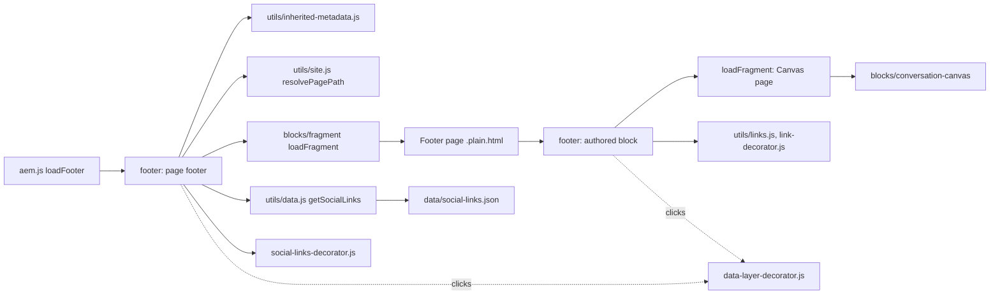
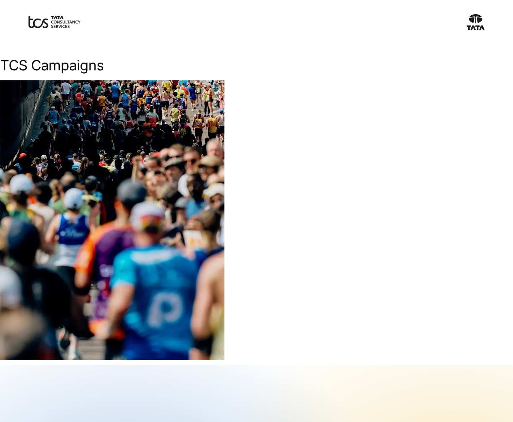
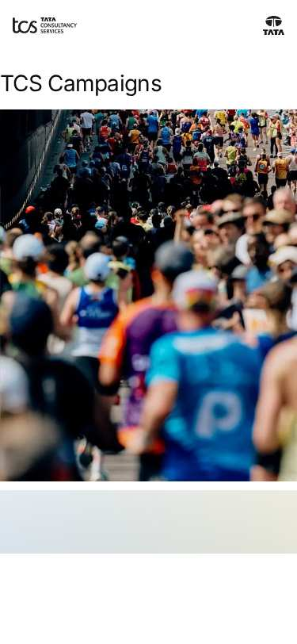

# Footer Block — Developer Guide

| Attribute | Value |
| --- | --- |
| Document ID | DEV-B-footer |
| Audience | Developers, technical leads, block owners, AI coding agents |
| Purpose | How the Footer block is built: files, model, structure, behaviour, variations, tests and limitations |
| Scope | blocks/footer/ and its components footer, footer-link |
| Prerequisites | — |
| Owner | Technical Lead / Block Owner (proposed) |
| Approver | Product Owner (to be confirmed) |
| Version | 1.0 |
| Status | Draft for review |
| Last updated | 8 November 2026 |
| Last validated | 2026-11-08 (model, files, imports from the code; reference pages from the live site) |
| Source files | blocks/footer/README.md, blocks/footer/_footer.json, blocks/footer/footer.css, blocks/footer/footer.js |
| Related documents | [Variations](./FOOTER-VARIATIONS.md), [Test coverage](./FOOTER-TEST-COVERAGE.md), [Authoring guide](../../../03-authoring/components/footer/FOOTER-AUTHORING-GUIDE.md) |
| Related AEM paths | /content/tcs-corp/design-block-master/en/block-library/footer, /content/tcs-corp/design-block-master/en/block-library/footer/campaign-page, /content/tcs-corp/design-block-master/en/block-library/footer/default-footer-page |

## Contents

- [Summary](#summary)
- [Overview](#overview)
- [Source files](#source-files)
- [Components, models and filters](#components-models-and-filters)
- [Fields](#fields)
- [Dependencies](#dependencies)
- [For Developers](#for-developers)
- [Extending the Block](#extending-the-block)
- [Responsive Behavior](#responsive-behavior)
- [Accessibility](#accessibility)
- [Data Layer and Analytics](#data-layer-and-analytics)
- [Performance Considerations](#performance-considerations)
- [Security and Privacy](#security-and-privacy)
- [For Architects](#for-architects)
- [Troubleshooting](#troubleshooting)
- [Known limitations of the block](#known-limitations-of-the-block)
- [Change history of the block](#change-history-of-the-block)
- [Reference pages](#reference-pages)
- [Coverage of the required topics](#coverage-of-the-required-topics)
- [Screenshots](#screenshots)
- [Known limitations](#known-limitations)
- [Open items](#open-items)
- [Change history](#change-history)

## Summary

| Attribute | Value |
| --- | --- |
| Block | Footer |
| Folder | `blocks/footer` |
| Type | Structural |
| Category | navigation |
| Status | Active |
| Purpose | Site footer bar on the footer reference page (copyright, links, Conversation Canvas) |
| Variations (summary) | Footer Link items; Conversation Canvas page |
| Children | footer-link (Footer Link) |
| Code size | 633 lines of JS and CSS |

## Overview

**Business purpose.** Close every page of every locale with the legal copyright, the policy links, the social channels and, in the TCS design, the Conversation Canvas ("Let's shape what's next, together"), maintained per locale (or per area) by authors.

**User experience.** On a white background with soft blue and yellow glows at the bottom: the footer Canvas (title, search row, buttons) when the footer page has one, then the bar with the copyright at the left and the links at the right (stacked on narrow screens), then the social icons (Figma "Footer - Desktop / Tablet / Mobile").

**Templates / page types.** All pages and templates, including the 404 page.

**Data source.**

- The footer page: the page's own **Footer** page property (or the metadata sheet's `footer` column), else the nearest parent page's up to the locale Home (`utils/inherited-metadata.js`), else the locale's `references/footer` (`utils/site.js` `resolvePagePath`).
- The locale's Social Links data sheet (`/{locale}/data/social-links.json`: platform, url, icon, sort-order; `utils/data.js` `getSocialLinks`).
- The Footer block's fields and Footer Link items; the Conversation Canvas page it names.

**Related blocks.** [Header](https://github.com/sradha-tcs/tcs-corp/blob/main/blocks/header/README.md) (same loading and inheritance), [Fragment](https://github.com/sradha-tcs/tcs-corp/blob/main/blocks/fragment/README.md) (`loadFragment`), [Conversation Canvas](https://github.com/sradha-tcs/tcs-corp/blob/main/blocks/conversation-canvas/README.md) (the footer Canvas, the final stop of the floating journey).

**When to use.** The page footer is always loaded. Add the Footer block only to footer pages in `references/` (`references/footer`, `references/footer-campaign`, …).

**When not to use.** On content pages: the block is offered in every section, but its styles are scoped to `<footer>`, so it renders unstyled there. Don't put social channels in the footer links (maintain the Social Links sheet); don't use the footer for page-specific calls to action.

**Realistic use cases.** The locale footer with the Canvas (block library `block-library/footer/footer-default`); a campaign footer without Canvas with "Campaign terms" (`footer-campaign`); an investors footer with "Investor relations" opening in a new tab (`footer-investors`).

## Source files

| File | Link |
| --- | --- |
| `README.md` | [GitHub](https://github.com/sradha-tcs/tcs-corp/blob/main/blocks/footer/README.md) |
| `_footer.json` | [GitHub](https://github.com/sradha-tcs/tcs-corp/blob/main/blocks/footer/_footer.json) |
| `footer.css` | [GitHub](https://github.com/sradha-tcs/tcs-corp/blob/main/blocks/footer/footer.css) |
| `footer.js` | [GitHub](https://github.com/sradha-tcs/tcs-corp/blob/main/blocks/footer/footer.js) |

## Components, models and filters

| Component | Title | Resource type | Template name | Model | Children allowed |
| --- | --- | --- | --- | --- | --- |
| `footer` | Footer | `core/franklin/components/block/v1/block` | Footer | `footer` | footer-link |
| `footer-link` | Footer Link | `core/franklin/components/block/v1/block/item` | Footer Link | `footer-link` | — |

## Fields

The Additional tab fields (anchor, hide, padding, margin, animation) are common to the blocks and described in the [content modeling guide](../../markdown/CONTENT-MODELING-GUIDE.md).

### Footer (`footer`)

| Tab | Label | Property | Type | Required in model | Default | Options | Visibility |
| --- | --- | --- | --- | --- | --- | --- | --- |
| — | Conversation Canvas Page | `conversationCanvas` | aem-content | No | — | — | — |
| — | Copyright Text | `copyright` | richtext | No | — | — | — |
| — | Link List | `links` | container | No | — | — | — |
| — | Link List › Link Title | `linkText` | text | No | — | — | — |
| — | Link List › Link Path | `link` | aem-content | No | — | — | — |
| — | Link List › Link Type | `linkTarget` | select | No | `""` | 2 options | — |

### Footer Link (`footer-link`)

| Tab | Label | Property | Type | Required in model | Default | Options | Visibility |
| --- | --- | --- | --- | --- | --- | --- | --- |
| — | Link Path | `link` | aem-content | Yes | — | — | — |
| — | Link text | `linkText` | text | No | — | — | — |
| — | Open in | `linkTarget` | select | No | `""` | 2 options | — |

"Required in model" is the model's `required` flag; whether a field is required in practice is stated in the authoring guide where it is known.

## Dependencies

| Import |
| --- |
| `../fragment/fragment.js` |
| `../../decorators/motion-decorator.js` |
| `../../scripts/scripts.js` |
| `../../decorators/button-decorator.js` |
| `../../decorators/content-decorator.js` |
| `../../decorators/editor-item-decorator.js` |
| `../../decorators/link-decorator.js` |
| `../../decorators/social-links-decorator.js` |
| `../../utils/cells.js` |
| `../../utils/data.js` |
| `../../utils/inherited-metadata.js` |
| `../../utils/links.js` |
| `../../utils/placeholders.js` |
| `../../utils/site.js` |

## For Developers

<!-- BEGIN GENERATED: files (npm run build:docs) -->

```text
blocks/footer/
├── README.md
├── _footer.json
├── footer.css
└── footer.js
```

| Decorator/Utility | Purpose | Execution or dependency point |
| ----------------- | ------- | ----------------------------- |
| [`blocks/fragment/fragment.js`](https://github.com/sradha-tcs/tcs-corp/blob/main/blocks/fragment/fragment.js) | — | `footer.js`: { loadFragment } |
| [`decorators/motion-decorator.js`](https://github.com/sradha-tcs/tcs-corp/blob/main/decorators/motion-decorator.js) | `prepareMotion` (the Content animation and Background animation of the blocks of a section, before it is shown, or of a fragment, footer page or header Canvas once in the page: first frame paused, run by one Intersection | `footer.js`: { prepareMotion } |
| [`scripts/scripts.js`](https://github.com/sradha-tcs/tcs-corp/blob/main/scripts/scripts.js) | Page decoration (moveInstrumentation and shared page helpers) | `footer.js`: { moveInstrumentation } |
| [`decorators/button-decorator.js`](https://github.com/sradha-tcs/tcs-corp/blob/main/decorators/button-decorator.js) | `decorateButton` (option `newTabHint`: a link opening a new tab says so), `createButton`, `setButtonDisabled`, `setButtonAlignment`, `removeButtonDecoration` | `footer.js`: { removeButtonDecoration } |
| [`decorators/content-decorator.js`](https://github.com/sradha-tcs/tcs-corp/blob/main/decorators/content-decorator.js) | `fromCell` (property content into an element, keeping editor instrumentation) | `footer.js`: { fromCell } |
| [`decorators/editor-item-decorator.js`](https://github.com/sradha-tcs/tcs-corp/blob/main/decorators/editor-item-decorator.js) | `buildEditorItems`, `editorItemHint` (in Universal Editor, an item the block doesn't render yet, e.g. a CTA just added, as a dashed placeholder the author can select; styles in `styles/lazy-styles.css`; the hint loaded o | `footer.js`: { buildEditorItems, editorItemHint } |
| [`decorators/link-decorator.js`](https://github.com/sradha-tcs/tcs-corp/blob/main/decorators/link-decorator.js) | `setLinkTarget` (open in a new window), `announceNewTab` (tells screen reader users a link opens in a new tab: hidden text, or added to its aria-label) | `footer.js`: { announceNewTab, setLinkTarget } |
| [`decorators/social-links-decorator.js`](https://github.com/sradha-tcs/tcs-corp/blob/main/decorators/social-links-decorator.js) | `buildSocialLinks` (Social Links data sheet as an icon list) | `footer.js`: { buildSocialLinks } |
| [`utils/cells.js`](https://github.com/sradha-tcs/tcs-corp/blob/main/utils/cells.js) | `itemRows`, `KEY_VALUE_ITEM`, `FIELD_ROW_ITEM` (the item rows of a block: by model in the editor, by their cells on the page), `withoutTabCells` (drops the empty cell AEM renders for each dialog tab of an item model), `m | `footer.js`: { FIELD_ROW_ITEM, itemRows } |
| [`utils/data.js`](https://github.com/sradha-tcs/tcs-corp/blob/main/utils/data.js) | `loadDataSheet`, `getAuthor`, `getAuthors`, `getLocations`, `getPartners`, `getSocialLinks`, `getMediaContacts`, `inRegion` (the locale's data sheets) | `footer.js`: { getSocialLinks } |
| [`utils/inherited-metadata.js`](https://github.com/sradha-tcs/tcs-corp/blob/main/utils/inherited-metadata.js) | `getInheritedMetadata`, `INHERITED_METADATA` (nav, footer and error-page of the page, else of the nearest parent page up to Home; parent heads loaded in parallel and cached per session) | `footer.js`: { getInheritedMetadata } |
| [`utils/links.js`](https://github.com/sradha-tcs/tcs-corp/blob/main/utils/links.js) | `NEW_WINDOW`, `linkOf`, `linkPathsOf` (the paths of a page property, one or many), `readLinkItems` (CTA lists with Link Type and the items' other select values), `readLinkRows` (the same from link item rows, e.g. Hero CT | `footer.js`: { readLinkItems, readLinkRows } |
| [`utils/placeholders.js`](https://github.com/sradha-tcs/tcs-corp/blob/main/utils/placeholders.js) | `getPlaceholders`, `loadPlaceholders`, `fillPlaceholder` (UI text from the locale's placeholders, with English fallbacks) | `footer.js`: { getPlaceholders } |
| [`utils/site.js`](https://github.com/sradha-tcs/tcs-corp/blob/main/utils/site.js) | `LOCALES`, `DEFAULT_LOCALE`, `getLocale`, `indexRoot`, `REVIEW_ROOTS` and `REVIEW_SHEETS` (the three review roots, KB-D-068: /language-master/en for testing, /language-masters/en the language master, /design-block-master | `footer.js`: { resolvePagePath } |

<!-- END GENERATED: files -->

**Roles.** `decorate(block)`: a block whose parent is `<footer>` is the page footer (`decoratePageFooter`), any other the authored bar (`decorateFooterBar`).

**Input DOM (authored block).** Not key-value: one row per field in model order — Conversation Canvas Page, Copyright Text, Link List (legacy multifield cell) — then one row per Footer Link item with 2 cells (the link with its collapsed text, Open in). `itemRows(block, ['footer-link'], FIELD_ROW_ITEM)` finds the items (by `data-aue-model` in the editor, by their cells on the page; covered by `test/items/item-rows.test.mjs`); the other rows are read by position.

**Decoration flow.**

- `decoratePageFooter`: `resolvePagePath(await getInheritedMetadata('footer'), 'references/footer')`; `loadFragment`, `getSocialLinks`, `getPlaceholders` in parallel; moves the fragment's sections into a `div`; appends `buildSocialLinks(…, 'footer-social', …)` with `aria-label`; `prepareMotion(block)` for the footer page's block animations.
- `decorateFooterBar`: placeholders, `buildCanvas` (link `href` or text → `loadFragment(resolvePagePath(value, ''))`) and `editorItemHint` in parallel; `fromCell` + `fillYear` for the copyright; `buildLinkList` (legacy `readLinkItems`, then `readLinkRows`; `removeButtonDecoration`, `setLinkTarget`, `announceNewTab`, `moveInstrumentation(row, li)`; editor placeholders for items without a link); `block.replaceChildren(canvas, bar)`.

**Rendered DOM contract.**

```text
footer
└─ div.footer.block                         (page footer)
   └─ div
      ├─ div.section …                      (footer page sections)
      │  └─ div.footer-wrapper > div.footer.block   (authored block)
      │     ├─ div.footer-canvas > div.section … div.conversation-canvas.block
      │     └─ div.footer-bar
      │        ├─ div.footer-copyright
      │        └─ nav.footer-links[aria-label] > ul > li > a
      └─ ul.footer-social[aria-label] > li > a > (span.icon | img) + span (label)
```

**Async and loading.** `scripts.js` `loadLazy` hides `<footer>` (`display: none`) while the main sections load and shows it after them, so it never moves; `footer .footer` stays `visibility: hidden` until `data-block-status="loaded"`.

**Error handling.** A footer page that can't load leaves only the social row (no fallback to `references/footer`); a Canvas page that can't load is skipped; a missing Social Links sheet gives no list.

**Exported functions.** Only the default `decorate(block)`.

**Parent / child contracts.** The footer Canvas is detected by the Canvas controller (`inFooter`) as the footer stop of the journey; don't add Canvas logic to `footer.js` (AGENTS.md "Floating Canvas").

## Extending the Block

- **A field or value.** Edit `blocks/footer/_footer.json` (the `footer` or `footer-link` model), run `npm run build:json` and `npm run lint`. The authored block reads rows by position: append new block fields at the end and update `decorateFooterBar`; a new item field changes the item's cells: update `test/items/item-rows.test.mjs` (layout `['link', 'linkTarget']`). Fields ending in Text, Title, Type or Alt collapse into their base field.
- **Rendering / responsive.** Styles are scoped to `footer`; use the component tokens at the top of `footer.css` and the 600 / 1200px media queries.
- **Accessibility.** New links go through `setLinkTarget` / `announceNewTab`; names from placeholders.
- **Data layer.** Captured centrally; add `data-cmp-interaction` for non-link controls.
- **Backward compatibility.** Keep reading the Link List multifield.
- **Docs and modules.** Update this README (`npm run build:docs`) and the block library footer pages; `npm run build:modules` after changing imports (the footer is in `CHROME_BLOCKS`).

## Responsive Behavior

| Viewport | Layout | Image behavior | Interaction behavior |
| -------- | ------ | -------------- | -------------------- |
| Mobile (< 600px) | Padding 3.5rem / 1.25rem / 1.5rem; text 0.75rem; links below the copyright; with Canvas: min height 50rem, title 3.25rem (max 20rem wide), buttons stacked, no Canvas menu button | Social icons 1.5rem; glows: blue at the left, yellow mostly beyond the right edge | Links |
| Tablet (600–1199px) | Padding 7.5rem / 1.25rem / 2.5rem; text 1rem; with Canvas: min height 59.75rem, title 6rem, buttons in a row, Canvas menu button shown | As mobile, glows repositioned | Links, Canvas menu |
| Desktop (>= 1200px) | Padding 7.5rem / 5rem / 2.5rem; content up to `--page-max-width`; with Canvas: min height 50.125rem, title up to 61.5rem wide | As tablet | As tablet |

## Accessibility

- **Semantics.** `<footer>` (contentinfo landmark); the bar's links in `nav.footer-links` named "Footer links"; social links in a list named "Follow us".
- **Headings.** None in the bar; the Canvas brings its own title.
- **Keyboard and focus.** Plain links in DOM order (Canvas, copyright links, footer links, social links); hover and focus underline the bar links.
- **Accessible names.** Social: "Follow us on {platform}" (visually hidden behind an icon; the URL when the platform is empty).
- **New tabs.** Announced with the hidden hint "(opens in a new tab)" (`opensInNewTab`) on Footer Links set to New tab and on external social links.
- **Contrast.** Text in `--footer-text-color` (`--color-text-default`) on `--color-bg-default`.
- **Reflow.** The bar and the links wrap; buttons stack below 600px.

Author responsibilities: unique link texts, a `platform` on every social row, new tabs only for external sites, `{year}` instead of a typed year.

Developer responsibilities: keep the `nav` / list names, `announceNewTab`, `rel="noopener noreferrer"`, UI text from placeholders.

| Key | Expected behavior |
| --- | ----------------- |
| Tab / Shift+Tab | Moves through the Canvas controls, the bar links and the social links |
| Enter | Follows the focused link (a new tab for New tab / external social links) |

## Data Layer and Analytics

- **Components.** Both footer blocks are `.block`s added in the delayed phase (`trackBlocks(document)`): the page footer (e.g. `footer-1`, `parentId` the page) and the authored block (e.g. `footer-2`, `parentId` `footer-1`); ids follow page order. The footer Canvas is its own component.
- **Clicks.** Captured centrally (`decorators/data-layer-decorator.js`): bar links report the authored block, social links the page footer. No `data-cmp-*` attributes or own pushes in the footer.

| Trigger | Data-layer event | Required properties | Analytics behavior |
| ------- | ---------------- | ------------------- | ------------------ |
| Delayed phase | `component` entries `footer-1`, `footer-2` | `@type` `tcs-corp/components/footer`, `parentId` | Component inventory |
| Click on a footer link | `cmp:click` | `eventInfo.path` `component.footer-2`, `interaction` "link", `dc:title` (link text, with the new-tab hint when set), `xdm:linkURL`, `xdm:linkType` `other` / `exit`, `breakpoint` | Policy link click |
| Click on a social link | `cmp:click` | `eventInfo.path` `component.footer-1`, `dc:title` "Follow us on {platform} …", `xdm:linkType` `exit` | Social click |

The intended flow is Adobe Client Data Layer → Adobe Data Collection (Tags) → AEP Web SDK → Edge Network → Analytics / CJA; Tags and the Web SDK aren't configured yet (blocked: measurement plan). No consent mechanism is implemented.

## Performance Considerations

- Lazy phase, alongside the main sections (handover 2.13); hidden until they have loaded, so no layout shift.
- Footer page, Social Links and placeholders in parallel; the Canvas page is a sequential second fragment (after the footer page's Footer block is decorated).
- Modules and stylesheets preloaded on every page (`CHROME_BLOCKS`).
- No listeners or observers in the footer itself; the footer Canvas uses the Canvas controller.

## Security and Privacy

- Fragment paths through `loadFragment` (same-site, root-relative); social URLs come from the site's own sheet and are used as authored; external links get `rel="noopener noreferrer"`.
- `{year}` is replaced in text nodes only (no HTML injection); no query strings; no personal data.

## For Architects

- **Role.** Page chrome (contentinfo), built in the lazy phase from a content page, plus an authored block for its bar.
- **Content model.** Footer page per locale / area, inherited like an AEM page property; Footer Link item children; social channels as data (sheet), not content.
- **Rendering and data source.** Client-side from `{footer}.plain.html`, the Canvas page fragment and `social-links.json`.
- **Dependencies.** `blocks/fragment`, `decorators/motion-decorator.js`, `button-decorator.js`, `content-decorator.js`, `editor-item-decorator.js`, `link-decorator.js`, `social-links-decorator.js`, `utils/cells.js`, `utils/data.js`, `utils/inherited-metadata.js`, `utils/links.js`, `utils/placeholders.js`, `utils/site.js`.
- **Data layer / Web SDK / Target.** Central capture; no Target.
- **Consent and identity.** None.
- **Caching.** Pages and sheets through the CDN / browser cache; inherited values per session.
- **Performance / scalability.** Three parallel requests plus the Canvas fragment; one footer page per locale / area.



## Troubleshooting

| Symptom | Likely cause | Diagnostic steps | Resolution | Verification |
| ------- | ------------ | ---------------- | ---------- | ------------ |
| Footer shows only social icons | Footer page not published or wrong Footer value | Network: `{footer}.plain.html` status; `<meta name="footer">` of the page and parents | Publish / correct the path | Bar visible |
| `{year}` shown or wrong year | Year typed, or `{year}` misspelled; visitor's clock | Inspect the copyright text | Use `{year}` | Current year |
| Social links missing or in the wrong order | Sheet not published, rows without `url`, `sort-order` not numeric | Open `/{locale}/data/social-links.json` | Fix and publish the sheet | Row in order |
| Broken social icon | Icon name without a file in `/icons` (F-16) | Inspect `span.icon-{name}` | Use a supported name or an image URL | Icon visible |
| Canvas missing | Canvas page unpublished or without content | Network for the Canvas page | Publish it | Canvas visible |
| Footer unstyled | Footer block placed on a content page | Inspect the block's position | Remove it from the content page | — |
| Wrong footer in an area | Parent value cached (F-35) or set on the wrong page | New private window; check the parents | Set Footer on the area top page | Area footer |

Evidence to collect: page URL, the `footer` meta values, network status of the footer, Canvas and Social Links requests, console errors, screenshots. No cookies or tokens.

## Known limitations of the block

| Limitation | Impact | Workaround | Planned correction |
| ---------- | ------ | ---------- | ------------------ |
| The bar is rendered even when copyright and links are empty (F-16) | An empty strip on a footer page | Fill in the copyright or links | Not recorded (F-16 open, P3) |
| An icon name without a file in `/icons` gives a broken icon (F-16) | Broken social icon | Use a supported name or an image URL | Not recorded (F-16 open, P3) |
| No fallback to `references/footer` when the configured footer page can't load (the header has one) | Only the social row | Publish the footer page / correct the path | Not recorded |
| Inherited Footer values cached per browser session (F-35) | Changes show in a new session | Private window | Not recorded |
| Offered in every section; styles only inside `<footer>` | Unstyled on content pages | Use it only on footer pages | Not recorded |
| A link title equal to its text is kept (audit, docs/audit/blocks/group-d-forms-media-chrome.md) | Redundant tooltip | — | Not recorded |
| Link List multifield still in the dialog | Two ways to add links | Use Footer Link items | Not recorded (audit: deprecate) |

## Change history of the block

| Version | Change | Source | Date |
| ------- | ------ | ------ | ---- |
| Not recorded | README generated from verified implementation and approved handover documentation | Repository review | Not recorded |
| Handover 2.3 | The footer Canvas is the final stop of the floating journey | docs/handover revision history | 16 October 2026 |
| Handover 2.10 | Footer links as Footer Link items added with Add; the Link List multifield still read (F-87) | docs/handover revision history | 17 October 2026 |
| Handover 2.13 | The footer loads alongside the main sections, hidden until they have loaded (F-90) | docs/handover revision history | 17 October 2026 |
| Handover 2.14 | Language master pages inherit Footer up to its root page (F-91) | docs/handover revision history | 17 October 2026 |
| Handover 2.27 | Block ecosystem audit: new-tab footer and social links announced (D-D-24) | docs/handover revision history; docs/audit/BLOCK-ECOSYSTEM-AUDIT.md | 19 October 2026 |
| Handover 2.29 | Re-audit: Footer Link labels (Link text, Open in) and the social list named (R-D-13) | docs/handover revision history; docs/audit/REAUDIT-2026-10-20.md | 20 October 2026 |
| Handover 2.36 | Footer blocks' modules and stylesheets preloaded (F-106) | docs/handover revision history | 20 October 2026 |

## Reference pages

| Kind | Page | Live URL |
| --- | --- | --- |
| Block library | /design-block-master/en/block-library/footer | https://main--tcs-corp--sradha-tcs.aem.live/design-block-master/en/block-library/footer |
| Block library | /design-block-master/en/block-library/footer/campaign-page | https://main--tcs-corp--sradha-tcs.aem.live/design-block-master/en/block-library/footer/campaign-page |
| Block library | /design-block-master/en/block-library/footer/default-footer-page | https://main--tcs-corp--sradha-tcs.aem.live/design-block-master/en/block-library/footer/default-footer-page |
| Block library | /design-block-master/en/block-library/footer/footer-campaign | https://main--tcs-corp--sradha-tcs.aem.live/design-block-master/en/block-library/footer/footer-campaign |
| Block library | /design-block-master/en/block-library/footer/footer-conversation-canvas | https://main--tcs-corp--sradha-tcs.aem.live/design-block-master/en/block-library/footer/footer-conversation-canvas |
| Block library | /design-block-master/en/block-library/footer/footer-default | https://main--tcs-corp--sradha-tcs.aem.live/design-block-master/en/block-library/footer/footer-default |
| Block library | /design-block-master/en/block-library/footer/footer-investors | https://main--tcs-corp--sradha-tcs.aem.live/design-block-master/en/block-library/footer/footer-investors |
| Block library | /design-block-master/en/block-library/footer/investors-page | https://main--tcs-corp--sradha-tcs.aem.live/design-block-master/en/block-library/footer/investors-page |

## Coverage of the required topics

| Topic | Where |
| --- | --- |
| Purpose | Overview |
| Source files | generated: Files |
| Model, definition, filters, children | generated: Components |
| Dependencies | generated: Dependencies |
| Authored input / rendered output / DOM transformation | For Developers |
| Configuration fields, defaults, required fields | generated: Fields |
| Variations | FOOTER-VARIATIONS.md |
| Responsive behaviour | Responsive Behavior |
| Accessibility and keyboard | Accessibility |
| Analytics / data layer | Data Layer and Analytics |
| Performance | Performance Considerations |
| Security | Security and Privacy |
| Extending | Extending the Block |
| Known limitations | Known Limitations |
| Troubleshooting | Troubleshooting |
| Tests | FOOTER-TEST-COVERAGE.md |
| SEO behaviour | Not recorded |
| Caching considerations | Not recorded (Edge Delivery default caching; no block-specific rule) |
| Ownership | Technical Lead / Block Owner (proposed) |

## Screenshots



*Figure: Footer block library page — desktop 1440 × 900 (/design-block-master/en/block-library/footer/campaign-page, captured 2026-11-08).*



*Figure: Footer block library page — mobile 375 × 812 (/design-block-master/en/block-library/footer/campaign-page, captured 2026-11-08).*

![Desktop rendering — The footer at 1440 px on white with blue and yellow glows at the bottom: the title Let’s shape what’s next, together on two lines, the menu button and the Ask us a question field, the buttons Explore our services, Read our insights and Talk to an expert in a row, then © Tata Consultancy Services 2026 at the left and Privacy & Terms, Cookie policy and Accessibility at the right, then the LinkedIn, X, YouTube and Instagram icons. (Sample content on the preview; callout letters as in the Field Entry Table; file screenshots/footer-desktop-view.jpg)](./screenshots/handover/footer-desktop-view.jpg)

*Figure: Desktop rendering — The footer at 1440 px on white with blue and yellow glows at the bottom: the title Let’s shape what’s next, together on two lines, the menu button and the Ask us a question field, the buttons Explore our services, Read our insights and Talk to an expert in a row, then © Tata Consultancy Services 2026 at the left and Privacy & Terms, Cookie policy and Accessibility at the right, then the LinkedIn, X, YouTube and Instagram icons. (Sample content on the preview; callout letters as in the Field Entry Table; file screenshots/footer-desktop-view.jpg) (handover screenshot; rendering at the time it was taken).*


*Figure: Tablet rendering — The footer at 1024 px: the canvas title Let’s shape what’s next, together without a maximum width, the menu button and the Ask us a question field, the three canvas buttons in a row, then the bar with © Tata Consultancy Services 2026 and the three links, and the four social icons. (Sample content on the preview; callout letters as in the Field Entry Table; file screenshots/footer-tablet-view.jpg) (handover screenshot; rendering at the time it was taken).*


*Figure: Mobile rendering — The footer at 390 px: the title Let’s shape what’s next, together at 3.25rem over several centred lines, the Ask us a question field without a menu button, the three buttons stacked, then © Tata Consultancy Services 2026 above Privacy & Terms, Cookie policy and Accessibility, and the four social icons. (Sample content on the preview; callout letters as in the Field Entry Table; file screenshots/footer-mobile-view.jpg) (handover screenshot; rendering at the time it was taken).*


*Figure: Default footer of /en — A full /en content page at 1440 px ending with the footer from /en/references/footer: the canvas with its title, search field and three buttons, the bar with © Tata Consultancy Services 2026, Privacy & Terms, Cookie policy and Accessibility, and the LinkedIn, X, YouTube and Instagram icons. (Sample content on the preview; callout letters as in the Field Entry Table; file screenshots/footer-default-locale-footer.jpg) (handover screenshot; rendering at the time it was taken).*


*Figure: Area-specific footer — A full campaign page at 1440 px ending with the footer from references/footer-campaign, without a canvas: © Tata Consultancy Services 2026 at the left, Privacy & Terms, Campaign terms and Contact us at the right, and below them the LinkedIn, X, YouTube and Instagram icons. (Sample content on the preview; callout letters as in the Field Entry Table; file screenshots/footer-alternate-footer.jpg) (handover screenshot; rendering at the time it was taken).*


*Figure: Bar without canvas — Two frames scrolled to the footer, one above the other. Top, 1440 px: one row with © Tata Consultancy Services 2026 at the left and Privacy & Terms, Campaign terms and Contact us at the right, then the social icons. Bottom, 390 px: the copyright above the three links in smaller text, then the icons. (Sample content on the preview; callout letters as in the Field Entry Table; file screenshots/footer-bar-only.jpg) (handover screenshot; rendering at the time it was taken).*


*Figure: Canvas in the footer — The footer at 1440 px with the canvas from references/footer-conversation-canvas: the title Let’s shape what’s next, together, the menu button and the Ask us a question field with its Search button, the three secondary buttons with dark 2px borders on white, then the bar and the four social icons. (Sample content on the preview; callout letters as in the Field Entry Table; file screenshots/footer-with-conversation-canvas.jpg) (handover screenshot; rendering at the time it was taken).*


*Figure: Social icon row — The end of a page at 1440 px with the footer-campaign bar (© Tata Consultancy Services 2026, Privacy & Terms, Campaign terms, Contact us) and below it a row of 1.5rem icons in sort-order: LinkedIn, X, YouTube, Instagram and Facebook. (Sample content on the preview; callout letters as in the Field Entry Table; file screenshots/footer-social-links-icons.jpg) (handover screenshot; rendering at the time it was taken).*


*Figure: Image and text fallbacks — The end of a page at 1440 px with the footer-campaign bar and below it the social row: the LinkedIn icon, the square-2.svg image for Glassdoor at 1.5rem and the visible text link Follow us on Xing. (Sample content on the preview; callout letters as in the Field Entry Table; file screenshots/footer-social-links-text-image.jpg) (handover screenshot; rendering at the time it was taken).*


*Figure: New-window link — The investors page footer at 1440 px: © Tata Consultancy Services 2026, Privacy & Terms, Cookie policy and Investor relations, then the four social icons; marker A on Investor relations, whose anchor has target="_blank" and rel="noopener noreferrer". (Sample content on the preview; callout letters as in the Field Entry Table; file screenshots/footer-link-new-window.jpg) (handover screenshot; rendering at the time it was taken).*


*Figure: Universal Editor canvas of the footer page — references/footer in editor mode at 1440 px: A the Footer block, B the canvas with Let’s shape what’s next, together, C the copyright © Tata Consultancy Services 2026, D the first link Privacy & Terms, and E the LinkedIn, X, YouTube and Instagram row in the page footer below. (Annotated preview in editor mode with sample content; letters as in the annotations list, not a Universal Editor screenshot; file screenshots/footer-authoring-view.jpg) (handover screenshot; rendering at the time it was taken).*


*Figure: Footer block properties — The properties panel of the Footer block with Conversation Canvas Page, Copyright Text and the Link List with two items expanded. (Dialog reference generated from the component model, not a Universal Editor screenshot; file screenshots/footer-properties-panel.jpg) (handover screenshot; rendering at the time it was taken).*

## Known limitations

- Universal Editor dialogs were not captured: no author access in this program (see the access blockers).

## Open items

- None.

## Change history

| Version | Date | Author | Change |
| --- | --- | --- | --- |
| 1.0 | 8 November 2026 | Delivery team (documentation program) | First version of the role-specific documentation (master documentation prompt), generated from the repository and the published reference pages |
